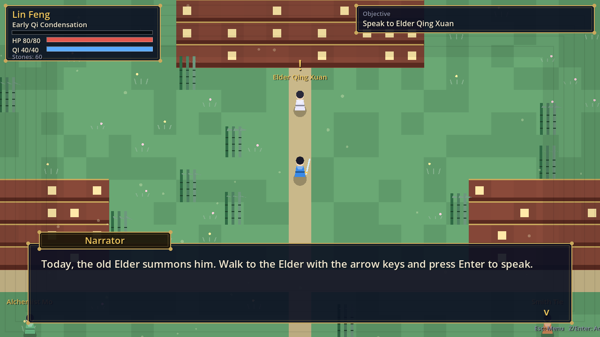
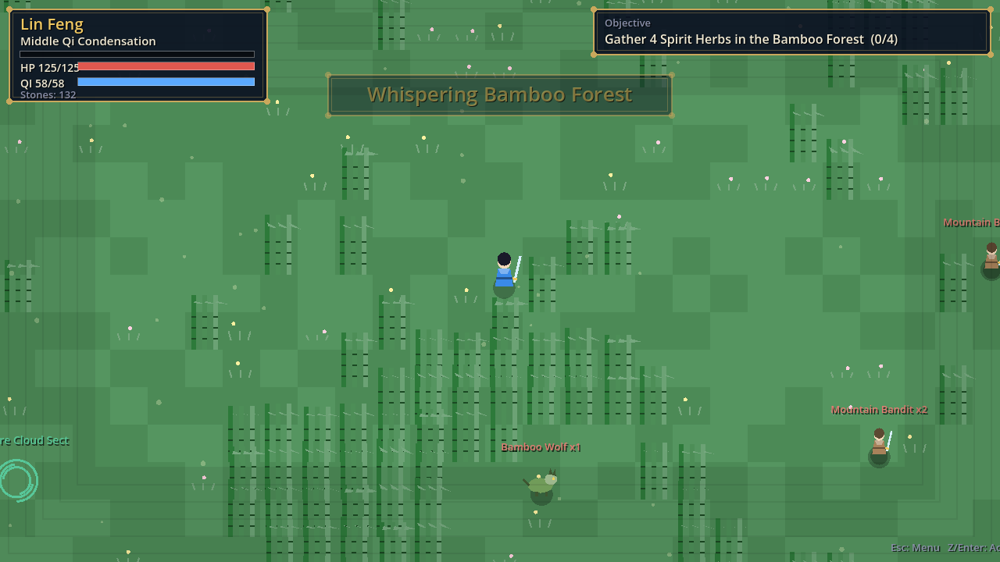
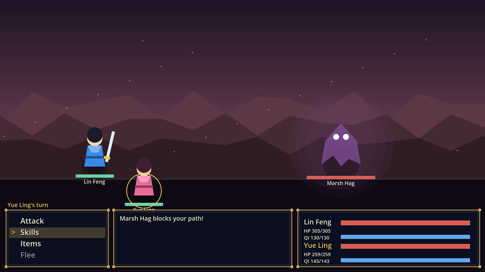
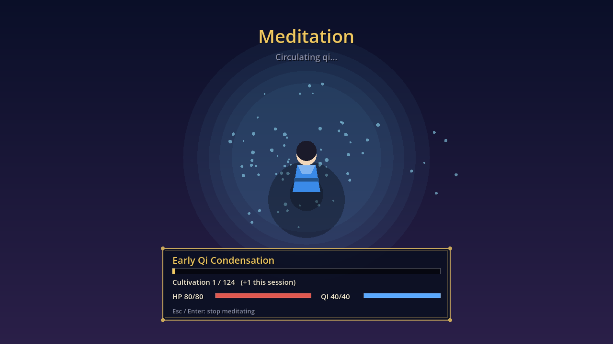
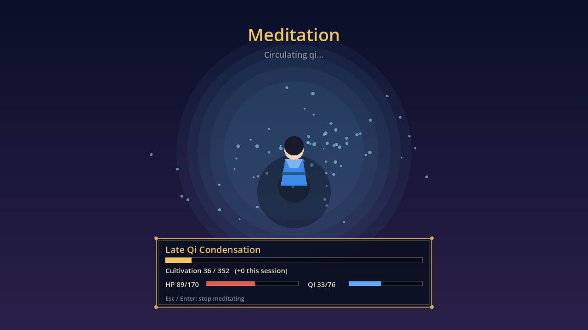
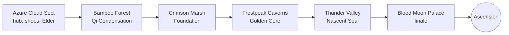
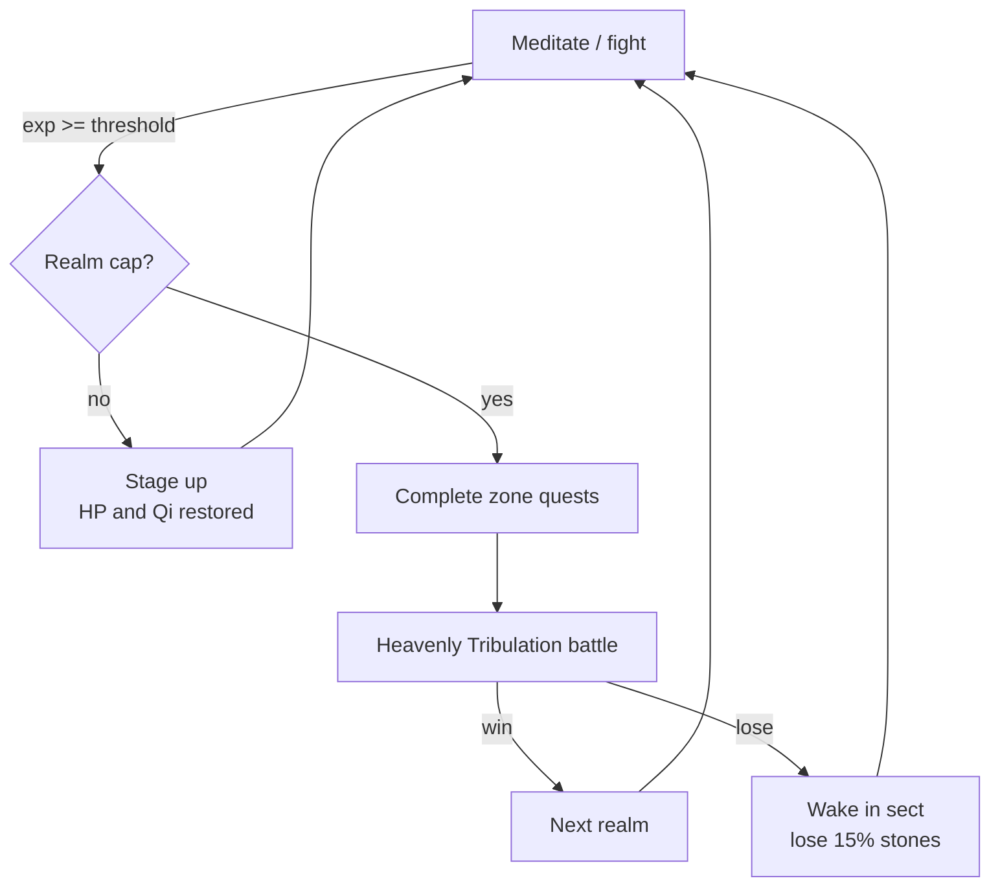

# Ascension of the Azure Cloud

A xianxia cultivation RPG built in **Godot 4** with no external art: every tile, character and monster is drawn procedurally in code.
Play Lin Feng, an orphaned sect sweeper with a hidden "Nine Heavens root", from Qi Condensation all the way to Deity Transformation, through six regions, 14 bosses and four Heavenly Tribulations.

> **Total gameplay duration: about 1 hour 6 minutes** (1:06:36 of game time for the end-to-end bot run; a human should expect roughly 1 to 1.5 hours depending on reading and menu speed).

| | |
|---|---|
|  |  |
|  |  |
|  |  |

More captures (frost, thunder, palace, tribulation, ending) are in [`docs/screenshots`](docs/screenshots).

## Run it (terminal)

Requires [Godot 4.3+](https://godotengine.org/download) (developed on 4.7.2) available as `godot` on your PATH.

```sh
git clone https://github.com/jgyy/timegox.git && cd timegox
godot --path . --import      # first time only: imports the project
godot --path .               # play it manually in a window
```

Other terminal commands:

```sh
godot --headless --path . --script tests/run_tests.gd           # data-integrity tests
godot --headless --path . --script tests/manual_input_test.gd   # real keyboard-event smoke test
godot --headless --fixed-fps 30 --path . -- --bot               # bot plays the whole game, prints play time
godot --fixed-fps 30 --path . -- --bot --timescale=1            # (drop --fixed-fps for real time) watch the bot
```

The game is fully playable by hand with the keyboard:

| Key | Action |
|---|---|
| Arrows / WASD | move, navigate menus |
| Enter / Z / Space | confirm, interact, advance dialogue |
| Esc / X | menu (Meditate, Breakthrough, Items), cancel |

Walk into NPCs, enemies, pickups and bosses to interact with them. There is no save system yet: a run takes about an hour.

## Gameplay

- **Cultivation**: gain cultivation by meditating (Esc → Meditate) and winning battles. 13 stages across five realms; at the end of each realm you must pass a **Heavenly Tribulation** boss fight to break through.
- **Turn-based combat** with qi-costed techniques, elemental weaknesses (fire / water / wood / earth / thunder), pills, a healer companion (Yue Ling) and boss heavy attacks.
- **Six regions**, each with a travel gate, elite, boss and hunt objective: the Sect, Whispering Bamboo Forest, Crimson Marsh, Frostpeak Caverns, Thunder Valley and the Blood Moon Palace.
- **Economy**: spirit stones buy pills and tempering for your sword.





## Architecture

```mermaid
flowchart TD
    subgraph Autoload
        Game[Game<br/>state, quests, play clock]
    end
    Main[Main<br/>screen stack, input routing, story]
    Main --> World[World<br/>tiles, movement, entities]
    Main --> Battle[Battle<br/>turn engine]
    Main --> Overlays[Dialogue, Menu, Shop,<br/>Meditate, Title, Ending]
    World --> MapGen[MapGen<br/>seeded, connectivity-guaranteed]
    World --> UI[UI<br/>procedural art]
    Battle --> UI
    Data[(Data<br/>skills, enemies, areas,<br/>quest chain, dialogue)] --> Main
    Data --> MapGen
    Data --> Battle
    Bot[Bot<br/>same press&#40;&#41; API as a player] --> Main
    Main --> Game
```



## The playthrough bot

`scripts/bot.gd` plays the entire game end to end through the **same input surface a human uses** (`up/down/confirm/cancel` presses on the top screen and a held movement direction). It pathfinds with BFS, grinds and meditates when under-levelled, rests when hurt, shops, picks skills by elemental weakness, heals with pills or Spring Rain, and handles tribulations.

To make its clock a fair estimate of a person's playtime it uses human-scale pacing: 0.2 to 0.4 s per key press, and each dialogue line is "read" for about `length / 40` seconds after it finishes typing.

```sh
godot --headless --fixed-fps 30 --path . -- --bot --seed=1234 --report=build/bot_report.json
```

**Is the game sped up?** No. `--fixed-fps 30` makes each frame advance the game clock by exactly 1/30 s regardless of how fast the machine renders it. All movement, typing, battle animation and meditation run off that same frame time, so a full hour of *game time* is simulated in under a minute of *wall-clock* time. `Game.playtime` is the game clock, and it is the number reported. Drop `--fixed-fps` (and optionally pass `--timescale=N`) to watch the bot in real time.

Latest result (seed 1234, identical across runs; seeds 7 and 99 give 1:06:45 and 1:06:34):

```
game play time  : 1:06:36 (3996 s)
wall clock      : ~55 s
final realm     : Early Deity Transformation
battles / kills : 93 / 163   deaths: 0
time by screen  : battle 2241 s, world 727 s, meditate 686 s, dialogue 320 s
result          : PASS (needs >= 3600 s)
```

Bot flags: `--bot`, `--seed=N`, `--report=PATH`, `--min-time=SECONDS` (default 3600), `--max-time=SECONDS`, `--timescale=N`, `--shots=DIR` (needs a window, saves screenshots at key moments).

## CI

[`.github/workflows/ci.yml`](.github/workflows/ci.yml) downloads Godot, imports the project, runs the data-integrity tests (`tests/run_tests.gd`: quest/dialogue/NPC/boss references, portal symmetry, map reachability and determinism), then runs the bot headless and **fails the build if the game is not completed or takes less than one hour of game time**. The bot report is uploaded as an artifact and shown in the job summary.


## Project layout

```
scripts/data.gd      content: skills, enemies, areas, quest chain, dialogue
scripts/game.gd      autoload: state, progression, quest engine, play clock
scripts/main.gd      screen stack, input, story flow
scripts/world.gd     tile world rendering and movement
scripts/mapgen.gd    seeded map generator with reachability guarantee
scripts/battle.gd    turn-based combat
scripts/bot.gd       end-to-end playthrough bot
tests/run_tests.gd   data-integrity tests
```
