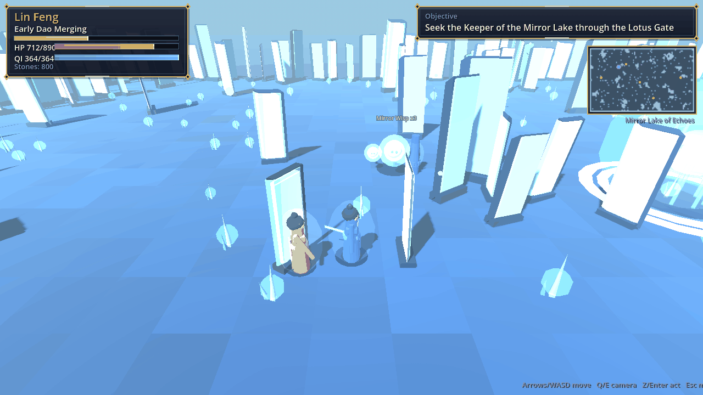
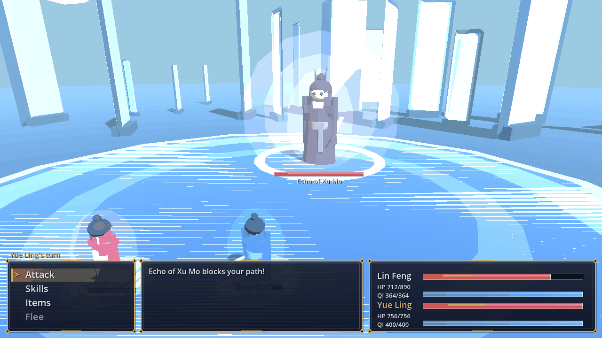
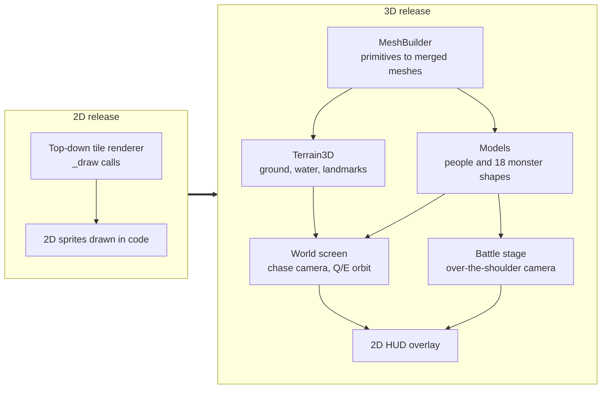
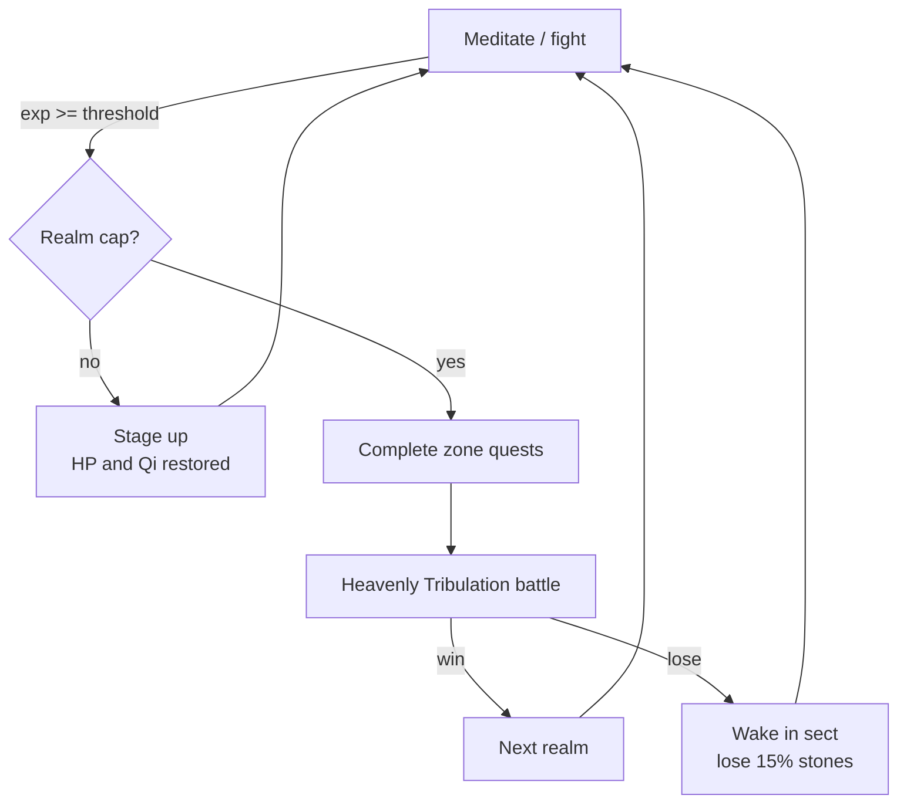
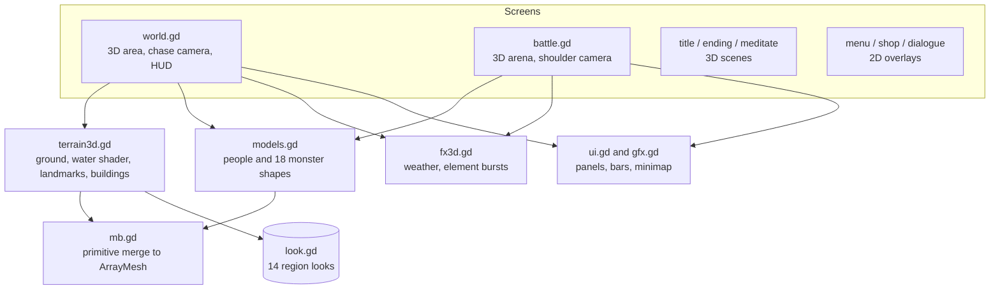

# Ascension of the Azure Cloud

A xianxia cultivation RPG built in **Godot 4**, played in **full 3D from a third-person view**, with no imported art: every tree, building, character, monster and spell effect is generated in code from primitive meshes.
Play Lin Feng, an orphaned sect sweeper with a hidden "Nine Heavens root", from Qi Condensation to True Immortal, through fourteen regions, 45 bosses and eight Heavenly Tribulations.

> **Total gameplay duration: about 3 hours 10 minutes** (3:11:18 of game time for the end-to-end bot run; seeds 7 and 99 give 3:09:27 and 3:10:41). Parts I and II take about 2 hours 10 minutes; **Part III, "The Hollow Heaven", adds another hour**: four new regions, 16 new bosses, 12 new monsters, two new realms (Mahayana, True Immortal), new techniques and a rewritten ending.

| | |
|---|---|
|  |  |
|  |  |
|  |  |

More captures (every region and every boss) are in [`docs/screenshots`](docs/screenshots).

## What changed in this release



- **3D third-person**: the hero is followed by a chase camera (`Q`/`E` rotate it in 90 degree steps; movement is camera-relative). Battles take place on a 3D arena with an over-the-shoulder camera, lunging attackers, element-coloured particle bursts and hit flashes. The title, meditation and ending screens are 3D scenes too. Only the HUD, menus and dialogue box remain 2D overlays.
- **Part III** adds +1 hour (see below).
- **Narrative plot holes fixed** (see below).
- Headless runs skip all rendering work, so CI simulates three hours of play in minutes.

## Run it (terminal)

Requires [Godot 4.3+](https://godotengine.org/download) (developed on 4.7.2) available as `godot` on your PATH and a GPU/driver that supports OpenGL 3 (the project uses the Compatibility renderer).

```sh
git clone https://github.com/jgyy/timegox.git && cd timegox
godot --path . --import      # first time only: imports the project
godot --path .               # play it manually in a window
```

Other terminal commands:

```sh
godot --headless --path . --script tests/run_tests.gd           # data-integrity and 3D-asset tests
godot --headless --path . --script tests/manual_input_test.gd   # real keyboard-event smoke test
godot --headless --fixed-fps 30 --path . -- --bot --min-time=10800   # bot plays the whole game, prints play time
godot --fixed-fps 30 --path . -- --bot --timescale=1            # (drop --fixed-fps for real time) watch the bot
```

| Key | Action |
|---|---|
| Arrows / WASD | move (relative to the camera), navigate menus |
| Q / E | rotate the camera |
| Enter / Z / Space | confirm, interact, advance dialogue |
| Esc / X | menu (Meditate, Breakthrough, Items), cancel |

Walk into NPCs, enemies, pickups and bosses to interact with them. There is no save system yet: a full run takes about three hours.

## Gameplay

- **Cultivation**: gain cultivation by meditating (Esc, Meditate) and winning battles. 25 stages across nine realms (up to True Immortal); at the end of each realm you must pass a **Heavenly Tribulation** boss fight to break through.
- **Turn-based combat** with qi-costed techniques, elemental weaknesses (fire / water / wood / earth / thunder / dark), pills, a healer companion (Yue Ling) and boss heavy attacks.
- **Fourteen regions**, each with a travel gate, elites, bosses and a hunt objective. **Part I**: the Sect, Whispering Bamboo Forest, Crimson Marsh, Frostpeak Caverns, Thunder Valley and the Blood Moon Palace. **Part II**: the Sunken Dragon Palace, Ashen Volcano, Void Rift Expanse and the Celestial Gate. **Part III (new)**: the Mirror Lake of Echoes, the Graveyard of Sword Saints, the River of Ten Thousand Years and the Origin of the Dao.
- **Techniques** for the late game: Abyssal Tide, Meteor Rain, Void Rending Slash, Celestial Judgement, **Chrono Severance** and **Genesis Sword**, plus Yue Ling's Starlight Rain and **Dawn Lotus**.
- **Economy**: spirit stones buy pills and tempering for your sword.

```mermaid
flowchart LR
    subgraph P1[Part I: about 1h06m]
    Sect[Azure Cloud Sect<br/>hub, shops, Elder] --> Bamboo[Bamboo Forest]
    Bamboo --> Marsh[Crimson Marsh]
    Marsh --> Frost[Frostpeak Caverns]
    Frost --> Thunder[Thunder Valley]
    Thunder --> Palace[Blood Moon Palace<br/>Demon Lord Xu Mo]
    end
    subgraph P2[Part II: about 1h04m]
    Palace ==>|Deity Tribulation| Dragon[Sunken Dragon Palace]
    Dragon --> Volcano[Ashen Volcano]
    Volcano -->|Void Tribulation| Void[Void Rift Expanse]
    Void --> Gate[Celestial Gate<br/>Jade Emperor of Ruin]
    end
    subgraph P3[Part III: about 1h01m]
    Gate ==>|Dao Merging, Lotus Seal recalls you| Sect2[Sect: the Elder's confession]
    Sect2 --> Mirror[Mirror Lake of Echoes<br/>Echo of Xu Mo]
    Mirror --> Grave[Graveyard of Sword Saints<br/>Founder Qing Lian]
    Grave -->|Mahayana Tribulation| Time[River of Ten Thousand Years<br/>Tian Xuan]
    Time --> Origin[Origin of the Dao<br/>The Hollow Heaven]
    end
    Origin ==> End((True Immortal))
```





## Part III: The Hollow Heaven

After the Jade Emperor falls and Lin Feng merges with the Dao, the Heavenly Lotus Seal recalls him to the sect, where Elder Qing Xuan finally explains what the Seal is, who the Emperor was and why the sky is still cracking. Four new regions, 16 bosses, 12 monsters and five dialogue-heavy quest chains (about +1 hour) follow:

| Region | Levels | Story beat | Final boss |
|---|---|---|---|
| Mirror Lake of Echoes | 18-19 | The lake remembers the nineteen bearers before Lin Feng | Echo of Xu Mo |
| Graveyard of Sword Saints | 19-20 | The Seal's key and the founder of the sect | Founder Qing Lian |
| *Mahayana tribulation* | | | |
| River of Ten Thousand Years | 21-22 | The Emperor's origin as the first sweeper | Tian Xuan, the First Sweeper |
| Origin of the Dao | 22-23 | Yue Ling's secret and the Hollow Heaven | The Hollow Heaven |
| *True Immortal tribulation and ending* | | | |

## Narrative plot holes found and fixed

| Plot hole | Fix |
|---|---|
| The Elder asks for **three** Frost Jades but the quest needs four | Elder now says four |
| The **Heaven-Cleaving Sword** was usable from Early Nascent Soul, before Ancestor Jian Wuchen teaches it | Technique is gated on beating the Thunder Roc (`after` field) and covered by a test |
| The Elder demands the **Roc's feather** that the player is never given | The Roc now drops a feather item, mentioned in dialogue |
| The Dragon King gives a **pearl "as proof"** that never exists, and greets Lin Feng as if they had met ("how you have grown") | He gives a Dragon King's Scale which Sage Huo Rong recognises; the greeting no longer implies a past meeting |
| Sage **Chi Rong** and the villain **Chi Yan** shared a surname with no relation | Sage renamed Huo Rong |
| Xu Mo "hunted you for **three centuries**" although Lin Feng is a teenager | Reframed as hunting the *root's* bearers, and resolved by Part III (Lin Feng is the twentieth bearer) |
| Marsh Hag called Lin Feng the **seal's bearer**; everyone else says root bearer | Unified to "bearer of the Nine Heavens root" |
| Iron Fang jeers at a **"sweeper boy"** he could not know about | Now a "sect boy" |
| The **Jade Mantis** hunt had no in-story motivation | The Elder's briefing mentions the mantis claiming the herb groves |
| Alchemist says "take these pills" but gives none | Now "take this payment" |
| Yue Ling's origin (a random healer who happens to be bound nearby) had no foreshadowing | She wakes beside a lotus pond three winters ago; paid off in Part III |
| Sage Huo Rong lists three fire bosses but there are four; the hermit says "three who shepherd" the horrors but there are four; the Gatekeeper lists the wrong guardians | Counts and lists corrected |
| Quest items (pearls, embers, star fragments) were collected and never used | Each is now referenced in the following dialogue |
| The **sect storyline was abandoned**: the failing Seal, the Elder and Xu Mo's army were never resolved and the game ended in a distant gate | Part III returns Lin Feng to the sect and resolves the Seal, the Elder, Yue Ling and the Emperor |

## Architecture

Game logic (`game.gd`, `data.gd`, `mapgen.gd`, the battle rules and the bot) is unchanged by the 3D port; only the presentation layer is new. Screens derive from `ScreenBase` (`screen.gd`): each owns an optional `Node3D` scene plus a 2D overlay drawn with the UI helpers.



Highlights of the renderer: merged vertex-coloured meshes (a few draw calls per chunk), MultiMesh instancing for landmarks and decorations, an animated water/lava shader, per-region sky, fog, sun and weather particles (snow, rain, petals, embers, bubbles, void stars, sand, drifting light), articulated characters with a walk cycle, 18 monster shapes with boss auras, and a distinct hit effect for each element.

Regenerate screenshots (needs a GL context; use `xvfb-run` on a server):

```sh
godot --path . --fixed-fps 30 -- --tour=docs/screenshots              # everything
godot --path . --fixed-fps 30 -- --tour=out --areas=mirror,grave --no-extras   # some regions
```

## The playthrough bot

`scripts/bot.gd` plays the entire game end to end through the **same input surface a human uses** (`up/down/confirm/cancel` presses on the top screen and a held movement direction). It pathfinds with BFS, grinds and meditates when under-levelled, rests when hurt, shops, picks skills by elemental weakness, heals with pills or Spring Rain, and handles tribulations.

To make its clock a fair estimate of a person's playtime it uses human-scale pacing: 0.2 to 0.4 s per key press, and each dialogue line is "read" for about `length / 40` seconds after it finishes typing.

```sh
godot --headless --fixed-fps 30 --path . -- --bot --seed=1234 --report=build/bot_report.json
```

**Is the game sped up?** No. `--fixed-fps 30` makes each frame advance the game clock by exactly 1/30 s regardless of how fast the machine renders it. All movement, typing, battle animation and meditation run off that same frame time, so a full hour of *game time* is simulated in under a minute of *wall-clock* time. `Game.playtime` is the game clock, and it is the number reported. Drop `--fixed-fps` (and optionally pass `--timescale=N`) to watch the bot in real time.

Latest result (seed 1234, identical across runs; seeds 7 and 99 give 3:09:27 and 3:10:41). Parts I and II alone took 2:10:20, so Part III adds about **1 hour 1 minute**:

```
game play time  : 3:11:18 (11479 s)
wall clock      : ~5 min (headless)
final realm     : Early True Immortal
battles / kills : 348 / 659   deaths: 0
time by screen  : battle 5915 s, world 1840 s, meditate 2561 s, dialogue 1116 s
time by area    : bamboo 867, marsh 655, frost 959, thunder 607, palace 561, sect 534,
                  dragon 621, volcano 1031, void 704, celestial 1444,
                  mirror 569, grave 998, time 708, origin 1250
result          : PASS (needs >= 10800 s)
```

Bot flags: `--bot`, `--seed=N`, `--report=PATH`, `--min-time=SECONDS` (default 3600; CI uses 10800), `--max-time=SECONDS`, `--timescale=N`, `--shots=DIR` (needs a window, saves screenshots at key moments), and `--tour=DIR` (screenshot tour, see Architecture).

## CI

[`.github/workflows/ci.yml`](.github/workflows/ci.yml) downloads Godot, imports the project, runs the data-integrity tests (`tests/run_tests.gd`: quest/dialogue/NPC/boss references, portal symmetry, map reachability and determinism, every 3D model and terrain builds, story consistency), then runs the bot headless and **fails the build if the game is not completed or takes less than three hours of game time**. The bot report is uploaded as an artifact and shown in the job summary.


## Project layout

```
scripts/data.gd      content: skills, enemies, areas, quest chain, dialogue
scripts/mb.gd        mesh builder (primitives to merged ArrayMesh)
scripts/models.gd    3D people, monsters, props
scripts/terrain3d.gd 3D terrain, landmarks, buildings
scripts/look.gd      per-region look (sky, fog, light, weather)
scripts/fx3d.gd      weather and combat particle effects
scripts/screen.gd    ScreenBase: 3D scene + 2D overlay
scripts/gfx.gd       2D UI ornaments, panels, minimap
scripts/tour.gd      screenshot tour (developer tool)
scripts/game.gd      autoload: state, progression, quest engine, play clock
scripts/main.gd      screen stack, input, story flow
scripts/world.gd     3D third-person world, movement, HUD
scripts/mapgen.gd    seeded map generator with reachability guarantee
scripts/battle.gd    turn-based combat on a 3D stage
scripts/bot.gd       end-to-end playthrough bot
tests/run_tests.gd   data-integrity tests
```
