# Ascension of the Azure Cloud

A xianxia cultivation RPG built in **Godot 4**, played in **full 3D from a third-person view, or out of his own eyes**, and **all art is generated from scripts**: every tree, building, character, monster and spell effect comes from code in this repository (GDScript, shaders and **Blender Python**), never from hand-made or downloaded files (see [Art pipeline](#art-pipeline)).
Play Lin Feng, **a young man or a young woman** (or whoever you make them: name, look, colours, trade and the hearth that fed them for a year), an orphaned sect sweeper with a hidden "Nine Heavens root", from Qi Condensation to Changes Its Cry, across **one open world in seven realms**: a continent of 42 regions round Azure Cloud Mountain, ringed by the sea, with the **Nine Heavens** floating above it, the **Nine Springs** under it, joined by the Jianmu, the world tree, the **Isles of the Eastern Sea** out past the edge of its shelf, reached in Mazu's boat, the **Far Countries** that no boat, cart or foot can reach, only **the spirit arks of the cultivators**, which lie moored in the air over six towns, and now **the Rivers and Lakes**, the country of the sects, down the Yellow River by the river-boat of Longmen: four towns that a sect answers for, **two upright and two crooked**, with **carts, coaches and couriers on every road** and **packs that come down to raid them**, and now **the floor of the Eastern Sea**, down with the water at the Returning Ruins: three towns under the sea where **things are made in the open by the people who make them**, twenty-four places nobody has stood in since they sank, and **ground that rises and falls under his hand** once he has been taught how it is asked. It has **mountains in every region, 179 peaks that are climbed hand over hand and come down from under a cloud-kite**, 268 bosses, thirty-three Heavenly Tribulations, a sky that keeps the hours from dawn to the dead of night, twenty towns (Qingshi in two quarters) lived in by **608 townsfolk with days of their own, twenty-four of them twice a man's height**, 56 camps out in the wild where **392 people of the road** keep theirs, things in the streets that really break, and 163 buildings you can walk into, every one with a cellar and all but a few with an upper storey, **39 of those storeys divided into 89 apartments with somebody at home in each**. Wake the **nine branches** of the Nine Heavens root, open the Founder's **sealed caves** as your realm allows, be measured by the testing stone for **a spirit root of one phase to five**, choose your road among **six Daos, each with a rite of its own**, earn the trust of **nine peoples** of the realms, change into **twenty-six outfits** (and dress Yue Ling in ten of her own), ride **six mounts and vehicles**, decide the fates of **five people** met on the road, become a guest at the **six hearths** of the land, each with its own table, fire and manners, choose where the story **begins** (six places) and how it **ends** (sixteen ways, bright, bitter and dark), answer at **forty crossroads** that the whole story remembers, raise **a host** from the six hearths and fight **field battles by drums**, hear **thirty-four tunes** made wholly from code, take down the **eighteen commissions** of a notice board, do **96 feats**, stake spirit stones at **Old Du's mat**, carry the **Eight Arms**, each struck with in its own way and each a Dao of its own, go down into a **cave under every region**, build the **eighteen works** of three schools of making (the oldest tools, machinery, and the arts of the Dao), and walk the whole way with **Yue Ling**, who has a story of her own. The monsters of the wild **keep hours**: what sleeps at noon hunts at dusk. Every face and figure in the world is sculpted from life, **with a body under the clothes** (a figure about seven and a half heads tall, every muscle where the anatomy books put it), the monsters after what the creature really is or what the old books say it was, and **every face shows what it feels**, and **the sword reaches the land**: trees fall where it cuts, rocks shatter, grass is mown and a pack struck first is thrown off its feet. **Everything he owns is on his back, in jin**: a load is drawn on him and on Yue Ling and slows him past what he can bear, the land can be worked with an axe, a rod, a pick and a sickle, and the ring that holds everything is the last thing in the story he is given.

> **Total gameplay duration: about 53 hours** (53:06:49 for this release's end-to-end bot run, seed 1234, which CI makes again on every push; the last release's story ends at 52:04:26 of it, and the new chapter is the remaining **1 hour 2 minutes 23 seconds**): **Part XLIV, The Owl Moves East**, is new. A farmer of Yunmeng writes to the Elder that a disciple of Azure Cloud stole his axe, and describes Lin Feng's walk exactly. Lin Feng goes down the river to find out what it is that people see: a neighbour's son a whole village saw a thief in, a man whose own dog barked at him for a borrowed coat, and a dove-keeper at the eastern end of everything who has told every owl the same thing. **What the land thinks of him is the difficulty now** (greed and cruelty to its people make every battle harder, and the counters dearer), **three new kinds of monster were sculpted for it** (a three-legged money toad, a red-headed centipede and an eagle-owl, each with an art of its own in battle), and eleven toads and frogs, a centipede and two owls that were drawn as jellies, a snake and hawks are drawn as what they are.

| | |
|---|---|
| 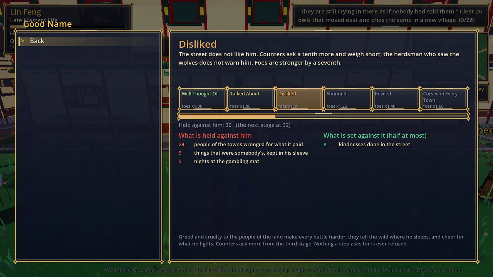 | 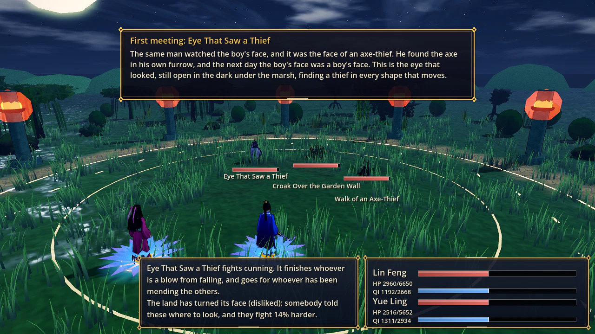 |
| 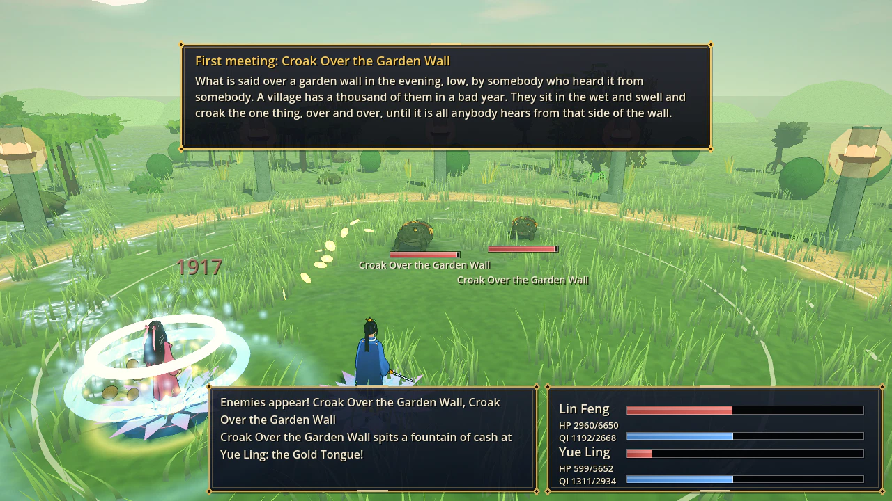 | 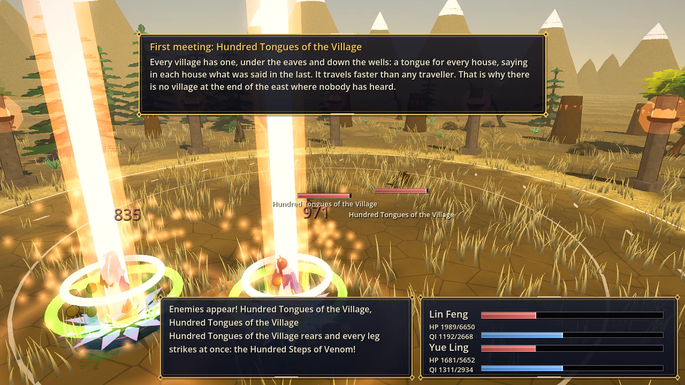 |
| 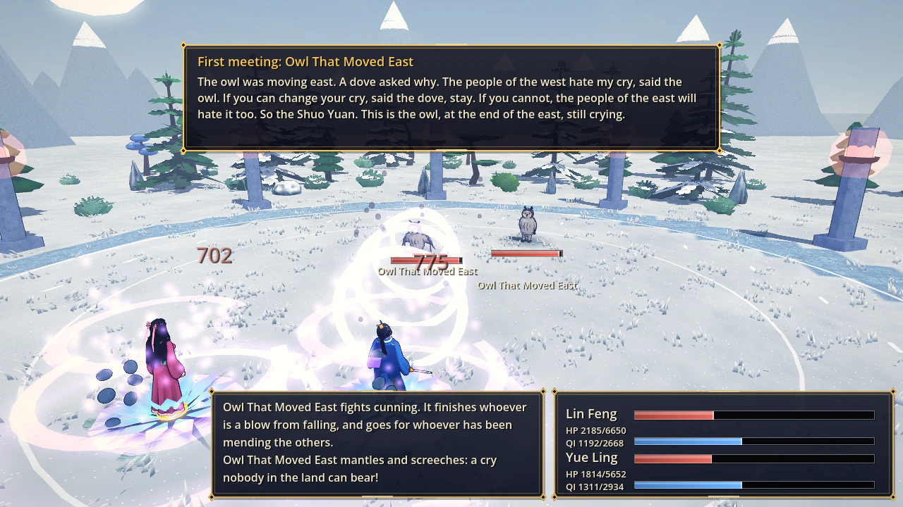 | 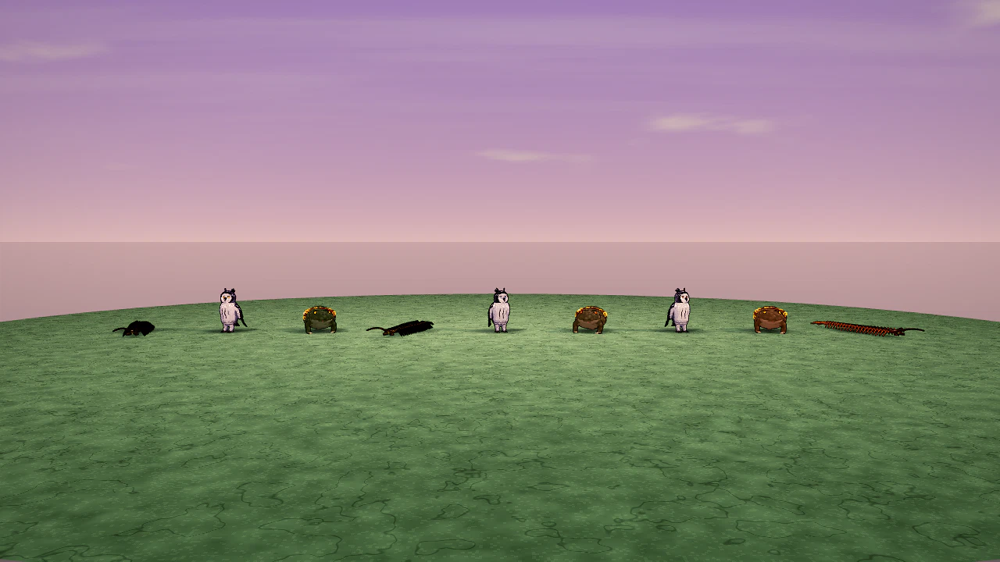 |
| 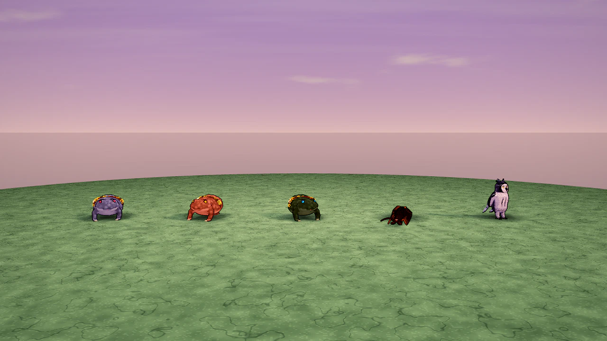 | 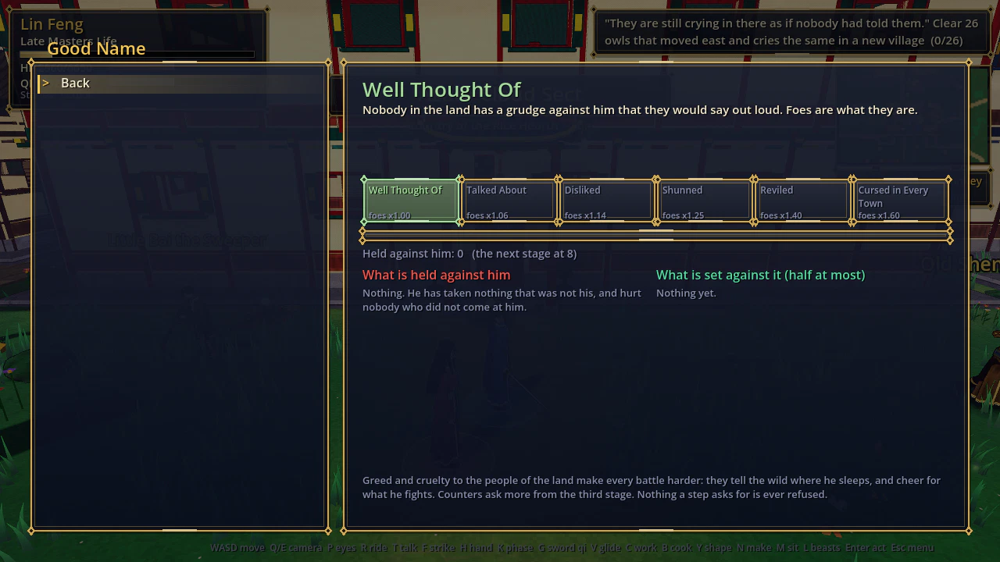 |
| 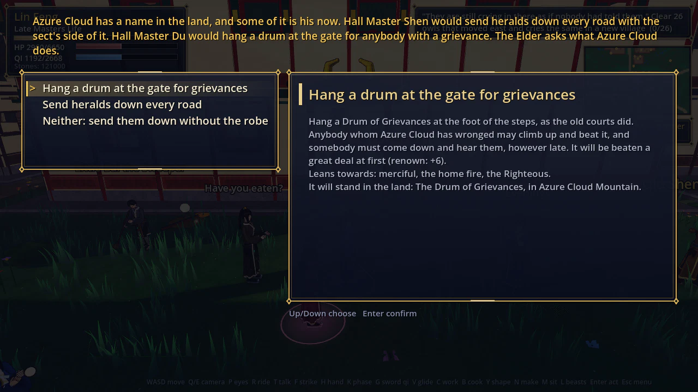 | 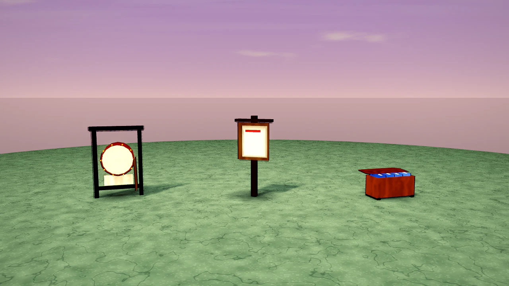 |

## What changed in this release

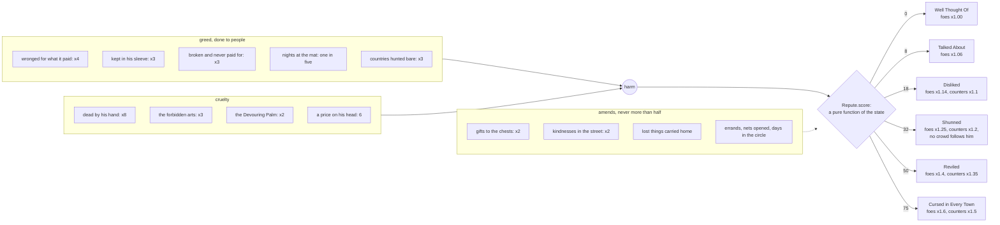

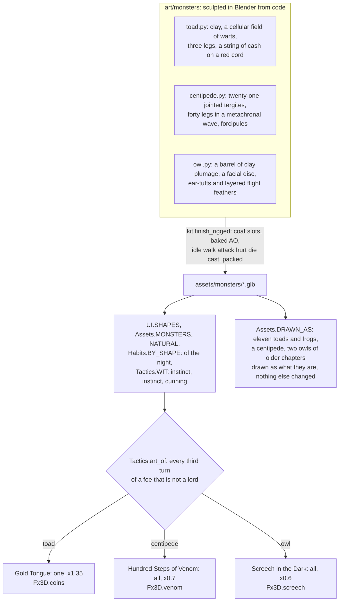

- **Variable difficulty: what the land thinks of him** (`scripts/repute.gd`, new; Esc > Good Name). If he gets greedy (wrongs done for what they pay, things pocketed, things broken and not paid for, the gambling mat, countries hunted bare) or cruel (people dead by his hand, the forbidden arts, the Devouring Palm, a price on his head), **people start to dislike him, and the land gets harder**: six stages from Well Thought Of to Cursed in Every Town, each making **every foe he meets stand up to more and hit harder** (up to three fifths), the counters of the towns dearer (up to half as much again), the crowd that follows a famous cultivator stay away, and the street say so to his face. Kindness is set against it, but **never more than half**: a town forgives, it does not forget. The battle says when it is harder and why; a toast and Yue Ling say when the land's opinion changes. It is weighed from the state alone, nothing a step needs is refused for it, a heavenly tribulation and a doom are not weighed, and the bot (which does nothing greedy or cruel) fights at the first stage as it always did.
- **Three new kinds of monster, sculpted in Blender** (`art/monsters/toad.py`, `centipede.py`, `owl.py`, new): the **three-legged money toad** (clay, with a cellular field of raised warts paler at the tips, two splayed forelegs and the one hind leg folded under the rump, a string of square-holed cash on a red cord over its back and a glowing coin in the corner of its mouth), the **red-headed centipede** (twenty-one jointed tergites with dark back edges, forty legs on the second colour, a clustered-eye head shield, black-tipped forcipules and heavy spined ultimate legs) and the **eagle-owl** (a barrel chest streaked down the middle, a facial disc ringed dark, orange eyes, ear-tufts, and layered coverts, secondaries and primaries). Each has **idle, walk, attack, hurt, die and cast**: the toad's throat pumps, it hops, lashes its tongue its whole length and puffs itself up to twice its size; the centipede walks in a metachronal ripple, rears and strikes, and rolls onto its back to die; the owl turns its head round, flies low and silent, drops on its prey talons first and mantles.
- **Monster arts and their effects** (`Tactics.ARTS`, `Fx3D.coins`, `venom`, `screech`): every third turn of its own, a foe of one of the new bodies uses its art instead of a plain blow, with the cast clip and an effect of its own: the toad's **Gold Tongue** (a fountain of spinning cash thrown in arcs onto whoever it strikes), the centipede's **Hundred Steps of Venom** (green fangs of venom up out of the ground under every one of the party, and a sick mist), the owl's **Screech in the Dark** (rings of sound going out from its beak, and feathers drifting after them).
- **Fourteen foes of older chapters drawn as what they are** (`Assets.DRAWN_AS`): eleven toads and frogs that were drawn as jellies (the Mire Toad, the Three-Legged Moon Toad, the Toad Who Swallowed the Dykes, the Frog Who Measured the Sea and the rest), the Thunder-Woken Centipede that was a snake, and the Owl of Huayin Hill and the Shadow the Owl Casts, which were hawks. Only the drawing changed: how they fight, and when, is as it was.
- **Part XLIV: The Owl Moves East** ([below](#part-xliv-the-owl-moves-east)): nineteen steps at the sect and in **three caves of the Rivers and Lakes no chapter had used** (under Yunmeng, Hanshan and Langya, west to east as the owl flew), nine new foes on the three new bodies, three people in the bodies of the towns, a crossroads with a row of things it leaves standing on the mountain, three letters, three fates, three pages, three feats, and the fiftieth realm, **Changes Its Cry**.
- **Bugs and plot holes fixed** ([below](#bugs-found-and-fixed)): a lord on a slope hung in the air over the downhill side (the one thing CLAUDE.md listed as known and not mended), three lords were called in what they said by names they do not fight under, fourteen foes were drawn on a body that is not their kind's, and a line of the new chapter's own assumed whose door a lost thing went back to.
- **1 hour 2 minutes 23 seconds of new game**, verified by the playthrough bot end to end (the whole game, seed 1234: 53:06:49, complete, with no script error; the last release's story ends at 52:04:26 of it, and Part XLIV is what follows), and again on its own from the chapter's first step (`--bot-start=s_p44_home`: 1:18:55, 134 battles, no death, *Well Thought Of* at the end).
- **Nothing older moved.** Every entity, peak, camp, floor and road of the seven realms stands where it stood in the last release (11,212 lines of the dump of both checkouts are identical; the 51 new lines are the chapter's people, things and packs in three caves and the row its crossroads leaves on the mountain).
- **Code**: the game's GDScript is 109,833 lines (109,015 before). The tests now make 122,808 checks (121,830 before).

### Previous release: a skill tree of sixty channels, a craft for every Dao, beasts that stay, places of peace and Part XLIII

| | |
|---|---|
| 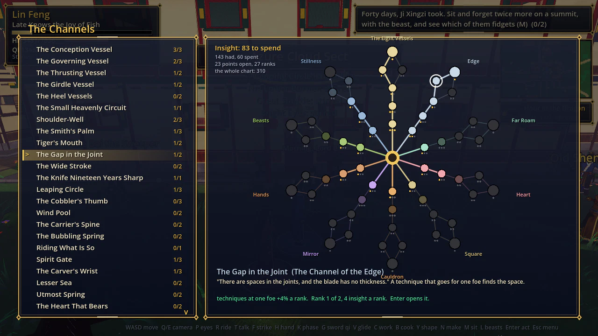 | 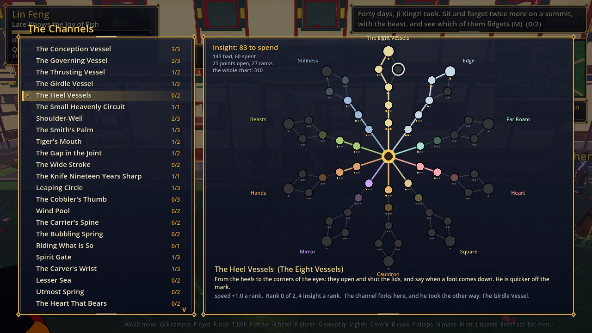 |
| 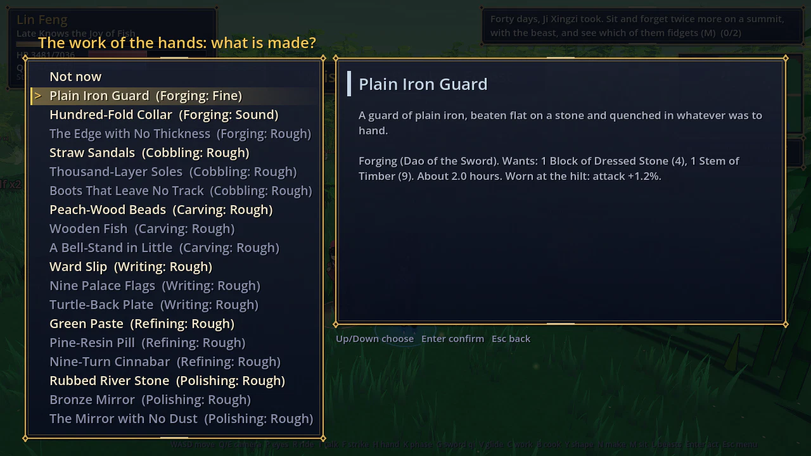 | 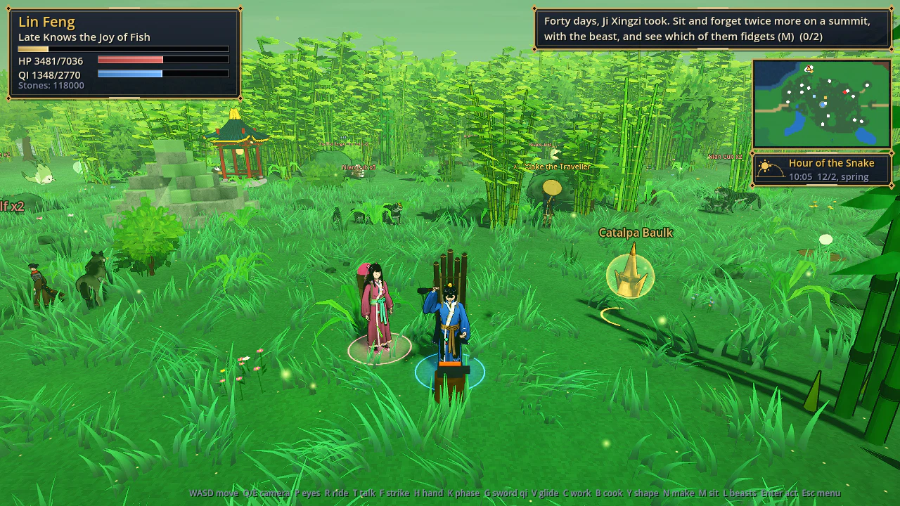 |
| 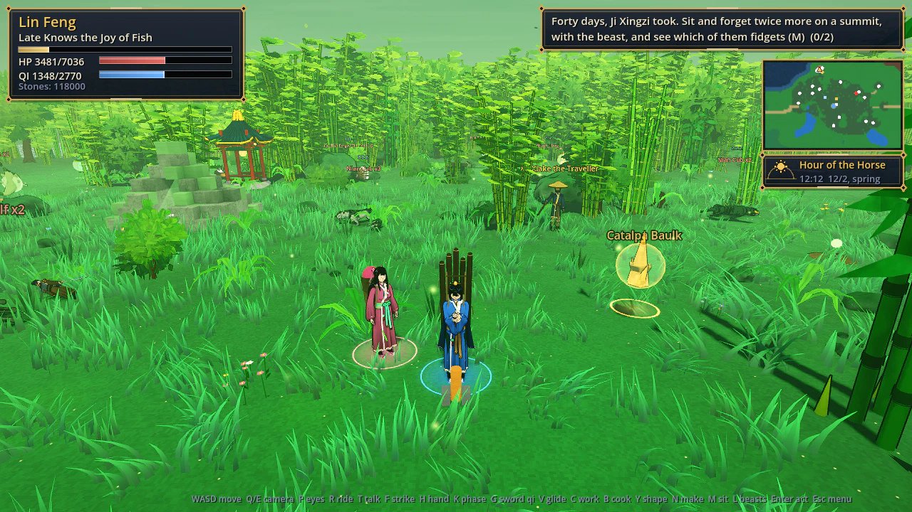 | 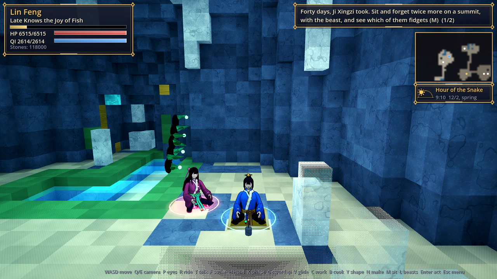 |
| 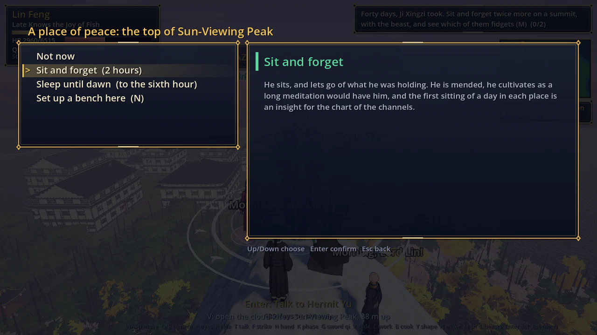 | 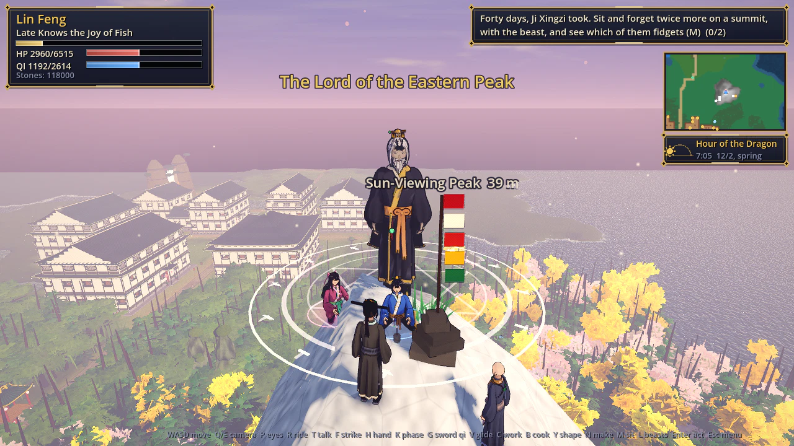 |
| 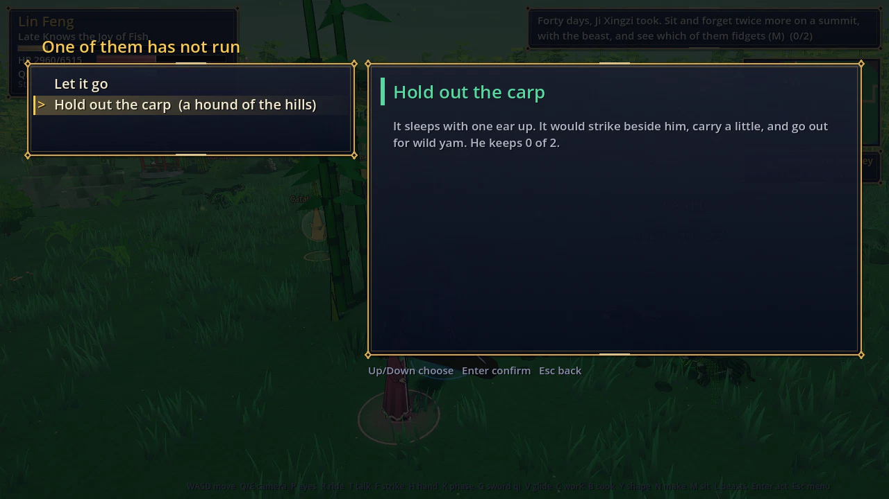 | 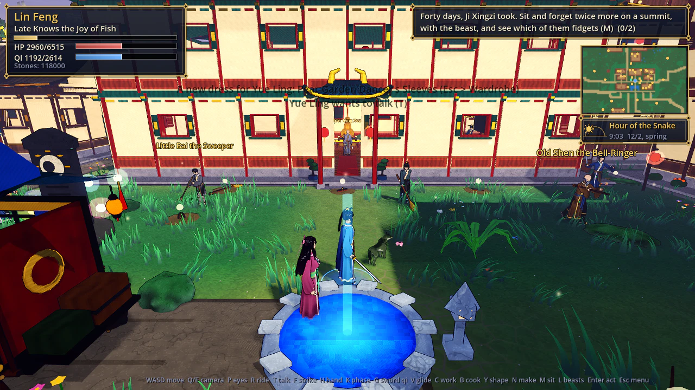 |
| 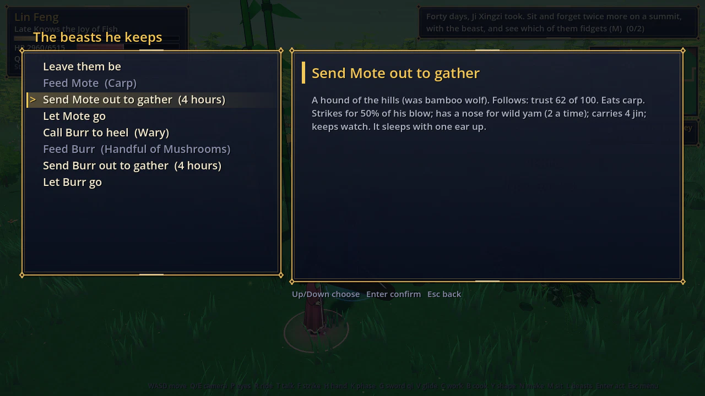 | 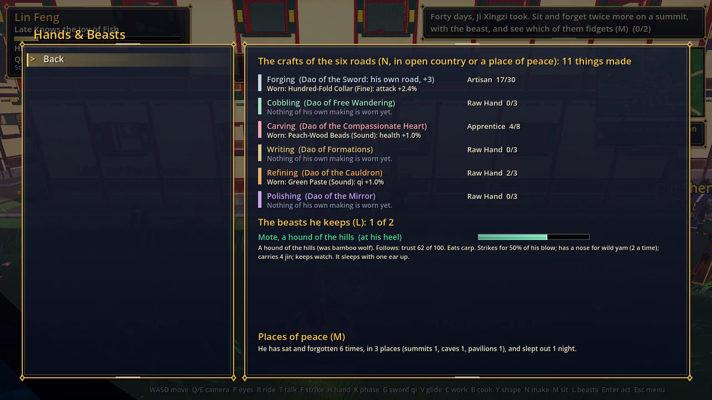 |
| 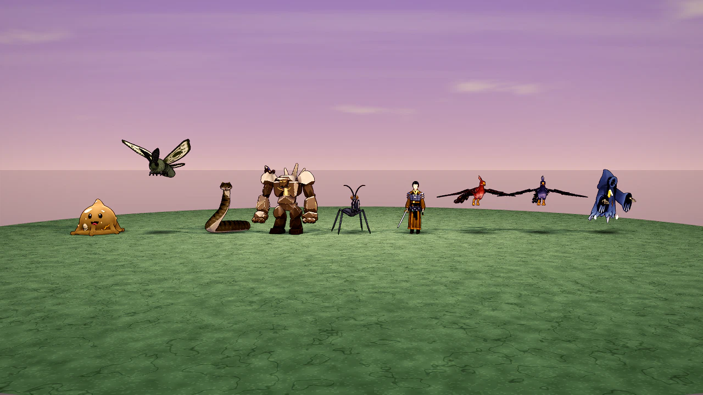 | 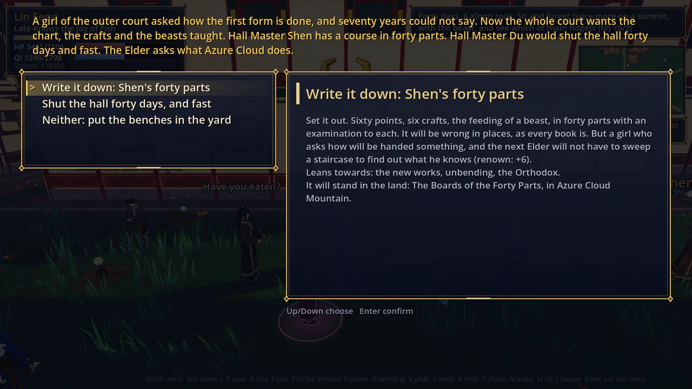 |


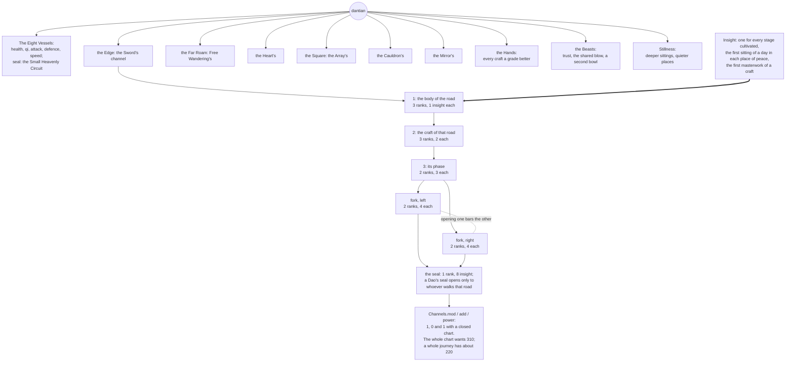

```mermaid
flowchart LR
    subgraph GATHER[the hands gather: scripts/toil.gd]
    T[timber] ; S[stone] ; O[ore] ; H[herbs] ; C[carp] ; Y[yams, mushrooms, jade]
    end
    subgraph CRAFTS[six crafts, one a road: scripts/crafts.gd]
    F[Forging: the Sword<br/>guard, collar, edge: attack]
    CB[Cobbling: Free Wandering<br/>sandals, soles, boots: speed]
    CV[Carving: the Heart<br/>beads, wooden fish, bell-stand: health]
    W[Writing: the Array<br/>slip, flags, plate: defence]
    R[Refining: the Cauldron<br/>paste, pill, cinnabar: qi]
    PO[Polishing: the Mirror<br/>stone, bronze, dustless: blows made less]
    end
    GATHER --> CRAFTS
    CRAFTS --> SC{Crafts.score, nothing thrown for:<br/>place in the craft 0-4<br/>+ the road walked 0-3<br/>+ how quiet the place is 0-3<br/>+ the chart<br/>- twice the grade - 1}
    SC -->|below 2| Q0[Rough]
    SC -->|2| Q1[Sound]
    SC -->|4| Q2[Fine]
    SC -->|6 and over| Q3[a Masterwork:<br/>the first of each craft is an insight]
    Q0 & Q1 & Q2 & Q3 --> KEPT[the best of each craft is kept and worn:<br/>Game.kept, one number each,<br/>a few parts in a hundred]
```

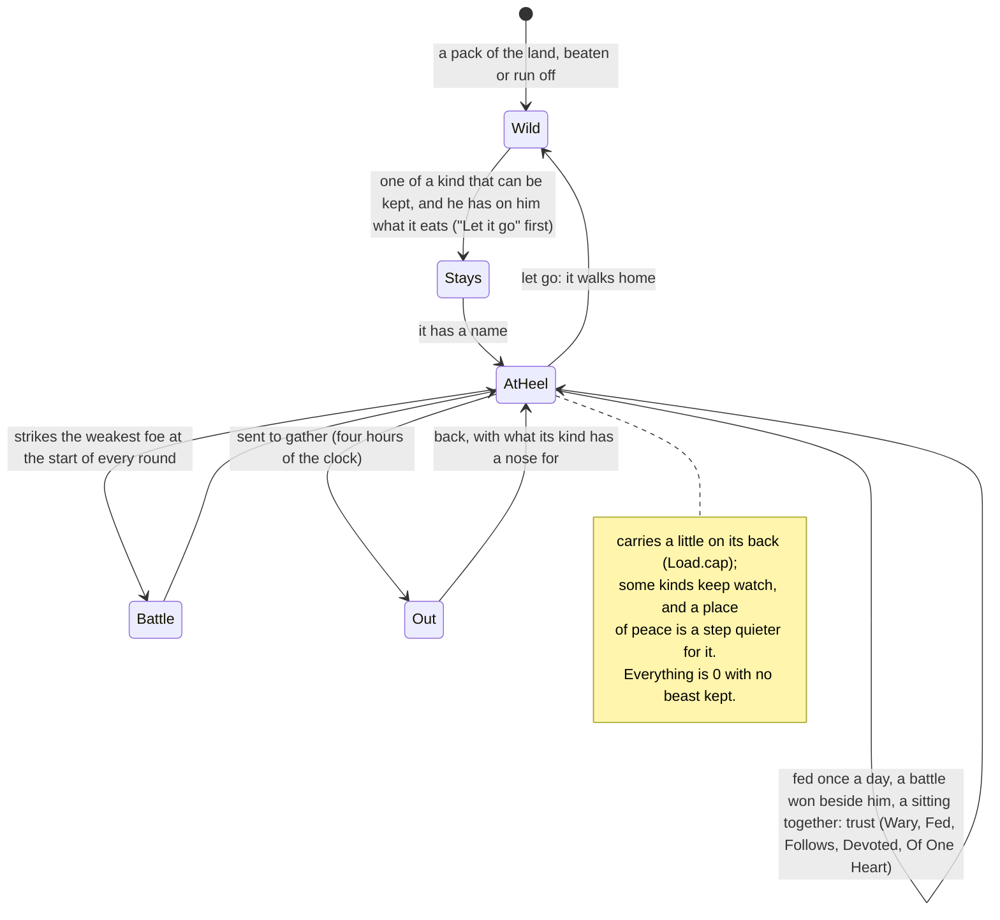

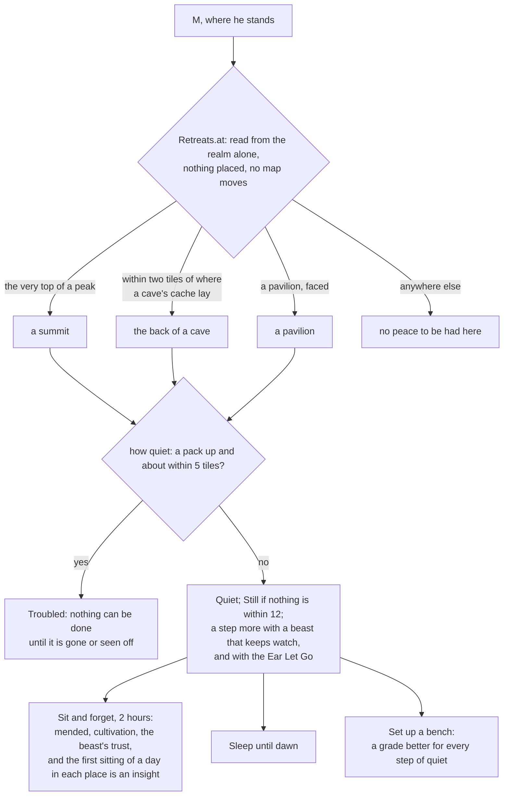

- **A very detailed skill tree** (`scripts/channels.gd`, new; Esc > The Channels). The **Chart of the Channels**: the dantian in the middle and **ten channels leaving it like spokes**, sixty points in all, drawn on a page of its own with what is open lit. The Eight Vessels are the body; **each of the six Daos has a channel** (its body, the craft of that road, its phase, a fork, and a seal that opens only to somebody who walks the road: the Knife Nineteen Years Sharp, Riding What Is So, the Fasting of the Heart, the Wheel Cut by Feel, the Upper Burner, the Mirror That Keeps Nothing); the Hands make every craft better, the Beasts are for what walks at his heel (the seal is the Wooden Cock: the beast takes the first blow of a battle that would have been his), and Stillness deepens every sitting. Every channel has the same shape: three points in a line, **a fork where the way he takes bars the other**, and a seal. **Insight** opens them a rank at a time: one for every stage he has cultivated, one for the first sitting of each day in each place of peace (two the first time he ever sits there), one for the first masterwork of each craft. The whole chart would want 310; a whole journey has about 220, so which channels to light stays a choice. What is spent is never given back.
- **Craftsmanship for every Dao** (`scripts/crafts.gd`, new; **N**). The Sword **forges**, Free Wandering **cobbles**, the Heart **carves**, the Array **writes**, the Cauldron **refines**, the Mirror **polishes**: six crafts of three things each, made of what his own hands gather (timber, stone, ore, herbs, carp, yams, mushrooms, jade), at a bench that is set up in front of him wherever there is room, on the clips the party already carried (hammer, sew, carve, write, pound, wash). A thing comes out **Rough, Sound, Fine or a Masterwork**, and **nothing is thrown for**: it is his place in the craft (five, from Raw Hand to Master, by things made), how far he walks the road the craft belongs to (anybody can forge; whoever walks the Sword's road forges a grade to three grades better), how quiet the place is, and what he has opened of the chart, against how hard the thing is. **The best thing he has made in each craft is worn** (a guard at the hilt, soles on his feet, beads at his wrist, flags in his sash, a gourd at his belt, a mirror over his heart) and changes one number by a few parts in a hundred; anything less is set aside. The hardest things (the Edge with No Thickness, Boots That Leave No Track, a Bell-Stand in Little, the Turtle-Back Plate, Nine-Turn Cinnabar, the Mirror with No Dust) come out a masterwork only for a master of the craft and of the road, somewhere quiet, with the Channel of the Hands open.
- **Beasts that stay** (`scripts/pets.gd`, new; **L**). When a pack of the land is beaten, or runs from his realm, **one of it may not run**: if it is of a kind that can be kept (eleven shapes: hounds and wolves, great cats, foxes, apes, birds, magpies, serpents, oxen, tortoises, rabbits, crabs) and he has on him what it eats (a carp, a bundle of herbs, mushrooms). "Let it go" is the first answer. One that stays has a name, the body and colours it had (drawn smaller, a pace ahead of him), and **trust** in five steps that grows by being fed once a day, by battles won beside him and by sitting together. **In battle** it goes in at the weakest foe at the start of every round. **For gathering** it is sent out, is gone four hours, and comes back with what its kind has a nose for: a hound digs yams, a fox finds mushrooms, a magpie brings whatever shines (now and then it is jade), a tortoise ore. **It carries** (an ox thirty jin), and some kinds **keep watch**, which makes a place of peace a step quieter. He keeps two (four with the Second Bowl of the chart); one that is let go walks back into its own country. Nobody's beast dies.
- **Places to rest and cultivate in peace** (`scripts/retreats.gd`, new; **M**). **The very top of every peak, the back of every cave and every pavilion** in the seven realms is a place of peace: nothing was placed in the world for them, so no map moved. How quiet one is depends on what is hunting within earshot, on a beast that keeps watch and on the chart; a place with a pack up and about within five tiles is troubled, and nothing can be done there until it has gone or been seen off. In one he can **sit and forget** (two hours: he is mended, he cultivates as a long meditation would have him, and the first sitting of a day in each place is an insight for the chart), **sleep until dawn**, or **set up a bench** (what he makes there is a grade better for every step of quiet). He is drawn sitting on a rush mat with a stick of incense in a stone.
- **Part XLIII: Mastering Life** ([below](#part-xliii-mastering-life)): twenty-seven steps at the sect, on the summits, at Tushan, in the Whispering Bamboo and in **three caves no chapter had used** (under Fusang, the Garden of Immortal Peaches and Mirror Lake), with five new kinds of step (`"retreat"`, `"train"`, `"craft"`, `"tame"`, `"fetch"`), nine new foes (what skill leaves lying about when it is gripped too hard: balls dropped from the pole, a wing counted too soon, billets cut across the grain, an archer shooting for gold, a cock that still crows), three new people (Old Goulou, Woodworker Qing, Ji Xingzi) and Cook Ding again, a crossroads with a row of things for each answer on Azure Cloud Mountain, three letters, three fates, three pages (the last in the Elder's hand), nine feats and a forty-ninth realm, **Masters Life**. It has no lord.
- **Twenty bugs and plot holes fixed** ([below](#bugs-found-and-fixed)), found by an audit run beside the work (the newer rule modules read against their callers, and Parts XXXVIII to XLII read against themselves and against the tables they name), every finding checked against the source before it was mended.
- **1 hour 22 minutes 59 seconds of new game**, verified by the playthrough bot end to end (the whole game, seed 1234: 52:00:51, complete, with no script error; the last release's story ends at 50:37:52 of it, and Part XLIII is what follows).
- **Nothing older moved.** Every entity, peak, camp, floor and road of the seven realms stands where it stood in the last release (11,172 lines of the dump of both checkouts are identical; the 46 new lines are the chapter's people, things and packs in three caves and the row its crossroads leaves on the mountain). No asset was rebuilt: the three new people use the bodies of the towns, and a beast at his heel is the model its kind already had.
- **Code**: the game's GDScript is 109015 lines (106,599 before). The tests now make 121,830 checks (120,206 before).

### Two releases ago: a seventh realm under the sea, places to find, six working factories, the Dao of Leading Water and Part XLII

| | |
|---|---|
| 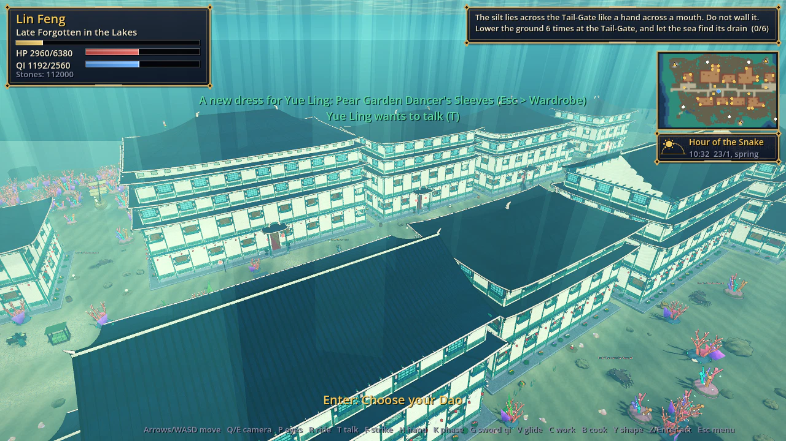 | 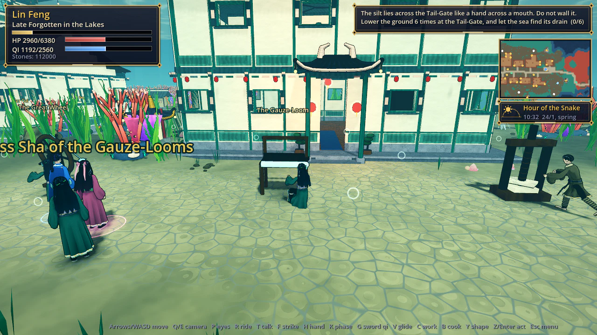 |
| 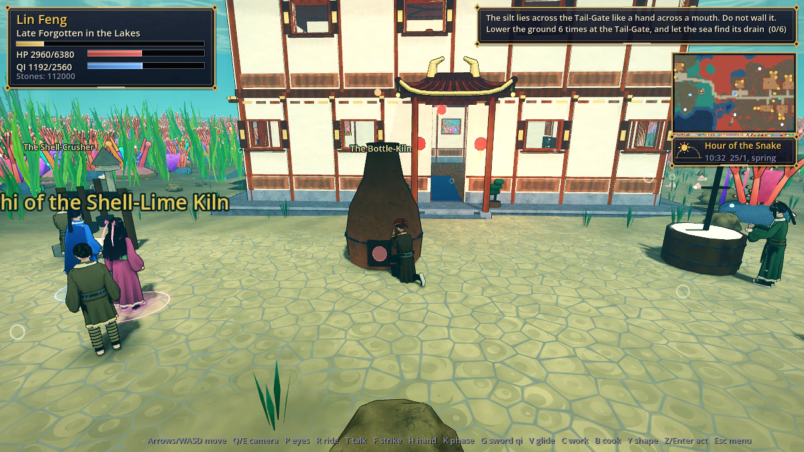 | 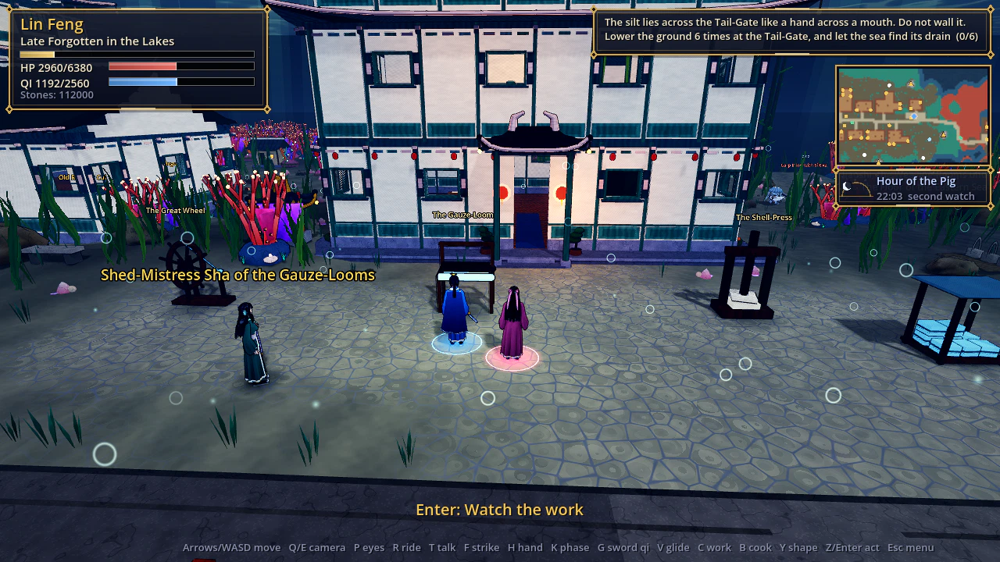 |
| 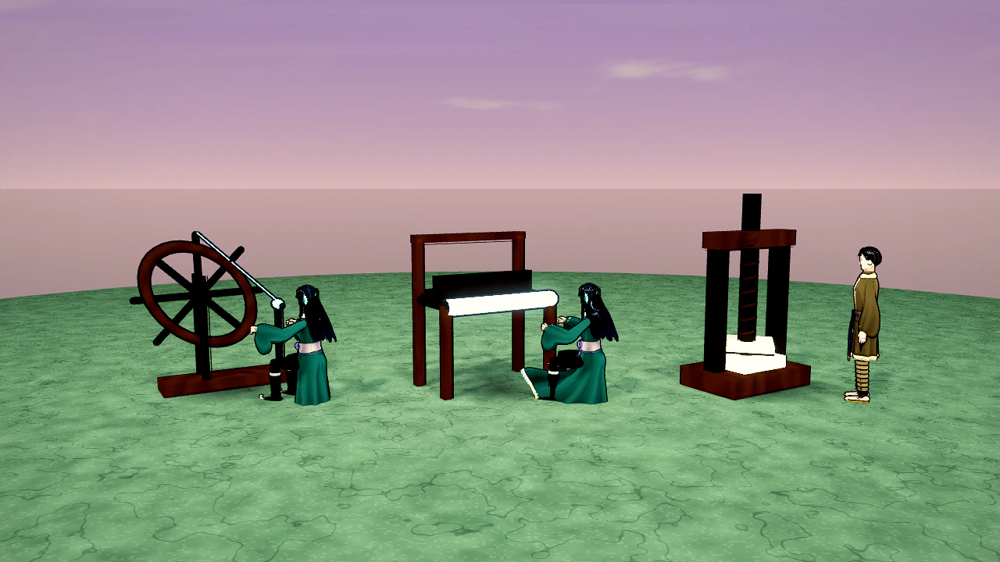 | 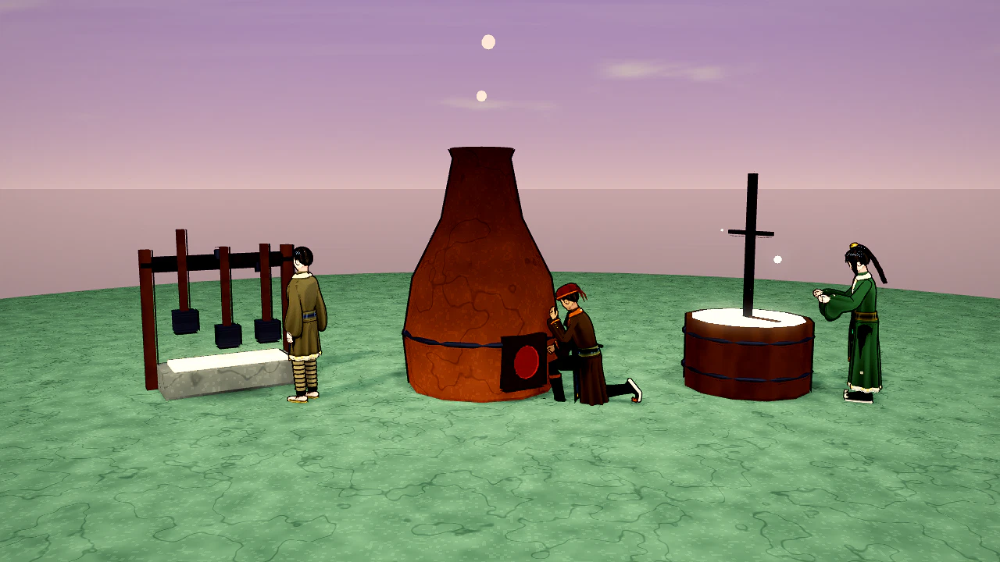 |
| 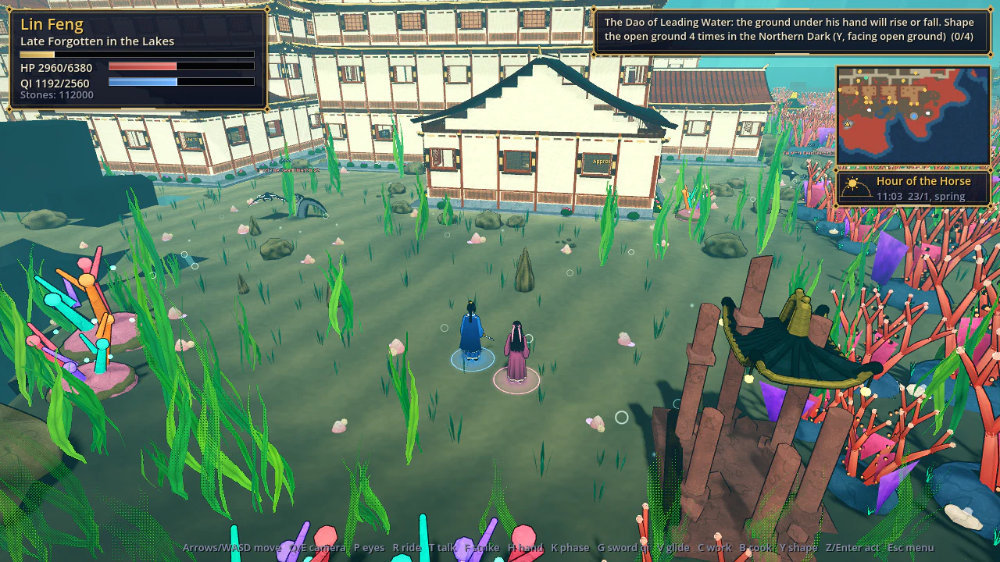 | 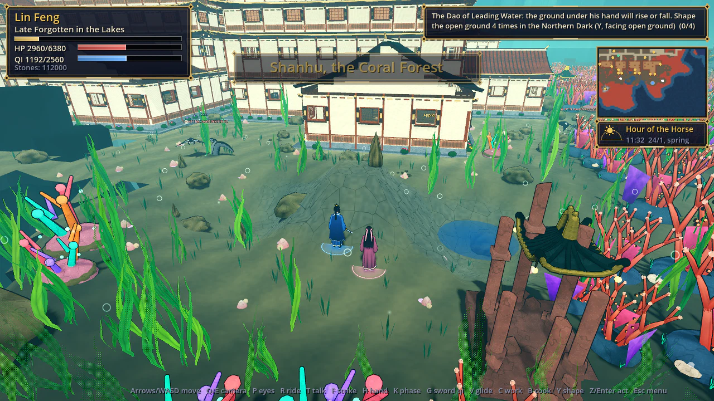 |
| 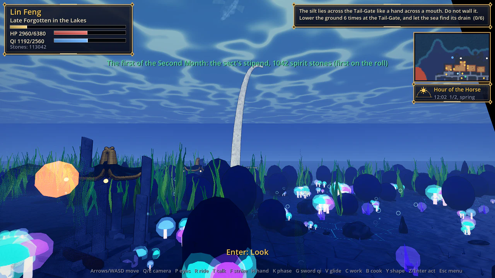 | 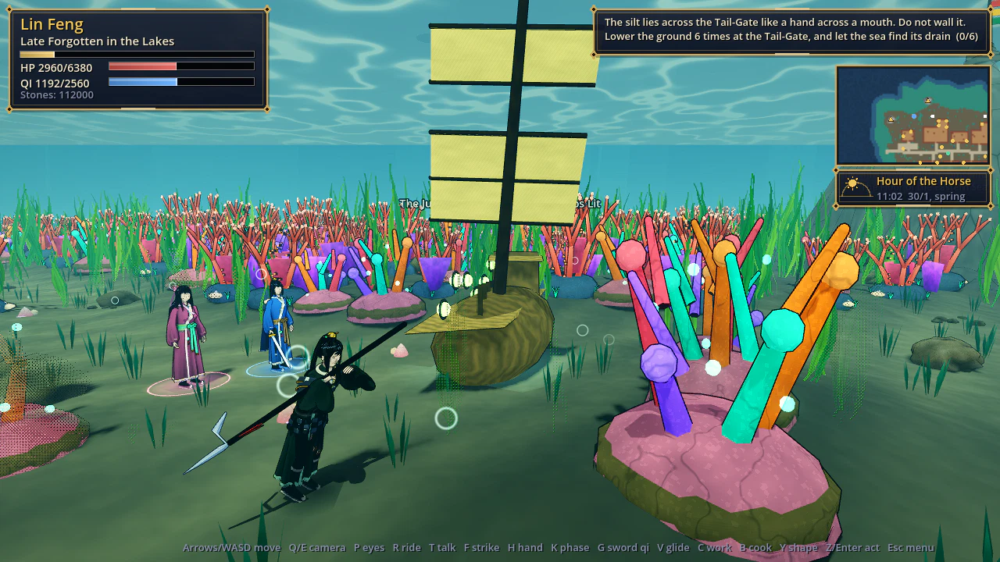 |
| 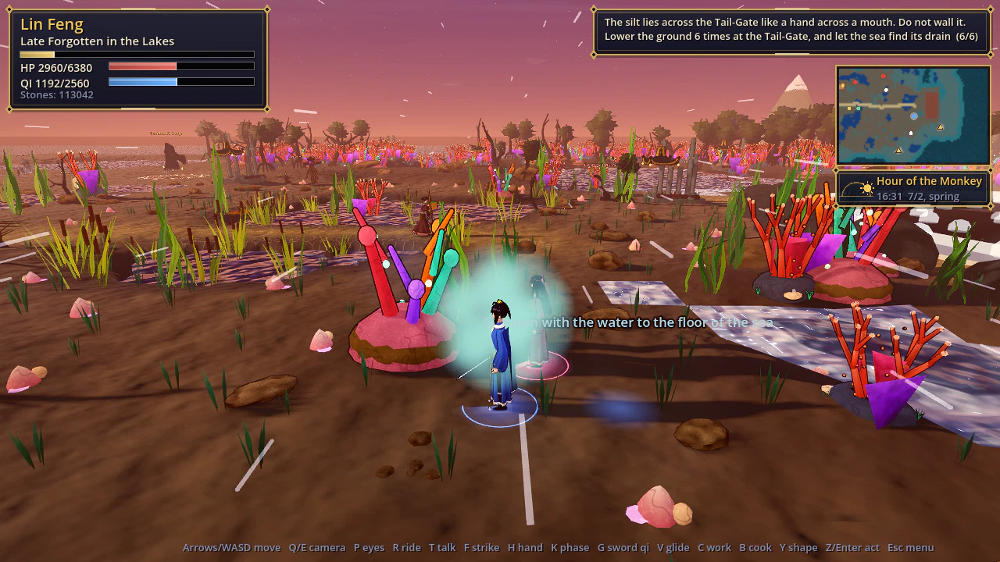 | 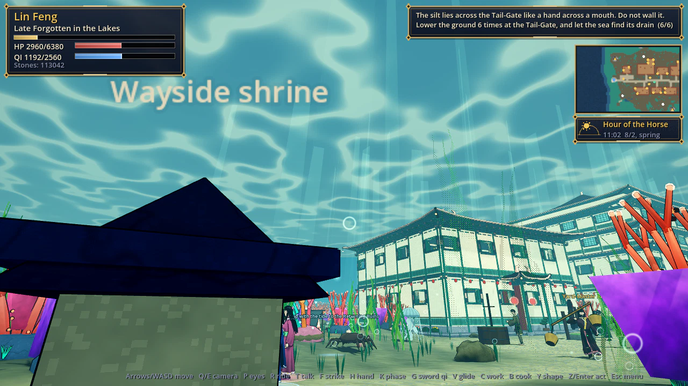 |
| 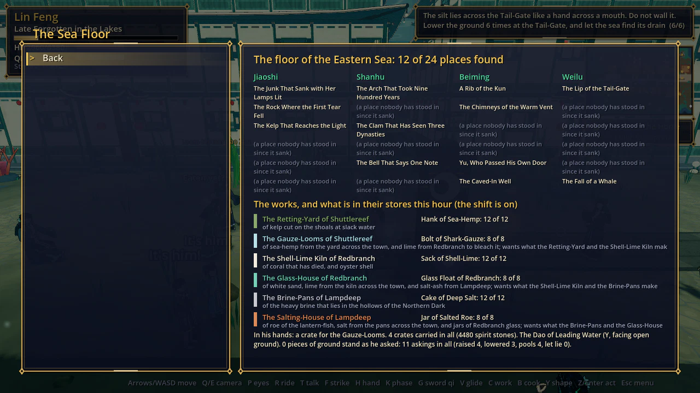 | 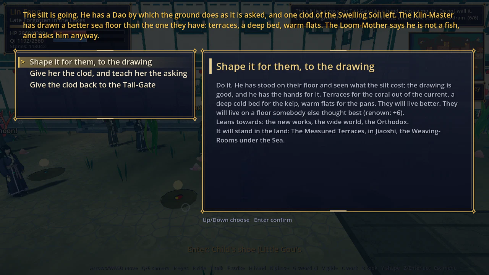 |

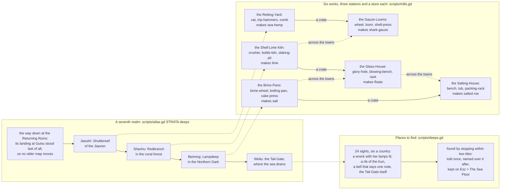

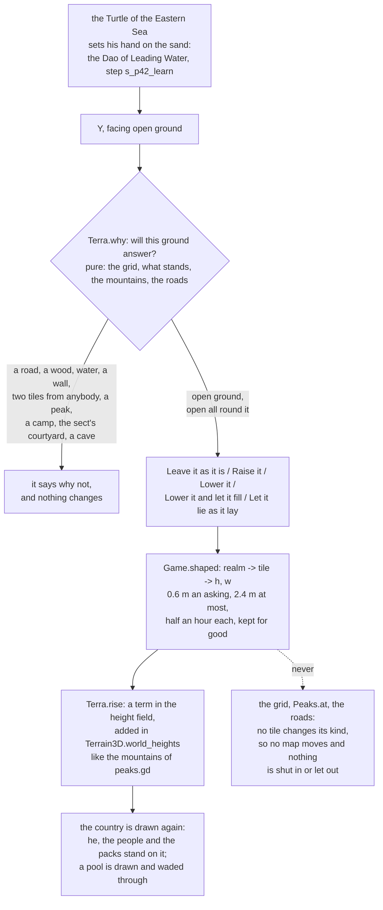

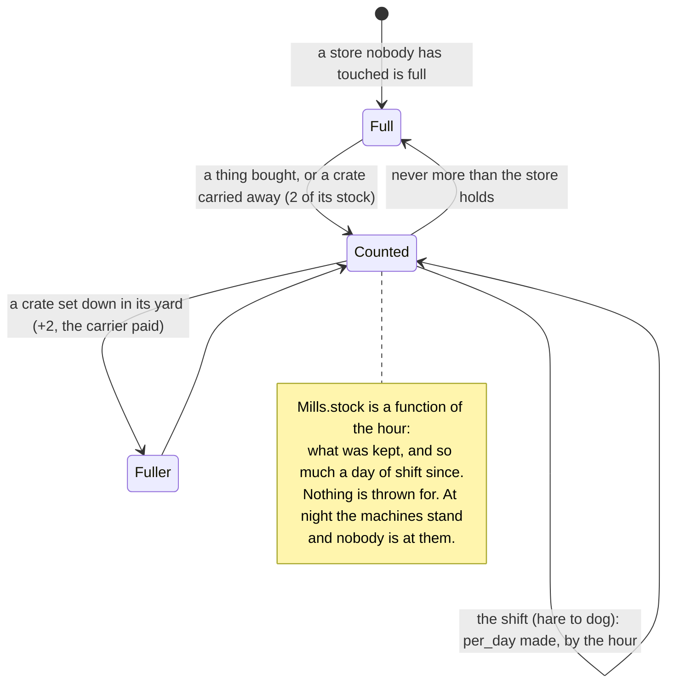

- **The world is bigger by a seventh realm, the floor of the Eastern Sea** (`Atlas.STRATA.deeps`): four countries under the isles, reached by going down with the water at the Returning Ruins, where Ruo of the Northern Sea holds the sea open a hand's breadth (`Data.LADDERS` "sea_dive": like the river-boat of the last release, its end among the isles is stood last of all on whatever open ground is left, so that **nothing of Guixu moved**: the dump of both checkouts shows one new line outside the new realm, the landing). **Jiaoshi**, the weaving-rooms of the Jiaoren who stayed in the open sea when their cousins went down to Tearwater, with the town of **Shuttlereef**; **Shanhu**, the coral forest, white at the tips this autumn, with **Redbranch** of the kilns; **Beiming**, the Northern Dark, where no light comes down and every door has a lit float, with **Lampdeep**; and **Weilu**, the Tail-Gate, where the sea drains and is never less, which has no town at all. Each has its own look, wood, creatures, cave, peaks, camp of the road, tune and dress; the realm is drawn with the water overhead (a rippled bright ceiling forty-six metres up, seen from underneath), shafts of light coming down through it everywhere but the Northern Dark, and the dark its floor falls away into (`Deeps.dress`).
- **Lots of places to explore** (`scripts/deeps.gd`, new). **Twenty-four sights**, six a country: the junk that sank with her lamps lit, the kelp that reaches the light, the arch two corals took nine hundred years to make, the clam that has seen three dynasties, a temple bell on its side saying one note, a rib of the Kun taller than a pagoda, the chimneys of the warm vent, the ice that burns, Yu walking past his own door, the caved-in well with a rope let down it, the lip of the Tail-Gate, the last of Gun's wall, the fall of a whale. Each is a model built from code, stands in the land (an entity of kind `"sight"`) and is **found by stopping within two tiles of it**: told once, kept, and named over it afterwards; Enter says what it is. **Esc > The Sea Floor** lists what has been found, country by country, and says only that the rest are there. With the three towns, a cave under every country, eight peaks to climb and a camp of the road in each, there is always something on the floor ahead.
- **Physical factories, where people make things** (`scripts/mills.gd`, new). **Six works, two a town**, each a counting-house, a paved yard, **three stations and a store**, standing in the open where they can be watched:
  - **Somebody is at every station by day, doing the work** (eighteen people on clips the towns already had: stirring, pounding, combing, spinning, weaving, pushing, fanning, lifting, shelving, raking, kneading, dressing fish), **and the machine turns while they do**: a retting-vat with a paddle that goes round, three trip-hammers lifted by cams on a turning shaft and let fall (a saw-tooth, not a sine), a hackling-comb, a great spinning wheel and its spindle, a loom whose reed beats and whose shuttle crosses, a screw-press, a bottle-kiln with a fire in its belly, a blowing-bench with the gather swelling on the pipe, a brine-wheel hung with pots, a boiling-pan over a warm vent with a rake drawing the crust. Twelve kinds of machine, all built from code (`Mills._machine`), all with parts that move (`Mills.tick`).
  - **The shift runs from the hour of the hare to the hour of the dog.** At night the machines stand as they were left, nobody is at them, and Enter in front of one says so.
  - **What is in the store is what has been made** (`Mills.stock`): a function of the hour (what was kept when it was last touched, and so much a day of shift since, never more than the store holds), and it is drawn: the crates stacked under the store's roof are counted off the same number. Nothing is thrown for.
  - **Every works needs another.** The yard of each town feeds the shed of the same town (sea-hemp to the looms, lime to the glass, salt to the salting), and each shed also wants what another town's yard makes (lime to bleach the gauze, salt-ash for the glass, glass jars for the roe). At the foreman ("Not today" first) he can **carry a crate** to a works that wants it: each pair of works once a day, two crates in a pair of hands, set down in the other yard for a carrier's fee worth far less than the road; the store it came from is two the poorer and the one it went to two the richer, and the town it went to feels it (`Weal.ACTS.supplied`: plenty).
  - **What is made can be bought**, at the town's own price: sea-hemp, shark-gauze, shell-lime, glass floats, deep salt, salted roe. They weigh nothing; three of them are of use (gauze mends, a float steadies the breath, roe does a little of both: Esc > Items).
- **He can shape the land, once he has learned the Dao for it** (`scripts/terra.gd`, new). The **Dao of Leading Water** is Yu's: "Gun built walls. His son went and asked the water where it wished to go." The Turtle of the Eastern Sea teaches it at Lampdeep, in the middle of Part XLII; before that, **Y** says only that the ground does not answer him.
  - **Y, facing open ground** ("Leave it as it is" first): **raise it**, **lower it**, **lower it and let it fill** (a pool), or **let it lie as it lay**. Each asking moves that piece of ground 0.6 m, no more than 2.4 m either way, takes half an hour, and **stays**: it does not mend.
  - **It is real ground.** The shaped land is a term in the height field (`Terra.rise`, added where the mountains are added): he, Yue Ling, the people of the towns and the packs all stand on it, grass and scatter follow it, and the country is drawn again as it now lies. A pool is drawn a little under the lip of its hollow and is waded through.
  - **And it is never a way round the story.** No tile changes its kind; what asks where anybody may walk, climb or fly is asked what it always was; nothing is shut in or let out. What will answer is open ground with open ground all round it, two tiles from anybody and anything, off the mountains, the roads and the camps (`Terra.why`, pure: the tests shape ground and hash the grid before and after). The sect's courtyard does not answer: "he swept it level himself, for seventy years."
  - It works in every realm, on any open ground he can stand beside. The old turtle calls it the only art that is harder the stronger you are.
- **Part XLII: The Joy of Fish** ([below](#part-xlii-the-joy-of-fish)): twenty-eight steps at the sect, Longmen and all four countries of the sea floor, with three new kinds of step (`"supply"`: so many crates carried between the works; `"sights"`: so many places of a country found; `"terra"`: so many things asked of the ground, of one kind or any); a crossroads with three answers, each leaving a row of things on the sand at Jiaoshi and somebody beside it; three letters, three fates, three pages in their own words; the forty-eighth realm.
- **Eighteen bugs and plot holes fixed** ([below](#bugs-found-and-fixed)), found by two audits run beside the work (one of the rule modules read against their callers, one of the story read against itself, every finding checked against the source before it was touched) and by the new chapter's own bot run: among them **the ending failing for any journey that had stood in more than fifteen towns**, a chapter that stopped for good at a grave, a price on his head that could never be paid, and Lin Feng's own page saying he never found the parents he had met a chapter earlier.
- **1 hour 1 minute 27 seconds of new game**, verified by the playthrough bot end to end (the whole game, seed 1234: 50:35:35, complete, with no script error; the last release's story ends at 49:34:08 of it, two minutes sooner than it did, and Part XLII is what follows): 3,698 battles against 7,712 foes. The chapter was also played by itself from its first step (`--bot-start=s_p42_home`).
- **Nothing older moved.** Every entity, peak, camp, floor and road of the six older realms stands where it stood in the last release (9,855 lines of the dump of both checkouts are identical; the one new line is the landing at Guixu). No asset was rebuilt: the people of the sea floor wear the bodies of the towns, and everything else new is built from code.
- **Code**: the game's GDScript is 106,599 lines (103,858 before). The tests now make 120,206 checks (116,327 before).

### Three releases ago: a sixth realm, sects with halls of tasks, upright and crooked towns, raids on the roads, traffic and Part XLI

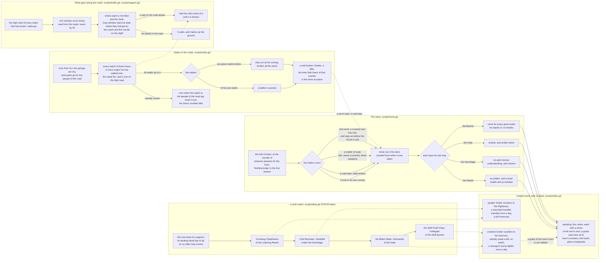

- **The world is bigger by a sixth realm, the Rivers and Lakes** (`Atlas.STRATA.lakes`): the country of the sects, down the Yellow River past the last gorge, where the Son of Heaven's calendar is read and nothing else of his is. Four countries in a chain: **Yunmeng**, the Marsh of Cloud and Dream; **Hanshan**, the Cold Mountain; **Heishui**, the Black Water that will not float a goose feather; **Langya**, the Wolf-Tooth Pass. 4 towns, 28 houses, 109 townsfolk, 24 people with names, 13 peaks, 4 caves, 4 camps, 12 new kinds of foe, each country with a look, a wood, a tune and a way of building of its own.
  - **It is reached by the river-boat of Longmen**, and **nothing older moved for it**. A way between realms used to be written at a fixed tile, which every peak, camp and mark of the region then moved round. The boat's landing is `"late"` (`Data.LADDERS`): `Atlas._place_late_ladders` stands it last of all, after every band, mark and height, on the open ground nearest the tile written for it with open ground all round, and the high road is laid as if it were not there. Every entity, peak, camp and road of the five older realms was dumped from both checkouts: **5,353 lines before, 5,354 after, the one new line being the landing**.
  - A town down the river counts for nothing until he has stood in its country (`Weal.towns`), as with the Far Countries: a journey that never takes the boat is weighed in eleven towns as it always was.
- **Good towns and evil ones** (`scripts/sides.gd`, new). Down the river a sect answers for each town, and **a town is what its sect is**: Reedhaven and Clearbell are **upright**, Ashmarket and Knifegate are **crooked**. Every older town is plain, and nothing here touches it.
  - **An upright town**: counters a tenth kinder to somebody of the Righteous Path and a quarter dearer to the Demonic; a wounded traveller mended once a day at the counter for nothing; a bill honoured as anywhere. Lime-washed boards and reed thatch at Reedhaven, bare grey plaster and slate at Clearbell.
  - **A crooked town**: counters kinder to the Demonic and dearer to the Righteous; **nobody reads a bill** (no price hangs at its gate, no watch comes, nothing a wanted man is shut out of is shut: `Crime.standing`, `watch_due`); and **somebody lifts a little off a stranger once a day**, the first time he speaks to anybody in its streets, by the day and the town and never by lot, unless the town's sect knows him or he walks the Demonic road himself. Soot-black boards and windows lit a low red at Ashmarket, raw ochre stone and flat roofs at Knifegate.
  - **It is not a label**: the street says different things ("Leave your pack by the door. It will be there. It always is" against "Keep a hand on your purse. Not that one. The other one"), whoever answers for the town says plainly which kind it is, and the Elder's last word on it is the chapter's: "An upright town tells you what it wishes it were. A crooked one tells you what it is."
- **Sects with ways and work of their own** (`scripts/sects.gd`, new). Until now there was one sect in the world, his own. Now there are five, each with three sayings, a custom, four ranks under names of its own, and (the four down the river) **a hall of tasks** at the counter of whoever answers for its town:

  | Sect | Town | Its way | How it pays |
  |---|---|---|---|
  | the Listening Reeds | Reedhaven (upright) | a flute before a name; feed him first, ask after | as written, and a bowl at the landing: health and qi mended |
  | the Cold Mountain Hermitage | Clearbell (upright) | whoever sweeps the kitchen is the abbot; write it on a rock and walk away | no spirit stones: understanding (cultivation), and renown |
  | the Black Water Gate | Ashmarket (crooked) | a debt is the only promise ever kept; no names | double, and written down; one task is foul, and is said to be |
  | the Wolf Banner | Knifegate (crooked) | the strongest takes first; say it to his face | more for every great realm he stands in, at once, and no thanks |
  | the Azure Cloud Sect | his own | sweep the step you are standing on | what it wants of him is the story |

  - **Sixteen tasks**, four a sect: a hunt in its own country, a road kept (raids broken), and two that are a matter of taste (fish caught with his own hands for the landing pot, a summit he has not stood on, three weapons learned, logs for the gruel). **A crooked sect has one foul task** (a wrong done to somebody in some street): the counting-master says so "before the brush is wet", the wall marks it in red, and nothing in the story ever asks for it.
  - **Standing** is the tasks done for a sect and the steps of the story done in its name: a guest pays three in a hundred less at its town's counters for every rank and is not robbed there, and the fourth rank gives a keepsake that weighs nothing (a flute with his tune in it, a chipped gruel bowl, a blank black slip, a wolf's tooth on a thong).
  - **Esc > The Sects** lists all five: side, standing, sayings, custom, tasks done, and how the roads stand.
- **Enemies go for people** (`scripts/raids.gd`, new). A pack used to stand on its own ground and wait to be walked into. From the first step of Part XLI **what lived by the springs comes down to where the people are**: on every watch of three hours, in every region the journey has walked into, the **camp** of the people of the road is set on, and a **cart on the high road** out of sight of any town (547 places in six realms).
  - **A raid is broken by going there.** The raiders are two or three of the region's own, drawn by the watch; they are fought in earnest, or, two great realms below him, they look up and run, which counts too. Whoever was set on thanks him (a few spirit stones: less than the road), the town that hears of that country is the more at peace (`Weal.ACTS.rescued`), and a raid on the road holds every cart behind it until it is broken.
  - **Nothing is thrown for and nothing is placed in the world**: which raids are on is the realm, the day and the hour; where each stands is read from the camps and the roads. A raid nobody breaks is over when the watch is, the people of the road say what it cost, and **no number of any town falls because he was elsewhere**. Before Part XLI there are none: every older journey is as it was.
- **Vehicles on every road** (`scripts/traffic.gd`, `scripts/wagons.gd`, new). The high road has joined the towns since the Lost Horse release, and nothing went along it but him. Now **115 vehicles of ten kinds** go along the roads of the six realms: ox-carts, caravan wagons, the post-coach, salt wagons behind two oxen, the one-wheeled sailing barrow of the plains, pedlars' handcarts, sedan chairs between two bearers, pack-trains of three horses, couriers at a canter, and, only in the Rivers and Lakes, a sect's banner-cart with a drum at its tail.
  - **Where each is, is the roads and the clock**: so many to a stretch by its length, each going to the far end, standing a while and coming back at its own pace. Day-vehicles go by the hours of daylight, so that at dusk each stands where it had got to and goes on at dawn; the coach and the courier run by night. A cart does not drive into a raid, and waits for him if he stands in the road.
  - **All of it built from code**: seven new vehicles from boxes, lathes and limbs, three that are the carriages he can buy with somebody else driving, drawn by the Blender ox and horse, crewed by the people of the towns. Drawn only round where he is, with a window: nothing is stood in the land, and the bot's journey is the same.
- **Part XLI: Forgetting One Another in the Rivers and Lakes** ([below](#part-xli-forgetting-one-another-in-the-rivers-and-lakes)): twenty-four steps in the land and all four countries down the river, with two new kinds of step (`"rescue"`: so many raids broken; `"sect"`: so many tasks done for one sect); a crossroads with three answers, each leaving a row of things in the marsh and somebody beside it; three letters, three fates, three pages in their own words; the forty-seventh realm.
- **Two bugs and seven plot holes fixed** ([Bugs found and fixed](#bugs-found-and-fixed)), from two audits of the newest rules and story run beside the work and from what the new chapter's own bot run tripped over.
- **1 hour 10 minutes 33 seconds longer**, verified by the playthrough bot twice: end to end (the whole game, seed 1234: 49:36:30, complete, the chapter being what follows 48:25:57) and from the chapter's first step to its last (`--bot-start=s_p41_home`: 1:23:09, 123 battles, no deaths). The bot breaks its raids, takes the boat, eats at all four tables, takes two tasks at each hall in order (never a foul one), and answers the crossroads by digging out the cleft.
- **Code**: the game's GDScript is 103,858 lines (101,369 before). The tests now make 116,327 checks (111,048 before).

### Four releases ago: card games, several Daos at once and harder for it, fuller towns, more good and bad deeds and Part XL

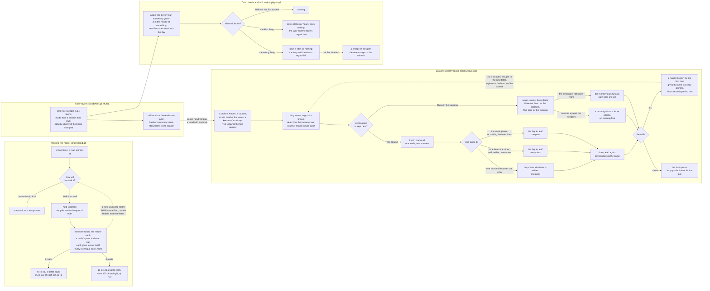

| | | |
|---|---|---|
| 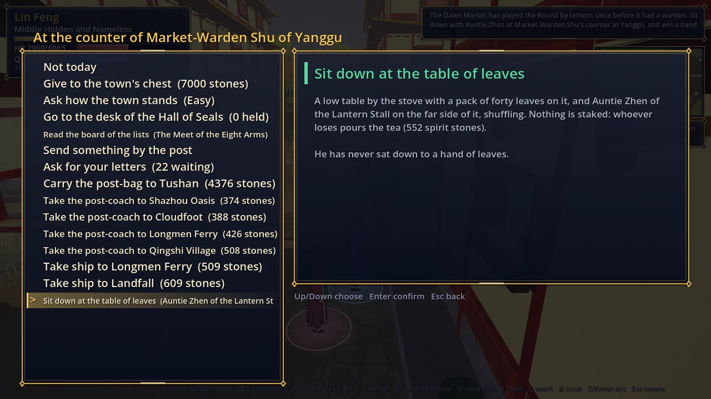 |  |  |
|  |  |  |
|  |  |  |
|  |  |  |

- **Card games** (`scripts/yezi.gd`, the rules; `scripts/leaves.gd`, the table; both new). A pack is **forty leaves**, eight of each of the five phases, numbered one to eight. Two games are played with it:
  - **The Round.** Five leaves in the hand. One leads a leaf and the other answers it. **A phase that overcomes the other takes the trick whatever is written on either leaf** (water puts out fire, fire burns wood, wood breaks earth, earth buries thunder, thunder runs through water: the same round every foe's weakness has always followed), so a water one beats a fire eight. Two leaves of one phase, or two with nothing between them: the higher. A phase and the one it bears, where neither overcomes (water and wood, fire and earth): the higher, **and it counts double**. Whoever took it draws first and leads. Seven points is the game.
  - **Three in the Morning.** Seven leaves each, three deals. Three are set down as the morning and four kept for the evening, **and the evening must be worth more, or the monkeys are furious and both piles are lost**. Morning is counted against morning and evening against evening: a morning taken is three acorns, an evening four. It is the keeper of monkeys' own game, and it is won by giving each pile just enough to stop it shouting.
  - **A table of its own.** The hand is drawn: his leaves fanned along the near edge, the other's face down along the far one, what was led and answered in the middle, the stock, and the round of the five phases painted on the cloth so that nobody has to remember what overcomes what. Left and Right choose, Enter lays, Esc gets up (a hand lost).
  - **Nothing is staked, and nothing is ever paid to him.** The loser pours: he pays the house for the pot when he loses, and when he wins the other side does. It is not a game of Old Du's mat, a keeper of the precepts may play it, and there is no playing it for a living (the tests play four hundred hands and count).
  - **Five masters**, each at a counter or where they stand, each with a game, a way of playing it and a leaf they painted: **Hall Master Du**, who confiscated the outer court's pack and has been guarding it by playing ("I led the eight. I always lead the eight"); **Auntie Zhen of the Lantern Stall** in the Dawn Market; **Old Ban of the Net-Loft** at Longmen ("the river plays it: it gives in spring and takes in autumn and the fools are surprised twice a year"); **Forewoman Rong of the Pits** at Tushan, who counts what has gone; and **Ju Gong, the keeper of monkeys**, under the Mulberry Silk Woods. A master beaten for the first time gives their **painted leaf**, a ninth of one phase, and will not sit again that day. **Esc > Leaves** shows the record and chooses which painted leaf is brought to a table: it takes the place of the least leaf he is dealt.
  - **Three ways of playing**: somebody who leads the biggest leaf they hold, somebody who answers with the least leaf that wins, and somebody who counts what has gone. Every deal is drawn from the journey's own count of hands and who sits opposite (`Game.card_n`), so the same journey is dealt the same leaves; `Yezi.best` is what the bot lays.
- **Several Daos at once** (`scripts/braid.gd`, new). Since Part XI a road was walked one at a time: taking up another at a stele set the first down. A stele now asks how the road pointed at is to be walked: **"Walk it as well"** holds it together with what he walks ("Leave it" is the first answer, and the old exchange is still there). The road he leads with is the one the peoples and the rites speak to; the gifts of every road he holds, and from Adept the technique of each, are his together. **And the more he holds, the harder each is to walk:**

  | roads held | what a battle's point is worth to each | how much of each road's gifts he has | what every technique costs | the realm it asks |
  |---|---|---|---|---|
  | 1 | the whole point | all | as written | |
  | 2 | 48 in 100 | 85 in 100 | 6 in 100 more | |
  | 3 | 30 in 100 | 72 in 100 | 12 in 100 more | Skill Become Dao |
  | 4 | 20 in 100 | 62 in 100 | 18 in 100 more | Sumeru in a Seed |
  | 5 | 14 in 100 | 54 in 100 | 24 in 100 more | Practised Hand |
  | 6 | 10 in 100 | 48 in 100 | 30 in 100 more | Hidden and Nameless |

  Two roads learn less between them than one did, and yet give more between them than one does: that is the bargain. A road set down keeps what was learned on it. A trial that asks for a Dao is met by any road he holds, a people is honoured by any road he holds, and **with one road every number is exactly what it was** (the tests compare all six roads at all three ranks, to the last bit).
- **Fuller, livelier towns** (`Folk.MORE`). **108 more people** live in the fourteen towns (421 where there were 313), each with a name, a body, a day and something to save for:
  - **Old hands** (two or three a town) are at the tea-house table with a fan of leaves from the first pot to the last, on a bench under the tree when the house is full, in the square in the afternoon; **talk to one and they will play a hand** ("Sit, sit. The loser pours. That is the only rule nobody has ever argued with").
  - **Hawkers** walk every street of the town with two baskets on a pole and a call of their own ("Hot chestnuts! Hot! They were hot. They are warm. Warm chestnuts, and honest about it!").
  - **Storytellers** have the square in the afternoon, with a fan ("Open: he draws his sword. Shut: the door closes. Tap: somebody is at the gate").
  - And more of who was there already: children, porters, washers, farmers, fishers, casters, disciples.
  - **Nobody who lived there before has changed.** The newcomers are made after everybody else from a seed of their own, so every older name, body, day and errand is who it was (the tests check each town).
- **More good deeds and bad ones** (`scripts/plights.gd`, new). Until now what he could do for or to the people of the towns was an errand of the story, a lost thing carried home, a gift to a chest, a thing pocketed or a sword drawn. Now, on about one day in four, somebody grown of the towns is **in the middle of something**, and a word with them shows it. There are three things to do: **walk on** (always the first answer), the **kind thing**, which costs him stones or hours and never pays, and the **wrong thing**, which pays, or costs nothing, and is remembered.

  | the plight | the kind thing | the wrong thing |
  |---|---|---|
  | a load spilled in the road | gather it up and carry the other end | name a price for the help |
  | a debt come due tomorrow | pay what is owed | buy the debt, and press it tonight (a charge) |
  | a weight that is not true | say so quietly, before the warden does | take silver to have seen nothing (a charge) |
  | an empty bowl on a bench | fill it, and bring a second bowl for himself | take the bench, and the sun with it |
  | two about to come to blows | stand between them | hold the stakes, and say when |
  | a letter nobody there can read | read it as it is written | read it as would pay better (a charge) |
  | a fever in the house | sit up with it, and send the nurse to bed | sell them well-water as an elixir (a charge) |
  | the watch going through a hawker's baskets | ask to see the toll written up | take the cut that is offered |
  | three tiles slipped before the rain | go up and set them | sell a talisman against rain |
  | a story going round about a rival's stall | say what is so, aloud | add to it |
  | a purse found, and nobody to ask | help find whose it is | say that it is his (a charge) |
  | a stroke of the trade that will not come | show where it goes wrong | say it will never come |

  - **Twelve good deeds and twelve bad ones**, each happening to somebody of a trade it could happen to, and each answered in that person's own words ("You have carried before. I can tell: you took the weight before I said lift"; "I have met a great many people on this road, and I shall remember which one you were").
  - **Each is weighed where everything else is**: kindnesses and people wronged are in the Way he walks (`Creed.causes`, each up to a measure), the town hears of both (`Weal.ACTS.kind`, `wronged`: regard), and the five heaviest wrongs are a charge at the gate (`Crime.CRIMES.wrong`: the one wronged is the witness).
  - **Nothing is random** (who is in which plight on which day is read from their seed and the day), **a child is never in one**, a wrong thing is worth less than the road, no step or trial asks for a deed of either kind, and the bot walks on. Three feats (one of them hidden).
- **Part XL: Three in the Morning** ([below](#part-xl-three-in-the-morning)): twenty-five steps at Azure Cloud Sect, the Mulberry Silk Woods, Yanggu, Glowcap Vale, Longmen, the Heights of the Magpie Bridge and Tushan, with two new kinds of step (`"cards"`: a master of the leaves beaten; `"braid"`: so many roads held at once); nine new foes in three caves no chapter had used (a monkey furious at three, a leaf kept up a sleeve, a road not taken); the keeper of monkeys, with a body built from a script; a crossroads (*may a disciple walk a second road?*) with three marks among the tea terraces, three letters, three fates and three pages; ten feats in all; and the forty-sixth realm.
- **Five bugs and nine plot holes fixed** ([Bugs found and fixed](#bugs-found-and-fixed)), from two audits of the last releases' rules and story run beside the work, each finding checked against the source before it was mended.
- **Nothing older moved.** The chapter's packs, things to find and the keeper are stood in three more caves, after everything that was already there, and its tables are at counters that already stood. Every entity, peak, camp and building of the five realms and every floor was dumped from both checkouts: 8,542 lines before, 8,591 after, **none moved or removed**: thirty packs, twelve things to find, the keeper, and the three marks of the crossroads with whoever stands by them.
- **1 hour 15 minutes 47 seconds longer**, verified by the playthrough bot twice: end to end (the whole game, seed 1234: 48:24:58, complete, the chapter being what follows 47:09:11) and from the chapter's first step to its last (`--bot-start=s_p40_home`: 1:26:05, 102 battles, no deaths). The bot sits down with all five masters and takes each table, takes up the Sword beside the Heart at a stele, performs a rite with both on its back, and answers the crossroads. The last release's whole run was 47:22:16: this one is **1 hour 2 minutes 42 seconds longer** end to end, the thirty-nine older parts having run thirteen minutes quicker than they did (47:09:11 where they took 47:22:16), in a land with a hundred and eight more people in its streets to ask the way of.
- **Code**: the game's GDScript is 101,369 lines (99,138 before). The tests now make 111,048 checks (108,671 before).

### Five releases ago: a paper for every Dao, three tournaments fought alone with words across the ring, auction rooms, a post that goes both ways and Part XXXIX

| | |
|---|---|
|  |  |
|  |  |
|  |  |
|  |  |


| | | |
|---|---|---|
|  |  |  |
|  |  |  |
|  |  |  |
|  |  |  |


- **Every Dao has a certificate** (`scripts/seals.gd`, new). For thirty-eight chapters what Lin Feng could do was known to whoever had watched him do it. The **Hall of Seals** now keeps a desk beside the post in six towns (the counter of whoever answers for the town; "Not today" is the first answer), and each of the seventeen Daos has a paper:
  - **The six roads and the eight Daos of arms are examined.** A road he has walked or a weapon he is an Adept of is shown to the desk (with a window, its rite of the Uncarved Block release is what is performed), the registrar asks his one question ("The straight sword. One cut, at the height of this candle, and the candle is to stay lit. Most people bring me a shorter candle"), the fee is paid and the paper is sealed **Entered**, **Proven** or **Attested** by how far he has gone in that Dao. A paper can be sat again when he has grown past its grade.
  - **The three forbidden Daos are abjured.** The Hall certifies no forbidden art. What it seals is a line saying the shelf has never been opened, and **that paper is void from the day he sits to the art**: a paper says a thing about him, and stops being a paper when the thing stops being true. Somebody the shelf has marked is sealed nothing at all, and neither is somebody with a price on his head in that town.
  - **What a paper is for**: the lists admit nobody without one, a purse is two parts in a hundred heavier for each he holds, and three open the sealed room of an auction house. **Esc > Seals & Lists** shows all seventeen, with a red square on the ones that are his.
- **Tournaments** (`scripts/lists.gd`, new). Three **meets** are called at three counters: the **Lists of the Outer Court** (the practice yard, eight names off the Roll that has been ranking his fellow disciples since the Ordered House release), the **Meet of the Eight Arms** (the lantern green of Yanggu; a paper of a weapon's Dao is asked for) and the **Meet of the Hundred Schools** (the casting floor of Tushan; three papers). Each is a fee paid once and three bouts.
  - **A bout is fought alone.** The party is Lin Feng; Yue Ling is at the rail ("His left! No. His other left. I shall be quiet"). The rival is somebody with a name, met at Lin Feng's own level on the day and a little over, with several times a single foe's health because there is one of him.
  - **Losing a bout is a fifth end of a battle.** The outcome is `"out"`: he kneels, the board is wiped at his name, nobody is carried home, no death is counted and nothing is taken but the fee he already paid. The meet is over for him at the place the round is worth (among the eight, among the last four, second), a purse is counted out, and **the step that asked for the meet is done however it went**. Three bouts won is first place. A meet is called again every thirty days for a better place.
  - **Nine rivals.** Brother Meng Zhi (who would be further on if he talked less), Senior Sister Bai Lu and Senior Brother Han Yue of the Roll; Spear-Master Tong, who teaches the dyers' sons, and the Maiden of Yue, who learned from a white ape; Kong Chuan of Lu; and the three disputers of the School of Names, each with a body built from a script: **Deng Xi**, who argues either side for the price of a coat ("I can prove you have won already. I can also prove you have lost. Which would you like? The second is cheaper"), **Hui Shi** of the five carts of books, and **Gongsun Long**, who brings a white horse into the ring and says it is not one.
- **Trash talk** (`Lists.WORDS`, `TEMPERS`). In a bout **Step out** takes the place of Flee on the battle menu, and there is a fifth line: **Words**. One thing may be said a turn, each thing once a bout, and **saying it does not cost the turn**:
  - *Needle him* (say the thing about his form he hopes nobody noticed), *Name the blow* (tell the rail what is about to happen: it puts weight in the arm, and it must be made good) and *Praise him* (the best true thing there is to say of his hands, aloud).
  - **What a word does depends on who it is said to.** A rival is hot, proud, cold or merry. A needle makes a hot man swing wide (he hits harder and is open by three parts in ten); a cold one smiles, and Lin Feng's own arm is the heavier for having said it. Praise disarms the proud ("He had an answer ready for anything but that") and is wasted on the merry, who get better. The rail has an opinion of each (it does not like the proud needled), and how it leans is in the purse.
  - **A boast is settled when the bout ends**: made good, it is the crowd's; lost, it halves the purse ("He had told the rail which blow it would be. The rail remembers").
  - **The rival talks too**, at the first, third and fifth rounds, in his own voice, and has something to say when it is over either way. And **what was said comes back by post**: needle Brother Meng and he writes to say he has asked four people whether it is true ("They all said yes at once, which I think is the worst part").
  - `Lists.word` is a pure function and the tests bound every number in the table; the bot says the one thing worth saying to each rival (`Lists.best_word`), once a bout.
- **Auction houses** (`scripts/auction.gd`, new): the **Lantern Room** over Headman Luo's drum in Qingshi, the **Tide Hammer** in a net-loft at Longmen, and the **Cauldron Room** of the Guild at Tushan.
  - **Four lots a day, by the day and never by lot**: pills, essences of every phase, the household things a picky house asks for, and in each room's **sealed room** (three papers open it) a **curio**: the Fishmonger's Inkstone, a Jade Carp with its tail unfinished, half a Tiger Tally, a White Clay Horse "listed, in a narrow hand, as: white; not a horse". There is one of each, they weigh nothing and they do nothing.
  - **Three people are in the room every day** (Granny Wen's niece, a lock-keeper who does not look up from his pipe, an agent of the court) and each has decided before coming what a lot is worth to them. A call is answered at once by whoever would still go higher; **a call nobody will top wins, and is what is paid**. Over two hundred days about half the lots go under their worth and half over: some days the right answer is "Let it go", which is always the first one.
  - Nothing sold there can be sold on, so there is nothing to farm.
- **More uses for the post** (`scripts/mail.gd`). Since the Lost Horse release letters have found him; now the counter also offers *Send something by the post*:
  - **He can write.** To Granny Wen, to the Elder, to Mian the novice who missed, for the carrier's fee. An answer is at any counter two days later, a different one each time ("Your third stroke still runs downhill. Are you eating?"). Nobody dead by his hand answers: the letter comes back unopened.
  - **A parcel home**: whatever of the land's goods is on his back goes to the sect's storehouse by the carrier's mule, at three stones a jin, from any counter.
  - **A remittance**: a gift to the chest of a town he has walked into and is not standing in (the same gift, the same three a town, and the carrier's tenth).
  - **Sealed bids**: the stones go into the bag with a bid for a lot of *tomorrow's* sale in another town's room. If nobody in the room would have gone higher the lot is waiting at any counter as a parcel; if somebody would, the stones come back.
  - **Ten new letters**: from the Hall of Seals (with the fee of a first sitting, which the Elder paid and asked not to have mentioned), from three rivals about what was said to them, from Hui Shi about wine (it can be answered two ways), and from Mian about each answer of the chapter's crossroads.
  - None of it is asked for by any step, nothing in it tips a scale, and the bot uses none of it.
- **Part XXXIX: The Name That Can Be Named** ([below](#part-xxxix-the-name-that-can-be-named)): twenty-seven steps at Azure Cloud Sect, Frostpeak, Qingshi, the Desert of Fallen Stars, Yanggu, Longmen and Tushan, with three new kinds of step (`"seal"`, `"meet"`, `"bid"`); nine new foes in three caves no chapter had used (a champion of straw nobody ever fought, a seal cut from a turnip, a white horse that is not a horse); nine rivals; a crossroads (*what is the column beside two hundred and six names for?*) with three marks on the mountain, three letters, three fates and three pages; four feats; and the forty-fifth realm, **Hidden and Nameless**.
- **Three bugs and six plot holes fixed** ([Bugs found and fixed](#bugs-found-and-fixed)), from an audit of the last release's rules and story run beside the work.
- **Nothing older moved, and nothing was stood on the land but three marks.** The chapter's packs and things to find are stood in three more caves, after everything that was already there; the desks, boards and rooms are at counters that already stood. Every entity, peak and camp of the five realms and every cave was dumped from both checkouts: 6,148 lines before, 6,196 after, **none moved or removed**, forty-eight added.
- **1 hour 6 minutes 47 seconds longer**, verified by the playthrough bot twice: end to end (the whole game, seed 1234: 47:22:16, complete, the chapter being its last 1:06:47), and from the chapter's first step to its last (`--bot-start=s_p39_home`: 1:25:53). The bot sits for six papers, wins a lot in each of the three rooms, cooks a meal nobody examines, and fights all three meets to the last bout, saying the one right thing to each of nine rivals: eighty-nine battles, no deaths. The bot that has played the whole game arrives stronger than one dropped at the chapter's first step, which is why the end-to-end figure is the shorter. The bot's own ceiling was forty-six hours and is now forty-nine (`max_time`): the first end-to-end run of this release stopped at exactly 46:00:00, twelve steps short of the last chapter's end (through the previous chapter's story at 46:15:29).
- **Code**: the game's GDScript is 99138 lines (96,958 before). The tests now make 108,671 checks (105,869 before).


### Six releases ago: foes realms above him, a story that forks where he loses, pages in the first person and Part XXXVIII

| | |
|---|---|
|  |  |
|  |  |
|  |  |
|  |  |


| | | |
|---|---|---|
|  |  |  |


- **Somebody can be above him** (`scripts/betters.gd`, new). For thirty-seven chapters whoever stood in the road was about as strong as Lin Feng was on the day, and a battle had three ends: the foe fell; he woke in the infirmary and tried again; or it was a doom, a tide or a host that nobody beats, and nothing was taken for it. A **better** is a fourth thing: *a person*, `over` whole realms above whatever he is when they meet. Three of them stand in the land from the chapter's first word: **Fuchai, King of Wu** (four realms), **Pang Juan, General of Wei** (five) and **Lian Po, General of Zhao** (four).
  - **A realm had to be made to weigh.** The first cut of this release stood them twelve and fifteen levels up with a lord's numbers, and **the bot beat all three at the first try**: a level is a few parts in a hundred of health in this land, and the weight of a realm (the suppression of Part XII) stops at three. So every realm of the gap past the first multiplies a better's health by 1.5 and his blow by 1.3 (`Betters.might`): at four realms Fuchai has thirteen times a lord's health and hits nearly three times as hard.
  - **Losing is not the infirmary.** The party is down, or he gives way, and the outcome is `"bested"`: he is where he stood, no death is counted, no stones go to the healers. **Something is taken instead**, and it is different for each: Fuchai takes half of what he carries and **three days of his life** as a groom (days lived: packs grow, the stipend falls due); Pang Juan takes a fifth and **a knee** (he strikes eight parts in a hundred less hard and is slower to the first blow until it is mended); Lian Po takes a quarter and **his name** (every counter in the land asks more of somebody who was put on his back in a lane). The town that hears of that country thinks less of its peace.
  - **He can be watched first.** Enter in front of one of them offers, after "Walk on": *Watch him* (four hours, once a day, three times), and each watch closes a realm of the gap, for knowing where a man's guard opens is worth a realm. Somebody who takes the three days meets Fuchai one realm up and can win. **The bot watches nobody, and loses to all three**; run with `--bot-watch` it plays as somebody who had, and wins all three.
  - **He can be met again.** Whoever lost may ask for another bout wherever the better stands. Winning gives back the stones and lifts the wound. It does not give back the branch: what was done after losing was done.
- **The story forks** (`"if": [better, "up" | "down"]` on a step). Each bout is a step of a new kind, `"dare"`, done however it goes; after it the journey that lost walks one set of steps and the journey that did not walks another, and they meet again further on (`Betters.skip`, asked once, in `Game.advance`). Eight journeys are possible through the chapter; the tests walk every one to the end. **Losing is the longer road, on purpose**: ten steps against three.
  - *Lost to Fuchai:* cut four loads of brushwood to sleep on, clear the yard he swept for Wu, and go back to a king who did both for twenty years to be told what the gall is for.
  - *Lost to Pang Juan:* light two cook-fires where a scout can count them, the second smaller; cut the bark from **one** tree with a blow held back to a single cut; clear the light horse he came on with; and meet him a second time at dusk, under the white tree, as a lord with four ways through (the slips Sun Bin kept back, fewer fires, one tree, or standing up again on the bad knee).
  - *Fought Lian Po and lost:* clear what came down into the lane the night two tigers fought, ask two old people of Qingshi who they have given way to in sixty years, and go back to the minister in the ditch.
  - **And one of the three it is right not to fight.** Lian Po is an old man with forty wounds, all in front, standing in the only way through because a clever man was set above him. Lin Xiangru, who faced down the King of Qin, turns his carriage into the ditch for him. *Giving way* to Lian Po costs a toll and nothing else, and is the road up: three days later he is at the cave mouth with thorn rods on his back. Giving way to the other two is what it was for Goujian and for Sun Bin: a groom, or lamed, all the same.
- **The people the story is about say "I"** (`scripts/memoir.gd`, new). Every chapter was told by a narrator standing a little behind Lin Feng's shoulder. Now **fifty-one pages** are written in the first person as the story goes: twenty-five by Lin Feng ("I swept the steps of Azure Cloud Sect for three years before anybody asked me to do anything else. I want that written first, because everything after it sounds like somebody else"), fifteen by Yue Ling, who writes *to* him ("You cut the rope and then stood there holding the two ends as if you ought to give them back to somebody"), and eleven by Elder Qing Xuan ("I kept the child sweeping. The answer I gave was humility. The true answer is that a sweeper is not looked at, and I knew who was looking").
  - One for the close of every part of the story, so a journey begun today is told from the inside from the bamboo forest on; and in Part XXXVIII **which pages are written depends on how each bout went**: somebody who lost to Fuchai writes of the stables ("I was good at it. He said: this one has done it before. And I was proud"), Yue Ling of the wall she sat on for three days, and somebody who won writes neither.
  - A page is read out as a scene the next time he stands free, and any page written can be read again on **Esc > In Their Own Words**. Nothing in a page says whether the hero is a man or a woman. Somebody dead by his hand writes nothing. With no window, or under the bot, a page is only written, so the bot's journey is what it was.
- **Part XXXVIII: A Sky Above the Sky** ([below](#part-xxxviii-a-sky-above-the-sky)): twenty-nine steps (nineteen to twenty-six of them walked by any one journey) at Azure Cloud Sect, the Sunken Dragon Palace, the Maple Gorge, the Whispering Bamboo, Qingshi and the Cloud-Tea Terraces; nine new foes; six people built from scripts (Goujian of Yue, Sun Bin, Lin Xiangru, and the three who stand above him); a crossroads with three marks on the mountain, three letters, four feats, and the forty-fourth realm, **Low as the Sea**.
- **Four bugs and nine plot holes fixed** ([Bugs found and fixed](#bugs-found-and-fixed)), from two audits run beside the work: one of the rule modules, one of the whole story read against itself.
- **Nothing older moved, and nothing was stood on the land but three marks.** The chapter's packs, people, things to find and the three betters are stood in three more caves, after everything that was already there. Every entity, peak and camp of the five realms and every floor was dumped from both checkouts: 8,319 before, 8,368 after, **none moved or removed**, forty-nine added.
- **One hour, five minutes and fifty-five seconds longer**, verified by the playthrough bot from the chapter's first step to its last (`--bot-start=s_p38_home`): sixty battles against 145 foes, no deaths. The bot meets all three betters, loses to all three, walks the three losing branches and beats Pang Juan the second time, under the tree. Given way to throughout (`--yield`) the chapter is 1:00:41; as somebody who watched first (`--bot-watch`), winning all three, 0:40:41. The end-to-end run (45:27:41 at the last release) is made by CI.
- **Code**: the game's GDScript is 96,958 lines (95,526 before). The tests now make 105,869 checks (100,058 before).


### Seven releases ago: hands on what they hold, things that hang by their weight, the five phases on the land and Part XXXVII

**Total gameplay duration then: about 45 hours 28 minutes** (45:27:41 of game time for the end-to-end bot run, seed 1234), **1 hour 2 minutes 37 seconds longer than the last release** (44:25:04): **Part XXXVII, A Cup of Water, a Cart of Firewood**, is new (the pines below the east wall burn for a night while forty disciples throw everything they know at it and make it worse; a fire fed for nine years to be rid of it, a dyke that sent its flood next door, a log that could sing burned for one supper; three lords met in caves, a crossroads, a forty-third realm, Five in One Hand). **Hands close on what they hold**: every held thing was in the sleeve, fifteen centimetres above the fist, and is in the palm; the other hand is on the shaft; a hoe lands on the ground and an axe in the trunk that is really there. **What hangs, swings**: a lantern, the baskets of a pole, a bell, a swing are pendulums and are timed as pendulums. **The five phases do to the land what they are**: fire burns a wood and catches the next stand, water puts it out, wood feeds it, earth is raised and root breaks it, thunder calls the rain. Five bugs fixed, and fifteen slips of the new chapter caught by an audit before it shipped.

| | |
|---|---|
|  |  |
|  |  |
|  |  |
|  |  |


| | | |
|---|---|---|
|  |  |  |
|  |  |  |


```mermaid
sequenceDiagram
    participant C as the clip (AnimationPlayer)
    participant R as Grip.Reach (after the clip)
    participant S as the skeleton
    participant W as the world
    C->>S: this frame's pose (the arm swings)
    R->>S: where is the working end of the tool?
    R->>R: is it in its stroke? (Grip.span, measured once)
    R->>W: what is under it, or in front of it?
    W-->>R: the ground's height, the trunk, the nearest face
    R->>S: upper arm and forearm solved, wrist turned: the end is on it
    R->>S: the other hand to the nearest of the shaft
    R->>W: it has landed here (chips, with weight, from this point)
    R->>S: what hangs from the hand, swung (Heft.hang)
    Note over S: drawn; and the next frame the clip's own pose is back
```

- **Hands close on what they hold, and tools meet what they work on** (`scripts/grip.gd`, new). Nobody had looked at a hand from a pace away. Three things were wrong with every animation that had a thing in it:
  - **What was held was not in the hand.** Every held thing in the game is drawn to be gripped eight centimetres below a wrist. The hand bones of the people the Blender scripts make point *down* their own +Y, so that was eight centimetres **up the forearm**: a hoe went through the sleeve and the fist closed on air fifteen centimetres below it. It has been so since the first glTF character. `Grip.seat` puts the grip in the palm; `World._hold_in_hand`, the one place anything is put into a hand (the hero, Yue Ling, every townsperson), asks it.
  - **The other hand was nowhere.** A hoe, a broom, an axe, a spade, a pick and a long ladle are worked with two hands; the clips moved one arm. The other hand now closes on the shaft, wherever on it is nearest (`Grip.TOOLS.two`): two bones solved for one point, the bones kept their length and the elbow kept on the side the clip had it (`Grip.solve`).
  - **The tool met nothing.** A hoe was swung at the air at the height of the waist; a broom swept a hand above the ground; an axe was swung at a tile, not a tree. Each tool says where its working end is and how it is used; in the part of the stroke where the clip brings it nearest (`Grip.span`: measured from the clip itself the first time, never authored) the arm is solved and the wrist turned so that the end is **on** what it works: the ground under it, whatever the slope; **the trunk of the tree that really stands on that tile** (`World._trunk_at`); the nearest face of the thing in front of him, found on the triangles of its own mesh (`Grip.closest`).
  - **A bare hand is laid on what it touches**: the stele he reads, the lion's head, the panel he knocks on, the strings of the qin, the rim of the cradle.
  - **None of it is in a clip.** It is a `SkeletonModifier3D` that runs after the animation and is undone before the next frame, so no clip was rewritten and not one of 293 characters was rebuilt. With no window nothing is held and nothing is solved; the bot's journey is the same.
- **Things move as things with weight move** (`scripts/heft.gd`, new). What a hand carries that hangs **hangs**: the lantern on a watchman's stick, the two baskets of a shoulder pole, the pan and the weight of a steelyard, a fishing line are each a weight on a cord driven by the hand (`Heft.hang`): start walking and it lags, stop and it swings on. They were rigid with the wrist: a lantern stood out sideways when the arm was raised. **The bell is struck and the swing is pumped** (`Heft.pendulum`, the equation of a pendulum, integrated): both were sines with an envelope. The tests time a pendulum of three lengths against 2&pi;&radic;(L/g) and check that it gains nothing from nowhere. **Chips are bodies**: where an axe, a pick or a spade lands, chips of the right colour fly back from *that point*, fall, bounce on the ground as it really lies and come to rest (`Heft.chips`, the same rigid bodies the breaking of things already used).
- **The five phases do to the land what they are** (`scripts/phases.gd`, new). Fire, water, wood, earth and thunder were five colours of one number: a fire technique and a water technique took different amounts off a foe and left the wood they were thrown in exactly as it was. Now **K** turns his hand to a phase (the plain blade is always the first, and is what it always was), and with F the land answers as what it is:

  | | a wood | open ground | water |
  |---|---|---|---|
  | **fire** | it burns, and the stands beside it catch | scorched, with embers in it | a bank of steam |
  | **water** | drenched (and will not take fire) | a pool left standing | a swell |
  | **wood** | in blossom | grass and flowers to the knee | a raft of lotus |
  | **earth** | boulders heaved up among the roots | a ridge of raised stone | a gravel bar |
  | **thunder** | every trunk riven and smoking | a branch of fused glass | it crackles, and runs through everything wet that touches |

  - **The phases meet as the old round has them meet.** A phase **quells** the one it overcomes (the same weaknesses every foe already has: the tests count the foes that agree): water on anything burning leaves steam and nothing burning; root breaks a ridge into a mossy bank; earth buries a seam of glass; thunder runs through water. A phase is **fed** by the one that bears it (the round the spirit root already turns in): fire in blossom is a blaze that takes twice as many stands; earth on what is scorched bakes hard as a kiln floor; thunder into raised stone leaves a lodestone; water after thunder comes down as rain that stays; and wood where it is wet is a grove. What overcomes the stroke spends it: a drenched wood does not burn, the fire only dries it.
  - **It is state, and only drawn.** `Phases.cast` is a pure function of the grid and what lies there: a tile, what, the day (`Game.touched`). **No tile changes**: a burning wood is still a wood nobody walks through, a ridge bars nobody, a pool is walked as the ground it is drawn on. It mends by days lived. On screen the trees that really stand on the tile take its colour (burnt black, in blossom, dark with wet), flames flicker, steam and smoke drift up, and each phase has its own burst as it lands.
  - **In battle too**: a technique of a phase leaves on the ground under whoever it struck what that phase leaves, and the next one meets it by the same rule (`Phases.come`).
  - Packs, obstacles of the story and what people leave about are struck by the blade exactly as they were, so the bot's first strikes and every older step are the same. With a phase in the hand the land is not *broken* (the weight of a blow, the last release), except in a step that asks for breaking.
- **Part XXXVII: A Cup of Water, a Cart of Firewood** ([below](#part-xxxvii-a-cup-of-water-a-cart-of-firewood)): twenty-nine steps at Azure Cloud Sect, the Ashen Volcano, Tushan, the Drowned Fields of Gun, Qingshi and Thunder Valley; nine new foes and three lords, all met in caves; three people built from scripts (Su Dai the Persuader, Minister Bai Gui, Cai Yong); a new kind of step (`"phase"`: blows the land answered, or blows in which one phase overcame or fed another), two new ways through a trial (by the round, by the measure), a crossroads with three marks on the mountain, four letters, five feats, and the forty-third realm.
- **Five bugs fixed, and fifteen slips caught before they shipped** ([Bugs found and fixed](#bugs-found-and-fixed)). The oldest: **everything anybody has ever held has been in their sleeve.**
- **Nothing older moved, and nothing was stood on the land but three marks.** The chapter's packs, lords, people and things to find are stood in three more caves, after everything that was already there (`Caves.LATE`, `"after": true`). Every entity, peak and camp of the five realms and every cave was dumped from both checkouts: 6,021 before, 6,075 after, **none moved or removed**, fifty-four added.
- **The whole game** is 1 hour 2 minutes 37 seconds longer, verified by the playthrough bot (45:27:41 against 44:25:04): 3,253 battles against 6,689 foes. The bot turns its hand to a phase only inside the chapter's own steps (thirty-one blows that the land answered, in which one phase overcame another on 166 tiles and was fed by another on 435), and strikes with the plain blade everywhere else.
- **Code**: the game's GDScript is 95,526 lines (93,356 before). The tests now make 100,058 checks (86,162 before).

### Eight releases ago: blows that weigh what his realm weighs, a meal cooked in a pot that is physics, picking, digging and veins, first person and Part XXXVI


| | | |
|---|---|---|
|  |  |  |
|  |  |  |
|  |  |  |
|  |  |  |


- **As cultivation rises, his blows do more to the land** (`scripts/sunder.gd`, new). Until now the sword (F) reached the same four tiles at Qi Condensation and at the last realm there is. A blow now has one of **seven weights**, by the great realm he has reached: the edge of a blade (what the sword always did), a felling stroke at Foundation Establishment (the tree behind the tree goes too), a cleaving stroke at Golden Core (a lane, and the rock in it), a stroke that breaks stone at Nascent Soul (the ground it crosses is cracked like a dry field), a stroke that shakes the hill at Void Refinement (five tiles wide), and from True Immortal on **a stroke that parts the wood**: eight tiles deep, five wide, thirty-six tiles of country, and a crater where he stood.
  - **What is broken is state, and only drawn.** `Sunder.blow` is a pure function of the grid, the height field and his realm: a tile, what it lost (a stand of trees, a crag, cracked ground, a crater), the day. The bot and the tests break the same land with no window. **No tile changes**: a felled wood is still a wood nobody walks through and the ground under a crater is as high as it was, so breaking the land is never a way round the story and no map moves. Scars mend by themselves, a tree in a day, a crater in four.
  - **On screen it is physics.** Every tree on the tiles the blow reached topples about its stump and breaks into logs that roll, every rock shatters into rigid bodies (impact.gd, which the first four tiles always had); past the third weight a ring of dust goes out, whatever lies loose within reach is thrown outward by an impulse that falls off with distance, a crater throws up two bursts of rubble, the camera is shaken, and everybody near answers as what they are.
  - **Because he can, he need not.** **H** holds the hand back a weight at a time, down to **a single cut**: one thing, and nothing behind it, lighter than anybody strikes by accident. The chapter asks for both, and for the light one first.
  - Packs, obstacles of the story and the things people leave about are struck exactly as they were (the first four tiles), so the bot's first strikes and every older step are the same.
- **The whole of cooking is animated, and the pot is physics** (`scripts/cooking.gd`, `scripts/kitchen.gd`, new). With the iron pot (given by the chapter; Smith Tie and the pedlars sell one) and what the land gave, **B** out in the country lays a fire on the free tile in front of him. Twelve things are done one after another, each on a clip the party already carried and with the right thing in the hand: deadfall gathered and laid, a spark struck, the fire fanned up with a palm leaf, water poured from the gourd, the board out and everything cut the same size, **the pieces thrown into the pot one at a time along the arc a thrown thing takes** (each lands with a splash), the lid on and brought to the boil, the simmer, salt from high up, a taste off the ladle, two bowls, and both of them eating. Yue Ling fans, warms her hands, sits by it, claps at the ladling and eats.
  - **The pot is a small simulation** (`Cooking.step`, a function of the pot and the seconds, nothing random): the fire burns up towards what it is fed and fanned and eats its wood; an empty iron pot heats fast and cold water poured in brings the two to one heat; the water gains heat by how much hotter the flame is and loses it to the air, slower the more is in it, and never passes the boil; at the boil the rest goes off as steam; **under the lid steam is pressure, and when it outweighs the lid the lid hops**, vents, lands and rings; a stirred pot comes to the speed of the ladle, **its surface dishes by the square of that speed**, what floats gathers at the middle as tea leaves do, and it runs down when the ladle is lifted; and what is in the pot is done by the heat it has had, not by the clock. The corner shows the fire, the water's heat and how done it is.
  - **One skill**: at the simmer, Enter turns the ladle. A thick stew must be kept moving or it catches; a broth wants a turn or two; **a small fish wants leaving alone, and comes apart at the second poke**. A meal that came out right mends health and qi (the stew, all of it); one that did not is still eaten, and mends half. Four dishes.
- **Mining and gathering** (`scripts/toil.gd`). Three more things the hands can take from the land: **mushrooms picked** under the trees of a forest's edge (a basket), **a wild yam dug** out of open ground (a narrow spade), and **a vein worked** in the wall of a cave (the pick): about one piece of cave wall in four shows a seam of green stone, drawn standing out of the rock with a glint in it, and gives jade in the rind. A piece of the land can now offer two things (`Toil.offers`): C does the one he has the tool for, **Shift+C** the other. Three goods with weight and a pedlar's price, three tools, and a load on the back for each.
- **First person** (`World.fp_on`). **P** puts the camera where his eyes are: W walks the way he looks, A and D turn him a quarter, S turns him about, and he faces what he looks at, so Enter, F, C and B do what they did. On a horse it rides at the rider's height; under the cloud-kite it looks down. Whenever something has to be *seen* done (work, a pot, a stair, a rite, a conversation's close-ups) the camera steps back out over his shoulder and returns when it is over.
- **Part XXXVI: Cooking a Small Fish** ([below](#part-xxxvi-cooking-a-small-fish)): thirty-one steps at Azure Cloud Sect, the Whispering Bamboo, the Crimson Marsh, Longmen, the Millet Plains and Heaven's Forge; nine new foes and three lords, all met in caves; three people built from scripts (Yong Ji, Song the Younger, Old Qi of the Gold Market); two new kinds of step (**cook a meal**, **break the land, or hold the hand back**); two new ways through a trial (by the pot, by the light hand); a crossroads whose three answers stand on the mountain path; four letters; and a forty-second realm, **Light Hand**.
- **Nine bugs and eight plot holes fixed** ([Bugs found and fixed](#bugs-found-and-fixed)), found by two audits run beside the work and by the chapter itself. The oldest: **cutting ore from a cave wall has been in the manual since the Heavy Road release and has never once worked**, because the rock of a cave is stored as a different kind of tile from the one the work looked for.
- **Nothing older moved, and nothing was stood on the land at all.** Every region has a cave, and a cave is a floor of its own: the chapter's packs, lords, people and things to find are stood in three of them, after everything that was already there (`Caves.LATE`, `"after": true`). Every entity, peak and camp of the five realms and every cave was dumped from this build and the last and compared: 56 things are new (50 in the caves, and the three marks of the crossroads with whoever stands by each) and not one other line differs. No band slot was needed.
- **The whole game** is 1 hour 0 minutes 9 seconds longer, verified by the playthrough bot (44:25:04 against 43:24:55): 3,185 battles against 6,525 foes. The bot cooks three meals and all three come out right (the broth turned once, the stew twice, the fish not at all), picks three handfuls, digs three yams, casts, works three veins, strikes three blows held back to a single cut and one in earnest; over the whole journey 46 of its blows broke something of the land (434 stands of trees, 640 tiles of ground, 28 craters), all mended since. The run was made twice on the finished scripts, and both took 44:25:04.
- **Code**: the game's GDScript is 93,356 lines (91,105 before). The tests now make 86,162 checks.

### Nine releases ago: a rite for each of the seventeen Daos, spirit roots of one to five phases, people who answer both and Part XXXV


The other nine rites (the eight above are at the head of this page):

| | | |
|---|---|---|
|  |  |  |
|  |  |  |
|  |  |  |

- **Every Dao in the game has a rite** (`scripts/rites.gd`, new). There are seventeen Daos in the land: the six roads (Sword, Free Wandering, the Compassionate Heart, Formations, the Cauldron, the Mirror), the eight Daos of arms and the three on the forbidden shelf. Until now each was a line on a page and a number in a battle. Each has three things now, and no two share any of them (the tests compare):
  - **A form nobody else has.** Seventeen clips written in Blender Python (`RITES` in `art/lib/person.py`, held poses eased by `_keyed` like the blows of the Eight Arms), carried by the hero's eight models: two fingers before the brow and the hand let fall (the Sword); the arms opened and a turn on the toes with the face to the sky (Free Wandering); down on one knee with the hands cupped and held out low (the Heart); the horse stance with both palms pressed to the ground (Formations); bent to listen to a furnace and a catch overhead (the Cauldron); a hand over his own eyes and the other into a mirror (the Mirror); the blade laid level and held (the jian); two slow sweeps and the chin rested on the planted staff; the sabre held up a long while, one cut and the back turned; the spear walked out as slowly as a door is closed; a turn with the fan open; the bow drawn, held, and let down unshot; the chain whirled and drawn home hand over hand; one stroke of the brush and the brush lowered; and, for the three that should not be done at all, a cup made of a hand, a banner raised and beckoned with, and a bell rung from the wrist beside the ear.
  - **A thing it is done with**, built from code (`Rites.prop`), some of it moving (`Rites.tick`): nine blades of light that open behind the shoulders and bow; a feather longer than he is tall that the wind takes; a lotus lamp whose petals open; eight flags and the eight trigrams between them, whole lines and broken; a cauldron whose lid lifts nine times and lets one pill rise; a bronze mirror with the moon in it, and the moon taken out; a plumb line; a ring of swept leaves; a green bamboo stake that slides apart at the cut; a copper cash on a thread; a candle whose flame leans and does not go out; a butt of rice straw with no arrow in it; nine reeds, none broken; a hanging scroll on which the character for one appears; a bowl of black lacquer; a banner of something that is not quite cloth; a figure of yellow paper that gets up and stands with its back to him.
  - **A scene cut in three shots** (`Rites.CAMS`: wide, low, face, top, back, prop, orbit, sky, far; no rite uses the same shot twice, and a change of beat is a cut, as in the close-ups of a conversation). It is played **the first time the Dao is truly his** (a road when it is first walked, a weapon's when he is first an Adept of it, a forbidden one when he first sits to it), once he is standing in the world with nothing else going on, and **again whenever he asks**: Esc > Root & Rites, or "Perform the rite" at any Dao Stele.
  - A rite changes no number. With no window nothing is built and the scene is three lines of narration, so the bot's journey is the same; it performs the rite of whatever it walks when a step asks.
- **The hero has a spirit root, of one phase to five** (`scripts/roots.gd`, new). Two new rows at character creation: how many of the five phases the testing stone finds (wood, fire, earth, thunder, water: the generating round), and which leads.
  - **One is a Heavenly Root**: learns a fifth faster, techniques of its own phase strike 18% harder and of the other four 8% softer, and blows land a little heavier. **Two is a Twin Root**, half of that. **Three is a True Root**, the ordinary sort, and every number of it is 1: it is the root the land is measured by, the root of a hero made before this release, and the bot's.
  - **Four is a Mixed Root and five the Whole Round, which the roll calls a waste root**: slower to learn (6% and 12%), lighter to hit. **A great vessel is a long time finishing**: past Dao Merging the round closes, and a five-phase root learns 12% *faster* than a True Root and takes a tenth less from every blow.
  - **The sect treats him by the roll**: its own counters ask a tenth less of a Heavenly Root and 8% more of a waste one, and the stipend of the first of the month is 30% more or 20% less.
  - It never changes. Nothing in the land washes a root; the chapter is about why.
- **NPCs react to the root he has, and very differently.** The fourth word with anybody of the towns (or the seventh) is about it, said as what they are (`Roots.said`: the nine kinds of `Manners.kind_of`, five roots, forty-five lines, each with a gesture): a labourer whose cousin saw the elders stand up for one colour, and another who was sorry to hear "waste root" and has stopped knowing what to be; a child who cannot see why five is less than three ("Grown people cannot count"); a gate guard who once had orders to turn such children back at the foot of the steps, and thinks about it when he sees him go by; a merchant who keeps the good scale under the cloth for a Twin Root; a scholar who has read the oldest copy of the roll, where the character is not *waste* but *a field left fallow*; one of the Great People, who asks what a thing can carry rather than what it is quickest at. **The Elder, Smith Tie and Yue Ling** each have a word of their own for each root (the Elder held the stone that day; for four colours he gave up his own bed for a month, for five he was outvoted), and two conversations of Part XXXV end differently for each of the five.
- **NPCs react to the Dao he walks, and to his walking none.** `Rites.said`: nine kinds of people, six roads and "no road yet", sixty-three lines, each kind with a gesture for each road. Before the Jianmu grows back a disciple asks whether she may say that Senior said there is no hurry; afterwards a seller says a sword-walker never haggles and it feels like being cut, the watch writes "passing through" for a wanderer as it does for clouds, a mother's cough is at last stopped and listened to, a child wants a formation drawn round his sister, a guard remembers two days of a blue goat, and nobody is sure it is him. Somebody will remark on the weapon in his hand once he is an Adept of its Dao (eight lines: "That is a broom handle. ...An Adept, of that? Then I have been armed all my life and nobody said"). The Elder, the smith and Yue Ling have seven words each. The six peoples of the realms already spoke to his road (`dao_lines`); the street's words for the forbidden shelf are still taboo.gd's, since nobody can see a forbidden art until he is marked.
- **Part XXXV: The Uncarved Block** ([below](#part-xxxv-the-uncarved-block)): twenty-five steps at Azure Cloud Mountain, Maple Gorge, the Garden of Immortal Peaches and the Jasper Pool of Kunlun, nine new foes, three lords with four ways through each, four people built from scripts (the boy Zeng Shen, Fang Zhongyong, Carpenter Shi of Qi, Bian He), a new kind of step (**perform a rite**), a new way through a trial (by the rite), a crossroads whose three answers stand on the mountain path, four letters, and a forty-first realm, Uncarved Block.
- **Four bugs and fourteen plot holes fixed**, found by two audits run beside the work (one of the smaller systems, every bug reproduced by a script before it was touched; one of the story of Parts XXVI to XXXIV read against itself, with mechanical checks over every step); see [Bugs found and fixed](#bugs-found-and-fixed). The worst was a soft-lock: six wares bought and never used filled the sleeve for good, and then nothing dropped in a road could be picked up, so two steps of Part XXXIV could not be finished.
- **Nothing older moved.** Every entity, peak and camp of the five realms was dumped from this build and the last and compared: 64 things are new (the chapter's people, lords, packs and things to find) and nothing else is anywhere else. Getting there took a **seventh band slot** (`"warband7"`, placed last of all in `Atlas`): in Maple Gorge a band of the sixth slot took the ground three marks of an older crossroads stood on. Two regions were tried before it and had no room at all (the Millet Plains placed two packs of thirteen, Qingshi's valley none).
- **The whole game** is 1 hour 15 minutes 30 seconds longer, verified by the playthrough bot (43:24:55 against 42:09:25): 3,116 battles against 6,356 foes. Part XXXV alone was also played from its first step with a Heavenly Root and with a waste root (`--root=1`, `--root=5`), and with a hero who is a woman: 1:23:44 and 1:22:50 against 1:23:50 for a True Root.
- **Code**: the game's GDScript is 91105 lines (89,111 before). The tests now make 72,302 checks.

### Ten releases ago: small things a hand closes on, people who answer what is done, a leap and Part XXXIV

```mermaid
flowchart LR
    subgraph TRF[Small things: scripts/trifles.gd]
    MAP[the town's own map:<br/>its buildings, its roads, the day] --> W1[wares by the wall of a shop,<br/>an inn, a smithy]
    MAP --> W2[somebody's own by a house:<br/>a toy, a pipe, a broom]
    MAP --> W3[what was laid<br/>before a shrine]
    MAP --> W4[dropped in the road:<br/>four a town, new every morning]
    MAP --> W5[nobody's: a feather,<br/>a cone, a shell]
    W1 & W2 & W3 & W4 & W5 --> ENT{Enter:<br/>'Leave it' first}
    ENT -->|buy| OWN[his: eaten, or held out<br/>to a child]
    ENT -->|pocket, unseen| SLV[in his sleeve, and still theirs:<br/>it weighs on the Way]
    ENT -->|pocket, seen| FACE[said to his face]
    FACE -->|put it back, or pay| CLEAN[no harm done]
    FACE -->|walk off with it| GATE[a small price at the gate,<br/>and the street remembers]
    ENT -->|pick up what was lost| CARRY[carried to its owner,<br/>or to their door]
    CARRY --> HOME[thanked, in the owner's own words;<br/>the town thinks better of him]
    end
    subgraph MAN[How the street answers: scripts/manners.gd]
    DEED[a deed: a blade swung, a jump, a leap landing,<br/>a body walked into, a thing taken] --> WHO{who saw it?}
    WHO -->|a child| A1[claps, copies the jump,<br/>'I am telling!']
    WHO -->|the watch| A2[points: 'sheathe it in<br/>the street, if you please']
    WHO -->|a seller| A3['not over the stall!']
    WHO -->|an elder, a scholar,<br/>a monk, a disciple, a hand| A4[each their own words<br/>and their own gesture]
    WHO -->|one of the Great People| A5[is not moved:<br/>it is he who is stopped]
    end
    subgraph JMP[A leap: World.jump]
    SP[Space, nothing in front of him] --> DIR{a way held?}
    DIR -->|no| UP[straight up]
    DIR -->|yes| OK{two tiles ahead both<br/>walkable, level, empty?}
    OK -->|yes| LEAP[a leap of two tiles, over<br/>the jar or the purse between]
    OK -->|no| UP
    end
    subgraph P34[Part XXXIV: Nothing Picked Up on the Road]
    CAKE[a cake of gold on the Elder's table:<br/>'found in the road, and whose is it?'] --> WIFE[Yue Yangzi's wife:<br/>'had the road mined it?']
    WIFE --> ZHEN[Yang Zhen: Heaven knows, the spirits<br/>know, I know, you know]
    ZHEN --> BELL[the man who stopped his ears<br/>to steal a bell]
    BELL --> BELTS{three belts on a rail,<br/>and the gate shuts at dusk}
    end
    HOME -.-> P34
    LEAP -.-> P34
```

- **The land is full of small things** (`scripts/trifles.gd`, new). The towns had things that could be broken (jars, crates, haystacks) and nothing that could be picked up. There are **forty-seven kinds of small thing in five classes** now, and more than eight hundred of them lying about the four realms of the story on any morning:
  - **wares** (a seller's, by the wall of the shop, the inn, the tea-house, the smithy, the alchemist's): a steamed bun, a pear, a stick of candied haws, a teacup, a gourd of wine, a fan, a comb, a horseshoe, a paper of nails, a gourd of pills, a writing brush, a dried fish;
  - **keeps** (somebody's own, by the house they live in): a cloth tiger, a stitched ball, a spinning top, a broom, straw sandals, a washing bat, a long pipe, a straw hat, a cricket cage, a chess piece, a wooden practice sword;
  - **offerings** (laid before a shrine): a peach, a bundle of incense, a prayer slip, a copper in the dish;
  - **lost things** (dropped in a town's road, **four a town, new every morning**, by the day and never by lot): a purse, a silver hairpin, a sealed letter, a child's shoe, a name seal, a string of cash, a jade pendant, a rattle-drum, an iron key, a longevity lock, a needle case, a reading stone;
  - **what is nobody's**: a pheasant's feather, a pine cone, a pebble or a shell by water, a wood-ear, a shed antler, a cicada husk, a spray of blossom.
  - **Nothing is placed in the world for them.** Where each lies is read from the town's own buildings and roads, as a jar's place is, so no map moves and the bot and the tests see the same things without drawing one. Each is a model built from code, no more than a hand high. They weigh nothing; a sleeve holds six.
- **They are physical.** Walk through one and it is kicked along by a foot; a blow sends it flying, and breaks what is frail (a teacup, a cricket cage: paid for, like a jar). A ball or a top can be set going where it lies.
- **Enter at a thing asks, and "Leave it" is the first answer.** A ware is **bought** (two stones for a bun; more in a town that is cold to him) or **pocketed**; a keep or an offering is **taken**; a lost thing is **picked up**. What he bought is his: a bun is eaten, and anything a child would like can be **held out to a child**.
- **People react to what was taken, by what it was and who they are** (`scripts/manners.gd`, new). The owner of a thing says their own words as it goes into his sleeve ("My tiger! He sleeps on my pillow!", "Gently! General Black is in there. He has won eleven bouts"); anybody else who sees it says whose it was, each kind in their own way (a child tells, the watch points, a scholar remarks that one does not lace a shoe in a melon field, a monk that it is only a pear and that is how it begins). Said to his face, he may **put it back, pay for it, or walk off with it**: then it is a charge at that town's gate (`theft`, the least of the charges of crime.gd) and the street remembers. Unseen, nothing is said, and it still weighs on the Way he walks (creed.gd). An offering taken is answered by everybody.
- **A lost thing has an owner and a door.** Whoever sees it picked up says whose it is ("Granny Li's hairpin. The door will be glad of a knock"). It is carried to its owner in the street, or to the door they live behind, where he knocks: each of the twelve is thanked for in its owner's own words, a few stones are pressed on him (worth less than the road), and the town thinks better of him (weal.gd, `restored`).
- **Attack in the open world is answered.** F swung the sword already, and everybody near only started. Now **nine kinds of people answer a blade in the street as what they are** (`Manners.kind_of`: a child, an elder, the watch, a seller, the learned, the holy, a disciple of the sect, one of the Great People, anybody who works with their hands), each with a gesture of their kind and the two nearest with a word over their heads; the people of the story who stand near start.
- **Space is a jump** (`World.jump`; J too). Straight up where he stands; with a way held, **a leap of two tiles** over whatever lies on the first: a jar, a purse, nothing at all. The body is a new clip built in Blender Python (`clip_jump` in `art/lib/person.py`: the crouch, the drive up through the ankles, the tuck, the landing taken in the knees), and the nine party models are rebuilt with it. **A leap goes nowhere a walk does not** (both tiles must be walkable, level and empty), so it is no way round the story. In the saddle the horse jumps. Everybody who sees it has something to say, and **a child who sees it jumps too** (the clip is lent to the towns). Somebody he comes down beside starts.
- **Somebody he runs into says so** (`World._bump`). The people of the towns still step out of his way, but he is quicker than they are: a child goes furthest and says he is as hard as a wall, a porter barely moves, a horse moves anybody, a back bent under a load is told to bend its knees, and **one of the Great People does not move at all**: it is he who is stopped.
- **Part XXXIV: Nothing Picked Up on the Road** ([below](#part-xxxiv-nothing-picked-up-on-the-road)): twenty-six steps at Yanggu, Shazhou, Mount Buzhou and Tushan, nine new foes, three lords with four ways through each, four people built from scripts (Yue Yangzi's wife, Yang Zhen, the Man Who Stopped His Ears, Pei Du), two new kinds of step (**carry lost things home**, **leap**), a new way through a trial (by what was carried home), a crossroads whose three answers stand by a temple rail, four letters, and a fortieth realm, Sleeves of Wind.
- **Seven bugs and nine plot holes fixed**, each bug proven by a script against the last release before it was touched; see [Bugs found and fixed](#bugs-found-and-fixed).
- **Nothing older moved.** Every entity, peak and camp of the five realms and every floor was dumped from this build and the last and compared: 66 things are new (the chapter's people, lords, packs, things to find and marks) and nothing else is anywhere else. Getting there took a change to the order things are stood in: somebody at the foot of a peak stands outside its rock, and two older war-bands and five older marks moved for the chapter's people until those were stood last of all (`"after": true`, a second pass of `Peaks.world`).
- **The whole game** is 1 hour 13 minutes 8 seconds longer, verified by the playthrough bot (42:09:25 against 40:56:17): 3,016 battles against 6,120 foes.
- **Code**: the game's GDScript is 89,111 lines (86,719 before). The tests now make 70,261 checks.

### Eleven releases ago: a bot three times as fast, foes that fight as what they are, what people work for and Part XXXIII

```mermaid
flowchart LR
    subgraph BOT[The bot, three times as fast: scripts/bot.gd]
    PF[a profile of a run:<br/>four fifths of the wall clock<br/>was the bot deciding, not the game] --> K1[every entity of the realm read<br/>several times a frame to find<br/>the handful of one kind]
    PF --> K2[a flood fill of sixty-four steps<br/>every frame of a hunt]
    PF --> K3[the whole bag weighed<br/>several times a step]
    K1 --> X1[lists by kind, made once a realm]
    K2 --> X2[one flat field, kept while he<br/>stands on a tile and nothing changes]
    K3 --> X3[only what has weight is weighed]
    X1 & X2 & X3 --> SAME[the same journey, line for line,<br/>in a third of the time]
    end
    subgraph TAC[Foes that think: scripts/tactics.gd]
    TURN[a foe's turn] --> WIT{what is it?}
    WIT -->|jelly, golem, wisp| M0[mindless: a blow at<br/>whoever the lot falls on]
    WIT -->|wolf, tiger, serpent| M1[instinct: the one that bleeds,<br/>the one the pack is on]
    WIT -->|fox, ghost, demon| M2[cunning: finishes whoever a blow<br/>would fell, goes for the mender]
    WIT -->|soldier, warden, lord| M3[tactician: all of it, and the<br/>mark its company has called]
    M2 & M3 --> BR{hurt, with company<br/>still standing?}
    BR -->|once a battle| GD[draws back and guards:<br/>half of what reaches it]
    M0 & M1 & M2 & M3 --> SAY[the battle says who was<br/>gone for, and why]
    end
    subgraph LIV[What people work for: scripts/living.gd]
    WG[the day's wage: trade, rank,<br/>how the town stands today] --> NET[less the day's keep:<br/>rice, a roof, the mouths at home]
    NET --> JAR[put by, day after day,<br/>at the rank held that day]
    JAR --> GOAL[an ox, a boat, a bride-chest:<br/>three things, in order]
    GOAL -->|bought| NEXT[says so, and begins<br/>on the next]
    GOAL -->|days away, or behind| LATE[does not sit over tea:<br/>counts, sews, carries]
    DIS[an outer disciple] --> LAY[nine layers of Qi Condensation,<br/>two hundred breaths a dawn]
    LAY --> PILL[the ninth will not move:<br/>water and steps for the points<br/>a Foundation pill costs]
    ASK[the second word with anybody] --> WAY[where whoever the story wants<br/>is standing, which pack hunts now,<br/>a wound, a back bent double]
    end
    subgraph P33[Part XXXIII: The Iron Pestle]
    BOY[a boy who wants the pill<br/>that makes a master by morning] --> WU[Old Dame Wu, grinding an<br/>iron bar into a needle]
    WU --> KH[Kuang Heng, a hole in the wall<br/>and wages paid in books]
    KH --> OIL[the Oil Seller and the archer:<br/>nothing but a practised hand]
    OIL --> NEEDLE{will it ever<br/>be a needle?}
    end
    SAY -.-> P33
```

- **The bot is more than three times as fast, and plays the same game.** The end-to-end run that proves the story can be finished took about a hundred minutes of wall clock on a four-core machine (seventy to ninety-five on CI). A profile of it (wrappers timing every `_process` and every helper of `scripts/bot.gd`) showed that **four fifths of that was the bot making up its mind**, not the game being played:
  - **every entity of a realm was read several times a frame** to find the dozen of one kind (the packs for a hunt, a sealed cave to open, a swing Yue Ling asked about): thousands of dictionary reads a frame, sixty frames a tile. The bot keeps lists by kind now (`_kind`: the packs by region too), made once a realm, in the realm's own order;
  - **a hunt flooded the map for sixty-four steps round the hero every frame.** The flood is one flat field of integers over a byte-map of the realm (`_bfs_field`, `_walk_map`), and it is kept for as long as he stands on the same tile and nothing that could be in the way has changed (`_land_stamp`);
  - **his pace was asked several times a step and the whole bag was weighed each time**: hundreds of kinds of pill and keepsake, a handful of which weigh anything. `Load.gross` weighs only what has weight (the tests check the quick sum against the slow one);
  - who is in the way of a path is worked out once until something changes, the cheap questions of a search are asked before the dear ones, and how hurt the party is is worked out once a frame.
  - **Nothing it decides is different.** Each change was checked by playing forty minutes of Part XXXII before and after with the same seed and comparing the log line for line. Forty minutes of game took 174 s before and 54 s after (of which 25 s is the land being generated, once a run); **the whole game took 30 minutes**. CI's playthrough step has its time limit lowered to match.
- **Every foe fights as what it is** (`scripts/tactics.gd`, new). Until now everything in the land fought the same way: a blow at somebody drawn by lot, four times in ten at whoever was worst hurt. There are four kinds of wits now, by the shape a foe is drawn in (`Tactics.WIT`; a `person:` and a lord are tacticians):
  - **mindless** (jellies, golems, wisps, moths, walking plants): a blow at whoever the lot falls on;
  - **instinct** (wolves, tigers, serpents, birds, everything with a shell): the one that is bleeding, and the one its own pack went for this round;
  - **cunning** (foxes, ghosts, demons, apes, dragons): whoever a plain blow of its own would fell (`Tactics.blow`, reckoned with realm suppression), then whoever cast a mending or fed somebody a pill this round or last, then the pack's, then the worst hurt;
  - **a tactician** (soldiers, wardens, the lords): all of that, always finishes, and takes **the mark another of its company has called**. Hurt below a third with company still standing, a cunning foe or a soldier **draws back and guards** instead, once a battle: half of what reaches it until its next turn. A lord never does.
  - It is a pure function (`Tactics.choose`: the fighters, what the battle remembers, and two numbers the battle draws), so the tests ask what any foe would do with any party. **The battle says what was chosen and why** ("goes for Yue Ling, who has been mending the others"), the first meeting with a kind that thinks says so, and the bestiary has a line on how each kind fights. A lord's heavy blow every third turn is as it was, and so is every trial's boon. The bot fights as it always did and still finishes: 2,911 battles.
- **Everybody in the towns works for something** (`scripts/living.gd`, new). A townsperson had a day, a trade and a rank in it, and no reason for any of them. Now everybody grown has **a living**: what the day's work pays (twenty-four trades, by the place they have reached in theirs and by how their town stands today, weal.gd), what the day costs (rice, a roof, the mouths at home), and what is put by **for three things of their own, in order**: an ox, a boat that is not rented, the fee for the examination, a bride-chest, a mother's burial as she wanted it. They say it in coppers and days; when the thing is bought they say that, and begin on the next; it is written under their name when he faces them. Somebody behind with the rice, or within a few days of what they want, **does not sit over tea in the evening**: they count, sew or carry (only what the hands do changes, never where anybody is, so every errand of the story is where it was).
  - **Those who cultivate are not paid in coppers.** The sect's outer disciples breathe their way up the nine layers of Qi Condensation at a pace of their own, stick at the ninth, and carry water and sweep steps for the three hundred contribution points a Foundation pill costs; then they break through and the juniors ask how. Monks count sutras, pilgrims mornings on the summit, hermits days of sitting.
  - **Nothing keeps state and nothing re-prices the past**: a purse is a function of who somebody is and the days lived, reckoned at the rank held on each of those days in an ordinary town; only today's takings move with the town.
- **People know things** (`Living.smart`). The second word with anybody grown is whatever is worth saying to him now: **the way** to whoever the story wants (which way and how far in their own country; which country, and which road, otherwise), **the pack of their country that is out hunting at this hour** and where, that he is bleeding, or that no porter would carry what is on his back at one go. Nobody chats so with a wanted man.
- **Part XXXIII: The Iron Pestle** ([below](#part-xxxiii-the-iron-pestle)): thirty-four steps in the Jasper Pool, the Void, the Celestial Gate and the Origin, twelve new foes, three lords with four ways through each, five people built from scripts (Old Dame Wu, the boy Li Bai, Kuang Heng, the Old Oil Seller, Chen Yaozi), a crossroads whose three answers stand by the stream, four letters, and a thirty-eighth realm, the Practised Hand.
- **Eleven bugs and eleven plot holes fixed**, each bug proven by a script against the last release before it was touched; see [Bugs found and fixed](#bugs-found-and-fixed).
- **Nothing older moved.** Every entity, peak and camp of the five realms and every floor was dumped from this build and the last and compared: 86 things are new (the chapter's people, lords, packs, things to find and marks) and nothing else is anywhere else.
- **The whole game** is 1 hour 40 minutes 12 seconds longer, verified by the playthrough bot (40:56:17 against 39:16:05): 2,911 battles against 5,866 foes.
- **Code**: the game's GDScript is 86719 lines (85,219 before). The tests now make 66,248 checks.

### Twelve releases ago: spirit arks, a fifth realm that only they reach, who lives upstairs and shared ground measured as drawn

```mermaid
flowchart LR
    subgraph AK[The spirit arks: scripts/arks.gd]
    OP[the sea comes home<br/>at the end of Part XII] --> BK[the arks of Huaxu come back:<br/>a keel of cloud holds a course again]
    BK --> DK[six docks in four realms:<br/>Cloudfoot, Tushan, Featherfall,<br/>Landfall, Lightfoot, Fourstreams]
    DK --> MO[an ark moored in the air over each,<br/>twenty-five metres up,<br/>over the roofs, on no tile]
    DK --> SK[two more under way,<br/>crossing the sky of every realm]
    DK --> CT{at the counter:<br/>can he stand the deck?}
    CT -->|below the Golden Core| NO[no passage]
    CT -->|yes| PS[a passage, by the leagues:<br/>only where he has been,<br/>and to the arks' own home]
    PS --> TL[the crossing is told,<br/>the hours pass, and he is set down<br/>where the town's road begins]
    end
    subgraph FC[A fifth realm: the Far Countries]
    TL --> HX[Huaxu, walked in sleep:<br/>the town of Lightfoot]
    HX --> ZB[Zhongbei, the Utmost North:<br/>Fourstreams, under the Jar-Neck]
    HX --> GM[Gumang, which sleeps<br/>fifty days and wakes once]
    ZB --> FL[Fuluo, which has<br/>never slept at all]
    HX -.->|no lord, no step, no seal:<br/>nothing of the story is here| OLD[every older journey<br/>is the same journey]
    end
    subgraph AP[Who lives upstairs: scripts/rooms.gd]
    ST[the stairs come up] --> LD[a landing]
    LD --> PT[partition walls on the tile's<br/>centre line, a curtained<br/>doorway to every room]
    PT --> R1[an apartment: bed, stove,<br/>table, chest, a window<br/>on the outer wall]
    PT --> R2[another: a cradle,<br/>or a mirror, or a wheel]
    R1 & R2 --> LG[somebody at home in each,<br/>with their own things to say]
    end
    subgraph CL[Shared ground, measured as drawn: scripts/clash.gd]
    AU[an audit of everything drawn,<br/>not only what stands on a tile] --> F1[furniture metres from its tile,<br/>beds in the wall, panels inside it]
    AU --> F2[lanterns at the height<br/>of a man's chin]
    AU --> F3[rocks and bushes on the paving<br/>and through the camps]
    AU --> F4[lords measured at half<br/>the size they are drawn]
    AU --> F5[a junk aground, packs<br/>walking through walls]
    F1 & F2 & F3 & F4 & F5 --> MD[mended where it is drawn:<br/>nothing left its tile]
    end
    DK -.-> AP
```

- **The cultivators have ships** (`scripts/arks.gd`, new). A junk goes from harbour to harbour over water; the game had three. A **spirit ark** has no water under her: a long pale hull of spirit-wood with a cloud-head at the prow, a batten sail on the main, two wing-sails carried out to either side, talisman plates burning along the wale, and a bank of cloud lying along her keel, which is what she sits on. They are Huaxu's. They stopped coming when the sea began to drain away at the Returning Ruins and the air after it; **when the sea comes home at the end of Part XII they come back**. From then on:
  - **An ark lies moored in the air over six towns** in four realms (Cloudfoot, Tushan, Featherfall in the Nine Heavens, Landfall on the Isles, and Lightfoot and Fourstreams in the Far Countries): twenty-five metres up, over the roofs, with a ladder over the side and a grapnel hanging clear of the ground, over ground where there is no roof, wood or peak beneath her. She stands on no tile, so nothing moved for her.
  - **Two more are always under way**, crossing the sky of whatever realm he is in, above the weather. They are drawn only, and are where the clock says they are.
  - **The counter of whoever answers for the town sells a passage** (after "Not today"): a fare by the leagues, the hours of the crossing passing, and three lines of what it was like to go over the edge of the chart with nothing under the keel. He is set down where the town's road begins. Before the arks come back the counter says why none has moored there in living memory.
  - **An ark is never a way round the story.** She calls only where the journey has already been, and at her own home mooring, Lightfoot; nobody below the Golden Core can stand her deck; no step, trial, notice or ending asks for a passage; and the bot takes none.
- **The world is bigger: a fifth realm, the Far Countries** (`Atlas.STRATA.far`). The *Liezi* tells of countries that "neither boat nor cart nor the feet can reach, only the spirit". They are in the game now, **four regions and two towns that only an ark reaches**, about nineteen thousand tiles of land of their own with 147 people, fourteen houses you can walk into, ten peaks to climb, a cave under each, four camps of the road and 72 packs that keep hours:
  - **Huaxu, the Country Walked in Sleep**, where the Yellow Emperor went once in a dream and ruled better for twenty-eight years after. Its people have no ruler and want none, and walk on the air over a puddle rather than go round it. **Lightfoot** is their town: the Hall of Moorings (where Mooring-Mistress Qiao keeps the roster and is in charge of nothing else), an inn, a tea-house, a chandlery that sells wind by the measure, and the long house of the ark-hands. Master Lie, who rode the wind, is in the street thinking about what his teacher said.
  - **Zhongbei, the Utmost North**, where Yu the Great lost his way measuring the flood: no wind, no frost, and in the middle Mount Huling, shaped like a jar, with the Divine Spring running from its neck in four streams. **Fourstreams** is under it. One of Yu's surveyors is still there, finishing a line; so is a groom King Mu of Zhou left behind when he remembered his kingdom.
  - **Gumang, the Country That Sleeps**, where neither sun nor moon reaches: its people sleep fifty days and wake once, and hold that what is done in dreams is done. One of them is awake by turns, in case of fire. The sky there barely keeps the hours.
  - **Fuluo, the Country That Never Sleeps**, under two lights that never set. An old woman there is looking for a night; she was told as a girl that there is such a thing.
  - **Nothing of the story is in them**: no lord, no seal, no step. That is deliberate. Every chapter of the thirty-two is walked exactly as it was, and the Far Countries are somewhere to go because they are there. The scales still stand their signs there, the post and the coach run between the two towns, and each is weighed like any town (thirteen now) **once he has stood in it**: until then a town of the Far Countries counts for nothing, so a journey that never takes an ark is weighed in eleven towns exactly as it was.
- **Who lives upstairs** (`scripts/rooms.gd` `apartments`, `lodgers`). The storey over a house was one loft with a bed and a chest in it, the same in every house, and nobody was ever up there. Now **a storey that people live on is divided into apartments**: a landing where the stairs come up; partition walls of plaster and timber on the centre line of their tile, like the house's own; **a curtained doorway to every room**, as tall as the Great People, the curtain parted and tied back to either post; and in each room what a household has: a bed along the wall, a stove, a table with a stool at it, a chest, a window on the outer wall, and by lot a cradle, a bronze mirror and a clothes stand, or a spinning wheel. **Somebody lives in every one**, stands in their own room, and has their own things to say about the stove, the neighbours and the third tread of the stairs. It is so over houses, shops, tea-houses, smithies and stills, and an inn's upper storey is guest rooms laid out the same way with a lodger in each: **39 storeys, 89 apartments, 85 people at home**. Every tile of every floor can still be walked to and every piece of furniture still has floor beside it (the tests walk them all). Floors the story wrote by hand are as they were.
- **Everything that shares ground, looked for again, as drawn** (`scripts/clash.gd`). The audit of the Answering Land release checked what stands on a tile. This release ran a second one over **everything that is drawn** (furniture as it is built, the camps, the junks, the paving of the roads, the scatter, the lords at the size they are shown) and found thirteen kinds of thing sharing ground that the first could not see. Eleven are mended, all of them where the thing is drawn (nothing left its tile):
  - **105 pieces of furniture were drawn metres from the tile they stand on.** A house let out by a tile or two kept what was written against its old wall, and a "wall piece" was drawn at whichever wall was nearest however far away: a shelf five metres from where it blocked the floor, a statue off its altar. A piece is drawn within a tile of where it stands now.
  - **Every bed was a third of a metre inside the wall** (92 of them), every shrine's statue stuck out through the back of it, and in **every cellar** the shelves stood in the stone and the hollow panels were wholly inside it, so that the one secret thing in a cellar could not be seen. A bed lies along its wall; a cellar's furniture is set against the face of its wall, not the middle of it.
  - **309 lanterns hung at the height of a man's chin over floor that is walked on**, and one of the Great People walked through all of them. They hang over heads.
  - **Springs, steles, sealed caves and the Jianmu's ladders were taken to be the size of a dropped coin**, and **a lord half the size it is drawn**. They are measured from their models now, like everything else; three lords that then stood in what had been put beside them are drawn a little narrower, and the cairn on a summit takes the corner furthest from whoever stands there.
  - **325 rocks, bushes, stumps and logs lay on the paving of the high road**, which is laid beside the grid and so was scattered over like any open ground; and a camp's lean-to had bushes growing through it. Nothing is scattered on the road or through a camp.
  - **The junk at Yanggu lay two metres up the beach**: her mooring was measured with her length north and south and she was then turned any way at all. And **the packs of the wild ranged through house walls, over water and into the rock of caves**; a pack keeps to the ground it has.
  - **Fifty people were sent to stand in things**: seventeen soldiers of the Drum Tower in a jar, the cook of every camp of the road in the cooking pot, a hermit in a cairn. The day of the people of the towns is laid out on the grid, where all of these are a tile; somebody who has stopped is now drawn a step clear of what is drawn there (`Clash.step_clear`), and where they are for everything else is the day's own.
  - **Five pieces of furniture had their backs to a wall since opened into a wing** (a stove, a bed, a cabinet); each has a standing screen behind it. And a milestone stood a hand inside the tile beside the road, in the plinth of three houses; it stands on the kerb.
  - **What is left, and why.** The high road is still paved under the mouths of fifteen caves and closer to ten lords than their models allow: mending that means laying the road again, which moves where a coach, a junk and an ark set him down. And a lord stood on the flank of a peak still stands level while the rock rises under one side of it. Both are in the audit's report and neither is in a test yet.
- **Thirteen plot holes and eleven bugs fixed, and eleven kinds of overlap mended**, found by three audits run beside the work (of the story, Parts XXIV to XXXII and everything written across them; of the smaller systems of the last ten releases; and of everything drawn); see [Bugs found and fixed](#bugs-found-and-fixed).
- **Nothing older moved.** Every entity, peak and camp of the four older realms was dumped from this build and the last and compared: nothing that stands in the land is anywhere else. What differs is on the floors rooms.gd lays out: the furniture of the divided storeys, the 59 people living on them (26 more live upstairs in the Far Countries), and the drying racks that now hang against a wall.
- **The whole game** is 1 minute 5 seconds shorter than the last release, verified by the playthrough bot (39:16:05 against 39:17:10): the Far Countries are not on the story's road, and the bot fights the same 2,772 battles against the same 5,546 foes. The difference is words: the lines the plot holes rewrote, most of them shorter, and one echo more that is heard; from there the clock runs a minute differently, and one thing the last run came on by chance at midnight on a summit this one does not. CI still requires **16 hours**.
- **Code**: the game's GDScript is 85,219 lines (83,580 before) and the Blender Python is as it was; no asset was rebuilt (the people of the Far Countries wear the bodies of the towns, and an ark is built from code like a junk). The tests now make 64,283 checks.

### Thirteen releases ago: the body measured against a reference and re-sculpted, courtship after the question and Part XXXII

```mermaid
flowchart LR
    subgraph AN[The body, measured: art/lib/body.py, art/measure_body.py]
    RF[a reference man and woman<br/>(the CC0 MakeHuman base mesh)<br/>fetched, never committed] --> LAY[laid over the rig joint for joint:<br/>ankle, knee, hip, shoulder]
    LAY --> SL[both cut into the same slices:<br/>width, depth, girth, clefts]
    SL --> FIX[hips 5 cm too deep, a round waist,<br/>a bust too large and low,<br/>a woman's calf a fifth too thin]
    FIX --> CLAY[the clay re-proportioned<br/>to the tape]
    CLAY --> CV[_carve: what melted clay cannot hold]
    CV --> C1[two cheeks, the cleft between,<br/>a fold under each]
    CV --> C2[two breasts or two pectorals,<br/>the sternum between, a lower border]
    CV --> C3[the furrow of the spine,<br/>the linea alba, a navel]
    C1 & C2 --> CB[cloth lies across a cleft:<br/>the same forms, shallower]
    CLAY --> PIT[collarbone pits and feet that hung<br/>below the shin: mended]
    end
    subgraph RM[The two of them, further: scripts/romance.gd]
    ST{how far have they come?} -->|courting| T1[take her hands]
    ST -->|promised| T2[an arm round her]
    ST -->|wed| T3[brow to brow]
    T1 & T2 & T3 --> TW[both of them play it, face to face:<br/>World.touch, person.COURT]
    AL[the almanac's feast days] --> FE[four hours had on no other day:<br/>the lanterns, the Night of Sevens,<br/>Mid-Autumn, the year's last night]
    JN[what the journey has done:<br/>a price on his head, a country<br/>hunted bare, somebody dead] --> MT[something is the matter]
    MT --> HR[she says it, once, when asked]
    HR -->|the thing is put right| MD[made up: closer for it]
    HR -->|it cannot be| SD[it was said, and stands]
    MT -.->|until she is heard| ST
    end
    subgraph CH[Part XXXII: The Broken Mirror]
    PD[a pedlar crying half a mirror<br/>at a price nobody would pay] --> YL[the Old Man under the Moon:<br/>'every one of them held'] --> G1[/the Two Graves Kept Apart/] --> WS[Weisheng, with his arms<br/>round a pillar] --> G2[/the Water That Kept the Hour/] --> MJ[Meng Jiang, with a bundle<br/>of winter clothes] --> G3[/the Wall Counted in Men/] --> XD[Xu Deyan and the Princess Lechang:<br/>both halves on one cloth] --> Q{{what is done with a thing<br/>that was broken}}
    end
    TW -.-> XD
    C1 -.-> TW
```

- **The human body was measured against a reference figure of each sex, and re-sculpted to the tape** (`art/lib/body.py`, `art/measure_body.py`). The body under everybody's clothes was sculpted two releases ago from anatomy books. This release fetched a reference model of a man and of a woman (the CC0 base mesh of MakeHuman with its young man and young woman), laid each over the game's rig joint for joint, cut both the reference and the game's figure into the same horizontal slices, and compared width, depth, girth and the depth of the midline at every height. **The reference is measured and thrown away**: nothing downloaded is in the repository, and `python art/measure_body.py --ref DIR` prints the same table for anybody who fetches the three files. What the tape found, and what was done:

  | | Was | Is | The reference |
  |---|---|---|---|
  | **A man's hips, front to back** (0.88 m) | 24.9 cm | 21.5 cm | 22.0 cm |
  | **A woman's hips, front to back** (0.88 m) | 26.8 cm | 22.7 cm | 22.7 cm |
  | **A man's waist, across and deep** (1.10 m) | 24.6 by 22.3 cm (nearly round) | 26.5 by 19.8 cm | 27.0 by 19.1 cm |
  | **A woman's waist, across and deep** (1.10 m) | 21.5 by 22.0 cm (deeper than wide) | 25.8 by 19.5 cm | 28.5 by 17.9 cm |
  | **A woman's chest at the fullest, front to back** | 30.0 cm at 1.26 m | 26.3 cm at 1.30 m | 23.1 cm at 1.30 m |
  | **The cleft between the cheeks** (0.86 m) | 1.6 cm (a man), 1.2 cm (a woman): one mass | 3.5 cm, 4.0 cm: two cheeks | 3.7 cm, 3.2 cm |
  | **The sternum behind the fullest of the chest** | 0.5 cm (a man) | 1.6 cm (a man), 3.1 cm between a woman's breasts | 1.9 cm (a man), 2.4 cm (a woman) |
  | **The furrow of the spine between the shoulder blades** | none | 0.7 cm there, 1.8 cm at the waist | about 2 cm |
  | **A woman's calf, round** (0.40 m) | 31.6 cm | 35.0 cm | 38.0 cm |
  | **A man's knee, round** (0.50 m) | 39.2 cm | 37.9 cm | 36.1 cm |

- **And it has the lines a body has** (`body._carve`). Clay that melts into one skin cannot keep a crease, so the seat was one mass and a woman's chest one shelf. The forms are now cut after the clay is set, each to a depth taken from the reference: **the seat is two cheeks** with the cleft between them and a fold under each where it meets the thigh; **a woman has two breasts**, each a teardrop on the pectoral with its fullness low and a little outward, the sternum bare between them and a fold beneath; **a man's chest is two pectorals** with the furrow of the sternum and a lower border that rises to the armpit; and there is the furrow of the spine, the linea alba down the belly, and a navel a head below the nipples. Cloth lies across a cleft rather than into it, so under the drawers and the breast-band the same forms show, shallower. Children are sculpted with the same lines at half the depth, and the old with a quarter less. Everybody is still in their underclothes.
- **Two faults of the old sculpt were bugs, and are mended.** Every undressed figure had **two dark pits at the collarbones** (visible in the last release's own screenshot): the collarbone was a capsule thinner than the clay's voxel, and tore the skin. And **the shin ended in the air above the foot**: there was no ankle, only two small balls for the ankle bones. There is an ankle now, and the tendon down to the heel.
- **Courtship goes on after the question** (`scripts/romance.gd`, Esc > Yue Ling > **Be near her**). The three questions used to be the end of it. Now there is **touch**: her hands taken once they are courting, an arm round her once promised, brow to brow once wed; both of them are drawn doing it, face to face (three clips of two people in `person.COURT`), the first of a day brings them a little closer, and what she says depends on how the two of them are with each other. There are **four feast days** on which an hour can be had that can be had on no other (the riddle on the lantern, the needle floated on the Night of Sevens, who is at the table at Mid-Autumn, the lamp kept on the year's last night). And **she minds some of what he does**: a price on his head, a country hunted bare, somebody dead by his hand. Something is the matter until she is asked; she says it once; nothing further is asked or answered until she has been heard; and it is made up when the thing itself is put right (the bill paid, the country let alone). What cannot be put right is not made up. No step, trial or ending needs any of it, and the bot leaves it alone.
- **Part XXXII, "The Broken Mirror"** plays in about 1 hour 25 minutes (1:24:51 of the full journey) (see [below](#part-xxxii-the-broken-mirror)) and the whole game is **1 hour 23 minutes longer** than the last release, verified by the playthrough bot; CI still requires **16 hours**. A new realm, **Parted and Whole**; thirty-three steps of ten kinds; three lords with trials; a crossroads with three answers, each leaving something standing at the foot of the Moon Palace; five new people, twelve foes, four letters.
- **Twenty bugs and plot holes fixed**, found by two audits run beside the work; see [Bugs found and fixed](#bugs-found-and-fixed).
- **Nothing older moved.** Every entity, peak and camp of every realm was dumped from this build and the last and compared: the 85 new things (five people, three who stand by the marks, three lords, sixteen things to find, 56 packs of four war-bands and the marks of the crossroads) are the only difference.
- **Code**: the game's GDScript is 83,580 lines and the Blender Python 31,637; all 352 assets (274 people, 42 monsters, two mounts, 26 props and 8 weapons) were rebuilt and pass the asset checks. The tests now make 62,497 checks.


### Fourteen releases ago: a people twice a man's height, houses built for them, a face earned by the Way, close-ups and Part XXXI

```mermaid
flowchart LR
    subgraph GP[The Great People: scripts/giants.gd]
    OL[three old lords drawn as an ape<br/>and a stock figure: Fangfeng,<br/>Kuafu, the Giant of Longbo] --> OB[bodies of their own, sculpted<br/>for the size: art/characters]
    OB --> RC[a tenth people of the realms:<br/>standing, a keepsake, a boon]
    RC --> TW[fourteen live in the towns:<br/>the beam at the gate, the woodpile,<br/>a well dug in an afternoon]
    TW --> SC[drawn at twice a man's height,<br/>at a giant's pace]
    SC --> ST[bends to speak to anybody<br/>half their size]
    end
    subgraph HS[Houses that let them in: scripts/architecture.gd]
    SC -.->|3.52 m to the crown| WL[ground storey 2.6 m to 4.2 m]
    WL --> LT[lintel 2.25 m to 3.74 m,<br/>leaves and studs to match]
    WL --> UP[upper storey 2.4 m to 4.0 m,<br/>thirteen treads where eight went up]
    WL --> GT[town gate's beam 2.96 m to 4.06 m]
    LT & UP & GT --> TS[the tests measure the built mesh:<br/>nothing hangs in a doorway<br/>under a giant's crown]
    end
    subgraph VS[The face he has earned: scripts/visage.gd]
    CR[Creed.value: Righteous Path<br/>to Demonic, weighed, never chosen] --> ST9{nine looks}
    ST9 -->|righteous| RG[brow open and level, eyes wide,<br/>gold in the iris, warm skin,<br/>a point of light between the brows]
    ST9 -->|demonic| DM[brows down and in, eyes narrowed,<br/>jaw drawn, red iris, ash skin,<br/>white hair, a red mark, smoke at the hem]
    RG & DM --> FR[a resting pose of the six face bones<br/>that every expression is worn over]
    end
    subgraph CU[Close-ups: scripts/closeup.gd]
    LN[a line of dialogue] --> SH{how is it shot?}
    SH -->|narration| WD[wide, drifting]
    SH -->|acted, first or last word| CL[the speaker's face,<br/>a longer lens, a cut]
    SH -->|plain talk between| TWO[the two-shot]
    CL --> SG[eight gestures of somebody's own:<br/>a stroked beard, a laugh behind a sleeve,<br/>fist to palm, hand on heart...]
    CL -.->|one of the Great People| UPL[shot from below the chin]
    end
    subgraph CH[Part XXXI: The Foot and the Shoe]
    FF[Fangfeng, who got up] --> HR[/the Hour He Was Not There/] --> KF[Kuafu, looking west again] --> KW[/Kuafu, Looking West/] --> LB[the Longbo, outgrowing<br/>their own roofs] --> DC[/the Decree with<br/>No Measure in It/] --> ZH[a man who trusts a cord<br/>over his own foot] --> YY[Yan Ying and the door<br/>cut for a dog] --> SHO[/the Shoe That<br/>Cuts the Foot/] --> Q{{which gives way,<br/>the foot or the shoe?}}
    end
    RC -.-> FF
    TS -.-> YY
    ST -.-> LB
```

- **There is a people twice a man's height, and they live in the towns** (`scripts/giants.gd`). The land already had lords drawn that size: Fangfeng who came late, Kuafu who drank the rivers, the Giant of Longbo on the shelf. Two of them were drawn with an ape's body and the third with a stock figure. All three now have **bodies of their own**, sculpted in Blender for somebody that size rather than as a man made larger (a head small on the shoulders, a heavy brow and jaw, long thick limbs, big hands), and they turn out to belong to somebody: **the Great People**, the Daren of the Classic of Mountains and Seas, the tenth people of the realms, with standing, a keepsake they love (the peg of the first door they did not have to stoop under) and a boon for a friend.
- **Fourteen of them live in eight towns** (one or two in every town of the Unbroken Land, three at Landfall), with a day of their own: the beam at the gate at first light, the woodpile, the heavy end of the market, a well dug in an afternoon, an evening in the square bent double to hear what the children are saying, the inn, and home. They are drawn at twice a man's height and **move at a giant's pace** (the same clips, slower, so that a stride twice as long covers the same ground), carry what anybody carries, are called Big Brother and Big Sister, have six things to say about it, and are nobody's easy mark for somebody with a sword (F).
- **Every house in the land was rebuilt to let them in** (`scripts/architecture.gd`). A man's house was the only kind there was: walls 2.6 m, a lintel at 2.25 m, an upper storey of 2.4 m, a town gate whose beam cleared 2.96 m. One of the Great People stands 3.52 m.

  | | Was | Is | A giant needs |
  |---|---|---|---|
  | **Ground storey, floor to beam** | 2.6 m | 4.2 m | 3.72 m |
  | **Under the lintel of a door** | 2.25 m | 3.74 m | 3.72 m |
  | **The upper storey that is walked in** | 2.4 m | 4.0 m | 3.72 m |
  | **Under the beam of a town's gate** | 2.96 m | 4.06 m | 3.72 m |

  The door leaves, their studs, the moon gates, the stairs (thirteen treads where eight went up), the porch and what a town hangs over its lintels went up with the walls. The tests do not take the constants' word for it: they build a house of four styles and measure the mesh, and nothing may hang in a doorway below a giant's crown. Nothing moved on the map for it: a house stands on the tiles it stood on.
- **His face is the one he has earned** (`scripts/visage.gd`). The Way he walks is weighed from what he does and never chosen; now it shows, in **nine looks**, four either side of a face nobody would remark on.

  | | The structure of the face | The look of him |
  |---|---|---|
  | **Towards the Righteous Path** | the brows open and level, the eyes wider, the mouth resting a little way into a smile | gold coming into the iris, a warmer skin, a lighter robe; at the end, a point of light between the brows and a pale light behind the head |
  | **Towards the Demonic** | the brows drawn down and in, the eyes narrowed, the jaw drawn, one corner of the mouth higher than the other | red in the iris, the skin going to ash, white coming into the hair and then all of it white, a darker robe; at the end, a red mark like a flame between the brows and a smoke about the hem |
  | **The precepts, or the open road** | a set mouth; or one eyebrow up and half a smile | |

  It is a pose of the six bones of expression that every other expression is worn *over*, so he smiles a different smile. It is drawn only: no rule, price, trial or ending reads it, and Esc > **The Way** says what people see.
- **Conversations are cut like scenes** (`scripts/closeup.gd`). There was one two-shot from the side. Now a line that is acted, the first thing anybody says and the last word of a conversation are **close-ups** of whoever is speaking, on a longer lens, from over the listener's shoulder; plain talk between them stays on the two-shot; narration drifts round the scene as it did. The camera cuts. And **everybody of the story has one gesture nobody else has**: eight new clips built in Blender (a beard stroked twice, a laugh kept behind a sleeve, a fist brought down into a palm, a hand laid on the heart, a hand shading the eyes, a measure held up between two hands, folded arms, and a giant's stoop), carried by the party and lent to anybody. Thirty people have theirs. One of the Great People is shot from below the chin.
- **Part XXXI, "The Foot and the Shoe"** plays in about an hour and thirty-nine minutes (1:38:58 of the full journey) (see [below](#part-xxxi-the-foot-and-the-shoe)) and the whole game is **1 hour 37 minutes longer** than the last release, verified by the playthrough bot; CI still requires **16 hours**. A new realm, **Great and Small Alike**; thirty-five steps of thirteen kinds; four lords with trials; a crossroads with three marks, four letters, three fates and echoes of two older answers; five people built from Blender scripts, three of them giants.
- **Twenty-five bugs and plot holes fixed**, found by two audits run beside the work (one of the story, Parts XXIV to XXX read against each other; one of the smaller systems, every finding reproduced by a script before it was touched); see [Bugs found and fixed](#bugs-found-and-fixed).
- **Nothing older moved.** Every entity of every realm and floor, and every peak and camp, was dumped from this build and the last and compared: the 87 new things (five people, three who stand by the marks, four lords, eighteen things to find, 56 packs of four war-bands and the marks of the crossroads) are the only difference, and one judge who no longer sits on after he has been answered.
- **The bot** asks two of the Great People of Landfall which door they came in by, carries four beams to a carpenter, and passes the Hour by them.
- **Code**: the game's GDScript grew to 82,756 lines and the Blender Python to 31,042 (`giants.gd`, `visage.gd` and `closeup.gd` are new); all 347 assets (269 people, 42 monsters, two mounts, 26 props and 8 weapons) pass the asset checks. The tests now make 60,987 checks.

### Fifteen releases ago: anybody can be killed and somebody answers for it, forbidden Daos, a wild that can be hunted out and Part XXX

```mermaid
flowchart LR
    subgraph LW[The law of the land: scripts/crime.gd]
    F[F, facing anybody:<br/>'Sheathe it' first] --> ST{is he the stronger?}
    ST -->|no| TH[on his back:<br/>the one he drew on saw it]
    ST -->|yes| DD[dead, for good:<br/>a mound and a tablet]
    DD --> SN{was it seen?}
    SN -->|no| UN[no bill; the town locks its doors,<br/>and the Way is weighed by it]
    SN -->|yes| BL[a price on his head<br/>in the town that hears of it]
    TH --> BL
    BL --> WT[the watch, once a day,<br/>in the town's own streets]
    WT -->|pay| CL[the bill torn up]
    WT -->|go with them| CI[days in a circle<br/>scratched on the ground]
    WT -->|run| HV[the bill is heavier]
    WT -->|draw| W3[three of the watch,<br/>as strong as he is]
    BL -->|heavy enough| OL[outlaw: every gate;<br/>bounty-takers in the wild]
    end
    subgraph TB[The forbidden shelf: scripts/taboo.gd]
    SH[three Daos every disciple<br/>is told the names of] --> SI[sit to one: two hours,<br/>a fifth of his blood, a step deeper]
    SI --> PW[blows harder, more learned,<br/>blows lighter: nine steps each]
    SI -->|anybody in sight| MK[found out]
    PW -->|past three steps, anybody<br/>of cultivation smells it| MK
    MK --> EN[his name at every gate, no price to pay;<br/>struck from the roll; no incense lights;<br/>three enforcers a day, stronger than he is]
    EN -->|kneel to the Elder| AT[the arts given up, days on the stone,<br/>the stage begun again]
    EN -->|lose to them| BR[burned out of him in the road]
    end
    subgraph WL[The balance of the wild: scripts/wilds.gd]
    K[one of the land's own packs<br/>put down] --> SR[the country's strain:<br/>eased by half every two days]
    SR -->|1.5 times its packs| T1[thinned: a head short,<br/>slower to return]
    SR -->|3 times| T2[hunted out: crows and rats fight<br/>beside what is left; the colour goes]
    SR -->|5 times| T3[barren: one gaunt survivor<br/>and the Hunger That Follows]
    T2 & T3 --> TW[the towns that hear of it<br/>have less in the pot]
    T1 & T2 & T3 -.->|pay a hunter of the camp| NT[three sides of the net<br/>taken down: the strain halved]
    end
    subgraph CH[Part XXX: The Net with Three Sides Open]
    FW[a fowler with nets<br/>on four sides] --> TG[Tang of Shang,<br/>who took three down] --> FN[/the Net on Four Sides/] --> LL[a judge who bound<br/>his own hands] --> SE[/the Sentence That<br/>Cannot Be Unsaid/] --> SY[/Shang Yang, turned from<br/>an inn by his own law/] --> JC[/Jiang Chong, who finds<br/>what he brings/] --> Q{{what does somebody owe<br/>who could not be made to pay?}}
    end
    OL -.-> SE
    MK -.-> JC
    T3 -.-> FN
    NT --> TG
```

- **Anybody can be killed, by somebody strong enough** (`scripts/crime.gd`). **F**, facing a person, draws on them; "Sheathe it" is the first answer, and the page says how the two of them stand and who is looking. Everybody in the land is weighed from what they already are: a farmer has no cultivation at all, a watchman a little, whoever answers for a town has the town's guard at the door, the people of the story have the level the story expects of whoever meets them, and Elder Qing Xuan has sixty-six levels behind his teacup. Stronger by a level, and it is one stroke with no fight in it. Weaker, and he is looking at the sky with a foot on his wrist. **A child is never struck**: the sword does not leave the sheath.
- **The dead stay dead, and the story goes on without them.** Where somebody of the story stood there is a mound and a tablet (with his name cut under theirs, if it was seen). Every conversation they were in is played with their lines unsaid ("Granny Wen does not answer. There is a mound where the answer would have come from"), a step that needed a word with them is done at the grave, and a counter they kept is kept by whoever came after, at a quarter more. One of the people of the streets is simply gone, until after five days somebody new has the place and says so. Yue Ling remembers each one. The epilogue does too.
- **What was seen is answered for.** Whoever stands or walks within seven tiles by day, four after dark, is a witness, and a price goes on his head in the town that hears of the region (a killing, the killing of one of his own sect, of somebody who answers for a town; a sword drawn; running; cutting down the watch), sized to what a cultivator of his realm can pay. What nobody saw has no bill, costs the town its peace all the same, and is the end of a clean name.

  | With a price on his head in a town | |
  |---|---|
  | **Its counters** | ask a quarter more (half as much again of an outlaw) |
  | **Its people** | will not hire him, ride with him, trust him with the post-bag or the coach, or take his gift for the chest; every other word in the street is about the bill |
  | **The watch** | comes once a day in the town's own streets: **pay** the price; **go with them** (there is no cell: a circle is scratched on the ground by the gate, as in King Wen's time, and the days are lived in front of everybody); **run** (the bill is heavier tomorrow); or **draw**, on three of the watch who are about as strong as he is |
  | **An outlaw** (a price heavy enough) | is wanted at every gate, struck from the sect's roll, and found once a day in the wild by bounty-takers a level above him, one more each time they fail |

- **Three Daos are forbidden, and he may sit to any of them** (`scripts/taboo.gd`, Esc > **The Law** > The forbidden shelf; "Leave it shut" first). The Blood-Refining Scripture (every blow a twentieth harder a step), the Banner of Ten Thousand Souls (a twentieth more learned from what falls), the Bell That Drives the Dead (blows a twenty-fifth lighter): nine steps each, two hours and a fifth of his blood a step, and every step on the Demonic side of the Way. **What it costs is being caught.** Anybody in sight when he sits has seen it; past three steps it is on him like smoke, and anybody of cultivation he speaks to knows what they are smelling. Found out, his name goes up at every gate *without* a price (the Righteous League takes no money), every town treats him as an outlaw, no incense lights for him, the sect sends nothing, and three enforcers stronger than he is find him every day. The ways back are to kneel to the Elder (the arts taken out with needles, a week on the stone, a fine, and the stage he was cultivating begun again; twice as much the second time) or to lose to the enforcers, who burn it out of him in the road.
- **Kill too much, and the country changes** (`scripts/wilds.gd`, Esc > **The Wild**). Every region has beasts of its own and bears so much hunting. Each of its packs put down raises its strain; the strain eases by half every two days it is left alone.

  | The country | What he meets there | What it does |
  |---|---|---|
  | **Thinned** (its packs put down half as often again as there are of them) | every pack a head short | packs are half as slow again to return |
  | **Hunted out** (three times) | the first of the pack, and carrion crows and midden rats beside it | the colour goes out of the land and crows turn over it; the towns that hear of it lose plenty; the hunters of its camp say so |
  | **Barren** (five times) | one gaunt survivor, the scavengers, and the Hunger That Follows at their head | packs four times as slow to return; the towns go lean and know whose doing it was; the sky is the colour of ash |

  The story's war-bands are invaders and fight as written in any country; no hunt the story asks for thins a country by itself. A hunter of the camps can be paid to take down three sides of his net (the strain is halved), and a barren country left alone is in balance again in about a week.
- **Part XXX, "The Net with Three Sides Open"** plays in about an hour and thirty-five minutes (1:35:02 of the full journey) (see [below](#part-xxx-the-net-with-three-sides-open)) and the whole game is **1 hour 12 minutes longer** than the last release, verified by the playthrough bot; CI still requires **16 hours**. A new realm, **Three Sides Open**; thirty-four steps of twelve kinds; two new ways through a trial (by a clean name, by the standing wild); four lords with trials; a crossroads with three marks, three letters, three fates and echoes of two older answers; four people built from Blender scripts.
- **Twenty bugs and plot holes fixed**, found by two audits (one of the story read against itself, one of the smaller systems with each finding reproduced by a script) and by that release's own tests; see [Bugs fixed in the Part XXX release](#bugs-fixed-in-the-part-xxx-release).
- **Nothing older moved.** Every entity of every realm and floor, and every peak and camp, was dumped from this build and the last and compared: the 73 new things (five people, three who stand by the marks, four lords, twelve things to find, 46 packs of three war-bands and the marks of the crossroads) are the only difference.
- **The bot** draws on nobody, leaves the shelf shut and is wanted nowhere, so it passes the Sentence "by a clean name"; its report now says what all its hunting did to the land (nine countries thinned at one time or another, none hunted out, none barren, and every one in balance again by the end).
- **Code**: the game's GDScript grew to 81,404 lines and the Blender Python to 30,829 (`crime.gd`, `taboo.gd` and `wilds.gd` are new); all 340 assets (262 people, 42 monsters, two mounts, 26 props and 8 weapons) pass the asset checks. The tests now make 59,333 checks.

### Sixteen releases ago: an almanac, the Way he walks, picky households and Part XXIX

```mermaid
flowchart LR
    subgraph AL[The almanac: scripts/almanac.gd]
    D[Game.day + what the story<br/>moved the calendar on by] --> DT[month, season, term,<br/>feast day]
    D --> RL[the Roll of the Outer Court:<br/>eight who do not wait for him] --> SP[a stipend on the first<br/>of the month, by his place]
    D --> TR[every townsperson<br/>rises in their trade]
    D --> PK{a pack left alone}
    PK -->|a day| P1[settled: a level]
    PK -->|two and a half| P2[a brood: one head more]
    PK -->|five| P3[old: two levels,<br/>an elder, a harder blow]
    end
    subgraph CR[The Way he walks: scripts/creed.gd]
    DE[gifts, errands, houses put to rights,<br/>the crossroads, shifts, the post,<br/>the mat, things broken, what sleeps] --> AX[two scales:<br/>Righteous .. Demonic<br/>Orthodox .. Unfettered] --> W9[nine Ways]
    W9 --> OP[what it opens:<br/>an art of battle, numbers]
    W9 --> SH[what it shuts: the mat, a shift,<br/>a fare, the post, a shrine,<br/>a blow at what sleeps, the stipend]
    end
    subgraph FT[The fitness of things: scripts/fitting.gd]
    HS[a house somebody lives in:<br/>its own furniture, its own door] --> WT{what is wrong with it?}
    WT -->|bed in line with the door| T1[a bead curtain at the bed]
    WT -->|a fire, no water near| T2[a jar by the stove]
    WT -->|else, by its own lot| T3[a lamp, an orchid,<br/>a burner, a broom]
    T1 & T2 & T3 --> SD[set down at the right piece:<br/>put to rights, and thanked]
    SD -.->|the wrong thing, the wrong place| OB[told why, at length]
    end
    subgraph CH[Part XXIX: The Crooked Chimney]
    G[a guest who said so] --> F3[three houses of Qingshi<br/>put to rights] --> FI[/the fire that was foretold/] --> CN[a crane, home after<br/>a thousand years] --> WL[/the wall that is as it was/] --> GN[two friends, one mat,<br/>gold in the furrow] --> HX[/Hua Xin, who went to look/] --> Q{{where does he sit?}}
    end
    SD --> DE
    F3 --> SD
    Q --> AX
    P3 -.-> CN
```

- **The days have names** (`scripts/almanac.gd`, Esc > **The Almanac**, and under the clock on the HUD). A year is twelve months of thirty days, four seasons, twenty-four solar terms and eleven feast days; the journey begins on the second of the second month (the Dragon Raises Its Head) of a Wood Dragon year. The story moves the calendar **forward** when a chapter is set on a day of the year: Part XVI's reunion dinner is eaten on the last night of the twelfth month and the riddles guessed on the fifteenth of the first, the graves of Part XVII are swept at Qingming, and the crane of Part XXIX comes down on the Double Ninth. What people say in the street follows the season and the feast.
- **The other side moves while he is elsewhere.** Three things progress by days lived, whether or not he is looking:

  | Who | What the days do | Where it shows |
  |---|---|---|
  | **Eight fellow disciples** of the Outer Court | each cultivates at a pace of their own, up to a ceiling of their own; Little Sister An is the quickest and has the highest | the Roll in the almanac; a line in the annals when one breaks through to a new great realm; **the stipend** the sect sends on the first of every month goes by his place on it (the first three draw it whole, the last three a third) |
  | **Every grown townsperson** | rises in what they do: new to it, learning, a steady hand, a master, the best in the street, each from a start and at a pace of their own | what they say of how long they have been at it |
  | **Every pack of the wild** | from the day it is first met, or last put down: **settled** after a day (a level), **a brood** after two and a half (one head more), **old** after five (two levels, an elder at its head, a harder blow) | a word over the pack, the first line of the battle, and "the wild" of every region in the almanac. What it is worth grows with it. Put down, it begins again from nothing. Lords keep no calendar |

- **The Way he walks** (`scripts/creed.gd`, Esc > **The Way**) is this game's answer to an alignment chart, in the terms of the genre: one scale from the **Righteous Path** to the **Demonic**, one from the **Orthodox** (who keep a sect's precepts) to the **Unfettered** (a rogue cultivator), and nine Ways where they cross:

  | | Orthodox | of the middle | Unfettered |
  |---|---|---|---|
  | **Righteous** | Pillar of the Righteous Path | Benevolent Wayfarer | Knight-Errant |
  | **of the middle** | Keeper of the Precepts | Walker of the Middle Way | Carefree Wanderer |
  | **Demonic** | Iron Hand of the Devil Sects | Devourer | Calamity |

  **It is weighed, never chosen**: gifts to a town's chest, errands, houses put to rights and mercy at the crossroads on one side; things broken and not paid for, packs struck in their sleep and an art that feeds on what it wounds on the other; shifts, the post, notices and months on the roll for the precepts; the mat, Daos taken up and dropped and the wide world for the open road. The page says what it was weighed by. **And it decides what he can and cannot do:**

  | Side | Opens | Shuts |
  |---|---|---|
  | **Righteous** | the Sword That Sets Right; a sixth harder on what is of the dark; a tenth off at the sect's counters | will not strike a sleeping pack first (he calls out, and it wakes); the Devouring Palm |
  | **Demonic** | the Devouring Palm (it feeds on what it wounds, and every use is remembered); harder blows; more learned from each kill | no incense lights: shrines and altars give him nothing; nobody hires him, rides in his carriage or trusts him with the post; the sect's counters ask half as much again |
  | **Orthodox** | the Wall of the Precepts; lighter blows taken; half as much again of the stipend | Old Du will not seat him at the mat |
  | **Unfettered** | the Carefree Step; more stones from a beaten pack | carries no post-bag, is on nobody's books, and draws no stipend |

  Nothing a Way shuts is something the story needs: a step is never stopped by it. Trials can be passed **"By the Way he walks"**, and the chapter's crossroads leans on it.
- **People are particular about what stands where** (`scripts/fitting.gd`). Every house somebody lives in is read as it really stands: if the bed is in a line with the door, it wants a bead curtain at the bed (feet first through a door is how the dead are carried); a mirror within two tiles of a bed wants a cloth over it; a stove with no tub, washstand or barrel near wants a jar of water by it; otherwise the household has always meant to see to a lamp on the left of the work, an orchid where the light falls, a burner on the old ring, or a broom upright by the store. **Whoever lives there says so.** Enter at a piece of their furniture offers, after "Leave it" and the piece's own use, whatever household thing he carries; what the house wants can be sent out for at its door. Set the right thing at the right piece and the house is **put to rights** (once, and thanked for: it was moved a finger's width afterwards). Set a broom by the altar, a lamp on the bookshelf or an orchid by the stove and he is told exactly why not, and it stays there, remembered, until he takes it up. And the first time he handles anything in a lived-in house, somebody notices ("The hasp on that chest sits a hair to the left when it has been opened"). Seven things, each with a model built from code, drawn where they were put. **Nothing was placed in the world for it**: a spot is a piece of furniture that already stood.
- **Part XXIX, "The Crooked Chimney"** plays in about fifty-nine minutes (58:51 of the full journey) (see [below](#part-xxix-the-crooked-chimney)) and the whole game is **1 hour 16 minutes longer** than the last release, verified by the playthrough bot; CI still requires **16 hours**. A new realm, **Everything in Its Place**; a new kind of step (`fit`: put so many houses to rights); two new ways through a trial (by the Way he walks, by the ordered house); four lords with trials; a crossroads with three marks, three letters and echoes of two older answers; four people built from Blender scripts.
- **Twelve bugs and plot holes fixed**, found by an audit of the story read against itself and of the smaller systems, each checked against the source before it was touched, and by this release's own tests; see [Bugs found and fixed](#bugs-found-and-fixed).
- **Nothing older moved.** Every entity of every realm and floor, and every peak and camp, was dumped from this build and the last and compared: the 72 new things (the chapter's five people and three who stand by its marks, four lords, twelve things to find, 46 packs of three war-bands, and the marks of its crossroads) are the only difference. The chapter's first hunt was written for Qingshi, where a late band finds no room among the houses; the sparks go over the ridge into the dry reeds of the Crimson Marsh instead.
- **The bot** puts three houses of Qingshi to rights (sending out for what each wants), carries green timber to a householder who will not use it, lays four shingles before a fire, climbs to look at a town a crane no longer knows, flies ten tiles as he flew, looks again at four things it left standing, carries four pieces of gold back to a furrow, puts three houses of Yanggu to rights, shows six rooms to a man who asked where he belongs, and tells Guan Ning to leave the mat whole. Its own Way is told as it goes: a **Carefree Wanderer** by the fourteenth hour (the wide world is behind most of what it answers, it changes Daos, and it strikes packs in their sleep), struck from the stipend by midwinter; back in the middle once Guiyun is built; and a **Benevolent Wayfarer** when the sixth house is put to rights.
- **Code**: the game's GDScript grew to 78,992 lines and the Blender Python to 30,765 (`almanac.gd`, `creed.gd` and `fitting.gd` are new); all 336 assets (258 people, 42 monsters, two mounts, 26 props and 8 weapons) pass the asset checks. The tests now make 57,394 checks.

### Seventeen releases ago: how the towns stand, the work of the towns, nothing sharing ground and Part XXVIII

```mermaid
flowchart LR
    subgraph IN[What he chose and did]
    CR[an answer at a crossroads:<br/>felt where its mark stands]
    LD[lords put down, packs cleared,<br/>fields of the war, dooms given way to]
    ST[in a town's own streets: a shift, a fare,<br/>the post, an errand, a gift to the chest,<br/>a jar broken and not paid for]
    end
    subgraph WE[How a town stands: scripts/weal.gd]
    M[three measures, worked out<br/>from the journey every time:<br/>plenty, peace, regard] --> S{its state}
    S --> C1[cold / afraid / lean]
    S --> C2[wary / easy]
    S --> C3[thriving / festive]
    end
    CR --> M
    LD --> M
    ST --> M
    subgraph OUT[What a state changes]
    P[what counters ask,<br/>what a shift pays,<br/>what a broken thing costs]
    D[what every house hangs<br/>at its door: lanterns and pennants,<br/>a talisman, an empty measure, a bar]
    F[what the street does with its<br/>evening, and says to his face]
    N[what became of 26 people<br/>with names: Weal.FATES]
    T[a festive town<br/>thanks him, once]
    end
    C1 --> P
    C3 --> P
    S --> D
    S --> F
    CR --> N
    C3 --> T
    subgraph WK[Nobody stands idle: scripts/folk.gd]
    CL[ten clips: serve, knead, weigh,<br/>arrange, sew, scrub, wring,<br/>fan, stalk, flay] --> RO[waiters and huntsmen,<br/>a bath at the day's end,<br/>work for everybody indoors,<br/>posts for 60 more names]
    end
    subgraph CG[Nothing shares ground: scripts/clash.gd]
    FP[every model's footprint,<br/>read from its own vertices<br/>below the height of a head] --> AU{two things<br/>in one place?}
    AU -->|a rock through a person| SC[nothing is scattered<br/>through what stands]
    AU -->|a person in a porch| NU[drawn a step aside,<br/>never off the tile]
    end
    subgraph CH[Part XXVIII: The Knotted Grass]
    WK2[Wei Ke's field, and<br/>who ties the grass] --> YB[a boy, a sparrow,<br/>four rings] --> ZC[three scourges, and<br/>the third is listening] --> ME[leave three towns<br/>the better] --> Q{{what is owed<br/>for a kindness?}}
    end
    ME --> ST
    Q --> CR
```

- **Every town is weighed, and it is weighed in nothing but what he did** (`scripts/weal.gd`, Esc > **The Land**). Until this release a choice left a thing standing in the land and a line in a later conversation, and the towns went on exactly as they were. Now each of eleven towns (the sect, Cloudfoot, Qingshi, Yanggu, Shazhou, Longmen, Tushan, Featherfall, Tearwater, Youdu, Landfall) keeps three measures: **plenty** (is there work, and something in the pot), **peace** (may a door be left open at night) and **regard** (what they think of him). Nothing is thrown for and almost nothing is kept: the measures are worked out from the journey whenever they are asked for, and the page says, for every town, exactly why.

  | What he did | What a town feels |
  |---|---|
  | an answer at a crossroads (all 37 of them, 109 answers) | in the towns that hear of the country its mark stands in: mercy is **regard**; rigour is **peace**, and less regard; the new works and the wide world are **plenty**; the old ways are peace; the home fire is regard in the towns of the Rice Hearth. All the answers together move a measure of a town four points at most: a town is not made or unmade by words alone |
  | lords put down in its country | peace, a point for every four, three at most |
  | packs cleared from its roads | peace, a point for every eighty, two at most |
  | a field of the war won (or two lost) | peace, in every town of the land |
  | a doom given way to, where it passed | peace lost; a doom stood in front of, regard |
  | works built | plenty, in every town of the land |
  | a shift at its trades, a fare carried in | plenty |
  | the post brought in with its seals whole, an errand among its people | regard |
  | a gift to the town's chest (at whoever answers for it: three a town, priced by his realm) | plenty, for good |
  | **a thing broken in its streets** with the flat of a sword | regard lost, a point for every two; broken and not paid for, a point each |

  | A town is | when | and so |
  |---|---|---|
  | **cold** | regard is at minus three or worse | every counter asks a quarter more, a shift pays a fifth less, a broken thing costs double, a bar is across the doors, and people in the street have somewhere to be |
  | **afraid** | peace is | shutters barred at dusk, a yellow talisman pasted by every door and peach wood nailed over the lintel; people look behind them |
  | **lean** | plenty is | an empty rice-measure hung mouth down by the door; what there is costs more, and a shift pays less |
  | wary / **easy** | nothing much either way | as it was before anybody had heard of a sweeper |
  | **thriving** | the three come to seven | a lantern at every door; counters ask a twelfth less and a shift pays a tenth more |
  | **festive** | they come to fifteen, none under three | lanterns either side of every door and pennants over the lintel, **the square dances at dusk**, nobody lets him pay full price, a broken thing costs half, and the town thanks him, once, with a purse every household put its mark to |

  A state changes what is *seen* of a town's people and never where they are or when: the errands of the story, and the bot's road through them, are the same in a festive town and a frightened one. Nothing is refused him in a cold town. It only costs more.
- **What became of them** (`Weal.FATES`): twenty-six lines for people with names, each true only of the journey that gave one answer, shown under the name when he faces them and said once in a while. Smith Tie has two apprentices since the drawings came down, or works alone and mends the bellows his master's way. Boatwright Gao has three hulls on the slip, or is mending buckets. Tofu-seller Sun has not slept since the wheel was let run, and is rich. The fishwife has a stall on top of the sea-wall, or her mother's field is under the tide and the crabs in it are the size of a hat.
- **Whoever answers for a town** receives him as the town stands (a word before anything else at the counter), tells him how it stands and why, takes a gift for the granary, the well-rope and the watch's lamp-oil, and in a festive town hands over the purse. The people in the street say it too, every other time he speaks to them, and now and then say why, in the words of the thing he did.
- **Nobody stands idle** (`scripts/folk.gd`, `art/lib/person.py`). Ten new clips, lent to everybody: **serve** (a tray level on the left palm, a bend from the hips while the right hand sets a bowl down), **knead**, **weigh** (a steelyard held up by its loop at the height of the eyes, the weight run out a notch at a time, a nod at the mark), **arrange** (up on the toes to a high shelf, then a lean back with the hands on the hips to look at the row), **sew** (the thread drawn out long to the side), **scrub** (the cloth up the forearm, across the back of the neck, water over the head and a shake: whoever is at it is down to the underclothes for as long as it takes), **wring**, **fan** (on one knee before the fire-door, the left hand keeping the heat off the face), **stalk** (bent low with the bow along the thigh, a freeze with the head coming up over the grass) and **flay** (on one knee over a kill, the knife drawn towards him). Cooks knead and fan before they stir; merchants weigh and shelve between calls; washers wring and hang; fishers gut their catch in the market and mend nets on the shore; the hunters of the road stalk at dawn and dress what they took by the fire. Two new kinds of townsperson, **the waiter** (in and out of the inn's door with a tray all day) and **the huntsman** (out before light, selling in the market at noon), and at the end of the day porters, smiths, youths and huntsmen wash at the bath-house door, the well or the water's edge. **Everybody found indoors works at what the house is for** (a shop-hand weighs and shelves, a pot-boy carries a tray, a clerk writes, an acolyte trims the lamps, and whoever answers for a town is at the registers), and **sixty more people with names** have a post of their own: Budai dozes and laughs, Tao Kan lifts, the Charcoal Seller chops and fans his kiln, Tailor Qiao sews, Cook Ding dresses an ox.
- **Townsfolk carry what they work with again.** A hoe, a shoulder pole with a basket at either end, a bowl, the watchman's lantern and gong, the lamplighter's taper: all of these were modelled in the Living Land release and none had been drawn since, because the world asked the wrong builder for them. They are in every hand now, with the six new ones (a tray with a pot and two cups, a steelyard, a palm-leaf fan, a washcloth, a skinning knife, a needle and its thread).
- **Nothing shares ground** (`scripts/clash.gd`). A new audit, run by the tests on every realm and every floor, finds without drawing anything: two things on one tile at the same point of the story; something stood in water or inside a wall; a thing that breaks where something else stands; a townsperson whose day sends them to stand on something; and **two models that come into one another's ground**, with every footprint read from the vertices of the model itself below the height of a head (so a roof's eave or a tree's crown over a neighbour is not a clash, and a porch is). What it found, and what was done:

  | Found | Mended |
  |---|---|
  | **Rocks, bushes, logs and stumps were scattered with no regard to who stood there**: the scatter knew the tiles and nothing of the people, lords, things to find, machines, marks, plots of Guiyun and camp fires on them, so a boulder could stand through a hermit and a fern through a chest | whatever stands keeps its tile (and a lord, a machine, a mark and a plot the tiles round it) clear of everything but grass: 3,400 tiles in the land |
  | Feng Xuan stood in the porch of the hall at Guiyun; First Disciple Ren and two gate-keepers stood in the posts of the gates they keep | each is **drawn** a step aside, a quarter of a metre, on the tile they always stood on |
  | a moon lotus lay inside a lantern upstairs in the Tide House; a cache of spirit stones lay on the top step of the stairs in the Hall of the Thousand Names | each is drawn beside what it lay in |
  | a statue and its altar on one tile, the plots of Guiyun wall to wall, the answers of one crossroads on one site | meant, and the audit knows it |

  **Nothing was moved off its tile to mend a clash**: every map, and the bot's road over it, is where it was.
- **Part XXVIII, "The Knotted Grass"** plays in about an hour and eleven minutes (1:10:55 of the full journey) (see [below](#part-xxviii-the-knotted-grass)) and the whole game is **1 hour 13 minutes longer** than the last release, verified by the playthrough bot; CI still requires **16 hours**. A new realm, **Rings Returned**; a new kind of step (`weal`: leave so many towns the better for his coming, counted from how they stood when it began); a new road through a trial (**By the towns**: so many towns thriving or festive); four lords guarded by trials (Du Hui, who cannot be thrown; the Owl of Huayin Hill; the Jiao under the Long Bridge; Zhou Chu, the Third Scourge, who asks to be put down), each with a relic found on the way before it; ten new foes; five people built from Blender scripts; a crossroads, **what is owed for a kindness**, whose three answers each leave something standing and somebody by it, tip all three scales, echo in the last conversation and bring a letter; and four more letters, one of them from a very large man who has hung thirty-one doors.
- **Forty bugs and plot holes fixed**, found by two audits (one of the code, one of the story read through against itself) and by this release's own tests; see [Bugs found and fixed](#bugs-found-and-fixed).
- **Nothing older moved.** Every entity of every realm and floor, and every peak and camp, was dumped from this build and the last and compared: the 72 new things (the chapter's five people and three who stand by its marks, four lords, thirteen things to find, 44 packs of three war-bands, and the marks of its crossroads) are the only difference. The first cut of the chapter stood its people in the Crimson Marsh, which has no peaks, and Thunder Valley, which has one that Part XXII uses: nine older things moved, the comparison said so, and the chapter went to the Valley of Sunrise, the Whispering Bamboo and Mirror Lake instead.
- **The bot** cuts the general's grass, climbs to look for whoever ties it, asks the hunters of the road, lays five knots in front of Du Hui, carries yellow flowers to a boy, flies ten tiles to show a sparrow how, lays four rings before an owl, catches carp for bait, stands in front of the third scourge, **gives to the chests of three towns**, calls on five people whose lives turned on an answer, and tells an old man that a kindness is owed to the next stranger. Its report: **PASS**, 33:49:41 of game time, 2,310 battles and one death.
- **Code**: the game's GDScript grew to 77,035 lines and the Blender Python to 30,701 (`weal.gd` and `clash.gd` are new); all 332 assets (254 people, 42 monsters, two mounts, 26 props and 8 weapons) rebuild from their scripts, the nine models of the party with ten more clips. The tests now make 56,096 checks.

### Eighteen releases ago: what things weigh, the work of the hands and Part XXVII

```mermaid
flowchart LR
    subgraph LD[What things weigh: scripts/load.gd]
    W[every item a weight in jin:<br/>a pill 0.1, a stem of timber 30,<br/>a dressed block 45] --> SUM[what is on his back<br/>what a finished errand asked for<br/>was handed over: nothing]
    CAP[what he can bear: 60 jin,<br/>+2 a great realm, +40% with Yue Ling,<br/>+40 a pack-frame, a mount 160,<br/>a carriage 600, a flying sword 0] --> T{how much<br/>of his back?}
    SUM --> T
    T -->|under half| L0[light]
    T -->|up to all| L1[laden: drawn on him,<br/>no slower]
    T -->|over| L2[heavy: the haul clip, half as slow<br/>again, off the sword, no kite]
    T -->|half again| L3[staggering: takes up<br/>nothing more of the land's]
    end
    subgraph TL[The work of the hands: scripts/toil.gd, C]
    FE[fell: an axe to the<br/>forest's edge] --> GD[timber, stone, ore,<br/>carp, herbs]
    AN[angle: a rod to water,<br/>two casts in three] --> GD
    QU[quarry: a pick to a crag<br/>or a cave wall] --> GD
    RE[reap: a sickle to<br/>open ground] --> GD
    end
    GD --> SUM
    L1 --> BU[scripts/burden.gd: a frame and<br/>what is lashed to it, on the chest<br/>bone, and Yue Ling's basket]
    L2 --> BU
    subgraph EA[Lighter, and what it costs]
    ST[the storehouse: the sect,<br/>and Guiyun once it stands]
    PD[a pedlar of the road buys<br/>what the land gave]
    PO[the Pouch of Heaven and Earth:<br/>Nascent Soul, 3,000 jin carried a league,<br/>60 essences, 30,000 stones]
    RG[the Mustard-Seed Ring: given once,<br/>at the end of Part XXVII]
    end
    L2 -.->|leave it| ST
    L2 -.->|sell it| PD
    L2 -.->|every tile walked<br/>under a load counts| PO
    subgraph CH[Part XXVII: The Cloth Sack]
    TK[Tao Kan's<br/>eight stems] --> CS[the Charcoal Seller's<br/>kiln and cart] --> ZC[ten thousand scrolls<br/>and a mustard seed] --> LJ[the king who cannot<br/>set it down] --> BS{{Budai's sack}}
    end
    GD --> TK
    BS --> RG
```

- **Everything he has is on his back** (`scripts/load.gd`, Esc > **The Load**). Until this release a sweeper could put a mountain in his sleeve: the bag had no bottom, and nothing in it weighed anything. Now every item has a weight in jin (a catty, about half a kilogram): a pill or an essence next to nothing, most things found on the road about one, and what is heavy in the hand what it would weigh there (a brick of Tao Kan's study twelve, a tablet of the five frolics eight, a basket of the North Mountain twenty-two). What a finished errand asked for has been handed to whoever asked, and weighs nothing.

  | He can bear | |
  |---|---|
  | as a sweeper | **60 jin**, all day |
  | for every great realm | **2 jin** more (a body that is cultivated is a strong one: 124 at Sumeru in a Seed) |
  | with Yue Ling along | **two fifths more**: she takes her share, and is drawn carrying it in a back-basket |
  | with a pack-frame (400 stones, of Smith Tie or a pedlar) | **40 jin** more |
  | in the saddle of a horse, a qilin or a tiger | **160 jin** more while he rides |
  | on the box of a carriage | **600 jin** more |
  | on a flying sword, a cloud or a sky-barque | **nothing more**: it is his own qi, and lifts no more than he can |

  | How much of his back | What it is called | What it costs |
  |---|---|---|
  | under half | light | nothing, and nothing is drawn |
  | up to all of it | **laden** | the load is drawn on him; no slower |
  | over it | **heavy** | bent under it on the `haul` clip, **half as slow again**; a flying sword will not carry him, and the cloud-kite will not open |
  | half as much again | **staggering** | every step is two, and he can take up nothing more that the land gives |

  A load only ever slows: nothing the story hands him is refused, and no step is stopped by weight. **No search of any older chapter loads him past laden** (the tests weigh every one at the realm it is reached in), so every road the bot walked in the last release is walked at the pace it was.
- **A load is drawn** (`scripts/burden.gd`, built from code like everything else): a carrying-frame of bamboo with two straps of plaited hemp, and on it a bundle with a rolled mat, a pot and a gourd; stems of timber standing well clear of his head; dressed blocks roped to the shelf; sacks of charcoal three high, black at the tied end; a creel and a string of carp; a tall back-basket with green standing out of it. It is hung on the chest bone, so it leans when his back leans, and it is fuller the more there is. Yue Ling carries a basket with a cloth over the top whenever he is laden.
- **Two new clips for carrying, four for working** (`art/lib/person.py`; the party's nine models were rebuilt, and the people of the towns can borrow them). `haul`: bent well forward from the hips so the weight is over the feet, both hands up at the straps, short flat steps on knees that never quite straighten. `haul_idle`: standing under it, shifting from foot to foot, a hitch of the shoulders to settle it higher. `fell`: the axe thrown up over the right shoulder with the whole body wound behind it and brought round into the trunk, hips first. `quarry`: a stride forward and the pick from overhead onto the rock, the haft stopping dead. `reap`: on one knee, a handful gathered in the left hand and the sickle drawn under it. `angle`: the cast, the long wait with the eyes on the float, the strike, and the fish played in with the rod bowed.
- **The work of the hands** (`scripts/toil.gd`, **C** facing the land). What a piece of the land can be worked at is read from its tiles and the height field: **fell** a tree at the forest's edge with an axe (three blows, the trunk goes over the way a trunk goes, and a stem of timber is shouldered: 30 jin), **angle** in any water he stands beside with a rod (two casts in three catch; counted, never thrown for), **quarry** the rock of a crag with a pick for a dressed block (45 jin) or the wall of a cave for a lump of ore, **reap** open ground out in the country with a sickle for a bundle of herbs. A tile gives once a day, so a load is walked for along the forest's edge and not stood for. The tools are sold by Smith Tie and by the pedlars of the camps; a pedlar also buys whatever of the land's goods is on his back, for a price worth less than the road. **Nothing was placed in the world for any of it**, so no map moved.
- **The storehouse.** What he does not want to carry can be left at the sect, and in the steward's yard at Guiyun once the town stands (Esc > The Load, there), and taken up again.
- **The bag that holds the sky is hard to come by.** There was never a storage ring to buy in this game, because there was never anything to store; now that things weigh, there still is not. A **Pouch of Heaven and Earth** (three hundred jin go into it and weigh thirty) is sewn by a pedlar of the road only for somebody whose spirit can open it (Nascent Soul), who has **carried three thousand jin a league on his own back** (every tile walked under at least half a load counts, and is shown on the page), and who brings thirty essences of metal, thirty of the dark and thirty thousand spirit stones. The **Mustard-Seed Ring**, into which everything goes and weighs nothing, is on nobody's counter: it is given once, in the last conversation of Part XXVII, to somebody who has by then carried timber, stone and two hundred jin of charcoal up a mountain on his own feet. "That is the only time such a thing is ever safely given."
- **Part XXVII, "The Cloth Sack"** plays in about an hour and twenty-three minutes (1:22:56 of the full journey) (see [below](#part-xxvii-the-cloth-sack)) and the whole game is **1 hour 2 minutes longer** than the last release, verified by the playthrough bot; CI still requires **16 hours**. A new realm, **Sumeru in a Seed**; two new kinds of step (`toil`: do the work of the hands so many times; `haul`: bring so many of a good to somebody, on whatever there is to carry it with); three lords guarded by trials (the Buyer in Yellow, the Ten Thousand Scrolls, Li Jing with his pagoda), each with a way through by what was found on the heights; twelve foes with hours of their own; a crossroads with a letter and a mark for every answer; six new people built from Blender scripts, three of them with something new in their hands (a cloth sack, a pagoda, a carrying-pole of charcoal).
- **Twenty-two bugs and plot holes fixed**, found by two audits (one of the code, one of the story read through from the first hour) and by this release's own tests; see [Bugs found and fixed](#bugs-found-and-fixed).
- **Nothing older moved.** Every entity of every realm and cave, and every peak and camp, was dumped from this build and the last and compared: the 98 new things (the chapter's four people, two lords and eighteen things to find, four war-bands and the marks of its crossroads) are the only difference.
- **The bot** fells its three trees, carries eight stems to Tao Kan five at a time (never more than its back takes at its own pace), cuts stone for the footings and the kiln three blocks at a time, walks eight sacks of charcoal up the mountain to Smith Tie on its own feet (two hundred jin is more than its flying barque will lift, and it knows it), takes a sack to five hearths, cuts herbs for the temple's pot, catches five carp for Budai, picks the sack up again, and goes to look at what it set down. Its report: **PASS**, 32:36:20 of game time, 2,234 battles and one death.
- **Code**: the game's GDScript grew to 75,054 lines and the Blender Python to 30,333 (`load.gd`, `toil.gd` and `burden.gd` are new); all 327 assets (249 people, 42 monsters, two mounts, 26 props and 8 weapons) rebuild from their scripts. The tests now make 50,438 checks.

### Nineteen releases ago: bodies under the clothes, thirty-two monsters re-sculpted and Part XXVI

```mermaid
flowchart LR
    subgraph MO[Thirty-two monsters, one at a time: art/monsters, art/lib]
    RS[read first: anatomy, field guides,<br/>museum pieces, the Shanhaijing,<br/>creature-design critiques] --> SV[silhouette, then value,<br/>colour last and sparingly]
    SV --> G1[birds and the things of the water<br/>bird.py: layered feathers, slotted<br/>wing-tips, a raptor's head]
    SV --> G2[spirits, plants and constructs<br/>elemental.py: hewn stone, bark,<br/>cloud, flame, a ledger of the dead]
    SV --> G3[the scaled, shelled and many-legged<br/>arthropod.py, serpentine.py: real<br/>segments, scutes and scales]
    SV --> G4[the mammals<br/>mammal.py: fitted jaws,<br/>groomed fur, closed mouths]
    G1 --> DE[a death lies on the<br/>ground, not under it]
    G2 --> DE
    G3 --> DE
    G4 --> DE
    end
    subgraph PE[People: art/lib/body.py, person.py, face.py]
    FG[a Figure: sex, age, build,<br/>muscle and fat, measured<br/>in heads and from girth tables] --> BD[the whole body in clay,<br/>every muscle tagged so<br/>its seams stay soft]
    BD --> UW[hemp drawers and, for a woman,<br/>a breast-band, tied with knots]
    HD[a head of a real size,<br/>smaller eyes, a real nose,<br/>fuller lips] --> SK
    UW --> SK[one skeleton, three meshes:<br/>own, dress, bare]
    SK --> UD[Models.undress: the wardrobe,<br/>every hot spring, the tour]
    end
    subgraph CH[Part XXVI: The Five Frolics]
    HT[Hua Tuo at the springs] --> FF[the five frolics] --> OX[Cook Ding and<br/>the Whole Ox] --> CC[Cao Cao's<br/>headache] --> BK{{the blue bag book}}
    end
    UD -.->|down to the<br/>underclothes| HT
```

- **Thirty-two monsters re-sculpted one at a time, each after reading what it should look like** (four groups, each with a shared module of its own; every build is byte-for-byte reproducible and passes `art/check_assets.py`). Each was designed silhouette first (what is its highest point, what leaves the outline), then value (dark back and points, pale belly and chest), and colour last. The death clips that sank into the ground now end lying on it (the golem's, the walking tree's and the ledger's went more than half a metre under, and every bird's turned about the ground under its feet; the game holds the last frame):

  | Group | What changed (and after what) |
  |---|---|
  | **Birds and the things of the water** (`art/lib/bird.py`) | Wings built from layers of feathers ending in slotted "fingers", after bird-wing anatomy, with a bone per flight feather so a wing folds and flexes; **phoenix** with a raptor's hooked bill and brow, a cape of nape feathers and five tail plumes after Ming phoenix pictures and the golden pheasant; **magpie** with a crow's head, white shoulder patches and a long graduated tail; **sun crow** with a raven's bill, three legs and a ring of fire behind it, after Han art; **Bifang** as a red-crowned crane on one leg, after Strassberg's *A Chinese Bestiary*; **carp** as a koi (barbels, offset dark-edged scale rows, rayed fins); **manta ray** with cephalic horns and a domed body; **jelly** with a sixteen-ray bell, frilled arms and no cartoon eyes |
  | **Spirits, plants and constructs** (`art/lib/elemental.py`) | **Golem** of hewn, faceted blocks with a gorilla's weight in the forearms and Stone Forest spires on its back; **walking tree** with a carved bark face and root-legs; **mushroom** with a bell cap, gills and a ruffled ring; **slime** as one sagging drop after Toriyama's slime, with coins and a skull inside; **storm spirit** with Lei Gong's ring of drums after Sotatsu's screens; **the Register of the Dead** as a thread-bound ledger with names struck through in vermilion; **ghost-fire** after the hitodama; **wraith** as a footless ghost in a burial robe fading to tatters |
  | **The scaled, shelled and many-legged** (`art/lib/arthropod.py`, `serpentine.py`) | **Dragon** after Guo Ruoxu's "nine resemblances" (a camel's head, deer's antlers, carp's scales, tiger's palms, eagle's talons, whiskers, mane and pearl); **serpent** with a viper's head (venom-gland jowls, heat pits, slit pupils, keeled scales); **tortoise** with the real scute layout (5 vertebral, 4 + 4 costal, 24 marginal); **crab**, **spider**, **scorpion** and **mantis** with jointed legs and the segments of each body; **silk moth** with hooked, eye-spotted wings and feathered antennae; **Hundun** as the Shanhaijing's faceless sack with six feet and four wings |
  | **The mammals** (`art/lib/mammal.py`) | **Wolf** lean and long-legged with a closed mouth and a soft ruff; **nine-tailed fox** with red-fox markings and nine brushed tails; **tiger** with a boxy muzzle, whisker pads and a fitted jaw; **Kaiming** as a crowned guardian of Kunlun with one stern face and eight more in its crown; **ape** after gorilla anatomy (arms longer than legs, knuckle-walking, a crest); **mammoth** with a domed head and shoulder hump after the Rouffignac paintings; **qilin** with a deer's body and a dragon's head; **jade rabbit** sitting up like a hare to pound the medicine |

  The scale pattern the toon shader draws on anything tagged as scale (a world-aligned grid) was what made several of them look like a tablecloth; the new models carve their scales instead. **Birds that are not birds of prey are drawn from the bird nearest their kind** (cranes and herons on the crane's long legs, crows and the small birds of the fields with the magpie's crow-head; `Assets.BIRD_OF`): their habits stay a bird's, and a wader is no longer lifted off the ground in the land. **The ox** is a beast of its own now (`art/monsters/ox.py`, the cart's ox with its harness off): the oxen of the corvee and the Whole Ox were drawn as wolves.
- **Every person has a body under the clothes** (`art/lib/body.py`). Until now a character *was* their clothes: the robe was the torso, and under it there was nothing. Now every one of the 243 people of the land is sculpted from the skeleton out, after Richer's *Artistic Anatomy*, Loomis, the Proko proportion lessons, Anatomy for Sculptors and the ANSUR II and NASA girth tables: the nipples a head below the chin, the navel a head below that, the crotch half way up the figure; a man's shoulders two heads across, a woman's about one and three quarters with her hips as wide; pectorals, deltoids, the trapezius, the latissimus, the rectus column, the gluteals, the quadriceps (the vastus medialis a teardrop above the knee), the two heads of the calf; a thigh about 55 cm round at the top, a calf 37, an upper arm 30. A woman is built from the same bones with narrower ribs, a wider, deeper pelvis and more of the soft layer over less drawn muscle; age softens the muscle and brings the belly forward; a child has a round belly and slim limbs. Every mass is tagged in the clay, so where two meet there is a soft furrow, darker on a man, hardly at all on a woman, never on a child. They wear what was worn under hanfu: hemp **drawers** (the *kun* of the Han) and, for a woman, the ***moxiong*** breast-band, tied with knots.
- **Down to the underclothes.** Each character's export carries the body as a third mesh on the same skeleton (`own`: the head, hair and hands; `dress`: the clothes; `bare`: the body), so every clip, mount, seat and weapon still fits. `Models.undress` swaps them: the wardrobe has a line **"Down to the underclothes"** under every outfit (and "Dress again"), and anybody who gets into a hot spring or a bath is undressed for its length.
- **Faces at life size.** Heads were drawn at a gacha game's size (a man about seven heads tall, a woman six and a half); now a figure is about seven and a half heads tall (`person.HEAD_K`: a man's head 12% smaller, a woman's 14%, a child's kept big, as it is in life), the eyes are a quarter smaller, each about a fifth of the face's width with an opening a third as tall as it is wide (`face.EYE_K`), and the nose has a bridge, a tip, wings and nostrils instead of a wedge, over fuller lips. Whatever is hung on a head (hats, crowns, flowers) is scaled with it (`Models.head_k`). **Darker skin keeps its own colour**: the skin shading pushed every shadow towards rose, which suits a pale anime face and turned a tan or brown body orange; now only a pale skin gets the rose.
- **Part XXVI, "The Five Frolics"** plays in about an hour (1:00:28 of the full journey; see [below](#part-xxvi-the-five-frolics)) and the whole game is **1 hour 1 minute longer** than the last release, verified by the playthrough bot; CI still requires **16 hours**. A new realm, **Room for the Blade**, three lords guarded by trials (Duke Huan of Cai, the Whole Ox, Cao Cao), a crossroads with a letter and a mark for each of its answers, nine new foes that keep hours, six new people built in Blender (Hua Tuo, Wu Pu, Cook Ding, the jailer's wife, Duke Huan and Cao Cao), a hot spring at the foot of Glowcap Vale's highest peak, three errands among the people of the road (pilgrims, anglers, herbalists), and two new things a step can ask for: a soak in a spring of the open land, and a fresh look at what stands (`"new"`: only what is looked at after the step begins counts).
- **The Hall of the Broom is built before the story speaks of it.** Part XXV's last steps, its crossroads and one of its ends spoke of a Hall of the Broom with disciples in it that a player was never asked to build (only the bot always did, because it builds in order); a step now asks for it before the Cold Pine's envoy arrives. **Fifteen more plot holes** found by reading the last three chapters through are fixed (below).
- **Nothing older moved.** Every entity of every realm, and every peak and camp, was dumped from this build and the last and compared: the 79 new things are the only difference. That needed one new rule: a crossroads of a later release whose marks share a region with an older release's late war-band is stood after it (`Marks.AFTER_BANDS`), or the band moves.
- **The bot** soaks in the hot spring of the open land, takes the frolics round, lays the four untouched whetstones before the Whole Ox, frees the physician with his own needles, copies the book out for every post, and looks at what its answers left standing. Its report: **PASS**, 31:33:46 of game time, 2,251 battles and one death; it founded the Returning Cloud Sect, met the Debt of Mercy, the Engine Without a Keeper and the Road With No Door at the reckoning, and took the Returning Cloud ending.
- **Code**: the game's GDScript grew to 73,155 lines and the Blender Python to 29,962 (`body.py`, `bird.py`, `elemental.py`, `arthropod.py`, `serpentine.py` and `mammal.py` are new); all 321 assets (243 people, 42 monsters, two mounts, 26 props and 8 weapons) rebuild from their scripts. The tests now make 47,862 checks.

| | |
|---|---|
|  |  |
|  |  |
|  |  |
|  |  |

### Twenty releases ago: a town of one's own, a sect to found or take, four more ends and Part XXV

```mermaid
flowchart LR
    subgraph TW[A town of one's own: hold.gd]
    G0[open ground on the east shoulder<br/>of Azure Cloud Mountain] --> F1[founded: four posts, a hall,<br/>a steward singing to his sword]
    F1 --> AS[ask people to come:<br/>woodcutters, pedlars, herbalists,<br/>anybody with no post to keep]
    F1 --> BD[build at the steward's table:<br/>twelve plots, paid for<br/>in spirit stones]
    AS --> HH[households]
    BD --> HH
    BD --> RM[room for more]
    RM --> GR[and it grows of itself,<br/>a little every day]
    GR --> HH
    HH --> DU[dues: a chest that<br/>holds five days]
    DU -.->|spirit stones| BD
    HH --> RK{rank}
    RK -->|founded| HM[a hamlet]
    RK -->|50 households<br/>and a market| TN[a town]
    RK -->|100 households<br/>and a wall| CT[a city]
    CT --> PW[power: a watch in the host,<br/>disciples in the Hall of the Broom,<br/>a way through trials]
    end
    subgraph X3[Three questions: echoes.gd]
    T1{{the tallies: burn them,<br/>collect them, or make<br/>each a share in a mill}}
    T2{{the gate: whoever knocks,<br/>whoever a hearth answers for,<br/>or whoever sweeps a season}}
    T3{{the seat: a sect of your own,<br/>the Cold Pine's seat,<br/>or the Azure Cloud's board}}
    end
    T1 -.->|what a household pays,<br/>how fast it grows| HH
    T2 -.->|room, growth, power| RM
    T3 -.->|disciples, power, the<br/>banner over the hall| PW
    subgraph EN[Four more ends: cultures.gd]
    E1([The Hundred Households:<br/>bright])
    E2([The Returning Cloud:<br/>bright])
    E3([The Borrowed Seat:<br/>bitter])
    E4([The Tiger at the Granary:<br/>dark])
    end
    CT --> E1
    T1 -->|burned, or shared| E1
    T3 -->|founded| E2
    T3 -->|taken| E3
    T1 -->|collected| E4
    CT --> E4
```

- **A town of one's own** (`scripts/hold.gd`, Esc > Town). Until now everything the hero did for a town was done for somebody else's: a shift worked in it, its post carried, a crowd behind him in its street. Now there is one that is **his to answer for**: Guiyun, "Where the Cloud Comes Home", on eleven tiles by nine of open slope on the east shoulder of Azure Cloud Mountain, which the sect has owned for three hundred years and never done anything with but look at. "I am giving it to you," says the Elder. "Not to the sect: to you, so that when it goes wrong it is yours. That is all that owning a thing has ever meant." Nothing of it is drawn until it stands: the same ground is open grass, a hamlet, a town or a walled city, and every roof is a model built from code the day it is paid for.
- **Twelve things to build**, at the steward's table, in spirit stones (79,200 for all of them; the chapter's own rewards cover it, and the tests count). Each brings a few households with it and makes room for more, and some do something else:

  | Plot | Cost | Brings / room | What else |
  |---|---|---|---|
  | The Steward's Hall | founding | 4 / 12 | where the chest is kept; the banner over it is the sect's, once there is one |
  | The Sweet Well | 1,200 | 2 / 8 | |
  | The First Row | 2,400 | 6 / 20 | |
  | The Granary on Stone Feet | 3,600 | 2 / 10 | the town grows twice as fast of itself |
  | The Morning Market | 6,000 | 6 / 10 | half as much again in dues; a town needs one |
  | The Second Row | 5,000 | 8 / 24 | |
  | The Returning Cloud Inn | 7,000 | 4 / 12 | |
  | The Smithy | 8,000 | 3 / 8 | power |
  | The Drill Ground | 9,000 | 2 / 6 | power; with the wall, **the Watch of Guiyun joins the host** |
  | The Hall of the Broom | 11,000 | 3 / 8 | disciples: one household in ten sends somebody (more with a sect) |
  | The Third Row | 12,000 | 10 / 30 | |
  | The Earth Wall and the Cloud Gate | 14,000 | 0 / 10 | power; a city needs one |

  The later plots wait for households (a market for thirty, a wall for seventy), so a town cannot simply be bought. Roofs are thatch in a hamlet, grey tile in a town and glazed green in a city; the rows grow a second storey; the banner over the hall and the board over the Hall of the Broom take the colour of whoever's sect it is.
- **People are asked to come.** Face any of the **315 people of the road** or the townsfolk of the eleven towns who has no post to keep (not a child, a guard, a soldier, a monk or a disciple), press Enter, and after their word there is a second: *"There is a roof for you at Guiyun."* ("Not today" is always first.) A family comes, and its kin with it: four households, while there is room. Each answers after their own trade ("A town. With people in it. ...How far apart are the houses? I shall take the last one. I shall not come to the meetings"). When there is room and nobody is asked, the town **grows of itself**, two households a day, up to thirty. Six people with names come to live there as it fills (a sawyer at ten households, a goodwife at twenty-four, an old pedlar, a grandmother, a scholar writing its gazetteer, and at a hundred the Captain of the Gate, who was taken on because he can crow like a cock), each with three things to say.
- **Dues.** Every household pays thirty spirit stones a day into the steward's chest (half as much again with a market), and the chest **holds five days and no more**: a town left to itself does not pile up a fortune, and a day's dues stay worth less than a day on the road. A city of a hundred and forty households pays about six thousand a day.
- **Rank and power.** A hamlet from the founding; **a town** at fifty households and a market; **a city** at a hundred and a wall ("In three years, a capital, says the book. I have checked. We are not a capital. We are a hundred households behind a wall that has a man on it who crows"). **Power** is a point for every ten households and every ten disciples and what the plots are worth, and it is what the rest of the game counts: a **new way through trials, "By the town"** (the lords of this chapter are each passed by the households of Guiyun), a **twelfth company for the host** (the Watch of Guiyun, foot: "they chose who stands on either side of them, and no drill-master has ever found a way to put that in"), and eight feats.
- **Three crossroads, and each changes the town** (and stands beside it, built from code, with somebody to speak to and a letter in the post):

  | Asked | Answers | What it does to Guiyun | What stands by the town |
  |---|---|---|---|
  | **The tallies** (every household owes the chest for its first winter) | burn them, as Feng Xuan did at Xue (mercy) | a family asked brings more kin, it grows half as fast again, dues are lower | a ring of wet ash, swept round, and Old Mother Qiu, who says it was a waste of good bamboo |
  | | collect them, to the notch (rigour) | 9,000 stones now, dues nearly a third higher, it grows half as fast | the accounts posted on a board, every line struck through |
  | | make each debt a share in a mill (the new works) | steadier dues | a mill with six sails of matting, and the half-tallies nailed along its wall |
  | **The gate** (who may live there) | whoever knocks (the wide world) | room for more, and it grows faster | five red lanterns down the road in |
  | | whoever a hearth will answer for (the home fire) | the regard of three hearths | a milestone hung with six colours |
  | | whoever sweeps the street a season (the old ways) | power | a rack of brooms where the road ends |
  | **The seat** (three hundred disciples with no master, and a hall with no name) | **a sect of his own: the Returning Cloud** (the new works) | twice the disciples, more power, a white banner | a new gate on the path, and First Disciple Ren |
  | | **take the Cold Pine's seat** (rigour) | 8,000 stones, three times the disciples, the most power, a pine-green banner | the kneeling ground, on Frostpeak |
  | | hang the Azure Cloud's board (the old ways, the home fire) | the regard of the Rice Hearth, a blue banner | the board of the first gate, where the path meets the steps |

- **Four more ends of the story** (sixteen now: nine bright, two bitter, five dark), open only to the journey that earned them, so that **what was chosen in the town decides how the story may close**:

  | End | Kind | Open to |
  |---|---|---|
  | **The Hundred Households** | bright | a city, whose debts were burned or shared: go down, take the last door in the Third Row, and be the one they barely know is there |
  | **The Returning Cloud** | bright | a town, and a sect founded there: the youngest sect in the land, whose founder teaches in the street |
  | **The Borrowed Seat** | bitter | the Cold Pine's seat taken: three hundred who kneel to whoever won, and the rest of a life spent teaching them to look up |
  | **The Tiger at the Granary** | dark | a city, whose debts were collected to the notch: "the chest is full. A full chest wants a strong lid, and a lid wants a seal" |

  The ending also tells of the town in a line of its own (what it became, and whose name is over its hall), and the bot now ends its journey as the founder of the Returning Cloud.
- **Nothing older moved, and three ways of moving it were found.** The town, its marks and the chapter's four war-bands were added to a land in which 6,264 things already stood, and all of them are where they were (every entity of every realm, cellar and cave was dumped from both builds and compared). Getting there showed three things, which are now rules in `CLAUDE.md` and in the code: a late-comer written **at a fixed tile** is stood before the peaks are laid out, and every peak of its region moves for it (the steward is stood with the town instead); a war-band placed **before the marks** takes ground a mark of an older release stood on (bands now have a fifth and a sixth slot, placed after them); and a lord stood **in a cave** moves the cave's packs (he may now be stood last). A mark can also be asked to stand **near** something (`"near"`), which is how the town's nine stand beside the town and not wherever the draw falls.
- **Part XXV, "The Three Burrows"** plays in about 1 hour 4 minutes (see [below](#part-xxv-the-three-burrows)) and the whole game is **1 hour 3 minutes longer** than the last release, verified by the playthrough bot; CI still requires **16 hours**. A new realm, **Scarcely Known**, three lords guarded by trials, three crossroads (and five older ones that echo in it), twelve new foes that keep hours, three new people built in Blender (the steward Feng Xuan, the Widow of Mount Tai and Han Song, Patriarch of the Cold Pine), one new kind of quest step (**hold**: something asked of the town) and nine letters.
- **The bot** finds the steward, asks the woodcutters, pedlars, herbalists and hermits of the camps to come, builds at the steward's table whatever the step is waiting for (and empties the chest while it is there), answers the three questions (the tallies burned, the gate open to whoever knocks, a sect of its own), lays the other halves of the tallies before the Great Rat, shows the tiger with a seal and the Patriarch the households of Guiyun, and looks at what its answers left standing. Its report says what the town became.
- **Code**: the game's GDScript grew to 72,176 lines (`hold.gd` is new) and the Blender Python to 25,046; all 314 assets (237 people, 41 monsters, two mounts, 26 props and 8 weapons) rebuild from their scripts. The tests now make 45,526 checks.

**Where the chapter comes from.** "Where Shun lived, in one year there was a hamlet, in two a town, in three a capital" is from the *Records of the Grand Historian*, of the sage-king Shun, who ploughed at Mount Li: people came to live beside him, and nobody sent them. **Feng Xuan** is from the *Intrigues of the Warring States*: a retainer so poor that he leaned on a pillar at Lord Mengchang's gate and sang to his sword ("Long sword, let us go home! There is no fish to eat"), was sent to Xue to collect the lord's debts and buy with them whatever the house was short of, burned every tally in the market-place, and came home saying he had bought righteousness; a year later the lord was dismissed, and all Xue came a hundred li down the road to meet him. "A cunning hare has three burrows" is what he said next, and it gives the chapter its name. The man who could **crow like a cock** and the one who could **steal like a dog**, who between them got Lord Mengchang out through the Hangu Pass by night, are from the same lord's biography in the *Records*. "**Big rat, big rat, do not eat our millet**" is from the *Book of Songs* (the airs of Wei). "**Harsh government is fiercer than a tiger**" is from the *Book of Rites*: the woman weeping at a grave by Mount Tai, whose husband's father, husband and son the tiger had killed, and who would not leave because there was no harsh government there. "Only when the year turns cold do we see that **the pine and the cypress are the last to wither**" is from the *Analects*. "When the granaries are full, the people know what manners are" is from the *Guanzi*. And the realm is from the *Daodejing*: "Of the best of those who are over others, the people only know that he exists... When his work is done, the hundred families all say: we did it ourselves."

| | |
|---|---|
|  |  |
|  |  |
|  |  |
|  |  |
|  |  |
|  |  |
|  |  |
|  |  |
|  |  |
|  |  |
|  |  |
|  |  |
|  |  |
|  |  |
|  | |

### Twenty-one releases ago: choices that stand in the land, battles that cannot be won, a lived-in world and Part XXIV

```mermaid
flowchart LR
    subgraph CH[Choices change the land: marks.gd]
    X0[a crossroads: a question asked once,<br/>with no way to take it back] --> AN[the answer given]
    AN --> ST[stands in the region it touched:<br/>built from code, named,<br/>with something to read]
    AN --> WH[and sometimes leaves somebody:<br/>a road-mender, a widow,<br/>a doorkeeper, with words of their own]
    AN -.->|the other answers<br/>are never built| NO[the same ground<br/>is another place]
    SC[a scale that leans: mercy or rigour,<br/>new works or old ways,<br/>wide world or home fire] --> SG[a sign of its own in every<br/>region of the four realms]
    ST --> LK[walked up to, looked at,<br/>remembered]
    SG --> LK
    end
    subgraph DM[What cannot be beaten: dooms.gd]
    D0[a doom: no realm, sword or<br/>trial's road puts it down] --> B1[fought in earnest: the wound<br/>closes like water, and it<br/>comes on harder every round]
    B1 --> F1[it crests:<br/>overwhelmed]
    B1 --> F2[Give way: the fifth<br/>line of the battle menu]
    F1 --> NE[not a defeat: nothing taken,<br/>nobody carried home]
    F2 --> NE
    NE --> SN[a scene, told by how it was lost:<br/>struck, kept, or gave]
    end
    subgraph P24[Part XXIV: the Lost Horse]
    H0[a horse walks in at the<br/>sect gate with no rider] --> SW[Sai Weng: how do you know<br/>it is not good fortune?] --> T1{{the tide of the eighth<br/>month: lost, three times}} --> Q1{{what the shore does:<br/>a wall, legs, or arrows}}
    Q1 --> HS{the horse that came back<br/>with it: a trial} --> T2{{Wuzhiqi, the Ape of<br/>the Huai: lost}} --> Q2{{what is done with him:<br/>chained, let go, or lived with}}
    Q2 --> T3{{ten thousand riders of<br/>the north: lost}} --> GL[go and look at six things<br/>that stand because of you] --> HF{Huofu, who keeps both<br/>columns: a trial} --> Q3{{the old man's horse:<br/>kept, loosed, or bred from}} --> SWA((Soft as Water))
    end
    SN --> Q1
    Q1 -.->|changes the shape<br/>of a country| ST
    LK -.->|By what stands| HF
    NE -.->|By the loss| HF
```

- **Choices change the 3D world** (`scripts/marks.gd`, new). Until this release a crossroads changed numbers and conversations: what was chosen was *said* for the rest of the story, ten chapters on, and nothing of it could be walked up to. Now **every answer of every crossroads stands somewhere**, in the region it touched, built from code like everything else.
  - **83 answers of 31 crossroads, 156 things, 23 regions.** The forty bandits set to mend the bamboo road in Part I left five lengths of corduroy road with a mallet on the last of them, and Road-Mender Hou beside it ("Forty of us threw our knives in the bamboo. Thirty-one are still in the valley. You count the ones who stayed; I count the logs"); the forty driven over the pass left three cold camps **on the same ground**, and nobody. The Blood Moon Palace sealed is a barred gate with nine strips of yellow paper across it; opened, it is the same gate with a lantern on each post and a line of washing, and a widow who says the goat has the throne room. The Willow Widow's tree has ribbons on it or has none. The axe that never dulls is in a chopping block in the woodcutters' yard, or grown into the cassia on the moon like a nail in a gatepost. The Elixir Furnace is chained to its terrace with white jade, or is three scorched footprints going down to the shore.
  - **The other answers are never built.** All the answers of a crossroads share their ground in a region; the world builds the one that was given, the first time it is seen (`Marks.key`, `World._mark_model`), and builds it again if what stands there changes. Two journeys that chose differently walk through different countries, and neither pays for the other's.
  - **Somebody is there because of it.** Five answers leave a person as well as a thing, with a body of the towns and words of their own, who is only in the world of whoever chose that way: the road-mender, the egg-mother of the horse-folk ("It hatched in my coat. It thinks I am a roc. I have stopped arguing"), the widow of the open palace, a carter who reads the map board, the shoe-minder at the door of the Hollow.
  - **The three scales stand a sign in every region.** Mercy that the land knows him by sets **a wayside table** with a jar of water and a bowl for whoever is hungrier; rigour, **a board of edicts** with a wooden collar hung ready. The new works stand **a wind-pump**, turning, built from memory by somebody who saw one in the next valley; the old ways, **an old stone set upright again**. The wide world hangs **a milestone** with the colours of far peoples; the home fire keeps **a hearth-cairn** burning. One of each, in all 50 regions of the four realms (150 signs), from the moment the scale leans; if it later leans the other way, the same spot is the other thing.
  - **A row where there is room for one.** An answer that is several things (eight lengths of sea-wall, six houses on legs, eight graves of swords) stands in a row, every other tile, so that it can be walked through; a mark never stands where it could shut something in (open ground all round it, checked for every one of them), and they are placed last of all when a realm is made, so that no older map moved for them.
  - **Said before it is chosen, and kept after.** Every answer on the choice screen now ends with what it will leave standing and where; the Crossroads page (Esc > Crossroads) keeps it with the echoes; walking up to one and pressing Enter reads it, and it is remembered. The ending counts them.
- **Battles that are impossible to win** (`scripts/dooms.gd`, new; `scripts/battle.gd`). For twenty-three chapters a battle had two ends: the foe fell, or Lin Feng woke in the infirmary, short of spirit stones, and tried again. A **doom** is a third thing.
  - **It cannot be put down.** A blow lands and does its harm, and the harm closes behind it like water: a doom cannot be brought under a tenth of its strength, it mends a quarter of itself at every round, it hits a third harder with every round that passes, and on the round it crests (three for the tide, five for the lords) whoever is still standing is carried off their feet. No trial leads past one; the tests check that nothing in a battle with one can be killed.
  - **Give way.** The battle menu has a fifth line in front of a doom. It is not Flee (which may fail, and leaves the thing where it was): it is to put up the sword and stand aside, at once, standing.
  - **Losing is a scene, not a game over.** Nothing is taken: no stones to the healers, no waking in the sect, no fall counted against the journey (the feat for never having been carried home is untouched). He is where he stood, with a third of his strength, and has learned something of it. What is said next depends on **how it was lost**: *struck* ("I lost count of what we threw at him. Then he picked you up. Gently. Like a man moving a child that is in the way of the door"), *kept* (most of what the two of them did was mend each other: "He stopped, at the end, and watched us do it. I do not think he had seen that before"), or *gave* ("He had his hand raised, and you looked at him, and you stepped out of the river and stood on the bank." "He put his hand down. And then the water did what it was always going to do. But he put his hand down first"). The first time each is met, the manner of it tips a scale; the ending says which he was.
  - **Five of them.** Three shapes of **the bore of the eighth month**, which roam the shore at Yanggu in packs and do not notice having been cut (a pack that has gone over him has passed, and is gone from that ground for a while); **Wuzhiqi, the Ape of the Huai**, with nine links of Great Yu's chain still on him; and **the Ten Thousand Riders of the North**, who are in the old story not as an enemy but as weather.
- **The houses** (`scripts/architecture.gd`). The enterable buildings of the land were long low boxes: plaster from corner to corner, a small window every few metres, a roof like a lid. Every one of them is rebuilt from the same code with **a facade** (`Arch._facade`): a timber post at every bay, a panelled dado with a raised field, a bracket and a painted band under the eave, and in every other bay **a wide lattice window with a sill and a pair of shutters**, lit from inside after dark; the upper storey has the same. Over the door there is **a porch on two posts with a little tiled roof of its own** (it lifts away with the roof when one walks in), a second step, and **a potted pine on either side**; along the foot of the other walls, shrubs and flowers on a pale lip of stone. **Roofs rise a third higher**, with rafter tails under the eaves and painted ends; a gabled roof is laid in concave tiled courses with ribs, a pale ridge with upturned ends and barge boards, where it was two flat planes; a double-eaved hall has a band of lit windows between its eaves. Nothing is a texture or a file: it is a few hundred more boxes a house, merged into the mesh the house already was.
- **More room indoors** (`scripts/rooms.gd` `let_out`). A building's rectangle on the map was its walls and all; a house written seven tiles by six had five by four to walk in. Now, when a region's own map is finished and everybody on it stands where they stand, **every building is let out by a tile, or two, on each side that has ground to spare**: never the side its door is in, never over a road, water or anybody's standing place, never nearer than a tile to the next house, and only if **everything that could be walked to before can still be walked to** (the map is flooded again for every row). **70 of 94 buildings are larger, with 36% more floor** (5,014 tiles of ground floor where there were 3,693), and the same again on every upper storey and in every cellar, which are laid out anew for the larger room. Every door, every piece of furniture written by hand and every person indoors is where it was; whose land is whose is still counted by the rectangle as written, so the continent is the shape it was. What was placed after the houses (cave mouths, the peaks of three regions, the later war-bands) has found other ground in the regions that have houses; the tests ask, as before, that all of it can be walked to.
- **Houses that are not boxes** (`scripts/rooms.gd`, `Arch._wing`). Every enterable building was one rectangle. Now **43 of the 94 have one or two wings**: a side room built out from a wall, two to four tiles deep inside, with its own three walls in the same bays and windows, its own floor and rug, a lantern, a scroll on the far wall, and **a gabled roof of its own whose ridge runs out from the house**, so that from the road, and from above, a house is an L, a T or a cross. The wall it stands against is open along it; it is walked into like the rest of the room, the roof lifts off it with the house's, and it is placed under the same rules as the larger rooms (nothing stood there, a tile clear of the next house, everything still walked to). Shrines, the hermitage, the bath-house and the aerie tower keep the shape they are. With the wings the land has **5726 tiles of ground floor where it had 3693**.
- **Three, four and five storeys** (`Rooms.STOREYS`). A house stood two storeys at most. Now a house stands **two to five by what it is**: a farmhouse two; a town house two or three; a shop, an inn, a hall or a dormitory three or four; a library four or five. **65 of 94 stand three or more.** The ground floor and the storey above it are walked in, as before; the storeys above those are seen from the street, each set back a little behind a skirt of tiled eave, with the same bays and lit windows, and they lift away with the roof when one goes in.
- **Most of a town is somebody's home, or somebody's office** (`Rooms.USES`). Every storey of every building has a use, and it is the use such a building has: a shop is a shop, with **offices** (the counting room) over it and **the family's home** on top; an inn has rooms to let and the innkeeper's own above them; a hall or a library has offices over it; a house is a home on every floor. Of the 273 storeys in the land, **144 are homes and 52 are offices** (the rest are the shops, inns, tea-houses, workshops, halls, libraries, shrines and store-rooms themselves). Coming in at a door says so: "Qiao's Needle and Thread: three storeys: a shop, offices above, somebody's home at the top".
- **Each people's town builds its own way** (`Arch.DRESS`). The land has twelve towns of ten peoples, and they were built of the same nineteen kinds of house in the same colours. Now a building takes, over its own style, **the dress of the country it stands in**: its colours are blended most of the way towards the country's, so that a shop is still told from a shrine, and where the country has a roof of its own it takes that. **Shazhou**, of the Sweet-Well Hearth: sun-dried brick the colour of the dunes, **flat roofs** on poles whose ends stand out of the wall, a parapet, **a turquoise dome** and an awning on four poles to sleep under. **Longmen**, of the Boat Hearth: whitewash over black-tarred timber and blue-grey tiles, gabled against the river wind. **Tushan**, of the Casting Hearth: fired brick, black tiles, bronze on everything and **a chimney on every roof**. **Yanggu**, of the Lantern Hearth: pale gold plaster, vermilion posts, red roofs and **a row of small lanterns under every eave**. Qingshi, Cloudfoot and the sect keep the cream plaster and grey tile they had. And the towns of the other realms: **Featherfall** white under sky-blue tiles, **Tearwater** sea-green with coral posts and windows lit like the inside of a shell, **Youdu** slate under black roofs with **windows lit a cold blue**, **Landfall** whitewashed and gabled against the sea. A shrine or a hall keeps its own roof wherever it stands.
- **People indoors** (`Rooms.residents`). The people of the towns lived in the streets; a house was furniture and, here and there, somebody the story had put in it. Now **215 people are found indoors**, one to three a house by how much room it has and what its ground floor is used for: a grandmother at home ("Three generations under this roof and one stove. We manage. We shout, but we manage"), a clerk in an office ("Everything in this town is written down twice, and one of the two is always wrong. I am paid to find out which"), a shop-hand ("I may tell you the price. I may not tell you the real price"), a lodger at the inn who came for one night in the third month, a copyist, a journeyman, an acolyte. Each wears a body of the country (the Feathered Folk in Featherfall, shades in Youdu), greets as its hearth greets, and can say what the house is, storey by storey. They stand where nobody needs to get past: with them in the room every tile of it can still be walked to, and so can whoever the story put there.
- **Who is in charge** (`scripts/offices.gd`, new). The land had one elder, six keepers of hearth fires and a notice board, and was run, as far as anybody could see, by nobody. Now **fifteen people answer for the sect and the towns of ten regions**, each found in the building their office is kept in. Under the Elder the sect has its **hall masters**: Shen of Discipline ("the Elder forgives. Somebody has to keep the list of what was forgiven"), Du of the Outer Court, and Treasurer Bao, who pays the tofu-seller first. **Headman Luo** of Qingshi sits in the Drum Tower ("nobody voted for the drum. It arrived, and then we needed a tower to keep it in"); **Station-Master Ge** at Cloudfoot; **Samira, Reeve of the Sweet Well**, at Shazhou ("the caravan-masters think they rule Shazhou. They rule the road. The road ends at my rope"); **Toll-Master Zeng** at Longmen; **Guild-Mistress Hu** of the Founders at Tushan; **Market-Warden Shu** at Yanggu; a roost-speaker for the Feathered Folk, a pearl-reeve at Tearwater, a registrar of arrivals in Youdu ("name, village, and what you died of. No? Then you are a visitor, and that is the other book, which is very much thinner") and a harbour-reeve at Landfall.
- **The Son of Heaven and the Empress** keep court in the Cauldron Hall of Tushan, because whoever holds the Nine Cauldrons holds the Mandate and nobody has wanted them moved. "We reign. The hearths rule. It was explained to our great-grandfather with great courtesy by six old women, and no Son of Heaven has had to raise a tax or an army since." A king sends one shell a year, the horse-folk one foal, the founders their best bell and their worst; the throne sends back a calendar ("it is the one thing a throne is for: somebody must say what day it is"). The Empress knows where the seal is kept, which of the nine cauldrons leaks, and what the founders are owed for the roof.
- **Jobs in town** (`Offices.TRADES`). Whoever is found indoors will take a pair of hands for a shift at the trade of the house: **wash pots at an inn, mind a shop counter, copy registers in an office, work the bellows in a workshop, carry the pots round a tea-house, shelve in a library, sweep a shrine's court, carry messages for a hall, chop wood for a household, stoke a bath-house**. A shift takes two to four hours of the day, pays spirit stones by what the hero's realm is worth to the town (never a fortune: a day of shifts is a fraction of an hour on the road), is thanked at the town's hearth the first time, and can be had once a day in each town, by daylight. "Not today" is the first answer; nothing in the story asks for a shift, and the bot never works one. Two feats: **A Day's Wage** and **Jack of Six Trades**.
- **A trade is a career** (`Offices.RANKS`, `CAREERS`). Every trade has **five places**, reached by shifts worked at it in any town: at three shifts, eight, sixteen and thirty. A copy-hand becomes an under-clerk, a clerk, a senior clerk and at last a registrar; a bellows-hand an apprentice, a journeyman, a foreman, a master of the craft; a pot-washer ends as keeper of the house and a pot-carrier as tea master. **Each rise pays more** (a quarter more, then 1.6, 2 and 2.6 times a day-hand's wage) and is told when it comes ("You are given your own hook for your coat. The work goes quicker now: you no longer have to be told any of it"). **From the third place a shift is an hour shorter.** **From the fourth the hero is on the books**: a salary of half a day's wage for every day away, up to five, is waiting at that house whenever the road lets them come back. At the top "they have had a small sign painted. It has your name on it, spelled wrong." The offer of a shift says where one stands and how far the next place is. Two more feats, **A Hook for Your Coat** and **A Sign with Your Name on It**; and the top of any career still pays less in a shift than twenty beaten foes, so that nobody need count pots to reach the next realm.
- **Water keeps off the houses** (`Rooms.dry`). A pond lapped at the podium of the Green Stone Inn, and the ground under two houses lay lower than the water beside them. No water now lies within two tiles of any wall, or of a wing's.
- **Carriages that seat four to six** (`Fashion.RIDES`, kind `carriage`). Every ride so far carried two: the hero, and Yue Ling behind. Now there are **three things on wheels**, each built from code with wheels that turn and something in the shafts, and everybody aboard sits: the **Two-Wheeled Ox-Cart** of Qingshi (four seats under a straw awning, turnips behind, 6,000 spirit stones from Headman Luo, and the ox sees no reason to hurry), the **Caravan Wagon of the Sand Road** (six seats, a hooped tilt of red felt, water-skins along the sides and a pair of horses, 25,000, from Samira at Shazhou) and the **Post-Carriage of Cloudfoot** (red lacquer on leather springs under a bowed roof with a lantern at each corner: two on the box and two inside behind the lattice, a pair in the pole, 40,000, from Station-Master Ge). With a seat free, **somebody at an inn, a tea-house or a shop will ask to be driven to another town** and climbs up behind; the fare (by the distance and the hero's realm) is paid when the carriage comes into their town, and they ride there in their seat, in the world, the whole way. Two feats: **Room for One More** and **The Regular Coach**. No step asks for any of it, and the bot buys no carriage.

  | | |
  |---|---|
  |  |  |
  |  |  |
- **Beasts with hides instead of paint** (`Assets.NATURAL`, `Assets.natural`). Every foe was tinted the one colour its entry gave it, all over: a wolf of the bamboo was green as a billiard cloth and an ape of the storm was violet. The models were sound; the paint was what made them crude. Now the shapes of flesh, fur, shell and scale (twenty-two of them) take that colour **down to what a hide can be** (two-fifths less saturated, never more than half, a sixth of the way towards the brown of an animal), and the brightness is kept for where a painter puts it: the markings, the second colour, the eyes. The green wolf is a grey-green wolf with green in its stripes, and still unmistakably the bamboo's. Spirits, flames, jellies, birds of fire and dragons are as bright as they were. (Silhouette first, then value, and colour last and sparingly: the order every guide to creature design gives.)
- **A sculpted ox** (`art/mounts/ox.py`, new: the 311th asset). The ox of the cart was a stack of spheres. It is now a water buffalo sculpted in clay over its muscle masses and rigged like the horse, built the way such an animal is drawn: **the hump over the shoulders is its highest point**, not the head, which is carried low and forward; a barrel deeper than a horse's on shorter legs with cloven hooves; **horns that leave the sides of the skull and sweep out and back in a crescent**; level ears, a dewlap, a pale muzzle and throat, dark points; a red blanket, a yoke of bent wood and a nose-rope to a brass ring. It walks when the cart moves.

  | | |
  |---|---|
  |  |  |
- **The high roads** (`scripts/roads.gd`, new). Every region had its own paths, laid by its own seed, and they stopped where it stopped: a cart bought at Qingshi was driven to Cloudfoot over grass. Now **the six towns of the land are joined by a paved high road** (setts between kerbs, wheel-ruts worn along it, a red-capped milestone every sixteen tiles), with **a lane of beaten earth off it to where travellers arrive in every other region** (thirty roads and lanes on the land, 5,358 tiles; the Nine Springs, the Nine Heavens and the Eastern Sea have theirs). It keeps to the old paths where they go the right way and goes round the peaks, the houses and whatever stands; and **nothing in the world moved for it**: the road is not written into the map but kept beside it, worked out in four tenths of a second the first time it is wanted. It is **drawn on the map page**, with a line in the legend. It is **what a carriage is for**: on a road or a path a thing on wheels goes three-tenths faster, and off it a seventh slower (a horse, a sword and a cloud go as they always did). And it carries **the post-coach**: from the counter of a town, for a fare by the distance, to any other town already walked into, the hours passing on the way, and never past a seal that is still shut. One feat (**Inside, If You Please**).

  | | |
  |---|---|
  |  |  |
- **Two lands, and ships between them** (`scripts/ships.gd`, new). The world was always two lands, the Unbroken Land and the Isles of the Eastern Sea out past the edge of the shelf, and the only way between them was Mazu's boat, once, for the story. Now there are **harbours** (Longmen Ferry under the Dragon Gate, Yanggu Market on the eastern shore, Landfall on Penglai), **a three-masted junk built from code moored in each** (batten sails of tanned cloth, a high painted stern, an eye on the bow), and at the counter of each **a passage to the others**: forty leagues down the river to Yanggu, ninety from there to the Isles, a hundred and twenty-five from Longmen all the way out. The fare is by the leagues, the hours of the voyage pass, and the crossing is told (the river going from yellow to green to a blue with no bottom; a day out, "nothing that wants anything of Lin Feng in any direction"). A ship goes only where the journey has already been, and to the Isles only once the story has opened the sea. One feat (**Out of Sight of Land**). (The land itself was not cut in two to make a second continent: every region, peak, pack and road of the story stands on it.)
- **Windows that are open** (`Arch._wall`, `_window_bays`). A window was a lit panel painted on a solid wall. On every storey that is walked in (the ground floor, the floor above and the wings) it is now **a hole in the wall with a frame and open shutters**, and the room is seen through it from the street: the furniture, the stairs, and whoever lives there. The storeys that are only drawn keep their lit lattices.

  | | |
  |---|---|
  |  |  |
  |  |  |
- **Fame** (`scripts/fame.gd`, new). Renown is what Lin Feng has done; **fame is what he is, and it follows his cultivation**, realm by realm, through six standings: nobody in particular, a name in the valley, spoken of on the road, known in every town, a living legend, and at the last somebody the children play at being. What it changes is who comes up to him. **In a town people walk up and go where he goes**: one at first, six at the end, in the bodies of the country, falling in behind him along the way he came, stopping when he stops, and saying what people say ("He's shorter than they said." "I named the ox after you. I hope that's all right." "I'm being him. You're the monster."). And **once a day a town one of them holds something out** (Enter): a pill, a few stones, more the better he is known; "it is only what was in the house". The menu says what his standing is, and it is told when it rises. The crowd is drawn, not stood in the land: nobody is blocked by an admirer. Two feats (**A Known Face**, **Only What Was in the House**).

  
- **The post** (`scripts/mail.gd`, new). For twenty-four chapters nobody could reach Lin Feng unless he walked up to them. Now **whoever answers for a town keeps a counter of the post**, and three things happen at it. **Letters come** (forty of them): from Granny Wen, who delivered Iron Fang forty years ago and wants to know if you have eaten; from Yue Ling, who posted one at Cloudfoot while you were looking at a horse because nobody has ever sent her a letter; from the Son of Heaven, enclosing the surplus of the treasury for the quarter (eight). And **most of them come only to the journey that chose a thing**: 29 letters answer the answers of thirteen crossroads. The bandits set to mending the road send the first day's toll; the ones driven over the pass send a list of names. Smith Tie writes that the engine he built from the drawings follows the cat about the forge, or that he still draws the third sheet from memory and burns it, mostly. **Some can be answered**, two ways, and the answer brings a different letter back. And **the post-bag can be carried**: every counter has a sealed bag for another once a day, three at most on the road, paid on handing over. A toast says when something has come; the satchel keeps what has been read. Three feats (**Somebody Wrote**, **A Full Satchel**, **Neither Snow Nor Rain**). No step asks for any of it, nothing in it tips a scale, and the bot leaves it alone.

  | | |
  |---|---|
  |  |  |
- **The last lords are made of what was chosen** (`scripts/reckon.gd`, new). Every chapter's last lord has been the same for every journey. The last of all is not. Before the final breakthrough something waits on the heights above the sect that is **made of the way the three scales lean**:

  | The scale leans to | Who waits | What it is |
  |---|---|---|
  | mercy | **The Debt of Mercy** | everybody he let go, come back for what mercy cost somebody else |
  | rigour | **The Iron Judge** | the judge his unbending made, with a sentence ready for him, in his own handwriting |
  | the new works | **The Engine Without a Keeper** | every engine he let be built, running perfectly, with nobody at it |
  | the old ways | **The Unturned Stone** | every old way he kept, grown too heavy to lift, and something pale growing under it |
  | the wide world | **The Road With No Door** | everything he gave to everybody, which has forgotten how to arrive |
  | the home fire | **The Wall Round the Valley** | everything he kept for one valley, which has never once looked over itself |
  | nothing | **The Unchosen** | every answer he did not quite give; it agrees with whoever spoke last |

  The lord of the scale that leans furthest waits, always; and with it **the lord of every other scale he is known for**, so that a journey of one strong habit meets one, and a journey of three meets three, on three heights. Each is **as strong as the habit that made it** (more for every point the scale leans), and **every time the other answer was given is a crack in it**: the answers that tipped that scale the other way are counted, and each takes a twentieth of its strength, down to three fifths. Somebody who chose only one way, every time, gets no help at all with what that made of them. What is said on the way up counts the cracks. None of them is destroyed: the Stone is lifted a hand's breadth to see what is under it and set down an inch to the left, eleven stones are taken out of the Wall and a lantern hung in the gap, the Judge's sentence is that the list be read aloud. Which were met is told at the end.
- **Part XXIV, "The Lost Horse"** plays in about 1 hour 5 minutes (see [below](#part-xxiv-the-lost-horse)) and the whole game is **1 hour 7 minutes longer** than the last release, verified by the playthrough bot; CI still requires **16 hours**. A new realm, **Soft as Water**, three things that cannot be beaten, two lords guarded by trials, three crossroads (and four older ones that echo in it), twelve new foes that keep hours, three new people built in Blender, three new kinds of quest step (**stand in front of what cannot be beaten**; **lose to so many of the packs that roam**; **go and look at so many things that stand because of you**), two new ways through trials, **By the loss** and **By what stands**, and five new feats (92 in all).
- **The bot** fights each doom as it fights anything and loses to all five, answers the three questions (a sea-wall of ten thousand baskets, nine channels for the Huai, the black horse kept by the tent), walks to the six nearest things its own choices left standing and looks at them, lays the old mare's four cast shoes in front of the horse nobody rides, and shows the keeper of the book three losses in the red column. `--yield` makes it give way to every doom instead of fighting it; its report says what was lost, how, and what stands.
- **Bugs found and fixed** (see [below](#bugs-found-and-fixed)).
- **Code**: the game's GDScript grew to 70,269 lines (`marks.gd`, `dooms.gd`, `offices.gd`, `reckon.gd`, `mail.gd`, `roads.gd`, `ships.gd` and `fame.gd` are new) and the Blender Python to 24,998 (`art/mounts/ox.py` is new); all 311 assets (234 people, 41 monsters, two mounts, 26 props and 8 weapons) rebuild from their scripts. The tests now make 44,110 checks.

**Where the chapter comes from.** "The old man of the frontier lost his horse; how do you know it is not good fortune?" is from the *Huainanzi*, the chapter *In the World of Men*: the horse ran off to the Hu and the neighbours condoled, it came back with a fine horse of the Hu and they congratulated him, his son rode it and broke his thigh and they condoled, and a year later the Hu crossed the frontier, every able man took up his bow, nine in ten of them died, "and only because he was lame were father and son both spared". The book says nothing of the riders but that they came "in great numbers". "Misfortune is what fortune leans upon; fortune is where misfortune lies hidden; who knows where it ends?" is chapter 58 of the *Daodejing*, and "nothing under heaven is softer or weaker than water, and for attacking the hard and strong nothing can surpass it" is chapter 78; "bend, and be whole" is chapter 22. **Wuzhiqi** is from the *Old Classic of Peaks and Rivers* quoted in Li Gongzuo's Tang tale and kept in the *Taiping guangji*: the god of the Huai and the Wo, shaped like an ape, blue of body and white of head, with eyes of gold and teeth like snow, a neck that stretched a hundred feet and the strength of nine elephants, whom two of Yu's captains could not hold and the third, Gengchen, chained by the neck with a gold bell through his nose under Turtle Mountain; a fisherman of Tang is said to have hooked the chain and fifty oxen to have hauled something up that looked at the crowd and went back down. The bore is the Qiantang's, greatest on the eighteenth day of the eighth month; the people of Wu made a god of **Wu Zixu** riding it on a white horse (he was met in Part XII, and rides at its head again). **Qian Liu**, a salt-smuggler who became King of Wuyue, built the sea-wall of Hangzhou in 910 of bamboo baskets filled with stone behind rows of stakes, after the tide had taken the work of every day in the night, and is said to have had five hundred crossbowmen shoot three thousand iron arrows at the crest. Gun dammed the flood for nine years and failed; his son Yu cut it roads to the sea for thirteen, and passed his own door three times without going in.

| | |
|---|---|
|  |  |
|  |  |
|  |  |
|  |  |
|  |  |
|  |  |
|  |  |
|  |  |
|  |  |
|  |  |
|  |  |
|  |  |
|  |  |
|  |  |
|  |  |
|  |  |
|  |  |
|  |  |
|  |  |
|  |  |
|  |  |
|  |  |

### Twenty-two releases ago: music from code, a host and field battles, more to wear, feats and finds, a bigger Qingshi and Part XXIII

```mermaid
flowchart LR
    subgraph MU[Music: music.gd]
    NT[a tune is numbered notes:<br/>1 2 3 5 6, a dash to hold,<br/>a line under to hurry] --> SY[instruments made of arithmetic:<br/>plucked strings, flutes, a fiddle,<br/>bronze bells, stone chimes,<br/>drums, gongs, clay pots]
    SY --> PL[34 tunes: the place, the hour<br/>and the screen choose one,<br/>and they cross-fade]
    PL --> SB[the songbook: every tune heard,<br/>its notes as a roll,<br/>played when asked]
    NT -.->|no audio file<br/>in the repository| SY
    end
    subgraph WR[Warfare: war.gd, field.gd]
    LV[the levy: a company from each<br/>of the six hearths, asked for] --> HO[the host: foot, bows,<br/>horse and drums]
    WK[two of the Hundred Works<br/>and two commissions] --> HO
    HO --> FD[a field battle: a dozen drums,<br/>one order to a drum]
    SC[the scouts say what the other<br/>host means to do, unless<br/>the dust hides it] --> FD
    FD --> OR[advance, volley, charge, hold,<br/>give ground, sound the airs,<br/>go in front]
    OR --> BR[a host breaks when<br/>its heart does]
    end
    subgraph TW[Qingshi grown: the Drum Tower quarter]
    Q8[eight new buildings,<br/>26 more people:<br/>the levy and the players] --> NB[the notice board:<br/>18 commissions]
    Q8 --> TQ[Tailor Qiao:<br/>outfits for two]
    Q8 --> OD[Old Du's mat: dice,<br/>fan-tan, crickets]
    end
    subgraph WD[Wardrobe and feats]
    O14[14 new outfits: the story, the tailor,<br/>feats, commissions, a find] --> W26[26 for the hero]
    Y10[10 dresses for Yue Ling:<br/>by how close the two are,<br/>the story, the tailor, a feat]
    FT[87 feats, told the moment<br/>each is true] --> O14
    EG[12 things nobody is<br/>told to look for]
    end
    subgraph SV[Survival and courtship: needs.gd, romance.gd]
    ON[survival: off unless<br/>turned on] --> N7[seven needs by the clock:<br/>rest, hunger, thirst, bladder,<br/>bowels, comfort, cleanliness]
    N7 --> LO[a low need costs<br/>something in battle]
    N7 --> Z0[at nothing it takes matters<br/>into its own hands;<br/>nobody dies of it]
    G12[12 gifts: she has tastes] --> CL[closer]
    H10[10 hours together, each in its<br/>own place at its own time] --> CL
    CL --> A3[three questions:<br/>courting, promised, wed]
    end
    subgraph P23[Part XXIII: the Thundering Pots]
    B0[every bell in the land<br/>rings flat at dawn] --> LL[Ling Lun: the Yellow<br/>Bell is broken] --> SW[Master Sun and<br/>Lady Hao: the levy] --> F1{{the field under<br/>Mount Li}} --> MT{Meng Tian:<br/>a trial}
    MT --> KU[Music-Master Kuang:<br/>learn the airs] --> F2{{the bank at Longmen,<br/>the river behind}} --> GJ{Gao Jianli of the<br/>leaded lute: a trial}
    GJ --> F3{{Gaixia: songs<br/>on four sides}} --> XY{the Hegemon-King:<br/>a trial} --> WF{Wafu, the Thundering<br/>Pot: a trial} --> YB[the Yellow Bell<br/>is cast again] --> GS((Great Sound,<br/>Rarely Heard))
    end
    HO -.->|By the host| P23
    SB -.->|the airs: By the song| P23
    NB -.->|a step asks for two| P23
```

- **Music, and all of it from code** (`scripts/music.gd`, new). The game was silent for twenty-two chapters. It now has **thirty-four tunes**, and **there is still not one audio file in the repository**: the art rule (every model, texture and animation is reproducible by running code here) is kept for sound.
  - **A tune is written the way the tunes of the land have always been written**: in numbered notes (jianpu), `1 2 3 5 6` for the five tones of the pentatonic scale, a dash to hold a note for another beat, a line under to halve it, a tick or a comma for the octave above or below, a bar every four beats. `"3_ 5_ 6 5 3_ 2_ | 1 2 3 - | ..."` is the first two bars of the planting song of the Rice Hearth. A tune has a key, a tempo and up to five voices; a voice may be a pattern that repeats under the melody (a qin's broken chords, a drum).
  - **Every instrument is arithmetic.** The **qin**, the **zheng** and the **pipa** are a burst of noise going round a delay line and averaged each time round, so that the high part dies first (the Karplus-Strong string; a silk string is the same thing smoothed more before it starts). The **bamboo flute**, the **xiao**, the **two-stringed fiddle** and the **reed horn** are one cycle of a few harmonics, with a soft attack, a vibrato that comes in late and a little dulled breath. **Bronze bells** and **stone chimes** are partials that are not quite harmonics, each dying at its own rate. **Drums**, **gongs** and **clay pots** are a falling sine and a burst of noise. A tune is brought to the same average level as every other and is exactly one loop long: what rings past the end is folded back into the beginning, so the loop has no seam.
  - **What plays is chosen by the place, the hour and the screen**, and cross-fades: the title; the sect; the mountain; in a town of one of the six hearths, **that hearth's own air** (a planting song in Qingshi, a long song over a drone among the felt tents, a caravan tune with a half-step in it at Shazhou, the haulers' call at Longmen, a hammer song at Tushan, the Lantern Dragon's tune at Yanggu); one of ten tunes for the kind of country (green, wet, cold, loud, dry, the heavens, the springs below, the sea, the unfinished places); the night, and the watchman's round in a town after dark; a cave; indoors; under the cloud-kite; battle, a lord, a tribulation; a field of war; sitting still; the ending. Three short stings mark a step done, a feat and a breakthrough.
  - **The songbook** (Esc > Songs) keeps every tune heard, says what it is played on and where, draws its notes as a roll (time across, pitch up, a colour for each voice) and plays it when asked. A tune is synthesised the first time it is wanted, on a worker thread (about a second), and kept. With no window (the bot in CI, the tests) nothing is synthesised, and what would be playing is still worked out, so the songbook fills as it would.
- **Warfare** (`scripts/war.gd`, `scripts/field.gd`, new). Until now every fight in the game was the party's own. Now there is **a host**, and **field battles**.
  - **A host is raised, not hired.** A company of a hundred comes in from each of the **six hearths** when whoever keeps its fire is asked (ploughmen with rehafted hoes, the horse-folk, camel archers from Shazhou who are paid in water, the haulers of Longmen, Tushan's crossbows, and from Yanggu, which has no soldiers, the band); the sect sends its outer disciples; **two of the Hundred Works put a company in the field by themselves** (the repeating crossbow, the south-pointing chariot), and two commissions of the notice board bring the hunters of the road, who scout, and the players of the Pear Garden, who drum. Four arms: **foot, bows, horse and drums**.
  - **A field battle is fought by drums, a dozen at most, one order to a drum.** The scouts say what the other host means to do (unless the dust hides it, and nothing hides anything from the hunters). **Advance**: good against bows and a host standing to listen. **Volley**: finds a spear wall, and horse coming on. **Charge**: ruinous to bows, ruined by a wall. **Hold**: a charge and an advance break on it. **Give ground**: an advance strikes air, and the next drum everything of yours tells half as much again. **Sound the airs**: no blow at all; the other host's heart is struck at, by every air of the land the host has learned and every drum it has to sound them on. **Go in front**: the hero himself, twice a battle, and it costs him. A host breaks when its heart does.

    | | their advance | their volley | their charge | their hold | their feint | their song |
    |---|---|---|---|---|---|---|
    | **advance** | even | tells | even | breaks on it | strikes air | tells |
    | **volley** | less | even | tells | tells | even | tells |
    | **charge** | even | ruinous | even | ruined | strikes air | tells |
    | **sound the airs** | lost in the shouting | less | lost | heard | heard | even |

  - **Nothing is random.** A battle is a function of the orders given (`War.step`), so the bot, the tests and the screen fight the same field; the tests lead the levy well and badly over every field of the story, and it must win the first way and lose the second (a host that only ever holds, or only ever goes in, loses all three). A field lost is come back to, and the other host is the wearier for it.
  - **The field is seen from a hill**: a figure for every five men, built from code and drawn by the hundred (a MultiMesh a company, in its own colours under its own flag), the foot in front, bows behind, horse on the flank, the drums at the back with the banner, the hero and Yue Ling. Blocks go forward and come back, arrows go over, the horse sweeps round, rings of sound go out from the drums, and the fallen are gone from the ranks. Three of Master Sun's lessons can be fought on the drill ground at Qingshi for practice.
- **More to wear, for two** (`scripts/fashion.gd`, `scripts/models.gd`). **Fourteen new outfits** for the hero, twenty-six in all, and eighteen new things they hang on him, every one built from code: a lamellar coat and a helmet with a pheasant's tail, a straw rain-cape, an official's black gauze cap with its two wings, a collar of fox, a pilgrim's hundred and eight beads, a swallow's tail of ribbon, a delver's brow-lamp, four flags at the back as stage generals wear them, a painted face, a fox mask pushed up on the side of the head, and the old broom slung where other men carry a sword. They are earned in new ways: from **Tailor Qiao** in Qingshi, for **feats**, for **commissions**, and one by finding something. And **Yue Ling has a wardrobe of her own** (Esc > Wardrobe > hers): ten dresses, given as the two grow close, by the story, by the tailor ("It has pockets. Lin Feng. It has pockets") and for a feat, each with a small passive that is hers.
- **Feats** (`scripts/feats.gd`, new; Esc > Feats). **87 things a journey is remembered for**, of nine kinds (the road, the sword, the people, the land, the hand, the host, the song, the wardrobe, and the unasked), each told the moment it is true and kept on a page that shows how far along the others are. A few are not shown until they are done; some give something to wear. 910 points in all, and a name for the journey by how many it has (from Unsung to The Tale Itself).
- **Twelve things nobody is told to look for** (`scripts/eggs.gd`, new). No step of the story names one and no notice asks for one; the page shows a question mark and half a hint until each is found. They are not listed here.
- **Qingshi is bigger.** East of Lao's farm the village has grown **a second quarter round a Drum Tower**: a street from the tower to the Hall of the Twelve Pipes, the tailor's and the levy's barracks across it, the Pear Garden stage, the potter's kiln, and two houses in Drum Tower Row. **Eight new buildings** (nineteen in the village), each with its cellar and upper storey, and **twenty-six more people with days of their own**, among them two new kinds: **levy-men**, who drill on the open ground at dawn with spear and bow, stand the gate and drink in the evening, and **players**, who rehearse in the square and are heard all down the street. There are 245 townsfolk now.
- **Even more quests: the notice board** (`scripts/jobs.gd`, new). Clerk Bai, by the Drum Tower, keeps **eighteen commissions**, posted as the story goes on: firewood for the kiln, moths in the silk, news for the road, three summits for a mapmaker who has drawn a hundred and thirty-nine and stood on none, three flights "where we can see" for the children ("we have nine coppers and a frog"), fox masks for the fifteenth night, a general for the stage, word to the hunters of the road, Master Sun's lessons. Each is taken down, done out in the land and reported for what it pays: spirit stones, renown, and now and then an outfit or a company for the host.
- **Survival mode** (`scripts/needs.gd`, new; Esc > The Body, or `--survival`). **Off unless it is turned on**: the story as it was first told asks nothing of the stomach, and nothing in this release changes that. Turned on, Lin Feng and Yue Ling have **seven needs** that run down by the clock of the land:

  | Need | What answers it |
  |---|---|
  | **Rest** | a bed fills it; a bench, a fire and meditation help; sleeping rough under the sky fills most of it, and costs comfort |
  | **Hunger** | food bought of the cooks and innkeepers of the land (a steamed bun, a tea egg, dried meat, a box of noodles), a fish caught, herbs gathered, something cooked at a stove; or forage, out in the wild, slowly |
  | **Thirst** | a well, a tea table, a spring; and the water gourd between them, which fills wherever one drinks |
  | **Bladder**, **bowels** | out in the country, a step off the road; in a town, only where there is a privy out the back. "Not in the street" |
  | **Comfort** | sitting down, a fire, hot tea, a bed, a bath; the road wears it away, and the night faster |
  | **Cleanliness** | a hot spring, a cedar bath, a washstand, a drip pool, or any water one is standing beside |

  A need that is low costs something in battle (the famished and the worn out strike less hard; the parched and the filthy hold less qi; the sore take more harm). One that reaches nothing **takes matters into its own hands**: he sleeps where he stands, six hours, and wakes under somebody's cloak; or does not, quite, reach the tree ("I saw nothing. I was looking at that cloud. It is a very interesting cloud"). **Nobody dies of it.** A cultivator needs less with every great realm, down to two fifths of a mortal's (the old books call it bigu, leaving off grain), and a body kept well, all seven, strikes a little harder. Seven small bars sit under the status panel; the page says what can be done about each where one stands, and why not. The things of the land that already existed do what they should: the hot spring washes, the well waters, the bed is a night's sleep.
- **Courtship: more that can pass between the two of them** (`scripts/romance.gd`, new; Esc > Yue Ling). The Lotus release gave her closeness, heart-to-hearts, wishes and a future of her own choosing, and none of that is changed. This is what the player may add, and never has to:
  - **Twelve gifts**, bought of a pedlar on the spot, found, made or won. She has tastes. She loves the candied haws ("Why did nobody tell me about this? I have been alive, in a manner of speaking, for three hundred years"), the quilted socks, her own silver needles; she does not know what to do with rouge ("I shall keep it for marking the patients I have already seen"); and the fighting cricket won at the mat is let go over the wall of the Pear Garden.
  - **Ten hours together**, each to be had only in its own kind of place at its own time of day: a town under lanterns, a market by day, the very top of a peak, the water's edge, a tea table indoors, the road at dawn, the open country under the Silver River, the dark of a cave, the snow, and the sect's own nine hundred and ninety-nine steps ("I have walked the four realms with the sweeper of the Azure Cloud Sect and I have never once watched him sweep"). Each is a short scene and one of three things to say: tender, playful or quiet. What is said most often becomes how the two of them are with each other, and the last page says so.
  - **Three questions**, in order, each when the two are close enough and not before: to say it (they are **courting**), to exchange tokens (**promised**: his mother's jade pin, a ring of straw from the first broom, or a red thread, against her lotus petal), and three bows (**wed**: in Granny Wen's front room, before four hundred people and a Dragon King eating sunflower seeds, or by the lotus pond with nobody). She answers as herself: if the road she chose at the end of Part XV is her own, she will be promised and will not be wed until she is back from it. "Ask me then. I shall say yes. I want to have been somewhere first."
- **Gambling: Old Du's mat** (`scripts/gamble.gd`, new), in the lane by the Pear Garden. **Big and Small** (three dice under a bowl; three of a kind is the house's), **fan-tan** (beads counted off by fours), and **the crickets** (two fighting crickets with names and records; the favourite pays less). Staked in spirit stones. Every throw is drawn from the journey's own count of throws, so the same journey throws the same dice; the dice are fair, and the house keeps a small edge on every bet (the tests throw ten thousand rounds to see that it does). "Nine of ten who gamble lose. I have it painted over the door, and nobody reads it." Yue Ling has opinions.
- **Part XXIII, "The Thundering Pots"** plays in about 1 hour 14 minutes (see [below](#part-xxiii-the-thundering-pots)) and the whole game is **1 hour 13 minutes longer** than the last release, verified by the playthrough bot; CI still requires **16 hours**. A new realm, **Great Sound, Rarely Heard**, four lords guarded by trials, three field battles, three crossroads (and three older ones that echo in it), twelve new foes that keep hours, six new people built in Blender, four new kinds of quest step (**hold a field**; **learn so many airs**; **do so many commissions**; **bring the host to so many companies**), and two new ways through trials, **By the host** and **By the song**.
- **The bot** raises the levy from hearth to hearth, reads the notice board and takes down what it can report, learns four airs, gives the order Master Sun would give on every drum of three fields, dresses Yue Ling as well as itself, passes Meng Tian and the Hegemon-King by the host, Gao Jianli by the song and the Thundering Pot with a potter's hands, answers the three crossroads, and walks away from Old Du's mat; it leaves courtship alone, which is the player's to do or not. With `--survival` it tends the body from The Body's page as somebody careful would (it buys buns of the cooks it passes, drinks, steps aside, washes where there is water), and plays the chapter through without the body once having its own way. Its report lists the host, the fields, the tunes, the commissions, the wardrobes, the feats and the finds.
- **Bugs found and fixed** (see [below](#bugs-found-and-fixed)).
- **Code**: the game's GDScript grew to 63,607 lines (`music.gd`, `war.gd`, `field.gd`, `feats.gd`, `eggs.gd`, `jobs.gd`, `gamble.gd`, `needs.gd` and `romance.gd` are new) and the Blender Python to 24,770; all 307 assets (231 people, 41 monsters, a mount, 26 props and 8 weapons) rebuild from their scripts. The tests now make 38,598 checks.

**Where the chapter comes from.** "The Yellow Bell is broken and thrown away, and the clay pots thunder; slanderers are raised up, and the worthy have no name" is Qu Yuan's, in the *Divination* of the *Chu ci*; the Yellow Bell (huangzhong) is the first of the twelve pitch-pipes, and the *Lüshi chunqiu* tells how Ling Lun cut them for the Yellow Emperor from the bamboo of Xiexi, to the song of the phoenixes, six to the cock's and six to the hen's. That the length of that pipe is the root of the foot, the peck and the pound is the *Han shu*'s treatise on the pitch-pipes and the calendar. That the true music of Qin was "beating on jars and thumping on pots" is Li Si's memorial against the expulsion of foreigners. Sun Wu drilling the King of Wu's palace ladies, and Meng Tian asking only whether the seal was true, and Gao Jianli at the River Yi and afterwards with lead in his lute, and Xiang Yu at Julu with the cauldrons broken and the boats sunk, and at Gaixia with the songs of Chu on four sides, and at the Wu River with the boatman, are all in Sima Qian. Fu Hao is in the oracle bones of Anyang, which record her thirteen thousand, and in her own tomb, which had the axes in it. Shi Kuang hearing in the airs of the south that Chu would lose is the *Zuo zhuan*, Duke Xiang's eighteenth year; his candle is the *Shuo yuan*. Han Xin's levies with the river at their backs are the *Shi ji* again. "The great note is rarely sounded" is the forty-first chapter of the *Laozi*. The soldiers of Mount Li, each with a face of his own and the potter's name stamped where it would not show, are in the ground at Lintong.

| | |
|---|---|
|  |  |
|  |  |
|  |  |
|  |  |
|  |  |
|  |  |
|  |  |
|  |  |
|  |  |
|  |  |
|  |  |
|  |  |
|  |  |
|  |  |
|  |  |
|  |  |
|  |  |
|  |  |
|  |  |

### Twenty-three releases ago: mountains in every region, climbing, the cloud-kite, the people of the road and Part XXII


```mermaid
flowchart LR
    subgraph MT[Mountains: peaks.gd]
    SD[every region's own seed] --> PL[139 peaks on ground nothing<br/>stands on, each wholly inside<br/>its own region]
    PL --> HF[a term in the height field:<br/>crags of 9 to 45 m<br/>with a level top]
    HF --> RK[bare rock where it is steep,<br/>snow on the high heads,<br/>a cairn and flags on every summit]
    HF --> MM[drawn on the map as a<br/>mapmaker draws them, with a<br/>mark on every top]
    end
    subgraph CG[Climbing and the cloud-kite: world.gd, glider.gd]
    ST[a step that rises more<br/>than a stride] --> CL[is climbed, hand over hand:<br/>the new clip, scale]
    CL --> SM[the very top:<br/>a summit stood on]
    SM --> V[V opens the cloud-kite:<br/>the new clip, glide]
    V --> FL[a flight sinks 0.8 m a tile<br/>and is turned with the arrow keys]
    FL --> LD[it ends where somebody can<br/>stand and walk away: alight]
    FL -.->|never| WR[into a region not yet walked into,<br/>through a seal, out over the sea]
    end
    subgraph RD[The people of the road: folk.gd]
    CP[a camp at the foot of the<br/>highest peak of 45 regions] --> P7[seven people in each: woodcutter,<br/>herbalist, angler, pedlar,<br/>hunter, pilgrim, hermit]
    P7 --> DY[days of their own by the clock:<br/>out at their work by day,<br/>in to the fire at dusk,<br/>asleep sitting up beside it]
    P7 --> HM[the pilgrim climbs to the top<br/>every morning; the hermit<br/>never comes down from it]
    end
    subgraph P22[Part XXII: the High Roads]
    A0[nobody has come down the<br/>mountain road in nine days] --> XI[Duke Xie and three<br/>hundred axes] --> F1[the first climb,<br/>and the first flight] --> SX{the Shanxiao:<br/>a trial} --> X1{{crossroads: the<br/>thief of voices}}
    X1 --> LZ[Master Lie on his rock:<br/>the wind is in a bag] --> FE{the Earl of the<br/>Wind: a trial} --> X2{{crossroads: whose<br/>the air is}} --> HY[a scholar who cannot<br/>get down] --> SG{the Mountain<br/>Spirit: a trial}
    SG --> S7[seven summits,<br/>three hermits] --> DY2{the Lord of the Eastern<br/>Peak: a trial} --> X3{{crossroads: what a<br/>summit is for}} --> LN((Leaning on<br/>Nothing))
    end
    SM -.->|By the heights| P22
    P7 -.->|errands on the road| P22
```

- **Mountains in the whole open world** (`scripts/peaks.gd`, new). Until now the land rolled a metre up and a metre down and called that a hill; the mountain the sect stands on was a name. Now **every region has peaks of its own**: 139 of them in the four realms (115 on the Unbroken Land), crags of bare rock **nine to forty-five metres high** with a level top, laid out from each region's own seed.
  - **A peak is a term in the height field**, not a model: `Peaks.rise` (a crag with a level head, steep flanks cut by ledges and an outline pushed in and out by three slow sines, so that no two are alike and none is a cone) is added to the corner heights in `Terrain3D.world_heights`, and the ground itself goes up, with whoever is on it. The ground shader already turned whatever is steep to bare rock; the builder greys the rock with height and puts **snow on the heads** of the high peaks (from twelve metres in the cold regions, from thirty anywhere), the scatter leaves the flanks bare but for a lodged boulder and one of the region's own trees holding on, and the minimap draws every mountain lit from the north-west, with a mark on its summit that is gold until it has been stood on.
  - **A peak never joins two regions.** A place is chosen where the whole footprint lies on one region's own land, clear of roads, water, buildings and everything the story stands anywhere (two summed-area tables answer "is this square clear?" and "can its foot be walked to?" in constant time, so the 115 peaks of the land are placed in about a second); every tile a peak lifts becomes open ground, and where the forest shut a peak in, a way is cut to its foot. So the seals between regions keep exactly what they kept, and nothing older moved: all 34,315 checks of the last release still pass on the new land.
  - **A cairn and a pole of prayer flags stand on every summit**, with the peak's name and height over them (Sun-Viewing Peak and the Sweeper's Lookout on Azure Cloud Mountain; the other 137 are named from two lists, forty words like Crane, Listening, Tea-Smoke and Monkey's Regret and ten like Peak, Crag, Needle and Brow, no name twice). The first time Lin Feng stands on the very top of one it is told, and kept.
- **Climbing: anywhere that can be reached with hands** (`World.climb`). A step that rises (or falls) more than a stride, 0.95 m between the middles of two tiles, is **climbed, hand over hand**: slower than running, and slower the more a step rises (0.4 to 1.2 s a tile going up, three quarters of that coming down), facing the rock on the way down as on the way up, on a new clip, **`scale`** (spread against the face, one hand reaching high for a hold while the other is pulled down to the shoulder, the opposite knee drawn up and turned out, the hips swinging over the standing foot, the head up looking for the next hold). When he stops on a face he hangs there and only shifts his weight. Yue Ling climbs beside him. No ride goes up a crag: the horse waits at the foot.
- **Gliding: the cloud-kite** (`scripts/glider.gd`, new; **V**). A swallow of oiled paper on split bamboo, the kind the children fly from the fields below Qingshi, made large enough to hang under, **built from code** in the colours of whoever carries it (Yue Ling has one of her own, in rose). V opens it anywhere under the open sky: from level ground it is a hop of two tiles; from a summit it is the way down.
  - A flight **sinks 0.8 m for every tile flown** (so a 35 m peak is seventy metres of air), is **turned with the arrow keys** (the camera swings round behind as it does on foot; back, or V again, folds the kite and comes straight down), and ends **only where somebody can stand and walk away from**: never in a pocket shut in by trees, never on water, a roof or a person. It passes over a wood, a roof or anybody standing only with air to spare (4.5, 8 and 2.6 m).
  - **Gliding is not a way round the story.** A flight never crosses into a region Lin Feng has not yet walked into, never passes a closed seal and never goes out over the open sea: the kite turns down and sets him on the nearest ground that will have him.
  - Two new clips, **`glide`** (both hands on the bar over the head, the body let hang and swung back by the air, legs trailing with the toes pointed, robe, sleeves, cape and hair all streaming) and **`alight`** (the knees take it, deep, arms thrown out for balance). The party's nine models (the hero's four looks on a man's frame and a woman's, and Yue Ling) were rebuilt from their scripts with the three clips; `scale` is lent to everybody, so a pilgrim goes up a rock face like anybody.
- **The land between the towns is lived in** (`scripts/folk.gd`). The Living Land release gave eleven towns 219 people with days of their own, and the wild between them nobody at all. Now there is **a camp at the foot of the highest peak of 45 regions** (a ring of stones and a fire, a lean-to of poles and oiled cloth with bedrolls under it, a stack of cut wood, a pedlar's pole of boxes, a pot on three sticks, a light for the night), and **315 people of the road** live in them, seven to a camp:

  | Who | By day | And |
  |---|---|---|
  | **the woodcutter** | at the forest's edge with an axe, morning and afternoon | carries the wood back on a shoulder pole, and splits it by the fire |
  | **the gatherer of herbs** | in the far meadows at dawn, under the crag before noon, at the forest's edge after | pounds and counts what was found, by the fire |
  | **the angler** | at the nearest water with a rod, from before dawn | fishes with a straight hook, and says why |
  | **the pedlar** | walks a round of the road with a street on one shoulder, calling the wares | counts the day's coppers by the fire |
  | **the hunter** | out in the open country with a bow before anybody is up | reads tracks at the forest's edge |
  | **the pilgrim** | **climbs to the summit every morning**, prays there, and comes down by noon | lays a hand on the rock at the foot in the afternoon |
  | **the hermit** | **lives on the summit and never comes down**: meditates at dawn, looks, eats, plays the flute or reads, watches the stars | sleeps sitting up beside the cairn |

  - They are made, moved, dressed and talked to by everything that makes the people of the towns (a camp is a town with no houses: `Folk.town`, `Folk.homes_in`), so nothing about them keeps state: where each is, and what they are doing, is a pure function of the clock, and the bot, the tests and the screenshots all see the same camp. At dusk they come in to the fire; at night all but the hermit sleep sitting up beside it; they step aside for the hero, turn to him when he stops, greet him as he passes and have five things each to say (the angler on the Grand Duke's straight hook, the gatherer on the Divine Farmer's seventy poisonings, the hermit: "you climbed with your hands? Good. Those who fly up never see what the mountain is made of").
  - New places for a day to be spent in: round a camp's fire, the forest's edge (open ground with a tree beside it, facing the tree), the foot of a crag, and its very top.
- **Part XXII, "The High Roads"** plays in about 1 hour 13 minutes (see [below](#part-xxii-the-high-roads)) and the whole game is **1 hour 13 minutes longer** than the last release, verified by the playthrough bot; CI still requires **16 hours**. A new realm, **Leaning on Nothing**, four lords guarded by trials (three of them standing on summits), three crossroads (and four older ones that echo in it), twelve new foes that keep hours, six new people built in Blender, two new kinds of quest step (**stand on a summit**; **make a flight of so many metres**), errands among the people of the road, and a new way through trials, **By the heights**.
- **The bot** climbs and flies by itself, as a player with the map open would: to the top of the peak a step names or the nearest it has not stood on (`_summit_step`), and for a flight to the top of the nearest peak tall enough, where it looks round and leaps whichever way the air is clear for longest (`_glide_step`, `World.glide_reach`); it runs an errand among the people of the road from camp to camp; it goes round a crag unless the top of it is where it is going; passes the Shanxiao, the Mountain Spirit and the Lord of the Eastern Peak by the heights and the Earl of the Wind with his own knotted cord; and answers the three crossroads. Its report lists the summits, the metres climbed and the flights.
- **Bugs found and fixed** (see [below](#bugs-found-and-fixed)).
- **Code**: the game's GDScript grew to 59,094 lines (`scripts/peaks.gd` and `glider.gd` are new) and the Blender Python to 24,667; all 301 assets (225 people, 41 monsters, a mount, 26 props and 8 weapons) rebuild from their scripts. The tests now make 35,367 checks, and the keyboard smoke test climbs a crag with a held key, opens the kite with V and lands.

**Where the chapter comes from.** The shanxiao (or shansao), the one-legged people of the western mountains who come to travellers' fires to roast crabs and steal salt, and who are frightened off by the crack of bamboo thrown on a fire, are in the *Shenyi jing* and the *Jingchu suishi ji*, which gives them as the reason bamboo was burned at the New Year before there was powder to put in it. Feilian, the Earl of the Wind, stag-bodied and sparrow-headed, runs behind the poet's chariot in the *Li Sao* and raised a storm for Chiyou at Zhuolu. That Master Lie "rode the wind and went about with it, cool and skilful, and came back after fifteen days", and that "although he was spared the trouble of walking, he still had something he must wait for", is the first chapter of the *Zhuangzi*, as is the one who "mounts on what is true of heaven and earth and rides the changes of the six breaths", and leans on nothing. The Mountain Spirit, clothed in fig leaves, riding a red leopard, come late through the dark bamboo to a summit where nobody is waiting, is the ninth of the *Nine Songs*; the chapter's last lines of her are the poem's. Xie Lingyun's clogs with teeth that came out (the front pair going up, the back pair coming down), his road-gangs of hundreds, and the governor who took them for bandits are in his biography in the *Book of Song*. Zhong Ziqi the woodcutter, who heard high mountains and running water in Bo Ya's qin, is in the *Liezi* and the *Lüshi chunqiu*. Han Yu's being unable to get down from the top of Mount Hua, weeping, and throwing down a letter of farewell is told in Li Zhao's *Supplement to the History of the Tang*. The seventy-two rulers who performed the Feng and the Shan on Mount Tai are Guan Zhong's count in the *Records of the Grand Historian*; the First Emperor's pine, Emperor Wu's sealed jade slips and his stele with nothing on it are there too; "Mount Tai does not refuse a clod of earth, and so is high" is Li Si's, and that Confucius climbed it and found the world small is Mencius's.

| | |
|---|---|
|  |  |
|  |  |
|  |  |
|  |  |
|  |  |
|  |  |
|  |  |
|  |  |
|  |  |
|  |  |

### Twenty-four releases ago: faces that show what they feel, the Eight Arms, twelve ends and Part XXI


```mermaid
flowchart LR
    subgraph FC[Faces that show what they feel: art/lib/face.py, faces.gd]
    SC[six bones sculpted into every head:<br/>two brows, two corners of the mouth,<br/>lids, jaw] --> EX[fourteen faces, each a pose<br/>of the six, worn over any clip]
    EX --> GS[gestures and battle actions<br/>set one by themselves]
    EX --> DL[a line of dialogue is read for one:<br/>its cue, or its words]
    EX --> BZ[a body busy with something keeps one:<br/>asleep, at peace, set to the work]
    end
    subgraph AR[The Eight Arms: art/lib/arms.py, arms.gd]
    W8[jian, staff, sabre, spear,<br/>fan, bow, chain whip, judge's brush:<br/>eight models built from code] --> HB[hung on the sword bone:<br/>a clip that stows the sword stows any]
    HB --> BL[each struck with in its own way:<br/>seven new clips for the plain blow]
    HB --> DA[each a Dao of its own:<br/>Novice, Adept, Master, by battles<br/>won with it in the hand]
    DA --> MD[what only that weapon does:<br/>sweep, pierce, bind, mark,<br/>slip, loose first]
    DA --> TQ[an Adept learns its technique:<br/>eight new clips]
    DA -.->|By the hand| TR[a new way through trials]
    end
    subgraph EN[Twelve ends: cultures.gd]
    J[what the journey earned:<br/>hearths, peoples, Yue Ling,<br/>Daos of arms, works, the three scales] --> BR[seven bright ends]
    J --> BI[one bitter: the Far Shore]
    J --> DK[four dark: the Jade Throne,<br/>the Blade That Would Not Sheathe,<br/>the Wheel That Never Stops,<br/>the Cold Hearth]
    end
    subgraph P21[Part XXI: the Hundred Arms]
    A0[the racks of the armoury<br/>are empty] --> OU[Ou Yezi: blades<br/>nobody ordered] --> YU{the White Ape:<br/>a trial} --> X1{{crossroads:<br/>who is to be taught?}}
    X1 --> JI[Ji Chang, who forgot<br/>what a bow is] --> GM{the Paired Dragons:<br/>a trial} --> KZ{the king who<br/>loved swords: a trial} --> X2{{crossroads:<br/>the three thousand}}
    X2 --> WZ{Wuzhu, the Masterless<br/>Edge: a trial} --> X3{{crossroads: the arms<br/>of the land}} --> SE((Sheathed<br/>Edge))
    end
    DA -.-> P21
    X3 -.-> J
```

- **Faces that show what they feel** (`art/lib/face.py`, `scripts/faces.gd`, new). Until now a face could blink and open its mouth, and that was all: a lord laughed, grieved and died with the same expression. Now **six bones of expression are sculpted into every human head**: one under each eyebrow, one at each corner of the mouth, `lids` over the eye bone and `jaw` over the mouth bone. The brows and the lips are weighted to them wholly and **the skin beneath them partly** (a share that falls off smoothly from the bone), so a cheek lifts with the corner of a smile and the forehead follows a frown: the face is one sculpted surface that moves, not features sliding on a mask. All 219 people were rebuilt from their scripts.
  - **Fourteen faces**, each a pose of the six bones written in the head's own measures (millimetres and radians): at rest, a smile, joy (the eyes shut into arcs, the mouth open), tenderness, sorrow (the inner ends of the brows up, the corners of the mouth down), anger, a battle cry, resolve, surprise, fear, pain, doubt (one brow up, one corner of the mouth), stillness and sleep. A blend of two faces is a blend of their numbers, so a face is about a fifth of a second in changing.
  - **No clip moves the six bones**, so every face can be worn over every clip: the eye bone hangs from `lids` and the mouth bone from `jaw`, and a blink still blinks inside narrowed eyes and a mouth still talks inside a smile. Nothing was added to any clip, and the assets grew by a thousandth.
  - **Faces come by themselves.** Every gesture and battle action has one (`Faces.OF_ACT`: a blow is struck with a battle cry, taken with pain, a victory is joy, a bow is tender, a shrug is doubt), so does whatever a body is busy with (`Faces.OF_CLIP`: asleep on a bench, at peace in meditation, set at the anvil, a smile over a bowl), and **a line of dialogue is read for one**: a cue as its fourth element, or else its words ("Hahaha!", "I am sorry", "How dare you", a question). The hero's face on the lotus at the end is the face of the end that was chosen.
- **The Eight Arms: weapons to carry, each used in its own way, each a Dao of its own** (`scripts/arms.gd`, `art/lib/arms.py`, new; Esc > **Arms**). A sweeper came up the mountain with a broom and was given a sword, and for twenty parts that was all he fought with. The old books give every weapon a temper: the jian is the gentleman of arms, the sabre their courage, the spear their king, the staff their grandfather.

  | Weapon | Won | Its own blow | Its Dao (Novice, Adept, Master) | Its technique, from Adept |
  |---|---|---|---|---|
  | **The Jian** | the first morning | the diagonal cut | *the Straight Edge*: true blows 5, 8, 12% more often, the plain blow keener | One Line: always lands true |
  | **The Sweeper's Staff** (his own broom handle) | the first morning | a level sweep in both hands | *the Level Staff*: the plain blow sweeps on through every other foe for 34, 44, 55% | Sweeping the Thousand Steps: two turns under a level staff |
  | **Iron Fang's Sabre** | from the bandit chief | both hands up behind the head, and the whole weight down | *the Single Stroke*: the plain blow 32, 46, 60% heavier, a little slower to act | The Tiger Comes Down the Mountain |
  | **The Armoury Spear** | the Elder's leave, at Golden Core | drawn back to the hip, and the body out along it | *the Long Reach*: the plain blow and single techniques ignore 40, 65, 90% of a guard | The Dragon Leaves the Sea: through the whole guard |
  | **The Empress's Fan** | left on the ice at Frostpeak | closed across the body, flicked open at arm's length | *the Folding Wind*: the party slips 5, 8, 11% of blows, techniques cost less | The Wind Unfolds: every foe, for less qi |
  | **The Roc-Sinew Bow** | strung by the horse-folk | side on, drawn to the ear, loosed | *the Unloosed Arrow*: speed +3, 5, 7, the first blow of a battle 40, 65, 90% harder | The Shot Not Shot: kneeling, a long draw |
  | **The Nine-Link Whip** | chains of the Blood Moon Palace | whirled once overhead and thrown out | *the Nine Bends*: a struck foe is bound, its attack 10, 14, 18% weaker | Nine Bends: binds every foe |
  | **The Judge's Brush** | the Dragon King's thanks | a dot, a lift and a second dot | *the Written Stroke*: a struck foe is marked, and takes 10, 15, 20% more from everything after | One Stroke: marks what it strikes |

  - **Eight models built from code**, each standing on its grip (`art/weapons/<id>.py`, 900 to 1,900 triangles), and **hung on the hero's sword bone** by the game. The hero's eight models (four looks, a man's frame and a woman's) no longer carry a blade of their own, so whatever is in the hand is put away by every clip that needs both hands, exactly as the sword always was, and comes back out afterwards. A spear and a staff stand upright beside their bearer and a bow hangs by the leg until an action begins (`Arms.tick` eases between the way a weapon is carried and the way it is used).
  - **Fifteen new clips**: a plain blow for each of the seven weapons that are not the jian, and the technique of all eight (`person.ARMS`, written as a few held poses with the time each is reached; `_keyed` eases between them, lets cloth and hair lag, and turns the whole figure where a form spins). They are played in battle and in the open land (F).
  - **Each weapon is a Dao**, walked beside the Dao of the road and not instead of it: a battle won with a weapon in the hand deepens that weapon's Dao (a lord's four times as much), 15 battles to Adept and 90 to Master, each weapon keeping its own mastery. A weapon's technique is measured against what Lin Feng already knows (`Game.skill_of`: a share more than the strongest technique of the same reach he has), so a sabre taken off a bandit at Qi Condensation is still worth carrying at Hollow Vessel.
  - **By the hand**: a new way through trials, for the Daos of arms learned. **Part XXI asks for battles won with particular weapons** (a hunt with `"arm"` counts what falls while that weapon is in the hand), and two of the ends of the story are open only to somebody who has learned several.
- **Twelve ends, and not every one of them is kind** (`scripts/cultures.gd`). The story had five ends, all of them by a fire. Now it has twelve: **seven bright, one bitter and four dark**, each open only to the journey that walked towards it, and a bitter or a dark end says what it is before it is chosen.

  | End | Kind | Open to |
  |---|---|---|
  | The Azure Cloud, the Fire at Home, the Road of Six Fires, the Open Door, the Lotus Hearth | bright | as before: always, five hearths, four hearths and four peoples, a kindred spirit |
  | **The School of the Eight Arms**: every weapon, and a year with a broom first | bright | four Daos of arms learned to Adept |
  | **The Broom**: the root given back, and sixty years more on the steps | bright | known at the crossroads as of the Old Ways |
  | **The Far Shore**: up past the ninth heaven, from which no letter comes down | bitter | of the Wide World |
  | **The Jade Throne**: the empty seat, the Ledger opened at a clean page, and all quite fair | dark | Unbending, and of the Wide World |
  | **The Blade That Would Not Sheathe**: down the mountain to find an equal | dark | two Daos of arms mastered, and Unbending |
  | **The Wheel That Never Stops**: an engine to hold the sky, and nobody to sit up with a fire | dark | nine works built, and of the New Works |
  | **The Cold Hearth**: the sky held alone, by somebody nobody knows | dark | a guest at no hearth but his own, and a stranger still to Yue Ling |

  - The scales of the crossroads, which until now only changed how the world met Lin Feng, **decide which ends are there to choose**; so do the works, the arms, and what was never done at all. The Cold Hearth is open on the first morning and shut by the second hearth that calls him a guest.
  - A dark end is told in three lines of its own, without the kind word his own hearth had ready, has its own last line over the film (`Ending.LAST_WORDS`), its own light and its own face on the lotus, and the results name it for what it is. The Jade Throne ends: *and somewhere below, in a village at the foot of some other mountain, an orphan with an odd root in him looks up at the red light in the sky, and picks up a broom.*
- **Part XXI, "The Hundred Arms"** plays in about 1 hour 28 minutes (see [below](#part-xxi-the-hundred-arms)) and the whole game is **1 hour 49 minutes longer** than the last release, verified by the playthrough bot; CI still requires **16 hours**. (The twenty older parts play 21 minutes longer than they did: a hero who learns eight weapons in turn spends a while as a Novice of each, and goes to the arms rack twenty-nine times.) A new realm, **Sheathed Edge**, four lords guarded by trials, three crossroads (and four older ones that echo in it), twelve new foes that keep hours, six new people built in Blender, two caves of the story (the Sword Pool under the Dragon Gate and the Barrow of the Unburied Blade), a new kind of quest step (so many Daos of arms learned) and hunts that ask for a weapon.
- **The bot** changes weapons by itself as a player who wanted every technique would (`_want_arm`: the weapon a step asks for; else each weapon it owns in turn to Adept and then to Master), through the menu and the arms rack like a player; passes the White Ape by the hand, the Paired Dragons side by side with Yue Ling, the king with a cock of wood from the smith and the Masterless Edge with the scroll the king left; answers the three crossroads; and at the end founds the school. Its report lists the weapons, each Dao's rank and battles, and the kind of end.
- **Bugs found and fixed** (see [below](#bugs-found-and-fixed)).
- **Code**: the game's GDScript grew to 56,987 lines (`scripts/faces.gd` and `arms.gd` are new) and the Blender Python to 24,466 (`art/lib/arms.py` and `art/weapons/` are new); all 295 assets (219 people, 41 monsters, a mount, 26 props and 8 weapons) rebuild from their scripts. The tests now make 34,189 checks.

**Where the chapter comes from.** Ou Yezi and the five swords he cast for the King of Yue (Zhanlu, which left an unjust king in the night and went by water to another) are in the *Yuejue shu*; Gan Jiang and Mo Ye, the pair of swords named for a smith and the wife who went into the furnace, are in the *Wu Yue Chunqiu*, and the *Book of Jin* has them leap from a belt into the river at Yanping Ford as two dragons. The Maiden of Yue, who taught an army ("inside, be full of spirit; outside, show calm: look like a mild woman, strike like a frightened tiger") and met the old man in white who went up a tree an ape, is in the *Wu Yue Chunqiu* too. Ji Chang, who lay under a loom to learn not to blink, looked at a louse until it was a cartwheel, tried to kill his teacher and met his arrows in the air, is in the *Liezi*; that he ended by forgetting what a bow was is Nakajima Atsushi's telling of it. King Wen of Zhao, his three thousand swordsmen and the three swords are the *Zhuangzi*'s Discourse on Swords, whose last line is that the swordsmen all killed themselves, which the chapter declines to take for a happy ending; the cock of wood is the *Zhuangzi*'s as well. King Helu's three thousand swords under Tiger Hill and the white tiger on the mound are the *Yuejue shu* again, and the snake in the cup that was the shadow of a bow is the *Fengsu tongyi*. "Arms are instruments of ill omen" and "the best fighter is not angry" are the *Daodejing*, 31 and 68.

### Twenty-five releases ago: voxel caves under every region, twice the room indoors and Part XX

*(This release's notes were not written into the README at the time; they are summarised here from its commit.)*

- **The ground is hollow** (`scripts/voxel.gd`, `scripts/caves.gd`, `scripts/cavethings.gd`): a voxel volume (cells half a metre a side, four to a tile) with a mesher that walks only the air and draws the rock that touches it, and **a real cave under 50 of the 51 regions** (two with a lower gallery): chambers with roofs, passages that climb and fork, pillars, shafts open to the sky, pools, low roofs gone under bent double. A cave is laid out in tiles from its region's seed when the world is built; the rock is made and meshed when somebody walks in. Thirteen things to do in the caves, each on a clip of its own.
- **Twice the room indoors** (`scripts/rooms.gd`): every building has a cellar and all but three an upper storey, 255 floors where there were 116, with thirteen new kinds of usable furniture.
- **Animations and faces**: nineteen new clips for the party, sixteen of them lent to the townsfolk for their work, five new gestures for everybody, and every eye about a fourteenth larger.
- **Part XX, "The Hollow Hills"**: Xu Xiake, Yu Gong, Zhi Sou, Wang Zhi and Xuanpin, four lords guarded by trials, three crossroads, twelve new foes, a new realm (**Hollow Vessel**), two new kinds of quest step (go to the back of caves; do the things of a cave) and a new way through trials, **By the dark**. The bot played the whole game in 24 hours 7 minutes.
- Bug fixed: a crossroads could never echo in what is said when a step is done.

| | |
|---|---|
|  |  |

### Twenty-six releases ago: smaller and faster, crossroads that echo, the Hundred Works, the hours of the wild and Part XIX

```mermaid
flowchart LR
    subgraph SZ[Smaller and faster]
    PK[art/lib/pack.py: every .glb packed<br/>as it is exported] --> AS[assets/: 526 MB to 352 MB]
    LOD[the importer's LODs kept on<br/>every person and monster] --> FR[a frame at the sect:<br/>8.2 M triangles to 4.95 M]
    FAR[far meshes for heavy scenery,<br/>nothing drawn past where<br/>it can be made out] --> FR
    WARM[the land generated in the<br/>background behind the title] --> LT[after Begin: 21.1 s to 10.9 s]
    IDX[story steps looked up,<br/>not searched] --> BOTT[the bot plays 1.6 times<br/>as fast]
    end
    subgraph CR[Crossroads and echoes: echoes.gd]
    ASK[16 questions, one in almost<br/>every part, asked once] --> TIP[three scales: mercy and rigour,<br/>new works and old ways,<br/>the wide world and the home fire]
    ASK --> ECHO[68 echoes: later conversations<br/>say what you chose,<br/>up to fifteen parts later]
    TIP --> LEAN[a scale that leans changes the world:<br/>packs give up more or open afraid, makers ask less,<br/>hearths, peoples and renown come faster]
    ASK --> ENDS[the ending tells what<br/>came of every answer]
    end
    subgraph WK[The Hundred Works: works.gd, machines.gd]
    KH[know-how: learned by looking<br/>at creatures, lords, things, obstacles] --> BUILD[18 works in 3 schools:<br/>the Hand, the Wheel, the Art]
    BUILD --> EFF[each changes one number:<br/>pills, the forge, prices, battles,<br/>meditation, first strikes,<br/>and none shortens the waiting]
    BUILD --> MACH[each stands in the land<br/>as a machine built from code]
    KH -.->|never enough for all three| BUILD
    end
    subgraph HB[The hours of the wild: habits.gd]
    CLK[the clock] --> ACT[asleep, stirring, foraging, hunting,<br/>resting in the heat, gathered,<br/>on watch, drifting]
    ACT --> LAND[seen in the land: packs lie down,<br/>range wide, circle together]
    ACT --> BAT[felt in battle: who moves first,<br/>stronger, slower, worth more]
    end
    subgraph P19[Part XIX: the Machine Heart]
    BAN[Gongshu Ban builds a wheel<br/>that never stops] --> GARD[the Gardener of Hanyin<br/>will not use a well-sweep]
    GARD --> Q1{{crossroads:<br/>the wheel at Qingshi}} --> CL{the Cloud Ladder:<br/>a trial}
    CL --> PL{the Player, Yan Shi's dancer,<br/>who built itself a heart: a trial} --> Q2{{crossroads:<br/>may it keep it?}}
    Q2 --> JX{Jixin, the Machine Heart:<br/>a trial} --> Q3{{crossroads: what the land<br/>does with its machines}} --> MG{the Wooden Magpie:<br/>a trial} --> SD((Skill<br/>Become Dao))
    end
    BUILD -.->|By the works: a new<br/>way through trials| CL
    BUILD -.->|only a maker of a school<br/>may answer for it| Q3
    ECHO -.-> P19
    SZ --> GAME((Game))
    CR --> GAME
    WK --> GAME
    HB --> GAME
    P19 --> GAME
    GAME --> BOT[bot: 22:45:41,<br/>CI needs 16 h]
```

- **The assets directory is a third smaller: 526 MB to 352 MB** (`art/lib/pack.py`, new; `python art/pack_all.py`). The Blender exporter writes every skin weight and tint UV as 32-bit floats, three animation channels for every bone of every clip (most of them two keys that say "stay where the rig rests"), a time track of its own for each, and a JSON entry for all of it: a character with sixty clips was two thirds bookkeeping. `kit.export` now packs each `.glb` as it writes it: channels of a clip in which the bone never leaves its rest pose are dropped (Godot's importer makes no track of those, so the game's clips are the same, track for track), bone rotations are stored as normalised 16-bit quaternions, identical time tracks are stored once, weights become normalised bytes (four that still sum to exactly one), the tint UV normalised 16-bit, one buffer view per kind of data instead of one per accessor, compact JSON. Positions, normals, vertex colours (the surface class lives in their alpha) and the rig are untouched; packing a packed file changes nothing. Lin Feng went from 4.0 MB to 2.1 MB. Measured in Godot against the raw exports: the same meshes (weights within 1/255, UVs within 1/65535) and the same clips (rotations within 0.006 of a degree). Quantised normals would have saved another 30 MB, but Godot's importer refuses `KHR_mesh_quantization`, so they stay floats.
- **Loading: the world opens ten seconds sooner** (measured with the new `--bench`, see [Performance](#performance)).
  - **The land is generated in the background while the title is on screen** (`Atlas.warm`): 8.5 of the 21.1 seconds between "Begin" and the first frame of the world were spent generating the continent, with nothing on screen. It is a pure function of the game's data, so it now runs on a thread from the moment the game starts and is there, or nearly, by the time the hero is made. The bot, the tests and the tour still generate it where they first ask for it, and get the same land.
  - **The sea is laid in 0.9 s instead of 2.1 s** (the coast test, asked of every one of the world's 936,000 tiles, built an array of eight neighbours each time), and a region's scatter is handed to the engine as **one buffer per chunk** instead of two calls for every one of its several hundred thousand instances.
- **Frame rate in the open world: a frame at the sect draws 4.95 million triangles where it drew 8.2 million, in 1,843 draw calls where it took 2,138** (40% fewer triangles; at Qingshi 6.1 million).
  - **Every person and monster keeps its levels of detail** (`Assets.lods_of`). The importer makes seven LODs for each Blender model; the loader rebuilds each mesh to tint it and was passing an empty list of LODs to the new one, so every figure in sight was drawn with all of its forty thousand triangles however far off it stood. This was the largest single cost of a frame in a town.
  - **Nobody is drawn from further off than they can be made out** (`World.ENT_SHOW`): every model of every loaded region (five regions' worth at Qingshi: several hundred people, packs and lords) was handed to the renderer every frame, and the story was asked whether each should be there. People, packs and pickups are now drawn to 92 m and the big things to 150 m, and beyond the reach of anything that could change them the story is asked every eighth frame.
  - **Heavy scenery has a far mesh** (`Terrain3D.far_mesh`): beyond 56 m (where the sun's shadows end) a tree, a landform or a karst tower is drawn from the same vertices with its solid parts thinned to about a third of their triangles by the engine's own simplifier (leaf cards are kept), and the shadows of the near ones are cast by the thinned mesh too. A 2,826-triangle landform draws as 704.
  - **`Data.step_index` is a lookup.** `Game.reached` and `Game.done` walked the whole list of 580 story steps comparing strings, for every person, lord and thing in sight on every frame, and thousands of times a second in the bot: in the same three minutes of wall clock the bot played 1 h 18 min of the game before and 2 h 03 min after, and the whole game, an hour longer, is played in 26 min 30 s.
- **Choices matter to the whole story: crossroads and their echoes** (`scripts/echoes.gd`, new; Esc > **Crossroads**). Until now a choice mattered where it was made: five people met on the road, one qilin, a Dao, a hearth. Now there is a **crossroads in almost every part**: sixteen questions, each asked once, after a lord has fallen or a thing has been found, with two to four answers and no way to take it back.

  | Part | Crossroads | The answers | Echoes later in |
  |---|---|---|---|
  | I | Iron Fang's forty men | set them to mend the road they robbed, or drive them over the pass with nothing | Part VII (Granny Wen), Part XVI (who stands on Qingshi's wall the night Nian comes) |
  | I | the Marsh Hag's poison garden | dig it up for Alchemist Mo, or burn and salt it | the antidote, Part XVII (the Mother of the Five Poisons) |
  | I | the Thunder Roc's egg | carry it to the horse-folk, leave it to the storm, or sell it | Part XI (the Duke of Thunder), Part XVIII (Grandmother Sarnai) |
  | I | the Blood Moon Palace | seal it as the ancestors would, or open it to whoever has nowhere | Part III (the Echo of Xu Mo), Part XIV (the Elder) |
  | II | the Dragon King's one boon | rain for the valley every spring, or a safe road for every ship | Part IX (the drought), Part XII (the sea) |
  | IV | the drawings of the Brass Spider Engine | carry them down to Smith Tie, or put them in Heaven's forge | Forge-Lord Tian Gong, Part XIX (Gongshu Ban's bench, and the Forgemaster when the wreck walks again) |
  | IV | the names of the Nineteen | set them in the sect's wall, or give them to the wind | Part VI (King Yama), Part XVII (the Elder) |
  | V | the Ancestor Who Took | strike his name from the lineage, or leave his tablet with the truth carved under it | Part XIV (Nie, the Unpaid) |
  | VI | the Willow Widow's question | the truth, or the kind lie | Part VIII (the Widow of the Reed Ford) |
  | VIII | the Crow Marshal's ten thousand crows | bridge-builders beside the magpies, or banished | Part IX (Jinwu, the Sun Crow) |
  | IX | Wu Gang's axe that never dulls | to the woodcutters of Qingshi, or left in the cassia tree | Part XVI (the Elder), Part XIX (the Gardener) |
  | X | Yu's map on the Nine Cauldrons | rubbings for every town, or left under its lid at Tushan | Part XIII (the Eight Gates), Part XVIII (Caravan-Master Kang) |
  | XII | the elixir furnace that walked away | let it walk, or carry it home to its masters | Part XIX (the Player has heard) |
  | XIX | the wheel at Qingshi | run night and day, give it hours, or take it down | Tushan, the Elder |
  | XIX | the Player's heart | it is yours, that is for your maker to say, or take it out | the oldest pit at Tushan |
  | XIX | what the land does with its machines | the hand first, the wheel kept by hours, the Dao in the tool, or ask the gardener | the weavers of the Silkworm Woods, the Gardener, the last tribulation |

  - **Every answer gives or costs something there and then** (spirit stones, renown, essences, pills) **and tips a scale**: *mercy and rigour*, *new works and old ways*, *the wide world and the home fire*. The five fated encounters weigh on the first (every one who stands with Lin Feng is a point of mercy, every one who fell a point of rigour) and the qilin on the third.
  - **A scale that leans changes how the world meets Lin Feng for the rest of the game.** *Merciful*: a beaten pack gives up what it was guarding sooner than die for it (a tenth more spirit stones from battles, and essences left more often). *Unbending*: the wild has heard, and packs open the battle with some of their strength already gone. *Of the New Works*: every work costs a quarter fewer spirit stones. *Of the Old Ways*: whatever is done for a hearth counts for more. *Of the Wide World*: the peoples of the realms warm a quarter faster. *Of the Home Fire*: every deed and trial earns more renown. Leaning twice as far, the land knows him for it, and says so at the end.
  - **Every answer echoes**: 68 sets of lines in later conversations are only ever said to somebody who chose that way. The bandits set to mend the road are six big men with mallets on the wall of Qingshi the night Nian comes, fifteen parts later; driven out, there are gaps on that wall. The drawings carried out of Heaven's Forge are on Gongshu Ban's bench in Part XIX, corrected in charcoal; burned, he has heard, and wants a word. Conversations are fetched through `Echoes.told`, and the Crossroads page counts each echo as it is heard.
  - **The ending tells what came of each** (one sentence for every crossroads answered), what the land came to call him, and what he built.
- **Technology: the Hundred Works** (`scripts/works.gd`, `scripts/machines.gd`, new; Esc > **Works**). Eighteen things to build, in three schools: primitive tools, machinery, and the arts of the Dao.

  | | The Hand: the oldest tools | The Wheel: wood, bronze and falling water | The Art: qi worked into a thing |
  |---|---|---|---|
  | 1 | **Fire-Drill and Tinder**: a hot meal every night, health a twenty-fifth greater | **Well-Sweep**: pills cost 8% less | **Spirit-Gathering Array**: meditation 8% deeper |
  | 2 | **Knotted Cords**: +4% cultivation from battle | **Water Trip-Hammer**: tempering the sword costs 15% less | **Cinnabar Talismans**: techniques cost 5% less qi |
  | 3 | **Sling and River Stones**: a pack struck first loses another twentieth | **Water-Bellows**: the cauldron and the forge cost 15% less | **Eight-Trigram Furnace**: monsters leave essences more often |
  | 4 | **Clay Kiln and Sealed Jars**: pills restore 15% more | **Repeating Crossbow**: every foe of a pack opens 4% down | **Paper Servants**: a lord's devastating blows land a tenth softer |
  | 5 | **Stone Adze**: an obstacle takes one blow fewer | **South-Pointing Chariot**: a hunting pack never moves first | **Heaven-Watching Mirror**: a pack caught asleep opens a tenth down |
  | 6 | **Hide Coat and Bone Needle**: a twentieth less harm | **Wooden Ox and Gliding Horse**: battles pay 12% more | **Formation Flags**: a weakness cuts deeper |

  - **Know-how** is what they are built with, and it is never bought: one for every kind of creature in the bestiary (a lord is in it too), every lord defeated, every thing of the land tried and every obstacle cleared, two for every deed done and every one of the Founder's caves opened. A work also costs spirit stones, waits for the story to reach its tier (the first from the first hunt, the last from Part XVII) and for the work before it in its school. **A whole journey's know-how builds about two schools of the three** (the tests check that it can never build all eighteen), so which to build is a choice, and one the story asks about. **No work shortens the waiting**: the first cut had a fire-drill that made resting quicker and paper servants that bound wounds after every battle, and the bot finished the old chapters over half an hour sooner for those two alone; a work makes the wanderer hardier, the towns richer or the cultivator deeper, and a rest takes as long as it ever did.
  - **Every work stands in the land once it is built**: nineteen machines made from code (`machines.gd`, a few hundred triangles each; the wheel turns, the sweep rocks, the trip-hammer lifts and falls, the wooden figure on the chariot keeps its arm to the south), each at its own place, to be walked up to and looked at.
  - **By the works**: a new way through trials for what you have built with your own hands, and **the last question of Part XIX can only be answered for a school by somebody who has built three works of it**.
  - The makers are the old books' own: Suiren who drilled fire, the knotted cords before writing, Lu Ban the carpenter, Du Shi's water-blown furnaces, the trip-hammer that husked rice by a stream, Ma Jun's south-pointing chariot that found the way by counting and not by a lodestone, Zhuge Liang's wooden ox and repeating crossbow, the gardener's well-sweep.
- **Monsters keep hours** (`scripts/habits.gd`, new). A pack of wolves stood in its clearing at noon exactly as it stood there at midnight. Now every kind of monster has a **habit** and, by the clock, an **activity**:

  | Habit | Who | Dawn | Morning | Noon | Afternoon | Dusk | Evening | Night | Small hours |
  |---|---|---|---|---|---|---|---|---|---|
  | of the day | birds, apes, qilin, carp, growing things, fire and thunder wisps | foraging | foraging | resting | foraging | gathered | asleep | asleep | asleep |
  | of the night | ghosts, moths, spiders, foxes, the dead, dark wisps | asleep | asleep | asleep | asleep | stirring | hunting | gathered | hunting |
  | of the half-light | wolves, tigers, serpents, scorpions, crabs, dragons | hunting | foraging | asleep | resting | hunting | foraging | asleep | asleep |
  | of no hour | golems, slimes, bandits, storms, water and earth wisps | on watch | on watch | on watch | on watch | on watch | drifting | drifting | drifting |

  - **Seen in the land**: a pack asleep lies down where it stood (a thing that floats sinks to the ground) under a line of z's and does not turn to watch you; a hunting pack ranges nearly twice as wide and fast and never stands still; a pack gathered to roost or revel goes round and round a common centre; one resting in the heat barely moves.
  - **Felt in the battle**: walk in on a pack **asleep** and the party moves before anything is on its feet; a **hunting** pack is in its strength (an eighth more health, blows 15% harder), moves first unless you struck it first in the land (F or G), and is worth 15% more cultivation; one **resting** is slow and hits a little softer; one **gathered** stands up to a fifth more and is worth a tenth more. The battle says which it was.
  - **The wild is no easier for keeping hours** (the tests add up every habit over a whole day). The first cut gave the party the whole first round against anything asleep, and since something is asleep at every hour the bot finished the old chapters a quarter of an hour sooner: an hour of the day is now a reason to look at the clock before walking into a wood, not a discount. (For the same reason no name the land gives ends a battle early: the first cut had packs yield to a merciful hero at their last strength.)
  - **The story holds the clock here and there, and the wild is held with it**: for the nine days the sun stood at noon (Part IX) the hunters of the half-light never woke, and on the last night of the year (Part XVI) nothing of the night slept. The bestiary says of every creature when it is abroad, when it sleeps and what it is doing now. Lords keep no hours.
- **Part XIX, "The Machine Heart"** plays in about 1 hour 39 minutes (see [below](#part-xix-the-machine-heart)) and the whole game is **1 hour 3 minutes longer** than the last release, verified by the playthrough bot; CI still requires **16 hours**. (The eighteen older parts play 36 minutes shorter than they did: a maker with works to his name is a little stronger and rests twelve minutes less, an errand that waits on the hour of the day fell nine minutes luckier, and later lords fall a little sooner. The chapter was written long enough to be an hour more all the same.) A new realm, **Skill Become Dao**, four lords guarded by trials, three crossroads, twelve new foes, five new people built in Blender (Gongshu Ban, Mozi, the Gardener of Hanyin, Yan Shi the Artificer and the Player), a new kind of obstacle, errands among four hearths' own people and two scenes with Yue Ling.
- **The bot** builds works as a builder of engines would (the Wheel's school first, saving up for it), answers at every crossroads by a plan that leans every scale far enough to be felt, takes the Cloud Ladder with Mozi's belt and nine sticks from the smith, the Player side by side with Yue Ling, the Machine Heart by the works and the Wooden Magpie with the stopped escapement the Machine Heart left, answers the last question for the Wheel, and keeps back what the forge will ask for the trials ahead before it spends spirit stones on a work. Its report lists the works, the know-how, the answers and the scales.
- **Bugs found and fixed** (see [below](#bugs-found-and-fixed)).
- **Code**: the game's GDScript grew from 51,693 to 55,082 lines (`scripts/echoes.gd`, `works.gd`, `machines.gd`, `habits.gd` and `bench.gd` are new) and the Blender Python from 22,711 to 23,112 lines (`art/lib/pack.py` is new); all 276 assets (208 people, 41 monsters, a mount and 26 props) rebuild from their scripts. The tests grew by about 2,000 checks to 26,841.

**Where the chapter comes from.** The old gardener is in the *Zhuangzi* (the chapter Heaven and Earth): Zigong, travelling south of the Han, sees an old man watering his garden with a pitcher carried up out of a tunnel, tells him of the well-sweep that waters a hundred plots a day, and is told: where there are machines there will be machine affairs, and where there are machine affairs there will be a machine heart; "it is not that I do not know of it: I would be ashamed to use it." Gongshu Ban (Lu Ban) and Mozi are in the *Mozi*: the cloud ladder built for Chu to take Song, the ten days and nights' walk, the belt for a wall and the slips of wood, nine assaults turned on a tabletop; and the wooden magpie that flew three days, of which Mozi said a linchpin was worth more. Yan Shi and the dancer who winked at King Mu's ladies, taken apart to show it was leather, wood, glue and lacquer with a heart that made it speak, are in the *Liezi*. Cook Ding, whose knife was not sharpened in nineteen years ("what your servant cares about is the Way, which goes beyond skill"), and Wheelwright Pian, who could not teach his son the trick of it, are in the *Zhuangzi* again. The chapter does not decide between them: the last question has four answers, and the makers are still arguing at the end.

### Twenty-seven releases ago: faces towards life, six hearths, a hero of either sex and Part XVIII

```mermaid
flowchart LR
    subgraph SC[Faces towards life: art/lib]
    JW[a wider lower jaw:<br/>less taper, the corners of the jaw,<br/>a broader chin] --> ALL[all 203 characters<br/>rebuilt from their scripts]
    EY[smaller, lifelike eyes:<br/>almond opening, round iris under the lid,<br/>one highlight, a thin lash line] --> ALL
    BU[a fuller chest for women] --> ALL
    end
    subgraph HR[Six hearths: cultures.gd]
    SIX[Rice, Felt, Sweet-Well,<br/>Boat, Casting, Lantern] --> WAYS[each: a greeting, a table, a festival,<br/>a fire, a thing nobody does]
    SIX --> FOLK[towns: their dress, names,<br/>hails and things to say]
    SIX --> ST[standing: stranger, guest, kin<br/>a first word, a seat, a deed]
    ST --> GIFT[each hearth's gift<br/>to its guests]
    end
    subgraph WHO[Who the sweeper is: fashion.gd, voice.gd]
    MF[a young man or a young woman:<br/>four looks on each frame] --> TOLD[the whole story told of either:<br/>whose 'he' is whose, clause by clause]
    HE[the hearth of the year away] --> BEG[six beginnings: the last morning<br/>at that hearth, three years early]
    end
    subgraph P18[Part XVIII: the New Fire]
    TIRED[the fire of the land is tired] --> COALS[a coal from each hearth,<br/>begged in each one's way]
    COALS --> ZR{Zhurong, Lord of the<br/>Southern Fire: a trial} --> DRILL[six coals drilled<br/>into one fire at Cloudfoot]
    DRILL --> HL{Huilu, the fire nobody<br/>sat up with: a trial} --> HOME[the new fire carried home<br/>to all six] --> FP((Fire<br/>Passed On))
    end
    ST -.->|By the hearths: a new<br/>way through trials| ZR
    ST -.->|By the hearths| HL
    ST --> END[five endings: where the hero's<br/>own fire is kept, among<br/>the ends the journey earned]
    BEG --> GAME((Game))
    SC --> GAME
    HR --> GAME
    P18 --> GAME
    END --> GAME
    GAME --> BOT[bot: 21:42:46,<br/>CI needs 16 h]
```

- **Faces re-sculpted towards life** (`art/lib/face.py`, `garment.py`; all 203 characters rebuilt from their scripts, see the before and after above).
  - **A wider lower jaw.** The V of the jaw tapers far less (`JAW_TAPER`, 0.36 of the face's width before, 0.22 now), the corners of the jaw under the ears have a mass of their own (`JAW_CORNER`: the angle of the mandible, two thirds of the way from the eyes to the chin, a man's squarer than a woman's), and the chin is half as broad again. From the front the face now keeps its width from the cheekbone down to the jaw and only then turns in to the chin, instead of a heart drawn to a point.
  - **Smaller, more lifelike eyes** (`EYE_K`, `eyes`). Each eye is about a fifth of the face's width and they stand one eye's width apart, as in life (`EYE_X`); the opening is an almond well under half as tall as it is wide (it was nearly round on women); the iris is **round** and its top goes under the upper lid, with white showing on both sides; the pupil is in proportion; there is one small highlight where there were two large ones; the heavy winged lash is a thin line a little heavier over the outer half; the brows come down to sit over the socket; and the biggest eyes of the cast are a quarter wider than the smallest where they were half as wide again. Everything drawn round the eye (lids, lashes, the depth of the ball) scales with it.
  - **Women's chests are fuller** (`BUST` in `garment.py`: 5 cm before, 8.2 cm now, a little lower, with a rounder underside and less of the robe stretched flat between), so the figure reads as a woman's from the front and in three-quarter view as well as in profile.
- **Six cultures: the hearths of the land** (`scripts/cultures.gd`, new). The realms above and below had their peoples since Part XI; the towns of the land were all one people until now. They are six, each with a home, a keeper, a way of greeting, a table, a festival, a way of keeping fire, a custom and a thing nobody does:

  | Hearth | People and home | They ask | Table | Their fire | Nobody ever |
  |---|---|---|---|---|---|
  | **Rice** | the Valley Folk: Qingshi, Cloudfoot, the sect's kitchens | "Have you eaten?" | gruel, pickled mustard, a salted duck egg; green tea | a brick stove under the Stove God's picture, banked every night | stands chopsticks upright in the rice |
  | **Felt** | the Horse-Folk: the tents below Thunder Valley | "Are your horses fat?" | mutton off the knife, dried curds; salted milk tea | three stones in the middle of the tent, fed with dried dung; the youngest keeps it | steps on the threshold, or points feet at the fire |
  | **Sweet-Well** | the Sand-Road Folk: Shazhou Oasis | "Peace on your road." | flatbread from the oven wall, torn, never cut; water before words | a clay oven lit once, fed one stick by every caravan | asks a traveller where they are going before they have drunk |
  | **Boat** | the River Folk: Longmen Ferry | "Smooth water." | river fish steamed whole; warm yellow wine | a charcoal pot in the stern, carried aboard from the mother's boat | turns the fish over, or says the word |
  | **Casting** | the Bronze-Founders: Tushan | "May your metal run clean." | millet cakes baked on the furnace lid; barley tea | the casting pit, never cold since Yu the Great | whistles at the furnace |
  | **Lantern** | the Dawn-Market Folk: Yanggu | "First light to you." | sesame cakes before sunrise; tea still dark in the cup | the shrine lamp, a taper handed on at every dusk | blows a lamp out with their breath |

  - **In the towns** (`folk.gd`): each hearth's people wear its dress (six new crowd models and three new hats, `art/characters/folk_*.py`, `garment.py`: the felt hat with a fur brim, the wound headcloth of the sand roads, the river women's headcloth, a founder's apron and sweat-cloth, a lantern girl's persimmon jacket), the people of Shazhou have the sand roads' names, every other grown townsperson hails in their own hearth's way as you pass, and the first thing anybody says to a stranger is one of their hearth's own lines.
  - **Standing** (Esc > **Hearths**, new): a first word with each of a hearth's townsfolk, sitting down with one of its named people for the first time, and what the story does for it make you a **guest** and then **kin**; the region's banner says whose country you are in and what they call you there. Every hearth has a gift for its guests (healing, speed, spirit stones, harm taken, attack, cultivation from battle; kin have half as much again).
  - **By the hearths**: a new way through trials, for the hearths that call you a guest.
- **The hero can be a young man or a young woman** (`fashion.gd`, `create.gd`, and `scripts/voice.gd`, new).
  - Character creation has a new row, **Who**; the four looks are built on a woman's frame as well (`art/characters/lin_feng_f*.py`: the same rig, robe, sword and all 21 + interaction + riding clips), and every outfit, ride, battle, cutscene and the ending draw her.
  - **The whole story is told of her.** Its ten thousand lines were written about a "he" and are left as they were; when the hero is a woman they are changed on the way to the screen, like the name the player chose. Most of the story says "you" and needs nothing. Narration is read a clause at a time: the first person named in a clause is the one spoken of (the hero, or another man, whose "his" stays his: "He Bo gives Lin Feng the tablet of his office"), a woman's name takes no "he" away from her, a name that only owns something names nobody, and a "him" in the clause she is the subject of is somebody else. What people say aloud is addressed to her, so only what they call her changes (Senior Sister, "sect girl", "our daughter"). Where the rule would be wrong the line is written out by hand. A test reads every conversation in the game through it.
- **Six beginnings.** At twelve every child of Qingshi is sent away for a year to eat at somebody else's hearth; character creation's other new row, **Hearth**, is where your year was spent. It gives a keepsake, a small gift and a small burden of its own, kinship with that people from the first day, and the start of the game: the story now opens **three years before the Elder's summons, on the last morning at that hearth**, in its own town (Qingshi, the tents below Thunder Valley, Shazhou, Longmen, Tushan or Yanggu), with its own keeper to say goodbye to in that hearth's own manner, nothing prowling, and nowhere else to go until the goodbye is said. Then: "Three years later."
- **Five endings** (`Cultures.ENDINGS`, `ending.gd`). When the last tribulation is passed the player chooses where the hero's own fire is to be kept, among the ends the journey earned: **the Azure Cloud** (stay, always open), **the Fire at Home** (go home to your own hearth, always open), **the Road of Six Fires** (five hearths call you a guest), **the Open Door** (four hearths and four peoples of the realms), **the Lotus Hearth** (you and Yue Ling are kindred spirits). Each has its own last words, then your own hearth's, its own title on the results, its own light over the film, and the hero's fire burns on the lotus between the two of them.
- **Part XVIII, "The New Fire"** added about 1 hour 1 minute (see [below](#part-xviii-the-new-fire)), verified by the playthrough bot. A new realm, **Fire Passed On**, two lords guarded by trials, nine new foes, two new kinds of obstacle for the sword, and Suiren's fire-drill.
- **The bot** says its goodbye at the hero's hearth as a player would, plays the chapter's errands among each hearth's own people, takes Zhurong with a drill of summer wood from the smith and Huilu by the hearths, and chooses an end. `--hero=f`, `--hearth=<id>` and `--ending=<id>` play the other heroes, beginnings and ends.
- **Bugs found and fixed** (see [below](#bugs-found-and-fixed)).
- **Code**: the game's GDScript grew from 49,528 to 51,693 lines (`scripts/cultures.gd` and `scripts/voice.gd` are new) and the Blender Python from 22,445 to 22,711 lines; all 271 assets (203 people, 41 monsters, a mount and 26 props) rebuild from their scripts: thirteen new people (the hero's four looks as a young woman, Grandmother Sarnai and Batu, Zhurong, and six crowd models in the dress of the hearths). The tests grew from 2,338 to 2,564 lines (24,767 checks). The captures at the top of this page and the turnarounds of Lin Feng and Yue Ling are from this release; the older galleries further down in [`docs/screenshots`](docs/screenshots) were taken before the faces were re-sculpted.

**What the hearths are made from.** None of the six is one living people. Each is put together from old customs of the lands the story's myths come from: *zuan sui gai huo*, the changing of the fire with the seasons recorded in the Zhou li and the Analects (elm and willow in spring, jujube and apricot in summer, mulberry at the turn, oak in autumn, sophora in winter), and the cold food that went with it; "have you eaten?" as a greeting, and chopsticks never stood in the rice; the boat-dwelling families of the southern rivers, the fire that goes aboard with the bride and the fish that is never turned over; the hearth-ring of the felt tent, the threshold not stepped on, the bowl taken with the right hand and the youngest son as keeper of the fire; bread torn and never cut, and water before words, along the oasis roads; and "the firewood burns out, the fire is passed on" from the Zhuangzi, which gives the new realm its name. Suiren, Zhurong and Huilu are the Fire-Driller, the Fire Regulator and the fire that visits uninvited of the old books.

### Twenty-eight releases ago: anime faces and bodies, the sword's wake and Part XVII

```mermaid
flowchart LR
    subgraph AN[Anime faces and bodies: art/lib]
    RS[research: gacha proportion sheets,<br/>modelling and shading breakdowns<br/>of Genshin, Star Rail, Wuthering Waves,<br/>Zenless Zone Zero, Blue Protocol] --> FC[faces: big eyes set low and wide,<br/>tall irises, heavy upper lashes,<br/>a hint of a nose, a small mouth,<br/>full cheeks, a chin with mass,<br/>a shorter neck]
    RS --> SH[shaded from a smooth shape:<br/>custom normals on face and hair,<br/>light rose skin shadow, a ring of<br/>light even on black hair]
    RS --> BD[bodies: a man's V, a woman's<br/>high waist, bust, hips and seat,<br/>long shaped legs, the robe falls<br/>from the hips, bell sleeves]
    RS --> SB[spring bones: hair, cape, sleeves<br/>and robe panels swing a beat behind]
    end
    subgraph SW[The sword's wake: impact.gd]
    F[F, the sword] --> TR[a tree falls about its stump<br/>and breaks into rolling logs]
    F --> RK[rocks shatter, grass is mown,<br/>water splashes]
    F --> PK[a pack is struck first: thrown back,<br/>the battle opens with it reeling]
    G[G, the sword qi:<br/>a crescent flying seven tiles] --> TR
    G --> RK
    G --> PK
    end
    subgraph P17[Part XVII: the Spring Thunder]
    OX[whip the Spring Ox] --> CL[clear the land with the sword:<br/>deadfall, rockfalls, ice jams]
    CL --> QN{Qing Nu, Maiden of Frost:<br/>a trial} --> DR[the dragon raises its head:<br/>a haircut, four chains of ice]
    DR --> TH[the first thunder on<br/>Lei Gong's new drums] --> PO[the five poisons wake] --> TS{Taisui, Lord of the Year<br/>Under the Earth: a trial}
    TS --> QM[Qingming: sowing, willow,<br/>the graves, kites] --> NB((Myriad Things<br/>Awake))
    end
    SW -.->|By the land: a new<br/>way through trials| QN
    SW -.->|By the land| TS
    AN --> GAME((Game))
    SW --> GAME
    P17 --> GAME
    GAME --> BOT[bot: 20:31:21,<br/>CI needs 16 h]
```


- **Every face and figure re-sculpted after the 3D anime characters of gacha games** (`art/lib/face.py`, `hair.py`, `garment.py`, `kit.py`; all 190 characters rebuilt from their scripts). The look was researched first, from proportion sheets, modelling breakdowns and shading talks for Genshin Impact, Honkai: Star Rail, Wuthering Waves, Zenless Zone Zero and Blue Protocol (see References for this release), and turned into numbers:
  - **Heads and proportions**: a woman's head a little bigger again (about 6.5 heads tall, as the games' adult women are), a man's about 7; a big cranium and a short lower face, the lower half of the skull shorter than the upper; and a **shorter neck**: the bigger head had left a long column of neck between the chin and the collar, so the head and everything that hangs from it sits 2.8 cm lower on a neck bone that much shorter (`NECK_DROP` in `person.py`, the way the modelling guides shorten a neck rather than scale the head), and the robe's neckline closes a little higher at the throat.
  - **Eyes** (every one a tenth smaller than first drawn, `EYE_K`, so they no longer crowd the face): set low and wide (the eye line at 0.43 of the head for women and 0.47 for men, an eye's width between them), a woman's nearly as tall as wide and a man's a little over half; a tall iris dark under the lid and bright at the bottom with a darker rim, a small pupil of the iris's own deepest colour, a large highlight and a small one, the shadow of the upper lid across the white, a heavy upper lash with a flick at the outer corner (and two lashes off a woman's), a lower lash on the outer half only, and thin, long, high brows.
  - **The rest of the face**: almost no nose (a small soft tip and the shadow under it), a small mouth low on the face (a line and a hint of colour), soft cheeks at the eyes, shallow sockets; elders keep more of their bones.
  - **Full cheeks** (`Face.cheeks`): the cheek line is what makes an anime face read soft or sharp, and it shows in neither the front view nor the profile but in the three-quarter view, the one a face is seen in most, where the far cheek swells out under the eye before the jaw draws in to the chin. Modellers check that view at 20 and 45 degrees and fill the cheek out *forwards* (along the face, not across it), so the front outline keeps its width. So the face below the eyes and beside the nose comes forward, by up to 1.7 cm on young women and 1.3 cm on young men (less with age), but never further than the middle of the face at that height, so the nose never sits in a hollow: at the height of the nose the face is now one broad, gently curved front, and the three-quarter outline swells at the cheek where it used to fall away in a straight line from the eye to the chin.
  - **A chin with mass** (`Face.chin_mass`): a chin drawn small and sharp, built in 3D as the bottom of a ball, is a needle from the front and rolls back into the neck in profile. The drawing guides build the profile as "two out, one in" (the brow out, the socket in, the cheekbone out, the jaw in under it, the tip of the chin out), and the chin as a small rounded mass: the lowest point of the face, nearly level with the lower lip, turning in a tight curve into a short underside that rises to the throat; from the front, straight V jaw lines ending in a rounded tip with some width (a woman's tapered, a man's broader and squarer, his jaw a little longer). So the profile below the mouth is fitted to a rounded box (a superellipse of exponent 4.4 for women and 5.2 for men, pushed out along rays from behind the mouth, less and less round the jaw and none at the throat), the lower face is a little fuller from below the nose down, and there is a slight hollow under the lower lip.
  - **Shaded from a smooth shape**: the skin, nose and lips of every face take their normals from an ellipsoid round the head (`Builder.set_normals`, exported as glTF custom normals), so the cel shading falls across a face as one clean shape the way an anime face is lit, never in blotches round the nose and sockets; the hair's cap and fringe do the same round the skull, so its highlight ring runs round the head in one band. Skin shadows are a light rose with a softer edge; black hair is a deep blue-black with a ring that shows on it; the head throws a rosy shadow on the neck.
  - **Bodies**: a man is a V (broad shoulders, a chest of two flat planes, a narrower waist and hips); a woman has narrow shoulders, a high slender waist where her sash is tied, a lifted bust and hips as wide as her shoulders; both have a seat; the robe follows the waist, the hips and the curve of the back and falls in an A-line from the widest point of the hips; legs have a full thigh, a slim knee, the curve of the calf and a fine ankle; sleeves are snug at the shoulder and open into a bell below the elbow instead of a balloon from shoulder to cuff; a woman's hands are a little smaller.
  - **Secondary motion** (`Assets.add_springs`): the hair's tail, the cape, the hanging pockets of the sleeves and the four panels of every robe are chains of Godot's `SpringBoneSimulator3D`, a VRM-style spring tuned after UniVRM's defaults and the VRoid and PhysBones guides: they swing a beat behind every turn, stop and gallop, on top of the baked clips.
  - Two new characters are built the same way: **Gou Mang, Lord of Spring** (a round-faced youth in new-leaf green with a swallow's wings and the willow switch) and **Lei Gong, Duke of Thunder** in person (blue-skinned, gold-crested, grey-winged, with his mallet); and **Qing Nu, the Maiden of Frost**, is a new boss model (`art/monsters/frost_maiden.py`): a woman of the same sculpt in white and ice blue, pale-haired, with a crown and a comb of ice.
- **The sword's wake** (`scripts/impact.gd`, new): the sword reaches the land, by physics.
  - **F** at a tree at the forest's edge cuts it through at the foot, and it **falls as a rod about its stump** (the angle integrated from theta'' = 3g/2L sin theta: a tall pine takes two seconds, a sapling half of one); where it lands it breaks into **logs that roll** down the slope (rigid bodies on a height field of the ground), its crown bursts into leaves, dust runs along it and a stump is left. Bushes, ferns and reeds are cut; boulders, slabs, spires and crystals **shatter** into rigid-body chunks; the **grass is mown** in an arc in front of the blade (the grass shader shortens every blade inside it and lets it grow back over a minute) and the clippings fly; **water splashes** and rings spread. The scatter now remembers what grows on every tile and the instance that draws it, so a blow finds its tree; what is felled grows back by the next dawn.
  - **A pack of monsters struck first** is thrown back off its feet, and once it lands the battle opens with it **reeling**: every one of them has lost a fifth of its health and the party moves first ("First strike: the pack is still reeling from the blow!"). A boss cannot be taken by surprise, and a pack two realms below scatters as it would before Lin Feng's aura.
  - **G, the sword qi**: a crescent of qi thrown from the blade flies seven tiles over open ground and water, and everything along its way feels it as if struck: the first pack it reaches is struck first, trees fall, rocks shatter, the grass is mown in a swathe. It costs an eighth of Lin Feng's qi.
  - **Obstacles of the story** (`Impact.OBSTACLES`): fallen trunks, rockfalls, ice jams, chains of black ice, paper petty men and the clay Spring Ox stand in the world as entities that take so many blows (one to five) and stay cleared, so the bot and the tests see them; Part XVII's **clearing quests** count them, and a new way through trials, **By the land**, asks for so many of them cleared.
- **Part XVII, "The Spring Thunder"**, adds a chapter, a realm (**Myriad Things Awake**), two trials, a boss, six new foes and two new characters (see [below](#part-xvii-the-spring-thunder)): the Spring Ox, the land cleared of the long winter, the Maiden of Frost, the dragon's head day, the first thunder, the five poisons, Taisui, Mingqian tea, Qingming, and a child of the thunder.
- **Nothing older moved for it**: everything Part XVII adds to the world (its people, lords, things to find, war-bands and obstacles) is stood in the finished world after it is built (`late`), and the breakables and the townsfolk's places leave it out, so the grid, the roads, the packs, the things to do, the breakables and the townsfolk of every older chapter are exactly what they were (a test compares them), and the bot plays the first sixteen parts to the second as it did.
- **The bot** plays all of it (see [The playthrough bot](#the-playthrough-bot)): it clears every obstacle by walking up to it and swinging the sword, strikes packs first in the hunts that ask for it (from beside them with F, or a few tiles off with G), takes the Maiden of Frost by the land and Taisui by the people, and has every new heart-to-heart and scene.
- **Code**: the game's GDScript grew from 47,498 to 49,528 lines (`scripts/impact.gd` is new) and the Blender Python from 21,984 to 22,445 lines; all 258 assets (190 people, 41 monsters, a mount and 26 props) rebuild from their scripts. The tests grew from 2,132 to 2,338 lines (23,244 checks).
- **Bugs found and fixed** (see [below](#bugs-found-and-fixed)).

| | |
|---|---|
|  |  |
|  |  |
|  |  |
|  |  |

#### References for this release

The anime look was researched from published material on gacha-game characters (proportion sheets, modelling breakdowns, shading talks and community analyses); every number used is in `art/lib/face.py` and `garment.py`:

- **Proportions**: Genshin Impact's five body rigs (tall and medium male, tall and medium female, child) and their head counts (about 7, 6.5 and 6 heads for the adults, 4.5 for children), the legs at about half the height and the high, narrow anime waist ([miyoushe.com, Genshin body types](https://www.miyoushe.com/ys/article/53218989); [bilibili, Genshin proportion analysis](https://www.bilibili.com/opus/947909302414213139); [Zhihu, anime figure proportions](https://zhuanlan.zhihu.com/p/375096153); [Anime Art Magazine, male and female bodies in anime](https://animeartmagazine.com/differences-between-men-and-womens-bodies-in-anime/)); a study of how cartoon faces exaggerate human ones: eyes much larger, noses narrower, mouths lower ([Symmetry 11(5), 664](https://www.mdpi.com/2073-8994/11/5/664)); anime face proportions and eye placement ([Biorust, anime face proportions](https://www.biorust.com/tutorials/face-proportions-anime/)).
- **The chin**: "two out, one in" and the chin's tip forward in profile ([Sohu, drawing anime profiles](https://www.sohu.com/a/478387241_120176070); [Zhihu, anime profiles](https://zhuanlan.zhihu.com/p/391150218)); the jaw line from the chin back to the ear and the bottom lip about an eighth of the head above the chin ([AnimeOutline, anime face side view with proportions](https://www.animeoutline.com/how-to-draw-anime-face-side-view-with-proportions/)); women's chins tapered, men's jaws more angular and their chins wider and squarer ([Domestika, anime face proportions](https://www.domestika.org/en/blog/8861-anime-tutorial-face-proportions-for-beginners); [Biorust, anime head proportions from any angle](https://www.biorust.com/tutorials/face-proportions-anime/)); a chin that reads razor-sharp in a drawing needs volume in 3D, and the face's outline and the jaw line are two different lines ([Arc System Works' toon modelling tips for Guilty Gear Xrd](https://www.slideshare.net/slideshow/guilty-gear-xrdtips-124324946/124324946)).
- **Cheeks and neck**: the three-quarter view as the one to get right first, and the cheek line that shows only in it ([Arc System Works, Guilty Gear modelling tips](https://www.docswell.com/s/ASW_Academy/5D2VY6-GG-Modeling); [Zhihu, anime character face rendering](https://zhuanlan.zhihu.com/p/411188212)); cheeks shaped at 20 and 45 degrees and moved forwards only, the front outline's vertices left where they are ([Byking, what we watch for when modelling a face](https://note.com/byking_blog/n/nda507ccb6e82); [chn, modelling a deformed character's face](https://note.com/chn_chn/n/nae239c513ee6)); the near cheek fuller and the far cheek swelling past the outline in three-quarter view ([Drawize, the anime face in three-quarter view](https://www.drawizeacademy.com/drawing-tutorials/anime-face-three-quarter)); one big cheek shadow, not many small ones ([building an anime-style 3D character](https://saka2jp.vercel.app/tech-blog/anime-style-3d-character/)); shortening a neck by moving the head down on a shorter neck bone rather than scaling the head ([Reallusion, changing character proportion](https://manual.reallusion.com/Character-Creator-4/Content/ENU/4.0/05_Character/Changing-Character-Proportion.htm)).
- **Faces and shading**: shading an anime face from edited or transferred normals ([Arc System Works, Guilty Gear Xrd toon lines and normals](https://www.docswell.com/s/ASW_Academy/5LVY67-GG-Toonline-Eng); [BNPR, "abnormal" normal sphering](https://bnpr.gitbook.io/bnpr/shaders/toon-shading-nbpr-abnormal-normal-sphering)); Genshin's face shadows and character lighting ([GameLook on Genshin's rendering](http://www.gamelook.com.cn/2021/07/448744/)); Honkai Impact 3rd's ramps, rim and hair highlights (Unite Tokyo 2018 talk, [slides](https://www.docswell.com/s/UnityJapan/KWLQP5-unite-tokyo-20183rd)); the angel ring ([Unity Toon Shader manual](https://docs.unity3d.com/Packages/com.unity.toonshader@0.12/manual/AngelRing.html)); anime skin colours in light and shade ([anime colour palettes](https://paletadecolores.org/en/anime-color-palette.html)); 3D anime eyes as separate layers ([AnimeCG Lab eye topology](https://animecglab.com/eye-topology-pattern-1/)).
- **Hair**: modelling anime hair as clumps over a helmet, seven to nine fringe clumps ([Vook, anime hair modelling](https://vook.vc/n/5887)).
- **Secondary motion**: VRM spring bones and their defaults ([VRMC_springBone 1.0](https://github.com/vrm-c/vrm-specification/blob/master/specification/VRMC_springBone-1.0/README.md)); tuning hair and skirts ([KawaiiPhysics parameters](https://pafuhana1213.github.io/KawaiiPhysics-Portal/en/docs/parameters/physics)); Godot's [SpringBoneSimulator3D](https://docs.godotengine.org/en/stable/classes/class_springbonesimulator3d.html).
- **Physics**: a felled tree falls as a rod pivoting on its base (the physical pendulum, I = mL^2/3), integrated once per tree; Godot's rigid bodies and height-field shapes for the pieces.
- **Part XVII**: [Lichun](https://en.wikipedia.org/wiki/Lichun) and the whipping of the Spring Ox; [Gou Mang](https://en.wikipedia.org/wiki/Goumang), god of spring and wood; [Jingzhe](https://en.wikipedia.org/wiki/Jingzhe), the Waking of Insects, and the beating of the petty people under bridges ([Da Siu Yan](https://en.wikipedia.org/wiki/Villain_hitting)); [Longtaitou](https://en.wikipedia.org/wiki/Zhonghe_Festival), the day the dragon raises its head, and its haircuts; [Leigong](https://en.wikipedia.org/wiki/Leigong); [Qingnü](https://zh.wikipedia.org/wiki/%E9%9D%92%E5%A5%B3), goddess of frost and snow; [Taisui](https://en.wikipedia.org/wiki/Tai_Sui) and asking his pardon before digging; the five poisons ([Wu Du](https://en.wikipedia.org/wiki/Five_poisons)); [Mingqian tea](https://en.wikipedia.org/wiki/Longjing_tea) picked before Qingming; [Qingming](https://en.wikipedia.org/wiki/Qingming_Festival), its willow, its tomb-sweeping and its kites.

### Twenty-nine releases ago: day and night, the people of the towns, things that break and Part XVI

```mermaid
flowchart LR
    subgraph DN[Day and night: clock.gd]
    CL[a clock of twelve double-hours:<br/>a day in about twenty minutes,<br/>the night twice as fast] --> SKY[dawn, day, dusk, night: the sun east to west,<br/>moon and stars, morning mist,<br/>lanterns and windows glow]
    CL --> HOLD[the story holds it: noon for nine days in Part IX,<br/>the last night of the year in Part XVI]
    CL --> BED[a bed after dark:<br/>sleep till six]
    end
    subgraph PE[The people of the towns: folk.gd]
    TW[11 towns, 219 people: farmers, fishers, merchants,<br/>porters, cooks, washers, scholars, monks, guards,<br/>watchmen, lamplighters, elders, children, disciples] --> DY[a day each: home, work,<br/>a meal, tea, home]
    DY --> WK[A* along the streets,<br/>round people's things]
    DY --> AN[work on clips lent to every rig:<br/>hoe, chop, carry, bang, call, eat<br/>and 30 more]
    TW --> TK[Enter: they talk; they greet him,<br/>step aside, call their wares]
    NP[the named townsfolk work at their posts,<br/>doze late at night]
    end
    subgraph HV[Things that break: havoc.gd]
    BR[jars, crates, barrels, baskets, haystacks,<br/>woodpiles, carts, pots, lanterns] -->|F, or a gallop| RB[rigid-body pieces on a<br/>height field of the ground]
    BR --> OW[the owner is paid or has words;<br/>mended by the next dawn]
    BT[battles scorch the ground;<br/>heavy blows throw up the arena]
    end
    subgraph P16[Part XVI: the Year Turns]
    ZJ[the Kitchen God would not go up] --> OLD{five of six towns<br/>reminded of the old ways}
    OLD --> XI[Xi, the Last Night:<br/>a trial] --> NI[Nian, the Year Beast:<br/>a trial] --> TTH((Ten Thousand<br/>Hearths))
    end
    PE -.->|By the people: a new<br/>way through trials| XI
    CL -.->|a night that will not end| NI
    DN --> GAME((Game))
    PE --> GAME
    HV --> GAME
    P16 --> GAME
    GAME --> BOT[bot: 19:28:20,<br/>CI needs 16 h]
```

- **Day and night** (`scripts/clock.gd`, new). The world keeps a clock (`Game.clock`, `Game.day`): by day a minute of the day goes by every second of play and by night two, so a whole day takes a little under twenty minutes. The hours are the twelve double-hours of the old reckoning (the Hour of the Rat is midnight, the Hour of the Rabbit dawn) and the five watches of the night, shown on a dial under the minimap with the sun or the moon on its arc of sky.
  - **The sky follows it** (`Look.at_hour`, `Look.apply_hour`): the sun rises in the east, stands in the south at noon and sets in the west, its light warm at dawn and dusk, with long shadows; dusk warms the horizon; the night is deep blue, lit by a moon (a pale disc with grey seas, drawn by the sky shader where the light is) and stars; morning brings a little mist into the valleys. Every region keeps its own colours as its day, and the places whose light is not the sun's (the Void, the Primordial Chaos, the land of the dead, the caverns under the roots, the Moon Palace) follow the hours less. Lanterns and lit windows glow brighter after dark (one shared material), the hero carries a little light of his own at night, and sunlit leaves and grass lose their glow (a `night_k` shader global). Battles are fought at the hour they were met.
  - **The story holds it**: in Part IX the sun stood at noon for nine days, and now it does on screen too, until Xihe and Chang'e agree to take turns and the sun goes down; in Part XVI the last night of the year will not end until Nian is driven out. A bed after dark is a night's sleep: he wakes at six.
- **The people of the towns** (`scripts/folk.gd`, new): **219 townsfolk** in the eleven towns (the sect is one), with names, homes and **a day each**. Farmers, fishermen, merchants and shopkeepers, porters, cooks, washerwomen, scholars, monks, guards, watchmen, lamplighters, casters, grandparents, children, the sect's outer disciples and their stewards; in Featherfall they are Yumin with wings, in Tearwater Pearl-Weepers with fins, in Shazhou caravan hands in desert hoods, and in Youdu shades, who keep the night as other towns keep the day.
  - **Their days**: each kind of person has a plan (`Folk.ROLES`: where they go at what hour and what they do there), and each person's own places come from their town's map (doorsteps of the right kind of building, open fields at the edge of town, the shore, the market, the town gate, the things to do in the street). Between places they **commute**, walking the streets by A* (roads preferred, round the houses and round other people's jars), at a walking pace that stays true by night; at home they are indoors and out of sight. Where everybody is, is a pure function of the clock, so a day is the same day for the bot, the tests and the screenshots.
  - **Their work, animated**: hoeing a field, fishing from the bank, calling their wares, lifting loads, carrying a shoulder pole, chopping wood, stirring a pot, sweeping, reading, writing, praying, sword forms, archery, flying kites, dancing and clapping, eating, and at night the watchman's gong: **six new clips** made in Blender with the rest (`art/lib/person.py`: hoe, chop, carry, bang, call, eat) and the thirty interaction clips the party already had. Every person shares one rig, so the clips Lin Feng carries are **lent to anybody** at run time (`Assets.lend_clips`), scaled to a child's smaller rig and without the bones a person does not have; with the tool for the job in their hands (a hoe, an axe, a rod, a broom, a ladle, a book, a basket, a shoulder pole, a gong, a taper, a lantern after dark).
  - **They are people**: they step aside when the hero walks through them, turn to him when he stops beside them, bow (or wave, if they are children) and say a word as he passes, and call out their wares or the watch over the street; face one and press **Enter** and they talk, about their work, the hour, the news of the town (the latest boss he put down) and, on New Year's Day, nothing but the New Year.
  - **22 new commoner models** (`art/characters/folk_*.py`), dressed for every kind of person and people, each **dyed** on the fly (the character shader takes a robe and a sleeve colour per person and keeps the folds and the baked shading), so a town of a few dozen people is a few dozen different people from a few dozen materials and no extra meshes.
  - **The named townsfolk work too** (`Folk.POSTS`): Smith Tie hammers at his anvil, Alchemist Mo stirs his cauldron, Auntie Zhou stirs and chops, Little Bai sweeps, the fishwife calls her fish, the storyteller tells his stories, the scholars read and write; late at night most of them doze where they stand (the watchman is the other way round). They keep their places (the story finds them there), stop when the hero comes near and turn to him.
- **Things that break** (`scripts/havoc.gd`, new): jars of pickles by the inn, crates, baskets of greens and stacks of pots at the shops, barrels at the smithy, haystacks, woodpiles and handcarts at the farmhouses, lanterns on poles at the shrines: **116** in all, a couple round the walls of every town building, off the roads and out of everybody's way.
  - **F swings the sword** at whatever is in front of the hero (it cuts the grass when it meets nothing), and **a gallop goes straight through** them; on foot he only jostles them. A thing that breaks comes apart into **rigid bodies** (shards, planks, staves, cabbages that bounce, logs that roll) that fly from the blow, tumble on a height field sampled from the terrain under them, are **kicked about** by the party walking through them, and fade.
  - **The people notice**: the townsfolk round about start; the owner of a thing broken on purpose is paid for it (a few spirit stones, more for a cultivator of a higher realm), one ridden through gets a piece of the owner's mind instead, and by the next dawn the owner has mended it.
  - **Fights leave their mark**: a battle won in the land scorches the ground it was fought on (and breaks the things beside it) for a few hours, and in the arena a heavy blow throws up chunks of the floor and burns a scar into it.
- **Part XVI, "The Year Turns"**, adds a chapter, a realm (**Ten Thousand Hearths**) and two trials (see [below](#part-xvi-the-year-turns)), and a new way through a trial: **By the people**, the towns that remember the old ways.
- **The bot** plays all of it: it buys red paper from the towns' merchants and a fish from their fishermen, asks Qingshi's farmers about their year, guesses the lantern riddles, gives red envelopes to the children and pays its respects to the grandparents by walking up to them, turning to them and pressing Enter as a player would (waiting for them to come out of doors when they are not), reminds five towns of the old ways, takes Xi with the door gods' peach wood and Nian with every pot in the land, and walks round people's belongings rather than galloping through them.
- **Code**: the game's GDScript grew from 44,004 to 47,498 lines (`scripts/clock.gd`, `scripts/folk.gd` and `scripts/havoc.gd` are new) and the Blender Python from 21,542 to 21,984 lines: 22 commoners, the Kitchen God and the two door gods are new characters, six new clips, and Lin Feng (all four looks) and Yue Ling are rebuilt with them. The tests grew from 1,879 to 2,132 lines (22,603 checks).
- **Bugs found and fixed** (see [below](#bugs-found-and-fixed)).

### Thirty releases ago: Yue Ling's own story, more to do and Part XV

```mermaid
flowchart LR
    subgraph YL[Yue Ling: closer, and her heart her own]
    T[30 heart-to-hearts, one or more in every<br/>chapter: T when she wants to talk] --> R{a reply}
    R -->|leans her heart| H[three futures: his Dao companion,<br/>the lotus of the mountain,<br/>or a road of her own]
    R -->|closer| C[Companion, Trusted Friend, Dear Friend,<br/>Kindred Spirit, Heart's Companion]
    W[15 wishes: sit on a bench, ring a bell,<br/>fly a kite, name the stars, a hot spring,<br/>a dance under lanterns...] -->|done together| C
    D[anything done side by side] --> C
    end
    subgraph TD[More to do, more to see]
    S[14 new kinds of thing, seven of them buildings:<br/>pavilion, watchtower, open-air stage, hot spring,<br/>millstone, archery butts, lantern green] --> AN[14 new animations,<br/>for both of them]
    A[the Founder's hermitage and its bathhouse:<br/>moon gates, round windows, a lotus finial,<br/>a pagoda tier, a steam louver, cedar baths]
    end
    subgraph P15[Part XV: the Thread She Never Had]
    E[nobody can remember<br/>her name] --> P[the lotus pond<br/>where she woke] --> J[Judge Cui: no page<br/>for the never-born] --> G[the moths among the graves,<br/>the Founder's echo]
    G --> LM[the loom she was woven on,<br/>in the Founder's hermitage] --> M{six of seven memories, any order:<br/>drive off the moths, do it together,<br/>answer her}
    M --> Q[the Moth-Queen] --> U[the Unweaver:<br/>a trial] --> TH{six people tie<br/>a thread for her}
    TH --> WA[Suo, Warden of the Lock:<br/>a trial] --> N{the first line<br/>of her life} --> FE[the naming feast] --> KD((Kindred Dao))
    end
    C -.->|Side by side: a new way<br/>through both trials| U
    H -.->|her heart's choice is marked| N
    YL --> GAME((Game))
    TD --> GAME
    P15 --> GAME
    GAME --> BOT[bot: 18:23:43,<br/>CI needs 16 h]
```

- **Yue Ling, the hero's partner, has a story of her own now** (`scripts/bonds.gd`, Esc > Yue Ling, **T** to talk to her). She has walked beside Lin Feng since the bamboo forest; now she talks back.
  - **Heart-to-hearts**: whenever the story has given her something to say (30 of them, at least one in every chapter from the bamboo forest to Part XV) the corner says *Yue Ling wants to talk (T)*. She talks about her name and the pond she woke beside, the dragon king who bowed lower to her than to him, the girl in rose a little to the left of every bearer in the Mirror Lake, Xu Fu looking for a cure for death, the hands that remember more than she does, the winter she lost, the chains she was kept in, being the Seal, never ageing, having no ancestors to queue for, the song about a boat that Lin Feng's mother hummed, the Weaver and the Herdboy, never having seen the sea, being frightened before the war god's grave, the threads on his wrists and none on hers; and every one ends with Lin Feng's reply, chosen by the player. With nothing waiting, T gets a word from her about wherever they are (all 51 regions).
  - **Her heart**: every reply leans her a little towards one of **three futures** (to walk beside him as his Dao companion; to stay on the mountain as the lotus of its pond, keeper of the door the Seal became; or to go out as the wandering healer she once only pretended to be), and at the end of Part XV she chooses, with the one her heart leans to marked.
  - **Closeness**, in five steps from Companion to Heart's Companion, grows with every heart-to-hearts, every **wish** of hers granted (15, opened as the story goes: sit with me on a bench, pour me a real cup of tea, ring a great bell right underneath, teach me to fish, play the qin and I'll play the flute, push me on a swing, name the stars with me, dance under lanterns, find me a hot spring, fly a red kite, do the sword form on a stage and I'll clap...), every thing done side by side and every memory given back to her. Closeness is a new way through the trials: **Side by side**.
- **More to do in the world, and more of it built** (`scripts/structures.gd`, `scripts/props.gd`): **14 new kinds of thing** to do, 86 more of them out of doors (356 in all, and 554 things to do with the furniture), most of them done **together** and some of them **buildings**:

  | Thing | What they do there |
  |---|---|
  | **Pavilion** (a hexagonal *ting* on a stone platform, its opening turned to the view) | sit side by side on the bench across it and watch the land go by |
  | **Watchtower** (four posts, cross-braced, a platform with a railing and a roof, a ladder up the front) | he climbs the ladder hand over hand, looks out over the region from the top with his hand shading his eyes, and climbs down; she waves from the bottom |
  | **Open-air stage** (a *xitai*: a raised stage under a hip roof on bracket sets, a painted screen with its two doors, red lanterns) | he performs a sword form on the boards, blade in hand; she claps every figure |
  | **Hot spring** (a ring of rocks, a bamboo spout, a screen, a stone lantern) | they soak side by side, arms on the rim, until their fingers wrinkle (health and qi restored) |
  | **Millstone** (the upper stone turns on the lower, with a push bar) | he walks round and round pushing the bar, and the stone turns with him |
  | **Archery butts** (a straw target on a tripod, a bow rack, a quiver) | he draws a horn bow and looses; the arrow stays in the target |
  | **Lantern green** (a stone dancing floor under strings of red lanterns on four poles) | they dance a sleeve dance together |
  | **Kite post**, **armillary sphere**, **sky lanterns**, **lotus lanterns** on a jetty, a **writing table**, a **flute** left on a rock, a **cedar bath** | fly a red kite (it climbs on its string and comes down after), lie back in the grass and watch the stars (the bronze rings turn), let a sky lantern go together (both lanterns rise and drift east), set a lotus lantern on the water (it drifts away), write a line of verse, play the bamboo flute (she dances to it), soak |

  **14 new animations** for both of them (built in Blender with the rest, `art/lib/person.py`): play the flute, a sleeve dance, fly a kite, watch the stars, let a sky lantern go, set a lantern on the water, write with a brush, draw a bow, soak, push, climb, look out, clap, and a sword form (the one thing done with the blade out). Yue Ling now plays her flute to his qin, pours her own tea and reads her own book. The bigger things stand in clearings of their own (the forest stands back from them), and every region has up to three of them, chosen by its theme.
- **New architecture**: the **Founder's Hermitage** under the Last Cave on Azure Cloud Mountain, where she wove Yue Ling, and its **bathhouse**: two new building styles with four new features any building can have: a **moon gate** (a round stone doorway with a carved name band) and round lattice windows, a bronze **lotus finial** on the ridge, a two-storey **pagoda tier** rising out of the roof, and a raised **steam louver** along the ridge of the bathhouse; and a new piece of furniture, the **cedar bath**.
- **Part XV, "The Thread She Never Had"**, adds a chapter, a realm (**Kindred Dao**) and two trials (see [below](#part-xv-the-thread-she-never-had)): when every thread went slack at the Wheel, Yue Ling, who was woven and never born, had none, and the world is tidying her away. Sit with her by the lotus pond where she woke; ask Judge Cui for a page; drive the moths that eat forgetting out of the Graveyard of Sword Saints; meet the **Founder's echo** (a new Blender-built character); sit at the loom she was woven on, in the Founder's hermitage; give back **six of the seven memories** the Founder pressed where Yue Ling was happiest with the bearers before him (in any order, each guarded, each a scene the two of them play out together); face the **Moth-Queen of Forgetting** and **the Unweaver**; ask six of the people who knew her (her friends among them) to tie a thread for her; face **Suo, Warden of the Lock**; at the lotus pond let her write the first line of her own life; and give the sect a sword form at her naming feast.
- **The bot** plays all of it: it hears out every heart-to-heart as soon as she wants one and answers by a plan (`TALK_PLAN`) that leans her heart all three ways, grants her wishes when a thing that can grant one stands near its road, goes round six of the memories (`MEMORY_ROUTE`, `MEMORY_PLAN`), takes the Unweaver **side by side** and the Warden with the Key of the Open Door, and lets her write the future her heart leans to. In the verified run (seed 1234) it plays the whole game in **18:23:43**, **1 hour 1 minute more than the last release** (17:22:16).
- **Code**: the game's GDScript grew from 41,154 to 44,004 lines (`scripts/bonds.gd` and `scripts/structures.gd` are new) and the Blender Python from 21,088 to 21,542 lines: the Founder's echo is a new character, and Lin Feng (all four looks) and Yue Ling were rebuilt from their scripts with the fourteen new clips.
- **Bugs found and fixed** (see [below](#bugs-found-and-fixed)).

| | |
|---|---|
|  |  |
|  |  |
|  |  |
|  |  |
|  |  |
|  |  |

### Thirty-one releases ago: fates and faces, outfits, rides and Part XIV

```mermaid
flowchart LR
    subgraph CC[Character creation]
    NG[New Game] --> MK[name, look, hair, eyes,<br/>robe, origin] --> J((the journey))
    MK -.->|origin| OL[a strength, a weakness,<br/>a keepsake, lines of its own]
    end
    subgraph FA[Fated encounters: five people, five meetings each]
    C1[Part I: Tala, Qiu Ye,<br/>Little Hu, Xu Lan, Liu Ying] --> CH{a choice at<br/>every meeting}
    CH -->|the state it leaves them in| C2[Parts III-XII: the next<br/>chapter is written for it]
    C2 --> CH
    CH -->|a battle, a ride, an outfit,<br/>a cheaper cauldron| R[rewards and costs]
    CH -->|the right state| BO[a way through a trial:<br/>By an old bond]
    C2 --> F14[Part XIV: friends come to the Wheel,<br/>enemies are fought, spared or fall]
    end
    subgraph LO[Every foe has a story]
    B1[355 foes] --> BC[first meeting: its story<br/>over the battle's opening]
    B1 --> BS[every boss: who it was,<br/>told before the fight]
    BC & BS --> BE[the Bestiary]
    end
    subgraph RD[Wardrobe and stable]
    OU[12 outfits: colours, hats,<br/>crowns, pauldrons, a passive] --> W[Esc > Wardrobe]
    RI[6 rides: horse, qilin, tiger,<br/>flying sword, cloud, sky-barque] --> S[R to ride, Esc > Stable]
    end
    subgraph P14[Part XIV: the Ripening of Karma]
    E[the Elder: every cause<br/>comes home] --> JC[Judge Cui at the Wheel] --> GR[the grudges round its rim]
    GR --> FV{settle the five,<br/>in any order} --> MI[the Mirror again:<br/>six grudges that stayed]
    MI --> GS{lay each to rest where<br/>it fell, in any order:<br/>pay it, a friend answers,<br/>or leave it to the Wheel}
    GS -->|unpaid grudges feed Nie| NIE[Nie, the Unpaid:<br/>a trial] --> KF((Karma Fulfilled))
    end
    CC --> GAME((Game))
    FA --> GAME
    LO --> GAME
    RD --> GAME
    P14 --> GAME
    GAME --> BOT[bot: 17:22:16,<br/>CI needs 16 h]
```

- **Character creation** (`scripts/create.gd`, `scripts/fashion.gd`). New Game no longer drops you straight onto the steps: first, over the moonlit cliff of the title screen, you make the sweeper. **Name** him (from the sect's rolls with Left/Right, or Enter to type your own: the story then calls him by it everywhere, Granny Wen's "Feng'er" and the juniors' "Senior Brother Lin" included, while the data keeps the name it was written with), choose his **look** (four Blender builds of the same rig: the Sweeper's topknot, the Wanderer's braid, the Wild Child's untameable hair, the Scholar's Ward's neat crop), the colour of his **hair** (six), his **eyes** (six) and his **sweeper's robe** (six colourings of robe, trousers and trims), and his **origin**: what he was in Qingshi Village before he climbed the steps at thirteen (Granny Wen's boy, the ferry-hand, Scholar Wang's pupil, the old hunter's apprentice, the runner of the Four Roads). Each origin has a small strength and a small weakness (a ferry-hand's back: health +8%, speed -1; a scholar's mind: qi +8% and cheaper techniques, health -5%...), a keepsake to start with, and lines of its own: in the prologue, in the Elder's first summons, at Granny Wen's door in Part VII and at the very end. The hero turns on the cliff as you choose, recoloured on the fly (`Assets.hero_instance` keeps every vertex's brightness relative to its part, so the baked occlusion, the folds, the embroidery and the hair's sheen survive the dye).
- **The wardrobe** (Esc > Wardrobe). **Twelve outfits**, earned along the road (the Elder's white robe at Foundation, the Dragon King's scale-silk, the Phoenix-Plume Robe, the Heaven-Gate Armour, an immortal's moon-white robe, the Weaver Star's star-river silk, the Sea-Wanderer's coat of Landfall's first sailcloth, the Robe of the Many Peoples from the Conclave), given by the people met on the road (Tala's hunter's greens, the Ashen Moon's black robe and mask) or bought from Dyer Su at the Dawn Market. Each recolours robe, trousers and trims and hangs things on the hero's bones (a straw douli, a jade crown, a phoenix crest, coral horn-combs, a traveller's beaded hat, a lacquered half-mask, gold-and-white pauldrons, a feather mantle, a collar of small stars), and carries a small passive (qi +5%, harm taken -4%, attack +5%, foes miss 3% more...). The hero in the world changes as the cursor moves.
- **Mounts and vehicles** (R to ride, Esc > Stable). **Six rides**: the **Mountain Horse** (a new Blender asset, `art/mounts/horse.py`, sculpted in clay over the muscle masses like the qilin, saddled and bridled, with a four-beat walk and a bounding gallop), the **Azure Qilin** and **Bai Hu's cub** (the Blender monsters in their own colours, with a saddle laid on), the **Flying Sword** (his own jian grown three paces long), an **Auspicious Cloud** in five colours and the **Sky-Barque of Landfall** (all three built in code). Lin Feng sits astride or stands on the deck with three new clips (`ride`, `ride_idle`, `ride_stand` in `art/lib/person.py`, baked into all four looks and Yue Ling, who rides pillion). Riding carries the party over open ground 15 to 45% faster, never indoors (the ride waits outside and comes back), and the rides are earned in the story: the horse from Tala's herd, the sword at Golden Core, the qilin if you let it choose you, the cloud at the True Immortal ascension, the tiger from Bai Hu, the barque from Landfall.
- **Fated encounters: five people, a choice at every meeting, and choices that matter to the end** (`scripts/fate.gd`, `scripts/fate_text.gd`, Esc > Fates). Five new characters (Blender-built, `art/characters/tala.py`, `qiu_ye.py`, `little_hu.py`, `hu_grown.py`, `xu_lan.py`, `liu_ying.py`) are met in Part I and again in three later chapters, each time in the state the earlier choices left them in, and settled in Part XIV:

  | Who | First met | Met again | The question |
  |---|---|---|---|
  | **Tala of the Horse-Folk** | Thunder Valley: starving apes have penned her herd | the Aurora Steppe's long winter, the drought on the Millet Plains | keep the herd, feed the apes, or let the horses run free? |
  | **Qiu Ye, the Second Son** | the sect at night, a stolen Foundation pill in his hand | the Graveyard of Sword Saints, the queue of the dead at the Yellow Springs | report him, keep his secret, or pay for the pill yourself? |
  | **Little Hu, Iron Fang's son** | over his father's body with a kitchen knife | Qingshi Village under the Weaver's threads, Longmen | the village, the sect, or the bamboo? and later: was his father a hero? |
  | **Xu Lan, the Moon's Daughter** | in silver chains in the Blood Moon Palace, the purge coming up the stairs | her father's echo in the Mirror Lake, his shade in Youdu | hand her over, cut her loose, or vouch for her? |
  | **Liu Ying, the Hag's Apprentice** | sorting poisons in the Marsh Hag's hut | the spore-blight of Glowcap Vale, the immortals' elixir on Fangzhang | Alchemist Mo, her family, or the grimoire? |

  Every chapter is written for every state a choice can leave its person in (**65 variants, 120 options, about 400 lines of dialogue**; the tests walk every path through every thread and fail if any state could run into a chapter with nothing written for it). A choice may cost something (spirit stones, essences, pills, a name the world respects), be fought out (a fight with a pack, or with the person themselves, in their own model, and a second choice once they lie beaten: spare them or end it), and bring something (a horse, an outfit, stones). And it is **remembered**: the next chapter opens on it, the Fates page lists every choice in words, the person stays where they are (or is gone from where they were met), and it pays off:
  - **By an old bond**, a new kind of way through a trial: Tala's riders run Bifang ragged, Qiu Ye walks into King Yama's court at Lin Feng's side, Fang Hu cuts the Weaver's threads with the village watch, Xu Lan turns Youdu's lanterns on Li, Liu Ying's antidotes meet Tianwu's venom, each only if their story went that way.
  - Liu Ying at Alchemist Mo's side makes every one of his recipes 15% cheaper.
  - In **Part XIV** the friends Lin Feng made come to the Wheel (three or more open **By the bonds you made** through Nie's trial, and they strike Nie every round), and the ones he made enemies of have been reached by Nie's whisper: they are fought, and spared or ended. Friends also answer the grudges of the road: Fang Hu speaks to his father's grudge, Liu Ying gives the Marsh Hag back her name, Qiu Ye makes the Headless Saint's bow.
  - The narrator tells what became of all five, and of the hero's village, before the ending's film; the results count the friends and the fallen.
- **Every foe has a story** (`scripts/lore.gd`, Esc > Bestiary). All **369 foes** (155 kinds of monster and 214 bosses) have a history: who or what they were, what happened to them and why they stand in the road. The first battle against a species shows its story on a card over the battle's opening; before every boss's battle (and every trial's choice of ways) the narrator tells who it was; the **Bestiary** keeps every foe met, with its element, weakness, how often it has been fought and its story. The early bosses, who used to have one line each ("Intruder in my grove"), now have a past: the Jade Mantis Matriarch guarding a season of egg-cases, Iron Fang turned away at the sect gate at twelve for want of a spirit root, the Marsh Hag who was the settlers' herb-wife before the red water took them.
- **Part XIV, "The Ripening of Karma"**, adds a chapter, a realm (**Karma Fulfilled**) and a final trial (see [below](#part-xiv-the-ripening-of-karma)): the Elder explains why threads have appeared on Lin Feng's wrists, Judge Cui shows him the darkness gathering round the Wheel of the Six Paths, he drives back the grudges round its rim (three new monsters), settles his five threads in any order, goes back across the whole world (the old roads round the sect, up the Jianmu to the Nine Heavens, out to the Returning Ruins) to lay to rest **the six grudges that stayed** where their owners fell (six new bosses, each with its story, each fought and then answered: paid, answered by a friend, or left to feed Nie), and faces **Nie, the Unpaid**, the shadow of every debt of the journey, by his friends, by his own strength, by his renown or by a mirror of settled debts.
- **The bot** plays all of it: it makes the story's sweeper, rides the fastest ride it has, wears the newest outfit, takes every fated encounter by a plan (`FATE_PLAN`) that makes friends of three and enemies of two (one spared at the end, one who falls), takes the bond paths through King Yama, the Weaver and Bifang, goes round the six grudges that stayed (`GRUDGE_ROUTE`, `GRUDGE_PLAN`: a friend answers where one can, else it pays, and it leaves the Admiral to the Wheel), and reaches Nie with four friends and one grudge unpaid. In the verified run (seed 1234) it plays the whole game in **17:22:16**, **1 hour 19 minutes more than the last release** (16:02:51); CI now requires **16 hours**.
- **Code**: the game's GDScript grew from 31,270 to 41,101 lines (`create.gd`, `fashion.gd`, `fate.gd`, `fate_text.gd`, `grudges.gd` and `lore.gd` are new) and the Blender Python from 20,578 to 21,088 lines: ten new characters (the five people met on the road, a grown Fang Hu, three more looks for the hero) and a new art group, `art/mounts`; Lin Feng and Yue Ling were rebuilt from their scripts with the riding clips.
- **Bugs found and fixed** (see [below](#bugs-found-and-fixed)).

| | |
|---|---|
|  |  |
|  |  |
|  |  |
|  |  |
|  |  |
|  |  |
|  |  |
|  |  |


### Thirty-two releases ago: many roads, crafting, renown and Part XIII

```mermaid
flowchart LR
    subgraph TR[Trials: the story's battles are guarded]
    B[a chapter's lords, the eight<br/>Gate Generals, Chiyou] -->|stronger: x1.3-2.0 health,<br/>+10-25% attack, enraged below 35%| T{how will you face it?}
    T --> MI[by might: a level, the peak<br/>of a realm, tempering, the root]
    T --> CR[by craft: something made at<br/>the cauldron or the forge]
    T --> WE[by wealth: spirit stones]
    T --> RE[by respect: renown]
    T --> DA[by the Dao you walk]
    T --> PE[by the friendship of a people]
    T --> RL[by a relic found and kept]
    MI --> BO[the battle changes: a weaker foe,<br/>allies striking every round, wards,<br/>a weakness shown, the first blow]
    CR --> BO
    WE --> BO
    RE --> BO
    DA --> BO
    PE --> BO
    RL --> BO
    end
    subgraph LO[Where the means come from]
    FI[every battle] -->|40% a foe| ES[essences of seven elements]
    ES -->|recipes| CR
    ES --> DE[28 deeds for townsfolk]
    DE --> RE
    BS[bosses, trials, gifts] --> RE
    end
    subgraph P13[Part XIII: the Eight Gates, +49 minutes]
    SE[Sect: eight bars of gold<br/>in the sky] --> MP[Yinglong; the Maple Gorge:<br/>Chiyou's fetters, his war-band] --> G{open any 4 of 8 gates,<br/>in any order, in 4 realms}
    G --> H[the field of Zhuolu] --> EN{invite any 4 of 8<br/>peoples' leaders} --> R{three roads}
    R --> SW[the Sword] --> E((Myriad Daos as One))
    R --> PP[the Many Peoples] --> E
    R --> CA[the Cauldron] --> E
    E --> EF[the ending: a film of the wonders<br/>set right, then the results]
    end
    TR --> GAME((Game))
    LO --> GAME
    P13 --> GAME
    GAME --> BOT[bot: 16:02:51,<br/>CI needs 15 h]
```

- **The game is no longer a straight line: 34 trials, each with three or four ways through** (`scripts/trials.gd`, `Main.open_trial`). The battles that carry the main story forward are now **trials**: two lords in every chapter, three in the first, from the bandit chief Iron Fang to Xu Fu (25 bosses), the eight **Gate Generals** of Part XIII and **Chiyou** at the end. A trial's boss is **harder** than the bosses before it (1.3 to 2.0 times the health, 10 to 25% more attack, and *enraged* once it is brought below 35%), and **nobody unprepared may fight it**: walking up to it opens a choice screen with every way through, what each one needs (ticked off or not) and what it does in battle. Only a way whose needs are met can be taken. The ways:

  | Way | What it asks for | What it does in battle (typically) |
  |---|---|---|
  | **By might** | a cultivation level, **cultivation full at the peak of a realm**, a sword **tempered** so many times, so many **ranks of the Nine Heavens root** awake | nothing: you face it at full strength |
  | **By craft** | an item **made** at Alchemist Mo's cauldron or Smith Tie's forge (a talisman, a lens, a seal, an ink, a mirror, an elixir...) | the foe begins weaker, its devastating blows are blunted, or its weakness cuts deeper |
  | **By wealth** | **spirit stones**, paid (once: a lost battle does not charge again) | the foe begins weaker or strikes softer |
  | **By respect** | **renown**: the respect of the world | allies strike the foe every round and the party takes less harm |
  | **By the Dao** | **walking a Dao** (change at any Dao Stele), sometimes as an Adept or a Master | a weakness shown, the first blow, less harm |
  | **By friendship** | the **standing** of one of the peoples of the realms (Friend or Kin) | the people's warriors fight beside you |
  | **By a relic** | something **found** (a keepsake hidden upstairs or in a cellar, a boss's trophy), kept or given up | the foe weakens |

  The way taken is remembered: the battle log names it, the **Journal** lists every trial passed and how, the Annals keep it, and the **ending names the road you walked most** ("Lin Feng, Master of Cauldron and Forge", "Friend of the Four Realms", "the Unbending Sword"...).
- **Crafting from what monsters leave behind.** Every foe beaten in an ordinary battle may leave an **essence** of its element (40%; bosses always leave three): Wood, Fire, Water, Earth, Thunder, Yin and Metal Essence. Alchemist Mo and Smith Tie now **craft** from essences, the things found on the quests (Thunder Shards, Saint Relics, Jade Seals, Keys of the Gate of Heaven...) and spirit stones: **29 recipes**, each listed once the story reaches it, from Smoke-Pellets for Iron Fang (two Wood Essences and a Spirit Herb) to the Elixir of Coming Home for Chiyou (five essences of each of five elements, an autumn leaf from his own maples and 300,000 spirit stones). The shops show what each recipe needs and what it is for, and a row of your essences.
- **Respect has to be earned.** **Renown** grows with every boss (+2), every trial passed (+4) and every keepsake given to a people (+2), and with **28 deeds**: requests from townsfolk all over the world, from Auntie Zhou's pickling brine and Old Shen's cracked bell at the sect to Granny Wen's mulberries, the Yumin's cold egg-cellar and Landfall's first keel in two thousand years. A townsperson with a request asks it when you talk to them; bring what they want and they pay, and the world thinks better of you, through seven titles from *Unknown* to *Legendary*. Every respect path asks for more renown than the bosses and trials alone give, so it is the path of a player who helps people.
- **Wealth matters.** Spirit stones used to pile up past a million by the end with nothing to spend them on; the wealth paths (from 150 stones to bribe Iron Fang's lieutenants to 420,000 to buy back the Lost Fleet), the recipes and the deeds' rewards give them a use.
- **The Journal** (Esc > Journal): your renown and title, your essences and treasures, the townsfolk's requests (and which you can do now), the trial ahead with every way through and its needs ticked off, the Eight Gates during Part XIII, and the trials you have passed and how.
- **Part XIII, "The Eight Gates"**, adds 49 minutes of play (see [below](#part-xiii-the-eight-gates)) and is **non-linear**: after the briefing, Yinglong's account of Zhuolu and a hunt of the war god's war-band, **open any four of eight gates, in any order**, two in each of the four realms, each a trial of its own (one asks for a Dao, another for a people's friendship, another for wealth, renown, a crafted key, a relic or plain strength); every gate opened beyond four weakens the war god at the heart; carry the invitations to the Conclave to **any four of the eight peoples' leaders, in any order**; and then reach the end by **one of three roads**, each with its own requirements, its own battle and its own epilogue. A new realm, **Myriad Daos as One**, its tribulation, eight Gate Generals and Chiyou, five new monsters, two war-bands marching in every gate's region, and a new ending (below).
- **A new ending: the Ascension, as a short film** (`scripts/ending.gd`). The old results screen had piled thirteen chapters' finales into one frame around the hero (the pillars, Nuwa's rings, the Wheel, the Loom's threads, the bridge, the sun and the moon, the cauldrons, the Jianmu, the isles, the gates), under a camera six metres away, with a yellow lotus and lily pads filling the foreground, seven lines of epilogue printed straight over the brightest part of the sky and the results in a box over the characters' feet. Now every wonder the story set right has a place of its own on a sea of clouds at sunset and a **shot of its own, with its line of the epilogue as a subtitle** between letterbox bars: the magpie bridge over the Star River with the sun and the moon taking turns, the Nine Cauldrons with their river, the Jianmu (the crown the world builds in the Nine Heavens), the Isles of the Eastern Sea on their sleeping turtles, the Eight Gates standing open under the Jianmu, and the Wheel of the Six Paths between two of Nuwa's pillars with Lin Feng's parents walking up a road of light to it. Then the camera draws back from Lin Feng and Yue Ling on a lotus, the sun going down behind the gates, and **the results come up beside them**: the time, the realm and the Dao, the battles, renown and deeds, a bar of the ways taken through the trials, the name the climb earned (from the way taken most) and how the war god's story ended on the road chosen. Enter skips the film.
- **Things to do: 810 things in the world Lin Feng can use, on 18 new animations** (`scripts/props.gd`, `World.start_use`, `art/lib/person.py` INTERACT). Facing one, the hint names it ("Enter: Strike the bell"); Enter, and he steps up to it (or onto it, to sit), does it, steps back, and something comes of it. **Outdoors**, every region has things of its own beside the road, chosen by its theme (270 in all, 20 kinds): a stone bench, a well, a wayside shrine, a bronze bell and a great drum, a qin on a stone table, a fishing jetty and a fish pond, a swing, a wishing tree hung with red ribbons, an inscribed stele, spirit herbs, a campfire, training stones, a broom and a heap of leaves (he swept the sect's steps for three years; his hands still know how), a weiqi board, a tea table, a stone lion, wind chimes, a stone lantern. **Indoors**, every piece of furniture in every building, upstairs and in the cellars, can be used (540, 22 kinds): pray at the altars, bow to the founders' statues, meditate on the cushions, read at the bookshelves and desks, look at the calligraphy, drink tea at the tables and taste from the barrels, sit on the stools, stir the cauldrons, cook at the stoves, warm your hands at the hearths, work the anvils, practise a form at the weapon racks, weave at the looms, sleep in the beds, trim the lanterns.

  | | What he does | What he holds | How it answers | What comes of it |
  |---|---|---|---|---|
  | bench, swing, stool | sits (beside Yue Ling on a bench; on the swing, higher and higher) | | the swing goes | rest: health and qi |
  | well, tea, table, barrel | draws water or pours tea and drinks | a dipper, a cup | the bucket comes up | a drink: health |
  | shrine, altar, statue, cushion | lights incense and prays, bows, meditates (Yue Ling prays too) | | incense smoke | qi |
  | bell, drum | takes the hanging beam and strikes | | the bell swings and rings out | a line of lore |
  | qin, chimes, broom, loom, cauldron, koi | plays, sets them ringing, sweeps, weaves, stirs, feeds the fish | a broom, a ladle | notes, chimes, leaves, steam, the fish rise | qi |
  | fishing | fishes from the jetty | a rod | the float bobs and dips | a quiet hour: health and qi |
  | stele, bookshelf, desk, scroll, shelf, counter, lantern, nest, weiqi | lays a hand on it, reads, looks, studies the game | a book | the inscription glows; the lantern stays lit | a line of lore |
  | wishing tree, stone lion, cabinet | throws up a wish ribbon, rubs the lion's head, looks inside | | the ribbon flies up | a find: spirit stones (once) |
  | herbs | kneels and gathers | | sparkles | a Wood Essence (again after a while) |
  | training stones, anvil, weapon rack | lifts the stone lock overhead, works the anvil, practises | a stone lock, a hammer | dust, sparks | a little cultivation (again after a while) |
  | campfire, hearth, stove | warms his hands, cooks | a ladle | the fire flares, embers rise | rest |
  | bed | sits on the edge and nods off | | | sleep: everybody restored |

  Every thing has three things said of it, in turn; the first time Lin Feng does each kind of thing it is a new **pastime** (renown +1, "A new pastime: strike the bell (12 of 42)"). Yue Ling joins in or reacts: she sits beside him on a bench, sits on the bank while he fishes and beside the table while he plays, prays at the shrines, warms her hands at the fire, laughs when he lifts the stones. While he does something Enter or Esc stops him. Nothing stands in anyone's way: the things outdoors stand on the forest edge or in the water by the bank (in a little clearing of their own), and the furniture on the tiles it already filled (the walk-over pieces, a cushion or a stool, are used by facing them), so no road changes and the bot, which never uses them, plays the same game to the second.

  The **animations** are new Blender clips for the party (`art/lib/person.py` INTERACT, baked into Lin Feng and Yue Ling): sit on a bench, doze, drink, strike, read, play the qin, meditate, fish, pray, gather, warm the hands, stir, hammer, sweep, weave, lift, toss and touch, each starting and ending in the idle pose or holding a breathing loop, the clips that sit or crouch lowering the hips themselves. A swordsman's rig now has a **sword bone** in the right hand (Lin Feng and three others), so a clip that needs both hands puts the blade away; what he holds is built in code and hung on his hand bone while he needs it.

```mermaid
flowchart LR
    W[face a thing:<br/>Enter: the hint names it] --> S{where is it done?}
    S -->|face| F[a step up to it]
    S -->|seat| SE[onto it, turned round to sit]
    S -->|before| B[sitting down in front of it]
    S -->|on| O[on its own tile: a cushion]
    F & SE & B & O --> C[the clip: sit, drink, strike, read,<br/>play the qin, fish, pray, gather,<br/>warm, stir, hammer, sweep, weave,<br/>lift, toss, touch, meditate, doze]
    C --> H[in his hand: a dipper, a cup, a rod,<br/>a broom, a hammer, a ladle, a book, a stone]
    C --> A[the thing answers: the bell swings,<br/>the fire flares, the fish rise]
    C --> Y[Yue Ling sits beside him,<br/>prays, warms her hands, laughs]
    C --> E[what comes of it: rest, a drink,<br/>qi, lore, a find, herbs, cultivation]
    E --> P[the first time: a new pastime,<br/>renown +1]
```


- **The bot** walks every kind of road: its plan takes the trials by every way there is (in the verified run: craft 9, respect 5, wealth 5, might 5, dao 4, relic 1, peoples 1), and it hunts essences, crafts at the cauldron and the forge, does deeds for renown, fetches keepsakes from upper storeys and cellars, changes Daos at the steles and opens the gates nearest first. The other two roads into the heart are verified with `--bot-start=s_p13_heart --route=sword|cauldron`. **16:02:51** for the whole game, **1 hour 56 minutes more than the last release**; CI now requires **15 hours**.
- **Code**: the game's GDScript grew from 26,632 to 31,270 lines (`scripts/trials.gd`, the trials, recipes, deeds and renown, and `scripts/props.gd`, the things to do, are new). Every new boss and monster is one of the existing script-built models in a palette of its own; five character exports were rebuilt from their scripts (Lin Feng and Yue Ling with the interaction clips, and the swordsmen with the sword bone).
- **Bugs found and fixed** (see [below](#bugs-found-and-fixed)).

| | |
|---|---|
|  |  |
|  |  |
|  |  |
|  |  |
|  |  |


#### References for that release

Background for that release (the Eight Gates, Chiyou and the war at Zhuolu):

- **Chiyou and the battle of Zhuolu**: the war god of the Nine Li, with bronze heads and iron brows, who made the first weapons of metal and fought the Yellow Emperor through a hundred days of fog; the Wind Earl and the Rain Master who fought for him, Nüba who dried the rain, the drum of Kui's hide whose beat broke his army, and the fetters struck off him that grew into the first maples, in the "Great Wilderness" chapters of the [*Classic of Mountains and Seas*](https://en.wikipedia.org/wiki/Classic_of_Mountains_and_Seas) ([Chiyou](https://en.wikipedia.org/wiki/Chiyou), [the battle of Zhuolu](https://en.wikipedia.org/wiki/Battle_of_Zhuolu)); "Chiyou's Banner", the red vapour that rose from his tomb every autumn and later the name of a comet.
- **Xingtian**, the giant who fought on after the Yellow Emperor cut off his head, with eyes in his chest and a mouth in his belly ([Xingtian](https://en.wikipedia.org/wiki/Xingtian)).
- **The Eight Gates**: Opening, Rest, Life, Harm, Closing, Sight, Alarm and Death of [Qimen Dunjia](https://en.wikipedia.org/wiki/Qimen_Dunjia), taught to the Yellow Emperor by the Mysterious Lady of the Nine Heavens, laid on the eight trigrams ([Bagua](https://en.wikipedia.org/wiki/Bagua)); the "Eight Gates Golden Lock" formation of the *Romance of the Three Kingdoms*, which falls when it is entered by the right gate.
- **Wang and Liang, Chi and Mei**: the goblins of the mountains, old things and waters that fought in Chiyou's host.

### Thirty-three releases ago: realms and talents that matter, cutscenes and Part XII

```mermaid
flowchart LR
    subgraph RM[Realms that matter]
    LV[Lin Feng's realm] -->|a whole realm apart| SU[realm suppression:<br/>x1.2 per realm, up to three]
    LV -->|two realms below| SC[packs scatter,<br/>counting for hunts]
    LV -->|the realm on the door| CV[nine Founder's caves<br/>on the mountain]
    LV --> TW[townsfolk greet it;<br/>deeper lore at higher realms]
    end
    subgraph TA[Talents: the nine branches]
    AW[an awakening:<br/>first qi, every tribulation,<br/>every cave] --> CH{wake which branch?}
    CH --> BR[Sword Bone, Thunder, Five-Phase<br/>and Yin Roots, Vajra Body, Sea of Qi,<br/>Enlightened Mind, Heaven's Favour,<br/>Spirit Sense: 3 ranks and a crown]
    BR --> PW[battle, meditation,<br/>stones, hidden caches]
    PW --> WG[the world grows with the root;<br/>tribulations test a woken root harder]
    end
    subgraph CU[Cutscenes]
    LN[a line of dialogue] --> EM[gesture: named in the line<br/>or read from its words]
    EM --> PL[the speaker plays it,<br/>the listener answers]
    LN --> CAM[two-shot conversation camera]
    end
    subgraph P[Part XII: +1 hour 23 minutes]
    SE[Sect: the tide went out] --> FS[Fusang: Mazu's boat] --> PG[Penglai] --> FZ[Fangzhang] --> YZ[Yingzhou] --> GX[Guixu]
    end
    CV --> AW
    RM --> GAME((Game))
    TA --> GAME
    CU --> GAME
    P --> GAME
    GAME --> BOT[bot: 14:06:51,<br/>CI needs 12 h]
```

- **Cultivation levels matter a lot more** (`data.gd` `REALM_INFO`, `suppression`, `game.gd`, `battle.gd`, `main.gd`):
  - **Realm suppression**: a fighter a whole major realm above another strikes **20% harder** and is struck 20% softer, up to three realms (x1.6); it is announced as the battle opens ("Realm suppression: your Golden Core weighs on them"). It works both ways, so rushing a region under-cultivated hurts. Heavenly Tribulations are heaven itself and press on every realm alike.
  - **Aura**: a pack whose strongest beast is **two realms below** Lin Feng scatters as he walks into it rather than fight; it still counts as driven off for a hunt.
  - **The Founder's nine sealed caves**: Founder Qing Lian sealed a cave on Azure Cloud Mountain for each realm from Golden Core to Primordial Sovereign; a stone door opens only to a cultivator of the realm carved on it. Inside are her letters to the bearers who would come after her, the scratched notes of two bearers Xu Mo caught before they reached the next door, a gift of spirit stones and an **awakening of the root**. The Annals keep what is written in them.
  - **What a realm is**: the new **Cultivation** page (Esc > Cultivation) shows Lin Feng's realm, his lifespan (120 years at Qi Condensation, 100,000 as a True Immortal, then beyond counting), how the world addresses him (young friend, Daoist friend, senior, elder, Immortal, Sovereign, Venerable, Sage...) and what the realm is like from the inside.
  - **The world notices**: the first time a townsperson sees him after a breakthrough they say so, in six bands of awe; and **realm-gated lore**: fifteen people (the Elder, the Archivist, Old Wu, Granny Wen, the immortals...) tell a high enough cultivator things they tell nobody else (`Data.CHAT_DEEP`).
- **Cultivation talents matter a lot too: the nine branches of the Nine Heavens root** (`Data.TALENTS`, `Game.talent_*`):

  | Branch | Each rank (of three) | Crown (rank three) |
  |---|---|---|
  | **Sword Bone** | Sword Strike and physical techniques +22%, single-target techniques +6% | the first blow of every battle lands as a critical strike |
  | **Thunder Root** | thunder techniques +18% | a thunder technique on a weakness strikes again for half |
  | **Five-Phase Root** | fire, water, wood and earth techniques +12% | techniques that strike every foe cost a fifth less |
  | **Yin Root** | dark techniques +18% | a dark technique heals Lin Feng for a tenth of its harm |
  | **Vajra Body** | health +10%, harm taken -5% | once a battle, a fatal blow leaves him one breath |
  | **Sea of Qi** | qi +10%, +1% qi a turn, techniques 3% cheaper | once a battle, a third of his qi floods back when it runs low |
  | **Enlightened Mind** | meditation +12%, cultivation from battle +6% | every battle teaches the Dao he walks twice over |
  | **Heaven's Favour** | spirit stones +15%, critical strikes +3%, pills found +8% | a boss always leaves a third healing pill |
  | **Spirit Sense** | speed +2, slips 3% of blows; feels hidden caches | he moves first in every battle; foes miss more |

  - A branch wakes one rank at each **awakening**: when his qi first stirs (the Elder explains the root's nine branches), at **every tribulation** he survives and in **every Founder's cave** he opens, and he chooses which on a new choice screen; an unspent awakening waits on the Cultivation page.
  - **The world grows with the root**: every foe is a little tougher for each rank a cultivator of its level would be expected to have woken (`Data.expected_ranks`), so the branches a player wakes (and the caves they open) decide whether they keep pace; and a **Heavenly Tribulation tests a woken root harder** (+1.5% per rank awake, heaven's jealousy).
  - **Spirit Sense** reveals four caches hidden on the isles; the ending names the ranks awake.
- **Custom animations in the cutscenes**: every person in the game (153 Blender characters) has **ten new gesture clips** baked in `art/lib/person.py` (nod, shake, point, wave, laugh, grieve, think, kneel, offer, shock). A line of dialogue can name its gesture (`["Speaker", "text", "kneel"]`), a narrator's line can direct somebody present (`"Mazu, Who Brings the Boats Home:offer"`), and otherwise one is read from the words (`Data.emote_for`: thanks bow, refusals shake their heads, welcomes wave, directions point, questions think); the listener answers (a bow for a gift, a wave for a wave, a nod for grief). A **conversation camera** eases from the chase camera into a two-shot from the side at head height (higher indoors), drifts during narration and eases back. The ending screen has Yue Ling waving, bowing and laughing and Mazu waving from her boat.
  | | |
  |---|---|
  |  |  |
  |  |  |
  |  |  |
  |  |  |
  |  |  |
  |  |  |

- **More people in every town**: 22 new townsfolk with their own Blender models and three lines each: a new disciple and the herb-gardener at the sect; a former tax-clerk of the Court carrying noodles, the noodle-seller and a courier at Cloudfoot; the ox-herd and the schoolteacher at Qingshi; a lantern-maker and the archery-master at Yanggu; a star-glass blower and a Sogdian merchant at Shazhou; a scholar who failed the examinations nine times and a cormorant fisher at Longmen; a bell-tuner and the keeper of the casting pits at Tushan; a Yumin who cannot fly and a rain-clerk at Featherfall; a silk-diver and a fruit-trader of the Deathless at Tearwater; a roll-clerk and the lamplighter at Youdu; and a fox of one tail at the Gate of Heaven. Landfall adds twelve more.
- **A richer, more consistent world**: two new peoples (the **Thousand Children of Landfall**, mortals on the isle of the immortals for two thousand years, and the **Immortals of the Isles**) with their Daos, keepsakes and boons; **progress-aware chat** (`Data.CHAT_LATER`: people only speak of falling stars and Jade Emperors once those have happened); the Founder's caves and their letters; realm-gated lore; and **nineteen plot holes fixed** (see [below](#narrative-plot-holes-found-and-fixed)).
- **Part XII, "The Returning Ruins"** adds 1 hour 23 minutes (see [below](#part-xii-the-returning-ruins)), verified by the playthrough bot; CI now requires **12 hours**.
- **Code**: the game's GDScript grew from 23,697 to 25,537 lines and the Blender Python from 19,113 to 20,039 lines; all 219 assets (153 people, 40 monsters, 26 props) rebuild from their scripts.
- **Bugs found and fixed** (see [below](#bugs-found-and-fixed)).

#### References for that release

Background for that release (the Isles of the Immortals and the Returning Ruins, and the people met there):

- **Guixu and the five isles**: the ravine without a bottom east of the Bohai into which every water and the Silver River pour, the five mountains Daiyu, Yuanqiao, Fanghu, Yingzhou and Penglai, the fifteen giant turtles (ao) set to bear them in three shifts of sixty thousand years under Yu Qiang, and the giant of Longbo who caught six of them, in the "Tang Wen" chapter of the [*Liezi*](https://en.wikipedia.org/wiki/Liezi); [Penglai](https://en.wikipedia.org/wiki/Penglai_(mythology)) and the [Eight Immortals](https://en.wikipedia.org/wiki/Eight_Immortals).
- **Xu Fu**: the magician the First Emperor of Qin sent east with three thousand boys and girls to find the elixir of immortality, in the *Records of the Grand Historian* ([Xu Fu](https://en.wikipedia.org/wiki/Xu_Fu)).
- **The sea's gods and creatures**: [Mazu](https://en.wikipedia.org/wiki/Mazu), with her generals Qianliyan and Shunfeng'er; [Jingwei](https://en.wikipedia.org/wiki/Jingwei), the Flame Emperor's daughter who fills the sea with pebbles, and Tianwu, the eight-headed water god, in the *Classic of Mountains and Seas*; Yu Qiang, god of the northern sea; Ruo of the Northern Sea and the River Earl in the "Autumn Floods" chapter of the [*Zhuangzi*](https://en.wikipedia.org/wiki/Zhuangzi_(book)); [Wu Zixu](https://en.wikipedia.org/wiki/Wu_Zixu), god of the tidal bore; the *shen*, the clam whose breath builds the mirages of the sea ([haishi shenlou](https://en.wikipedia.org/wiki/Fata_Morgana_(mirage))); the Sea-Monk (haiheshang) of the fishermen's tales.
- **Cultivation realms and talents**: the realms, spiritual roots and talents of [xianxia](https://en.wikipedia.org/wiki/Xianxia) cultivation fiction, and realm suppression ("jingjie yazhi"), a staple of the genre.

### Thirty-four releases ago: three realms, six Daos, six peoples and Part XI

| | |
|---|---|
|  |  |
|  |  |
|  |  |
|  |  |
|  |  |
|  |  |
|  |  |
|  |  |
|  |  |

```mermaid
flowchart LR
    subgraph RE[Height and depth: three realms]
    HV[Nine Heavens, 96 m up:<br/>islands over a sea of cloud] <-->|a stair up the trunk| JM{{the Jianmu}}
    LD[the Unbroken Land:<br/>the tree's foot west of the sect] <--> JM
    JM <-->|a stair down the roots| NS[Nine Springs, 64 m down:<br/>caverns over an abyss]
    end
    subgraph FL[Buildings with floors]
    UP[12 upper storeys] --- CE[11 cellars]
    UP --> IN[people, quest scenes<br/>and keepsakes inside]
    CE --> IN
    end
    subgraph DA[Six Daos]
    CH[choose one when the tree grows,<br/>change at any Dao Stele] --> MA[mastery: Novice, Adept, Master;<br/>passives grow, a technique at Adept]
    MA --> TA[the story answers<br/>the Dao you walk]
    end
    subgraph PE[Six peoples]
    RA[Feathered Folk, dragon-kin,<br/>celestial foxes, Pearl-Weepers,<br/>Deathless, shades] --> ST[standing from help<br/>and keepsakes]
    ST --> BO[a friend grants a boon]
    end
    subgraph P[Part XI: +1h18m]
    SE[Sect: a tree<br/>in the night] --> JT[Juntian] --> CG[Changhe] --> NN[Nine Springs] --> YD[Youdu]
    end
    RE --> GAME((Game))
    FL --> GAME
    DA --> GAME
    PE --> GAME
    P --> GAME
    GAME --> BOT[bot: 12:46:15,<br/>CI needs 11 h]
```

- **More height above and an underworld below.** The land used to be the whole world. Now it is the middle of three (`scripts/atlas.gd`, `world.gd`, `terrain3d.gd`):
  - **Two new realms, each a world of its own**, built by the same atlas as the continent: regions round sites, organic borders under a domain warp, roads by A*, Lotus Seals where the chapter is not open yet. Where the continent's land runs out into the sea, theirs runs out into the sky or the dark.
  - **The Nine Heavens** float **96 m above the land**: Juntian, the Level Heaven, and Changhe, the Gate of Heaven, are islands with steep rock undersides over a sea of cloud that runs on to the horizon, under bright high air and a violet-and-gold dusk.
  - **The Nine Springs** lie **64 m below**: the cavern country under the roots and Youdu, the Dark Capital, on rock shelves over a faintly glowing abyss, lit by glowing moss, lanterns and the Torch Dragon's eye.
  - **The Jianmu**, the Standing Tree of the old myths, grows overnight on the open ground west of the sect: a trunk wider than the Hall that goes up through the clouds to a crown of leaf-clouds in Juntian, with roots that split the hillside and come out in the roof of the Nine Springs. The realms are laid out so that the crown stands right above its foot and the roots right below. **A stair winds up the trunk and another goes down the roots**; walking onto one carries Lin Feng up or down in a lift and a fade, and the world on the other side streams in around him.
  - The minimap and the HUD follow the realm you are in, and the **world map has a page for each realm** (Left/Right switches between them), with the Jianmu marked on each.
- **Multi-storey buildings and cellars to explore.** A building can have an **upper storey** (`upper`) and a **cellar** (`cellar`) in `Data.AREAS`, each a small world of its own (`Atlas._floor`) reached by a flight of **stairs** inside the building. Upstairs is a plank floor laid on the ground floor's walls, with walls, windows and furniture of its own and the roof raised a storey higher (`Architecture.house`); while Lin Feng is on the ground floor the storey lifts away with the roof, so you can still see him. A cellar is a room of dressed stone and timber posts lit by lanterns (`Architecture.cellar`), with dark, close air of its own (`Look.cellar_environment`). There are **23 floors** (12 up, 11 down), furnished with beds, shelves, barrels, altars, cushions, bookshelves, desks, nests and lanterns:
  - **The sect**: the Sealed Archive under the Scripture Library (where Archivist Lan kept everything the Court ordered forgotten), the ancestral crypt under the Hall and the upper dormitory.
  - **The old towns**: the letter room over Cloudfoot's post station and the upper gallery of the Teahouse of Ten Thousand Tales, Granny Wen's root cellar in Qingshi Village, the guest rooms of the Leaping Carp Inn and the harbourmaster's flood-record store in Longmen, and the wine cellar of the Inn of the Late Arrival in Tushan.
  - **Featherfall** (the top of the Aerie Tower, Yu Jian's feather loft, the warm cellar under the Egg-Nursery, the Archive of Rain under the Rain Ministry), **Changhe** (the moon terrace of the Pavilion of the Moon-Foxes, the Moon-Wine Shop's wine loft, the old gatehouse cellar), **Tearwater** (the pearl vault, the Tide-Singer's singing room, the loft under the Great Root) and **Youdu** (the magistrate's upper room, Zhi Ma's paper store, the deep hall of Sovereign Earth, the lodgings of the Inn of the Last Lantern).
  - Quest scenes happen upstairs and downstairs, and the **keepsakes the peoples love** are hidden on these floors.
- **Six Daos to choose from.** With the Court gone, so is its one road (obedience). When the Jianmu grows back the Elder asks which road Lin Feng will walk, on a new choice screen, and he can change roads at any **Dao Stele** (one stands in the sect's courtyard and one in each new region). Every Dao keeps its own **mastery**: battles won while walking it raise it from Novice to Adept to Master, and its passive grows with it. At **Adept** it teaches a technique of its own. The people he meets **answer the Dao he walks**: the Elder when he chooses, every people when they first meet him, Chong and Li after their fights, and the ending tells the story his way.

  | Dao | Motto | What it does (Novice, Adept, Master) | Technique from Adept | Honoured by |
  |---|---|---|---|---|
  | **the Sword** | "A blade has one direction: forward." | single-target techniques x1.15 / 1.22 / 1.3, the plain sword strike x1.5 / 1.6 / 1.7 | Ten Thousand Swords Return to One | humans and the dragon-kin |
  | **Free Wandering** | "The Peng rises on a wind of ninety thousand li, and goes where it likes." | +3 / 5 / 7 speed, the party slips 7 / 10 / 14% of blows | Peng's Wind of Ninety Thousand Li | the Feathered Folk |
  | **the Compassionate Heart** | "Hold the sky only as long as you choose, and ask for help." | heals x1.2 / 1.3 / 1.4, Lin Feng heals 3 / 4 / 5% a turn, the party takes 4 / 6 / 8% less harm | Lotus Heart Sutra (heals and raises the party) | the Pearl-Weepers |
  | **Formations** | "The land keeps its shape because it is allowed to." | the party takes 12 / 16 / 20% less harm | Eight Trigrams Grand Array | the shades of Youdu |
  | **the Cauldron** | "Every pill is borrowed time. Borrow wisely, and for others." | pills x1.6 / 1.8 / 2.0, spirit stones x1.25 / 1.35 / 1.5, techniques cost 8 / 12 / 15% less qi | Nine-Turn Golden Elixir Fire | the Deathless |
  | **the Mirror** | "The moon in the water is still the moon." | foes miss 7 / 10 / 13% of the time, weaknesses cut x1.65 / 1.75 / 1.85 (normally x1.5) | Mirror-Flower, Water-Moon | the celestial foxes |

- **The peoples of the realms.** Six peoples live above and below the land, each with its own home, the Dao it honours, the keepsake it loves and a boon for a friend (`Data.RACES`). **Standing** with a people grows with the help Lin Feng gives in their lands (every quest step there, more for a boss) and by half as much again if he walks the Dao they honour; a **keepsake** given to any of their people adds more. At 50 they call him **Friend** and grant their boon; at 100, **Kin**. Their townsfolk speak to the Dao he walks now and then, and when he carries the keepsake their people love he can give it to them. The **Dao & Peoples** page in the pause menu shows it all.

  | People | Home | Honours | Loves | Boon as a friend |
  |---|---|---|---|---|
  | **Yumin, the Feathered Folk** | Featherfall, in Juntian | Free Wandering | a wutong seed | Lin Feng acts sooner (+3 speed) |
  | **Dragon-kin of the Rain Ministry** | the Rain Ministry, in Juntian | the Sword | a night-shining pearl | Lin Feng hits harder (+6% attack) |
  | **Tianhu, the celestial foxes** | Changhe, the Gate of Heaven | the Mirror | peach-blossom wine | foes miss a little more often |
  | **Jiaoren, the Pearl-Weepers** | Tearwater, in the Nine Springs | the Compassionate Heart | a pressed moon lotus | every heal is 10% stronger |
  | **The Deathless** | the root-groves of the Nine Springs | the Cauldron | a pressed autumn leaf | Lin Feng is hardier (+8% health) |
  | **Shades of Youdu** | Youdu, the Dark Capital | Formations | ancestor incense | the party takes 6% less harm |

  - **19 new Blender-built characters** for them (`art/lib/race.py`, a new library hooked into `person.py`): **wings** of coverts over cubic-curve flight feathers that sway with the robe, a **crest** of plumes, **fox ears** with a cupped inner ear and fur tufts, **one to nine tails** fanned in two rows from under the sash, **fin ears** with rays and a pale edge, branching **dragon antlers**, **scales** on the cheekbones and the backs of the hands, and **whiskers** (barbels from the upper lip); the Deathless are black-skinned and the shades pale as paper. Among them: Ling Yu and Feather-Mother Yu Hua of the Feathered Folk, Rain-Minister Ao Run, Hu Qingyi the Ninth-Tail Matron, Pearl-Weaver Shui Lian, Elder Bu Si of the Deathless, Lantern-Magistrate Ming Yi and Houtu, Sovereign Earth.

    | | |
    |---|---|
    |  |  |
    |  |  |

- **Part XI, "The Ladder of Heaven"** adds 1 hour 18 minutes (see [below](#part-xi-the-ladder-of-heaven)), verified by the playthrough bot; CI now requires **11 hours**.
- **Code**: the game's GDScript grew from 20,722 to 23,687 lines (+14%) and the Blender Python from 17,939 to 19,113 lines; all 174 assets (108 people, 40 monsters, 26 props) rebuild from their scripts.
- **Bugs found and fixed** (see [below](#bugs-found-and-fixed)).

#### References for that release

Background for this release (the myths of the Jianmu and the realms, the Daos and the peoples):

- **The Jianmu and the severing of heaven and earth**: the Jianmu, the tree at the centre of the world by which the gods went up and down, in the [*Classic of Mountains and Seas*](https://en.wikipedia.org/wiki/Classic_of_Mountains_and_Seas) ("Classic of the Regions within the Seas") and the [*Huainanzi*](https://en.wikipedia.org/wiki/Huainanzi) ("Terrestrial Forms"); Zhuanxu sending Chong to lift heaven and Li to press down the earth, in the [*Guoyu*](https://en.wikipedia.org/wiki/Guoyu_(book)) ("Discourses of Chu") and the *Book of Documents* ("Lü Xing"); the [world tree](https://en.wikipedia.org/wiki/World_tree) and the [axis mundi](https://en.wikipedia.org/wiki/Axis_mundi).
- **The realms above and below**: the Nine Heavens and their fields (the *Huainanzi*, "Celestial Patterns"), the Nine Springs and the Yellow Springs ([Diyu](https://en.wikipedia.org/wiki/Diyu)), Youdu, the Dark Capital, with its earl Tubo, in the "Summons of the Soul" of the [*Chu Ci*](https://en.wikipedia.org/wiki/Chu_Ci), [Houtu](https://en.wikipedia.org/wiki/Houtu), Sovereign Earth.
- **The Daos**: the Peng and free and easy wandering in the [*Zhuangzi*](https://en.wikipedia.org/wiki/Zhuangzi_(book)) ([Peng](https://en.wikipedia.org/wiki/Peng_(mythology))), "mirror flowers and water moons" (the illusions of Buddhist and Daoist writing), the eight trigrams of formations, and nine-turn cinnabar alchemy.
- **The peoples**: the Feathered People, the Deathless (black-skinned people who eat of the immortal tree) and the dragon-kin in the *Classic of Mountains and Seas*; the Jiaoren, whose tears turn to pearls, in the *Bowuzhi* and Gan Bao's *Soushen Ji*; celestial foxes who climb to heaven at a thousand years ([huli jing](https://en.wikipedia.org/wiki/Huli_jing)).
- **The bosses**: [Leigong](https://en.wikipedia.org/wiki/Leigong), Duke of Thunder; Feilian, Earl of the Wind; Kui, the one-legged thunder ox of the *Classic of Mountains and Seas*; Jiufeng, the nine-headed bird of Chu; [Pixiu](https://en.wikipedia.org/wiki/Pixiu); Shentu and Yulei, the door gods under the peach tree ([Menshen](https://en.wikipedia.org/wiki/Menshen)); [Zhulong](https://en.wikipedia.org/wiki/Zhulong_(mythology)), the Torch Dragon whose open eye is day; Wangxiang, the water goblin; [Heibai Wuchang](https://en.wikipedia.org/wiki/Heibai_Wuchang), Black and White Impermanence.

### Thirty-five releases ago: an organic continent, four towns and Part X

```mermaid
flowchart LR
    subgraph OLD[Before]
    G1[38 rectangles in<br/>nine east-west bands] --> G2[a mountain column<br/>down the west side]
    G2 --> G3[ladder of L-shaped<br/>roads, rectangular world]
    end
    subgraph MAP[The new world map: atlas.gd]
    S[a site and a way<br/>for every region] --> T[maps turned to face<br/>their road]
    T --> V[anisotropic Voronoi<br/>under a two-scale warp]
    V --> C[coast where land runs out:<br/>the Four Seas, an inner sea]
    V --> O[open ground: a warped ellipse<br/>with lobes and bays]
    V --> R[roads by A*: winding,<br/>one border crossing, land bridges]
    R --> SL[Lotus Seals where<br/>each road crosses]
    end
    subgraph WB[World-building]
    TW[4 new towns, 26 new<br/>Blender-built people] --> AN[history of every region<br/>and town: the Annals]
    AN --> WM[world map shows where<br/>you are and what it was]
    end
    subgraph P[Part X: +1h14m]
    CF[Cloudfoot] --> LM[Longmen, the Dragon Gate] --> DF[Drowned Fields of Gun] --> TS[Tushan, the cauldron-casters] --> BZ[Mount Buzhou]
    end
    OLD ==>|the Court's squares give way| MAP
    MAP --> GAME((Game))
    WB --> GAME
    P --> GAME
    GAME --> BOT[bot: 11:27:54,<br/>CI needs 10 h]
```

- **The world map is no longer a grid.** The old world was 38 rectangles packed into nine east-west bands with a 60-tile mountain column down the west side: every region's open ground a rounded rectangle, every border a straight seam between rows, the coast a frame. Now (`scripts/atlas.gd`, `scripts/mapgen.gd`):
  - **Sites, not rows.** Every region has a site and a *way*, the direction its road runs through it, and its own map is turned to face that way. Each chapter winds outward from Azure Cloud Mountain as a province of its own: Part I east and up the east coast, Part II west along the north coast, Part IX east to the sunrise, Part V south-east, Part III south, Part VIII south-south-west, Part VII south-west, Part VI west, Part IV west and up into the sky, and Part X north to the river and the broken pillar.
  - **Organic borders.** A tile belongs to the region whose site is nearest, measured in that region's own half-sizes (an anisotropic, weighted Voronoi diagram), so long regions own long land, and the point is first moved by a two-scale domain warp, so borders wander like coasts and ridges. The land round everything that matters in a region (people, bosses, gates, buildings, monster packs) always belongs to it.
  - **A coast.** Land runs out about two half-sizes from the nearest site, so the continent has bays, capes, fjords between the mountain's spurs and an inner sea in the north-east. The sea is one surface for the whole world (sea tiles are cut out of every region's terrain) with foam along the coast, water carried under the coastal land, the ocean running on past the edge of the world and a seabed under it.
  - **Open ground with a shape.** A region's open ground is an ellipse filling its map, pushed and pulled into lobes and bays by a domain warp, bitten by a second noise and frayed at the edge, with forest beyond; clearings stay round everything that matters and trails join any that end up in the forest. A test checks that every region's corners are mostly forest.
  - **Roads that find their way.** Roads are searched for with A* across the land: old paths are cheap, open ground cheap, forest dear and water dearer, and a slow noise field makes them wind. Each road crosses from one region to the next exactly once, at the point of their border that makes the way shortest, and the Lotus Seal stands right there, turned across the road. Land bridges are raised along every road, so none has to cross the sea.
  - **Rivers, ponds and winding streets** inside regions (`river`, `ponds` and `roads` in `Data.AREAS`): a river runs through Longmen under the main street's bridge, a pond gives Shazhou its oasis, and towns and dykes get curved streets drawn as splines.
  - The **world map** is a full-screen page now: one sea colour with paler shallows, every region's name at its site (a town at a region's heart names it), towns marked in gold, closed seals in red, and beside the map the history of the region Lin Feng is standing in.
- **Four new towns and a deeper world.**
  - **Cloudfoot**, the post town at the foot of the mountain where the north road leaves for the river: a post station, Cartographer Pei's House of Maps, the Teahouse of Ten Thousand Tales, the Caravanserai of the Four Roads, a shrine to Xiu, god of roads, and the post stables.
  - **Longmen**, the ferry town below the Dragon Gate: the Leaping Carp Inn, the Temple of the River Earl with its flood stele, a boatyard, the fish market, the lock-keeper's house, a teahouse on stilts and the harbourmaster's office, on a river with a bridge.
  - **Tushan**, the cauldron-casters' town on Mount Kuaiji: the Hall of the Nine Cauldrons, Tu Lan's foundry, the bell works, the stone-carver's workshop, the Inn of the Late Arrival and the charcoal-burner's lodge, round a great bronze cauldron.
  - **Shazhou Oasis**, a caravan town round a sweet well in the Desert of Fallen Stars: a caravanserai, the Sweet Well, the Temple of the Fallen Stars and the camel yard.
  - **26 new people, all Blender-built** with their own props and three things each to say, and those things tie the world together: the postmaster knows who writes to whom between the towns, the caravan master's camels know every road from the desert to the Silk Woods, the stone-carver cuts the flood marks for Longmen's stele.
  - **A history for every region and town** (`Data.REGION_LORE`, `Data.TOWNS`): where it lies, who lives there and what happened there. It is shown beside the world map, and the new **Annals** page in the pause menu keeps every place Lin Feng has been.
  - **Part X tells why the map changed**: the Heavenly Court had surveyed the land into squares and pinned it with Yu the Great's Nine Cauldrons; with the Court gone the land is lying down in its own shape again.
- **Part X, "The Nine Cauldrons"** added 1 hour 14 minutes (see [below](#part-x-the-nine-cauldrons)), verified by the playthrough bot; CI then required **10 hours**.
- **Bugs found and fixed** (see [below](#bugs-found-and-fixed)).

#### References for that release

Background for this release (the techniques behind the new map, cartography and the myths of Part X):

- **Map generation**: [Red Blob Games: polygonal map generation](https://www.redblobgames.com/maps/polygon-map-generation/) (Voronoi regions, coasts by distance), [Red Blob Games: making maps with noise](https://www.redblobgames.com/maps/terrain-from-noise/) (island shaping by distance), [Inigo Quilez: domain warping](https://iquilezles.org/articles/warp/), [Frozen Fractal: continents and domain warping](https://frozenfractal.com/blog/2023/11/2/around-the-world-1-continents/), [weighted Voronoi diagrams](https://en.wikipedia.org/wiki/Weighted_Voronoi_diagram), [A* for roads (Red Blob Games: introduction to A*)](https://www.redblobgames.com/pathfinding/a-star/introduction.html), [Catmull-Rom splines](https://en.wikipedia.org/wiki/Centripetal_Catmull%E2%80%93Rom_spline).
- **Cartography**: [Pei Xiu and his six principles of map-making](https://en.wikipedia.org/wiki/Pei_Xiu), [Yu Gong (the Tribute of Yu) and the Nine Provinces](https://en.wikipedia.org/wiki/Nine_Provinces).
- **The myths of Part X**: [Nine Tripod Cauldrons](https://en.wikipedia.org/wiki/Nine_Tripod_Cauldrons), [Yu the Great and the Great Flood](https://en.wikipedia.org/wiki/Great_Flood_(China)), [Gun](https://en.wikipedia.org/wiki/Gun_(Chinese_mythology)) and [Xirang](https://en.wikipedia.org/wiki/Xirang), [Gonggong](https://en.wikipedia.org/wiki/Gonggong) and [Mount Buzhou](https://en.wikipedia.org/wiki/Mount_Buzhou), [Xiangliu](https://en.wikipedia.org/wiki/Xiangliu), [Yinglong](https://en.wikipedia.org/wiki/Yinglong), [Longmen and the carp that leap the Dragon Gate](https://en.wikipedia.org/wiki/Longmen_(mythology)), [He Bo and Ximen Bao](https://en.wikipedia.org/wiki/He_Bo), [Taotie](https://en.wikipedia.org/wiki/Taotie), Fangfeng and the assembly at Kuaiji ([Yu the Great](https://en.wikipedia.org/wiki/Yu_the_Great)), [Kuafu](https://en.wikipedia.org/wiki/Kuafu), [Kun and Peng](https://en.wikipedia.org/wiki/Peng_(mythology)), [Tushan and the nine-tailed fox](https://en.wikipedia.org/wiki/Huli_jing).

### Thirty-six releases ago: hanfu characters, five-colour monsters and Part IX

```mermaid
flowchart LR
    subgraph R[References studied]
    RC[anime proportions, Genshin and<br/>Guilty Gear shading, hanfu cut,<br/>hair clumps]
    RA[walk, run and idle key poses,<br/>quadruped gaits, game rigs]
    RW[Voronoi and domain-warped maps,<br/>toon water, Hui-style villages]
    RP[60-30-10 colour, countershading,<br/>focal accents, Shan Hai Jing colours]
    end
    subgraph CH[Characters]
    GA[garment.py: sloping shoulders,<br/>pipa sleeves, V-neck,<br/>wrap-around skirt]
    HA[hair.py: clumps,<br/>curtains of long hair]
    SH[mat_actor: soft cel ramp,<br/>tinted shadows, coloured ink]
    RG[37-bone rig, 11 clips:<br/>run, talk, bow, die ...]
    end
    subgraph MO[Monsters]
    CL[clay.py metaball sculpting,<br/>canine, feline, bird]
    PT[painted coats: stripes,<br/>saddles, masks, scales]
    IK[IK gaits, 5 clips each,<br/>3 new creatures]
    PA[five-role palettes: dominant,<br/>underside, secondary, markings,<br/>element accent]
    end
    subgraph WO[The land]
    SHO[curved shorelines,<br/>recessed water]
    BO[meandering borders,<br/>irregular forest edges]
    TO[9 new buildings,<br/>20 new townsfolk]
    end
    subgraph P[Part IX: +1 hour]
    YG[Yanggu Dawn Market] --> MF[Scorched Millet Plains] --> FS[Fusang Valley] --> GH[Moon Palace]
    end
    RC --> CH
    RA --> CH
    RA --> MO
    RP --> PA
    RW --> WO
    CH --> G((Game))
    MO --> G
    WO --> G
    P --> G
    G --> BOT[bot: 10:17:41,<br/>CI needs 9 h]
```

- **Characters, rebuilt again: they now look like people in hanfu.** The old figures had square, horizontal shoulders with the sleeves set on like shoulder pads, wide trapezoid "bell" sleeves with black insides, a white stripe of inner robe running from collar to hem like an apron, a turtleneck collar, thin strands of hair round a helmet and neon costumes. Now (`art/lib/garment.py`, `hair.py`, `person.py`):
  - **The cut of the robe**: narrower, sloping shoulders that run on into the sleeve with no seam (hanfu sleeves are cut in one with the bodice), arms that hang close to the body, a **V at the throat** where the crossed collars meet, and a **wrap-around skirt**, left over right, whose overlap edge carries the collar line down to the hem as one trimmed line.
  - **Sleeves** swept from the shoulder to the cuff as one surface: narrow seen from the front, deep seen from the side, the **pipa-shaped pocket** (mei) sagging behind the hand and gathered into a trimmed cuff (qu), on its own bone so it swings a beat behind the arm.
  - **Hair** in big clumps instead of thin strands: long hair falls as one continuous mass cut into pointed clumps at the ends, ponytails are full tails, side locks and fringes are wider; a highlight ring runs across dark hair.
  - **Proportions** of about 6.6 heads (a slightly larger head reads better at game distance), a thicker neck, softened plant-dye colours, a cape gathered over the shoulders on three bones.
- **Cel shading for characters and monsters** (`MB.mat_actor`): a soft two-tone ramp on the key light with **tinted shadows** (warm rose on skin, cool lavender on cloth and fur) instead of Godot's hard toon terminator, the ambient light that used to double every colour into neon cut back, a thin rim only on the lit side, toon highlights on metal, crystal and scales, and **coloured ink lines** (dark rose under skin, deep blue under a blue robe) drawn thinner than the scenery's.
- **Rigs**: every character gains a pocket bone per sleeve, finger and thumb bones, toe bones, a mouth bone for speech, a second hair bone and a third cape bone (26 to 37 bones).
- **Animation**: eleven clips instead of seven.  **Walk** rebuilt on contact, down, passing and up poses (the arms used to swing *with* the leg on the same side), a **qinggong run** with a flight phase and the cape, sleeves and hair streaming back (the hero crosses a 2 m tile every 0.16 s, so the old walk slid along the ground), **talk** (gestures, nods and a moving mouth), **bow** (the cupped-fist salute), **die** (a collapse that stays down), and idle, sit, attack, cast, hurt and victory redone with anticipation, follow-through and overlapping cloth.
- **Life in the world**: the hero and Yue Ling run on the road; whoever is speaking in a conversation gestures and moves their mouth; people bow as you walk up; **monster packs amble about their ground** with walk cycles and stop to face you when you come close; a fallen fighter collapses and stays down (party members until they are raised).
- **The world is no longer made of rectangles.**
  - **Shorelines** follow a smooth water field (the share of water round each corner, blurred and warped by noise, rounded towards the middle of every water tile) instead of tile corners; shore tiles are subdivided so the waterline curves, lone water tiles become round pools, banks slope down to a recessed waterline, and the foam follows the real depth instead of outlining every square tile in white. Water has teal shallows, deeper blue middles and a quieter sky reflection.
  - **Region borders meander**: ownership uses a two-scale domain warp, so borders wander like coasts and ridges on the world map and on the ground.
  - **No more rectangular clearings**: the forest reaches into every region from its edge by a depth that varies with noise, keeping clearings round every gate, arrival, person, boss, pickup, building and monster pack, and reconnecting anything it cuts off with trails that go round buildings.
  - Regions sit off the grid inside their bands.
- **More town buildings and people.** New building styles: **Huizhou houses** with white walls, black tiles and stepped horse-head fire walls, **thatched farmhouses**, a **two-storey teahouse** with a gallery, **shops** with awnings and signboards, **dormitories** and a **kitchen** with a smoking chimney. The sect gains a kitchen, a hall of martial practice and the disciples' dormitory; Qingshi Village a teahouse, a tofu shop, a carpentry, a farmhouse, a scholar's study and a granary. **Twelve new people** with their own Blender models and chat: Senior Brother Han, Junior Sister Mei, Auntie Zhou the cook, Little Bai (who sweeps the steps with Lin Feng's old broom), Gate Disciple Wu, Old Shen the bell-ringer, Farmer Lao, Little Hua, Tofu Seller Sun, Scholar Wang, Carpenter Gu and Xiao Lan the herb-picker.
- **Monsters sculpted, painted and animated** (`art/lib/clay.py`, `anatomy.py`, `canine.py`, `feline.py`, `bird.py`, `creature.py`): bodies are modelled from metaballs (balls, ellipsoids and capsule chains, each carrying smooth bone weights) instead of hundreds of outlined fur cards, with fur as shingled clumps that belong to the silhouette. Heads are built per species (the tiger's broad skull and cheek ruffs, the wolf's long muzzle and stop, the qilin's dragon head with one ridged horn and cloven hooves, the dragon's nine resemblances on an S-curved serpent body), and coats are painted in the grey values so a recolour still reads as an animal: tiger stripes and the king mark, the wolf's dark saddle and mask, the fox's white bib and black stockings, scales and belly plates. Horns, claws and fangs taper and shade from base to tip. Rigs gained spine, neck, jaw, ear, toe and long tail chains; every monster has **idle, walk, attack, hurt and die**, quadrupeds walk in the four-beat lateral sequence with the hips and chest bouncing out of step and the tail following through, insects and crabs walk on IK legs in an alternating tripod. Three new creatures: the **sun crow**, the **jade rabbit** and **Bifang**. The simpler shapes were restyled too: a **golem** of split, lichen-spotted boulders over a core that glows through the seams, a real **tortoise** (a high shell of raised scutes with growth rings over a plated underside, neck folds, a hooked beak and thick scaly legs), **scorpion, crab, spider and mantis** built from keeled exoskeleton segments (`anatomy.sclerite`) with proper chelae, an uneven crusher claw and raptorial forelegs, a **slime** that sags into a puddle with drips and half-swallowed things, a **jellyfish** with frilled oral arms and trailing tentacles, **mushroom folk** whose stems are their bodies, a **koi** with painted scales, barbels and trailing fins, a lofted **manta**, a scowling **thundercloud**, solid wisp flames and a tattered wraith. The person-shaped monsters (Ox-Head, Horse-Face, the hopping corpse, the Queen Mother and the rest) are built with the new character library.
- **Monsters in five colours, not one** (`Assets.palette`, `Builder.coat_slots`, research below). Each enemy's colour now expands into a palette with a clear hierarchy, as creature designers build one: a **dominant** colour over most of the body; a pale, cream-leaning **underside** (countershading on the belly, throat, bib and inner legs); **markings** that contrast in value (dark stripes, saddles, masks and tail tips on a light coat, pale ones on a dark coat); a **secondary** a clear step round the colour wheel and different in value (manes, wings, shells, fins, skirts of hair); and one small, saturated **accent** for the focal points, taken from the element (fire gold, water cyan, wood spring green, earth amber, thunder violet, dark magenta) or its alternate when the body already has that hue. The painted grey coats are split automatically (the pale parts blend into the underside, the dark ones into the markings, measured against the coat's median by surface area), and every creature got accent parts: the eyes of all of them, the dragon's dorsal spines, tail tuft and elbow flames, the qilin's horn, the serpent's horns and fin rays, the tiger's king mark, the wolf's brow spots, fox-fire, bird crests, the phoenix's tail eyes, the golem's molten core and faults, the ape's crest, crab claws, the scorpion's venom gland, spider and mantis eyes, moth eyespots, ghost-fire, storm runes and the jelly's glowing organs. The classic creatures keep the colours of the old texts: **Bifang** red markings on a blue-green body (the *Shan Hai Jing*: "red markings on a blue-green ground and a white beak"), **Hundun** a yellow sack red as cinnabar, **Bai Hu** white with black stripes, **Zhu Que** vermilion and gold, **Xuan Wu** a black shell lined in gold, the **Azure Dragon King** with a golden mane and cream belly plates, a nine-tailed fox with blue fox-fire.
- **Yue Ling no longer runs sideways** (see [bugs](#bugs-found-and-fixed)).
- **Part IX, "The Tenth Sun"** added +1 hour (see [below](#part-ix-the-tenth-sun)), verified by the playthrough bot; CI then required **9 hours**.
- **Art code** grew from 12,550 to 17,548 lines of Blender Python (+40%) and the game's GDScript from 17,359 to 19,113 lines; all 129 assets (63 people, 40 monsters, 26 props) rebuild from their scripts in about three minutes on four cores (the build now runs in parallel).
- **Bugs found and fixed** (see [below](#bugs-found-and-fixed)).

#### References for that release

Researched for that release (characters, creatures, rigs, animation, landscape and towns):

- **Stylised characters and faces**: [PoseMyArt anime head guide](https://posemy.art/blog/anime-head-drawing-guide/), [anime proportions step by step](https://www.alibaba.com/product-insights/how-to-draw-anime-characters-with-correct-proportions-step-by-step.html), [80.lv: capturing anime art style in 3D](https://80.lv/articles/cg-jolyne-cujoh-here-s-how-to-capture-anime-art-style-in-3d), [Blender Studio stylised character workflow](https://studio.blender.org/training/stylized-character-workflow/5e70a631db0e8bc0c8b226f2), [3D character body](https://tinakuang.myblog.arts.ac.uk/?p=656).
- **Toon shading**: [Adrian Mendez, Genshin shading breakdown](https://adrianmendez.artstation.com/projects/wJZ4Gg), [B. J. Ayers, recreating the Genshin shader](https://bjayers.artstation.com/blog/category/5), [URP Simple Genshin Shaders](https://github.com/NoiRC256/URPSimpleGenshinShaders), [80.lv Genshin shader for EEVEE](https://80.lv/articles/genshin-impact-character-shader-for-eevee), [GDC 2015: Guilty Gear Xrd's art style](https://gdcvault.com/play/1022031/GuiltyGearXrd-s-Art-Style-The) ([handout](https://www.ggxrd.com/Motomura_Junya_GuiltyGearXrd.pdf)).
- **Hanfu**: [Ru (upper garment)](https://en.wikipedia.org/wiki/Ru_(upper_garment)), [newhanfu: basic features and forms](https://www.newhanfu.com/73124.html), [hanfu garment types](https://culturechina.com/blog/what-is-zhiduo-and-other-hanfu-garment-types-explained.html).
- **Hair**: [BlenderNation: flat-modelling anime hair](https://www.blendernation.com/2020/02/01/flat-modeling-anime-hair/), [80.lv: hairstyle modelling for an anime-like character](https://80.lv/articles/a-closer-look-at-hairstyle-modeling-for-an-anime-like-3d-character), [CG Cookie: modelling hair](https://cgcookie.com/posts/how-to-model-hair-in-blender).
- **Walks, runs and idles**: [Walk cycle](https://en.wikipedia.org/wiki/Walk_cycle), [UW CSE 459 walk cycle notes](https://courses.cs.washington.edu/courses/cse459/19au/assignments/assignment_5/index.html), [SIGGRAPH walking exercise](https://education.siggraph.org/static/HyperGraph/animation/character_animation/walking/walking_excercise.htm), [AnimSchool: breathing life into idle animations](https://blog.animschool.edu/2024/06/14/breathing-life-into-idle-animations), [idle animation for games](https://mocaponline.com/blogs/mocap-news/idle-animation-design-guide).
- **Rigs**: [skeleton hierarchy guide](https://mocaponline.com/blogs/mocap-news/skeleton-hierarchy-animation-guide), [demystifying character rigging for games](https://gamedev.net/blogs/entry/2277565-demystifying-character-rigging-for-games/), [CRYENGINE jiggle bones](https://www.cryengine.com/docs/static/engines/cryengine-5/categories/23756816/pages/44959301).
- **Creatures**: [creating a furry 3D character](https://www.creativebloq.com/how-to/create-a-furry-3d-character-from-scratch), [80.lv: stylised characters for games](https://80.lv/articles/building-stylized-characters-for-games-tips-and-tricks), [digitigrade legs](https://www.line-of-action.com/zh-Hant/article/digitrade-animals-dont-have-backward-knees), [how to draw a tiger](https://chriswilsonstudio.com/how-to-draw-a-tiger/), [Chinese dragon (Loong)](https://www.wikiwand.com/en/articles/Loong), [A Chinese Bestiary (Strassberg)](https://abookofcreatures.com/category/china).
- **Quadruped gaits**: [Animation Mentor quadruped walk](https://www.animationmentor.com/?p=46186), [animating four-legged beasts](https://gamedeveloper.com/art/animating-four-legged-beasts), [animating dogs: gaits](https://animuppetry.blogspot.com/2013/01/animating-dogs-part-ii-more-gaits-and.html).
- **Landscape**: [Red Blob Games: polygon map generation](https://www.redblobgames.com/maps/polygon-map-generation/), [Frozen Fractal: continents and domain warping](https://frozenfractal.com/blog/2023/11/2/around-the-world-1-continents/), [stylised water with depth fade](https://godotshaders.com/shader/stylized-water-with-depthfade/), [toon water](https://godotshaders.com/shader/toon-water/).
- **Monster colour**: [the 60-30-10 rule applied to characters](https://pixflow.net/blog/the-ultimate-guide-to-creating-memorable-character-color-palettes/), [Fiveable: colour balance and proportion](https://fiveable.me/color-theory-and-application/unit-6/color-balance-proportion/study-guide/gJcxbcR9KQVhlVIz), [colour palettes and game design](https://www.gamedeveloper.com/design/where-colour-meets-design-colour-palettes-and-game-design), [evolution of Pokemon designs: one main colour and contrasting details](https://www.gamedeveloper.com/design/evolution-of-pokemon-designs-gen-1), [2 to 6 colours with a hierarchy](https://forums.thousandroads.net/threads/caniss-thoughts-on-pok%C3%A9mon-design.1886), [concept and colour theory for creatures](https://www.cinemamakeup.com/?p=6170), [Polycount: Monster Hunter base colours](https://polycount.com/discussion/comment/2382718/), [Proko: values before colour](https://www.proko.com/course-lesson/painting-in-greyscale), [Gnomon: the face as the focal point](https://www.thegnomonworkshop.com/tutorials/creature-and-character-design), [countershading and warning colours](https://en.wikipedia.com/wiki/Animal_marking), [Shan Hai Jing creatures](https://abookofcreatures.com/category/china).
- **Towns**: [Hui-style architecture](https://en.wikipedia.org/wiki/Hui_Style_architecture), [Xidi and Hongcun](https://worldheritagesite.org/list/Xidi+and+Hongcun), [Jiangnan architecture](https://news.cgtn.com/news/2024-05-01/VHJhbnNjcmlwdDc4NTI5/index.html).

### Thirty-seven releases ago: rebuilt models and Part VIII


```mermaid
flowchart LR
    subgraph R[References studied]
    REF1[anime / Genshin-style<br/>proportions, faces, shading]
    REF2[dog, horse and big-cat<br/>anatomy: digitigrade legs]
    REF3[Chinese dragon:<br/>nine resemblances]
    end
    subgraph L[New Blender libraries: art/lib]
    SC[sculpt.py<br/>lofts, profiles, noise, strands]
    FA[face.py<br/>skull, nose, lips, lidded eyes,<br/>ears, ageing, beards]
    HA[hair.py<br/>scalp, locks, bangs,<br/>8 styles, sheen]
    GA[garment.py<br/>layered hanfu, sleeves, armour,<br/>hats, brocade, weapons]
    AC[accessory.py<br/>29 hand props + poses]
    AN[anatomy.py<br/>quadruped bodies, legs, paws,<br/>heads, fur, feathers, scales]
    FE[feline.py + bird.py]
    end
    subgraph C[Colour]
    PAL[palette slots in the UVs:<br/>primary / secondary / accent]
    HAR[harmonised costumes,<br/>hair sheen]
    end
    subgraph P[Part VIII: +1 hour]
    SF[Starfall Ferry] --> MG[Magpie Bridge Heights] --> SP[Weaver Star Palace] --> JP[Jasper Pool of Kunlun]
    end
    R --> L
    L --> ASSETS[39 people, 37 monsters,<br/>26 props rebuilt]
    C --> ASSETS
    ASSETS --> G((Game))
    P --> G
    CHK[check_assets.py<br/>GLB validator in CI] --> ASSETS
```

- **Characters look like people.** Every character is built by `art/lib/person.py` from new libraries. **Faces** (`face.py`) are sculpted on a skull: brow ridge, cheekbones, jaw and chin, a nose with alar wings, lips with a philtrum, eyes set into sockets under lids with a crease and lashes, ears with a helix, laugh lines and crow's feet for the old, and beards that grow from the face. **Hair** (`hair.py`) grows from a scalp with a real hairline as tapered locks, with fringes, side locks, a crown whorl and eight styles (topknot, long, bun, twin buns, braid, short, wild, bald), and dark hair gets a lighter sheen. **Clothes** (`garment.py`) are layered hanfu lofted around the body: inner robe, crossed collar, sash, hanging sleeves with a lining, a skirt that drapes, and armour of lamellar plates, pauldrons and tassets; hats, crowns, weapons, brocade motifs (cloud scrolls, waves, cranes, plum blossom), scars and freckles. Builds (slight to burly), age (the old stoop), femininity, and anime-leaning proportions (about 7 heads tall, larger eyes) follow the references. **Props and poses** (`accessory.py`): 29 hand-held items (gourds, fans, scrolls, lanterns, oars, fishing rods, abacus, flute, a cormorant...) with matching holding poses, so every NPC carries their trade.
- **Natural motion.** Idle with contrapposto and breathing, a walk with heel strike and counter-swinging arms, sitting, attacking, casting, hurt and victory clips; held props keep their pose while walking.
- **Monsters have anatomy.** `anatomy.py` builds quadrupeds the way the animals are built: a keel-shaped ribcage and tucked waist, withers and croup, muscled shoulders and haunches, **digitigrade legs** with the stifle forward and the hock back, paws with toe pads and claws, canine and feline skulls with a stop and a separate jaw, groomed fur clumps, feathers with a rachis, scale rows, plates, compound eyes, bristles, bark-covered limbs and veined leaves. The dragon follows the **nine resemblances** (camel head, deer antlers, rabbit eyes, cow ears, snake neck, clam belly, carp scales, eagle claws, tiger palms). All 29 old shapes were rebuilt and 8 new ones added: **qilin, ape, tiger, Queen Mother, River Warden, Crow Marshal, nine-faced Kaiming and magpie**, so lions, tigers, apes and qilin are no longer drawn as wolves.
- **Much richer colour palettes.** The art pipeline now stores a **palette slot** per vertex (primary, secondary, accent) next to the tint weight. In game, `Assets.palette()` turns one enemy colour into a scheme: a shade and a light of the primary blended by the surface's own value, an analogous secondary and a complementary accent (gold or blue for grey creatures). Quadrupeds get pale bellies and darker lower legs, manes, crests, fins and horns take the secondary, eyes, claws and glows the accent. Characters' costumes are **harmonised** from their robe colour: a pastel inner robe, deeper trousers, a contrasting sash and collar, light trim.
- **Landmarks** (all 26 props) gained sculpted detail within their triangle budgets, and four new ones mark Part VIII: the ferry post, the magpie pine, the star pillar and the jade peach tree.
- **Part VIII** adds +1 hour (see below), verified by the playthrough bot; CI now requires **8 hours**. The ending gains the **magpie bridge** (`art/props/magpiebridge.py`) with the Cowherd and the Weaver meeting on it.
- **Asset validation in CI.** `art/check_assets.py` reads every exported GLB without Blender and checks the script-to-file pairing, the three material slots, vertex colours and tint UVs, triangle budgets, the bones the game drives and the animation clips.
- **Blender Python art code doubled**: 6,272 to 12,549 lines (`art/lib` 5,389, characters 770, monsters 4,704, props 1,489, tools 198).
- **Bugs found and fixed** (see below).

#### References for that release

The models were rebuilt after studying how stylised and anatomical 3D characters are made:

- Anime proportions and faces: [how to draw anime characters with correct proportions](https://www.alibaba.com/product-insights/how-to-draw-anime-characters-with-correct-proportions-step-by-step.html), [3D character body](https://tinakuang.myblog.arts.ac.uk/2024/03/26/3d-character-body/), [making a stylised face](https://www.hitem3d.ai/de/ai-faq/how-to-make-a-face-3d-model-look-stylized).
- Toon shading and model evolution in Genshin Impact: [Adrian Mendez's shading breakdown](https://adrianmendez.artstation.com/projects/wJZ4Gg), [B. J. Ayers' blog](https://bjayers.artstation.com/blog/category/5), [character model evolution 1.0 to 7.0](https://topuplist.com/blogs/detail/genshin-impact-character-model-evolution-version-1-0-to-7-0), [Natlan model changes](https://thenerdstash.com/genshin-impact-fans-discover-a-small-yet-welcome-change-in-the-new-natlan-character-models).
- Quadruped anatomy: [digitigrade animals don't have backward knees](https://www.line-of-action.com/zh-Hant/article/digitrade-animals-dont-have-backward-knees), [canine hindlimb](https://en.wikivet.net/Canine_Hindlimb_-_Anatomy_&_Physiology), [canine phalanges](https://en.wikivet.net/Canine_Phalanges_-_Anatomy_%26_Physiology), [dog anatomy](https://www.wikiwand.com/en/articles/Dog_anatomy), [equine anatomy and biomechanics](https://mink-studios.blogspot.com/2016/11/equine-anatomy-and-biomechanics-primer.html), [eastern dragon anatomy](https://w.blackdrago.com/science/anatomy_east.htm).
- The Chinese dragon: [Loong](https://www.wikiwand.com/en/articles/Loong) (the nine resemblances), [how to draw a dragon](https://www.sixthtone.com/news/1014614/how-to-draw-a-dragon).

### Thirty-eight releases ago: one open world and Part VII

```mermaid
flowchart LR
    subgraph O[One open world]
    AT[atlas.gd<br/>every region on one tile grid] --> RD[roads between gates,<br/>Lotus Seals instead of teleports]
    AT --> SM[noise-warped borders,<br/>forest belts between regions]
    AT --> ST[world.gd streams regions in<br/>and out around the player]
    AT --> MAP[world map in the pause menu,<br/>scrolling minimap]
    end
    subgraph S[Less squarish land]
    W1[wandering trails instead of<br/>L-shaped corridors] --> LAND((terrain))
    W2[shorelines follow the ground,<br/>oval sect pond] --> LAND
    W3[hilliness blends across<br/>region borders] --> LAND
    end
    subgraph B[Buildings you can enter]
    H["architecture.gd house():<br/>walls, door, plank floor,<br/>furniture, lanterns"] --> RF[roof lifts away<br/>while you are inside]
    H --> NPC[Elder, Alchemist, Smith,<br/>Archivist and villagers indoors]
    end
    subgraph P[Part VII: +1 hour]
    V[Qingshi Village] --> TE[Cloud-Tea Terraces] --> SK[Mulberry Silk Woods] --> LM[Loom of Borders]
    end
    O --> G((Game))
    S --> G
    B --> G
    P --> G
```

- **One open world.** All 30 regions and the sect now lie on one continuous map (492 x 448 tiles, about 1 x 0.9 km). Azure Cloud Mountain with the sect on its slope runs down the west side; each chapter's chain of regions runs east from it as a band of land, and Part II's chain snakes back west beneath Part I's. You walk from region to region along roads: there are no loading gates or teleports any more. A region the story has not opened yet is closed by a **Lotus Seal** barrier across its road, which dissolves into an open archway when the Elder (or the boss before it) lets you through. The 3D view streams regions in as you approach them and drops the far ones; the minimap scrolls with you, and **Esc > World Map** shows the whole land.
- **Less squarish terrain.** Region borders are no longer straight walls: the land between two regions is a forest-and-rock belt whose edges wander with noise, and the change of ground, trees and sky follows the same wavy line. Connecting trails wander on the diagonal instead of running in L-shaped corridors, the mountain roads meander, the water plane runs on under the banks so shorelines follow the shape of the ground, the sect's lotus pond is an oval, and hilliness blends smoothly from one region to the next.
- **Buildings you can enter.** The sect's Hall of Azure Clouds, the Alchemist's Pharmacy, the Smithy and a new Scripture Library are hollow buildings with a door, plank floors, lattice windows, lanterns and furniture (altar and founder statue, cauldron and herb racks, hearth, anvil and weapon rack, bookshelves). Qingshi Village has five more (Granny Wen's house, an inn, a shrine, a weaver's workshop and an abandoned house) and the tea terraces and silk woods one each. Walk in through the door and the roof lifts away; the Elder, Alchemist Mo, Smith Tie and the villagers wait inside.
- **Part VII** adds +1 hour (see below), verified by the playthrough bot; CI now requires **7 hours**.
- **Bugs found and fixed** (see below).

### Thirty-nine releases ago: natural landscapes and Part VI

```mermaid
flowchart LR
    subgraph N[Natural landscapes]
    NA[nature.gd<br/>painted leaf textures,<br/>foliage-card and grass shaders] --> FL[flora.gd<br/>43 species, grown<br/>recursively in variants]
    RK[rocks.gd<br/>noise-displaced rocks,<br/>karst towers] --> SC
    FL --> SC[scatter.gd<br/>distance fields, grove noise,<br/>forest edges, meadows, shores]
    FA[fauna.gd<br/>birds, cranes, butterflies,<br/>dragonflies, fish, moths, bats]
    end
    subgraph A[Architecture]
    AR[architecture.gd<br/>halls, curved roofs, dougong,<br/>walls, archways, pagoda,<br/>bridges, dwellings, ruins]
    end
    subgraph B[Blender art]
    PE[person.py<br/>layered hair, eyes, fingers,<br/>folds, embroidery, animal heads] --> CH[28 characters<br/>19 new]
    CR[creature.py chain rigs] --> MO[29 monsters<br/>17 new: every shape<br/>is now Blender-built]
    PR[21 props<br/>10 new landmarks]
    end
    subgraph I[Image]
    IM[4x MSAA, highlight-only glow,<br/>light fog, no grain or fringing,<br/>visible water, new sky and water]
    end
    subgraph P[Part VI: +1 hour]
    D1[Maple Gorge] --> D2[Stone Forest] --> D3[Yellow Springs] --> D4[Wheel of Six Paths]
    end
    N --> Play((Game))
    A --> Play
    B --> Play
    I --> Play
    P --> Play
```

- **Natural landscapes instead of stamped copies.** Trees are grown by code from 43 species recipes, each in several seeded variants, with leaf-card canopies lit as one soft volume that glow when back-lit and move in rolling gusts. An ecology layer places them: dense tall forest inside blocked areas, young trees and shrubs at the edges, species gathering in natural stands, ferns, logs and stumps along forest borders, reeds and lotus at the water, flowers in meadows, rocks where the ground is rocky, and thick wind-blown grass. Wildlife moves through it.
- **Architecture.** The sect's halls are rebuilt the traditional way (platform, balustrade, lions, columns with bracket sets, lattice doors, painted beams, curved double-eaved roofs), with a courtyard wall, gate archways and a pagoda. Every road that crosses water gets a stone bridge; huts, shrines, watchtowers, tents, yurts, pavilions and ruins dot the wilds; the built regions get 10 new Blender landmarks.
- **Characters and monsters.** The character builder gained layered hair, richer eyes, fingers, cloth folds, embroidery and animal heads; 19 new characters (every NPC is now a Blender model) and 17 new monsters, so no enemy shape uses the old primitive models any more.
- **A clearer image.** The "slightly blurry lens" look is gone. The frame had no anti-aliasing and was softened by a low-threshold bloom over everything, a soft-light glow, heavy fog with aerial perspective, film grain and chromatic aberration. Now: 4x MSAA, glow only on genuinely bright highlights, light fog, and no grain or fringing.
- **Third-person follow camera.** The camera sits low behind Lin Feng and swings round behind him whenever he walks, so you see his back rather than his side; a held direction key keeps its heading while the camera turns. Trees, rocks, landmarks and buildings standing between the camera and the hero dissolve in an ordered dither, and Yue Ling walks at his shoulder instead of in the camera's way.
- **Part VI** adds +1 hour (see below), verified by the playthrough bot; CI now requires **6 hours**.
- **Graphics code grew from 8,667 to 15,036 lines** (+73%: 8,862 lines of GDScript graphics modules, 6,174 lines of Blender Python).
- **Bugs and plot holes found and fixed** (see below), including one that hid every pond, lake and river in the game.

## 3D graphics

| Area | Before | Now |
|---|---|---|
| Trees | 1-2 meshes per region, one per blocked tile | 43 procedurally grown species in 5 variants each, leaf-card canopies with spherized normals, translucency, gusting wind; per-instance hue, size, lean and yaw |
| Placement | a landmark on every blocked tile, a tuft on every open tile | ecology: distance fields to forest edge, water and road; grove noise; forest-edge undergrowth; meadows, shore plants, logs, rock outcrops; a dwelling per neighbourhood |
| Ground cover | one tuft mesh | curved grass blades with root-to-tip colour, dry and lush patches and gusts; ferns, flowers, lotus, spider lilies, glowshrooms, agave, kelp |
| Rocks | one sphere-like boulder | noise-displaced icospheres: boulders, slabs, spires, scree, pebbles, limestone towers; moss, snow or sand on top |
| Buildings | boxes with a pyramid roof | curved hip roofs with swept corners, tile ribs, ridge ornaments; bracket sets, lattice doors, platforms, lions; walls, archways, pagoda, bridges, 8 kinds of dwelling |
| Landmarks | primitive obelisks, columns, gears | 10 new Blender landmarks (obelisk, jade pillar, column, furnace, gear, monolith, floating island, shard, stone lantern, ghost pagoda) |
| Wildlife | none | flocks, crane formations, butterflies, dragonflies, fish that leap, moths, bats |
| Water | flat, hidden under the ground skirt | visible; sky reflection, sun glints, waves lapping at the shore |
| Mountains | grey six-sided cones | massifs with forested foothills, snow caps and shoulder peaks |
| Characters | 9 Blender people | 190, re-sculpted after gacha anime: big eyes set low with tall layered irises, a hint of a nose, a small mouth, full cheeks, a soft V jaw and a chin with mass of its own, a shorter neck, faces and hair shaded from a smooth shape (custom normals); men built as a V, women with a high waist, bust, hips and seat; long shaped legs; layered hair and fringes, fingers, folds, embroidered hems and lapels, animal heads; hair, capes, sleeves and robes on spring bones |
| Monsters | 12 Blender shapes, 15 primitive | all 29 shapes Blender-built (serpent, crab, spider, mantis, jelly, manta, wisp, wraith, plant, slime, storm, tome, fox, koi, Ox-Head, Horse-Face, hopping corpse, ...) |
| Image | soft, misty | 4x MSAA, highlight-only bloom, light fog, distance-scaled ink outline |

|  |  |
|---|---|
|  |  |
|  |  |

```mermaid
flowchart TD
    G[tile grid from mapgen] --> DF[distance fields<br/>to forest, water, road]
    DF --> WT{blocked tile}
    DF --> FT{open tile}
    WT -- edge --> E[shrubs, saplings,<br/>dwelling facing out]
    WT -- interior --> I[tall trees,<br/>sometimes two]
    WT -- built region --> L[Blender landmark]
    FT --> GR[grass by meadow noise]
    FT -- by forest --> FE[ferns, logs, stumps]
    FT -- by water --> SH[reeds, lilies]
    FT -- meadow --> FW[flowers]
    GV[grove noise per species] --> I
    GV --> E
    I --> MM[(MultiMesh per chunk:<br/>variant, hue, size, lean)]
    E --> MM
    GR --> MM
```

## Performance

`godot --path . -- --bench=build/bench.json` (a developer tool, `scripts/bench.gd`; it needs a window, so `xvfb-run -a` on a server) opens the world at the sect the way a new game does and then stands and walks the hero through seven regions, and writes for each: the time to arrive, the mean and worst frame, and what the renderer was asked to draw. `--census` lists every triangle in the scene by the kind of thing it belongs to (`--census-view`: only what the camera can see; `--census-detail`: the scatter by draw distance and weight), which is how this release's costs were found. `AZ_PROFILE=1` prints where the time goes when a realm is generated and a region is built.

The numbers below are from the same machine before and after this release (a four-core server with no graphics card: frames are drawn by a software rasteriser, so the frame times are thousands of times a real card's, but the triangle and draw-call counts are exactly what any card is sent, and the load times are the CPU's own).

| | Before | After |
|---|---|---|
| `assets/` on disk | 526 MB | **352 MB** |
| The land generated (once per run) | 8.5 s, after "Begin" | 8.5 s, **behind the title screen** |
| The sea laid | 2.1 s | **0.9 s** |
| "Begin" to the first frame of the world | 21.1 s | **10.9 s** once the title has been up twelve seconds (19.0 s if the world is opened at once, as the tour does) |
| A frame at the sect: triangles drawn | 8.23 million | **4.95 million** |
| A frame at the sect: draw calls | 2,138 | **1,843** |
| A frame at the sect (software rasteriser) | 2.13 s | **1.26 s** |
| A frame at Qingshi: triangles drawn | 40.4 million | **6.1 million** |
| A frame at Qingshi: draw calls | 3,819 | **2,298** |
| A frame at Qingshi (software rasteriser) | 15.3 s | **3.8 s** |
| Arriving at Qingshi (five regions built) | 19.1 s | **12.1 s** |
| The bot's pace: game time played in the first 174 s of wall clock | 1:18:09 | **2:03:08** |

```mermaid
flowchart LR
    subgraph BEFORE[Before: a frame in a town]
    A1[every model of five regions<br/>handed to the renderer] --> A2[each at all 40,000 triangles:<br/>its LODs were dropped at load]
    A3[trees and landforms at full<br/>detail out to 115 m] --> A4[8.2 M triangles]
    A2 --> A4
    end
    subgraph AFTER[After]
    B1[people and packs to 92 m,<br/>big things to 150 m] --> B2[seven LODs each,<br/>thinned as they shrink]
    B3[full mesh to 56 m, far mesh beyond:<br/>solid parts at a third] --> B4[4.95 M triangles]
    B2 --> B4
    end
    BEFORE --> AFTER
```

## Art pipeline

**Rule: all art is generated from scripts.** Every model, texture, animation and effect must be reproducible by running code that lives in this repository. Hand-made, downloaded or AI-image-generated asset files are not allowed. Rendered screenshots in `docs/screenshots` are outputs, not inputs.

| Source | Use it for | Where |
|---|---|---|
| **Godot code** (GDScript and shaders) | anything built from game data or changing at runtime: terrain, weather, spell effects, shaders, UI | `scripts/` |
| **Blender Python** (`bpy`, Blender 5.2) | hero assets: characters, monsters, rigs and animations, landmarks | `art/` |

- `art/lib/pack.py` (this release): every export is **packed** as `kit.export` writes it (byte weights, 16-bit tint UVs and bone rotations, no channels for a bone that rests through a clip, shared time tracks, one buffer view per kind of data): a third smaller on disk, and the same meshes and clips once Godot has imported them. `python art/pack_all.py` packs anything exported with `ART_PACK=0`; `art/check_assets.py` reads packed files as it read raw ones.
- `art/lib/kit.py`: the toolkit. Coordinates are written in Godot space; primitives (ellipsoids, superquadrics, swept tubes with per-point bone weights, lathes, double-sided sheets, leaves, eyes), organic bodies from Blender's **Skin + Subdivision modifiers**, **ray-cast ambient occlusion** baked into vertex colours, the **Decimate** modifier for landmark triangle budgets, armatures, clips baked from Python functions and GLB export.
- **The anime re-sculpt (the Spring Thunder release)**: `face.py` builds the gacha-style face (eye line at 0.43 of the head for women and 0.47 for men, eyes an eye's width apart, tall irises dark under the lid and bright at the bottom, heavy upper lashes with a flick, a lower lash on the outer half, almost no nose, a small low mouth, a soft V jaw, the lower half of the skull shorter than the upper, and a chin with mass of its own: `Face.chin_mass` fits the profile below the mouth to a rounded box, so the chin is the lowest point of the face with a short underside rising to the throat, and the jaw lines run straight into a rounded tip; and full cheeks: `Face.cheeks` carries the face below the eyes forward, never past its middle, so the three-quarter outline swells at the cheek) and gives the skin, nose and lips **normals of their own** from an ellipsoid round the head (`Builder.set_normals`, exported as glTF custom normals), so cel shading falls across a face as one clean shape; `hair.py` does the same for the cap and the fringe. `garment.py`'s `Torso` has a man's and a woman's sections (a V-taper chest with flat pectoral planes; a high narrow waist, a lifted bust, wide hips) and the seat behind both, and the skirt hangs from the widest point of the hips; legs have a thigh, a slim knee, a calf and a fine ankle; sleeves are snug at the shoulder and open into a bell below the elbow. Proportions follow published gacha proportion sheets (see References for this release).
- `art/lib/person.py` builds every character from options (robe, hair style, hat, weapon, beard, horns, build, age, props, pose, brocade, tinting) with `face.py`, `hair.py`, `garment.py` and `accessory.py`, and the features of the peoples of the realms (wings, crests, fox and fin ears, tails, antlers, scales, whiskers) with `race.py`; `sculpt.py` holds the shared modelling tools (lofts through cross-section profiles, noise, splines, strands).
- `art/lib/clay.py` sculpts creature bodies from metaballs (balls, ellipsoids, capsule chains) that carry smooth bone weights and paint tags; `anatomy.py` builds species heads, torsos, legs, paws, hooves, tails, fur clumps, eyes, ears, horns, claws and fangs; `canine.py`, `feline.py` and `bird.py` build the dog, cat and bird families; `art/lib/creature.py` holds the rigs, IK for legs, gait timing, the shared four-legged motion set and the clip helpers.
- `art/lib/body.py` (this release): **the body under the clothes**, sculpted for every person over the same rig after the anatomy books (proportions in heads, the masses that carry the light, girths from the ANSUR II and NASA tables), with the seams between masses kept soft from the clay's own tags, and hemp drawers and a breast-band tied on with knots; `person.py` exports it as a third mesh (`own`, `dress`, `bare`) on the one skeleton, and `Models.undress` swaps it in.
- The monster groups' own modules (this release): `bird.py` (layered feathers, a bone per flight feather), `elemental.py` (hewn stone, bark, cloud, flame, a ledger), `arthropod.py` (jointed exoskeleton parts) and `serpentine.py` (scaled snake and dragon bodies), `mammal.py` (fur grooming, a jaw fitted under the lip by ray-casting).
- `art/characters/*.py`, `art/monsters/*.py`, `art/props/*.py`: one script per asset, each writing `assets/<group>/<name>.glb`.
- Vertex colour alpha carries the toon shader's surface class, UV.x a tint weight, UV.y a **palette slot** (0 dominant, 0 to 0.2 blending into the underside, 0.5 secondary, 0.6 to 0.8 blending into the markings, 1 accent; `Builder.coat_slots` fills the underside and markings from a monster's painted coat, and `Assets.palette` turns the enemy's colour and element into the five colours), and the material slot (`toon`, `plain`, `glow`) chooses the game shader; `scripts/assets.gd` swaps the materials in at load time and turns the enemy's colour into a palette, so Blender and procedural models share one look.
- `python art/check_assets.py` validates every export (pairing with its script, materials, colours and UVs, triangle budgets, bones, clips); CI runs it after the rebuild.
- Builds are deterministic: rebuilding produces byte-identical files on the same machine. CI rebuilds every asset from its script.
- Every art change is checked visually with the screenshot tour (`--tour`, `--gallery`).

```sh
pip install bpy==5.2.3                        # Blender as a Python module (or use a Blender install)
python art/build_all.py                       # rebuild all 321 assets in parallel (about twenty minutes on 4 cores; ART_JOBS=N)
python art/check_assets.py                     # validate the exports
blender --background --python art/monsters/hundun.py   # or one asset with Blender itself
godot --headless --path . --import            # re-import into Godot
```

```mermaid
flowchart LR
    LIB[art/lib<br/>kit, sculpt, clay, face, hair, garment,<br/>body, accessory, anatomy, feline,<br/>bird, mammal, elemental,<br/>arthropod, serpentine] --> BS
    BS[art/*/*.py<br/>Blender Python] -->|bpy / blender --background| GLB[assets/*.glb]
    GLB --> CK[check_assets.py]
    GLB --> AS[assets.gd<br/>game shaders, tint, palette, clips]
    GD[scripts/*.gd<br/>GDScript + shaders] --> GAME((Game))
    AS --> GAME
    GAME -->|--tour --gallery| SHOT[docs/screenshots<br/>visual check]
```

## Run it (terminal)

Requires [Godot 4.3+](https://godotengine.org/download) (developed on 4.7.2) available as `godot` on your PATH and a GPU/driver that supports OpenGL 3 (the project uses the Compatibility renderer).

```sh
git clone https://github.com/jgyy/timegox.git && cd timegox
godot --path . --import      # first time only: imports the project
godot --path .               # play it manually in a window
```

Other terminal commands:

```sh
godot --headless --path . --script tests/run_tests.gd           # data-integrity and 3D-asset tests
godot --headless --path . --script tests/manual_input_test.gd   # real keyboard-event smoke test
godot --headless --fixed-fps 30 --path . -- --bot --min-time=57600   # bot plays the whole game, prints play time
godot --headless --fixed-fps 30 --path . -- --bot --seed=1234 --bot-start=s_p39_home --max-time=7200   # the new chapter alone: papers, three meets, two auction rooms
godot --headless --fixed-fps 30 --path . -- --bot --root=5 --root-el=water --bot-start=s_p35_home   # the last chapter with a waste root (--root=1..5)
godot --fixed-fps 30 --path . -- --bot --timescale=1            # (drop --fixed-fps for real time) watch the bot
```

| Key | Action |
|---|---|
| Arrows / WASD | move (relative to the camera; a held key keeps its direction while the camera turns), navigate menus |
| Q / E | rotate the camera (it swings back behind Lin Feng as soon as he walks) |
| R | summon your ride or get down (out of doors; it waits outside buildings) |
| T | talk to Yue Ling: a heart-to-heart when she wants one (the corner says so), else a word about where you are |
| Enter / Z | confirm, interact (talk to a townsperson you face, pick up a small thing at your feet), advance dialogue |
| Space / J | in the land, with nothing in front of you: **jump**; with a way held, a leap of two tiles. Anywhere else Space is Enter |
| F | facing a person: draw on them ("Sheathe it" is the first answer; see the law of the land). Otherwise swing the sword at what is in front of you: things break (and are paid for), trees fall, rocks shatter, grass is mown, water splashes, a pack is struck first, an obstacle takes a blow |
| G | throw the sword qi: a crescent that flies seven tiles and does all of that along its way (an eighth of your qi) |
| C | the work of the hands: fell a tree at the forest's edge (an axe), cast a line into water (a rod), cut stone from a crag or ore from a cave wall (a pick), cut herbs on open ground (a sickle), work a vein where green shows in a cave wall (the pick); what comes of it goes on your back |
| Shift+C | the other thing the same ground offers: pick mushrooms under the trees (a basket), dig a wild yam out of open ground (a spade) |
| B | lay a fire and cook what you have the makings of ("Not now" first): out in the country, with free ground in front of you. While it simmers, Enter turns the ladle |
| H | how hard he means to strike: a weight lighter each press, down to a single cut, and round again to all he has |
| P | out of his own eyes, or back over his shoulder. In first person W walks the way he looks, A and D turn him a quarter, S turns him about |
| V | open the cloud-kite and glide (anywhere under the open sky; from a height it is the way down); V again, or back, folds it; left and right turn the flight |
| Esc / X | menu (Meditate, Breakthrough, Items, Cultivation, Journal, Fates, Yue Ling, Root & Rites, Wardrobe, Stable, Bestiary, ...), cancel |
| Letters, Backspace | type a name of your own at character creation (Enter on a name row) |

Walk into NPCs, enemies, pickups, stairs and bosses to interact with them; walk at a rock face to climb it, hand over hand; walking up to a boss that guards the story opens its trial, with every way through it. There is no save system yet: a full run takes about twenty-seven hours. Esc > Hearths shows the six cultures of the land, their customs and whether each calls you a stranger, a guest or kin. Esc > Journal shows your renown, essences and treasures, what townsfolk have asked of you, and every way through the trial ahead. Esc > Cultivation shows your realm (and what it means) and the branches of the Nine Heavens root you have woken; Esc > World Map shows the whole land and the history of where you are (Left/Right turns to the Nine Heavens, the Nine Springs and the Eastern Sea once you have been there); Esc > Annals keeps the history of everywhere you have been; Esc > Dao & Peoples shows the Daos you have walked and your standing with the peoples of the realms; Esc > Fates shows the people whose lives you changed and every choice you made about them; Esc > Wardrobe and Esc > Stable change your outfit and your ride; Esc > Bestiary keeps the story of every foe you have met.

## Gameplay

- **Day and night**: a clock of twelve double-hours (the dial under the minimap); dawn, day, dusk and a moonlit night, lanterns and windows lit after dark, a bed after dark sleeps till six, and a story that can hold the hour.
- **The people of the towns**: 219 townsfolk with homes, work, meals and a night watch, who walk to their work, do it, greet the hero, step aside and talk (Enter); the named townsfolk work at their own places and doze there at night.
- **Things that break**: F at a jar, a crate or a haystack (or a gallop through it) and it comes apart into pieces that fly, tumble and get kicked about; the owner is paid or has words; battles scorch the ground.
- **What the choices left standing**: every crossroads answer stands somewhere in the land (`scripts/marks.gd`); the choice says what it will leave and where, **Esc > Crossroads** keeps it, and Enter in front of one reads it. A scale that leans stands a sign in every region.
- **What cannot be beaten**: a few foes are dooms (`scripts/dooms.gd`): the battle says so when it opens, the menu has a fifth line, **Give way**, and losing costs nothing and is followed by a scene, not the infirmary.
- **Those above him**: three people in Part XXXVIII are four and five realms over his head (`scripts/betters.gd`). **Enter** in front of one offers *Walk on*, *Watch him* (four hours, once a day, three times: each closes a realm of the gap) and *Stand in front of him*. The battle menu has **Give way**. Losing is not the infirmary: something is taken (stones, days, a wound shown under his name), the story takes its other branch, and he may come back for another bout.
- **Papers, the lists and the hammer**: at the counter of whoever answers for a town there may now be a **desk of the Hall of Seals** (a certificate for every Dao that is his: `scripts/seals.gd`), **the board of a meet** (three bouts, alone; in a bout the battle menu has **Words** and **Step out**: `scripts/lists.gd`) and **an auction room** (four lots a day; "Let it go" is first: `scripts/auction.gd`). *Send something by the post* writes a letter, sends a parcel home or a gift to another town, or leaves a sealed bid. **Esc > Seals & Lists** is the page of all of it.
- **In their own words**: **Esc > In Their Own Words** is the book of pages Lin Feng, Yue Ling and the Elder have written of the story so far, in the first person (`scripts/memoir.gd`); a new page is read out when the thing it tells of is over.
- **Music**: every place, hour and screen has a tune (`scripts/music.gd`), made from numbered notes by instruments built of arithmetic; **Esc > Songs** is the songbook, and Enter plays the tune under the cursor. `--no-music` runs silent; `--music-vol=-6` turns it down (dB).
- **The host and the field**: from Part XXIII a host can be raised (Esc > The Host) and **field battles** fought: read what the scouts say, choose one order a drum (advance, volley, charge, hold, give ground, sound the airs, go in front), and break the other host's heart before it breaks yours. Master Sun, on the drill ground in Qingshi, sets three lessons for practice.
- **The body, if you want it**: **Esc > The Body** turns survival on or off, shows the seven needs, and lists what can be done about them where you stand (eat, drink from the gourd, step aside, wash, sleep rough, forage). `--survival` begins a journey with it on.
- **Courtship**: **Esc > Yue Ling** has three more lines under "Talk with her": give her something, spend this hour with her (it says how many can be had where you are), and, when the two are close enough, what there is to say.
- **The notice board, the tailor and the mat**: in the Drum Tower quarter of Qingshi, Clerk Bai keeps the commissions, Tailor Qiao sells outfits for the hero and for Yue Ling, and Old Du keeps a gambling mat (dice, fan-tan, crickets). **Esc > Feats** is what the journey is remembered for; **Esc > Wardrobe** now ends with Yue Ling's own.
- **The high roads**: every region has mountains (`scripts/peaks.gd`). Walk at rock too steep to walk and Lin Feng **climbs it, hand over hand**, Yue Ling beside him; the very top of a peak, by its cairn, is a **summit** stood on (the minimap marks every one, gold until it has been). **V opens the cloud-kite** anywhere under the open sky: from a summit a flight carries the two of them seventy metres down, turned with the arrow keys, to wherever somebody can stand. Out between the towns, at the foot of the highest peak of most regions, there is a **camp of the people of the road** (a woodcutter, a gatherer of herbs, an angler, a pedlar, a hunter, a pilgrim and, up on the summit, a hermit), each about their own day by the clock and each with something to say.
- **The sword's wake**: F (or G, the sword qi) at the land itself: a tree at the forest's edge falls about its stump and breaks into logs that roll, bushes and reeds are cut, rocks shatter, the grass is mown and grows back, water splashes, and a pack of monsters struck first is thrown back and fights the battle reeling (each has lost a fifth of its health, and the party moves first). Felled trees and broken rocks grow back by dawn. In Part XVII the story's obstacles (fallen trunks, rockfalls, ice jams, chains of black ice, the clay Spring Ox) are cleared this way, and a new way through trials, **By the land**, counts them.
- **Yue Ling** (T to talk, Esc > Yue Ling): 30 heart-to-hearts across the journey, each ending in a reply that leans her heart towards one of three futures; 15 wishes of hers to grant by doing things together; a closeness that grows from Companion to Heart's Companion and opens the **Side by side** way through the trials; and in Part XV a story of her own.
- **Character creation**: name the sweeper (or keep the story's name), choose his look, hair, eyes and robe, and his origin in Qingshi Village, which gives him a small strength, a small weakness, a keepsake and lines of his own in the story.
- **Fated encounters** (Esc > Fates): five people met in Part I and again and again until Part XIV, a choice at every meeting; each choice decides the next chapter, can open a way through a trial (**by an old bond**), and decides who stands with Lin Feng at the end and who is fought.
- **The Eight Arms** (Esc > Arms): eight weapons to carry, each struck with in its own way (in battle and with F in the open land) and each a Dao of its own, learned by winning battles with it in the hand: Novice, Adept (15 battles; its technique) and Master (90). The staff sweeps every foe, the sabre falls heavier, the spear goes through a guard, the fan slips blows, the bow looses first, the whip binds, the brush marks, and the jian lands true. The jian and the staff are his from the first morning; the rest are won on the road by the end of the Dragon Palace.
- **Faces**: everybody's face shows what they feel: in battle, with every gesture, in what they are busy with, and in what they say.
- **Sixteen ends**: when the sky is held, the ends the journey earned are open, and not all of them are kind (twelve came with the Eight Arms; four more are for whoever answered for a town: see [what changed](#what-changed-in-this-release)).
- **A town of your own** (Esc > Town, from Part XXV): Guiyun, on the east shoulder of the mountain. Build at the steward's table, ask people to come (face one of the people of the road or the towns, Enter, and then "There is a roof for you at Guiyun"), and empty the chest of its dues.
- **Outfits and rides**: twelve outfits (Esc > Wardrobe) with their own colours, hats, crowns and armour and a small passive each; six rides (R to ride, Esc > Stable): a horse, a qilin, a white tiger, a flying sword, a cloud and a sky-barque, faster than running over open ground.
- **Every foe has a story**: the first battle against a kind of monster tells its story over the opening, every boss's story is told before the fight, and the Bestiary (Esc > Bestiary) keeps them all. In Part XIV six of the foes put down on the road come back as **grudges**, each asking what it was owed: pay it, let a friend answer it, or leave it to feed Nie.
- **Cultivation**: gain cultivation by meditating (Esc, Meditate) and winning battles. 67 stages across twenty-three realms (up to Myriad Things Awake); at the end of each realm you must pass a **Heavenly Tribulation** boss fight to break through. **Realms matter**: a whole realm between two fighters is felt in every blow (realm suppression, x1.2 a realm, up to three), beasts two realms below you scatter, the Founder's nine caves on the mountain open only at their realm, and the world notices the realm you have reached (Esc > Cultivation).
- **Talents: the nine branches of the Nine Heavens root** (Esc > Cultivation): when your qi first stirs, at every tribulation and in every Founder's cave a branch wakes and you choose which: the Sword Bone, the Thunder, Five-Phase and Yin Roots, the Vajra Body, the Sea of Qi, the Enlightened Mind, Heaven's Favour or Spirit Sense, three ranks each and a crown at full leaf. The world grows with the root, so what you wake decides how you keep up.
- **Trials and many roads**: 41 battles that carry the story forward (two lords in every chapter, three in the first, the eight Gate Generals and Chiyou) are trials, harder than the bosses before them and open only to a cultivator who has prepared one of their three or four ways: by might, by craft, by wealth, by respect, by the Dao, by a people's friendship, by a relic, by an old bond, side by side, by the people or by the land. The way taken changes the battle (a weaker foe, allies striking every round, wards, a weakness shown) and the ending names the road you walked most.
- **Crafting**: every foe may leave an essence of its element (bosses always do); Alchemist Mo's cauldron and Smith Tie's forge make 29 talismans, lenses, seals, inks, mirrors and elixirs from essences, things found on the quests and spirit stones.
- **Renown and deeds**: bosses, trials and gifts raise your renown, and so do 28 deeds, requests from townsfolk all over the world; seven titles from Unknown to Legendary, and every respect path asks for a name earned by helping people.
- **Turn-based combat** with qi-costed techniques, elemental weaknesses (fire / water / wood / earth / thunder / dark), pills, a healer companion (Yue Ling) and boss heavy attacks.
- **Fifty-eight regions in six realms** (four more down the river, in the Rivers and Lakes): forty-two on a continent within the Four Seas, two in the Nine Heavens above it, two in the Nine Springs below it and four on the Isles of the Eastern Sea out past its shelf, each with elites, bosses and a hunt objective, joined by winding roads, the Jianmu and Mazu's boat; four more in the Far Countries, which only a spirit ark reaches and where nothing is asked of him; and **thirteen towns** (the sect, Cloudfoot, Qingshi Village, Yanggu, Shazhou Oasis, Longmen, Tushan, Featherfall, Tearwater, Youdu, Landfall, Lightfoot and Fourstreams). **Part I**: the Sect, Whispering Bamboo Forest, Crimson Marsh, Frostpeak Caverns, Thunder Valley and the Blood Moon Palace. **Part II**: the Sunken Dragon Palace, Ashen Volcano, Void Rift Expanse and the Celestial Gate. **Part III**: the Mirror Lake of Echoes, the Graveyard of Sword Saints, the River of Ten Thousand Years and the Origin of the Dao. **Part IV**: the Sea of Clouds Archipelago, the Ruins of the Jade Court, Heaven's Forge and the Garden of Immortal Peaches. **Part V**: the Desert of Fallen Stars, Glowcap Vale, the Aurora Steppe and the Primordial Chaos. **Part VI**: the Maple Gorge of Returning Souls, the Stone Forest of the Nine Bends, the Yellow Springs of Red Lilies and the Wheel of the Six Paths. **Part VII**: Qingshi Village Below the Mountain, the Cloud-Tea Terraces, the Mulberry Silk Woods and the Loom of Borders. **Part VIII**: the Starfall Ferry on the Silver River, the Heights of the Magpie Bridge, the Palace of the Weaver Star and the Jasper Pool of Kunlun. **Part IX**: Yanggu, the Dawn Market; the Scorched Millet Plains; Fusang, the Valley of Sunrise; and Guanghan, the Palace of the Moon. **Part X**: Longmen, the Dragon Gate Ferry; the Drowned Fields of Gun; Tushan, the Town of the Cauldron-Casters; and Mount Buzhou, the Broken Pillar. **Part XI**: Juntian, the Level Heaven, and Changhe, the Gate of Heaven, in the Nine Heavens; the Nine Springs beneath the Roots and Youdu, the Dark Capital, in the Nine Springs. **Part XII**: Penglai, the Isle of the Immortals (Landfall); Fangzhang, the Square-Pot Isle; Yingzhou, the Isle of Mists; and Guixu, the Returning Ruins, in the Eastern Sea. **Part XIII**: the Eight Gates, in eight of these regions across all four realms, and the buried field of Zhuolu under the oldest maples of the Maple Gorge. **Part XIV (new)**: the five threads of the journey, settled where their people wait, six grudges that stayed where their owners fell (in the Bamboo Forest, the Crimson Marsh, the Graveyard of Sword Saints, Tushan, Juntian and Guixu), and Nie at the heart of the Wheel of the Six Paths. **Part XVI (new)**: the New Year, in the sect, the bamboo forest, the towns of Qingshi, Yanggu, Cloudfoot, Longmen, Tushan and Shazhou, the Cloud-Tea Terraces, the snows of Frostpeak and the Garden of Immortal Peaches.
- **Techniques** for the late game: Abyssal Tide, Meteor Rain, Void Rending Slash, Celestial Judgement, Chrono Severance, Genesis Sword, Ten Thousand Starfall, Ledger-Breaking Stroke, Sky-Mending Sword, Five-Colour Stone Rain, Pillar of Heaven Strike, Six Paths Wheel Slash, Ten Thousand Lantern Rain, Samsara Sword, Seam-Cutting Sword, Thousand-Thread Rain, Boundless Heart Sword, Magpie Bridge Sword, Silver River Torrent, Seventh-Night Reunion Sword, Noon-Splitting Sword, Fall of the Nine Suns, Tenth Arrow Sword, Dragon Gate Leap, Swelling Earth Rampart, Nine Cauldrons Sword, Strike of the Standing Tree, Torrent of the Nine Springs, Three Realms Concord Sword, **Returning Tide Sword**, **Rain over the Five Isles** and **Jingwei's Stone Sword**, plus Yue Ling's Starlight Rain, Dawn Lotus, Seal Bloom, Five-Colour Thread, Nuwa's Mending, Spirit Lantern Ward, Lotus of Rebirth, Silver Silk Snare, Homeward Lantern, Starweave Net, Magpie Wing Ward, Osmanthus Moon Rain, Moon-Dew Ward, Reed-Boat Blossom, River-Mother's Ward, Rain of Phoenix Feathers, Ward of the Standing Tree, **Spray of the Pearl Trees** and **Mazu's Red Lantern** (the reviving heals also raise a fallen ally); and the six **Dao techniques** (Ten Thousand Swords Return to One, Peng's Wind of Ninety Thousand Li, Lotus Heart Sutra, Eight Trigrams Grand Array, Nine-Turn Golden Elixir Fire and Mirror-Flower, Water-Moon), one for each Dao from Adept on.
- **The spirit arks** (`scripts/arks.gd`): once the sea has come home (the end of Part XII), an ark lies moored in the air over Cloudfoot, Tushan, Featherfall, Landfall, Lightfoot and Fourstreams, and the counter of whoever answers for the town sells a passage to the others he has been to, and to Lightfoot in the Far Countries, to anybody of the Golden Core or above.
- **Who lives upstairs**: the storey over a house, a shop, a tea-house or a smithy, and an inn's guest rooms, is divided into apartments off a landing, each furnished for a household and each with somebody at home (Enter to talk; a household can be worked for like any other).
- **Upstairs and down**: 30 upper storeys and cellars, each reached by its stairs, with people, quest scenes and hidden keepsakes; the Jianmu's stairs climb to the Nine Heavens and go down to the Nine Springs, and Mazu's boat sails from Fusang to the isles.
- **Cutscenes**: conversations over the world play out with gestures (nod, shake, point, wave, laugh, grieve, think, kneel, offer, shock, bow) picked from each line, answered by the listener, and framed by a two-shot conversation camera.
- **Daos** (Esc > Dao & Peoples): choose one of six roads when the Jianmu grows back and change at any Dao Stele; each has a mastery from Novice to Master, passive powers that grow with it and a technique from Adept on, and the story answers the one you walk.
- **The peoples of the realms**: the Feathered Folk, the dragon-kin, the celestial foxes, the Pearl-Weepers, the Deathless, the shades of Youdu, the Thousand Children of Landfall and the Immortals of the Isles; your standing with each grows with the help you give in their lands and with the keepsakes you give them, faster if you walk the Dao they honour, and a people that calls you Friend grants a boon.
- **The Annals** (Esc > Annals): the history of every region and town Lin Feng has been to, and the Founder's words from every cave he has opened; the world map shows the one he is standing in.
- **Economy**: spirit stones buy pills, tempering for your sword, what the cauldron and the forge make, and the wealth paths through the trials.

```mermaid
flowchart LR
    subgraph P1[Part I: about 1h06m]
    Sect[Azure Cloud Sect<br/>hub, shops, Elder] --> Bamboo[Bamboo Forest]
    Bamboo --> Marsh[Crimson Marsh]
    Marsh --> Frost[Frostpeak Caverns]
    Frost --> Thunder[Thunder Valley]
    Thunder --> Palace[Blood Moon Palace<br/>Demon Lord Xu Mo]
    end
    subgraph P2[Part II: about 1h04m]
    Palace ==>|Deity Tribulation| Dragon[Sunken Dragon Palace]
    Dragon --> Volcano[Ashen Volcano]
    Volcano -->|Void Tribulation| Void[Void Rift Expanse]
    Void --> Gate[Celestial Gate<br/>Jade Emperor of Ruin]
    end
    subgraph P3[Part III: about 1h01m]
    Gate ==>|Dao Merging, Lotus Seal recalls you| Sect2[Sect: the Elder's confession]
    Sect2 --> Mirror[Mirror Lake of Echoes<br/>Echo of Xu Mo]
    Mirror --> Grave[Graveyard of Sword Saints<br/>Founder Qing Lian]
    Grave -->|Mahayana Tribulation| Time[River of Ten Thousand Years<br/>Tian Xuan]
    Time --> Origin[Origin of the Dao<br/>The Hollow Heaven]
    end
    subgraph P4[Part IV: about 1h06m]
    Origin ==>|True Immortal, names written in the sky| Sect3[Sect: the Jade Ledger]
    Sect3 -->|west gate| Clouds[Sea of Clouds<br/>Herald Qian Shu]
    Clouds --> Court[Ruins of the Jade Court<br/>Registrar Si Ming]
    Court --> Forge[Heaven's Forge<br/>Forge-Lord Tian Gong]
    Forge --> Garden[Garden of Immortal Peaches<br/>The Jade Ledger]
    end
    subgraph P5[Part V: about 1h08m]
    Garden ==>|Dao Ancestor, stars fall at noon| Sect4[Sect: the falling sky]
    Sect4 -->|south-east road| Dunes[Desert of Fallen Stars<br/>Bai Hu, White Tiger]
    Dunes --> Fungal[Glowcap Vale<br/>Zhu Que, Vermilion Bird]
    Fungal --> Aurora[Aurora Steppe<br/>Xuan Wu, Black Tortoise]
    Aurora --> Chaos[Primordial Chaos<br/>Hundun, the Faceless]
    end
    subgraph P6[Part VI: about 1h07m]
    Chaos ==>|Primordial Sovereign, the dead stop moving on| Sect5[Sect: the queue at the gate]
    Sect5 -->|south-west funeral road| Maple[Maple Gorge<br/>Ox-Head]
    Maple --> Karst[Stone Forest<br/>Horse-Face]
    Karst --> Springs[Yellow Springs<br/>The Thousand Unforgotten]
    Springs --> Wheel[Wheel of the Six Paths<br/>King Yama]
    end
    subgraph P7[Part VII: about 1h07m]
    Wheel ==>|Samsara Transcendence, threads across the roads| Sect6[Sect: the Weaver's seams]
    Sect6 -->|south road| Village[Qingshi Village<br/>Needle General Zhen]
    Village --> Terraces[Cloud-Tea Terraces<br/>Thread Matron]
    Terraces --> Silk[Mulberry Silk Woods<br/>Thousand Hands]
    Silk --> Loom[Loom of Borders<br/>Madam Qianxian]
    end
    subgraph P8[Part VIII: about 1h11m]
    Loom ==>|Boundless Heart, the Silver River floods| Sect7[Sect: drowned stars in the pond]
    Sect7 -->|south road, the old Sky Road| Ferry[Starfall Ferry<br/>Qilin of the Rising Tide]
    Ferry --> Magpie[Magpie Bridge Heights<br/>Crow Marshal]
    Magpie --> Star[Weaver Star Palace<br/>Heavenly Warden of the River]
    Star --> Jasper[Jasper Pool of Kunlun<br/>Xiwangmu, Queen Mother of the West]
    end
    subgraph P9[Part IX: about 1h19m]
    Jasper ==>|Star River Crossing, the sun will not set| Sect8[Sect: noon for nine days]
    Sect8 -->|the new south road| Yanggu[Yanggu Dawn Market<br/>Hanba, the Drought Fiend]
    Yanggu --> Millet[Scorched Millet Plains<br/>Bifang, the Fire Crane]
    Millet --> Fusang[Fusang Valley of Sunrise<br/>Jinwu, the Sun Crow]
    Fusang --> Guanghan[Guanghan, Palace of the Moon<br/>Xihe, Mother of Suns]
    end
    subgraph P10[Part X: about 1h14m]
    Guanghan ==>|Sun-Moon Harmony, the maps are wrong| Sect9[Sect: the Court's squares give way]
    Sect9 -->|the north gate| Cloudfoot[Cloudfoot<br/>Cartographer Pei]
    Cloudfoot --> Longmen[Longmen, the Dragon Gate<br/>He Bo, Earl of the River]
    Longmen --> Drowned[Drowned Fields of Gun<br/>Gun, the Swelling Earth]
    Drowned --> Tushan[Tushan of the Cauldrons<br/>Taotie, the Glutton]
    Tushan --> Buzhou[Mount Buzhou<br/>Gonggong, God of the Flood]
    end
    subgraph P11[Part XI: about 1h18m]
    Buzhou ==>|Mountain-River Oneness, a tree in the night| Sect10[Sect: the Jianmu<br/>and the Sealed Archive]
    Sect10 -->|up the trunk| Juntian[Juntian, the Level Heaven<br/>Leigong, Duke of Thunder]
    Juntian --> Changhe[Changhe, the Gate of Heaven<br/>Chong, Who Lifts Heaven]
    Changhe -->|down the roots| NineSprings[The Nine Springs<br/>Zhulong, the Torch Dragon]
    NineSprings --> Youdu[Youdu, the Dark Capital<br/>Li, Who Presses Down the Earth]
    end
    subgraph P12[Part XII: about 1h23m]
    Youdu ==>|Three Realms Concord, the tide goes out| Sect11[Sect: a boat on an ox-cart]
    Sect11 -->|east to Fusang, Mazu's boat| Penglai[Penglai, Landfall<br/>the Giant of Longbo]
    Penglai --> Fangzhang[Fangzhang<br/>Tianwu]
    Fangzhang --> Yingzhou[Yingzhou<br/>Yu Qiang]
    Yingzhou --> Guixu[Guixu, the Returning Ruins<br/>Xu Fu]
    end
    subgraph P13[Part XIII: about 49 minutes]
    Guixu ==>|Ten Thousand Waters Return, eight bars of gold| Sect12[Sect: the eve of the Conclave]
    Sect12 -->|the funeral road| MapleH[Maple Gorge: the lantern monk]
    MapleH --> Gates{any four of the Eight Gates,<br/>in any order, in four realms}
    Gates --> Zhuolu[the field of Zhuolu: Chiyou,<br/>by the Sword, the Many Peoples or the Cauldron]
    end
    subgraph P14[Part XIV: about 49 minutes]
    Zhuolu ==>|Myriad Daos as One, threads on his wrists| Sect13[Sect: the ripening of karma]
    Sect13 -->|the funeral road| Wheel2[the Wheel: Judge Cui,<br/>the grudges round its rim]
    Wheel2 --> Five{settle the five threads,<br/>in any order}
    Five --> Grudges{the six grudges that stayed,<br/>where they fell, in any order:<br/>bamboo, marsh, graves, Tushan,<br/>Juntian, Guixu}
    Grudges --> Nie[Nie, the Unpaid,<br/>by the bonds you made]
    end
    subgraph P15[Part XV: about 47 minutes]
    Nie ==>|Karma Fulfilled, and nobody remembers her name| Sect14[Sect: the lotus pond where she woke]
    Sect14 -->|the funeral road| Wheel3[the Wheel: Judge Cui]
    Wheel3 --> Graves[the Sword Graveyard:<br/>the moths, the Founder's echo]
    Graves --> Loom[the hermitage:<br/>the loom she was woven on] --> Mem{six of seven memories,<br/>any order, in seven regions}
    Mem --> MothQ[the Silk Woods:<br/>the Moth-Queen] --> Unw[the Loom: the Unweaver]
    Unw --> Thr{six people tie<br/>a thread for her} --> Ward[the mountain: Suo,<br/>Warden of the Lock]
    Ward --> Pond[the lotus pond:<br/>the first line of her life] --> Feast[the mountain: her naming feast]
    end
    Feast ==> End((Kindred Dao))
```

```mermaid
flowchart TD
    A[Meditate / fight] -->|exp >= threshold| B{Realm cap?}
    B -- no --> C[Stage up<br/>HP and Qi restored]
    C --> A
    B -- yes --> D[Complete zone quests]
    D --> E[Heavenly Tribulation battle]
    E -- win --> F[Next realm]
    E -- lose --> G[Wake in sect<br/>lose 15% stones]
    G --> A
    F --> A
```

## Part III: The Hollow Heaven

After the Jade Emperor falls and Lin Feng merges with the Dao, the Heavenly Lotus Seal recalls him to the sect, where Elder Qing Xuan finally explains what the Seal is, who the Emperor was and why the sky is still cracking. Four new regions, 16 bosses, 12 monsters and five dialogue-heavy quest chains (about +1 hour) follow:

| Region | Levels | Story beat | Final boss |
|---|---|---|---|
| Mirror Lake of Echoes | 18-19 | The lake remembers the nineteen bearers before Lin Feng | Echo of Xu Mo |
| Graveyard of Sword Saints | 19-20 | The Seal's key and the founder of the sect | Founder Qing Lian |
| *Mahayana tribulation* | | | |
| River of Ten Thousand Years | 21-22 | The Emperor's origin as the first sweeper | Tian Xuan, the First Sweeper |
| Origin of the Dao | 22-23 | Yue Ling's secret and the Hollow Heaven | The Hollow Heaven |
| *True Immortal tribulation and ending* | | | |

## Part IV: The Unwritten Ledger

Lin Feng ascends as a True Immortal, but across the golden dawn someone is writing names in jade ink: the nineteen bearers, and his own. The Lotus Seal pulls him home, where everyone who ever survived a tribulation is ageing by the hour. The harvest had a bookkeeper: the Heavenly Court's **Jade Ledger**, still trying to balance its columns by collecting years from the living. Four new regions, 16 bosses, 12 monsters, five quest chains (each with a hunt, a collection and a delivery scene) and a new realm follow:

| Region | Levels | Story beat | Final boss |
|---|---|---|---|
| Sea of Clouds Archipelago | 24-25 | The Court's tollgate in the sky; a cloud-step woven from feathers | Herald of the Ledger, Qian Shu |
| Ruins of the Jade Court | 25 | A runaway scribe, four Jade Seals and the brush that wrote every name | Grand Registrar Si Ming |
| Heaven's Forge | 25-26 | Where every tribulation bolt was hammered; the brush is reforged to unwrite | Forge-Lord Tian Gong |
| Garden of Immortal Peaches | 26 | The nineteen bearers wake and remember their names | The Jade Ledger |
| *Dao Ancestor tribulation and new ending* | | | |

Part III's ending now flows into Part IV (the final ascension sets up the Ledger instead of closing the story), and the ending screen reflects the new finale.

## Part V: The Falling Sky

Lin Feng keeps his word and sweeps the steps, until stars start falling at noon. The Heavenly Court had propped up the sky with the years it harvested; with the Ledger closed, nothing holds it. Nuwa once mended the sky with stones of five colours and set four pillars beneath it. The eastern pillar still stands because the Azure Dragon King (freed in Part II) holds it up out of gratitude; the other three wardens have starved and gone wild, and at the centre Hundun, the faceless chaos from before the world, is waking. Four regions, 16 bosses, 12 monsters, five quest chains and a new realm:

| Region | Levels | Story beat | Final boss |
|---|---|---|---|
| Desert of Fallen Stars | 27 | Nomads who sing star fragments back into the sky | Bai Hu, White Tiger of the West |
| Glowcap Vale | 27-28 | A spore-witch's glowcaps rekindle a cold fire | Zhu Que, Vermilion Bird of the South |
| Aurora Steppe | 28-29 | The sky's breath, caught on the snow, wakes a frozen god | Xuan Wu, Black Tortoise of the North |
| Primordial Chaos | 29 | The First Lightning, Pangu's shadow and the Ancestor Lin Feng refused to become | Hundun, the Faceless Chaos |
| *Primordial Sovereign tribulation and new ending* | | | |

New creature types built in Blender for Part V: scorpion, mushroom folk, mammoth, lantern moth and Hundun (four wings, six legs, no face).

## The open world

```mermaid
flowchart TD
    D[(data.gd: 55 areas,<br/>gates, NPCs, bosses, caves,<br/>buildings, floors, rivers, roads)] --> MG[mapgen.gd: each region's own map<br/>organic outline, river, ponds,<br/>spline roads, A* trails]
    S[atlas.gd SITES: a site and a way<br/>for every region] --> L[layout: maps turned<br/>to face their road]
    MG --> AT[atlas.gd _build]
    L --> AT
    AT --> PIN[pins: the land round people,<br/>bosses, gates and buildings]
    AT --> OW[ownership: nearest site in its own<br/>half-sizes, after a two-scale warp]
    PIN --> OW
    OW --> SEA[coast: land runs out about two<br/>half-sizes out; the Four Seas]
    OW --> BE[forest belt where<br/>two regions meet]
    SEA --> IS[land bridges along<br/>every road]
    IS --> RO[roads: A* over the land,<br/>one border crossing each]
    RO --> SE[Lotus Seal across the road<br/>where it crosses]
    RO --> CO[reconnect anything cut off]
    CO --> G[one world grid 1040 x 900:<br/>558k tiles of land, 378k of sea]
    G --> BOT[bot: AStarGrid2D over the world]
    G --> W[world.gd]
    W --> STR[stream regions within 46 tiles:<br/>land slice + shared heights + Terrain3D.build]
    W --> SEAR[Terrain3D.world_sea:<br/>one ocean for the whole world]
    W --> IN[houses: roof lifts while inside]
    AT --> RLM[the same build for the Nine Heavens<br/>and the Nine Springs, 260 x 200 each:<br/>islands over cloud, caverns over an abyss]
    AT --> ESEA[and for the Eastern Sea, 520 x 200:<br/>four isles in real sea, sandbar causeways]
    RLM --> LAD[ladders: the Jianmu's stairs line up<br/>across the realms, layer_origin;<br/>Mazu's boat sails from Fusang]
    ESEA --> LAD
    AT --> FLR[floors: every upper storey and cellar<br/>a small world of its own, with stairs]
    LAD --> W
    FLR --> W
```

| Way out of the mountain | Chapter | Regions | Entered from |
|---|---|---|---|
| east, then north up the east coast | Part I | Bamboo Forest, Crimson Marsh, Frostpeak, Thunder Valley, Blood Moon Palace | the sect's east gate |
| west along the north coast | Part II | Sunken Dragon Palace, Ashen Volcano, Void Rift, Celestial Gate | the road on from the Blood Moon Palace |
| south | Part III | Mirror Lake, Sword Graveyard, River of Ten Thousand Years, Origin of the Dao | the sect's south gate |
| west, then north into the sky | Part IV | Sea of Clouds, Jade Court, Heaven's Forge, Peach Garden | the sect's west gate |
| south-east | Part V | Desert of Fallen Stars (Shazhou Oasis), Glowcap Vale, Aurora Steppe, Primordial Chaos | the south-east road |
| west-south-west | Part VI | Maple Gorge, Stone Forest, Yellow Springs, Wheel of the Six Paths | the south-west funeral road |
| south-west | Part VII | Qingshi Village, Cloud-Tea Terraces, Mulberry Silk Woods, Loom of Borders | the village road |
| south-south-west | Part VIII | Starfall Ferry, Magpie Bridge Heights, Weaver Star Palace, Jasper Pool of Kunlun | the old Sky Road |
| east to the sunrise | Part IX | Yanggu, Scorched Millet Plains, Fusang, Guanghan | the east road from the south gates |
| north, then west to the broken pillar | Part X | Longmen, Drowned Fields of Gun, Tushan, Mount Buzhou | the north gate, through Cloudfoot |
| up the Jianmu's trunk, then east across the islands | Part XI | Juntian (Featherfall), Changhe | the stair round the Jianmu, west of the sect |
| down the Jianmu's roots, then east through the caverns | Part XI | the Nine Springs (Tearwater), Youdu | the stair down the roots, from the root-cave at the Jianmu's foot |
| east over the sea in Mazu's boat, then east from isle to isle | Part XII | Penglai (Landfall), Fangzhang, Yingzhou, Guixu | Mazu's jetty on the pool of the suns in Fusang |

Each region is still generated from its own seed by `mapgen.gd` (so every boss, NPC and herb keeps its place), but its open ground is no longer the rectangle of its map: an ellipse filling the map is pushed into lobes and bays by a domain warp, bitten by a second noise and frayed at the edge, with clearings kept round everything that matters and trails (a cost-weighted A* that goes round buildings) joining anything left in the forest. `atlas.gd` then turns the map to face the way its road runs and lays it at its site. Every tile of the world belongs to the region whose site is nearest, measured in that region's own half-sizes after a two-scale domain warp (and the land round a region's people, bosses, gates and buildings always belongs to it); a forest belt marks where two regions meet. Land runs out about two half-sizes from the nearest site, which gives the continent its coast, the fjords between the mountain's spurs and the inner sea in the north-east, and fades out towards the edge of the world, which is always open sea. Roads are searched for with A* across the land (old paths cheap, forest dear, water dearer, a slow noise to make them wind), keep to their own two regions and cross the border between them exactly once, on a land bridge raised for them; where a chapter is not open yet, a Lotus Seal stands across the road at that crossing. Tests check that every entity can be walked to, that with all seals shut only the sect, the mountain (with Cloudfoot) and the bamboo forest can be reached, that the sea rings the land, that regions are not laid out in rows and columns, that every region's corners are mostly forest, and that the world is deterministic.

**The realms above and below** (Part XI) are built by the same `Atlas._build`, one realm at a time (`Atlas.world_of(layer)`): `STRATA` gives each its own 260 x 200 grid, the sites of its regions, how far land reaches from a site (land runs out into open sky or into the abyss instead of the sea) and how many holes to open in the wild ground between regions (gaps of sky between the islands, chasms between the caverns). `layer_origin` lays each grid over the land's so that the Jianmu's crown in the Nine Heavens floats straight above its trunk on the mountain and its roots in the Nine Springs hang straight below. The ends of a ladder are two linked entities, one in each realm; walking onto one lifts or lowers Lin Feng and puts him on the free tile beside the other end. The Nine Heavens are drawn 96 m above the land and the Nine Springs 64 m below it, and `world.gd` keeps a bundle per realm (its land, its streamed regions, its sea of cloud or glowing abyss) and shows only the one Lin Feng is in. A **floor** (`Atlas.floor_id`, `f:<region>:<building>:<level>`) is a world of its own the size of its building, holding the people and things that live on it and the stairs back.

The 3D view builds a region when the player comes within 46 tiles of the bounding box of its land: its own land is cut out of the world grid (other regions' tiles and the open sea blanked), corner heights come from one shared height field so neighbours meet without a crack, and the usual terrain, ecology, wildlife and buildings are built for it. The sea is a single surface for the whole world (`Terrain3D.world_sea`), running on to the horizon. Far regions are hidden and the furthest dropped.

## Part XLIV: The Owl Moves East

A letter has come up the river from Yunmeng, folded very small. A farmer has lost his axe, and writes that a disciple of Azure Cloud took it: a young cultivator in a blue robe who walks like an axe-thief, looks like an axe-thief and spoke to him exactly as an axe-thief speaks. The Elder has watched Lin Feng walk for forty-nine realms and could not have described it better. The street has been saying things for a while; a name runs ahead of a person and is sitting at the table when they arrive. So Lin Feng goes down the river, west to east, as an owl once flew: to the neighbour's son of the Liezi, whom a whole village saw a thief in until the axe turned up in the farmer's own furrow; to Yang Bu, who went out in white and came home in black and was barked at by his own dog; and to the dove-keeper at Knifegate, whose doves have told every owl the same thing: if you can change your cry, stay; if you cannot, the people of the east will hate it too.

```mermaid
flowchart TD
    H[a letter from Yunmeng about an axe:<br/>'He describes your walk very well'] --> A[sixty-two packs under the marsh:<br/>the walk of an axe-thief, the eye that saw one,<br/>the croak over the garden wall]
    A --> B[four slips of something said,<br/>in four hands, none signed]
    B --> S[Ah Shun, the neighbour's son:<br/>'Old Gao found it in his own furrow.<br/>And then I was just a boy walking past a gate']
    S --> A2[thirty-two more: everything they saw in him]
    A2 --> L[[carry two lost things home<br/>in the roads of Reedhaven]]
    L --> SIT{{sit on a height and listen<br/>for his name in the valley}}
    SIT --> C[sixty-two packs under the Cold Mountain:<br/>a bark that runs ahead, a coat the rain turned black,<br/>a toad that swells when doubted]
    C --> D[four hems with a dog's teeth in them]
    D --> Y[Yang Bu: 'Do not beat them. Take the coat off,<br/>or wear it long enough that they learn it']
    Y --> C2[thirty-two more, and the yellow dog<br/>lies down across his feet]
    C2 --> E[sixty-two packs under the Wolf-Tooth Pass:<br/>the owl that moved east, the same cry in a new village,<br/>the hundred tongues of the village]
    E --> F[four feathers dropped going east]
    F --> J[Granny Jiu: 'If you can change your cry, stay.<br/>Not one owl has ever listened']
    J --> E2[thirty-two more, and the last owl<br/>puts its head under its wing]
    E2 --> X{Azure Cloud has a name in the land too.<br/>What does it do?}
    X -->|hang a drum| X1[the Drum of Grievances<br/>at the foot of the steps]
    X -->|send heralds| X2[the heralds' posts,<br/>papered thick as bark]
    X -->|neither| X3[a chest of blue robes folded small:<br/>go down as nobody in particular]
    X1 & X2 & X3 --> END[three piles of letters, and one with no name:<br/>'the owl is back, and it is singing']
    END --> T([the fiftieth tribulation, over twenty towns<br/>lighting their lamps: Changes Its Cry])
```

- **Nineteen steps, and no lord.** Its foes are 282 packs in three caves (`Caves.LATE`: Yunmeng, Hanshan, Langya), at levels 144 to 146, all on the three new bodies.
- **The crossroads, "The Owl's Cry"** (`the_owls_cry`): hang a Drum of Grievances at the foot of the steps (anybody the sect has wronged may beat it, and somebody will come down), send heralds down every road with the sect's printed account, or neither: send every disciple down the mountain without the blue robe, to earn a name as nobody in particular. Each leaves a row of three things on the mountain with somebody beside it, a letter (Old Gao, Herald Fan, Granny Jiu), a fate, an echo in the Elder's last words and a line at the end. What the outer court was taught in Part XLIII is remembered when the letter about the axe arrives.
- **Three pages**: *A Thief's Walk* (hers), *The Coat* (his), and *The Same Village*, in the Elder's hand, at the close.
- **Three feats**: *The Same Village* (the last realm), *Not the Neighbour's Son* and *Held Still to Be Smelled*.

## Part XLIII: Mastering Life

The Lotus Seal sets Lin Feng down at the foot of the nine hundred and ninety-nine steps, and somebody is sweeping them who is not a disciple. A girl of the outer court asked the Elder how the first form is done. He has done it every morning for seventy years; he opened his mouth to tell her, and there was nothing in it. "That is not teaching, child, that is being looked at." He has taken his name off the list of those who teach. He sends Lin Feng to sit down on something high, and then to watch three people who can do one thing as nobody else can, and cannot say how. The chapter is the nineteenth of the Zhuangzi, *Mastering Life*: the hunchback who catches cicadas, Woodworker Qing and the bell-stand, Ji Xingzi and the fighting cock that became like a cock of wood, and the archer who shoots well for a tile and goes blind for gold.

```mermaid
flowchart TD
    H[the Elder is sweeping the steps himself:<br/>'I said: like this. And did it.<br/>That is not teaching'] --> S1{{sit and forget on any summit}}
    S1 --> C1[[open three ranks of the chart]]
    C1 --> A[fifty-two packs under the Valley of Sunrise:<br/>balls dropped from the pole,<br/>a wing counted too soon, a pole that trembles]
    A --> B[four balls from the pole]
    B --> G[Old Goulou: 'I hold my arm like a dead branch.<br/>I know of nothing but the wings of a cicada.<br/>The dropping came first']
    G --> A2[twenty-six more: the trembling<br/>that got into the rock]
    A2 --> S2{{sit and forget at the back of that cave}}
    S2 --> C2[[open three more ranks]]
    C2 --> F1[[forge a Plain Iron Guard<br/>with his own hands]]
    F1 --> D[Tushan: Cook Ding looks at the guard,<br/>not the blade. 'I can see every blow.<br/>A week. But you made it']
    D --> E[fifty-two packs under the Peach Garden:<br/>billets cut across the grain, a chisel in a hurry,<br/>an archer shooting for gold]
    E --> E2[four billets that were<br/>not the bell-stand]
    E2 --> Q[Woodworker Qing: 'What art should I have?<br/>I fast until I have forgotten<br/>I have four limbs and a body']
    Q --> E3[twenty-six more: what was cut<br/>for the lord's praise]
    E3 --> F2[[carve two things: 'the second time, do less']]
    F2 --> K[fifty-two packs under Mirror Lake:<br/>a cock that still crows, one that glares<br/>at shadows, a swagger with nothing behind it]
    K --> K2[four spurs taken off too soon]
    K2 --> J[Ji Xingzi: 'Not yet. Not yet. Not yet.<br/>I waited until it had stopped doing<br/>everything that was not itself']
    J --> K3[twenty-six more: echoes and shadows]
    K3 --> P1[[a carp, the wolves of the bamboo,<br/>and one that does not run]]
    P1 --> P2[[send it out, and be there<br/>when it comes back: a yam]]
    P2 --> S3{{sit twice more on a summit, with the beast}}
    S3 --> X{the whole outer court wants<br/>to be taught how.<br/>What does Azure Cloud do?}
    X -->|write it down| X1[Shen's Forty Parts:<br/>boards of slips beside the path]
    X -->|shut the hall and fast| X2[forty days:<br/>bowls turned down on stones]
    X -->|neither| X3[the benches carried out<br/>under the open sky]
    X1 & X2 & X3 --> END[the girl did the first form badly, and looked at him,<br/>and he did it. 'Oh. Like that.'<br/>His name is back on the list]
    END --> T([the forty-ninth tribulation, met sitting down,<br/>not ready: Masters Life])
```

| | |
|---|---|
|  |  |

- **Twenty-seven steps, and no lord.** Its foes are 234 packs in three caves (`Caves.LATE`: Fusang, the Garden of Immortal Peaches, Mirror Lake), at levels 141 to 143.
- **Five new kinds of step**, each counted since the step began: `"retreat"` (sittings in a place of peace of a kind), `"train"` (ranks of the chart opened), `"craft"` (things made, of a craft or by name), `"tame"` (a beast asked to stay) and `"fetch"` (a beast come back with something). The bot does all five by itself: it climbs to a summit or goes to the back of the cave and sits, opens the points of its plan, fells a tree and cuts a block for the guard, casts a line for the carp the wolf wants, holds out its hand when one does not run, and sends it off.
- **The crossroads, "Like This"** (`the_first_form`): write it down (Hall Master Shen's forty parts, with examinations), shut the hall for forty days and fast (Hall Master Du's way), or neither: carry the benches out into the yard, and let whoever can do a thing do it where it can be seen. Each answer stands on the mountain as a row of three, with Tang Xi, the girl who asked, beside it; each brings a letter (Shen, Du, Tang Xi) and turns Woodworker Qing's life a different way. What he did with the floor of the sea is remembered in the chapter's first conversation.
- **Three pages**: *It Rattles* (his, of the guard), *You Held Out a Fish* (hers), and *Like That*, in the Elder's hand, at the close.
- **Nine feats**, among them *It Rattles* (make something), *I Have No Art* (a masterwork), *Held Out a Fish*, *A Cock of Wood* (a beast of one heart with him) and *Who Was Sitting* (six places of peace).

## Part XLII: The Joy of Fish

The Lotus Seal sets Lin Feng down by the spring under the pine. It is full to the lip again, and brown: the water came back all at once, picked up a year of dust from every dry bed between the mountain and the last gorge, and has gone east with it. On the Elder's table a strip of gauze has been lying in the sun since dawn and is still wet. "To whoever dug out the cleft. Your water has come home, and thank you for it. It has brought your hills with it. They are on our looms." There is a floor under the Eastern Sea, and people on it: the Jiaoren who stayed in the open sea when their cousins went down to Tearwater. He dug out a spring and buried a town he had never heard of. "Look before you mend," the Elder says. "They did not ask you to mend."

```mermaid
flowchart TD
    H[the spring is full again, and brown;<br/>a letter on gauze that will not dry] --> Z[Longmen: Zhi Sou on a pile above the flood.<br/>'Somebody has moved several mountains.<br/>They went past here on Tuesday']
    Z --> D[the Returning Ruins: Ruo holds the sea open<br/>a hand's breadth, and says nothing about it.<br/>Shuttlereef, with silt on every roof]
    D --> A[thirty-six packs off the shoals:<br/>blind carp, crabs that cut the warp,<br/>the jellies of tears not wept]
    A --> B[four shuttles laid down unfinished,<br/>by weavers who are not dead]
    B --> W1[[one crate carried<br/>from the yard to the looms]]
    W1 --> S1{{three places of Jiaoshi found}}
    S1 --> C[Redbranch: Kiln-Master Hong, a dead branch in each hand.<br/>'You have the look of somebody who has<br/>never had to wait for anything']
    C --> E[thirty-six packs in the coral:<br/>rays that slipped the nets,<br/>white polyps that walk]
    E --> F[four links of an iron net,<br/>raised a year early, at night]
    F --> W2[[two crates carried between the works]]
    W2 --> S2{{three places of the coral found}}
    S2 --> T[Lampdeep: Old Ao, who told a frog<br/>about the sea. 'It has put a little dust<br/>on a very large floor, child']
    T --> G[thirty-six packs in the dark: frogs who measured the sea,<br/>summer insects told of ice, scholars of one corner]
    G --> I[four well-ropes let down into the sea,<br/>each tied to the end of the last]
    I --> L[the Dao of Leading Water:<br/>'Gun built walls. His son went and asked<br/>the water where it wished to go']
    L --> Y1[/the ground asked four times,<br/>and it answers/]
    Y1 --> W3[[two crates carried between the works]]
    W3 --> S3{{three places of the dark found}}
    S3 --> J[the Tail-Gate: Wa, the frog of the caved-in well.<br/>'I came to the one thing too big to be mine,<br/>and somebody has put a lid on it']
    J --> K[thirty-six packs: a hundred rivers' silt,<br/>a flood that thinks it is the sea]
    K --> M[four clods of the Swelling Soil,<br/>warm, leaning toward one another]
    M --> Y2[/the ground lowered six times:<br/>the Tail-Gate takes a breath/]
    Y2 --> S4{{three places of the Tail-Gate found}}
    S4 --> MOOT[Shuttlereef: three towns, a drawing<br/>of a better floor, and the Loom-Mother:<br/>'he is not a fish. So. I ask him']
    MOOT --> X{You are not a fish}
    X -->|Shape it for them, to the drawing| X1[the measured terraces:<br/>level, edged with shell]
    X -->|Give her the clod, and teach her the asking| X2[the children's mounds:<br/>forty, and no two alike]
    X -->|Give the clod back to the Tail-Gate| X3[a thread round nothing:<br/>'as it lay']
    X1 --> END[the tide goes up at dusk.<br/>A second letter, underlined twice]
    X2 --> END
    X3 --> END
    END --> BT[the forty-eighth realm:<br/>Knows the Joy of Fish]
```

- **Twenty-eight steps of eight kinds**: four countries cleared (144 packs), sixteen things found, five crates carried between the works, twelve places of the sea floor found, the ground asked ten times, a mark looked at, and eight conversations. **There is no lord**: what stands in front of him is three towns that are grateful and buried.
- **The story is the Zhuangzi's, twice.** From the chapter of the autumn floods: the frog of the caved-in well who boasted of his well to the turtle of the Eastern Sea, and was told how big the sea is ("in Yu's time there were nine floods in ten years, and it did not rise"); the summer insect that cannot be told of ice; the scholar shackled to one corner; the Tail-Gate, where the sea drains without cease and is never empty. And from its last page, the bridge over the Hao: "The minnows swim out so easily: that is the joy of fish." "You are not a fish. How do you know?" "I knew it from up here, on the bridge." Here the frog is no fool. He did not believe the turtle, so he let down a rope; and when the rope was not enough, he tied on another. "I have known immortals who could not have done that."
- **And it is Yu's.** Gun stole the Swelling Soil and walled the floods in, and they came over the top; his son walked the land with a plumb-line and asked the water where it wished to go. That is the Dao the Turtle teaches (terra.gd), and the last clod of Gun's soil is what he has in his sleeve at the end. The silt across the Tail-Gate is not walled: the ground is lowered six times, and the sea finds its drain. He had a wall across water on Cold Mountain a month ago, "and it was only a rock."
- **The people of the works are asked whether they like it.** A Jiaoren never leaves off weaving: it is in the books. "Nobody who wrote the books asked us whether we wished to. Some of us do." Mistress Zi has packed roe for forty years and needs a day to think about the question. He goes back the next day to find out.
- **The crossroads: you are not a fish.** He can give three towns any floor he chooses, and the Kiln-Master has drawn a better one than they have. *Shape it for them* (new works, and the wide world): terraces, a deep bed, warm flats, in eleven days; they live better, on a floor somebody else thought best, and a grandmother goes round the steps rather than walk on them. *Give her the clod, and teach her the asking* (mercy): the Loom-Mother's first mound is the size of a loaf and crooked, and she will not let anybody level it. *Give the clod back to the Tail-Gate* (the old ways, and the home fire): nobody made this floor; a red tip comes back on the old arch in its own time, "and I thought you would want to be told that nobody did it." Each leaves a row of three things on the sand and somebody beside them, a letter, and a turn in the life of Xiao Xiao, who has not wept yet.
- **Three pages in their own words**: Lin Feng on never once having asked where a river goes; Yue Ling on watching him raise a hand and a half of sand and be unable to eat his supper ("I want you to know which of the two I trusted more"); and Lin Feng at the close, on the man on the bridge: "Not that he was a fish. Only that he was there, and looking, and that it would have been a kind of lie to say he had seen nothing."
- **The forty-eighth realm, Knows the Joy of Fish**: the cloud has a floor, flat and rippled, as the sea is seen from below, and for the first time in forty-seven tribulations it seems to be waiting to be asked. He lowers the ground, and the bolts come down like water finding a channel that was already there.

## Part XLI: Forgetting One Another in the Rivers and Lakes

The Lotus Seal sets Lin Feng down by the spring under the pine, and he has to bend to see his face in it: the water is a hand lower than the stone lip. A carter has come up the steps with no cart. And four letters have come up the river under four seals the Elder has not seen in sixty years, each asking Azure Cloud for the same thing, against the other three. South of the last gorge four sects have answered for four towns and ignored one another, most peaceably, for three hundred years. "When the springs dry up, the fish find themselves lying together on the mud. They wet one another with their spit. It looks like love."

```mermaid
flowchart TD
    H[the spring under the pine is a hand low,<br/>and four letters have come up the river] --> R1{{two raids broken<br/>on the roads of the land}}
    R1 --> B[the river-boat of Longmen,<br/>down to Reedhaven in Yunmeng:<br/>a bowl before a name]
    B --> M[forty packs off the marsh banks:<br/>carp left on the mud, reavers,<br/>a breath that kept another wet]
    M --> T1[[two tasks for the Listening Reeds]]
    T1 --> F[four flutes cut for children<br/>who are not born yet]
    F --> C[Cold Mountain: Shide, who sweeps the kitchen.<br/>'Of course I am the servant.<br/>That is why they do what I say']
    C --> P[four rubbings of the poems<br/>he wrote where the water came out]
    P --> T2[[two tasks for the Hermitage]]
    T2 --> S[the top of Cold Mountain:<br/>one water, parting four ways]
    S --> G[forty packs: gibbons that laugh as he did,<br/>poems nobody copied]
    G --> K[Ashmarket: robbed at the gate, and told so.<br/>Mo Chou: 'I am crooked, sweeper, not false']
    K --> L[forty packs off the Black Water:<br/>a ledger that is owed, collectors<br/>collecting for themselves]
    L --> T3[[two tasks for the Black Water Gate:<br/>the clean ones]]
    T3 --> D[four slips with the names cut out:<br/>'that is not a debt. That is a famine']
    D --> R2{{three raids broken<br/>on the east road}}
    R2 --> W[Knifegate: priced at the rope.<br/>Tuoba Lie: 'a wolf does not pretend<br/>the lamb agreed']
    W --> Q[forty packs in the pass: kennel-wolves,<br/>riders who left the Banner, teeth of the rock]
    Q --> T4[[two tasks for the Wolf Banner]]
    T4 --> R3{{three more raids:<br/>the carts begin to ride together,<br/>and nobody admits it}}
    R3 --> MOOT[the landing at Reedhaven: a covenant,<br/>three pens, and Shide, who cannot write:<br/>'the springs are not dry. They are stopped']
    MOOT --> X{Fish on the mud}
    X -->|Sign it: one league of four gates| X1[the oath-posts:<br/>four cords on one post]
    X -->|Dig out the cleft, and sign nothing| X2[the four spades,<br/>left where the stream came back]
    X -->|One strong hand on every road| X3[the toll-ropes:<br/>a rope, a stool, a slate]
    X1 --> END[the boat goes home on the evening water.<br/>Nobody sees them off]
    X2 --> END
    X3 --> END
    END --> BT[the forty-seventh realm:<br/>Forgotten in the Lakes]
```

- **Twenty-four steps of eight kinds**: four countries cleared (160 packs), twelve things found, eight raids broken, eight tasks done for four sects, a summit, a mark looked at, and seven conversations. **There is no lord**: what stands in front of him is four people who each want him on their side.
- **The story is the Zhuangzi's**: "When the springs dry up, the fish lie together on the ground, wetting one another with their breath and moistening one another with spit. It is better to forget one another in the rivers and lakes." Four sects pressed together by a dry year draw up a covenant in a month, and call it friendship. And **Cold Mountain is Hanshan's**: the madman in the birch-bark hat who wrote on rocks, his friend Shide who swept the monastery kitchen, Fenggan who rode in on a tiger, and Prefect Lu Qiu who came to bow and saw the cleft shut.
- **Two upright towns and two crooked ones, and it is not obvious which is honest.** Reedhaven feeds him before it asks who he is, and is finding out what he is like by watching him eat. Ashmarket robs him at the gate and looks him in the eye while it does. The counting-master of the Gate tells him which of its work is foul before he takes it: "I have been lied to more politely than that in upright towns."
- **The crossroads: fish on the mud.** The four have a covenant on the table with three seals and a gap. Then Shide, who cannot write, says what he saw from the top with a boy to hold the lamp: the springs are not dry, they are stopped, by a slide of rock at the cleft. *Sign it* (new works, and the wide world): a league, a roll of oaths, every road kept by all four in turn. *Dig out the cleft, and sign nothing* (the old ways, and mercy): "Mo Chou digs in silk gloves and ruins them. Tuoba Lie moves the rock that three hermits could not." *One strong hand on every road* (rigour): the Banner keeps them all, for a toll. Each answer stands on a bank of the marsh with somebody beside it, brings a letter from somebody who lives with it, and turns the life of Qi, who left the Banner.
- **Three pages in their own words**: Lin Feng on being fed by people who did not yet know whether he was worth it, Yue Ling on the crooked town ("I had thought upright and honest were one word. They are two. You are both. Most places manage one"), and Lin Feng at the close: "Nobody saw us off. I think that is the best work I have done."
- **The forty-seventh realm, Forgotten in the Lakes**: the cloud lies down over the whole mountain like water coming back into a bed, and the first bolt falls so softly that the disciples in the yard hold out their hands.

## Part XL: Three in the Morning

The Lotus Seal sets Lin Feng down in the courtyard, and for the first time in nine years there are leaves on it: paper ones, face up, in rows, and forty disciples sitting on the flagstones round them. A pack of forty painted leaves came up the mountain in a hawker's basket, under the sugared haws. Hall Master Du confiscated it on the first night, for the good of the court, and has been guarding it at the end of Treasurer Bao's counter ever since. He guards it by playing. And a question came up in the same basket: the game has two forms and five phases, and the Elder's disciples have each one road, and have begun to look at that as if it were a rule somebody made. "Somebody did. I should like to know whether I was right."

```mermaid
flowchart TD
    H[nobody has swept the steps for three days:<br/>the outer court is playing leaves] --> DU{{a hand of the Round<br/>with Hall Master Du:<br/>the loser pours}}
    DU --> M[the cave under the Mulberry Silk Woods:<br/>monkeys furious at three,<br/>acorns counted twice, threes of the morning]
    M --> A[four acorns of the seven,<br/>thrown at the wall]
    A --> K[Ju Gong, keeper of monkeys:<br/>'three in the morning and four at night: furious.<br/>Four and three: delighted. It is seven either way']
    K --> F[the count itself has got loose:<br/>fetch it back]
    F --> ZH{{the Round with Auntie Zhen,<br/>by her own lantern}}
    ZH --> HW[two hawkers of the Dawn Market:<br/>'where do the pricked packs come in from?']
    HW --> G[the cave under Glowcap Vale:<br/>leaves with a nail-mark, leaves kept up a sleeve,<br/>dealers who never pour]
    G --> P4[four pricked leaves:<br/>'you cannot unlearn it now']
    P4 --> S16[a leaf kept up a sleeve<br/>is still up it when the game is over]
    S16 --> BAN{{Three in the Morning<br/>with Old Ban of the Net-Loft}}
    BAN --> W[the Elder: a disciple has asked<br/>for a second road.<br/>'Then carry two, and tell me what it weighs']
    W --> TWO[at a Dao Stele:<br/>walk a second road as well]
    TWO --> R[a rite of his own Dao,<br/>with a second road on his back:<br/>'nothing is lost, and nothing is quick']
    R --> FK[the cave under the Heights of the Magpie Bridge:<br/>shadows at a fork, roads not taken,<br/>things of two minds]
    FK --> ST[four stones from a fork,<br/>set on both ways by somebody who went neither]
    ST --> MN[the road not taken follows a little behind]
    MN --> RG{{the Round with Forewoman Rong,<br/>who counts}}
    RG --> OH[two old hands of Tushan:<br/>one game, or two? 'Ask me in the evening']
    OH --> JU{{Three in the Morning<br/>with the keeper of monkeys}}
    JU --> C{the petition of the forty:<br/>may a heart walk two roads?}
    C -->|one road, to its end| C1[the single stones among the tea]
    C -->|whoever can carry two| C2[the posts with two arms]
    C -->|four in the morning| C3[the tables of seven]
    C1 --> END[the Elder on the top step with a pack:<br/>'there is no highest leaf. Du says that is the game']
    C2 --> END
    C3 --> END
    END --> BT[the forty-sixth realm:<br/>Walking Two Roads]
```

- **Twenty-five steps of nine kinds**: five tables of leaves, three caves cleared twice over (234 packs), twelve things found, two errands in the towns (the hawkers of Yanggu, the old hands of Tushan), a second road taken up, a rite, a mark looked at, and five conversations. **There is no lord**: what stands in front of him is somebody across a table.
- **The story is the Zhuangzi's** (and the Liezi's): a keeper of monkeys in a thin year said three acorns in the morning and four at night, and the troop was furious; four in the morning and three at night, and it was delighted. "Neither the name nor the thing was altered, and joy and anger were both made use of. So the sage harmonizes with right and wrong alike and rests at the hinge of Heaven's wheel. This is called walking two roads."
- **What is under the three caves**: the count that got out of the acorns (a monkey in the moment before he said it the other way round, an acorn counted in the morning's three and again in the evening's four, the half that has been told it is the smaller half); what cheating does to a game where nothing is staked (a leaf marked along its edge, the best leaf in the pack that was never once laid down, a dealer nobody has looked at for long enough to remember a face); and what is left at a fork by whoever could not choose (Yang Zhu's shadow, the fork the sheep did not take, somebody who promised two Daos the morning). "None of them was on two roads. Every one of them was standing at the fork, on neither."
- **The crossroads: one heart, two roads.** Forty disciples petition for a second road; Hall Master Shen writes *One heart. One road.* above their names in red; the Elder will rule as Lin Feng, who has carried two for a month, advises. *One road, to its end* (the old ways, and rigour), *Whoever can carry two* (new works, and the wide world), or *Four in the morning*: the rule stays, and each spring a disciple may be a guest on a second road until autumn (mercy, and the home fire). "He says: this is what they asked for. The Elder says: it is what you asked for." Each answer stands among the tea terraces, with Mian the novice beside it; Mian or Hall Master Shen writes; Senior Brother Han's life turns on it; and the Elder's last conversation ends differently.
- **Three pages in their own words**: Lin Feng on doing a thing nothing depended on ("Hall Master Du told me I was holding the leaves like a sword. I was. I do not know another way to hold anything"), Yue Ling on having had two roads all her life ("Neither of them will forgive you for the other. You only need to stop promising each of them the morning"), and the Elder at the close.
- **The forty-sixth realm, Walking Two Roads**: two clouds come over the peak from east and west, and the yard argues which is the tribulation. They meet above the pine. It was one cloud.

## Part XXXIX: The Name That Can Be Named

The Lotus Seal sets Lin Feng down in the courtyard, and the first thing he sees is a table with a red cloth on it and a thin man in grey who does not look up. Registrar Yin Wen of the Hall of Seals has walked up all nine hundred and ninety-nine steps to ask the Elder one question: *what* is Lin Feng? "I said: a sweeper. He said that was a thing you did. I said: a disciple of the Sword Road. He said, show me the paper. There is no paper. There has never been any paper." Every Dao is to have one, sealed, at a grade; three meets are called, and nobody goes into a ring whose name is only a rumour. "You are, I am afraid, a rumour."

```mermaid
flowchart TD
    H[a registrar asks the Elder<br/>what Lin Feng is:<br/>'you are, I am afraid, a rumour'] --> P3[sit for three papers<br/>at a desk of the Hall of Seals]
    P3 --> Y[the old practice cave under Frostpeak:<br/>champions of straw nobody ever fought,<br/>forms learned from a scroll, titles with nobody in them]
    Y --> T[four tallies of the lists:<br/>the last has his own name on it,<br/>burnt nine years ago]
    T --> T2[the forms learned from a scroll<br/>have copied his own first lesson]
    T2 --> M1{{The Lists of the Outer Court:<br/>Meng Zhi, Bai Lu, Han Yue}}
    M1 -->|first, or out:<br/>the step is done either way| R1[the Lantern Room of Qingshi:<br/>win a lot, to see how a thing is sold]
    R1 --> F[a cave under the Desert of Fallen Stars:<br/>seals cut from turnips, names bought<br/>over a counter, blots where a grade was]
    F --> F4[four turnip seals:<br/>'I cannot tell them apart. Can you?']
    F4 --> F5[whoever bought a name is still<br/>down there, wearing it]
    F5 --> M2{{The Meet of the Eight Arms:<br/>Tong, the Maiden of Yue, Deng Xi}}
    M2 --> ME[two merchants of Yanggu:<br/>'what is the name over your stall for?']
    ME --> SU[a meal cooked in open country<br/>that nobody examines]
    SU --> W[the Elder: 'a man with one name<br/>can be argued out of it']
    W --> P6[six papers: every road, every weapon,<br/>and the shelf sworn shut]
    P6 --> RI[a rite of his own Dao,<br/>with no desk to see it:<br/>'it is the same']
    RI --> R2[the Tide Hammer of Longmen: a lot,<br/>and beside it, unsold, a forged paper<br/>in his own name]
    R2 --> HO[the cave under the Dawn Market:<br/>a white horse that is not a horse,<br/>an egg that has feathers, a stick halved every day]
    HO --> S4[four halves of half a stick,<br/>and a knife worn to a wire]
    S4 --> S5[an argument that is beaten gets up again:<br/>and in the last egg, one wet feather]
    S5 --> EL[two old casters of Tushan:<br/>'who certified you?' 'The bell did.']
    EL --> R3[the Cauldron Room: the Assay-Master<br/>rings every lot with his knuckle]
    R3 --> M3{{The Meet of the Hundred Schools:<br/>Kong Chuan, Hui Shi, Gongsun Long}}
    M3 --> X{What is the column beside<br/>two hundred and six names for?}
    X -->|seal whoever<br/>can do the thing| O[the desk at the Cloud Gate:<br/>a cook Proven in the cleaver]
    X -->|seal few,<br/>and seal hard| S[the posts of one sentence:<br/>a hundred and sixty fail, and are told why]
    X -->|leave it empty| B[the washed leaves on the east wall:<br/>'uncertified; not in doubt']
    O --> LOOK[go and look at what was stood]
    S --> LOOK
    B --> LOOK
    LOOK --> END[the Elder, on the top step, with a paper<br/>sealed and blank: 'give me the broom, child']
    END --> BT[the forty-fifth realm:<br/>Hidden and Nameless]
```

| | |
|---|---|
|  |  |

- **The School of Names** is where the chapter's people come from. **Deng Xi** of Zheng taught the people to go to law and argued either side for a coat (the Spring and Autumn of Master Lu; the drowned man's body, which he advised both the family and the finder to wait over, is from there too). **Hui Shi**'s books filled five carts, and his paradoxes (the egg has feathers; a stick halved daily is never used up; the sun at noon is setting) are in the last chapter of the Zhuangzi, with Zhuangzi at his grave saying he has nobody to talk to. **Gongsun Long** rode a white horse to a frontier gate and proved it was not a horse (the Gongsun Longzi), and **Kong Chuan** asked him to give it up. The registrar is named for **Yin Wen**, who wrote on names and what they are stuck to. The **Maiden of Yue** and her white ape are from the Spring and Autumn of Wu and Yue; the man of Zheng who trusted the measure and not his foot is from the Han Feizi.
- **There is no lord in this chapter.** Its nine fights with somebody who has a name are the bouts of the lists, and every one of them can be lost without the story stopping. What stands in the three caves are names with nothing in them: a straw champion whose name was written on the wall every year because nobody else was there, and at the bottom of the last cave a stick the length of a fingernail that it is quite correct to say there is half of left.
- **The crossroads** is asked over the Roll of the sect, weighted with four tea-bowls. Open the desk to whoever can do a thing (the wide world, and mercy: Auntie Zhou of the kitchen is the first to sit, and is asked to show the part that is not the knife), examine everybody hard and fill the column only where it is so (rigour: a hundred and sixty fail, each in one sentence), or wash the leaves and hang them to dry (the old ways, and the home fire: "A name is the guest of what is so"). Mian, the novice who missed, writes about each.
- **The forty-fifth realm, Hidden and Nameless**: the registrar leaves him a sheet of the Hall's best paper, sealed, and blank. "He said he had examined you for a month and that this was the only accurate thing he could write."

## Part XXXVIII: A Sky Above the Sky

The spring after the fire, three people walk through the gate of Azure Cloud Sect in the night. They do not open it and they do not break it; it is simply not something that applies to them. Yue Ling feels them pass "like standing in a river when a ship goes over". They are not gods. "I could have borne gods," says the Elder. "People. They started where you started and went on longer." For seventy years he has told every disciple who swept those steps that above each sky there is a sky, and he said it to keep the proud ones modest; he never thought to say it to Lin Feng. He does not send him to beat them. "I am sending you because you have never once lost to anybody, and I should like you to do it while I am alive to pour the tea afterwards."

Each of the three has gone down into a cave, and outside each door sits the man he once beat, who is the one worth asking.

```mermaid
flowchart TD
    H[three walked through the gate<br/>without opening it:<br/>'go and meet them'] --> GJ[Goujian of Yue, on a heap of brushwood:<br/>'you walk in the middle of the passage']
    GJ --> E1[forks handed to a king, chests under<br/>another's seal, galls hung over a bed] --> C1[four galls of the bed-head] --> D1{{Fuchai, King of Wu<br/>four realms above}}
    D1 -->|lost, or surrendered:<br/>half his purse, three days a groom| B1[four loads of brushwood<br/>to sleep on] --> B2[the yard he swept for Wu,<br/>cleared to its corners] --> B3[Goujian again:<br/>'it is not for hating him.<br/>It is so that I should not be comfortable']
    D1 -->|won| U1[Goujian again: 'twenty-three years<br/>and I never once made him laugh']
    B3 --> SB[Sun Bin, in his cart:<br/>'do not look at the rug']
    U1 --> SB
    SB --> E2[cook-fires a scout counted, marches that<br/>left their baggage, trees with the bark cut away] --> C2[four slips of the Art of War<br/>he kept back] --> D2{{Pang Juan, General of Wei<br/>five realms above}}
    D2 -->|lost, or came in peace:<br/>the knee| K1[two cook-fires where they<br/>can be counted, the second smaller] --> K2[the bark of one tree,<br/>with one cut] --> K3[the light horse he came on with] --> K4[[Pang Juan again, at dusk,<br/>under the white tree:<br/>four ways through]]
    D2 -->|won| U2[Sun Bin again: 'push me<br/>as far as the turning']
    K4 --> LX[Lin Xiangru, with his feet in the ditch,<br/>eating a pear]
    U2 --> LX
    LX --> E3[lanes a general stands in, wounds told to<br/>every carter, carriages turned into the ditch] --> C3[four linchpins<br/>out of the ditch] --> D3{{Lian Po, General of Zhao<br/>four realms above,<br/>in the only way through}}
    D3 -->|fought him, and lost:<br/>on his back in a lane| W1[what came down the night<br/>two tigers fought] --> W2[two old people of Qingshi:<br/>who have you given way to?] --> W3[Lin Xiangru again:<br/>'that is the rod']
    D3 -->|went round by the ditch,<br/>or won| U3[an old man kneeling at the cave mouth<br/>with thorn rods on his back]
    W3 --> X{{'what do I teach them, child?'<br/>a gall at every bed-head /<br/>a second way round the gate /<br/>send them out to be beaten}}
    U3 --> X
    X --> END((Low as<br/>the Sea))
```

| | |
|---|---|
|  |  |
|  |  |
|  |  |

- **Goujian and Fuchai** are from the Records of the Historian and the Spring and Autumn of Wu and Yue. Fuchai broke Yue at Fujiao; his minister said kill the king, and he made him a groom instead and after three years sent him home. Goujian slept on brushwood and hung a gall where his face would brush it, tasted it every morning, and asked himself whether he had forgotten the shame of Kuaiji. Twenty years. The chapter gives the gall to the hero and has Goujian say what it is *not* for: "A man who hates gets up in the morning and looks for his enemy. I needed to get up in the morning and look at a rice tax."
- **Sun Bin and Pang Juan** are from the Records of the Historian. They learned war under one master; Pang Juan, a general of Wei, knew he was the lesser, sent for his friend, and had his kneecaps cut out and his face branded. Thirteen years later Sun Bin had the army of Qi light a hundred thousand cook-fires, then fifty, then thirty, and Pang Juan counted them, left his baggage and came on with the light horse to a defile at Maling, where a tree had been stripped of its bark and written on. He called for a torch to read it. The down branch is that campaign done by hand: two fires (the step is a `"cook"`), one tree (a `"sunder"` with `max` 1: one blow, one thing), and a man who cannot leave a thing unread. Here he does not cut his own throat. He is sent up the passage to look at a man in a cart.
- **Lin Xiangru and Lian Po** are from the Records of the Historian too: the jade brought back whole from Qin, the general who swore to shame the talker in the road, the carriage turned aside ("Qin does not attack Zhao because there are two of us"), and the thorn rods carried to the gate. It is the one bout where the right answer is on the battle menu's fifth line.
- **The three who are above him are met, not hunted.** None has a trial. Each stands at the back of a cave from the chapter's first word, can be walked past, watched or met at any time once the story asks for it, and stays there after a loss for whoever wants another bout.
- **The crossroads** is asked in a practice yard where forty disciples are standing in rows not practising, because for nine years they trained under somebody who could not lose and took that to be what training was for. A gall over every bed (rigour, and the old ways), a second path cut round the sect's own gate so that everybody walks it once a month and leaves the paving to somebody else (mercy, and the home fire), or every disciple sent down the mountain for a season to find somebody better at one thing and lose to them properly (the wide world). Each leaves a row of three things on the mountain with the novice who missed his target beside it, each brings a letter from him, and each is heard in the Elder's last word.
- **The forty-fourth realm, Low as the Sea**, comes down to him: the cloud gathers over the lotus pond, the lowest thing in the sect, where every gutter on the mountain runs.

## Part XXXVII: A Cup of Water, a Cart of Firewood

The summer after the fish it does not rain on Azure Cloud Mountain from the fourth month to the eighth, and on a night of dry wind a novice practising the Crimson Flame Palm below the east wall misses his target. Forty disciples run down in their night-clothes, and every one of them knows a technique. The wood-root disciples grow a hedge to stop it, and it eats the hedge. Earth raises a wall, and it goes round. Each of forty throws one cup of water where he happens to be standing. It goes out because it rains. "You have five phases in that hand," says the Elder, "and you have used them as five colours of the same blow. So have I taught them."

```mermaid
flowchart LR
    H[the east slope black to the wall:<br/>'it rained. That is not the same<br/>as being put out'] --> T[six blows, six answers:<br/>what each phase does to a wood] --> Q[a stand set burning on purpose,<br/>and put out: all of it,<br/>where the fire is] --> SU[Su Dai under the volcano:<br/>'to serve Qin with land is to carry<br/>firewood to put out a fire']
    SU --> E1[faggots carried to the fire, cups thrown<br/>at a cartload, embers given ground] --> C4[four cinders a kitchen-maid<br/>put out on the first evening] --> F2[two casters of Tushan:<br/>what a furnace is given at night] --> FD[blossom, and then fire:<br/>see how far it goes] --> L1[[The Fire Fed<br/>to Be Rid Of]]
    L1 --> BAI[Bai Gui under the Drowned Fields:<br/>'I had never asked where it went'] --> E2[dykes raised a hand higher, floods<br/>sent next door, drowned furrows] --> S4[four stakes of<br/>the old boundary] --> F3[two farmers of Qingshi:<br/>'open the low gap at dusk,<br/>a hand wide'] --> R3[earth raised three times, as Gun did;<br/>then root put into it, as Yu did] --> L2[[The Dyke That Sent<br/>It Next Door]]
    L2 --> CAI[Cai Yong under Thunder Valley:<br/>'not the fire. The log'] --> E3[stoves that burn what they are given,<br/>billets split for the pot,<br/>notes nobody stopped for] --> P4[four scorched pieces<br/>that still answer] --> TH[thunder called down three times;<br/>then the rain it is the door of] --> L3[[The Song Burned<br/>for Supper]]
    L3 --> RD[the whole round on one piece of ground:<br/>wood, fire, earth, thunder, water, wood] --> X{{'what is the sect to do before<br/>the next dry wind?'<br/>cut firebreaks and burn them each spring /<br/>teach every village the round /<br/>let the mountain burn as it always has}} --> END((Five in<br/>One Hand))
```

| | |
|---|---|
|  |  |
|  |  |
|  |  |

- **Su Dai** is from the Strategies of the Warring States (and the Records of the Historian after it). Qin was at the border of Wei every year, and every year a minister advised ceding a little land for peace. Su Dai told King Anxi that to serve Qin with land is to carry firewood to put out a fire: until the firewood is used up the fire does not go out. The king said it was so, and ceded the land. **The cup** is Mencius: humanity overcomes its opposite as water overcomes fire, but those who practise it now are like people trying with one cup of water to save a cartload of burning firewood, who then say that water does not overcome fire. The chapter puts the two side by side, because they are the same mistake from opposite ends: the right phase in the wrong measure, and the wrong phase with the best intentions.
- **Bai Gui** is from Mencius too. He said that his management of the waters was better than Yu's. Mencius said: Yu followed the way of water, and so he made the four seas its drain; you, sir, make the neighbouring states its drain. The region is the Drowned Fields of Gun, who dammed the flood for nine years, so the chapter has the hero do both with his own hand: raise the earth against the water, three times, and watch the pool behind it begin to look along the ridge for the end; then put root into what was raised, and watch it become a bank with a way through.
- **Cai Yong** is from the Book of the Later Han. A man of Wu was burning paulownia to cook; Cai Yong heard the sound of the fire cracking and knew it for fine timber, asked for it, and made a qin whose tail was still scorched. The chapter is about the logs nobody happened to pass. Nobody in the story is a fool: the cook had rice to boil and it was wood.
- **A phase turned on the wrong thing goes down under where it was done.** The three lords are in caves, like the last chapter's: under the Ashen Volcano, the Drowned Fields of Gun and Thunder Valley. Each has four ways through: what was found on the way (four cinders that stayed out, four stakes of an agreement older than the dyke, four pieces that still answer), what somebody who lives with the thing said, might, and one of the two new ways: **by the measure** (he has put out what burned with the phase that overcomes it) or **by the round** (he has turned three of the five on the land itself).
- **The new kind of step counts blows the land answered**, in the step's own country: six of any phase, to see what each does; fire and then water on the same trees; blossom and then fire, *on purpose*, to see how far a fed fire goes; earth raised, and root put into it; thunder, and the rain after it; and at the last the whole round on one piece of ground, each phase fed by the one before.
- **The crossroads** is asked in the hall, with ash still on everybody, over six tallies from six villages under the mountain. Firebreaks cut and burnt clean by the sect every spring (the new works, and rigour), every village taught which cup and on which evening (mercy, and the home fire), or the barns moved out of the trees and the slope left to burn when it burns, as it has every forty years since before there was a sect (the old ways, and the wide world). Each leaves a row of three things on the mountain and the novice who missed his target beside it, with a different trade in each; each brings a letter from him; and each turns Auntie Zhou's day.

## Part XXXVI: Cooking a Small Fish

The spring after the testing stone, Lin Feng runs the Nine Swords above the practice yard before the bell, as he has every morning for more years than he counts, and at the seventh form lets the stroke go as he always has. A lane eight tiles long opens through the pines. The Elder counts forty of them, some seedlings when he was, and says: you did not mean it; that is what I have come to talk about. Then he hands over an iron pot, a basket and a spade, and sends the strongest disciple the sect has ever had down to the kitchen. *Govern a great country as you would cook a small fish* (Laozi, 60): turn it once too often and it is not a fish.

```mermaid
flowchart LR
    H[a lane through the pines,<br/>and the Elder counting stumps] --> Z[Auntie Zhou: 'broth first.<br/>Broth forgives'] --> G1[mushrooms picked, herbs cut,<br/>a broth made in the bamboo] --> Y[Yong Ji in the Swallow Gallery:<br/>'drain the pond and you take every fish.<br/>And next year there are no fish']
    Y --> E1[weirs standing in mud, nets with<br/>no mesh too small, carp gasping] --> S4[four scales of a carp<br/>sixty years old] --> F2[two fishers of Longmen:<br/>what they throw back] --> C3[three casts, one fish at a time] --> L1[[The Pond Drained<br/>for One Supper]]
    L1 --> SY[Song the Younger: 'he came home<br/>so tired, and so pleased'] --> E2[shoots pulled taller, hands that help,<br/>noons the field lay down] --> P4[the four shoots<br/>he did not get to] --> YAM[three yams dug, each as slowly<br/>as it wants] --> ONE[three blows that fell one stalk<br/>and nothing behind it] --> L2[[The Help That<br/>Pulled Them Up]]
    L2 --> Q[Old Qi at the end of his digging:<br/>'I did not see the men.<br/>I saw only the gold'] --> E3[glares of gold, grasps that saw<br/>nobody, adits after the vein] --> V3[three veins worked,<br/>the roof left up] --> G4[four pieces nobody saw fall] --> STEW[a thick pot for forty diggers,<br/>counted as they eat] --> L3[[The Hand That<br/>Saw Only Gold]]
    L3 --> ALL[once, with all of it:<br/>a road in the pines, and a hollow] --> FISH[the small fish:<br/>his hand put back in his lap<br/>four times] --> X{{'what is the sect to do with hands<br/>that have outgrown the mountain?'<br/>set stones, and strike lightly inside them;<br/>send them to the kitchen first;<br/>give them a valley to break}} --> E[the Elder, where the lane was] --> BK([Light Hand])
```

| | |
|---|---|
|  |  |
|  |  |
|  |  |
|  |  |

- **Yong Ji** is from the Spring and Autumn of Master Lu. Before the battle of Chengpu Duke Wen of Jin asked his uncle how the few could beat the many, and was told: deceive them. He asked Yong Ji, who said: drain the pond to fish and you will take every fish, and next year there will be none; burn the wood to hunt and you will take every beast, and next year there will be none. The duke used his uncle's plan, won, and rewarded Yong Ji first: the one was advice for a day, the other for a hundred generations. Here a smaller lord has heard only the half that works.
- **The man of Song** is from Mencius: he grieved that his grain did not grow, went along the rows pulling each shoot a little taller, and came home worn out and pleased. His son ran to look, and the field had withered. The chapter keeps what the retellings drop: he was not lazy, he worked harder that day than in his life, and he never knew. The son is forty now.
- **The man of Qi** is from the Liezi, and the whole story is four sentences. He wanted gold, dressed, went to the market, took it from the gold-seller's stall and walked off; and when the constable asked how he could, with all those people there, he said: when I took the gold I did not see the people. I saw only the gold. Here he has been let out, has found an honest vein, and has followed it through two springs, the roots of a wood and a village's well without seeing one of them go.
- **Whatever is taken too hard out of the land goes down into it.** The three lords are in caves, and so is everything else the chapter stands: the Swallow Gallery under the Crimson Marsh, the Old-Root Under-Hall under the Millet Plains, the Stone-Milk Cave under Heaven's Forge. None of the three is beaten by being struck. The pond is passed by four scales with sixty rings in them, by what a fisher of Longmen said about the summer she kept everything, by half a ladle and the lid put on, or by standing in front of it until evening. The help is shown four shoots left alone, a blade that had the whole row and took one, or the earth under his nails. The hand is made to look at what gold is lying on.
- **Two new kinds of step, and the lesson is in the mechanics.** A step that counts **meals** (and one that wants the fish *whole*), and a step that counts **what a blow broke**, or, with a limit, the *blows that broke no more than one thing*. At the last realm his ordinary stroke takes thirty-six tiles; to cut one stalk of a windbreak he has to press H six times and hold a weight nobody strikes by accident. The game then asks him to strike once with all of it, so that he knows what the hand is holding, and only then to cook the fish.
- **The crossroads** is asked in the kitchen, about a girl of fifteen who split the practice yard and has not drawn since, and whatever is answered is asked of Lin Feng first. Stones round the mountain inside which nobody strikes harder than a felling stroke are rigour and the old ways; nobody taught a heavier form until they have cooked a small fish whole is mercy and the home fire; a waste valley where anybody may strike with everything, once, and see, is a new work and the wide world. Each stands on the mountain path with the girl beside it: keeper of the stones, sister of the small fires, or warden of the bell at the valley's mouth. Auntie Zhou has a fate for each, the girl writes, and so does the man of Qi, who has counted his village.

## Part XXXV: The Uncarved Block

On the morning the new children climb, the testing stone inside the gate shows five colours at once under a boy's hand, so faint that the registrar holds his sleeve round it to see. The rule is older than the Elder: five is sent down, with a day's rice. The boy bows, thanks them, goes, and at the foot of the fifth height sits down on a flat rock and does not go further. He does not say the stone is wrong. He cannot see how all of them is the worst. The Elder has held that stone for seventy years and finds he cannot say what it measures; three people could, and Lin Feng is sent to ask them.

```mermaid
flowchart LR
    H[the testing stone: five colours,<br/>hardly lit, and a boy<br/>who will not go down] --> Z1[Zeng Shen on his rock:<br/>'how is all of them the worst?'] --> F[Fang Zhongyong, hoeing:<br/>'I was shown until there<br/>was nothing to show'] --> E1[verses shown for coppers, seats at<br/>rich men's tables, slates never written on] --> V4[four lines in a hand<br/>of five years old] --> EL[two elders of Qingshi: the cleverest<br/>child they knew, and the best] --> L1([the Gift Led from Door to Door])
    L1 --> S[Carpenter Shi on his tool chest:<br/>'sink, rot, split, sweat, worm.<br/>And then it came in the night'] --> E2[inked lines, logs squared for coffins,<br/>adzes that ask what for] --> T4[four tallies: boat,<br/>coffin, bowl, door] --> OAK[the third height: a shrine, a well,<br/>a market and a swing, under<br/>a tree nobody wanted] --> L2([the Rule That Found It Crooked])
    L2 --> B[Bian He with a stone in his arms:<br/>'not for the feet'] --> E3[glances of a court jeweller, rinds that<br/>hide the jade, writs that say fraud] --> R4[four flakes of rind,<br/>never turned over] --> RT[the rite of his own Dao,<br/>performed for an old man<br/>who took him for a sweeper] --> HT[the second height: the whole<br/>hill is jade, and sheep graze on it] --> L3([the Eye That Saw a Stone])
    L3 --> D3[three of the outer court:<br/>'I asked not to be told'] --> Q{{'what is a true measure for,<br/>when it shuts a gate?'<br/>let in everyone it turns away;<br/>test the stone every year;<br/>turn it on its face}} --> E[the Elder, with the stone's<br/>cover folded in his hands] --> BK([Uncarved Block])
```

| | |
|---|---|
|  |  |
|  |  |
|  |  |
|  |  |
|  |  |

- **Fang Zhongyong** is from Wang Anshi's short essay of regret. A farmer's son of Jinxi who at five, having never seen brush or ink, cried for them, wrote four lines and signed them, and after that made a verse on anything he was shown. The county paid; his father led him from door to door and did not let him study. At twelve the verses were not what had been heard of; at twenty he was no different from anybody. What he had from heaven was beyond the gifted, Wang says; he ended ordinary because what he should have had from men never came. Here the gift is still five years old on the height above his terrace, holding out four lines and waiting for the coin, and what undoes it is to be sat down to a slate.
- **Carpenter Shi** is from the Zhuangzi. He walked past the oak of the shrine at Quyuan, which shaded several thousand oxen, without a glance: useless timber, and that is how it has lived so long. It came to him in a dream and asked what he was comparing it to, and what a useless man near death knows of a useless tree. Here the one tree in the Garden of Immortal Peaches that bears nothing has a shrine, a well and a market under it, and his own square has gone up the hill to measure the peach trees.
- **Bian He** is from Master Han Fei: the man of Chu whose jade in the rough was called a stone by two kings' jewellers at the cost of a foot each, and who wept at the foot of the hills, not for his feet. Kunlun is the mountain jade comes from, so he has been carried as far as the Jasper Pool. The second height turns out to be jade from end to end, with sheep on it.
- **Zeng Shen** is the disciple of whom the Master said "Shen is dull", who examined himself three times a day, and to whom the teaching was handed in the end. Here he is twelve, has walked nineteen days, and has swept the ground round his rock with a branch.
- **It is about the root the player chose.** The Elder's last word in the first conversation, and the boy's first in the last, are written five ways: to a hero who was one colour ("You will not know what it is to be turned back at a gate. That is why I am sending you"), to one who was five as the boy is ("They voted then, too. I have kept the tally of that vote in my sleeve"), and to each between.
- **A new kind of step.** Bian He has taken Lin Feng for a sweeper, as surely as King Li's man took the jade for a stone, and asks to be shown something that cannot be seen from outside: the rite of a Dao that is his. The bot performs the rite of the road it walks. Each lord can be passed by its relic, by might, and by two ways of its own; the Gift and the Eye can be passed **by the rite**.
- **The crossroads** is asked by a boy who will abide by the answer. To let him in, and everyone the stone turns away, with a hall for the slow, is mercy and the wide world; to keep the stone and test it every year against what the hands have done, in a ledger anybody may read, is a new work and rigour; to turn the stone on its face and take whoever climbs the steps, as the founder did, is the old way and the home fire. Each answer stands on the path up Azure Cloud Mountain with somebody beside it, Zeng Shen's days turn on it (three fates), a letter comes for each, and Bian He writes when the stone has been cut. Three older crossroads echo in the chapter: the belts in the millet, the pestle under the oak, the mirror beside the jade.
- **A seventh band.** Maple Gorge's packs are the first of a seventh slot, placed after everything else that stands in the land (see the release notes of the Uncarved Block, above).

## Part XXXIV: Nothing Picked Up on the Road

Sweeper Bai comes up the nine hundred and ninety-nine steps holding a cake of gold well away from his body, sets it on the Elder's table and goes out backwards. He found it on the four hundredth step. He will not put it in the treasury, he will not put it back and he will not keep it, and after four days the Elder is no better at it than he is. Three people were handed this question once and answered it: a weaver at Yanggu, a governor lodged at Shazhou, and a man on Mount Buzhou who answered it wrongly, and so loudly that he is the best teacher of the three.

```mermaid
flowchart LR
    H[a cake of gold on the Elder's table:<br/>'found in the road, and whose is it?'] --> W[Yue Yangzi's wife at her loom:<br/>'I asked whether the road had mined it'] --> F1[gold thrown into the weeds, water of<br/>Robber's Spring, food flung with a hey] --> G4[four quarters of one cake,<br/>couch-grass through the break] --> R1[three things dropped in the roads<br/>of Yanggu, carried to their doors] --> S1[the second height:<br/>good water nobody will drink] --> L1([the Find That Is Nobody's])
    L1 --> Z[Yang Zhen on the smallest chest:<br/>'it is dusk, he said.<br/>Nobody will know'] --> F2[gold brought at dusk, nobody-will-knows,<br/>sleeves with ten catties in them] --> K4[four slips: Heaven,<br/>the spirits, I, you] --> GD[two guards of Shazhou:<br/>'we know the walk'] --> L2([the Hour Nobody Knows])
    L2 --> B[the man behind the rock:<br/>'WHAT? It is PERFECTLY QUIET'] --> F3[bells that rang anyway, wads for<br/>the ears, mallets brought for a bell] --> S4[four shards of the Fan bell,<br/>each still humming] --> LP[eight leaps down a lane of Tushan:<br/>nobody steps on a bell] --> R2[three things carried home in a town<br/>that is counting its pockets] --> S2[the fourth height: all Tushan<br/>at its doors, looking up] --> L3([the Bell with Its Ears Stopped])
    L3 --> CH[three children of Qingshi:<br/>'stand on it, with both feet,<br/>until somebody comes looking sad'] --> Q{{'what is right, when the gate shuts?'<br/>sit the night out at the rail;<br/>have it cried at every counter;<br/>leave them, and walk away}} --> E[a carter in the door with his cap<br/>in both hands: it was his] --> BK([Sleeves of Wind])
```

| | |
|---|---|
|  |  |
|  |  |
|  |  |
|  |  |
|  |  |
|  |  |

- **Yue Yangzi's wife** is in the Book of the Later Han, among the exemplary women; her own name is not given. He found a cake of gold in the road and brought it home. She said that a man of purpose does not drink of Robber's Spring nor eat what is thrown to him with a shout; how much less pick up what was lost. He was ashamed, threw it into the wilds, and went off to find a teacher. Here it has not stayed thrown: it broke in four, and every traveller since has seen one quarter and thought, only a little, and nobody's.
- **Robber's Spring and the food flung with a hey** are the two things she named: the spring Confucius would not drink from for its name, and the bowl a rich man of Qi set down in a famine with the word hey, which a starving man would not eat (the Book of Rites).
- **Yang Zhen** is in the Book of the Later Han. Wang Mi, whom he had recommended, came by night with ten catties of gold: it is dusk, nobody will know. Heaven knows, the spirits know, I know, you know. Here the sentence has got out and is in every sleeve in Shazhou, and the guards at the gate turn out to have been counting all along.
- **The man who stopped his ears** is from the Spring and Autumn of Master Lu: when the house of Fan fell, one of the people got a bell, found it too big to carry, took a mallet to it, and when it rang stopped his own ears lest others hear. There was no room left in Tushan for another war-band (two packs of fourteen found ground), so he has got the bell as far as Mount Buzhou, next door, and the casters' town watches from the valley.
- **Pei Du** is from the Tang collection of sayings: a poor scholar told by a reader of faces that he would starve, who found three belts on a temple rail, left by a woman who had borrowed them to free her father, and waited for her. The reader of faces met him afterwards and could not account for the change.
- **Two new kinds of step.** Three things dropped in the roads of Yanggu, and later three at Tushan, are picked up and carried to the doors their owners live behind; eight leaps are made down a lane of Tushan, where a bell is chalked wherever one was poured and the children never set a foot on the chalk. The bot does both as a player would.
- **The crossroads** is asked by a man who has been told he will starve and is sitting beside thirty years' rice. To sit the night out with him is mercy and the home fire; to have the find cried at every counter of the post, with a board for things found in every town, is a new work and the wide world; to leave the belts lying and walk him away to his supper is the old way and rigour: in a land well kept, nothing is picked up in the road. Each answer stands by a temple rail at Tushan, and Pei Du, a clerk and the man with the mallet write.

## Part XXXIII: The Iron Pestle

A boy of ten comes up the nine hundred and ninety-nine steps with a book under his arm and asks at the gate for the pill that makes a master by morning. He has done the sum: so many characters a day, so many years to the end of the classics; it is too slow. Told that the quick way is the steps he has just climbed, he goes west, to Kunlun, where one bite of a peach is three thousand years of somebody else's patience. Lin Feng swept those steps for three years, and once asked very nearly the same thing. The chapter is about people who work for their living and cultivators who sit down every day: an old woman at a stream, a labourer at a wall, a pedlar of oil and a duke with a bow, and then a school at the third watch, where the boy asks to be told true.

```mermaid
flowchart LR
    H[a copybook on the Elder's table,<br/>stopped in the middle of a character] --> DW[Old Dame Wu at the stream:<br/>'I am making a needle.<br/>No, I have not reckoned how long'] --> F1[peaches picked green, lessons left at<br/>the third line, steps somebody skipped] --> WS[four whetstones,<br/>each worn through] --> OR[the second height: the orchard,<br/>a boy waiting for one to fall] --> F1b[more skipped steps] --> QR[three blocks of the green rock] --> ST[four loads to her; she chooses one:<br/>'there is a paper of needles<br/>in my house'] --> G1[/the Stair with the Steps Left Out:<br/>four worn stones, a stone carried down,<br/>a wild that stands, or go straight up/]
    G1 --> KH[Kuang Heng at the back wall:<br/>'what falls through a wall<br/>is nobody's'] --> F2[plaster over the hole, lamps lit<br/>for nobody, books with pages uncut] --> SL[four slips in his own hand,<br/>lime on every one] --> FL[three stems for the new wing] --> CR[four loads beside him:<br/>'a load is a roll'] --> RF[the second height: forty lit rooms,<br/>one set of footprints] --> F2b[more uncut books] --> G2[/the Library Nobody Opened:<br/>four slips, a load for a roll,<br/>a clean name, or go through it/]
    G2 --> CY[Chen Yaozi in his garden:<br/>'he nodded. A little. So'] --> F3[arrows that expect applause, oil spilt<br/>in a hurry, clappings of the garden] --> OS[the Old Oil Seller: a coin on a gourd,<br/>'nothing but a practised hand'] --> DC[four dry coins,<br/>the ones he learned on] --> PD[two pedlars of the road:<br/>'I tie it in the dark'] --> FT[ten tiles down the wind: the butt,<br/>packed with rusted heads] --> F3b[more clapping] --> G3[/the Gift That Never Practised:<br/>four coins, the view from the butt,<br/>what the pedlars said, or do not stand still/]
    G3 --> LB[Li Bai at the school, his topknot<br/>tied to the beam: 'I laughed. Then<br/>I saw four stones worn through'] --> F4[sleeps of the third watch, lamps with<br/>no oil, snows melting on the page] --> FB[four bags of fireflies] --> BM[the second height: every light<br/>that is still burning at this hour] --> F4b[more snow and sleep] --> SM[three smiths of Tushan:<br/>'seven years. Eleven.<br/>I will let you know']
    SM --> Q{{'tell me true: will it ever be a needle?'<br/>tell him, there will be none;<br/>grind it through tonight, by art;<br/>send him to take a turn at the stone}} --> E[a green peach for a paperweight,<br/>one bite out of it] --> B([Practised Hand])
```

| | |
|---|---|
|  |  |
|  |  |
|  |  |
|  |  |

- **The iron pestle** is in Zhu Mu's Fangyu Shenglan, of the Song: Needle-Grinding Stream lies below Elephant-Ear Mountain; Li Bai studied in the mountain as a boy and gave it up unfinished; crossing the stream he met an old woman grinding an iron pestle, who said she meant to make a needle; he was moved, went back, and completed his studies. She said her name was Wu, and there is a Dame Wu's Rock by the stream. The game sets her where the Jasper Pool runs out, below the peaches that are the oldest short way there is, and gives her a secret the source does not: a paper of forty needles at home. She grinds for whoever comes down the path from the school.
- **Kuang Heng** is in the Miscellaneous Records of the Western Capital: he had no candle, bored through the wall to draw his neighbour's light, and hired himself to the great house of Wen Bushi for no pay, asking only to read through its books; the master sighed and supplied him, and he became a great scholar. The lord of this act is the library before he asked: every roll tied, and none of the cords ever loosed. It is beaten by being read aloud to.
- **The Oil Seller** is Ouyang Xiu's, from the Notes on Returning to the Farm. Chen Yaozi, the best archer of his day and proud of it, hit eight or nine in ten in his garden, and an old man selling oil only nodded slightly. "Nothing else to it; only that the hand is practised." Challenged, he set a gourd on the ground, covered its mouth with a coin, and ladled oil through the hole without wetting the coin. Chen laughed and let him go. Here the lord is what Chen called it: a gift, gilded and seamless, with a thumb as smooth as a child's; and the butt in his garden is packed with his first thousand arrows.
- **The school at the third watch** is four short tales at once: Sun Jing, who tied his hair to the roof-beam so as to wake if he nodded; Su Qin, who stabbed his thigh with an awl; Che Yin of the Book of Jin, who read by a gauze bag of fireflies; and Sun Kang, who read by the light off the snow. Their enemies are the foes of the fourth country: the sleep, the dry lamp, and the snow going to water on the page.
- **Work of the hands**: a whetstone is quarried and carried to the stream, timber is felled and carried beside a labourer whose wage is a roll of the Odes a load, two pedlars of the camps say what their hands know, and three smiths of Tushan say how many years it was before the hammer was their own.
- **Four regions nothing later had touched**: the Jasper Pool of Kunlun, the Void Rift Expanse, the Celestial Gate and the Origin of the Dao, on heights nothing older stood on, each with a war-band of fourteen packs in its last slot. Nothing is written at a fixed tile, and nothing older moved.
- **The crossroads** is asked by a boy who will believe what he is told. To tell him there will be no needle is rigour and the wide world; to grind it through in a night by art, and let him think she finished, is a new work and a mercy; to send him down each morning to take a turn at the stone is the old way and the home fire. It leaves by the stream below the Jasper Pool a rock with the truth cut in it, a whetstone with nothing on it, or three stones in a row with a bar on each; a letter from whoever lives with it; and an old woman whose mornings are different after each.

## Part XXXII: The Broken Mirror

On the seventh of the first month a pedlar comes up the nine hundred and ninety-nine steps crying half a bronze mirror at ten times the price of a whole one, and looks relieved when he is refused. It is an old signal: two people parted in a hurry break a thing between them, and one cries it at market until the other hears. This half has been cried nine years. The chapter goes to the clerk who ties every marriage in the land and has never seen what is done with the knot, and then to three couples parted by things that could count (a king's seal, an hour, a tally of yards) before it comes to the two halves, which no longer meet.

```mermaid
flowchart LR
    H[half a mirror on the Elder's table,<br/>one bird and the tail of another] --> OM[the Old Man under the Moon:<br/>'I tie two feet together.<br/>Every one of them held'] --> F1[threads cut short, seals of King Kang,<br/>sleeves that tore in the hand] --> RC[four red cords,<br/>each with its knot] --> TR[the second height: the terrace,<br/>two mounds, a ditch between] --> F1b[more sleeves and seals] --> OL[two old people of Qingshi:<br/>'whoever is up first<br/>lights the fire'] --> G1[/the Two Graves Kept Apart:<br/>four knots, what the old said,<br/>a wild that stands, or cross the ditch/]
    G1 --> WS[Weisheng under the bridge:<br/>'she said under the bridge.<br/>I am under the bridge'] --> F2[water to the knee, pillars somebody held,<br/>footsteps on the planks above] --> HS[four hour-stones,<br/>the last scratched deep] --> SP[the second height: two small footprints<br/>worn into the middle of the span] --> DN[ten tiles down the wind,<br/>where she went looking] --> F2b[more water and steps] --> G2[/the Water That Kept the Hour:<br/>four hours, the view from above,<br/>a clean name, or stand where it comes/]
    G2 --> MJ[Meng Jiang in the Dark Capital:<br/>'he is under it.<br/>They will not say which yard'] --> F3[bricks with a name under them,<br/>overseers' lashes, tallies on bone] --> WT[four wall-tallies,<br/>a village cut in each] --> RN[Roll-Clerk Ning: 'he was entered<br/>as material. Rubble, so many loads'] --> RP[the second height: every yard<br/>numbered, and not one name] --> F3b[more lashes] --> QS[three blocks of the wall's own stone] --> CN[four loads to her: a stone<br/>the height of a man, with his name] --> G3[/the Wall Counted in Men:<br/>four slips of elm, the named stone,<br/>a clean name, or go at it as an army would/]
    G3 --> XD[Xu Deyan, holding half a mirror<br/>up to the full moon] --> F4[shards with half a face in them, prices<br/>nobody would pay, moons with nobody in them] --> SV[four slivers of bronze<br/>from between the halves] --> MK[three more things his own<br/>answers left standing] --> F4b[more cries] --> PL[the Princess Lechang: 'we swore to join it.<br/>We did not swear it would fit']
    PL --> Q{{both halves on one cloth, and the edges no longer meet:<br/>rivet it, and let the join show;<br/>melt both and cast it new;<br/>leave it in two, on one wall}} --> E[a ring in the dust<br/>on the Elder's table] --> B([Parted and Whole])
```

- **The Old Man under the Moon** is from the Tang tale of the Inn of the Betrothal: Wei Gu met an old man reading by moonlight on a temple step, with a bag of red cords that tie the foot of a man to the foot of the woman he will marry. Told his wife was then a child of three, he sent a servant to stab her; fourteen years on he married her, scar and all. Here he is the clerk he always said he was, with a complaint: every knot held, and they were taken apart all the same.
- **Han Ping and his wife** are in the Records of the Search for Spirits. King Kang of Song took her; Han Ping killed himself; she let her clothes rot so that they would tear in the hands of whoever caught her, and leapt from the terrace. The king buried them apart, in sight of each other: join the graves if you can. Two catalpas grew, the roots met below and the branches above, and a pair of mandarin ducks lived in them. The lord of this act is the king's word, still pacing the ground between the mounds. It was never any use against roots.
- **Weisheng** is the Zhuangzi's, and the Strategies of the Warring States': he was to meet a girl under a bridge, she did not come, the water did, and he clasped the pillar and drowned. Both books tell it from under the bridge. The chapter asks where anybody coming to meet him would have had to stand, and finds two small footprints worn into the planks overhead. He kept the hour and the place. It was the person he did not keep.
- **Meng Jiang** carried winter clothes the length of the country to a husband taken for the wall, was told he was under it, and wept until eight hundred li of it fell. The game finds her in Youdu, where every death is entered, because his is not: the men who went into the footings were written down by the quartermaster, as rubble. A wall reckoned in yards falls to one name cut in a stone.
- **Xu Deyan and the Princess Lechang** broke a mirror between them when Chen fell in 589, and he found her half being cried in the capital's market on the fifteenth of the first month. He wrote on it: the mirror has come back, the lady has not; no more the shadow of Chang'e, only the bright moon's light. So they stand at the Moon Palace. In the old telling the great lord lets her go and that is the end. Here it is nine years on, the worn edges do not meet, and neither of them is who broke it.
- **Four regions with room for it**: the Palace of the Weaver Star, the Heights of the Magpie Bridge, Youdu and Guanghan, on heights nothing older stood on, each with a war-band of fourteen packs in its last slot. Nothing is written at a fixed tile.
- **The crossroads** is asked by two people who will do with themselves whatever is done with the mirror. To rivet it is mercy and the old way of mending; to recast it is a new work and the wide world; to leave it in two on one wall is the home fire and rigour. It leaves at the foot of the Moon Palace a mender's stone with six rivets in it, a founder's pit with a new pair of birds in the mould, or two lamps a hand apart; a letter from whoever lives with it; and a lady whose life is different after each.

## Part XXXI: The Foot and the Shoe

A carpenter of Qingshi is standing in the Elder's hall with a foot-rule in each hand, a man's and one twice its length. Three ships have come in to Landfall riding low: the people of Longbo, who were made small for six turtles, are growing out of their own roofs, and nobody can tell him what height to build for. Lin Feng has walked under raised lintels all his life and never asked who paid for them. The chapter goes back to three giants he once fought and left, and finds each of them measured by something that never looked at him; and then to a market that is over, where a man is holding a cord up to his own foot.

```mermaid
flowchart LR
    H[a carpenter with two rules,<br/>and a letter written very large] --> FF[Fangfeng, who lay nine years on a hill<br/>and then got up: 'nobody asked'] --> F1[drums that count the late, rolls<br/>called without him, the mud of his road] --> SK[four stakes of a dyke,<br/>a palm-print in each] --> RD[the second height: a day and<br/>a night standing in a breach] --> F1b[more mud and drums]
    F1b --> FR[three stems of old fir] --> BM[four beams to Carpenter Gu:<br/>'measured from whoever<br/>in it is tallest'] --> HR[/the Hour He Was Not There:<br/>four stakes, four beams,<br/>a clean name, or be on time/]
    HR --> KF[Kuafu by the black lake, his staff<br/>a wood in flower, looking west] --> F2[glares of noon, shadows that<br/>ran ahead, river-beds drunk dry] --> PS[four peach stones,<br/>a giant's stride apart] --> WS[the second height, and ten tiles<br/>down the wind: he came down] --> F2b[more dry beds] --> WC[two woodcutters: 'peach burns<br/>slow, and wants a year to dry'] --> KW[/Kuafu, Looking West:<br/>four stones, what the woodcutters said,<br/>a wild that stands, or stand in his way/]
    KW --> LB[the Giant of Longbo on the shingle:<br/>'a finger a month, the children two'] --> F3[edicts in small characters, lintels<br/>set low, isles come adrift] --> SH[four oracle shells:<br/>'it was hunger; ask again'] --> GS[two of the Great People of Landfall<br/>go down to the shingle] --> IS[the second height: the sea<br/>where two isles are not] --> RM[three houses of Tushan,<br/>each measured from who lives there] --> DC[/the Decree with No Measure in It:<br/>four shells, nine rooms, two cousins,<br/>a clean name, or strike it out/]
    DC --> MZ[the Man of Zheng: 'I would sooner<br/>trust the measure than my own foot'] --> F4[shoes a size too small, measures<br/>left on the seat, doors cut for a dog] --> CD[four cords,<br/>no two alike] --> YY[Yan Ying, before a wall<br/>with two doors in it] --> F4b[more low doors] --> UN[the back of the dark,<br/>bent double] --> MK[three more things his own<br/>answers left standing] --> SO[/the Shoe That Cuts the Foot:<br/>four cords, twelve marks, a wild that stands,<br/>the Righteous Path, or cut it down to size/]
    SO --> Q{{which gives way, the foot or the shoe:<br/>let them be hills, and raise the gates;<br/>where they stand, and every door fits;<br/>ask each of them, at the gate}} --> E[a door-frame with two lintels,<br/>and a note pinned to the lower] --> B([Great and Small Alike])
```

- **Fangfeng** is in the Discourses of the States: when Yu assembled the spirits at Kuaiji he came late, and Yu had him killed; one joint of his bones filled a cart, and Confucius told the envoy of Wu whose it was. The game had him already, from Part X, hurrying for four thousand years, and its own telling of why he was late (a day and a night in a burst dyke). Told there that he might be as late as he liked, he lay down. Here he has got up, because nobody ever asked, and walked to the one place where the hour he missed is still kept.
- **Kuafu** raced the sun, drank the River and the Wei, and died of thirst short of the Great Marsh; his thrown-down staff became the Deng forest, a wood of peaches (the Classic of Mountains and Seas; the Liezi). The game gave him a reason in Part X: the nights in the north, and the old and the very young who do not see the end of them. He planted the staff by the black lake and laughed. Now it is winter at home. What turns him is not a blow but a woodcutter's remark: he ran after the one fire nobody can carry, and dropped behind him a thousand li of the kind anybody can.
- **The Longbo** are in the Liezi, in the questions of Tang: a giant of that country hooked six of the fifteen turtles that held up the isles of the immortals, two isles drifted north and sank, and the Emperor "by degrees made the country of Longbo narrow and its people short". By degrees: no measure is given. Part XII had the shrinking wearing off. It still is, with nothing to say where it stops, and the lord of this act is the decree itself, which cannot be finished and so cannot be finished being undone.
- **The Man of Zheng** is Han Fei's: he measured his foot, left the measure on his seat, went back for it, and found the market over. Asked why he had not tried the shoe on his foot: "I would sooner trust the measure than trust myself." The chapter's name is the other old saying, of cutting the foot to suit the shoe.
- **Yan Ying**, the minister of Qi who stood under six chi, was shown a small door cut beside the gate of Chu and said that an envoy to a country of dogs goes in by the dog-door (the Annals of Master Yan). He is the chapter's authority on doors, and the smallest person in it.
- **Four regions with room for it**: the River of Ten Thousand Years, Mount Buzhou, Penglai and the Loom of Borders, on heights nothing older stood on, each with a war-band of fourteen packs in its last slot. Nothing is written at a fixed tile.
- **The crossroads** is put by somebody very small on behalf of people very large. To let them be hills is the wide world, a new work and a step outside the rule; to stop them where they stand is the home fire, rigour and the precepts; to ask each of them is mercy, the old way of doing it, and the Righteous Path. It leaves at Landfall a gate with a second lintel far above the first, five notched posts where this year's notch is level with last year's, or a stone with two lines and a question cut beside each; and a carpenter in Qingshi whose trade is different after every one of them.

## Part XXX: The Net with Three Sides Open

Three hunters of the camps have come up the nine hundred and ninety-nine steps, which no hunter ever has, and are holding the Elder's teacups like live coals. The hills behind the Peach Garden have gone quiet: no cranes, no deer, crows by day. They have come to ask a cultivator what a cultivator would know, which is whether a country can be hunted until it stops. Lin Feng, before whom every pack has scattered since the autumn, had taken that for peace.

```mermaid
flowchart LR
    H[three hunters at the top<br/>of the steps, with a question] --> FW[the Fowler of the Four Nets:<br/>'from the four quarters,<br/>all into my net'] --> F1[close-meshed nets, drained pools,<br/>snares with nothing in them] --> PG[four pegs, pulled clean<br/>and laid side by side] --> TG[Tang of Shang, walking<br/>without a guard: 'what would<br/>go left, go left']
    TG --> HU[two hunters of the road take down<br/>three sides, and say the old words] --> CS[three casts at the Mirror Lake:<br/>two carp, and one let go] --> AN[two anglers cut<br/>every second knot] --> F1b[more snares and nets,<br/>with nowhere left to hang] --> HT[the third height, and ten tiles<br/>down the wind: a way round] --> NT[/the Net on Four Sides:<br/>four pegs, a wild that stands,<br/>two hunters, or knot by knot/]
    NT --> LL[Li Li, Judge of Jin, among the lilies<br/>with his own wrists tied] --> F2[bills nailed to a gate, witnesses<br/>who were sure, seals set in haste] --> SL[four slips of the case:<br/>the plea he never reached] --> CR[a circle scratched on the height:<br/>stand in it] --> MK[four more things his own<br/>answers left standing] --> TW[three towns left<br/>the better]
    TW --> ST[/the Sentence That Cannot Be Unsaid:<br/>four slips, a clean name,<br/>eight marks, or overrule it/] --> SY[Shang Yang, shut out of an inn<br/>by the statute he wrote] --> F3[doors shut by statute,<br/>passports nobody signed] --> RU[three houses of Longmen:<br/>a rule with a reason] --> LW[/Shang Yang, Turned from the Door:<br/>six rooms, the precepts,<br/>a clean name, or amend him/]
    LW --> JC[Jiang Chong, digging under every floor<br/>of the Blood Moon Palace, and finding] --> F4[dolls under the floor,<br/>shadows of the spade] --> RF[forty-one roofs<br/>from the third height] --> F5[ears at the keyhole] --> DL[four paulownia dolls<br/>with no earth on them] --> UN[the very back of the dark:<br/>rock, water, no dolls] --> FD[/Jiang Chong, Who Finds What He Brings:<br/>four dolls, six caves, a wild<br/>that stands, or as the Prince did/]
    FD --> BN[six rows of weed cut<br/>beside a dead man's beans] --> Q{{what does a judge owe who could not be made to pay:<br/>the law he kept; the bench, under a dead man's name;<br/>a widow's field of beans}} --> E[a net at the gate with<br/>three cords cut] --> B([Three Sides Open])
```

- **The net opened on three sides** is in the Records of the Historian, in the annals of Yin: Tang went out and saw a man with nets spread on four sides, praying that everything from the four quarters should come into them; he said "that is to take them all", had three sides taken down, and prayed instead that what would go left should go left and what would go right, right, and only what did not heed should enter. The lords said his virtue reached the birds and beasts. The chapter is that story told to somebody everything already runs from, with the release's own mechanic under it: a country that is hunted too hard goes quiet, and stays so.
- **Li Li**, chief judge of Duke Wen of Jin (the Biographies of Upright Officials), heard a case wrongly and a man was put to death. He had himself bound. The Duke said the fault was the clerk's; Li Li said he had not shared his rank or his salary with his clerks and would not share this, refused the pardon and fell on his sword. Here he has come down to the Yellow Springs to find the man, and the sword has not been used yet.
- **Shang Yang**, who gave Qin its laws, fled when his duke died and was turned from an inn at the pass: by the law of the Lord of Shang, whoever lodges a man without papers shares his guilt. "Alas, that the making of laws should come to this." He is allowed his argument, since the argument is good, and concedes one line.
- **Jiang Chong** was sent by the Emperor Wu to dig for the dolls of the witchcraft plot and found one wherever he dug, the Crown Prince's floor included. The chapter's last act is the other side of the release: a forbidden art is a thing people are caught for, and some are caught for what they did and some for what was brought in a sleeve.
- **Three regions with room for it**: the Garden of Immortal Peaches, the Yellow Springs of Red Lilies and the Blood Moon Palace, on heights nothing older stood on, each with a war-band in its last slot (fourteen, eighteen and fourteen packs).
- **The crossroads** is put by a man who could not be made to pay to another who cannot be either. To let the law stand is rigour and the precepts; to cut the cord is mercy and the Righteous Path; the field is the home fire, a new way, and a step outside the rule. It leaves a judge's mound with seven rows of beans, a stone with a farmer's name and "every case twice" cut under it, or bean rows that get straighter every year with a black robe on a pole for the birds.

## Part XXIX: The Crooked Chimney

Auntie Zhou has tidied the Elder's study. The broom is where a broom goes, for the first time in seventy years, and the Elder cannot find his tea, which was behind it. "I knew where everything was," he says, "and none of it was in its place, and I never once saw the difference until today." He sends Lin Feng down to a man who told a householder two things about a stove, and tells him to look at the date as he goes.

```mermaid
flowchart LR
    H[the Elder cannot find his tea:<br/>the broom is where it belongs] --> G[the Guest Who Said So:<br/>'bend the chimney,<br/>move the firewood'] --> F3[three houses of Qingshi<br/>put to rights] --> TW[three stems of green timber<br/>for the far wall] --> F1[sparks off the chimney, tongues<br/>of smoke, stacks by the stove,<br/>in the dry reeds of the marsh]
    F1 --> SH[four shingles, each burned<br/>on the edge nearest the flue] --> PD[two pedlars, with every<br/>bucket on the pole] --> FI[/the Fire That Was Foretold:<br/>four shingles, three rooms where<br/>nothing happened, or by hand/] --> FE[the feast: scorched heads at the top,<br/>and the guest not asked]
    FE --> CN[the Double Ninth: a white crane<br/>on a pillar, reciting] --> SU[the first height: the walls as they<br/>were, and nobody he knew] --> F2[years that went by, townsmen of the<br/>old wall, moss of mound upon mound] --> FT[four flight feathers] --> GL[ten tiles under the kite:<br/>see it as he saw it] --> MK[four more things his<br/>choices left standing]
    MK --> WL[/the Wall That Is As It Was:<br/>four feathers, eight marks,<br/>twelve summits, or breach it/] --> RO[the roll of names:<br/>'they did not stop when<br/>you looked away']
    RO --> GN[Guan Ning, hoeing; the other<br/>row left in the middle] --> HO[four rows, and what<br/>the blade turns up] --> F4[glints in the furrow,<br/>halves of a mat] --> GD[four pieces of gold] --> LG[/the Gold in the Furrow:<br/>four pieces carried back, the Righteous<br/>Path, nine thousand stones, or hoe it under/]
    LG --> F5[dust of the passing carriage,<br/>gawkers at the gate] --> HX[Hua Xin, with dust<br/>on his shoes] --> Y3[three houses of Yanggu<br/>put to rights] --> HB[/Hua Xin, Who Went to Look:<br/>six rooms, the precepts,<br/>two losses, or the short argument/]
    HB --> Q{{where does a friend sit who looks at the road:<br/>cut the mat; leave it whole;<br/>roll it up and both go}} --> E[the Elder can find<br/>everything. It is dreadful] --> B([Everything in Its Place])
```

- **The crooked chimney and the moved firewood** is in the Book of Han, in the life of Huo Guang: a guest saw his host's chimney was straight and the wood stacked by the stove, and said so; the host said nothing; the house burned; the neighbours who put it out were feasted in order of their burns, and somebody asked why scorched heads sat at the top of the table and the man who said bend the chimney was not asked. The chapter is that story told with the release's own mechanic: before the fire, three houses are put to rights by moving a jar, a lamp and a broom, and nobody thanks anybody for what did not happen.
- **Ding Lingwei** (the Sequel to the Search for the Spirits) studied the Way on a mountain and came home a crane a thousand years on, to find the walls as they were and the people gone. Here he asks the date, and then asks whether the sect keeps a roll: the chapter's middle is the almanac's argument, that nothing waits. The packs left behind the hill while his years are cleared have grown by the time the hunt is done.
- **Guan Ning and Hua Xin** (the New Account of Tales of the World) hoed one garden and read on one mat; one picked up gold and threw it down, and went out to look at a carriage, and the other cut the mat. Here the knife has not come down yet, Hua Xin is allowed his say (he became an honest minister, and each recommended the other to the throne), and the question is put to somebody who has spent the chapter being told where a jar goes.
- **Three regions with room for it**: Qingshi (its fourth height, which nothing older stood on) with its hunt over the ridge in the Crimson Marsh, the Graveyard of Sword Saints and the Ruins of the Jade Court, each with a war-band in its last slot (fourteen, fourteen and eighteen packs).
- **The crossroads** leans on the Way as well as the scales: to cut is the precepts, to leave it whole is the Righteous Path, to roll it up and go is the open road. It leaves two mats a hoe's length apart, one old mat with a place brushed clean every morning, or a bench inside the gate where people stop to watch who goes by.

## Part XXVIII: The Knotted Grass

The winter after the sack, things begin to come up the nine hundred and ninety-nine steps by themselves: a basket of eggs left at the gate before light, a jar mended with nine rivets, a bill for a jar from another town. Old Shen keeps a list, and by midwinter it is four pages, all of it about things one sweeper did years ago and did not stay to see the end of. "A thing done does not stop when the doer walks away. It goes on doing. I am old, and I find I have never once gone back to look."

```mermaid
flowchart LR
    H[four pages of thanks and bills,<br/>with no name on them] --> WK[Wei Ke of Jin, who has lost a field<br/>three days to one man] --> R4[cut four bundles of the long<br/>grass: one of them is tied]
    R4 --> F1[grass that trips, footmen of Qin,<br/>dust of the trampled field] --> K5[five knots, all on<br/>the enemy's side] --> SU[the second height:<br/>somebody small, in the field] --> HU[four hunters of the road<br/>have all seen him]
    HU --> DH[/Du Hui, who cannot be thrown:<br/>five knots, twelve summits,<br/>or throw him/] --> OM[the Old Man in the Grass:<br/>'I am the father of the woman<br/>he gave in marriage']
    OM --> YB[Yang Bao, aged nine,<br/>and a sparrow in a box] --> YF[four bundles of<br/>yellow flowers] --> F2[robbers of the nest, shadows<br/>the owl casts, foxes that forgot] --> JR[four rings of white jade] --> GL[ten tiles under the kite:<br/>show it what the air is for] --> WC[four woodcutters leave<br/>the hollow stems standing]
    WC --> OW[/the Owl of Huayin Hill:<br/>four rings, the Feathered Folk,<br/>or argue it in the air/] --> YO[a boy in yellow came<br/>in the night, and bowed]
    YO --> ZC[Zhou Chu of Yixing: 'a good year,<br/>and not a smile in the place'] --> F3[white-browed cubs,<br/>roars left on the hill] --> CA[five carp for bait] --> SC[four scales of the jiao] --> F4[eels of the long bridge,<br/>drums of the early feast]
    F4 --> JI[/the Jiao under the Long Bridge:<br/>four scales, six hearths,<br/>three towns, or hold on/] --> FE[the town is singing.<br/>It has his name in it] --> Z3[/the Third Scourge: four towns,<br/>two losses, eight marks,<br/>or put him down/]
    Z3 --> ME[leave three towns<br/>the better for his coming] --> CL[five people whose lives<br/>turned on an answer] --> Q{{what is owed for a kindness:<br/>nothing; a line in a book;<br/>the next stranger}} --> E[the Elder, and whose<br/>persimmons they were] --> B([Rings Returned])
```

- **The knotted grass** is in the Zuo Commentary: Wei Ke's father asked, in health, that his concubine be married after him, and, dying, that she be buried with him; Wei Ke followed the first. At Fushi an old man knotted the grass in front of Du Hui, the strong man of Qin, who tripped and was taken. The old man came in a dream: *I am the father of the woman you gave in marriage*. The general in this telling never learns of it. **The yellow sparrow** is from the Sequel to the Tales of Qi: Yang Bao, nine years old, a siskin struck down by an owl and beset by ants, a hundred days of yellow flowers, and four rings of white jade brought by a boy in yellow. **The three scourges** are from A New Account of the Tales of the World: the tiger of the south hill, the jiao under the long bridge, and Zhou Chu; he kills the two, comes home after three days in the river and hears the town rejoicing that he is dead.
- **Three regions with room for it**: the Valley of Sunrise, the Whispering Bamboo and Mirror Lake, each on heights nothing older stands on, each with a war-band in its last slot (sixteen, ten and eighteen packs).
- **The step that goes back and looks** (`s_p28_mend`): three towns left the better than they stood when it began. A gift to the chest is the plain way; a shift, the post, an errand or a road cleared count as well.
- **The crossroads** (what is owed for a kindness) leaves a cairn in the Valley of Sunrise where an old man put down what he owed, the Book of Kindnesses on a board in Qingshi, or the boy's box open by the road into the bamboo, with something in it for whoever comes next.

## Part XXVII: The Cloth Sack

The summer after the physician went north, Azure Cloud Mountain is busier than it has ever been, and lighter. Everybody on it who has reached the Golden Core flies. In the autumn Smith Tie's forge goes out: there is charcoal a hundred li south, as there has always been, and nobody to carry it. "I asked forty disciples to bring charcoal. Forty disciples told me, very politely, that a sword will not lift it. I asked them to walk. They looked at me as if I had asked them to grow gills. We have made a mountain of people who can put the sky in a sleeve and cannot say what a bucket weighs." The chapter plays in about an hour and twenty-three minutes.

```mermaid
flowchart LR
    H[a cold forge, and nobody<br/>who will carry charcoal] --> TK[Tao Kan, who carries a hundred<br/>bricks out of his study every<br/>morning: an axe] --> F3[fell three trees<br/>at the forest's edge]
    F3 --> T8[eight stems of timber<br/>on his own back, as many<br/>at a time as he can bear] --> K6[a pick: six blocks<br/>of stone for footings] --> V1[moths of the soft cushion,<br/>sedan-chair shades, golems of<br/>what was thrown away] --> BR[five bricks carried<br/>up the heights for a joke]
    BR --> WC[four woodcutters keep the<br/>sawdust and the butt-ends] --> PN[four pedlars carry bamboo<br/>nails down to the fleet] --> SN[the thaw: a dry path<br/>of sawdust across the mud] --> CS[the Charcoal Seller<br/>on the south slope]
    CS --> K4[four blocks of stone<br/>for a cracked kiln] --> W6[eight stems for<br/>the burn] --> V2[runners in yellow, boys in<br/>white shirts, oxen with<br/>gauze on their horns] --> RG[four half-bolts of<br/>red gauze: the price]
    RG --> R1{the Buyer in Yellow: the price<br/>four times over, six hearths,<br/>or might} --> C4[eight sacks of charcoal, two<br/>hundred jin: too heavy to fly.<br/>On foot to Smith Tie] --> FH[a sack each to five<br/>hearths of the land] --> ZC[Chan Master Zhichang<br/>under the stone towers:<br/>a sickle]
    ZC --> H5[five bundles of herbs<br/>for the temple's pot] --> V3[scrolls that were only read,<br/>ivory tags, worms of<br/>ten thousand scrolls] --> SC[five empty cases<br/>on the towers] --> R2{the Ten Thousand Scrolls:<br/>the cases, a hand that<br/>learned by doing, or might}
    R2 --> MS[Sumeru, and where<br/>it goes] --> BD[Budai asleep on his<br/>sack: a fishing rod] --> C5[five carp for<br/>nine children] --> AG[four anglers teach the<br/>children to cast a line] --> V4[fists that will not open,<br/>grudges carried thirty years,<br/>crabs with the family chest] --> PT[four tiles fallen from<br/>a pagoda] --> R3{Li Jing, who cannot set it down:<br/>the tiles, a town nobody holds,<br/>a host sent home, or might}
    R3 --> Q{{the sack is on the ground:<br/>pick it up again, put a strap on it<br/>for every shoulder, or leave it<br/>empty by the gate}} --> RI[the Mustard-Seed Ring] --> MK[look at six things<br/>that were set down] --> RL((Sumeru in a Seed))
```

- **The bricks.** Below the far heights of the Mulberry Silk Woods there is a yard, a study with its door open, and a path between them worn a hand deep. "Ninety-six. Do not speak to me until a hundred; I lose count. ...I mean to give my strength to the Central Plain before I die, and a man who has sat easy for a year is not fit to lift a writing-brush, never mind a province. So: bricks. Take this axe. Show me you can fell a tree without your sword doing it for you." Three trees, then eight stems for the frame of a granary, carried as his back allows, and six blocks of stone for it to stand on ("Stone is heavier than wood, and you will find it is more honest"). "If you bring them all at once I shall know you are showing off, and if you bring them one at a time I shall know you are lazy. Your shoulder is red. Change shoulders. Nobody ever tells the young to change shoulders."
- **The sawdust.** What comes of ease has settled on the woods like dust on a shelf: moths that eat the stuffing out of whatever has been sat on longest, shades of people who were carried everywhere and do not know the bearers have gone home, and whatever was thrown away because nobody could be troubled to carry it to where it was wanted, got up and looking for its use. Then the thaw comes in a night, and across the mud of the yard runs a dry yellow path a pace wide. "Every clerk in the yamen laughed when I had it stored. Now they walk on it to their desks with dry feet and say nothing. I knew that a thing has weight, and that whatever has weight has a use, and that whoever has never carried it will not find the use."
- **The Charcoal Seller.** On the south slope of the Ashen Volcano an old man is on his knees looking into the crack in his kiln, in one thin jacket, in the snow. Four blocks cut from the crag and set on their beds ("stone remembers which way up it was"), eight stems for the burn, a night and a day of smoke read with a wet finger, and a thousand jin and more on the cart by dark. Then two riders come up the slope with a paper. "By order, they said. They read it out. I cannot read. They turned the ox and shouted it north, and tied this to its horn. Half a bolt of red gauze. That is the price. It says so on the paper."
- **The Buyer in Yellow.** "One does not give it back. That is the beauty of the thing. Everything is paid for, and nothing is bought. I have never carried anything in my life, young man, and I own a great deal." Beaten, he tries to lift one sack off the cart to see what he has been buying for thirty years, and cannot move it. The old man takes eight down, one at a time: "For your smith. I have been paid by the palace and I have been paid by you, and I know which of them I could lift." Two hundred jin: no sword will lift that, and it is a long way to Azure Cloud Mountain on foot. Smith Tie has the forge lit before the eighth sack is down; the rest of the cart goes, a sack at a time, to five hearths of the land, and at every one of them somebody looks at the black on his hands before they look at his face.
- **The ten thousand scrolls.** Smith Tie has a ring on his bench he will not finish: there is a seat in it for a stone, and nothing he puts there will stay. The monk under the stone towers who sent him the iron looks at Lin Feng's shoulders before his face. "Somebody has been carrying. Good. Before the question, the pot." A prefect who read ten thousand scrolls came to ask how Mount Sumeru goes into a mustard seed, and was asked where in his head he had put the scrolls; they have been getting out ever since. In the cave they have made themselves a body. "It is written. It is written. Where is the difficulty? We have read everything." "What does Mount Sumeru weigh?" "...That is not written."
- **The pagoda.** In the Maple Gorge a very fat monk is lying on a hemp sack in the middle of the road with nine children sitting on him, and wants fish. Everything in the gorge that was picked up once and never set down is coming down the road: a stone fist closed on nothing, a grudge thirty years old with its arms round its bearer's neck, a crab carrying a brass-bound chest for a shell. On the height above, a king of heaven stands with a seven-storeyed pagoda on his palm, and the maples have grown round his feet. "The Buddha put this in my hand. While I hold it he is my son. I have forgotten what my left hand is for. I had rather you fought me for it than asked me, sweeper. I do not know what I should say if I were asked." Four tiles laid on the rock where he can see them: it has been coming apart for a thousand years, and nothing has happened.
- **The sack.** Budai puts it down, and it is only a sack. In it: a broom, two buckets, a red-string seal, eight stems of timber, a town of a hundred households, the sky, patched. "Everybody gives me something to carry, and I never ask what. You have been doing the same since you were thirteen. So, sweeper: there it is on the ground. What comes after?" Whatever is answered, the seed goes into Smith Tie's ring. "It holds everything, so naturally it is only given to somebody with nothing left to put in it."

**Where the chapter comes from.** **Tao Kan** (259-334), great-grandfather of the poet Tao Yuanming, is in the *Book of Jin*: as governor of Guangzhou with nothing to do he carried a hundred bricks out of his study at dawn and in again at dusk ("I mean to exert myself for the Central Plain; too much ease, and I fear I shall not be fit for it"), kept the sawdust and the butt-ends of the shipyards' bamboo (the sawdust went on the mud of the thaw before the New Year's audience, the bamboo made the nails of Huan Wen's fleet), threw his officers' dice and wine-cups into the river, and as a young clerk had a jar of pickled fish sent back by his mother, sealed. **The Charcoal Seller** is Bai Juyi's *Mai tan weng* (c. 809), one of his "new music-bureau" poems against the palace market: "his face the colour of dust and smoke, his temples grey, his ten fingers black... poor man, the clothes on his body are thin, yet he worries that charcoal is cheap, and hopes for cold"; the envoy in yellow and the boy in white turn the cart north, and "half a bolt of red gauze and ten feet of damask, tied to the ox's head, is the price of the charcoal." **Li Bo and Zhichang**: the exchange about Mount Sumeru and the mustard seed (from the *Vimalakirti Sutra*) is in the *Jingde Record of the Transmission of the Lamp*; the prefect really was called Li of the Ten Thousand Scrolls. **Li Jing**, the Pagoda-Bearing Heavenly King, is the father of Nezha in the *Investiture of the Gods* and the *Journey to the West*, where it is said in so many words that he does not dare set the pagoda down. **Budai** (d. 917), the Cloth-Sack Monk of Fenghua, later taken for Maitreya and now the laughing Buddha of every temple gate, is in the same *Record*: asked for the great meaning of the teaching he put down his sack; asked whether there was anything further, he picked it up and went.

| | |
|---|---|
|  |  |
|  |  |
|  |  |
|  |  |

## Part XXVI: The Five Frolics

In Qingshi people wake and cannot turn their heads, and three disciples who sat down in the Hall of Stillness at the solstice cannot get up. "We teach sitting here, child. Three hundred years of sitting. I find I have never once asked whether it can be overdone." There was a physician at the gate in the autumn who stood in the door of the hall a long time and went away down the mountain shaking his head. "I took it for rudeness. I should like to have it explained to me."

```mermaid
flowchart LR
    H[three disciples who sat down<br/>at the solstice and cannot<br/>get up] --> HT[Hua Tuo at the hot springs<br/>of Glowcap Vale] --> SK[into the water, down<br/>to the underclothes]
    SK --> V1[rust-shell beetles, still-water<br/>toads, spores of idleness] --> DA[five datura flowers, for the<br/>powder that lets a knife in] --> R1{Duke Huan of Cai, who was<br/>not ill: the powder, five<br/>hearths, or might}
    R1 --> WP[Wu Pu, ninety-one,<br/>with all his teeth] --> TB[five stones of the five frolics<br/>on the heights round Qingshi] --> DW[five people of three realms<br/>teach the frolics at home]
    DW --> PI[three pilgrims carry the<br/>beasts along the roads] --> CD[Cook Ding has put down<br/>his knife] --> V2[gristle-hounds, locked joints,<br/>butchers who hack] --> WS[four whetstones thrown<br/>up the hill] --> R2{the Whole Ox: the whetstones,<br/>a hand that knows the gaps,<br/>or might}
    R2 --> FI[four anglers of the road<br/>bring their catch] --> FE[the feast of the six<br/>hearths at one table] --> SU[a summons from the<br/>Lord of Wei] --> V3[tiger-guards, crows of the<br/>splitting head, drums that<br/>will not stop] --> NE[four silver needles<br/>thrown over the plain]
    NE --> R3{Cao Cao, with the wind in his<br/>head: the needles, a host that<br/>sleeps, by the town, or might} --> Q{{the blue bag book: copy it<br/>for every post, keep it at the<br/>Hall of the Broom, or let it burn}}
    Q --> HB[five herbalists to the springs] --> SM[the frolics on the top<br/>of Glowcap Vale] --> GL[come down as the bird does:<br/>a flight of 40 metres] --> MK[look at eight things that<br/>stand because of you] --> RL((Room for the Blade))
```

- **The springs.** In the hot springs of Glowcap Vale a dozen people are sitting in the water to the chin, and on the rock above them an old man in a hemp shirt is telling them very cheerfully that they are all going to die. "Not today! Not of this! Of sitting. The body wants to be used, though never used up. Move it, and the food is digested and the blood goes round: a door-hinge that turns is never eaten by worms." He stood in the door of the Hall of Stillness, he says, and was not being rude to the Elder: "I was counting the worms. Now: into the water, down to your underclothes. Everybody here is in theirs, and nobody is looking at yours." The party soaks (and is drawn in its underclothes while it does, as anybody now is in any hot spring), and whatever feeds on stillness comes down the vale after the sick.
- **The duke who was not ill.** For the numbing powder Hua Tuo needs datura from the heights. "Long ago Bian Que looked once at Duke Huan of Cai and said: Your Grace, there is an illness in the skin. Treat it now, or it will go deeper. The duke said: I am not ill. Doctors like to treat the well, to take the credit." Ten days, the flesh; ten more, the bowels; ten more and Bian Que saw him across a courtyard and ran. The duke is here ("at my age one stops asking how"), on a stool of jade in the cave under the vale, grey to the lips, with something under the skin of his neck moving the way a fish moves under ice. Beaten, he sits down on the floor, which a duke does not do. "Drink. All of it. ...There. Your Grace, you are ill. It is in the skin. It was always in the skin; it is only that nobody ever caught you there before." "Then it can be treated. ...Do not tell Bian Que."
- **The five frolics.** Below the heights at Qingshi, in the grey before the sun, Wu Pu, ninety-one and able to bite through a walnut, is crouched on all fours being a tiger. "The master gave me five beasts: the tiger, the deer, the bear, the ape and the bird. When the body is heavy, do one until you sweat. That is all, and nobody does it. They want a secret. There is no secret; there are five beasts." Hua Tuo cut each into a stone and left the stones on the heights, so that the climb is the first frolic; then the frolics are taken to five people of three realms who will teach them at home ("A hinge rusts the same in every realm"), and three pilgrims of the road carry them to every shrine they pass ("Not from a master to a pupil: from a stranger at a shrine to whoever is waiting for the ferry").
- **Cook Ding.** The kitchen of the Cauldron Hall at Tushan is the size of a temple and smells of nothing: the cook of the court has put down his knife. "Nineteen years, this knife, and thousands of oxen, and the edge is as if it had just come from the stone. A good cook changes his knife once a year, because he cuts. An ordinary cook once a month, because he hacks. I go where the gaps are." But the court has been sent an ox for the feast of the six hearths, and he cannot see the gaps in it. On the height above the town stands an ox the size of a house, perfectly whole: not a seam, not a joint, not a hollow. "Do not look at it. Looking is what it wants. Meet it with the spirit, not the eyes." It comes apart like a clod of earth falling to the ground. Four anglers of the road bring fish for the table ("They will want to have been asked"), and the Son of Heaven eats what he is given and says it is very good, which is correct of him.
- **The Lord of Wei.** A rider in black lacquer brings a summons to the springs. "The Lord of Wei has a wind in his head. Twenty years it has come in the night and split him from the brow to the nape. To be rid of it I should have to open his head, take out what is there and close it again. I shall tell him so. He has had a great many people killed for wanting things of him." On the height above the camp a man in black armour has not slept in a month. Beaten, he goes down on one knee, and the hand comes away from his brow for the first time. "Let the old man go. I find I do not want to be the man who killed the only one who ever told him the truth about what was in his head. The histories will say I did. They may say what they like. I am going to sleep."
- **The blue bag book.** At the door of the jail the jailer's wife stands over a brazier with Hua Tuo's book in both hands: the powder, the needle, the knife and the frolics. "To save lives, he said. And I asked my husband: what did it do for him? It put him in chains." The physician will not decide: "It is yours to say, cultivator. I am only a physician." **Copy it out for every counter of the post** (the new works and the wide world: a board of its pages beside the road in Qingshi, and Granny Lou the Bonesetter, who set her grandson's wrist by the page on the left at midnight); **keep it at the Hall of the Broom, for whoever sweeps** (the old ways and the home fire: a shelf with a book in a blue bag beside Guiyun, and Novice Tang, who swept a season to be let sit there); or **let her burn it** (mercy, and what was lost with it: a ring of stones on the plain where the camp of Wei stood, and the old turnkey who would not take it). Each answer has a letter in the post and is told at the end.
- **Room for the Blade.** Five herbalists go to the springs to learn while there is time; on the very top of Glowcap Vale the five frolics are done where Hua Tuo does them ("The bird is the hard one. You have to believe you could, or the arms will not go up"), and Lin Feng comes down as the bird does, under the cloud-kite. "A body is what it does every morning, and a land is what was left in it." The Elder: "And a hall where nobody gets up is a hinge nobody turns. I have been in that hall seventy years. I thought I was cultivating stillness. I was cultivating worms. ...Go and sit under the pine, child, and do not sit still. There is a realm for the one whose edge has no thickness."

**Where the chapter comes from.** **Hua Tuo** (c. 140-208) is the physician of the *Records of the Three Kingdoms* and the *Book of the Later Han*: he operated under *mafeisan*, a powder taken in wine (later writers guessed datura among its herbs), taught that "the body wants to be worked, but not to the utmost; a door-hinge that turns is never eaten by worms", and made the **Five Animal Frolics** (*wuqinxi*: the tiger, the deer, the bear, the ape and the bird). His pupil **Wu Pu** did them all his life and was said to be over ninety with every tooth sound. Summoned by **Cao Cao** for his headaches, he was thrown into prison and put to death (for staying away too long, say the histories; for proposing to open the skull, says the novel *Romance of the Three Kingdoms*). Before he died he offered his book to the jailer, saying it could save lives; the jailer was afraid of the law and would not take it, and the book was burned (by Hua Tuo himself in the histories, by the jailer's wife in the novel, which is where Mistress Wu comes from). **Duke Huan of Cai** and the physician **Bian Que**, the illness in the skin that goes to the flesh, the bowels and the marrow, are from the *Han Feizi*. **Cook Ding** (*Pao Ding*), who cut oxen for Lord Wenhui for nineteen years without dulling his knife because "the joints have spaces and the edge of the knife has no thickness", is from the third chapter of the *Zhuangzi*, "Nourishing Life", and so is the realm, **Room for the Blade**.

| | |
|---|---|
|  |  |
|  |  |
|  |  |
|  |  |

## Part XXV: The Three Burrows

The story of the three losses goes down the mountain faster than any victory ever did. A sweeper who stood in front of the sea and lost, and then said what should be done with the shore, and it was done: people who have never trusted a hero find that they can trust that. They begin to arrive in the spring. Not disciples: families, with a cart, a grandmother and a crate of hens. By midsummer there are a hundred and six fires along the road below the nine hundred and ninety-nine steps, and none of them has asked to be let in. "They want to live near you," says the Elder, "which is not the same as entering the sect, and is a great deal more trouble. A sect may shut its gate. Somebody people have made up their minds to trust has no gate to shut."

```mermaid
flowchart LR
    H[a hundred fires on the road,<br/>and the east shoulder given<br/>to him and not to the sect] --> FX[Feng Xuan, singing to his sword:<br/>a steward in want of a house] --> FD([Guiyun is founded])
    FD --> W1[ask three woodcutters<br/>of the road to come] --> V1[granary rats, seed-sparrows,<br/>thatch-moths] --> B1[build until four things stand:<br/>a well, a row, a granary] --> W2[ask three pedlars<br/>to lay their mats]
    W2 --> TS[five tally-sticks,<br/>carried off in a mouth] --> R1{Shuo Shu, the Great Rat:<br/>the other halves, by the town,<br/>or might} --> Q1{{the tallies in the square:<br/>burned, collected to the notch,<br/>or each a share in a mill}}
    Q1 --> B2[build until Guiyun is a town:<br/>fifty households and a market] --> GU[ask four who know everybody<br/>to send a household each] --> WD[the Widow of Mount Tai:<br/>the tiger has learned to write]
    WD --> V2[seal-wasps, tally-crows,<br/>oxen of the corvee] --> BL[four bills, with a<br/>paw for a seal] --> R2{the Tiger of Mount Tai:<br/>by the town, its own bills,<br/>by the hearths, or might} --> Q2{{who may live at Guiyun:<br/>whoever knocks, whoever a hearth<br/>answers for, whoever sweeps}}
    Q2 --> W3[ask three herbalists] --> V3[cock-crowers, dog-thieves,<br/>guests nobody asked] --> B3[build until it is a city: a hundred<br/>households and a wall] --> WA[the Watch of Guiyun<br/>stands to with the host]
    WA --> EV[a letter from the Cold Pine:<br/>bring me the board from<br/>over your door] --> V4[its outer hall, in ranks<br/>in the snow] --> SE[four seat-tokens,<br/>and nobody in the seats] --> R3{Han Song, Patriarch of the<br/>Cold Pine: by the town, the empty<br/>seats, by the hand, or might}
    R3 --> Q3{{whose name goes over the hall:<br/>a sect of his own, the Cold<br/>Pine's seat, or the Azure Cloud's}} --> W4[ask three hermits<br/>to come down and teach] --> MK[go and look at eight things<br/>that stand because of you] --> SK((Scarcely Known))
```

- **The ground.** The east shoulder of the mountain is the sect's by a deed three hundred years old. On it sits a lean man of forty-odd with a long plain sword, singing: "Long sword, let us go home! Here there is no fish to eat." He is Feng Xuan, who once burned a lord's debts in a market-place and told him he had bought righteousness. "I have come to find out whether it can be done from the beginning instead of the end. You have a hundred fires on a road and a piece of ground. The hall goes here, where I am sitting. A cunning hare has three burrows, and you have none. Shall we dig?" By evening there are four posts in the ground and an argument about the roof.
- **The first roofs.** Three woodcutters of the road come up with their saws ("Four posts? Who set them? Never mind. I can see from here they are wrong"). Seed-grain is carried up the mountain, and everything that eats it follows. A well, a row of doors, a granary on stone feet: "From the sect's upper terrace it looks like something a child has laid out with pebbles. From inside it, at dusk, with smoke going up from six chimneys at once, it looks like the only lit place on the mountain."
- **The rat.** The steward's chest is gnawed open from below, and the tallies of what every household owes are gone. They are found on the heights, carried in a mouth, laid in order. Under the mountain sits a rat the size of an ox on a heap of millet, with every tally in Guiyun stacked round it in bundles. It has heard the old song for three thousand years and has always taken it for a petition. "They owe. I have it in writing: their own. I do not steal. I hold what is owed, and I eat while I wait." It can be shown the **other halves** (a debt is only owed when the two are laid together), or thirty households who each count the sacks at dusk.
- **The tallies.** "A chest that is empty digs no well. And a chest that is full, in a town where every door owes it, is a rat with a roof on. I have kept accounts for forty years and I have never been sure which of those is the worse." The whole town is in the square, not pretending to draw water. **Burned**: "Nobody cheers. An old woman at the back says, quite loudly, that it is a waste of good bamboo, and then sits down on the well-kerb and cries." **Collected**: "I shall be civil, and they will pay. They will also stop telling me things." **A share in a mill**: "It is neither mercy nor rigour. It is carpentry. I shall want a new kind of column."
- **The guests.** "A lord is known by his guests. Yours are all people who came because they had nowhere else. Go and ask for some who have." A tofu-seller's cousin, a horse-doctor whose knees are finished for the saddle ("do not tell him it has walls"), a girl who can taste a well, a boatwright's nephew ("a cart is only a boat that has given up"), a bell for a town that does not know what time it is. And a household from the Cloud-Tea Terraces that set out, and never got past its own door.
- **The tiger.** At the foot of the height a woman in mourning hemp is weeping by three graves, as one who has had the practice. Her husband's father, her husband and her son were killed by the tiger; a Master asked her once why she did not leave, and she said there was no harsh government there. "Now the tiger has learned to write. It wears a seal. It taxes the hearth and the head and the road, and when my neighbours packed for your town they found a second bill beside the first: for leaving." It lies on a ledger and does not get up. "Tell me, sweeper, you who are building a town with a chest in it: which of us did the Master mean was the fiercer? I or the paper?" Answer it with **fifty households who pay, and came anyway**.
- **The gate.** The terraces come up the road with their beds on their backs, and behind them people of nowhere: a family of the Feathered Folk with a hand-cart, two shades of Youdu who walk at night. "At the sect they ask one thing of whoever comes: have you eaten?" "A good question for a kitchen. A town must ask a second: and who answers for you? Or it must make up its mind never to ask it. Either is a town. They are not the same town."
- **The wall.** Word goes round that Guiyun turns nobody away, and the people who come to see it proved include a man who can only crow like a cock and one who can only steal like a dog. ("Do not be hard on them. Ask what else they can do.") The wall goes up a hand's breadth a day, each household its own length, with a seam where two lengths meet that will show for a hundred years. "A hundred. I have kept the accounts of a lord with three thousand guests, and I was never once as rich as this." The Watch stands to, and Lady Hao walks down its front rank without a word: "They chose who stands either side of them. I cannot teach that; I can only find it or not find it."
- **The Cold Pine.** "A hall in which cultivation is taught, standing within a hundred li of an older gate, is a branch of that gate or it is a weed. Bring me the board from over its door, or I shall come down for it." It is one room with nine brooms in it. "It is a room children go into in order to become somebody. That is a sect, whatever is in the rack. He is right about what it is. He is only wrong about whose." Han Song has three hundred disciples standing in the snow and has not taken a pupil of his own in sixty years: nobody was good enough. His four hall-masters' seats are empty. "He is not keeping the seats. He is keeping them empty. It is the only thing left on this mountain that he is sure he does well."
- **The seat.** "Sixty years I looked for somebody fit for the seat. All that time I thought the seat was the thing to be fit for. They will be at your gate by tomorrow. They follow whoever has beaten the master; it is the one lesson I ever finished teaching." Three boards the carpenter could cut: **a new name that nobody has heard** ("Volume one, page one: on the first day the founder was asked what the first lesson was, and pointed at the street"); **an old name that three hundred will kneel to by nightfall** ("They did not look up. Not one. They would have knelt to anybody who came down that mountain"); or **the name that is over his own Elder's gate**, which he has never yet stepped out from under (the Elder sends down the oldest board the sect has, and no message: "I could not think of one that an old man can say aloud").
- **Scarcely Known.** "What do they say down there, when they are asked whose town it is?" "They say: ours. They say they built it themselves. They did, Elder. I only stood about and was asked things." "Then you did it properly." Under the pine Lin Feng leaves the qi where it is, as a steward leaves a chest: counted, and not his. The tribulation comes down on the mountain and cannot find the middle of him. There is a town where the middle used to be, and a gate, and a room with brooms in it. In the morning a cock crows at Guiyun, and then a man, and the gate opens.

## Part XXIV: The Lost Horse

The Yellow Bell is cast again, and the land sings in tune for a year. Nothing comes down off any mountain that Lin Feng cannot put back, and by the autumn the younger disciples have begun to tell each other that the sweeper has never lost a fight. They are nearly right, and Elder Qing Xuan has not slept well since. "Everything you ever lost to, you went back to and won. I am asking what you will do the day you go back and it is still bigger than you. I do not know the answer. I did not teach you one, because I have not got one." Then a shaggy frontier horse walks in at the sect gate with a halter and no rider, and goes straight to the trough.

```mermaid
flowchart LR
    H[a horse at the gate, and the<br/>Elder's question about winning] --> SW[Sai Weng on the Aurora Steppe:<br/>three things are coming<br/>that are not beaten] --> ST[slipped halters, burr-sprites,<br/>empty hoofbeats] --> SH[four cast shoes]
    SH --> KQ[King Qian at Yanggu, who built<br/>the wall three times] --> T1{{the bore of the eighth month:<br/>stand in front of it<br/>three times, and lose}} --> Q1{{what the shore does about it:<br/>a wall of baskets, houses on legs,<br/>or arrows every year}}
    Q1 --> WR[wrack-crabs, salt-gulls,<br/>drift-logs] --> BS[four shells<br/>from the bore] --> SN[the horse ran off again, and<br/>came back, and not alone] --> HS{the Horse That Came Back With It:<br/>four cast shoes, by the loss,<br/>by what stands, or might}
    HS --> LG[the boy rides it,<br/>and breaks his thigh] --> BY[Bo Yi of the Dykes: what Yu<br/>chained under Turtle Mountain] --> SA[silt-apes, weir-eels,<br/>mired oxen] --> CL[five links of<br/>Yu's chain] --> T2{{Wuzhiqi, the Ape of the Huai:<br/>it cannot be won}}
    T2 --> Q2{{what is done about him:<br/>chained again, the river cut a road<br/>and the ape let go, or boats}} --> LS[ask four of the six hearths<br/>what they lost, and<br/>what came of it]
    LS --> OR[outriders, led remounts,<br/>hounds of the wagons] --> MS[four muster-slips: who<br/>is to be taken] --> T3{{the Ten Thousand Riders<br/>of the North: they go round}} --> MK[go and look at six things<br/>that stand in the land<br/>because of what you chose]
    MK --> HF{Huofu, Who Keeps Both Columns:<br/>by the loss, by what stands,<br/>or might} --> Q3{{the old man's horse:<br/>kept by the tent, let run,<br/>or bred from by the book}} --> SWA((Soft as Water))
```

- **The trouble.** There isn't one. That is the trouble. Sai Weng, the old man of the frontier, has been congratulated nine times in his life and condoled with eleven ("I was wrong to be pleased four times and wrong to be sorry seven. I keep the count on that tent pole"), and he tells Lin Feng plainly: three things are coming this season that are not beaten. "I do not mean hard. I mean that the sword is the wrong kind of thing, as a spoon is the wrong kind of thing for a fire. You will stand in front of all three, because you are that sort. You will lose to all three. What you do the morning after is not the weather; that part is yours, and it is the only part that ever was."
- **The tide.** At Yanggu, on the eighteenth day of the eighth month, the sea comes up the estuary in one wave, and the people say it is white horses. King Qian was a salt-smuggler before he was a king and thought there was nothing he could not get past; he has built a wall three times and had three thousand arrows shot at the crest ("and I have five hundred very good crossbowmen"). Three packs of the bore go over Lin Feng. "I stood in front of it with everything I had. I do not think it knew I was there. I have never been so little in the way of anything in my life." **What the shore does about it** is his to say, and it is built: **a wall of ten thousand baskets**, each giving a little ("a child pushed on it yesterday and it moved, and I nearly had him flogged, and then I understood that it is supposed to"); **the low fields given up** and the houses put on legs, each with a boat tied to one of them; or **the tide shot at, every year**, uselessly, so that nobody born on that shore ever learns to kneel.
- **The horse.** It ran off again and came back with a horse of the Hu, of the line they do not sell, the colour of the hour before a storm. The whole frontier came to say what luck. The old man asked them how they knew it was not a misfortune ("to their faces! Old Chagan had brought a cheese"). It is a trial: it has thrown nine riders, and stands for nobody who comes up the height certain of bringing it down. The boy rides it that evening, and for the length of one gallop is the happiest person on the frontier. "It is the thigh. I heard it. Father, say it. You are going to say it anyway."
- **The ape.** When Great Yu cut the Huai its road to the sea there was a thing in it: blue body, white head, eyes of gold, a neck that comes out a hundred feet when he wants to see over something. Two captains could not hold him; the third chained him under Turtle Mountain with a bell through his nose. Four thousand years in a river. "I am surprised at the bell," says Bo Yi of the Dykes, who dug for Yu. Every link of the chain is rusted through at one place and worn mirror-bright on the inside curve: he never once stopped pulling. Nobody has ever beaten him and Lin Feng does not either. **What is done about him**: **chained again**, as the old books say ("he will let us, you know. That is the worst of it. He holds his neck out like an ox, and looks at you while you do it"); **nine channels cut**, one for each year Gun's wall stood, with the chain-iron for sluice gates, and the ape let go down to the sea; or **the river left to him**, and every house in the Drowned Fields put on a hull ("a child threw him a bean-cake. I am told he ate it").
- **What they lost.** Bo Yi says to ask anybody old. Four of those who keep the six hearths tell what they once lost and what came of it, and not one of them tells it as a lucky thing: a husband, and four hundred and six children delivered since; a herd, and nine grandchildren; a bell for a king that cracked in the cooling and was poured into forty ploughshares ("nobody remembers that king. They are still ploughing"). "One is not obliged to be grateful to a thing for being survivable."
- **The riders.** They come past the foot of the height at a walk, with their herds and wagons and their gods on poles, and it takes until dusk for all of them to pass. A captain of a hundred lifts his hand, not to the two people standing in the grass, but to the rank behind him: go round. Every tent on the frontier with a sound son has a muster-slip nailed to its pole. The old man's has a nail-hole. "He rode up, and looked at my leg, and pulled it down again with two fingers. I have never been so ashamed in my life, and my mother's sister has not stopped crying for joy since."
- **Going to look.** Six things, in six places, that were not there before he chose. None of them is as he pictured it when he gave the answer. People have leaned things against them. One has been mended already, by somebody who did not know whose it was. "You lost three times this season, and the land has not moved an inch for it. And you said a few words, here and there, over the years, and look."
- **The keeper of the book.** Huofu, calamity-and-blessing, has a face on each side of its head and has kept the book of every gain and every loss there ever was, black for the one and red for the other, with a line ruled down the middle. Twenty-three in Lin Feng's black column. Show it three in the red and ask it to put its brush on the place where the losing ended and the choosing began (by the loss); name it six things that are only there, and watch it find that neither column will take them (by what stands); or add to the black column, which is what it expects.
- **Soft as Water.** "Winning leaves things as they were. That is what it is for." The last question is the black horse, which broke the old man's son and saved him: kept by the tent and never ridden, let run with the rails taken down, or bred from, by the book ("I shall keep your book. And I shall write at the bottom of every page: so far"). Under the pine Lin Feng lets the qi go where water goes, to the lowest place, and the tribulation passes over the mountain as the riders passed over the steppe. It did not miss. It went round.

## Part XXIII: The Thundering Pots

The tops are open, and all that summer the people of the road go up and come down again with nothing to report. On the first morning of the tenth month the sect's great bell is struck for the dawn, as it has been every dawn for three hundred years, and it rings flat. Not cracked: flat, by a hair, like a word said by somebody who has stopped meaning it. And when it has died away, something goes on, under the ground, a long way west, in time. "Pots," says the Elder. "I should know it anywhere; I was a potter's son. No tune. Not a note of tune in it. I find I mind that more than the noise."

```mermaid
flowchart LR
    H[every bell rings flat,<br/>and something keeps time] --> LL[Ling Lun at the Hall of the<br/>Twelve Pipes: the Yellow Bell<br/>is broken] --> PD[pot-drummers, flat notes,<br/>kiln-wasps] --> SH[four pieces of<br/>the Yellow Bell] --> SW[Master Sun on<br/>the drill ground]
    SW --> LV[the levy: a company asked<br/>of each of six hearths] --> FH[Lady Hao, who led<br/>thirteen thousand] --> NB[two commissions of<br/>the notice board]
    NB --> CS[clay spearmen, kneeling<br/>archers, saddle-horses] --> TT[four halves of<br/>tiger tallies] --> F1{{the field under Mount Li:<br/>the vanguard of the left}} --> MT{Meng Tian: by the host,<br/>four left halves, or might}
    MT --> Q1{{what is done with the clay:<br/>left standing, carried home,<br/>or back to the kiln}}
    Q1 --> SK[Music-Master Kuang: the airs<br/>of the south are not strong] --> AI[learn four airs of the<br/>six hearths] --> LS[leaded strings, cracked<br/>reed-pipes, drowned drums] --> PP[four pitch-pipes] --> F2{{the bank at Longmen:<br/>the river at the levy's back}} --> GJ{Gao Jianli: by the song,<br/>by the hearths, or might}
    GJ --> Q2{{the lute with lead in it:<br/>melted out, left as it is,<br/>or broken}}
    Q2 --> PL[three players teach<br/>the levy to sing] --> E8[an eighth company] --> CH[halberdiers, black steeds,<br/>cauldron-breakers] --> BN[five banners of Chu,<br/>left standing] --> F3{{Gaixia: sound the airs<br/>on four sides}} --> XY{the Hegemon-King: by the song,<br/>by the host, or might}
    XY --> WF{Wafu, the Thundering Pot,<br/>in the First Kiln: by the song,<br/>a potter's hands, or might} --> YB[the Yellow Bell cast again,<br/>with a boat-hook in it] --> Q3{{what becomes of a host:<br/>home by the roll, a standing host,<br/>or the song without the spears}} --> GS((Great Sound,<br/>Rarely Heard))
```

- **The trouble.** The Yellow Bell is the first of the twelve pitch-pipes, and every measure in the land was once cut to its length: the foot, the peck, the pound, what a day's work is. It hung on the height above Qingshi, where nobody knew what it was, and last night it broke. "And when the measure breaks, young man," says Ling Lun, who cut the pipe, "whatever was made by rule and has no heart of its own gets up and walks." Under Mount Li a king buried eight thousand soldiers of fired clay to go on being obeyed. They are marching, by the count, on half an order.
- **A host that would rather be home.** Master Sun, who drilled the King of Wu's palace ladies, has forty outer disciples forming a square on the drill ground and has not, it appears, said anything for some time. The clay host is the perfect army, he says: it obeys, it does not eat, it does not wonder. "And they have exactly one fault, sweeper, which is the same thing. Nobody in those ranks has a home he would rather be in. A host that would rather be home fights to end the war. It is not in the book." So the levy is asked for, hearth by hearth, of whoever keeps each fire, and Lady Hao of Shang, who was buried with her axe, takes six companies who do not share a word for left.
- **Three fields.** Under **Mount Li** the vanguard comes on, and comes on, and stands, and sends its horse: it does everything by the count, so count. At **Longmen** Master Sun draws the levy up with the river at its back, where no book says to, his own included; the host cannot give ground there, and a line that holds with water behind it does not break. And at **Gaixia** the eight thousand of the Hegemon-King cannot be broken by killing them at all. "But they were men of Chu before they were clay, and Chu is south of the river, and it is the airs of the south that are not strong. They are not strong because they are about going home."
- **The airs.** Music-Master Kuang, who put out his own eyes to hear better, listens to both hosts and hears no song in either. Each of the six hearths has an air, and somebody at each still sings it: a tofu seller, a horse-herd, a well-keeper, a boatwright ("it is not a song. It is a way of being forty men"), a tuner of bells, a seller of tea. Carried into one room they turn out to be one song. Three players of the Drum Tower quarter teach it to eleven companies in a week of evenings; the horse-folk decline to learn the planting song on the ground that it is about standing in mud, but they hum it.
- **Four lords, four trials.** **Meng Tian**, who built the Wall and asked of the forged letter only whether the seal was true: show him seven companies nobody ordered (by the host), four left halves of tallies that nobody holds the right of, or break the Wall. **Gao Jianli**, blinded by the king who liked his playing, who filled his lute with lead: sing him the planting song, badly (by the song); tell him who is listening now; or cut the strings. **The Hegemon-King**, who never lost a charge: the songs of Chu again, to him this time; eight hundred who will all go home, to the man who could not face the fathers of eight thousand; or meet the charge. And **Wafu**, the first thing anybody made, which was beaten with a bone to say supper before there was a bell, and has been calling ever since: answer it with all six airs, lay a potter's hand on the cracked rim, or break what has been cracked since the Xia.
- **Three crossroads.** What is done with four hundred clay soldiers standing in a good field, each with somebody's face; what is done with a lute that has only ever kept time for an army; and what becomes of a host when nothing is coming: home, every one, by the roll; a standing host that marches only on a whole tally, whose other half lies in six pieces at six hearths; or the song kept and the spears sent home. The last tips all three scales the ends of the story ask about.
- **Great Sound, Rarely Heard.** The bell is cast again from the four pieces and bronze given by every hearth, a ploughshare, a stirrup, a boat-hook, and rings a hair warm of true. Under the hill something very old answers it, once, softly. "I have sat on this mountain seventy years listening for the note that is not sounded," says the Elder. "I took that to mean it was high up and hard to reach. I believe I have had it the wrong way about. I believe it is the one underneath, that everything else is in tune with or not."

## Part XXII: The High Roads

The racks are full again, and the armoury door stands open; nobody has thought to bar it since. Spring comes up the valley a terrace at a time, and with it the people of the road: the woodcutters, the gatherers of herbs, the pedlars with a street on one shoulder, the pilgrims bound for the tops. They come as far as the foot of the mountain. This year they stop there. "They go up into the cloud," says the Elder, "and come out of it going down, on the side they went up, and never once stood anywhere."

```mermaid
flowchart LR
    H[nobody has come down<br/>the road in nine days] --> XI[Duke Xie: three hundred axes<br/>and a pair of toothed clogs] --> L1[the Lookout, hand<br/>over hand: a summit] --> K1[the cloud-kite:<br/>sixteen metres of air]
    K1 --> ZQ[Zhong Ziqi, who hears<br/>what is meant] --> WC[three woodcutters:<br/>whose voice was it?] --> ST[salt-thieves, false echoes,<br/>night-fire crabs] --> SB[four bags<br/>of road salt] --> SX{the Shanxiao: by the heights,<br/>green bamboo or might}
    SX --> Q1{{the thief of voices: a place<br/>at the fires, green bamboo,<br/>or over the ridge}}
    Q1 --> LZ[Master Lie on his rock:<br/>the wind is in a bag] --> GU[stray gusts, kite-hawks,<br/>leaking wind-bags] --> KN[four knotted<br/>cords of wind] --> F2[fly twenty-eight metres,<br/>and do not lean back] --> FE{the Earl of the Wind: his own knot,<br/>by the heights or might}
    FE --> Q2{{whose the air is: his,<br/>nobody's, or theirs<br/>who climbed to it}}
    Q2 --> AN[three anglers: paper<br/>coming down the streams] --> HY[Han Yu, who cannot<br/>get down] --> LE[five farewells thrown<br/>off the ledge] --> RL[red leopards, fig-leaf creepers,<br/>rain-calling gibbons] --> F3[carry him down under<br/>the kite: thirty-two metres] --> SG{the Mountain Spirit: by the heights,<br/>side by side or might}
    SG --> S7[seven summits,<br/>any of them] --> HE[three hermits on<br/>their tops] --> SL[steles, smokes of announcement,<br/>serpents of the bends] --> JS[five jade slips<br/>of announcement] --> F4[forty-eight metres,<br/>leaning on nothing]
    F4 --> DY{the Lord of the Eastern Peak:<br/>by the heights, a slip with<br/>nothing on it, or might} --> Q3{{what a summit is for: a stone<br/>and no name, nine thousand steps,<br/>or the mountain's own}} --> PG[three pilgrims: the tops<br/>are where they were] --> X2[Duke Xie keeps<br/>his clogs] --> LN((Leaning on<br/>Nothing))
```

- **The trouble.** Four things have gone wrong on the mountains at once, and each is somebody's loneliness. A **shanxiao**, one-legged, has carried off every bag of salt on the south road and every voice it has overheard, and calls the woodcutters to its fire by name ("my mother, calling me to supper. She has been dead six years, and she never once called me Ziqi. She called me Dog"). The **Earl of the Wind** has drawn his bag shut on every breath from the mountain to the sea, because of the kites: "nobody asked him. He is quite right. Nobody did." A **lady in fig leaves** who came late to a summit a thousand years ago, and never knew whether he had been and gone, keeps every top in the land in cloud: if nobody can arrive at any of them, he has not arrived without her. And when her cloud thins, the first thing up the open mountain is a row of names: the steles are walking up Sun-Viewing Peak, where **the mountain itself** has been receiving reports of success for two thousand years, and was glad of nine days with nobody arriving.
- **Up by the hands, down by the air.** The chapter is played on the new land. Two steps ask for **summits** (the Lookout beside the great peak, first, "with your hands. No sword-flying"; later any seven), four ask for **a flight** under the cloud-kite (sixteen metres to learn it; twenty-eight for Master Lie, who watches the shoulders; thirty-two with a large official under the kite, who opens his eyes half way down; forty-eight before the last climb), three of the four lords stand on the very tops of peaks and are walked up to on the rock, and the things to be found lie on the flanks.
- **The people of the road.** Four errands are run from camp to camp among them: three woodcutters asked whose voice it was, three anglers what came down the stream ("a leaf with writing on. It said only: are you coming. I have had that leaf in my hat three days"), three hermits, each climbed to on his own summit, what went by ("a pedlar went by yesterday at the height of my knees, singing. I did not know what to do. I waved"), and three pilgrims told that the tops are there again, who knew.
- **Four lords, four trials.** The **Shanxiao** has only ever been looked down on: come over the edge of its height on your hands (by the heights), lay green bamboo on its fire, or be quicker than one foot. **Feilian** has never been asked: hand him back his own cord with the three knots untouched, show him the rock-dust of three mountains on your hands, or stand against what took the roofs off Zhuolu. **The Mountain Spirit** does not know which top he meant: tell her the four you have stood on and who was on each, have Yue Ling stand beside her facing down the path, or part a cloud a goddess has held together for a thousand years. **The Lord of the Eastern Peak** asks everybody what they have to report: nine summits and a stone left on each; or a jade slip ground smooth, which he reads twice; or move the mountain.
- **Three crossroads.** What is done with a thief of voices; whose the air is; and what the top of a mountain is for: a stone on the cairn with no name on it, Duke Xie's nine thousand steps for the old and the six-year-old, or the mountain's own, behind a gate. The last tips all three of the scales the ends of the story ask about, and each answer is heard again from the hermits, from Han Yu half way down, from the pilgrims, from the Elder and on the last page.
- **Leaning on Nothing.** Master Lie rode the wind, and leaned on the wind; Duke Xie leans on his clogs, and the Elder on his seventy years. For the last tribulation Lin Feng does not sit under the pine. He climbs it, hand over hand, and when the wind takes it by the crown and looks for whatever he is holding on by, he lets go. He comes down the ordinary way, by the branches, and is late for supper.

## Part XXI: The Hundred Arms

Winter comes in with water in the wells. The spades have been given their hours and the hollow places are left hollow, and what was dug before anybody thought to stop is lying in the yards of Tushan, in heaps, waiting to be something. Ore does not wait long. On the first morning of the frost a disciple goes to the armoury for a practice sword, and comes back to say that the racks are empty, and that the door was barred from the inside.

```mermaid
flowchart LR
    H[the racks are empty,<br/>and it was not thieves] --> OU[Ou Yezi: four hundred blades<br/>a week, and no hand on the ladle] --> BL[five unasked<br/>sword-blanks] --> CA[Casting: watch what<br/>four casters' hands do]
    CA --> YU[the Maiden of Yue will<br/>not talk to a sword] --> ST[the staff: sword-reeds,<br/>gibbons, herons] --> SW[four bamboo<br/>switches] --> AP{the White Ape: by the hand,<br/>peaches or might}
    AP --> Q1{{who is to be taught:<br/>whoever asks, whoever has<br/>swept a year, or nobody}}
    Q1 --> SA[Felt: a hole in a hat] --> JI[Ji Chang, who cannot<br/>think what a bow is for] --> BO[the bow: stray arrows, the louse,<br/>the snake in the cup] --> AR[five spent<br/>arrows] --> WH[the whip: what is left<br/>on the winter ground]
    WH --> SG[the stage at dusk:<br/>which of the eight is you?] --> LU[Boat: the nets come<br/>up cut] --> NE[mend three nets] --> SP[the spear: down into<br/>the Sword Pool] --> HI[five empty hilts] --> GM{the Paired Dragons: side by side,<br/>one scabbard or might}
    GM --> AY[Sweet-Well: the guards have<br/>gone to a king's gate] --> PO[load three camels] --> EN[a thin man in a<br/>scholar's robe] --> FA[the fan: through<br/>the gate] --> TA[five tallies<br/>of challenge] --> SB[the sabre:<br/>one stroke] --> KZ{the king who loved swords:<br/>a cock of wood, by the hand,<br/>the hearths or might}
    KZ --> Q2{{the three thousand: home,<br/>to the caravans, or judged}} --> MA[ask five what a<br/>weapon is for] --> AD[three Daos of arms<br/>to Adept] --> GV[the swords have got up<br/>without their saints] --> BR[the brush: a name<br/>for each blade] --> TB[four fallen<br/>name-tablets]
    TB --> SS[sweep the nine hundred<br/>steps with Yue Ling] --> WZ{Wuzhu, the Masterless Edge:<br/>the king's scroll, by the hand,<br/>the hearths or might} --> Q3{{the arms of the land: melt,<br/>a rack at every hearth,<br/>a school, or bury them}} --> RK[Rice: a blade down<br/>out of the thatch] --> O2[Ou Yezi puts his<br/>mark on one] --> SE((Sheathed<br/>Edge))
```

- **The trouble.** What was dug in Part XX was smelted, what was smelted was cast, and nobody ordered what came out of the moulds. Ou Yezi, who cast the five great swords for the King of Yue, has come back to the oldest pit in Tushan to watch bronze run by itself into the shape of a blade: "an edge is the easiest thing in the world for metal to be; leave bronze alone with a quarrel anywhere in the land, and it will find its own way to the mould." Every caster's hand turns the ladle a little without being asked, because every one of them has a neighbour he would like to be safe from. A blade without a hand goes looking for one.
- **Seven weapons, seven lessons.** Lin Feng has carried eight weapons since the Dragon Palace, and Part XXI is the first time the story asks which is in his hand: seven hunts each count only what falls to one weapon. The Maiden of Yue will not talk to a sword ("a staff has no edge, so it cannot mean more than you do"); Ji Chang, the best archer under heaven, is sitting in the snow unable to think what a bow is for, and asks for the arrows the boys loosed at nothing to be finished with one and what is left driven off with a whip, which "only reaches as far as you are willing to go yourself"; the Sword Pool wants a spear, a king's gate a fan, his champions one stroke of a sabre, and the swords of the saints a brush that writes each its name.
- **Four lords, four trials.** The **White Ape** saw one stroke two thousand years ago and has made a school of it: show him a second weapon (by the hand), feed him, or be quicker. The **Paired Dragons**, Gan Jiang and Mo Ye, have gone round each other in the dark under the Dragon Gate since they leapt into the river, each still a sword: walk them in to one another with Yue Ling, hold out one scabbard with two mouths, or stand between a husband and a wife. **King Wen of Zhao**, in the Demon Lord's empty hall, asks to be shown the lowest of the three swords, the one he already has: set a cock of wood in front of him, show him four weapons each put down when it is done, say whose sons his swordsmen are, or be one more of them. And **Wuzhu, the Masterless Edge**, four thousand blades nobody made, has built itself a hand with Lin Feng's face on it and wants to be shown everything a hand does: read it the king's scroll, show it six weapons and then an open hand, tell it how many pegs there are by how many door-flaps, or give it the one answer it expects.
- **Three crossroads.** Who is to be taught what the Maiden taught an army; what becomes of the king's three thousand swordsmen, who in the old book went to their quarters and killed themselves; and what is done with the arms of the land. The answers echo at Sarnai's tent, under Aysha's awning, in the barrow and on the last page, and the scales they tip are the ones the ends of the story now ask about.
- **Nobody says: for winning.** A smith, a girl, an archer and three keepers of hearths are asked what a weapon is for. To be hung up. A gate. For looking. By the door-flap, where the grandmother sees who takes it down. Four hundred fish. Paid the same if he does not draw.
- **Sheathed Edge.** The last tribulation comes as an edge, with no thunder in it, and looks for whatever in him will rise to meet it. Nothing rises. He puts the eight away, and takes the broom.

## Part XIX: The Machine Heart

Summer goes on. The new fire cooks, casts and lights as no fire has in sixty years, and the land, which had forgotten what it was to have strength to spare, begins to make things with it. The first sign on the mountain is small: the sect's rice comes up from Qingshi two days early, and it is white. Polished. Every grain. Auntie Zhou will not cook it. She says she does not trust rice that nobody was tired for.

```mermaid
flowchart LR
    H[the rice comes up<br/>already ground] --> B[Gongshu Ban's wheel<br/>in the mill-race] --> T[catalpa for<br/>the second wheel] --> W[build three works<br/>with your own hands]
    W --> F[Rice: a sack to the mill<br/>with five farmers] --> G[the Gardener of Hanyin:<br/>where there are machines...] --> M[midnight: what has got<br/>into the wheel]
    M --> Q1{{the wheel at Qingshi:<br/>run, hours or down}}
    Q1 --> R[Casting: the hammers have<br/>not stopped in nine days] --> C[break five<br/>gear-trains] --> E[the engines of the pits]
    E --> MO[Mozi has walked<br/>ten days and nights] --> CL{the Cloud Ladder: craft,<br/>the works or might}
    CL --> GA[Boat: six paddle-boats<br/>climbing the Dragon Gate] --> Y[Yan Shi: I kept<br/>the heart] --> P[five cast-off pieces] --> PO[Sweet-Well: the oxen<br/>walked off] --> K[kites, oxen and<br/>paper servants]
    K --> CF[the caravan fire:<br/>I was woven, Lin Feng] --> PL{the Player: side by side,<br/>the works or might}
    PL --> Q2{{may it keep the heart<br/>it made?}} --> LA[Lantern: a lamp<br/>lit by hand] --> FO[Heaven's Forge: the Engine's<br/>children, counting] --> MK[call five makers<br/>to the casting yard] --> JX{Jixin, the Machine Heart:<br/>the works, the hearths or might}
    JX --> Q3{{what the land does<br/>with its machines}} --> SK[the looms that<br/>were not told] --> MG{the Wooden Magpie:<br/>a relic, the works or might} --> WD[the answer carried<br/>to five hearths] --> G2[the gardener, again] --> MS[one measure of rice,<br/>ground by hand] --> SD((Skill<br/>Become Dao))
```

| Step | Where | What happens |
|---|---|---|
| The rice is white | the sect | a carpenter came up the river road with a bag of tools and an ink-line, and in nine days built a wheel that grinds the valley's rice between breakfast and noon. The Elder cannot find what is wrong with it. "And yet Auntie Zhou will not cook the rice" |
| **Gongshu Ban** | the mill-race below Qingshi | Lu Ban, patron of every carpenter, dead two thousand years: "a maker does not die while people still pick up his tools." He woke because of the new fire. Does it ever stop? "Why would it stop? ...You are the second person to ask me that, and the first was a cook" |
| The carpenters' wood | the Bamboo Forest | **five baulks of catalpa**, seasoned where they fell |
| **Three works** | anywhere | "I cannot talk about machines with somebody who has never made one go": **build any three works** (Esc > Works). The story waits; works built earlier count |
| **The Rice Hearth** | Qingshi | carry a sack to the mill with **five farmers**, who stand about in the middle of the morning not knowing where to put their hands. "She sang. I did not know I liked the singing until this month" |
| **The Gardener of Hanyin** | below the last terrace | down the tunnel, fill the pitcher, up, pour. He knows about the well-sweep. "I should be ashamed to use it." Yue Ling: a pitcher is a machine, and so is a hoe. He did not say he knew where the line was; go and look at that wheel at midnight |
| Midnight | Qingshi | **Wheel-Mites, Treadle Imps and Idle Shuttles** (strike first): nobody was there, and they were helping it |
| *Crossroads* | the mill-race | **the wheel at Qingshi**: let it run night and day with a watch on it, give it hours (opened at dawn by the first up, shut at dusk by the last home), or take it down |
| **The Casting Hearth** | Tushan | a double beat that does not stop; the founders walk in time to it and do not know. Nobody built a way to stop the hammers. **Break five locked gear-trains** (F, two blows each), then the **Cog-Crabs, Bellows Wraiths and Trip-Hammer Golems** |
| **Mozi** | Tushan | ten days and nights from the east, in what is left of his sandals. He is not against machines; he asks what a thing is good for. The engines are building now: a cloud ladder, going up because up is where a ladder goes |
| **The Cloud Ladder** | the mountain above Cloudfoot | a trial: **a belt and nine sticks** (craft: Smith Tie copies Mozi's models from wood and metal essence and a baulk of catalpa), **a maker's eye** (by the works: five built) or might |
| **The Boat Hearth** | Longmen | **Boatwright Gao** built six paddle-boats in the spring; three nights ago all six went upriver with nobody aboard and were found under the Dragon Gate, in a row, paddling at the falls. "The carp do it once in a thousand years and become dragons. What does a boat become?" Pole a boat across with **four fishers**: "a pole tells you what the bottom is" |
| **Yan Shi the Artificer** | Shazhou Oasis | he made a dancer for King Mu, took it apart in front of the king to save his neck, put it back together, and kept the heart. It has been filling the hollow with whatever in the world ticks: the escapements, the part that lets a machine rest |
| What it shed | the dunes | **five cast-off pieces**, finer than the ones he made, with tally marks scratched inside the wrist: it is counting the days |
| **The Sweet-Well Hearth** | Shazhou | the caravans' wooden oxen walked west in the night: shoulder a load with **three porters**, who remember a walking song |
| The carriers | the dunes | **Wooden Kites, Stray Oxen and Paper Servants** (strike first), each carrying one small toothed wheel |
| The caravan fire | outside Shazhou | Yue Ling with the little lacquered hand in her lap: "I was woven, Lin Feng. On a loom, by somebody, for something" |
| **The Player** | a swept circle in the dunes | a trial: **one who was made, to another** (side by side: Yue Ling tells it what the first year of having a heart is like), **read the joinery** (by the works: seven built) or might. "I have danced three thousand years on the outside of myself" |
| *Crossroads* | the dunes | **the Player's heart**: it is yours, you made it; that is for your maker to say; or take it out and give the pieces back |
| **The Lantern Hearth** | Yanggu | the revolving lanterns turn with no candle in them: trim and light a lamp by hand with **four stallholders**, a taper pinched from the shrine lamp, never blown. "A man likes to be needed by his own lamp" |
| The Engine's children | Heaven's Forge | where the Brass Spider Engine fell in Part IV there is a scar in the floor and nothing else: it came apart at every joint into **Brass Spiderlings, Counting Wasps and Tally Golems**, and they are counting the Forge: **break four of the gear-trains** they have locked across the furnace doors (F), then stop them (strike first). **Forgemaster Ou Lan**: "they counted me this morning; I am, it seems, one." What he says of the Engine's drawings depends on what was done with them in Part IV |
| The makers | six towns, any five | Smith Tie, Auntie Rong, Boatwright Gao (whose paddle-boat tried to climb the Dragon Gate), Lantern-Maker Xi, Carpenter Gu ("somebody has to speak for stools") and Well-Keeper Zhaya, called to the casting yard |
| **Jixin, the Machine Heart** | the oldest pit at Tushan | the first master of the pit, who said "I will rest when this is done" for four thousand years. A trial: **speak as a maker** (by the works: four of one school), **nine stools and a bench** (all six hearths: the makers sit down in front of it, and rest) or might |
| *Crossroads* | the casting yard | **what the land does with its machines**: the hand first, the wheel kept by hours, the Dao in the tool (each only for somebody who has built three works of that school), or it is not mine to say: ask the gardener |
| **The Casting Hearth** | Tushan | the river's bellows are stopped for a day, and a pit is blown by lung with **four casters**: it takes all morning to bring one pit to heat. "My grandfather did this every day of his life and I thought him a hard man. He was only a tired one" |
| The looms | the Silkworm Woods | saying it at Tushan does not make it so. **Silk Farmer Can Niang**'s forty looms are weaving one long knot with nobody at them: nobody told them (what she makes of the answer depends on the answer). Still the **Idle Shuttles, Treadle Imps and Paper Servants** (strike first). "That is most of governing anything: going round afterwards and telling it" |
| The kites | the Sea of Clouds | the kites that did not come down went up. **Cloud Warden Feng Yu**: there is a big one with them, very old, that flies like a magpie. Clear the **Wooden Kites, Counting Wasps and Bellows Wraiths** off the islands of cloud (strike first) |
| **The Wooden Magpie** | the ninth island | Gongshu Ban's first toy, which flew three days; Mozi said a linchpin was worth more, and Ban was so angry he let go of the string. It never came down: he built it too well to stop. A trial: **show it how to stop** (a relic: the stopped escapement the Machine Heart left), **find the string** (by the works: six built) or might. Afterwards two old men sit against a wooden bird, and neither asks what it is for |
| The answer, carried | five of the six hearths, in any order | each keeper has done something with it already: a pole in the stern of every paddle-boat, a name and hours on a board by every trip-hammer, porters singing beside the wooden oxen, candles back in the revolving lanterns, a sweep Granny Wen would not be ashamed of, and Grandmother Sarnai's one question: can you walk away from it in the morning? |
| The gardener, again | Qingshi | somebody has built him a well-sweep and oiled the pivot. He has not touched it. He has not pulled it down, either |
| One measure | the old millstone of Qingshi | ground by hand with Yue Ling, slowly; two small cakes, slightly burnt. "Explain to me at once why I am happy" |
| The Way, which goes beyond skill | the sect | the tribulation comes while Lin Feng is sweeping the long steps, and he does not put the broom down: **Skill Become Dao** |

New in this chapter: twelve foes with stories in the bestiary and hours of their own (the mites work the wheel by night; the kites fly by day), four lords with pasts, a locked gear-train for the sword (`impact.gd`), five people built in Blender (`art/characters/gongshu_ban.py`, `mo_di.py`, `gardener_hanyin.py`, `yan_shi.py`, `the_player.py`), Gongshu Ban's wheel turning in the mill-race, Mozi's belt and nine sticks at the smith, errands among four hearths' own people, and a step that asks for works. A step of visits now begins with nobody visited: three of this chapter's makers had been called on in earlier chapters, and would have counted as called on already.

## Part XVIII: The New Fire

Qingming passes, the paddies go green, and by every sign in the almanac the year is running again. Only the kitchen is wrong: for three days the rice in Auntie Zhou's pot has come to the table hard in the middle. The fire burns. It simply does not make anything hot. The same letters come from everywhere: the bread will not rise at Shazhou, the bronze will not run at Tushan, the lamps of Yanggu are lit and the street is dark. **At the turn of every season the fire used to be changed**: every hearth put out for a day of cold food, new fire drilled from the wood of the season and carried to every house. Nobody has done it for sixty years, and this fire has burned through the falling of the sky, nine days of noon and the longest winter there ever was. But it cannot be put out either: **every one of the Six Hearths has a fire it has sworn never to let die**. So nothing is put out. A coal is asked of each, in each one's own way.

```mermaid
flowchart LR
    Z[Zao Jun: the pot<br/>of six coals] --> W[apricot wood<br/>for the drill]
    W --> V[Rice: cold gruel<br/>with five farmers] --> S[Felt: argal<br/>for the tent] --> A[Sweet-Well: a stick<br/>for the oven] --> R[Boat: drive the damp<br/>out of the sterns] --> C[Casting: break<br/>the clinker] --> D[Lantern: the first<br/>sale by lamplight]
    D --> ZR{Zhurong: hearths,<br/>craft or might}
    ZR --> FB[Kang's firebreak] --> DR[drill the new fire<br/>with Yue Ling] --> WF[six bonfires<br/>run together]
    WF --> HL{Huilu: hearths,<br/>the land or might} --> CH[carry it home<br/>to all six] --> FE[six tables,<br/>one fire] --> FP((Fire<br/>Passed On))
```

| Step | Where | What happens |
|---|---|---|
| The rice will not cook | the sect | the Elder remembers the changing of the fire; **Zao Jun**, Lord of the Stove, has his head in his hands: the fire must be changed and cannot be put out. Yue Ling's answer: one coal from every hearth. He hands down **the Pot of Six Coals** |
| The wood of summer | the orchards of Qingshi | cut **five billets of apricot** (elm and willow for spring, apricot and jujube for summer) |
| **The Rice Hearth** | Qingshi | eat cold gruel with **five farmers** whose stoves will not boil: "have you eaten?", and the answer is always no. **Granny Wen** gives a coal from the back of the stove, "the one that knows you" |
| **The Felt Hearth** | the grass below Thunder Valley | nobody comes to a tent empty-handed: gather **five baskets of argal**. Over the threshold without touching it, round the fire by the left, the bowl in both hands: **Grandmother Sarnai** gives a coal from the middle stone, and wants one back |
| **The Sweet-Well Hearth** | Shazhou Oasis | every caravan puts one stick in the oven: carry one with **three porters**. **Auntie Aysha**: no caravan came all winter; "even my fire wants strangers" |
| **The Boat Hearth** | Longmen | the damp is in every stern: drive off the **Damp Smokes, Bilge Imps and Drowned Embers** (strike first). **Fishwife Lu** has sat up nine nights; the coal is carried lid on, and never set down on bare ground |
| **The Casting Hearth** | Tushan | a tired fire leaves clinker: **break the crust off five casting pits** (F, two blows each). **Auntie Rong**: the pit is the roll of the clan, and it is dying of loneliness. "Let it meet somebody" |
| **The Lantern Hearth** | Yanggu | be the **first customer of five stallholders**, by lamplight, at their price. **Lantern-Maker Xi**: a flame you are handed, you owe to whoever handed it |
| Six coals, not one fire | the Ashen Volcano | Sage Huo Rong: they lie side by side, each keeping to itself. Somebody has to drill it. The cinders of the mountain come for the coals (a hunt; they were only cold) |
| **Zhurong, Lord of the Southern Fire** | the crater | a trial: **speak for the hearths** (three call you a guest), **a drill of summer wood** (craft: Smith Tie, wood and fire essence, two apricot billets) or might. "A new fire wants an empty hearth." Afterwards: Suiren did not make fire out of nothing either. He gives **Suiren's fire-drill** |
| The Gathering | Cloudfoot, where the roads meet | all six keepers have come, each with kindling stacked the only proper way. Kang wants a firebreak: **cut six stands of dry brush** (F) |
| **The new fire** | the fire-ring on the mountain | drilled with Yue Ling, four hands on the spindle; six colours of coal, and the fire that stands up is gold. Then six people each take a brand, without a word, and walk quickly to six piles of kindling |
| The wildfire | the mountain | six bonfires run together: **Wildfire Sprites, Spark Swallows, Smoke Hounds** (strike first) |
| **Huilu, the Fire Nobody Sat Up With** | the road above Cloudfoot | a trial: **six lines of buckets** (five hearths), **Kang's firebreak** (by the land: 34 obstacles cleared) or might. It is not angry. It was lit and nobody stayed. Afterwards six people who each know the only right way to keep a fire keep one, between them, till morning |
| Home | all six hearths, in any order | a coal of the new fire for every keeper: the pit is told a new name, the tea tastes of bronze, the bread rises, the mother boat will mother a fleet |
| Six tables | the stage at Cloudfoot | nobody can agree which is the head, so they stand in a ring. Whose table is Yue Ling's? |
| The rice is cooked | the sect | Zao Jun's report to Heaven: the fire was changed in the old way, by a new method. The tribulation comes as a taper lowered to a wick: **Fire Passed On** |

New in this chapter: nine foes with stories in the bestiary (`lore.gd`), two lords with pasts, two kinds of obstacle (`impact.gd`: a pit's mouth crusted with glowing slag, a stand of dry brush), two scenes with Yue Ling, errands among three hearths' own people (they are done with that town's people only), Grandmother Sarnai and Batu the horse-herd in the tents below Thunder Valley, and every step done for a hearth earns its standing, so the story alone makes a guest of anybody at all six before Huilu asks for five.

## Part XVII: The Spring Thunder

The Lantern Festival ends and the almanac turns its page: Lichun, the beginning of spring, comes and goes on paper. On Azure Cloud Mountain the snow does not even begin to think about it. Every night the frost comes back thicker; the plum blossom cut for the reunion table freezes on its branch; in Qingshi the ground rings like an anvil. **Spring is not a season, says Gou Mang, Lord of Spring; it is a door, and somebody has to push it.** The Spring Ox has to be whipped so the earth knows to open, the dragon has to lift his head on the second day of the second month so the rain can fall, the first thunder has to roll so everything asleep in the ground wakes up, and the frost has to agree to go home. This year nobody pushed: the longest winter the world ever had has left the land tangled shut, and Qing Nu, the Maiden of Frost, will not take her frost back. So Lin Feng carries the spring in himself, with his sword.

| Step | Where | What happens |
|---|---|---|
| Spring has not come | the sect | the Elder: a young man with a swallow's shadow came to the gate with a willow switch, asking for the sweeper |
| Gou Mang, Lord of Spring | Ah Niu's ox-pen in Qingshi | a god who walks in front of the Spring Ox, worried: the ox, the rain, the thunder and the frost; he gives Lin Feng **the first willow's switch** |
| **The Spring Ox** | Qingshi | the clay ox the village made from its fields, painted the five colours: **five blows** with the switch (F), and the village scrambles for the pieces (a horn on the windowsill keeps the house lucky all year) |
| **The roads** | the Whispering Bamboo Forest | cut through **six trunks** the snow broke and laid across the paths (F): they come apart into logs that roll down the slope |
| **The channels** | the Cloud-Tea Terraces | break **five rockfalls** the frost split off the hill (two blows each), and the meltwater runs down the terraces |
| The cold that comes back | Frostpeak | drive twenty Rime Wisps, Hoarfrost Hares and the Cold That Comes Back up into the high snow: **strike a pack first** (F, or the sword qi: G) and it opens the battle reeling |
| **The river** | Longmen | break **six ice jams** against the banks (two blows each) before the thaw breaks them all at once and floods the fields of Gun again |
| **Qing Nu, Maiden of Frost** | the caverns of Frostpeak | a trial: **the land made ready** (by the land: sixteen things cleared), Gou Mang's willow switch (relic), the Brazier of the South Wind (craft) or might. Under her snow, she says, nothing the long year broke can hurt; Lin Feng shows her a land somebody has made ready to wake |
| The dragon raises its head | Qingshi's lane | the second day of the second month: everybody has their hair cut for luck, and Yue Ling takes the shears (her heart leans) |
| Envoy Ao Lan | the Sunken Dragon Palace | the old Rain Dragon cannot lift his head: chains of the Maiden's black ice |
| **The chains** | under the palace | break **four chains of black ice** (three blows each), and the first rain of spring falls; but no thunder comes with it |
| Lei Gong, Duke of Thunder | Thunder Valley | the thunder god in person, among cracked drums: the frost split every head; new ones are made from thunder eggs |
| Thunder eggs | Thunder Valley | five round stones with stars of crystal inside, laid where the lightning strikes |
| **Jingzhe, the Waking of Insects** | Lei Gong's drum | at dusk in the rain the two of them strike the first thunder of spring together, the way you knock on the door of somebody you love, and everything asleep in the ground wakes (her heart leans) |
| **The petty men** | under Qingshi's bridge | on the day of the first thunder the women beat the petty people out of the year: **four paper petty men** (F), with Granny Wen's shoe |
| The five poisons | the Scorched Millet Plains | the thunder woke the scorpions, centipedes and toads in the cracks the nine days of noon left: drive twenty of them off before the sowing (strike first) |
| **The Mother of the Five Poisons** | under the scorched plain | a new boss: a toad as big as a granary with a scorpion's tail and a centipede's legs |
| **Taisui, Lord of the Year Under the Earth** | Qingshi's top field | a trial: **the old way of asking** (by the people: five towns), a charm of peace with the year (craft), every stone put right (by the land: twenty-four), a name even the earth knows (respect 1000) or might. Every blow that opened the land this spring fell on his head; Lin Feng says sorry |
| The sowing | Qingshi | help **six of Qingshi's farmers** with the sowing (face one and press Enter) |
| Mingqian tea | the Cloud-Tea Terraces | the first tea of the year is picked before Qingming: six buds, and the first cup for Yue Ling, three sips (her heart leans) |
| Willow | the Mirror Lake | six sprigs for the doors and the graves, and one in his hair so he is not reborn a yellow dog |
| **Qingming** | the Maple Gorge | sweep the two graves under the maple where the Elder found a baby, with the names Lin Feng carved on them himself: Lin Shan, Su Wan (her heart leans) |
| Kites | the towns | fly a kite with **eight children of the towns** |
| Yue Ling's kite | Qingshi's kite post | a red lotus kite, flown as high as it will go and cut loose to carry the year's bad luck away (her heart leans) |
| **A child of the thunder** | Granny Wen's house | a baby girl born on the night of the first thunder, laughing, who looks at Lin Feng as if she has known his face all her life. Su Wan's promise at the Wheel: *look for a child who stares at you as if she has known you all her life*. He names her Su Chun |
| *Myriad Things Awake* | | the last tribulation does not fall: it wakes, in every seed and grub and root in the land at once |

```mermaid
flowchart TD
    H[spring has not come] --> GM[Gou Mang, Lord of Spring:<br/>the ox, the rain, the thunder, the frost] --> OX[whip the Spring Ox:<br/>five blows with the willow switch]
    OX --> DF[six trunks across the roads<br/>in the bamboo] --> RF[five rockfalls in the<br/>terraces' channels] --> HU[the cold that comes back:<br/>strike first in Frostpeak] --> IC[six ice jams at Longmen]
    IC --> QN{Qing Nu, Maiden of Frost:<br/>the land made ready, the willow,<br/>a brazier or might}
    QN --> HC{the dragon raises its head:<br/>a haircut in the lane} --> AL[Envoy Ao Lan] --> CH[four chains of black ice:<br/>the first rain of spring]
    CH --> LG[Lei Gong among his cracked drums] --> EG[five thunder eggs] --> JZ{Jingzhe: the first thunder,<br/>struck together}
    JZ --> PM[four paper petty men<br/>under the bridge] --> PO[the five poisons wake:<br/>strike first in the millet] --> MO[the Mother of the Five Poisons]
    MO --> TS{Taisui, Lord of the Year<br/>Under the Earth: the people,<br/>a charm, the land, respect or might}
    TS --> SO[sowing with six farmers] --> TE{Mingqian tea:<br/>the first cup} --> WI[willow by the Mirror Lake] --> QM{Qingming: the graves<br/>of Lin Shan and Su Wan}
    QM --> KI[kites with eight children] --> YK{her kite, cut loose} --> NB[a child of the thunder:<br/>Su Chun] --> MT((Myriad Things Awake))
    SW[the sword's wake, impact.gd:<br/>26 obstacles cleared] -.->|By the land| QN
    SW -.->|By the land| TS
    T[four heart-to-hearts: seeing the spring come,<br/>waking up, saying sorry to the earth,<br/>who sweeps for her] -.-> QM
```

## Part XVI: The Year Turns

For the first time since Lin Feng picked up a broom, a year can simply end. The snow comes; the road from Cloudfoot fills with cabbages, firewood and red paper; Little Bai sweeps the bad luck out of the whole sect. Then, on the Little New Year, when every stove in the land sends its Kitchen God up the chimney to report on the household, the sect's Kitchen God climbs down out of the smoke instead and asks for a cup of tea. **Nian is awake**: the Year Beast, who sleeps under the mountains all year and eats every fear anybody had in it, and comes down to the villages on New Year's Eve for the rest. It has eaten the longest, most frightening year the world ever had, and the towns, worn out by it, have forgotten the three things it is afraid of: **red, fire and noise**.

| Step | Where | What happens |
|---|---|---|
| The Kitchen God would not go up | the sect | the Elder: Zao Jun is sitting on Auntie Zhou's stove, and will only speak to the sweeper |
| Zao Jun, Lord of the Stove | the sect's kitchen | Nian is awake and has never been this big; before it comes Xi, the Last Night, who eats the last light of the year; and nobody must be alone on the night itself |
| The last sweeping | the courtyard | he sweeps the old year out with the old broom, and she asks what he thought about for three years (her heart leans) |
| Red paper | the towns' markets | buy red paper for the sect's couplets from **four merchants of the towns** (face one and press Enter) |
| The couplets | the Scripture Library | he and Yue Ling write the sect's New Year couplets on the red paper (her heart leans) |
| The Kitchen God's report | Qingshi | ask **five of the village's farmers** what their year was like, for Zao Jun's report to Heaven; each has a story (the flood, the nine days of noon, a wedding, a death and a birth) |
| Thunder bamboo | the Bamboo Forest | four stalks of the bamboo that bangs on a fire, the first firecrackers |
| **The old ways, in five of six towns** | Qingshi, Yanggu, Cloudfoot, Longmen, Tushan, Shazhou | Granny Wen, the night-watchman, the postmaster, the lock-keeper, the bell-caster and the well-keeper bring their towns out to practise: every pot, gong and bell in the street (and in Longmen, Yue Ling cuts red paper carp for every window) |
| The hunger on the terraces | the Cloud-Tea Terraces | drive off the Lean Months, the candle-eating moths and Nian's cubs (three new monsters, each with its story) |
| The Lean Month King | the top of the terraces | a new boss: a crowned skeleton on a throne of empty rice jars, counting the grain that is left |
| The door gods' peach wood | the Garden of Immortal Peaches | Shenshu and Yulei, home under the great peach tree because nobody pasted them up this year, give him two boards of peach wood with their names on |
| Winter plum | the snows of Frostpeak | eight sprigs of the plum that flowers in the snow, for the vases on the reunion table |
| A fish for the table | Longmen | buy the reunion dinner's fish (so that every year has more than enough) from **five fishermen** of the towns; Longmen's are on the river |
| The candle-moths | the Dawn Market | Xi's candle-eating moths and the Lean Months are eating the market's lanterns: drive them out of the lanes |
| The reunion dinner | the sect's kitchen, New Year's Eve | the whole sect squeezed into the kitchen, a god on the stove, a coin in a dumpling: her first New Year's Eve (her heart leans); a courier: the lanterns of Yanggu are going out |
| **Xi, the Last Night** | the Dawn Market | a trial: **the door gods' peach wood** (relic), **every gong in the market** (by the people: three towns), thunder-bamboo crackers (craft) or might; then the night stops: Xi has eaten the hours with the light |
| The vigil | Granny Wen's house in Qingshi | the whole village on stools round her table, nobody asleep (her heart leans) |
| **Nian, the Year Beast** | Qingshi, at midnight | a trial: **every pot in the land** (by the people: four towns), **not alone** (side by side), the Lantern of Ten Thousand Doors (craft), the name the world knows (respect 900) or might |
| The first dawn of the year | the sect's bell | a hundred and eight strikes, one for every trouble a person can have (her heart leans) |
| Nian's cubs | the Whispering Bamboo Forest | New Year's morning: the cubs that followed Nian down hide in the bamboo and jump out at the children in their new clothes; drive twenty of them back into the hills |
| Red envelopes | the towns | New Year's Day: **eight children of the towns**, in their new red clothes |
| The grandparents | the towns | pay New Year respects to **four grandparents of the towns** |
| New Year calls | the sect | wish six of the sect's people a good new year, in any order |
| Lantern riddles | the Dawn Market | the stallholders hang riddles on their lanterns: guess **six** of them (a lantern, a broom, tangyuan, the New Year, the upside-down Fu, the moon), and the evening of the festival comes |
| The Lantern Festival | the Dawn Market | the fifteenth night: every lantern in Yanggu, sweet dumplings, and a sword form on the stage at the crossroads (her heart leans) |
| *Ten Thousand Hearths* | | the last tribulation comes from every lit window in the land, asking him in out of the cold |

```mermaid
flowchart TD
    H[the Kitchen God would not go up] --> ZJ[Zao Jun: Nian is awake;<br/>red, fire and noise] --> SW{the last sweeping:<br/>what do you sweep out?}
    SW --> PA[red paper from four merchants] --> CP{the couplets} --> RP[five farmers' years<br/>for the Kitchen God's report] --> BA[four stalks of thunder bamboo]
    BA --> RA{five of six towns reminded:<br/>Qingshi, Yanggu, Cloudfoot,<br/>Longmen, Tushan, Shazhou}
    RA --> HU[the hunger on the terraces] --> LK[the Lean Month King] --> DG[the door gods' peach wood]
    DG --> PL[winter plum in the snows<br/>of Frostpeak] --> FI[a fish for the table<br/>from five fishermen] --> EV{the reunion dinner:<br/>her first New Year's Eve} --> MO[the candle-moths<br/>in the market] --> XI{Xi, the Last Night:<br/>peach wood, the people,<br/>crackers or might}
    XI --> NT[the night will not end] --> VG{the vigil at Granny Wen's} --> NI{Nian, the Year Beast:<br/>the people, not alone,<br/>a lantern, respect or might}
    NI --> DW{the first dawn:<br/>a hundred and eight strikes} --> CB[Nian's cubs in the bamboo] --> HB[red envelopes for eight children] --> GP[respects to four grandparents] --> CA[New Year calls round the sect] --> RI[six lantern riddles] --> LF{the Lantern Festival} --> TT((Ten Thousand Hearths))
    RA -.->|By the people| XI
    RA -.->|By the people| NI
    T[four heart-to-hearts: her first New Year,<br/>the hungry winters, the long night,<br/>the first morning] -.-> NI
```

## Part XV: The Thread She Never Had

For nine days after the last tribulation nothing on Azure Cloud Mountain is owed to anybody. On the tenth morning Disciple Han sets out the Elder's tea and frowns at the second cup: *who is it for?* It is for Yue Ling, and it has been for ten years. When every thread in the world went slack at the Wheel, one thing had no thread to go slack: she was **woven, not born** (the Founder made her out of the Lotus Seal's own lotus so that the bearer would never face the end alone), and everything she did on the road went into Lin Feng's column. Now that nothing is owed, the world is very tidy, and it is putting her away, gently, the way a book goes back on a shelf: people forget her name, and petals come away from her hands.

| Step | Where | What happens |
|---|---|---|
| Nobody remembers her name | the sect | the Elder explains: she needs a place in the world that is hers, a page in the Book of Life and Death |
| The lotus pond | the sect | they set lotus lanterns on the pond where she woke; she tells him what is happening to her, and he promises her something (her heart leans) |
| No page for the never-born | the Wheel of the Six Paths | Judge Cui: a page is grown, not made, from a past of your own, people who remember you, and a first line you write yourself; and something is eating her past |
| The moths among the graves | the Graveyard of Sword Saints | drive off the Loose Threads, Moths of Forgetting and Unweaving Shuttles (three new monsters, each with its story) |
| The Founder's echo | beside her barrow | Qing Lian, threading a needle: every time a bearer died Yue Ling was unwoven and woven again, and the Founder pressed what she remembered where she had been happiest; and the part of the Seal that was a lock calls itself the Warden now, and wants her back |
| The loom she was woven on | the Founder's Hermitage under the Last Cave, on the mountain | he sits at the loom and she guides his hands on the shuttle, feeling where the Founder was tired and where she sang; what do they weave? (her heart leans) |
| **Six of seven memories, in any order** | the Bamboo Forest, Frostpeak, the Yellow Springs, the Starfall Ferry, the Cloud-Tea Terraces, the Magpie Bridge, Yanggu | at each, fight off what is eating it, then do there what she did with that bearer, together, while she remembers it; then answer her (her heart leans) |
| The Moth-Queen of Forgetting | the Mulberry Silk Woods | a new boss; out of her scales come the things the moths had eaten |
| **The Unweaver** | the Loom of Borders | a trial: **hand in hand**, side by side (closeness: Dear Friend), a shuttle of pressed petals (craft), her friends' threads (bonds) or cut every thread it holds (might) |
| Six threads | anywhere | any six of Qiu Ye, Tala, Fang Hu, Xu Lan, Liu Ying, Alchemist Mo, Smith Tie, Archivist Lan, Granny Wen, Mazu and Meng Po tie a thread on her wrist and tell what they remember of her (so it can always be done, even if every one of the five fell) |
| **Suo, Warden of the Lock** | under the Founder's Last Cave, by her hermitage | a trial: **she chooses to stay** (closeness: Kindred Spirit), the Key of the Open Door (craft), a name the world will not forget (respect 800) or break the lock (might) |
| The first line of her life | the lotus pond, at dawn | the Book of Life and Death has a page for her; she writes the first line herself: his Dao companion, the lotus of the mountain, or a road of her own (the one her heart leans to is marked) |
| The naming feast | the open-air stage on the mountain, below the Jianmu | the sect decides she has just been born and throws her a naming feast; he gives them a sword form on the stage, and says who it is for |
| *Kindred Dao* | | the last tribulation comes up out of the pond: two reflections, his and hers; nobody reaches the top of the mountain alone |

The seven memories (`Bonds.MEMORIES`), each one of the bearers she walked beside before Lin Feng:

| The memory | Where | The bearer | What the two of them do there |
|---|---|---|---|
| **Ah Zhu's flute stone** | the Bamboo Forest | Ah Zhu, the third bearer, a woodcutter's daughter who played the flute terribly | she plays Ah Zhu's tune on the flute left on the rock |
| **Bai Shan's hot spring** | Frostpeak Caverns | Bai Shan, the sixth bearer, a soldier home from a war, who could not sleep | they soak in the snow, and nobody asks anybody anything |
| **Old Jiang's lantern jetty** | the Yellow Springs | Old Jiang, the ninth bearer, a ferryman who lost his wife to the river | two lotus lanterns on the water, so neither goes alone |
| **Chun's kite post** | the Cloud-Tea Terraces | Chun, the twelfth bearer, a tea-picker of fourteen | he flies her red kite; hold the string, tie it, or cut it, as Chun did |
| **Wen Shu's lantern green** | the Magpie Bridge Heights | Wen Shu, the fifteenth bearer, a scholar who failed four times and married on Qixi | they dance under the lanterns, as she danced at his wedding |
| **Fat Bao's millstone** | Yanggu, the Dawn Market | Bao, the seventeenth bearer, a noodle-maker who fed the whole market | he pushes the millstone; feed them first, save the world after |
| **Xing Yao's armillary** | the Starfall Ferry | Xing Yao, the eighteenth bearer, the Court's dismissed astronomer | they lie back in the grass, and she finds the star Xing Yao named for her |

```mermaid
flowchart TD
    H[the Elder: her name is slipping] --> P{the lotus pond:<br/>what do you promise?}
    P -->|I'll remember you| C1[companion]
    P -->|the mountain won't let you go| L1[lotus]
    P -->|let's go and find your past| W1[wander]
    C1 & L1 & W1 --> J[Judge Cui] --> GR[the graves: drive off the moths] --> FE[the Founder's echo]
    FE --> LO{the loom she was woven on:<br/>what do you weave?}
    LO --> MEM{any six of seven memories}
    MEM --> F1[fight what is eating it] --> SC[the scene: they do it together] --> AN{what do you say?}
    AN -->|leans her heart| MEM
    MEM -->|six| MQ[the Moth-Queen] --> UN{the Unweaver:<br/>side by side, a shuttle,<br/>her friends' threads, might}
    UN --> TH{six people tie a thread}
    TH --> WD{Suo, Warden of the Lock:<br/>she chooses to stay, a key,<br/>respect, might}
    WD --> NM{the first line of her life}
    NM -->|his Dao companion| FS[the naming feast:<br/>a sword form on the mountain's stage]
    NM -->|the lotus of the mountain| FS
    NM -->|a road of her own| FS
    FS --> KD((Kindred Dao))
    T[30 heart-to-hearts on the road,<br/>15 wishes, things done together] -.->|closeness and her heart| UN
    T -.-> WD
    T -.-> NM
```

## Part XIV: The Ripening of Karma

The first Conclave goes on for nine days, and on the tenth everybody goes home. In the evening, sweeping the steps, Lin Feng finds threads on his wrists, fine as spider silk and warm, running out over the edge of the mountain and all pulling, very gently, south-west. **Cause and effect**, the Elder says: everything a cultivator set moving on the road comes home at the end of it and asks to be settled. Most threads are light; a few were people, and those are heavy. And at the far end of every thread that was cut instead of tied, something has been feeding: **Nie**, the shadow of everything owed and never paid, gathering where debts are reckoned, at the Wheel of the Six Paths.

| Step | Where | What happens |
|---|---|---|
| The threads | the sect | the Elder explains the ripening of karma, and sends Lin Feng to the Wheel |
| The Karma Mirror | the Wheel of the Six Paths | Judge Cui shows the five threads running into the darkness round the Wheel's rim |
| The grudges | the Wheel | drive back the Grudge Wisps, Debt Shades and Karma Moths (three new monsters, each with its story) |
| The five threads | the sect, Cloudfoot, Qingshi Village, the Blood Moon Palace, the Crimson Marsh | settle Tala, Qiu Ye, Fang Hu, Xu Lan and Liu Ying, **in any order**: each meeting is written for what Lin Feng made of them, and ends with a friend, an enemy fought (and spared or ended) or a parting |
| The Mirror again | the Wheel | Judge Cui shows six grudges that never came to the Wheel: their owners went over the bridge, but what they were owed took root where they fell, and Nie drinks from all six |
| **The grudges that stayed** | the Bamboo Forest, the Crimson Marsh, the Sword Graveyard, Tushan, Juntian (the Nine Heavens), Guixu (the Eastern Sea) | six new bosses, **in any order**, each standing beside the place its owner fell, in its owner's shape gone to soot: it fights first (as hard as a trial's boss), then says what it was owed, and Lin Feng chooses: **pay it**, **let a friend answer it** (only if that thread went that way), or **leave it to the Wheel**. Every grudge left unpaid gives Nie 15% more health, every one laid to rest takes 4% off; Nie names the ones it carries, and the ending tells what came of the rest |
| Nie, the Unpaid | the heart of the Wheel | a trial: **by the bonds you made** (three or more friends; they strike Nie every round), **by might** (the peak of Myriad Daos and a fully tempered sword), **by respect** (renown 760: the dead have heard of you) or **by craft** (a Mirror of Settled Debts, forged from two spokes of the Wheel) |
| Home | the sect | every thread goes slack at once, like a bell rope when the ringing stops |
| *Karma Fulfilled* | | the last tribulation is every face met on the road, waiting to hear what Lin Feng will say; then the narrator tells what became of all five, and of his village |

```mermaid
flowchart TD
    Q1{Part I, the sect at night:<br/>Qiu Ye and a stolen pill} -->|take him to the Elder| EX[expelled]
    Q1 -->|keep his secret| SE[secret]
    Q1 -->|pay Mo for the pill| SH[shared]
    EX -->|fight him: he flees| BE[beaten]
    EX -->|offer your hand| DO[doubt]
    SE -->|break the cursed sword: its guardians rise| FR[freed]
    SE -->|let him keep it| PO[possessed]
    SH -->|duel him honestly| FI[friend]
    SH -->|let him win| FL[flattered]
    BE & PO -->|Part VI: stop the binding of his father's shade| FOE[foe]
    BE & PO -->|help him say goodbye| TU[turning]
    DO & FR & FI & FL -->|walk them to the Naihe Bridge| BR[brother]
    DO & FR & FI & FL -->|leave them to it| DI[distant]
    FOE -->|Part XIV: he comes with the Ashen Moon; spare him| RE((redeemed: at the Wheel))
    FOE -->|end it| FA((fallen))
    TU -->|vouch for him| RE
    TU -->|refuse| PA((parted))
    BR --> AL((ally: at the Wheel))
    DI -->|ask him as an equal| AL
    DI -->|let him go home| PA
    BR -.->|Part VI: a way through King Yama's trial| KY[By an old bond]
    TU -.-> KY
```

*Qiu Ye's thread, every way through it (the other four are as branched: 65 variants in all).*

The six grudges (`scripts/grudges.gd`), every one a foe Lin Feng put down on the road and never asked about:

| The grudge | Where it fell | What it was owed | The answers |
|---|---|---|---|
| **Iron Fang's** | the Bamboo Forest (Part I) | a test at the sect gate: at twelve he was sent down the steps for his father's patched sleeves, without even the stone | let **Fang Hu** answer his father (if he stands with you), **test him at last** and pay for testers at the gate (30,000 stones), or the Wheel |
| **The Marsh Hag's** | the Crimson Marsh (Part I) | a winter of cures for thirty-six settler families the Court never paid for, and her own name, which she has forgotten | let **Liu Ying** read her name from the grimoire's first page, **pay the settlers' bill** (40,000 stones), or the Wheel |
| **The Headless Saint's** | the Sword Graveyard (Part III) | his name, taken off the sect's ancestral tablets because a saint who refused an Emperor was an awkward ancestor | let **Qiu Ye** make the old bow, **put his name back** (renown 450), or the Wheel |
| **Fangfeng's** | Tushan (Part X) | somebody to ask why he was late: he stood in a burst dyke for a day and a night, and was beheaded before he could say so | **ask him** (free), **raise him a shrine** on the dyke (25,000 stones), or the Wheel |
| **Kui's** | Juntian, in the Nine Heavens (Part XI) | its joy: its hide became a war drum, and every thunderclap since has sounded like the drum | **carry it home** to Liubo (three rides of your own), **unstring the drum** (six thunder essences), or the Wheel |
| **The Admiral's** | Guixu, out at sea (Part XII) | word of his daughter, rowed ashore at Penglai at eleven with a red ribbon | **read him her name** from Xu Fu's log, **bring his wheel to Landfall** (30,000 stones), or the Wheel |

```mermaid
flowchart LR
    M[the Karma Mirror:<br/>six grudges that<br/>never came] --> G{any order}
    G --> F1[fight it where<br/>its owner fell] --> O{what was<br/>it owed?}
    O -->|a friend answers it| E[laid to rest]
    O -->|pay it| P[paid]
    O -->|leave it to the Wheel| U[unpaid]
    E & P -->|Nie health -4% each,<br/>a line of the ending| N((Nie, the Unpaid))
    U -->|Nie health +15% each,<br/>Nie names it| N
```

## Part XIII: The Eight Gates

Every water has come home, and for a whole autumn nothing goes away that does not come back. So the peoples of the four realms agree to meet on Azure Cloud Mountain, under the Jianmu, for the first **Conclave of the Realms**, with no Court at the head of the table because there is no head of the table. On the eve of it eight bars of gold light go up at once, two in each realm. The Elder knows what they are: the **Eight Gates** of the Qimen art, which the Mysterious Lady of the Nine Heavens taught the Yellow Emperor to win the war at Zhuolu, and which the Court, not yet the Court, set round the grave of the war god **Chiyou** so that his war would never wake. The lock answered to the Court. The Court is gone, every water comes home through Lin Feng now, and it seems the dead would like to as well.

This chapter is **not a line**. After the Elder, the Archivist (who found the Lady's own war-book propping up a table), **Yinglong** at Mount Buzhou (the winged dragon who killed Chiyou at Zhuolu, and never flew home to heaven after it: "He was a smith. The first. He made ploughs before he ever made an axe") and the lantern monk of the Maple Gorge (where Chiyou's fetters, struck off him, grew into the first maples), and once his war-band has been driven back off the funeral road, **any four of the eight gates, in any order**, break the lock, and each gate is a **trial** with its own ways through:

| Gate | Trigram | Where | General | Its ways |
|---|---|---|---|---|
| **Opening** | Qian, heaven | Changhe, the Nine Heavens | Xingtian, Who Dances Without a Head | the Sword (Adept), Kin of the celestial foxes, 150,000 stones (Pixiu's gold given back) |
| **Alarm** | Dui, lake | Juntian, the Nine Heavens | Yu Shi, the Rain Master of Zhuolu | Free Wandering (Adept), Kin of the Feathered Folk, the Fan of Nuba's Drought (crafted) |
| **Rest** | Kan, water | the Nine Springs | Liang, Goblin of the Black Springs | the Compassionate Heart (Adept), Kin of the Pearl-Weepers, two Vials of the Nine Springs poured back |
| **Death** | Kun, earth | Youdu | the Bronze-Headed Brothers of Chiyou | Formations (Adept), Kin of the shades, renown 560 |
| **Sight** | Li, fire | Yingzhou, the Eastern Sea | Chiyou's Banner, the Red Comet | the Mirror (Adept), the Mirror of Clear Sight (crafted), Middle Ten Thousand Waters Return |
| **Closing** | Xun, wind | Guixu, the Eastern Sea | Mei, Goblin of the Old Mast | 160,000 stones (the Lost Fleet's wages), Yu Qiang's conch and a handful of mainland earth, Kin of the Thousand Children |
| **Life** | Gen, mountain | the Maple Gorge, the land | the Fetter-Maple of Chiyou | the Cauldron (Adept), Kin of the Deathless, two pressed autumn leaves |
| **Harm** | Zhen, thunder | Mount Buzhou, the land | the Drum of Kui's Hide | Middle Ten Thousand Waters Return and a fully tempered sword, the Drumstick of the Thunder-Beast (crafted), renown 580 |

A **war-band** of Chiyou's host (Warriors of the Nine Li, the Fog of Zhuolu, Bronze-Browed Brothers, Fetter-Maple Saplings and Embers of Chiyou's Banner) marches in every gate's region once the formation wakes: the only foes in the old regions who still stand and fight a cultivator of Ten Thousand Waters Return, and the way to the new realm. Every gate opened beyond four takes 6% off Chiyou. When the fourth falls, the fog lifts off the Maple Gorge and the buried field of **Zhuolu** lies open under the oldest maples. Before walking into it Lin Feng carries the Elder's invitations to the Conclave to **any four of the eight peoples' leaders, in any order** (the Feather-Mother, the Rain-Minister, the Ninth-Tail Matron, the Pearl-Weaver, the elder of the Deathless, the Lantern-Magistrate, the Headwoman of Landfall and He Xiangu), each with something to say about the war god, and then there are **three roads** into the field:

| Road | What it asks | The battle | How it ends |
|---|---|---|---|
| **The Road of the Sword** | Master of the Dao you walk, and cultivation full at Late Ten Thousand Waters Return | Chiyou at his full strength (twice the health of a boss, a quarter more attack), as the Yellow Emperor met him; his weakness shown, and the first blow yours | Chiyou laughs, lies down in the field and closes his eyes for the first time since he died; his axes hang in the Hall of Azure Clouds |
| **The Road of the Many Peoples** | every people of the realms calls you Friend, and renown 600 | the envoys of four realms at your back, quarrelling: allies strike every round and the party takes a fifth less harm | the war god of the Nine Li, who fought for nine tribes arguing round one fire, takes a seat at the Conclave as the envoy of a people five thousand years gone |
| **The Road of the Cauldron** | the Elixir of Coming Home: five essences of five elements, an autumn leaf and 300,000 spirit stones at Alchemist Mo's cauldron | he smells the Nine Li on it: he begins at 60% of his strength and strikes softer | he drinks it, turns to autumn leaves from the feet up and blows away east to the plains where his people lived |

Then the Conclave meets (on the sect's practice ground, the only place flat enough for a dragon to sit down) and the last tribulation asks Lin Feng which road he will choose, and he does not have to: **Myriad Daos as One**, a realm in which every road leads somewhere worth going.

```mermaid
flowchart TD
    S[Sect: eight bars of gold in the sky<br/>the Elder, the Archivist] --> Y[Mount Buzhou: Yinglong,<br/>who killed Chiyou]
    Y --> M[Maple Gorge: the lantern monk,<br/>Chiyou's fetters grown into maples]
    M --> HU[drive the war-band<br/>off the funeral road]
    HU --> G{the Eight Gates:<br/>open any four, any order}
    G --> O[Opening, Changhe<br/>Xingtian]
    G --> A[Alarm, Juntian<br/>Yu Shi]
    G --> R[Rest, the Nine Springs<br/>Liang]
    G --> D[Death, Youdu<br/>the Bronze Brothers]
    G --> SI[Sight, Yingzhou<br/>Chiyou's Banner]
    G --> C[Closing, Guixu<br/>Mei of the Old Mast]
    G --> L[Life, the Maple Gorge<br/>the Fetter-Maple]
    G --> H[Harm, Mount Buzhou<br/>the Drum of Kui's Hide]
    O & A & R & D & SI & C & L & H --> F[four open: the lock breaks,<br/>the field of Zhuolu]
    F --> EN{invitations to the Conclave:<br/>any four of eight leaders, any order}
    EN --> W{three roads}
    W -->|Master of a Dao, full cultivation| SW[the Sword: Chiyou at full strength]
    W -->|every people a Friend, renown 600| PE[the Many Peoples: allies at your back]
    W -->|the Elixir of Coming Home| CA[the Cauldron: he wants to go home]
    SW & PE & CA --> CO[the Conclave of the Realms]
    CO --> T[tribulation: every road at once]
    T --> E((Myriad Daos as One))
```

## Part XII: The Returning Ruins

Every road goes somewhere now, and for a season Lin Feng sweeps the steps in the mornings and the first hundred steps of the Standing Tree in the evenings. Then a fishing boat comes up the south-east road on an ox-cart: the sea went out in the night and did not come back. East of the Eastern Sea, the *Liezi* says, lies **Guixu, the Returning Ruins**, a ravine without a bottom into which every river, every sea and the Silver River pour, and which never fills and never empties, because everything that goes in comes back. Over it stood the five **Isles of the Immortals**, held up on the heads of fifteen great turtles; a giant of Longbo fished up six of them and two isles sank. The Court hid the rest in a mirage, so nobody could pick years off the pearl trees while it was selling them by the column, and put a bronze stopper in Guixu so that water came back only where the Rain Ministry signed for it. Somebody has pulled the stopper out. At Fusang, where the sun rises out of the sea, **Mazu**, who brings the boats home, takes Lin Feng across what is left of the sea in her boat.

| Region | Realm | Size | Levels | Story beat | Final boss |
|---|---|---|---|---|---|
| *Azure Cloud Sect and Fusang* | the land | | | The Elder and the Archivist on Guixu, the five isles and the Court's stopper; Mazu at the pool of the suns gives Yue Ling her red lantern | |
| Penglai, the Isle of the Immortals | the Eastern Sea | 100 x 64 | 48-49 | Landfall, the town of the Thousand Children Xu Fu brought from Qin and never came back for; the Slips of the Thousand Names; Lu Dongbin explains the elixir: a ripe fruit lets you stop when you choose, an unripe one just stops you | the Giant of Longbo, fishing the turtles off the bare shelf |
| Fangzhang, the Square-Pot Isle | the Eastern Sea | 92 x 60 | 49 | He Xiangu's dying pearl trees; Zhang Guolao, who rides backwards, remembers the Court bringing its stopper | Tianwu, the eight-headed god who kept the stopper |
| Yingzhou, the Isle of Mists | the Eastern Sea | 96 x 62 | 49-50 | Jingwei, who has carried stones to fill the sea for four thousand years, finds she was building a reef that can hold the isle; Old Gui of the turtles and forty thousand years without a shift | Yu Qiang, God of the Northern Sea, who keeps the turtles' shifts |
| Guixu, the Returning Ruins | the Eastern Sea | 100 x 64 | 50 | The wreck of Xu Fu's flagship and its ghostly steersman; Xu Fu's torn logbook; the drowned summit of Daiyu at the lip of the Ruins | Xu Fu, Who Sought the Elixir |
| *Ten Thousand Waters Return tribulation: every water in the world passes through Lin Feng into the Ruins, and the Ruins remember how to give it back* | | | | | |

```mermaid
sequenceDiagram
    participant E as Elder and Archivist
    participant M as Mazu
    participant Q as Xu Qian and Lu Dongbin
    participant H as He Xiangu and Zhang Guolao
    participant J as Jingwei and Old Gui
    participant Y as Yu Qiang
    participant X as Xu Fu
    E->>E: The sea went out. Guixu has stopped returning
    E-->>M: Go east to Fusang
    M-->>Q: A boat that floats, to the isle in the mirage
    Q->>Q: Three thousand names in one hand, and a promise
    Q-->>H: The unripe fruit stops you. Xu Fu pulled the stopper
    H-->>J: Tianwu: who decides where the water goes?
    J->>J: Not filling the sea. Building a reef to hold it
    J-->>Y: Forty thousand years without a shift
    Y->>Y: Blows the conch. Two turtles in three sleep
    Y-->>X: Down the bare sea floor to the lip of the Ruins
    X->>X: Eats the ripe fruit, and grows old
    X->>E: Home to Landfall, and the water comes home: Ten Thousand Waters Return
```

| | |
|---|---|
|  |  |
|  |  |
|  |  |
|  |  |
|  |  |
|  |  |

- **A fourth realm**, the **Eastern Sea** (`Atlas.STRATA.sea`), built like the others (sites, warped ownership, land that runs out into real sea, roads and seals) on a 520 x 200 grid of its own: four isles in a chain running east, the sea between them crossed on the sandbars the drain has left bare. **Mazu's boat** joins it to Fusang: a new kind of crossing (`"style": "sail"`) at a jetty on the pool where the ten suns bathed, with a boat built in code (a junk with a red batten sail and eyes on the bow), a sea-blue fade and its own map page.
- **Sixteen bosses** from the old texts: Qianliyan and Shunfeng'er, Mazu's runaway generals, hired by Xu Fu as lookouts; the Sea-Monk who drowns fishermen; **the Giant of Longbo**; the White Deer of Longevity; the Elixir Furnace That Walked Away; the Pearl Tree That Will Not Fruit; **Tianwu**, the eight-headed god of the waters; **Wu Zixu**, god of the tidal bore, who stopped the tide; **Shen**, the clam-dragon whose breath made the mirage; the Great Ao who bears Yingzhou; **Yu Qiang**; the Admiral of the Lost Fleet; the Bronze Stopper of Guixu; **Ruo of the Northern Sea**, the sea itself (who once humbled the River Earl of Part X); and **Xu Fu**. Xu Fu and Yu Qiang answer the Dao Lin Feng walks.
- **Twelve new monsters**: Mirage Wisps, Sharks Stranded by the Low Tide and Sandbar Crabs on Penglai; Cinnabar Toads of the Furnaces, Cranes Who Steal Elixirs and Herb-Thief Rabbits on Fangzhang; Phantoms of the Sea-Mist, White Horses of the Tidal Bore and Shell-Armoured Tide Soldiers on Yingzhou; Drowned Sailors of the Lost Fleet, Eels of the Bottomless Ravine and Sentinels of the Sunken Isles at Guixu.
- **Two new peoples**: the **Thousand Children of Landfall** (honour the Compassionate Heart, love a handful of mainland earth, their friendship finds more spirit stones) and the **Immortals of the Isles** (honour Free Wandering, love a cake of new Cloud-Tea, their friendship makes every battle teach more).
- **New techniques**: the Returning Tide Sword, Rain over the Five Isles and Jingwei's Stone Sword (taught by Jingwei) for Lin Feng; Spray of the Pearl Trees and Mazu's Red Lantern (it raises the fallen) for Yue Ling.
- **A new town, Landfall**, with a Hall of the Thousand Names (and its gallery upstairs), the Wine-House of the Drunken Immortal (where Lu Dongbin drinks upstairs), a temple to Mazu, a shipyard on the sand (and its rope store) and the net-menders' house; Fangzhang has He Xiangu's Lotus Hall, the House of the Nine Furnaces and the herb-keepers' lodge; Yingzhou the Shrine of the Fifteen Turtles and its tally-room; Guixu the wreck of the flagship *Penglai-Seeker*. **23 new characters**, among them the Eight Immortals (Lu Dongbin with his sword and fly-whisk, Iron-Crutch Li, Lan Caihe, Han Xiangzi with his flute, He Xiangu with her lotus, Zhang Guolao with his fish-drum, Zhongli Quan with his fan and Cao Guojiu with his broken court tablet), Mazu, Jingwei with her speckled wings, and the ghosts of Xu Fu's lost fleet.
- **Set pieces built in code** (`terrain3d.gd`): the **Pavilion of Penglai**, an octagonal two-storey pavilion on a white sea-cliff with a mirage of pale towers hanging over the water; and **the lip of Guixu**, the sea pouring round and round in a funnel of dark water and foam down into a ravine without a bottom, with a faint glow far below. Four new region looks: the pearl-white haze of Penglai, the golden afternoon of the immortals' gardens, the grey-green mists of Yingzhou and the violet storm over the bare sea floor at the Ruins.
- **A new realm**, Ten Thousand Waters Return, with its own tribulation; the ending adds the isles on their sleeping turtles below the clouds, with Jingwei's reefs beside them, Mazu's lantern-boat drifting between them and Jingwei flying a pebble over the sea.

## Part XI: The Ladder of Heaven

The land keeps its own shape, and for a season everybody lets it. Then one morning the whole mountain shudders, and by sunrise a tree stands west of the sect that was not there the night before: a trunk wider than the Hall, not one branch below the clouds, roots that have split the hillside open. The Elder knows it. It is the **Jianmu**, the Standing Tree, the ladder at the middle of the world by which gods climbed down to visit and people climbed up to complain, until the sage-king Zhuanxu sent his grandsons Chong to lift heaven up and Li to press the earth down, and between them they cut the ladder through. The Court made a government of the severing: one ladder, kept by the Court, one road up it, obedience. With the land in its own shape again the tree has remembered how to grow, and whatever comes down it, or up through its roots, will ask Lin Feng one thing first: what is your Dao? He chooses a road, finds the record of the severing in the Sealed Archive under the Scripture Library and goes to meet whoever has climbed down the trunk.

| Region | Realm | Size | Levels | Story beat | Final boss |
|---|---|---|---|---|---|
| *Azure Cloud Sect and the Jianmu's foot* | the land | | | The Elder asks which Dao Lin Feng will walk; Archivist Lan reads the record of the severing in the Sealed Archive; Ling Yu of the Feathered Folk climbs down the tree to see whether the middle world is as horrible as the stories | |
| Juntian, the Level Heaven | the Nine Heavens | 100 x 64 | 45-46 | Featherfall's chicks will not hatch while the winds run wild; four wind bells go back up the Aerie Tower, and the Rain-Minister, sulking in the Archive of Rain because nobody signs his ledgers any more, picks up a brush himself | Leigong, Duke of Thunder |
| Changhe, the Gate of Heaven | the Nine Heavens | 92 x 60 | 45-46 | The celestial foxes keep the Gate as a joke and hid its four keys as the punchline; the door gods let Lin Feng through to Chong, who has held heaven up for four thousand years and cannot hear any more | Chong, Who Lifts Heaven |
| The Nine Springs beneath the Roots | the Nine Springs | 96 x 62 | 46-47 | Down the roots to Tearwater on the black water: the springs run thin and bitter, the Deathless explain that the tree pushes up while Li pushes down, and the roots are caught between them like a hand in a door | Zhulong, the Torch Dragon |
| Youdu, the Dark Capital | the Nine Springs | 100 x 64 | 47 | The rolls of the dead have scattered and Black and White Impermanence are collecting the living; Houtu, Sovereign Earth, gives Lin Feng the earth's own blessing; Tubo opens the inner gate | Li, Who Presses Down the Earth |
| *Three Realms Concord tribulation: hold heaven, earth and the middle world in one breath, the way you hold a ladder steady for somebody else to climb* | | | | | |

```mermaid
sequenceDiagram
    participant E as Elder and Archivist
    participant Y as Ling Yu and Yu Hua
    participant R as Rain-Minister Ao Run
    participant F as Hu Qingyi
    participant C as Chong
    participant J as Shui Lian and Bu Si
    participant H as Houtu
    participant L as Li
    E->>E: The Jianmu grows back. What is your Dao?
    E-->>Y: Something came down the trunk at dawn. Go and be polite at it
    Y-->>R: The winds run wild and the chicks will not hatch
    R->>R: Signs his own rain, with no ledger to answer to
    R-->>F: Through Changhe to the Gate of Heaven
    F-->>C: Four keys, and the door gods open the Gate
    C->>C: Puts his hands down to fight. Heaven does not fall
    C-->>J: My brother presses the earth down. Tell him
    J-->>H: The tree pushes up, Li pushes down, the roots are caught
    H-->>L: The earth's own blessing on your sword
    L->>L: Lifts his hands. The earth does not rise
    L->>E: The tablet and the weight go to the tree: Three Realms Concord
```

- **Sixteen bosses** from the old texts: Feilian, Earl of the Wind, with his bag of winds; Kui, the one-legged thunder ox; Jiufeng, the nine-headed bird whose heads cannot agree which way the wind blows; **Leigong**, Duke of Thunder, striking at everything; Pixiu, eating the gold off the Gate; the door gods **Shentu** under the peach tree and **Yulei** with his rope of reeds; **Chong**, who lifts heaven; the wyrm gnawing the Jianmu's great root; the Weeping Pearl-Mother; Wangxiang, the goblin who muddies the springs; **Zhulong**, the Torch Dragon whose open eye is the only day below; **Bai Wuchang** and **Hei Wuchang**, White and Black Impermanence; **Tubo**, the three-eyed Earl of the Dark Capital; and **Li**, who presses down the earth. Chong and Li each answer the Dao Lin Feng fought them with.
- **Twelve new monsters**: Cloud Kites, Loose Thunder-Motes and Rain Serpents Without a Ledger in Juntian; Gilded Gate-Lions, Foxfire Wisps and Cloud-Armour Soldiers Still at Their Posts at Changhe; Root-Gnawer Worms, Blind Carp of the Black Water and Glow-Shell Cave Crabs in the Nine Springs; Ghost Soldiers, Paper Horses Who Ran Away and Lantern Shades in Youdu.
- **New techniques**: the Strike of the Standing Tree, the Torrent of the Nine Springs and the Three Realms Concord Sword (Houtu's blessing) for Lin Feng; the Rain of Phoenix Feathers and the Ward of the Standing Tree (it raises the fallen) for Yue Ling; and six **Dao techniques**, one for each Dao from Adept on.
- **A new realm**, Three Realms Concord, with its own tribulation of three storms at once.
- **Set pieces built in code** (`terrain3d.gd`): the **Jianmu**, a trunk of bronze-dark bark nine metres across, ribbed and slightly twisted, with no branch for a hundred and fifty metres, buttress roots over the hillside, a stair of planks on brackets winding up it past lanterns, a root-cave glowing blue on its east face (the way down) and, as the old books say, no shadow at noon; its **crown** of leaf-clouds among the islands of Juntian; its **roots**, veined with blue-green light, coming down through the roof of the Nine Springs; the **Gate of Heaven**, red lacquer and gold on the highest island of Changhe; and the **inner gate of Youdu**, black stone and iron with ghost-fire lanterns and a red glow from the deep beyond it. Four new region looks: the bright high air of Juntian over the cloud sea, the violet-and-gold dusk at the Gate of Heaven, the teal glow of the caverns under the roots (lit red from the east by the Torch Dragon's eye) and the ghost-fire of the Dark Capital.
- **Three new towns**: **Featherfall**, the Feathered Folk's aeries round the Jianmu's crown, with an Aerie Tower, a fletching loft, an Egg-Nursery and the Rain Ministry; **Tearwater**, a town of shell and silk on the black water, with the Hall of the Pearl-Weavers and the House under the Great Root; and **Youdu**, the Dark Capital, with its Ward Office, a paper-horse shop, the Inn of the Last Lantern and the Palace of Sovereign Earth.
- The **ending** raises the Jianmu behind everything, from the clouds below to the top of the sky, with feathers, pearls and lanterns climbing it and a slow ring of the six Daos' colours round its trunk; and the last words of the story ("Later they will tell it as the story of...") follow the Dao Lin Feng walked.

## Part X: The Nine Cauldrons

A month after the sun and the moon agree to take turns, Archivist Lan comes running into the courtyard in her nightcap: the great map in the Scripture Library, the Court's survey, is wrong. The rivers have moved; the coasts have bays; the roads go round bends that were never drawn. The Elder explains that the Heavenly Court surveyed the land into squares so that every square could be taxed in years, and pinned the corners with the Nine Cauldrons that Yu the Great cast when he tamed the Flood, engraved with the true map of the Nine Provinces. With the Court gone the land is lying down in its own shape again (the world map you walk through is the true one). But land that moves floods, and under the Court's squares lay something Yu never killed, only channelled: Gonggong, the Flood God, who once broke a pillar of heaven with his head.

| Region | Size | Levels | Story beat | Final boss |
|---|---|---|---|---|
| *Cloudfoot (on the mountain)* | | | Cartographer Pei, twelve years right about the Court's maps, draws the north road properly | |
| Longmen, the Dragon Gate Ferry | 100 x 60 | 42 | A ferry town on a river that runs backwards in its sleep; the carp will not leap the Dragon Gate; He Bo's flood tablet goes back to his temple | He Bo, Earl of the Yellow River |
| The Drowned Fields of Gun | 96 x 58 | 42-43 | Bo Yi, who dug the channels with Yu, and the Swelling Earth rising out of the flood: Gun has come back to finish his dam | Gun, Who Stole the Swelling Earth |
| Tushan, the Town of the Cauldron-Casters | 96 x 60 | 43-44 | The stone-carver reads the flood tablet; Tu Lan recasts the Ninth Cauldron from its shards, the land as Yu drew it | Taotie, the Glutton on the Cauldron |
| Mount Buzhou, the Broken Pillar | 96 x 58 | 44 | Yinglong, who drew every river with his tail; Xiu who loved roads, the Kun, Xiangliu and Kuafu round the black lake | Gonggong, God of the Flood |
| *Mountain-River Oneness tribulation: the land is allowed to keep its own shape* | | | | |

```mermaid
sequenceDiagram
    participant E as Elder and Archivist
    participant P as Cartographer Pei
    participant J as Jiang Yao and He Bo
    participant B as Bo Yi and Gun
    participant T as Tu Lan
    participant Y as Yinglong
    participant G as Gonggong
    E->>P: The maps are wrong. The land is lying down in its own shape
    P-->>J: The north road, drawn properly. The carp will not leap
    J-->>B: The river runs backwards. Someone upstream builds with earth that grows
    B-->>T: Gun never learned channels. Ask what became of the cauldrons
    T->>T: Recasts the Ninth Cauldron: the land as Yu drew it
    T-->>Y: Show him the rubbing
    Y->>G: Every river runs east because of you
    G-->>G: Then let the water go where it goes
    G->>E: The Nine Cauldrons hold the land as it really is: Mountain-River Oneness
```

- **Five bosses in each region** from the old texts: the Carp Who Would Not Leap, Black Eel and his river-rats, the Drowned Temple Bell, the Stone Lion of the ferry stage and **He Bo**, who used to demand a bride every spring until Ximen Bao threw his priests in the river; the Toad Who Swallowed the Dykes, the Heron Lord of the Drowned Paddies, the Mud Dragon, the Turtle Who Carried Gun's Earth (the *Tianwen*'s owls and turtles) and **Gun**, Yu's father, still building his wall; the Slag Serpent, the Stone Mother (Yu's wife, turned to stone), Fangfeng (executed for coming late to Yu's assembly), the White Nine-Tailed Fox of Tushan and the **Taotie**, the glutton cast on every cauldron, eating the map off the shards; Xiu, Gonggong's son and god of roads, the Kun of the Northern Darkness, Xiangliu with nine heads, Kuafu who drank the rivers dry and **Gonggong** himself.
- **Twelve new monsters** (Dragon-Gate Carp, River-Rat Eel Bandits, Silt-Shell Crabs, Paddy Flood-Toads, Mud-Wading Herons, Drowned-Rice Wraiths, Slag Golems, Bronze Taotie Hounds, Charcoal-Pit Wisps, Black-Water Wolves, Pillar-Shard Sentinels and Kun-Fish Fry); most of the flood is water and weak to earth.
- **Five new techniques**: Dragon Gate Leap, Swelling Earth Rampart and the Nine Cauldrons Sword (taught by Tu Lan) for Lin Feng; Reed-Boat Blossom and the River-Mother's Ward (it raises the fallen) for Yue Ling.
- **Three set-piece landmarks** built in code (`Terrain3D.landmark`): the **Dragon Gate**, two banded cliffs with a carved gate across the gorge and the falls pouring through it in three sheets; the **great cauldron** of Tushan on three legs with taotie faces round its belly and molten bronze glowing inside; and the **stump of Mount Buzhou**, a banded column of black stone leaning north-west with a shattered crown, chains and fallen blocks.
- **New region looks**: the ochre river and cliff pines of Longmen under river mist, the grey flood and reeds of the Drowned Fields in the rain, the smoke and bronze-glow of Tushan with sparks in the air, and the storm over the black lake at Buzhou.
- **The guides and townsfolk are Blender-built**: Harbourmistress Jiang Yao with her oar, Bo Yi in his straw hat with the hoe he dug the first channels with, Tu Lan in a scorched apron with her clan's hammer, Yinglong as an old man with dragon horns, and the people of Longmen, Tushan, Cloudfoot and Shazhou.
- The **ending** sets the Nine Cauldrons, recast, in an arc on the clouds with a river winding between them to the sea.

## Part IX: The Tenth Sun

The magpie bridge holds, and the next morning the sun comes up and does not go down. The Elder tells the oldest story of all: Xihe, Mother of the Ten Suns, drove her children across the sky one a day from the Fusang tree in the Valley of Sunrise, until the morning all ten rose together and the archer Hou Yi shot nine of them down. After that the Heavenly Court drove the last sun and counted the days. With the Court gone the sun kept to its road out of habit, until something frightened it: now it hangs at noon over the scorching east, the west lies in endless night, and the embers of the nine fallen suns are waking in the ground. Only Chang'e, alone in the Moon Palace, still walks the moon round the sky, and she is tiring.

| Region | Size | Levels | Story beat | Final boss |
|---|---|---|---|---|
| Yanggu, the Dawn Market | 104 x 60 | 39 | A riverside market town where it has been noon for nine days: seven buildings you can enter, market lanes and eight townsfolk; Ah Mei the lantern-maker hangs the Noon Embers in her lanterns and sees them all lean east | Hanba, the Drought Fiend |
| The Scorched Millet Plains | 100 x 52 | 39-40 | Old Farmer Tian prays to Hou Ji for a little night; four Rain-Stones raise a cloud that cannot rain, because rain wants an evening | Bifang, the One-Legged Fire Crane |
| Fusang, the Valley of Sunrise | 88 x 64 | 40-41 | Feng Meng, Hou Yi's last apprentice, reads the fallen sun-feathers, confesses his master's murder and gives Lin Feng the tenth arrow that was never shot | Jinwu, the Three-Legged Sun Crow |
| Guanghan, the Palace of the Moon | 92 x 56 | 41 | Chang'e hears Feng Meng's apology after four thousand years; Wu Gang puts down his axe, Tiangou stops eating the moon, the Jade Rabbit finally sleeps | Xihe, Mother of the Ten Suns |
| *Sun-Moon Harmony tribulation: the sun and the moon walk the sky by agreement, not by decree* | | | | |

```mermaid
sequenceDiagram
    participant E as Elder Qing Xuan
    participant L as Lin Feng
    participant A as Ah Mei and Farmer Tian
    participant F as Feng Meng
    participant J as Jinwu, the Sun Crow
    participant C as Chang'e
    participant X as Xihe
    E->>L: Nobody counts the days now. The sun is afraid to go down
    L->>A: Noon Embers and Rain-Stones
    A-->>L: The embers lean east. Rain wants an evening
    L->>F: Four sun-feathers
    F-->>L: It is afraid of archers. Take the tenth arrow instead of a bow
    L->>J: The tenth arrow was never shot
    J-->>L: Mother is singing my brothers up out of the ground
    L->>C: Feng Meng is sorry
    C-->>L: Tell him to look up
    L->>X: Your youngest is waiting for you at the top of the sky
    X-->>C: There was always room for both of us. We only had to take turns
    X->>X: The nine fallen suns rise as the nine stars of the Dipper and count the days
    L->>L: Holds the dawn and the dusk at once: Sun-Moon Harmony
```

New Blender characters: Ah Mei the lantern-maker (a lit lantern and a carrying pole of unsold ones), Old Farmer Tian (straw hat, hoe, gourd and a sheaf of withered millet), Feng Meng (horn bow and quiver) and Chang'e (cloud brocade, osmanthus sprig, the Jade Rabbit in her arms). The Dawn Market's eight townsfolk have their own Blender models too (Watchman Zhou with his gong and unlit lantern, Innkeeper Bao, Tea Seller Pan, Dyer Su, Monk Huiming, Granny Gu of the granary, Porter Niu and Little Dou with his drum), and the market's buildings are shop fronts with awnings, a two-storey teahouse, a Huizhou inn and a thatched granary. New Blender creatures: `sun_crow` (Jinwu, three-legged, ringed with sun-fire), `jade_rabbit` (an upright hare with mortar and pestle) and `bifang` (the one-legged fire crane). New region looks: a market town under a white-hot noon with the sun high in the east, cracked yellow drought fields in heat haze (a new cracked-earth ground), a steaming green-gold valley under a blazing dawn round the colossal Fusang tree, and the silver-blue frost and osmanthus of the moon under a western moonlight. The ending adds the sun and the moon in the sky together, taking turns, with Xihe, Chang'e and the nine new stars of the Dipper.

## Part VIII: The River of Heaven

On the seventh night of the seventh month the whole sect climbs onto the hall roof to watch the magpies gather in the sky, as they have every year. No magpies come. Instead the Silver River across the sky spills over and stars rain into the lotus pond. The Elder tells the old story: the Weaver Star fell in love with a cowherd, and the Queen Mother of the West drew her golden hairpin across the sky to part them. That line became the River of Heaven, the oldest border there is. Qianxian bound its banks with her thread for ten thousand years, and now that she is unpicking her borders the river is pouring down the old Sky Road into the world.

| Region | Levels | Story beat | Final boss |
|---|---|---|---|
| Starfall Ferry on the Silver River | 36 | Niu Lang the Cowherd fishes drowned stars out of the flooded rice fields and reads where they fell | Qilin of the Rising Tide |
| Heights of the Magpie Bridge | 36-37 | Que Lao, the Old Magpie, calls the scattered flock home with the plumes the storm tore away | Crow Marshal of the Broken Bridge |
| Palace of the Weaver Star | 37-38 | Zhi Nu stopped weaving the river's banks to make it go away; it went down instead | Heavenly Warden of the River |
| Jasper Pool of Kunlun | 38 | Dong Shuang brings Lin Feng before the Queen Mother with four peaches of Kunlun | Xiwangmu, Queen Mother of the West |
| *Star River Crossing tribulation and the magpie bridge in the ending* | | | |

```mermaid
sequenceDiagram
    participant E as Elder Qing Xuan
    participant L as Lin Feng
    participant N as Niu Lang
    participant M as Que Lao and the Crow Marshal
    participant Z as Zhi Nu
    participant X as Xiwangmu
    E->>L: The river is a border, and its banks are coming undone
    L->>N: Four drowned stars from the fields
    N-->>L: They fell where the bridge always stood
    L->>M: The Court fell two years ago. You have no orders
    M-->>L: The magpies come back, enough to carry you across
    L->>Z: Four threads of starlight
    Z-->>L: Banks this time, not a wall. And a ford every night
    L->>X: Prove the world can stand without your lines
    X-->>L: Nobody said I could only draw rivers
    X->>X: Draws a bridge of light across the river
    L->>L: Holds the bridge through the last tribulation: Star River Crossing
```

New Blender characters: Niu Lang the Cowherd (straw hat, flute, ox tether), Zhi Nu the Weaver Star (star crown, shuttle), Que Lao the Old Magpie (feather cloak) and Dong Shuang, maid of the Jasper Pool (peach branch). New creatures: the qilin, the ape, the great cat (tiger, lion, lynx), the magpie, and dedicated models for the Queen Mother, the River Warden, the Crow Marshal and nine-faced Kaiming. New region looks: flooded paddies under a sky of falling stars, wind-bent cliff pines full of magpie nests, the silver-and-lilac palace among star pillars, and the jade peach orchards around the green Jasper Pool.

## Part VII: The Unbroken Land

Spring comes, and silver threads appear across the mountain roads overnight. The Elder explains why the world was ever cut into separate realms joined by gates: the Heavenly Court's Weaver, **Madam Qianxian, Lady of a Thousand Threads**, sewed it into a quilt so that each realm could be harvested alone. When Lin Feng turned the Wheel her stitches came undone and the land grew back into one (the open world). Now she is sewing the mortal lands shut again, and spinning the newly reborn into thread, Little Wan among them.

| Region | Levels | Story beat | Final boss |
|---|---|---|---|
| Qingshi Village Below the Mountain | 33 | Granny Wen, the midwife who raised Lin Feng, reads the stolen threads in her own house | Needle General Zhen |
| Cloud-Tea Terraces | 33-34 | Tea Master Lu Yu brews tea that wakes thread-sleepers, and Yue Ling finds she was being sewn too | Thread Matron of the Hills |
| Mulberry Silk Woods | 34 | Can Niang unwinds soul-cocoons and frees four children's souls | Thousand Hands of the Spinning Hall |
| Loom of Borders | 35 | Zhi, the last weaver-girl, helps take the shuttles out of the Loom | Madam Qianxian, Lady of a Thousand Threads |
| *Boundless Heart tribulation and new ending* | | | |

```mermaid
sequenceDiagram
    participant E as Elder Qing Xuan
    participant L as Lin Feng
    participant W as Granny Wen
    participant C as Can Niang
    participant Q as Madam Qianxian
    E->>L: The gates were her seams, and she wants them back
    L->>W: Who is missing?
    W-->>L: Three newborns. One of them is Little Wan
    L->>C: Four soul-cocoons from the mulberries
    C-->>L: Four children go home. Little Wan's went on to the Loom
    L->>Q: A wall keeps the wind out. A door makes it a home
    Q-->>L: I never thought to sew a door
    L->>L: Opens the door to the last tribulation: Boundless Heart
```

New characters (Blender scripts in `art/characters`): Granny Wen, Innkeeper Fu, Weaver Liu, Tea Master Lu Yu, Can Niang, Zhi and Archivist Lan of the sect's new library. New region looks: rice paddies and village lanes, steep green tea terraces in river mist, sunlit mulberry woods and the lilac marble floor of the Loom under a gold-and-violet sky.

## Part VI: The Turning Wheel

The sky holds, but on the night of the Ghost Festival the lanterns on the lotus pond gather at the sect's south-west gate, and the dead stand among them in a queue that no longer moves. The Heavenly Court did not only prop up the sky with stolen years; it also turned the Wheel of Rebirth, letting souls back up only when the Ledger allowed. With the Court gone the Wheel has stopped, and the overflow of the dead is walking back up the old funeral road. The Elder finally tells Lin Feng where he found him: under a maple in that gorge, beside two nameless graves.

| Region | Levels | Story beat | Final boss |
|---|---|---|---|
| Maple Gorge of Returning Souls | 30 | A lantern monk, lost soul lanterns, and the nameless graves | Ox-Head, Runner of the Ten Courts |
| Stone Forest of the Nine Bends | 30-31 | A cormorant fisher dives for dropped memories; one is a lullaby Lin Feng thought he invented | Horse-Face, Runner of the Ten Courts |
| Yellow Springs of Red Lilies | 31 | Meng Po brews a gentler soup that lets each soul keep one thing; Lin Feng meets his parents | The Thousand Unforgotten |
| Wheel of the Six Paths | 31-32 | Judge Cui mends the spokes; King Yama stopped the Wheel to spare souls a cruel world | King Yama, Lord of the Wheel |
| *Samsara Transcendence tribulation and new ending* | | | |

```mermaid
sequenceDiagram
    participant E as Elder Qing Xuan
    participant L as Lin Feng
    participant M as Meng Po
    participant P as Lin Shan and Su Wan
    participant Y as King Yama
    E->>L: I found you in the Maple Gorge, beside two graves
    L->>M: Herbs of Forgetting for a gentler soup
    M->>P: Drink, and keep one thing
    P->>L: You have his nose. Walk with us to the Wheel
    L->>Y: The world above is kind now
    P->>Y: He swept the steps for three years and never stopped being kind
    Y-->>L: The Wheel turns
    L->>L: Turns it gladly: Samsara Transcendence
```

New Blender creatures for Part VI: the nine-tailed fox, the koi carp, Ox-Head, Horse-Face and the hopping corpse (jiangshi). New characters: Lantern Monk Jing Kong, Cormorant Fisher Old Yu, Meng Po, Judge Cui Jue, and Lin Feng's parents Lin Shan and Su Wan. New region looks: autumn leaf-litter ground and falling maple leaves, limestone towers above the river, fields of spider lilies under a golden spring, and the blue ghost-fire flagstones of the Ten Courts, with the Naihe Bridge and the great Wheel on the horizon.

## Bugs found and fixed

Found in this release (the Turned Face), by reading the newer art, the documented known issues and every speaker of the story against the world, each finding checked against the source before it was mended.

| Bug or plot hole | Fix |
|---|---|
| **A lord on a slope hung in the air over the downhill side** (CLAUDE.md: "a lord on a slope stands level", the one thing listed as known and not mended). He was stood at the height of the ground under his middle, and is drawn at nearly twice a man's size. | He is set down on the lowest ground under his footprint (eight points round him, worked out once: a lord does not move), never more than 0.45 m under his middle; only the drawing changes. |
| **Fourteen foes were drawn on a body that is not their kind's**: eleven toads and frogs as jellies, a centipede as a snake, two owls as hawks, since there were no such bodies. | Three were sculpted, and `Assets.DRAWN_AS` draws them so (the shape, and so the habits, the wits and the battle, stay as they were). |
| **Three lords were called in what they said by names they do not fight under**: "Bamboo Spirit" (the Ancient Bamboo Spirit), "Well Spider" (the Spider in the Village Well) and "Shui Ying, the Drowned Bearer" (Drowned Bearer Shui Ying). | Each speaks under the name on his health bar. |
| **The new chapter's own narration assumed whose door a lost thing went back to** (Old Gao's), when the step asks for any two in Reedhaven. | Old Gao is at his gate when the cultivator passes. |
| **The battle log printed a raw "%s"** for an art that strikes the whole party (found in the release's own screenshots). | `Tactics.art_said` fills in as many names as the line has. |
| **A drum and a ring of sound came out squashed** (`MB.cyl` and `MB.torus` scale along the world's axes after they turn). | Set with their own basis: turned first, then scaled along their own length. |

Found in the last release (the Unblunted Knife), by an audit run beside the work (the newer rule modules read against their callers; Parts XXXVIII to XLII read against themselves and against the tables they name), each finding checked against the source before it was mended, and each kept mended by a check in `tests/run_tests.gd`:

| Bug or plot hole | Fix |
|---|---|
| **A glass float could not be used on whoever needed it.** A thing of the works that only steadies the breath (`mill_float`) asked whether the member *lowest in health* was short of qi; with one of them hurt and the other drained it said "Nobody has any need of it now." | `Game.use_item_field` gives a thing that mends only qi to whoever is lowest in qi. |
| **Two crates set down together were one crate to the town.** `Mills.deliver` paid for and counted every crate, and told the town's ledger of one. | `Weal.act(..., "supplied", n)`. |
| **A step that asked for something broken in one country counted what was broken anywhere.** "Cut the bark from one tree at a wood's edge in the Maple Gorge" was done by a cut at any wood's edge in the land. | `Sunder.blow` counts for a step with an `area` only in that country (as the phases already did). |
| **Han Yue said he was first on the Roll "when you were sweeping the ninth landing"**, nine years ago; everywhere else he has been first for six. | He was "already on the Roll". |
| **The Elder thanked him for shaping the ground by the spring, and Yue Ling found a pool "by the gate"**, in the one courtyard the Dao of Leading Water refuses ("He swept it level himself, for seventy years"). | The spring "has not been so clear since I was a boy"; the pool is outside the gate, on the open slope. |
| **Three lines assumed he had reached the last bout of a meet** (Deng Xi, Gongsun Long), which a meet lost in the first round never comes to. | They speak of the advocate and the fourteen chapters as things known, not things met. |
| **Two narrations named a place of the sea floor he may not have found** (the bell, the rib of the Kun): the steps ask for any three of six. | Told as what the country says is out there. |
| **Ten spoken lines called the hero a man**, where the hero may be a woman and only narration is turned: "Junior Brother." three times (Bai Lu, Han Yue's letter, his jeer), Gongsun Long's "the man who earned it", Old Ao's letter and "Listen to him", the Loom-Mother's "he is not a fish... I ask him", Hong's "in his life", the Elder's "his shoulders", and the three who stand by the marks of the sea floor ("the man from the mountain"). | "Junior Brother Lin" (which `Voice` knows), and "you". The fate's tag reads "who thinks somebody made the sea". |
| **The desk of seals called the Heart's road "The Mirror Heart"**: the Mirror is another Dao. | "The Compassionate Heart." |
| **The Black Water Gate asked for "three Dark Essences"**; the thing is a Yin Essence everywhere else. | "three Yin Essences". |
| **A boy with a slate at the rope in two echoes**, where the one who stands there is the Girl with the Slate. | "a child with a slate". |
| **"An old piper is sitting beside it"** at whatever the Covenant left standing: none of the three who stand there is a piper. | "Somebody is sitting beside it". |
| **A new girl of the outer court was first written as Mian**, who is somebody already, and a young man (caught before it shipped). | She is Tang Xi. |

Found in the last release (the Sea Floor), by two audits run beside the work (one of the rule modules read against their callers, with a scratch script run wherever a claim could be run; one of the story read against itself, from Part I to Part XXXVIII, with a mechanical pass over all 1,257 steps first) and by the new chapter's own bot run, each finding checked against the source before it was mended:

| Bug or plot hole | Fix |
|---|---|
| **The ending failed for a journey that had stood in more than fifteen towns.** `Weal.summary` and `Weal.epilogue` look the number of towns up in a table of words that stopped at fifteen. The last release brought the towns to seventeen, so a journey that had taken an ark to the Far Countries and the river-boat to the Rivers and Lakes ran off the end of it at the last conversation of the game (the bot, which takes no ark, knew fifteen, and never saw it). | The words go to twenty-two, and the tests ask that there are always more words than towns. |
| **Killing Ju Gong stopped Part XL for good.** The step asks for a hand of leaves won from him, and the table was only offered by a word with him; at his grave there was nothing to do, and "no step is stopped by it" was not so. | At the grave of a master of the leaves whom a step asks for, the hand is turned up and conceded: "There is nobody to pour. He pours." |
| **A price on his head in a crooked town could never be paid.** Nobody in Ashmarket or Knifegate reads a bill, and no watch comes there to take payment or days; but a comb pocketed there still wrote a bounty, which then stood for ever: the Law page said wanted, a clean name was gone for good, and the sect's own counters charged a quarter more. | No bill is written in a town that keeps no law. |
| **Steps that asked for houses "of Yanggu" or lost things "in the roads of Tushan" were done anywhere.** `step_fit` and `step_restore` counted any house and any lost thing: three houses of Qingshi finished a step set in Yanggu, and Yanggu's conversation played. | A step that names a region counts that region's. |
| **"Send what is on his back home" posted the quest and the lunch.** The parcel took everything the storehouse would take, which includes food and what the current search is looking for: three herbs of four went home by mule, and he had to walk back for them. | A parcel takes the goods of the land, and nothing else. |
| **A paper that says he never opened a forbidden art came back to life when he knelt.** It was void while he sat to the art; the Hall of Discipline strips the art, and the old paper then read true again and counted (purses, the sealed room), and the Hall of Seals would write a fresh one. | The paper is destroyed the day he sits, and is not written again for somebody who has knelt for the shelf. |
| **A wanted man shut out of an auction room could bid in it by post.** The room's door asked the law; the sealed bid did not. | The post-bag asks too. |
| **The river-boat of Longmen was written down as Mazu's.** Taking it noted "Sailed with Mazu to Fusang" in the journal, both ways. | It is the river-boat, down to the Rivers and Lakes and home to Longmen. |
| **Lin Feng's page said he never found his parents, a chapter after he met them.** "I looked for two faces in that queue. I would not have known them... I do not know who they were": but the last two of the Thousand Unforgotten are Su Wan and Lin Shan, who know him by his nose and walk with him to the Wheel. | "At the bridge they knew me first... I know their names now." |
| **Yue Ling had karmic threads in Part XIV, and Part XV turns on her never having had one.** "To both of us. Look at yours." Then, a chapter on: "one thing had no thread to go slack. You were woven, child, not born." | "Only to mine. Look: there is nothing on yours." |
| **Master Lie stood in two realms at once**: on the height of Thunder Valley for good since Part XXII, and in Huaxu, saying the same thing about the wind. | It is his pupil Yin Sheng who keeps the Far Countries, and tells it of his master. |
| **He had been on the mountain nine years, and also twelve.** The bamboo slip Hall Master Du cut "the week you came up the mountain" was nine years old in the chapter that also says the journey since the bamboo forest has been nine years, three years after he came. | The burn is twelve years old. |
| **The second cup had been Yue Ling's "for ten years" two years into the journey.** | "Every morning since the bamboo forest." |
| **Fangfeng and Kuafu had each waited "nine years" since Part X**, in a journey that was nine years long from its first day. | "Some years." |
| **The Elder's page had the woodcutter still watching the game under the hill**, a step after he was given the room over the wood-store. | "He has the room over the wood-store now." |
| **The Duke of Thunder was Leigong in Part XI and Lei Gong in Part XVII**, the same god ("the sweeper who would not give me a list"). | Lei Gong, everywhere. |
| **One door god had two names and his brother two titles**: Shentu at the Gate of Heaven and Shenshu at the New Year, with "Shentu's brother" Yulei, Door God of the Reed Rope, who was of the Peach Tree by Part XVI. | Shenshu and Yulei, of the Peach Tree and the Reed Rope. |
| **"The Emperor again," at his first mention.** The Siren Queen's dying words are the first time anybody in the story says the word. | "An Emperor. Somebody promised them the sun." |

Found before release, in the new work: a station's store asked for a worker it does not have and wrote an error every frame; the trip-hammers of a works were drawn behind whoever worked them (the hand now stands at the machine's near corner, half turned to it); three of the sights reached a hand past their own ground (drawn a little under life size); and a foreman's greeting lost the hyphen of his own works.

Found in the release before (the Rivers and Lakes), by two audits run beside the work and by that chapter's own bot run:

| Bug or plot hole | Fix |
|---|---|
| **A journey dropped at a late step had seen nothing but the sect.** `--bot-start` marks every region its steps were set in as walked into, and then `Main.begin_at_sect` set `Game.seen` back to the sect alone. No camp, coach, kite or raid knew where such a journey had been. | The morning at the sect keeps what was seen when the journey does not begin at its first step. |
| **A kindness late at night cost a whole day.** `Plights` moved the clock to "now plus the hours, but no later than half past eleven"; after half past eleven that is *earlier* than now, and the clock treats earlier as tomorrow: an hour's help at 23:40 passed twenty-three hours fifty minutes, with a day's stipend, dues and pack growth. | The clock is never set earlier than it stands. |
| **A step that asked for raids "of the Rivers and Lakes" was done by raids anywhere** (found before release): the count took any raid. | A step that names a realm counts that realm's. |
| **Day-vehicles would have gone back to their morning's place at every midnight** (found before release): the clock of the day wraps, and they were asked where they were by it. | They are asked by all the daylight there has been. |
| **Raiders were remembered as packs of the land** (found before release): each raid fought wrote a line in the almanac's pack days that nothing would ever read. | Raiders are no pack of the land. |
| **How many failed the strict sitting.** "He fails a hundred and sixty of them", says the Roll; "the eleven who failed" and "eleven of us failed", say the echo and a letter. | The eleven are eleven *of those who failed*, who practise together. |
| **Sixteen roads not taken, in a step that clears twenty-six.** The line after `s_p40_minds` kept Part XXXIX's count. | Twenty-six. |
| **Ju Gong's lap held seven acorns, and three.** The four found make seven "with the three in the old man's lap"; the next objective had him sitting with seven. | Three. |
| **Who washed the Roll, and where.** The echo washed its leaves in the lotus pond; Auntie Zhou says she did it in the kitchen, with the bowls, having no tub that size. | In the kitchen, bowl by bowl. |
| **A cook from Cloudfoot sat after Mian, who was first.** The echo has Auntie Zhou of the sect's kitchen sit first for the cleaver; Mian's letter had "a cook from Cloudfoot" sit after him. | Auntie Zhou sat before him. |
| **A pack of forty fire sevens.** A pack has one fire seven; the echo painted forty. | "Forty of them are now a pack, fire seven and all." |
| **"Every hearth in the three realms"** at an ending of a story that has walked six, and two feats that counted "regions of the four realms". | "In the realms." |
| **The Hermitage pooled spirit stones** (found before release): its sect has none, and the crossroads paid him "what the four had pooled". | What three of the four had pooled. |
| **The spring was back at the lip under an answer in which nobody dug** (found before release): the homecoming is the same under all three answers. | Under the toll, too, "the rock can be dug as well"; and the last page no longer says they have forgotten him where two of the three write. |
| **A toll-rope at Longmen**, in the land, when what was given was the roads of the Rivers and Lakes (found before release). | The rope is across the landing at Reedhaven, and it is Bao's carter who was priced. |

Found in the last release (the Two Roads), by two audits run beside the work, one of the newest rule modules and one of the story of Parts XXXVIII and XXXIX read against itself, each finding checked against the source before it was mended:

| Bug or plot hole | Fix |
|---|---|
| **Losing to somebody above him never cost a town its peace.** `Betters.over` asked `Weal.town_of` for the town of the country he was beaten in, which names a town only inside its own streets; the three betters stand out in the country, so nothing was ever taken, and the test passed by allowing no town | the town that *hears* of that country is asked for (`Crime.town_for`), and the test now expects one |
| **Only the last word said across a ring was remembered.** Up to three words can be said in a bout; `Game.said_to` kept one, so a rival's letter that waits on the first (Meng Zhi, needled) was lost when a boast was made after it | every word said to a rival is kept, and the letter asks whether its word is among them |
| **The sect's own chest was offered as a remittance from the sect's own counter**, at the carrier's tenth: the sect's post is at the Treasurer's counter and its chest at another, so "this counter's own town" was nobody | the town is found from where the counter stands |
| **A curio there is one of could be bought twice**: one won by a sealed bid lies at the post as a parcel, and the sealed room looked only in his pack before offering it again | the room looks at what is waiting for him at the post too |
| **A step that sends him to one auction room was done by a lot won in another** (or by a sealed bid opened anywhere): "go up to the Tide Hammer at Longmen" completed in Qingshi, and Longmen's conversation played | a lot counts for the step only in the room the step names |
| **Lines assumed the last bout of a meet was fought.** A meet ends at the first loss and its step is still done, yet Lin Feng and the Elder spoke of Deng Xi proving he had won and lost, Hui Shi had heard he "beat an advocate", his letter spoke of "the wine I spoke of", and the last scene quoted what Gongsun Long says only to somebody he has beaten | the advocate is spoken of as what the green says of him; Hui Shi has heard they *met*; the letter introduces its wine; the last scene quotes what Gongsun Long says to whoever reaches him |
| **Lin Feng told the elders of Qingshi how a story ended one step before Lin Xiangru told it to him** ("and the two died friends") | he asks them as somebody who fought the general instead |
| **The close of Part XXXVIII assumed he lost** ("I got up because you were there"; "paid what it cost") on a journey that beat all three | "I went on to the next one"; "came back, each time" |
| **The Elder had been on the mountain eighty years in one scene and seventy in the rest; Longmen's Toll-Master was a Harbour-Master in one step; two fires were counted "three nights running"; a cart pushed "to the turning" was pushed "to the road" in a page; Lian Po came "three days later, to the door" where the scene has him at once, at the mouth of the cave; Meng Zhi came up the mountain in spring where Lin Feng came in winter** | each agrees with what was said first |
| **A hero who may be a woman was called a man or a boy** in five lines of the two chapters ("sending boys", "like a man trying to hold a tray", "a man told in red ink") | "children", "somebody" |

Found in the Red Seal release, by an audit of the last release's rule modules and of its story read against itself, run beside the work, each finding checked against the source before it was mended:

| Bug or plot hole | Fix |
|---|---|
| **All three watches of a better fitted into one night.** `Betters.watch` wrote down the day *before* adding its four hours, so a watch begun in the evening ended on a day that had not been watched yet | the day is written after the hours are added: "once a day" is the day the watch ends on |
| **Bowing to Lian Po a second time wounded him for the right answer.** Somebody rightly given way to could still be "met again"; the menu said "He has beaten you once already", and a second bow set the wound and cost the town its peace | `Betters.again` is false on the up branch, and for anybody before the story has been back to whoever sent him |
| **Yue Ling limped with him.** The wound of the knee weighed on both fighters' blow and speed | `Game.fighter` applies a wound to Lin Feng only |
| **Somebody who beat Lian Po was told he had gone round by the ditch.** Winning and bowing take the same branch, and its scene and its page were written for the bow | a second telling of the thorn rods (`s_p38_rods:won`) and a page of its own (`p38_lian_won_lin`), chosen by how the first bout went |
| **Three pages were read out before the scenes they describe**: Goujian's question, Sun Bin and the cart, the thorn rods "three days later" | each is written after the step it tells of |
| **"I had lost twice that month as well" / "You had lost to two of them by then"** were said to a journey that had won twice | reworded so that they are true of every journey |
| **The close of the chapter assumed he had lost** ("can be beaten", "You got up. All three times", "on your back") on every branch | "there are three above Lin Feng", "You came back", "from below" |
| **The Elder forgot Part XXIV**: "you have never once lost to anybody" / "I lost to the tide." / "The tide did not know your name", though he had been told of the sea, the river and ten thousand horsemen | "I lost to the tide, and the ape, and ten thousand riders." / "None of them knew your name. These will." |
| **Goujian was told "half of what I had is in his chest"** by somebody who had already won it back in a second bout | no second bout before the story has been back to him |
| Caught before it shipped: the bot won nine bouts of nine against rivals with a single foe's numbers, and the three purses came to two and a half steps of the road | a rival has five to six and a half times a foe's health (there is one of him), and a first purse is an eighth to two fifths of a step |
| Caught before it shipped: "Abjuration of the The Blood-Refining Scripture" | "Abjuration: The Blood-Refining Scripture" |

Found in the release before (the Higher Sky), by two audits run beside the work (one of the rule modules, one of the whole story read against itself, each finding checked against the source before it was mended), and by the bot:

| Bug or plot hole | Fix |
|---|---|
| **Somebody five realms above him lost to the bot at the first try.** A level is a few parts in a hundred of health and the weight of a realm stops at three (Part XII), so a foe fifteen levels up with a lord's numbers was a lord like any other | every realm of the gap past the first multiplies a better's health and blow (`Betters.might`); the bot now loses to all three, and wins as somebody who watched first |
| **The name of a realm past the last crashed the battle's opening.** `Data.REALMS[realm_of(lv)]` was read for a foe of level 138: three script errors at the start of every such bout, and the rest of `Battle.start` never ran | `Data.realm_name`: the realms above the last are the First to the Ninth Sky Above |
| **Water on steam put out a fire, for ever.** `Phases.come` let a phase quell what its own quelling had left: every water blow on a tile of steam laid the same steam again and counted as one more fire put out, so the step and the trial's way that ask for quellings could be done on one tile | what already lies there is not laid again (the test tries every kind, phase and ground) |
| **The towns did not hear that a country was cleared.** `Game.record_kills` wrote the ledger and never told weal.gd that something had moved: the eightieth pack brought a town no peace until some other thing happened | `weal_n` moves with the ledger |
| **A scorch from the last battle lay under the next foe.** What a technique's phase left on a battle's ground was never cleared between battles, so the first fire of the next one met it and left nothing | cleared when a battle begins |
| **A crater was dug again every day and counted again.** A blow that parts the wood leaves a hollow in front of him, and a hollow that already lay there was laid again with its mending begun again | not dug, and not counted, twice |
| *"Give her back five of the pressings."* The Founder's echo asks for five of Yue Ling's memories; the step, and `Bonds.MEMORIES_NEEDED`, ask for six | six |
| *The seventh bearer changed sex between two chapters.* She is Shui Ying, drowned in the Mirror Lake ("where she sank"); in the Founder's fourth cave Yue Ling says "Xu Mo found him first" | "found her first" |
| *Lantern-Maker Xi had made lanterns sixty years in Part XVIII and forty in Part XIX*; *Forgemaster Ou Lan had tended the bellows six thousand years and kept the forge forty*; *Old Bo had lit the lamps of Youdu six hundred years and four hundred* | each is as old as they first said |
| *"Their owners have gone over the bridge."* Judge Cui says it of all six grudges; Fangfeng's owner is alive on his hillside, and speaks in Part XXXI | "over the bridge or back to their own hillsides" |
| *"The room your mother had is still swept."* Granny Wen, to somebody found as a baby beside two graves with no names, whom nobody in Qingshi ever saw | "the room you had" |
| *Four peaches, nineteen souls.* The keeper asks for four Immortal Peaches, one to each soul that wakes; nineteen wake, and each is handed a peach | she breaks the four, and each is handed a piece |
| *A lowered sword was told as a beating.* Giving way to Fuchai or Pang Juan was first written to cost half and leave no wound, and the steps after spoke of three days in the stables and a knee | a king takes a surrender as he took Goujian's, and Pang Juan a friend come in peace as he took Sun Bin's: the words and the cost agree |
| *Pang Juan could be beaten before the story came back to him.* Anybody who lost may ask a better for another bout; won early, he was gone from the land with the step under the white tree still to do, and nobody to do it with | somebody the story itself brings him back to is met again there and nowhere sooner (`Betters.again`) |

Found in the last release (the Five Hands), by looking at a hand from a pace away, by the release's own tests, and by an audit of the new chapter's story run beside the work:

| Bug or plot hole | Fix |
|---|---|
| **Everything anybody held was in their sleeve.** Every held model (a hoe, a cup, a lantern, a brush: dozens of them) is drawn to be gripped at its own y = -0.08, eight centimetres below a wrist. The hand bones of the glTF people point down their own +Y, so in a hand that was eight centimetres *up the forearm*. The shaft went through the sleeve; the fist closed on nothing. Since the first Blender character | `Grip.seat` carries the grip into the palm; `World._hold_in_hand` holds through it. The tests measure it on the hero's own skeleton: the grip is below the wrist, and was above it |
| **Two-handed tools were worked with one hand.** The clips for hoeing, sweeping, felling, digging and mining move the right arm; the left hung, or swung, a forearm's length from the shaft | the other hand is solved onto the shaft every frame (`Grip.Reach`, `TOOLS.two`) |
| **Tools met nothing.** The hoe's stroke ended at the height of the waist; the broom's head was a hand above the ground; the axe was swung at the middle of a tile whether or not a tree stood there | the working end is put on the ground under it, on the trunk that stands there, or on the nearest face of the thing (`Grip.span`, `_goal`) |
| **What hung did not hang.** A lantern was one mesh with its stick: with the arm raised it stood out sideways, and with the arm down it floated above the stick. The baskets of a shoulder pole were welded to the pole | each is a weight on a cord (`Folk._hang`, `Heft.hang`) |
| **Digging threw nothing.** The work of digging a yam names an effect, `"clods"`, that `World._prop_fx` has no case for: since the Small Fish release the spade has gone into the ground in silence | clods fly from where the blade lands (`Reach.on_hit`, `Heft.chips`) |
| *The Elder had taught for three hundred years.* The sect is three hundred years old; Elder Qing Xuan has "been over this sect for seventy years" wherever else he says so. The new chapter had him throw water and sweep under the pines for three hundred | "we have taught", and seventy |
| *The fire went out because it rained, and the breakthrough then brought the first rain since the fourth month* | the first rain since the night of the fire |
| *The novice practised "the Crimson Palm"*; the sect's first fire art is the Crimson Flame Palm | its name, in three places |
| *"The one pine the fire left"*: the pine he has always sat under is above the sect, and the fire was below the east wall | "the old pine above the sect" |
| *Six answers the mountain could not give*: on the mountain at the middle of the land only the woods answer a phase, and the step's words promised a pool where there was path | the words say what a wood does; the step says "at the woods" |
| *"Five strokes" for a round of six*; *a step quoting a line the speaker does not say*; *four cinders described as the only one*; *four pieces "of that log", which he had saved*; *a qin a year in the making, strung in a letter two steps later*; *a letter in which a bell is rung for a fire, from a man who says the bell is not for fire*; *"by autumn" after a drought that ran into autumn*; *a trial that says "as she does" of a line he may not have heard* | each made to agree |
| *Two people spoke who were not there*: Bai Gui and Cai Yong stand in caves, and each had a line after a step done above ground | the lines are Yue Ling's |
| *The novice was called Pei*, on a mountain that already has Cartographer Pei of Cloudfoot (and then Qiao, in a land that has Tailor Qiao) | Mian |
| *A phase left in the hand stopped a step that asks for breaking*: with K turned, a blow turns the land and does not break it, and the last chapter's steps count what is broken | in such a step the blade is plain again, and says so |

Found in the Small Fish release, by an audit of the smaller systems and an audit of the story run beside the work, and by the chapter's own tests:

| Bug or plot hole | Fix |
|---|---|
| **Ore could never be cut from a cave wall.** The Heavy Road release documented it, gave it three lines of its own and a good (`ore_lump`), and `Toil.work_at` asked whether the tile was `MapGen.WALL`; the rock of a cave is laid as `BUILDING`, the way the walls of every floor are. No cave wall had ever answered C | a cave's rock is either; the tests count the places it can be cut from |
| **Facing a small thing showed no "Enter:" line**: `face_entity()` returns a trifle and the hint was written for it, but the list of kinds the hint is drawn for left it out | trifles are in the list |
| **"A Stick Of Candied Haws, set out for sale by Mei."**: seven sentences about small things used `capitalize()`, which gives every word a capital | only the first letter (`Trifles.cap`) |
| **The glint over a small thing never pulsed**: it was looked for as a child of the model and is a grandchild | found wherever it is |
| **Enter on a town in Esc > The Land said "You have none."**, and the message stayed at the foot of the menu: the town's id fell through to the code that uses an item | the page of the land takes Enter and does nothing with it |
| **"In his sleeve:" was drawn on top of the survival strip** when survival was on | it moves down a line |
| **The status page listed what a technique costs on paper, and the battle charged something else** (the Cauldron Dao, talents, gear and works all change it) | the page shows what the battle charges |
| **A technique that costs 5.6 qi was shown as "5 qi"**, and greyed out at 5.3 | rounded up, as it is charged |
| **A bot told to gather for a pot reaped where it meant to dig**: where the ground offers two things, C did the first it had a tool for | the bot says which it means (`World.work_want`); a player says it with Shift |
| **Iron Fang "was sent down for having no root" in a boy's telling and the bestiary, and "they never tested me, not even with the stone" in his own grudge** | sent down untested, everywhere: nobody laid his hand on the stone |
| **The Founder's writing on a sealed cave said "I check it every spring. Xu Mo hunts every bearer down"**: she died before the first bearer, three hundred years ago | "Nobody has opened this door, and while Xu Mo hunts I do not think anybody will" |
| **Granny Wen had delivered "three hundred babies"** in Part XVII, four hundred in Part XIX and four hundred and six since | four hundred |
| **Yue Ling's morning tea "has been for me every morning for ten years"**; she woke beside a lotus pond three winters before the story | "since the bamboo forest" |
| **"The first Dao Ancestor in ten thousand years"** swept the steps of a sect whose Founder wrote, in the Cave of the Dao Ancestor, that she never went past that realm | the first since the Founder |
| **Senior Brother Han: "you are three realms past the sect's founders"**, eleven realms on | "further past the sect's founders than I can count" |
| **Four slivers of bronze "were lost at the well"** two steps after Lin Feng had found all four | they will not go back in |
| **"The Silkworm Woods"** in two steps of Part XIX; the region is the Mulberry Silk Woods everywhere else | the Mulberry Silk Woods (the Silk Woods where the panel is two lines) |

Found in the Uncarved Block release by two audits run beside the work, one of the smaller systems (each bug reproduced by a script before it was touched) and one of the story of Parts XXVI to XXXIV read against itself, with mechanical checks over every step of the story (every person, lord and thing a step asks for is there at that step, every ordinal of a height matches its peak, every relic can have been found): the first eighteen rows of the table. Found in the last release (the Unpicked Road) by two audits run beside the work, one of the smaller systems (every bug reproduced by a script against the last release before it was touched) and one of the story of Parts XXVI to XXXIII read against itself: the next seventeen rows. Found two releases ago (the Iron Pestle) by a sweep of the smaller systems and of the story of Parts XXIX to XXXII, every bug reproduced by a script against the last release before it was touched; they are the next twenty-two rows. Found in this release by three audits run beside the work: of the story (Parts XXIV to XXXII read against each other, and against the letters, the echoes and what stands in the land); of the smaller systems of the last ten releases; and of **everything that is drawn**, measured for sharing ground (the audit of the Answering Land release looked at what stands on a tile; this one built the furniture, the camps, the junks, the paving and the scatter and measured them). The first thirty-two rows are this release's. Each is kept fixed by a test where a test can hold it.

| Bug or plot hole | Fix |
|---|---|
| **A full sleeve could never be emptied, and two steps of Part XXXIV could not be finished**: a ware that was bought is his own, so it has no owner to carry it to; only what can be eaten or given to a child ever left the sleeve. Six teacups, horseshoes or writing brushes stayed for good, and then `Trifles.blocked` refused every lost thing in every road (`s_p34_lost`, `s_p34_streets`) | for somebody's lost thing, the oldest thing of his own is left behind to make room |
| **A leap in the saddle counted as jin carried on his own back**: `_leap_arrive` told `Load.walked` he was on foot, so the three thousand jin the Pouch of Heaven and Earth asks for could be hopped on a horse | a leap is ridden if he is riding |
| **A house already put to rights offered "Set down the jar of water here", and choosing it did nothing**: the spot was taken, and the dead choice also hid the furniture's own use behind it | a fitted spot offers only its own use |
| **"1 days in the circle", "1 hours", "(1 summits)", "(1 caves)", "(1 things brought home)", "1 fields of the war won", "1 things broken and never paid for"**: eleven sentences of the watch, a shift, a first summit, a first cave, a first lost thing and the town page | each says one of a thing as one |
| **Yue Ling found a jade pin "when I was nine"** (Part XXXIV). She was never nine: she woke beside a lotus pond three winters ago with only her name | "my first winter here" |
| **The Elder had swept his hall "forty years"** in Part XXXIV and seventy everywhere else | seventy |
| **Xu Deyan said he had sent four lines "by your hand" before he had met Lin Feng**, and **Princess Lechang described "today: the new lord opposite the old" before the day had come**: idle lines of people who are visible from the first step of Part XXXII | each is said only after the step it speaks of, and each has a line for the days before |
| **Li Bai stood at his school speaking of having come back, from the first step of the chapter in which he runs away** (Part XXXIII) | he is at the school from the step after the short way has been walked |
| **"Five knots, on three heights"** in the Valley of Sunrise, which has two; **white jade dropped "on the heights"** of the Whispering Bamboo, which has one | two heights; the height |
| **Old Dame Wu had been at her pestle "longer than I have been Elder"**, which is seventy years; she has ground it forty by her own count, the letter's and the trial's, and is eighty | "for forty years" |
| **A mirror "was cast at Tushan"** in the ending of the answer whose mark is a casting pit at the Moon Palace, by a founder *of* Tushan | cast by a founder of Tushan |
| **"The postmaster says"** of the counter at Qingshi, which is Headman Luo's | the headman says |
| **The Guest Who Said So remarked that "people say I am a prophet" before the fire** that made them say it | "I am no prophet" |
| **Pei Du sat "beside ten years' rice"**; any one of the three belts would feed him ten years | thirty years' rice |
| **Yue Yangzi "has been gone a year" and "Seven years. I weave"** in the same woman's mouth | "He will be seven years" |
| **"Nobody has dared pick up a piece"** of the gold of which "half the road has a piece in its sleeve" | every passer-by has looked twice at a piece |
| **The feat for Sleeves of Wind called it "the last realm there is"** | it is said of Uncarved Block only |
| **A rite-less Dao** (not a bug of the last release, but a hole in the world since Part XI): a road was chosen from a list and nothing was seen to happen | every Dao has a rite |
| **Smith Tie and Alchemist Mo could be cut down by a hero of the fourth layer**: `Crime.MIGHT` named them `smith_tie` and `alchemist_mo`; their ids are `smith` and `alchemist`, so both were weighed as anybody (three levels, where the table says twenty-four and twenty-two) | the table names them as they are; a third key that matched nobody is gone |
| **One oil lamp put every house of a town to rights**: the thing that fitted a house could be taken up again (`Fitting.take_up`) and the house stayed fitted, so the thanks, the step and the Way were counted again at the next door: ten houses and eight hundred stones for one lamp | what put a house to rights stays in it |
| **Every change of a town's state was announced twice**: `Weal.act` told it and never wrote down that it had, so the next poll told it again | it is remembered as told |
| **Killing Kuafu stopped his mother's letter, and killing the cook stopped only one of hers**: "the dead do not write" matched names by raw prefix ("Kuafu" in "Kuafu's Mother"; "Auntie Zhou of the Kitchen" not in "Auntie Zhou the Cook") | a name matches itself, or itself before a comma or a space; the cook signs both letters alike |
| **Everybody with a name in Cloudfoot was charged as "of his own sect"**: the horse-dealer, the noodle-seller, the postmaster, at twice the price | only the sect's own are his own |
| **A winning bet could pay nothing**: a stake of one or two stones on a favourite cricket paid `floor(1 x 0.29)`: "0. Take it, take it" | no stake is offered that a win could not pay a stone on |
| **"1 days", "1 shifts", "1 rounds", "1 others like it"**: nine sentences of the people's savings, a grave, the circle, a career and the mat | each says one of a thing as one |
| **Dame Wu's stream was in two places**: below the Jasper Pool in the story and its marks, on Elephant-Ear Mountain in an echo; and the boy who is sent down to her "each morning before school" had said the way back took four days | the stream is below the Jasper Pool everywhere, and the long way round, by the stair, took all day |
| **Xu Deyan said he had sent her half of the mirror back while Lin Feng was still carrying it** | he sent four lines by Lin Feng's hand |
| **The wall-tallies were "never collected" and also "taken off the men at the footings"** | they were taken off, and thrown in a pit unread |
| **The Old Man in the Grass was eleven years a father-in-law, eleven years owing, and eleven years dead** | the mound is not dated |
| **Chen Yaozi, the Fowler and the Old Man under the Moon each said, from the first, something that only happens later** (that he had told people for twenty years he was born able to shoot; that the lord took down three sides of the net; what he answered Yue Ling about the book) | each is said after the step it belongs to (`Data.CHAT_LATER`), and each has a new fourth thing to say before it |
| **Kuang Heng knew by heart the roll he was handed that night**: "the second roll" for tonight, and "I know the second roll" | tonight's is the third |
| **The trial of the Stair said Dame Wu sent three blocks back**; she set them by, in order, and wants a sixth | the trial says so |
| **Duke Huan had been dead "a few centuries" and "two thousand years"** | centuries |
| **Wu Pu did the Five Frolics at the sect and in Qingshi every dawn** | he does the square first, and then climbs |
| Caught in this release's own new code before it shipped: **two older war-bands and five older marks moved** for the chapter's people (somebody at the foot of a peak stands outside its rock, and whatever is drawn after them keeps four tiles off); and **the bot could not leap**, because it is always in the saddle | what a later chapter stands on a height is stood last of all (`"after": true`); in the saddle it is the horse that jumps |
| **Five lines of the street were never said**: `Weal.line` picked "why" for every third seed and indexed the pool by the same seed, so the first line of the cold, afraid, lean, thriving and festive towns could not come up | the pool is indexed by the seeds that are left |
| **Grown townsfolk said one season line of three**: the caller's own modulo fixed the index | `Almanac.season_line` turns its lines over itself |
| **An outlaw who keeps the sect's rule was told the sect "sends nothing to a rogue cultivator"** when no stipend came | "His name has been struck from the roll" |
| **Somebody found out at a forbidden art had "a clean name"** on the Law page (no price on his head, so no heat) | `Crime.text` says outlaw |
| **A bill once paid barred "By a clean name" for good**: the trial read the log of past charges while the Law page said the name was clean | clean is what the trial's own words say: nobody dead, no bill hanging, the shelf never opened |
| **Three of the watch dead by his hand, and Yue Ling did not mind** (`matter_true("blood")` did not count them) | counted |
| **The whole sect could witness the wedding with the Elder dead by his hand**, and the narration had him give her away | refused, like the option that needs Granny Wen |
| **"Elder Qing Xuan watches over you" after a defeat, with the Elder in his grave** | "Nobody is sitting by the bed." |
| **Old Du spoke from the grave**: his lines at the mat were written under a shorter name than his own, so the dead man's lines were not muted | spoken under `Gamble.name_of()` |
| **Anybody with a fate and three lines of their own never said the second again**: the fate line took a turn and the turn's own line with it (17 of the 20 people with a fate) | their own lines are counted by the turns left over (`Weal.chat_turn`) |
| **Esc > The Law counted somebody who stands in two places as two dead** in "and N more" | counted once |
| **Feilian and Fei Lian** were one Earl of the Wind under two spellings (a name, a speaker, a step, lore, a trial, three echoes) | Feilian everywhere |
| **Lin Feng asked the Old Man under the Moon about a king nobody had told him of** (`s_p32_clerk`) | he asks about the mirror and the knots; the Old Man brings up the king |
| **"A Thursday"** in a land of thirty-day months (a fate line and a letter) | "on the fifth" |
| **Fangfeng's village was two hundred and six in Part XIV and "four hundred, I never went back to count" in Part XXXI** | two hundred and six; and "Nobody at Kuaiji asked" |
| **The pedlar of Part XXXII left "with an empty blue cloth"** while the halves still lay on that cloth on the moon | he leaves with nothing to cry |
| **"Your Duke says the fault was the clerk's"**, of a Duke nobody had mentioned (`s_p30_judge`) | "Any Duke would say..."; Li Li: "Mine has said so." |
| **Yue Ling said "if you had sat to one of those three arts"** to a hero who may have | reworded to hold either way |
| **"It is the ninth month"** in narration, three steps before the calendar is moved to it | not claimed |
| **Weisheng wanted "to ask your name again"**; her letter says he had never asked | "I should like to ask your name. I never did." |
| **Princess Lechang held "the other half of the mirror"** and said "take him my half", which Lin Feng was carrying | her hands are empty: "You carry my half" |
| **Hours with Yue Ling, which can be had from the day she joins, spoke of rivers mended and realms walked in later chapters** | none of them presupposes anything now |
| **105 pieces of furniture were drawn metres from the tile they stand on**: a house let out by a tile or two kept what was written against its old wall, and a wall piece was drawn at whichever wall was nearest, however far (a shelf five metres from where it blocked the floor, a shrine's statue off its altar) | drawn within a tile of where it stands (`Arch.WALL_REACH`); drying racks, which hang against a wall, are laid out against one |
| **Every bed was a third of a metre inside the wall**, every shrine's statue stuck out through the back of it, stoves and hearths stood in the plaster | a bed lies along its wall, within its own tile; the others stand clear |
| **In every cellar the shelves, cabinets and racks stood in the stone, and every hollow panel was wholly inside it**: the one secret thing in a cellar could not be seen. A cellar's walls are 0.9 m thick and its furniture was set against their centre line | set against the face of the wall |
| **309 lanterns hung at the height of a man's chin over floor that is walked on**; one of the Great People walked through all of them | they hang over heads, on every floor at the height its ceiling allows |
| **A spring, a Dao stele, a sealed cave and the Jianmu's ladder were all taken to be the size of a thing lying on the ground** (0.3 m; a spring's basin is three metres across), **and a lord was measured at the size of a beast of the packs** though it is drawn nearly twice that, so the audit of shared ground could not see six lords standing in a summit's cairn, or two in what had been laid beside them | measured from what is drawn (`Clash.extent`, `lord_scale`); three lords are drawn a little narrower, and a cairn takes the corner of the summit furthest from whoever stands there |
| **325 rocks, bushes, stumps and logs lay on the paving of the high road**, which is laid beside the grid and was scattered over like any open ground; and rocks and bushes grew through the lean-to and the woodstack of the camps | nothing is scattered on the road or through a camp (`Clash.stood`) |
| **The junk at Yanggu lay two metres up the beach**: her mooring is searched for with her length north and south, and she was then turned any way at all | she lies the way the mooring was measured |
| **The packs of the wild ranged through house walls, over water and into the rock of caves**: a pack wandered as far from its spot as the hour said, whatever stood there | a pack keeps to the ground it has (`World._pack_room`) |
| **Fifty people of the towns and the road were sent to stand in things**: seventeen soldiers of the Drum Tower in a jar, the cook of every camp in its cooking pot, two townsfolk in the sign a leaning scale had stood where they stop, a hermit in a cairn | somebody who has stopped is drawn a step clear of what is drawn there (`Clash.step_clear`); where they are, for an errand or a word, is unchanged |
| **Five pieces of furniture stood with their backs to a wall that had since been opened into a wing**, and **milestones stood in the plinths of three houses** | a standing screen behind each; a milestone stands on the road's own kerb |
| **Roll-Clerk Ning and Cook Zhou, both women everywhere else, were "he" in Part XXXII** (a line of narration, and an echo of the last crossroads) | she |
| **The three letters of the last crossroads could never arrive.** Each waited three steps after the choice, and the story has two more | they wait one |
| **"Leave it in two, on one wall", and then each went away with the other's half**: the narration and the Princess's fate contradicted the answer, Xu Deyan's own line beside it, the Elder and her letter | the halves are set a hand apart, as they will hang |
| **Part XXX dug up the floors of a Blood Moon Palace that one answer of the first crossroads had sealed for ever**, with people at supper over them, and nobody said who (the same hole was closed for Part XXI two releases ago) | Yue Ling says, for either answer |
| **Two towns had two holders of one office.** "Postmaster Ge of Cloudfoot" answered for a town whose postmaster has been Postmaster Lu since Part X, and "Harbour-Master Zeng of Longmen" for a town with a Harbourmistress, each claiming the other's thirty years | Station-Master Ge and Toll-Master Zeng, with a line each to match |
| **"She said under the bridge"** on the objective of a hunt; in every line of the scene it was Weisheng who said it, which is the point of the story | "I said under the bridge" |
| **The pedlar came on the fourteenth of the first month and the mirror was sold on the fifteenth**, with a clerk's roll, a flood and a wall built in between, and "a ring in the dust where a half-circle lay for a week"; and the first month was called winter | the seventh, of the new year |
| **Fangfeng thanked the Elder for the hero's own words** ("Your elder said I might be as late as I liked"), **Xu Deyan had been eight years in the wrong city** where every other line says nine, and **Lin Feng twice quoted to people what they had only told him in optional chat** | his own words, nine, and lines that follow from the scene |
| **Part XXXII called the hero "sir" five times and a trial "a man"**, in text that is read to a heroine | nobody does |
| **Two things that stand spoke of a season that had not come**: a carter "since the spring" of a mat cut in the ninth month, a mender "in the autumn" of a mirror riveted in the first | since the frost; within the month |
| **A post-bag was paid in full for riding the post-coach or a junk.** A bag pays for the road it is carried over; taken aboard, it paid on the far side several times the fare, for a road nobody had walked (at level 60, Cloudfoot to Tushan: 2,040 stones for a 295-stone seat, three bags at a time, daily). Passengers were mended for exactly this two releases ago; bags were not | whatever carries him carries the post too: his bags are handed over, and the road pays the carrier. So with an ark |
| **A fare was asked for towns behind seals still closed.** A lodger at Qingshi wanted carrying to Tushan chapters before its road opens, and held a seat until then (the same hole was closed for post-bags) | a fare is for somewhere he has been |
| **Guiyun's chest paid the past at today's rate**: it was the days since it was emptied times what the town pays *now*, so a market built on the fifth day re-priced the four already gone (5,100 stones became 9,000 at the moment of building) | the days are banked as they pass, at what the town paid then |
| **What a crossroads made of somebody with a name had a line written for it, and the line was never said**: thirty-five of them. Only the tag under the name was ever read | their second word, and every third after |
| **The street's words for a walker of the forbidden could never be said**: they came after its words for an outlaw, and somebody marked is always an outlaw. And **two lines of what the small say of the Great People** had no caller at all | the first is asked first; the second is said in any town where the Great People live |
| **"A quarter more", said whoever kept a dead man's counter, and charged the same** at the dyer's stall, the tailor's and wherever a carriage is sold | a quarter more |
| **A fate was shown under the name of somebody under a mound** ("Smith Tie, with two apprentices") | not of the dead |
| **Three of the watch cut down left "Nobody" dead by his hand** on the page of the law, and no word that a clean bill is not a clean name | counted there as everywhere else |
| **The sacks a haul says to carry on his own feet could be left in the sect's storehouse and taken up in the steward's yard at Guiyun**: the two are one store | what a haul is carrying cannot be left |
| **The bar of a cold town's doors lay across every open doorway at the height of a chest**, and everybody walked through it | taken down and stood on end by the jamb |
| Caught in this release's own new code before it shipped: **the towns of the Far Countries were weighed with the rest**, so that what the scales make of him, which is known everywhere, would have left two towns he had never seen "the better for his coming" and finished a step of Part XXVIII early | a town only an ark reaches counts for nothing until he has stood in it |
| ... and **the bottom room of a divided storey was taken for the landing** wherever the stairs came up beside it, so that nobody lived there and somebody lived on the stairs | the landing is the piece every doorway opens on |
| **Every undressed figure had two dark pits at the collarbones**, in the hot springs, the wardrobe and the last release's own screenshot: the collarbone was a capsule thinner than the clay's voxel, and tore the skin | drawn as thick as the clay can hold, with the hollow above it filled |
| **The shin ended in the air above the foot**: there was no ankle, only two small balls for the ankle bones | an ankle, and the tendon down to the heel |
| **The seat was one mass and a woman's chest one shelf**, hips stood five centimetres too deep, and a waist was round | re-sculpted to a reference figure of each sex: see above |
| **A foe that was not a lord ignored the measure it was made to.** `Data.make_enemy` used `mult` and `atk` only for a boss, so the gaunt survivor of a barren country had full health, the Hunger That Follows hit no harder than a rat, and the League's enforcers were only two levels up | applied to anybody; and an old pack's harder blow, which was written twice against that day, is given once |
| **"Under the Silver River" and "The road at first light" could be had in a cave** ("no roof, no lamp"): a cave counts as the wild for stepping aside, and the two hours of the open sky did not ask for sky | not under the ground |
| **A town that would take no more gifts was neither bettered nor wanted.** The comment said such a town counts; the code asked for three gifts *and* plenty at its cap | either |
| **Yue Ling was nine hundred years old in three lines of courtship** and three hundred everywhere else, including two other lines of the same file | three hundred |
| **Lin Feng swept the steps for four years in two of her lines**, and three in every other telling | three |
| **She said "he" of the hero to the hero's face** in four lines of courtship ("Pour, he says"), which read wrongly of a woman | "you" |
| **The measuring posts at Penglai had four generations of Longbo notches going down**; the chapter has them arrive this spring and grow a finger a month | notched monthly since the ships came in, climbing, and level this month |
| **"The first time I have ever seen you go back and look"**, said in the fifth chapter running that he had gone back and looked | the first time she has seen him go back to mend |
| **The tallies burned in the square in every telling but on the mark that shows it**, a stone's throw from the town | the ash was carried there from the square |
| **Widow Sang's letter said she did not know what the judge had been**; her own mark and the crossroads say she knows exactly | she does not ask |
| **A quest text had Kuafu say "I never looked round"** two steps before he finds out that he never did | said of him, not by him |
| **"You have never once called Lin Feng a lord before today"**, in a chapter where the same man had been saying "the lord will say" and enjoying it | he said it and did not mean it until today |
| **The broom went "back behind the door"** at the end of a chapter whose own rule puts it beside the store, where it had never been | beside the store |
| **Tao Kan revealed the bamboo nails as news** one step after Lin Feng had sent them to the yards | the pedlars have them at the river by now |
| **A Longbo child grew "a finger every month of her life"**; it is two fingers, and only since the letting-go began | so |
| **"The Book on the Counter" was a board by the road** with pages pasted to it | The Pages by the Road, from the counter's copy |
| **The README still quoted six things the game no longer says** (a deed and a dawn bell nine hundred years old, six stems for a burn, "since you were six", a line about fish) | as the game has them |
| **Three lords who are giants were drawn as an ape and a stock figure.** Kuafu and the Giant of Longbo had the ape's body, Fangfeng the faceless figure every nameless humanoid has | bodies of their own, built from scripts, at their people's height |
| **The judge sat on, bound and chatting, after he was answered**, on all three answers: dead beside the beans, back on the bench in Jin, or hoeing in a farmer's clothes, he was still on his stone saying the cord was not tight | he is gone from the lilies once the question is answered |
| **Keeping the horse paid regard to the wrong hearth.** The text said the Horse-Folk would understand; the number went to the Lantern Hearth of Yanggu | the Felt Hearth |
| **Tang of Shang told one thought two opposite ways**: "a king called Jie asked for that" in the story, "even Jie never asked for so much" if spoken to again | what Jie asks for |
| **Fishwife Lu of Longmen had a stall on Yanggu's sea-wall and a mother's field under Yanggu's tide.** She lives on a boat in another town, and her mother had a boat | her cousin's, at Yanggu |
| **The Mustard-Seed Ring was in his hand two steps before Smith Tie set the seed in it** | given by the last talk of the chapter, as it was always said to be |
| **Five trials named a realm he had not reached**, and the screen printed the true one underneath ("Middle Skill Become Dao" over "Cultivation of Late Fire Passed On") | the realm the number is |
| **The tiger learned the ledger "from the last of them"**; the widow says from her husband's father, who was the first it ate | the first |
| **The duke was "told he was ill four times"**; the chapter and its own lore count three, and the fourth time the physician ran without a word | three, and five days after the physician ran |
| **Tian's roof was thatch in the narration and cedar shingles in the quest**, the item and the trial | shingles |
| **Four jade rings were collected from bare rock and then lying in a boy's lap**, with nobody having handed them over | where Lin Feng set them down as he came off the height |
| **"In the kitchen of the Cauldron Hall" sent the player indoors** for a cook who sits below the first height | the kitchen is cold, and he has gone out |
| **The dooms were never felt in the towns.** What was lost to them is kept as a record, and the towns compared the record itself with a word: "he gave way" and "he stood in front of it" never counted for or against anybody | they read how it was lost |
| **Cloudfoot did not notice Guiyun becoming a city** until something unrelated changed | a town's rank is part of what the towns' measures remember |
| **Somebody the story stands in several places was dead in one and alive in the next**, and silenced by name in both | dead everywhere he stands, and counted once |
| **Striking down one lodger silenced another of the same name in another town** | residents are told apart by house, not by name |
| **The dead went on writing letters, enclosing gifts and waiting for replies** | no letter comes from a mound |
| **Five children of the story could be struck down** (a stable-boy, a camel-boy, an ox-herd, a ship's boy, a furnace-boy) | a child is never struck |
| **A resident he had killed still watched, thanked him and paid for a house put to rights** | whoever has the house now |
| **An outlaw was mobbed by admirers and handed gifts under his own bill** | nobody walks up to a wanted man |
| **The coach and the ship took twice the hours the counter quoted after dark** | the hours quoted |
| **A month with no stipend still counted as a month on the roll**, so an outlaw grew more Orthodox by the month | a month on the roll is a month he was paid |
| **A dead passenger paid his fare on arrival, and a dead lodger asked to be carried** | neither |
| **Three of the watch cut down were counted nowhere**: once the days were served it was "a clean name" again | three people dead by his hand |
| **Granny Wen stood witness at the wedding after he had killed her** | that answer is not offered |
| Caught in this release's own new code before it shipped: **the keepsakes of the Great People, laid in two caves, moved every pack in those caves** | on two heights nothing else used |

### Bugs fixed in the Part XXX release

Found by two audits (one of the story, Parts XXV to XXIX read against each other, every finding checked in both places before it was touched; one of the smaller systems, with each finding reproduced by a small script), by that release's own tests and by its bot.

| Bug or plot hole | Fix |
|---|---|
| **The roof burned in the eleventh month, and the feast for that fire was held on the Double Ninth.** The calendar only moves forward: Tian killed his ox ten months after the fire, or a year went by between two steps. The shingle said "eleven months" from a spring that is ten at most | the fire is in the ninth month, half a year after the guest spoke |
| **The Old Man in the Grass was dead on every answer but one.** He casts no shadow and says so; on the answer "nothing is owed" his daughter wrote that he "sleeps at night now" and "has taken up whittling", and he asked to be helped up to go to his grandchildren | he lies quiet: the grass on his mound stands in the morning |
| **The Elder had "not been down these steps in seventy years"**, one chapter after he walked down them to ask whose persimmon tree it was | "It took me seventy years and a basket of persimmons to go down these steps" |
| **Five herbalists came to Hua Tuo, and one answer's echo counted three** ("one is sweeping; the other two are staying") | the other four |
| **Granny Lou, whose eyes "are not what they were"** and who has the book read to her a page a night, read a page by lamplight at midnight with nobody to ask | her granddaughter held the lamp and read it out |
| **Guan Ning had already worn one cap for fifty years**, on a mat he has shared for six | he means to |
| **A tea-seller of Yanggu spoke of another town's debts as his own town's.** The tallies burned or collected were Guiyun's; "half this town owed" | he has heard of it, and his customers have drawn their own conclusions |
| **Three people stood where the story said they were not**: Zhou Chu by the lake while he was three days under the river on the jiao's neck, Hua Tuo at the springs while he was in chains in the camp of Wei, and Wei Ke complaining of his battle after his army had gone home. Somebody stood on a height could not be away | they are away (`hide`, which a height did not carry) |
| **Idle lines ran ahead of the story**: Tian spoke of the neighbours' buckets and the ox before there had been a fire, the guest minded not having had "a bowl of the ox", and Hua Xin spoke of a knife nobody had drawn yet | said of what has happened |
| **The sparrow's blessing was for sons in the ring's description and for grandsons in the boy's mouth** | sons' sons |
| **The sect's steps were still nine hundred in five places** (the staff's description, the morning of the two brooms, an ending) | nine hundred and ninety-nine |
| **How it ends was counted three ways**: "twelve ways" at the top of this page, sixteen in the game | sixteen |
| Caught in this release's own new code before it shipped: **a killing in the wild was charged nowhere, and F at anybody outside a town threw an error.** A price was put on his head in "the town whose own region it is", and most regions are nobody's own | the town that hears of the region answers for it (`Crime.town_for`); the tests ask every region |
| Caught before it shipped: **getting away from the watch in a fight counted as being taken.** "Escaped!", and then twice the days in the circle and half the purse; from the League's enforcers, "Escaped!" and the arts burned out of him | getting away is running: the bill is the heavier, and that is all |
| Caught before it shipped: **the circle ended the night that will not end.** Days served, the Hall of Discipline and the burning all set the clock to seven in the morning, in a chapter whose story is holding the hour | none of them moves an hour the story holds |
| Caught before it shipped: **killing somebody new in a dead man's place erased the first killing.** The record was overwritten: the town forgot what it had seen, and the Way was weighed by one death, however many times it was done | each is counted, and what was seen stays seen |
| Caught before it shipped: **"Old Carrion Crow".** A pack grown old in a hunted-out country had its last head named the elder, and the last head was whatever had come in behind it | what follows a pack is not its elder; a thinned old pack keeps its own |
| Caught before it shipped: **"It is a quarter more now" was a twentieth**, and bounty-takers who "bring one more next time" brought one more every second time | a quarter; one more |
| Caught before it shipped: **two hours at a forbidden art shrank to nothing after ten at night** (the clock was held short of midnight) | the day turns |
| Caught before it shipped: **the chapter was not an hour long.** The bot's first full run was thirty-two minutes longer than the last release: fifty-five minutes of Part XXX, and an earlier game that ran quicker | ten more steps, and longer hunts |

### Bugs fixed in the Part XXIX release

Found in that release by two audits (one of the code, each finding reproduced with a small script before it was touched; one of the story, read through against itself), by the new audit of things that share ground, by the new tests and by looking at the screenshots:

| Bug or plot hole | Fix |
|---|---|
| **A bandit mended the bamboo road even on the journey that drove the bandits out.** Part XXVIII's first conversation and its last tribulation both spoke of "a man who mends the bamboo road" and "a man who was once a bandit": true only of one answer at the first crossroads, and said to everybody (the other answer's own echo then contradicted it in the next line) | the eggs are left by "somebody who says you know why", and the echo of the answer that was given says who |
| **The sect's steps were counted three ways**: nine hundred and ninety-nine in eight places, three hundred and ninety-one in three (Sweeper Bai, who "counted", among them) | nine hundred and ninety-nine |
| **A post-bag carried up the mountain counted for nobody.** The sect's post is kept by the treasurer, the town is answered for by the Master of the Outer Court, and the delivery was credited by who sits at the counter | credited by the region of the counter |
| **Sleeping rough ended the night that will not end** (survival on): the last release mended this for beds, and a night under a tree, a collapse and an hour's foraging still moved the hour the story was holding | none of them moves an hour the story holds |
| **A crossing sold as three hours was told as three days** ("on the third morning"), with the day of the journey not moving | told as the hours it takes |
| **Yue Ling was in the story before she had joined it**: looking tactfully at the horizon, and naming herbs as they were cut, for a hero who had not met her yet | she is there when she is there |
| **The third thing there is to say of a catch was never said.** Every third cast misses, and the lines of a catch were counted in casts, so the third was always the miss | counted in catches |
| **Old Du paid "the gentleman"** whoever was playing, and Yue Ling remarked on the frightened cricket over a game of dice | he pays "you"; she speaks of crickets at the crickets |
| **"Cerberus-kin!"**, cried Yue Ling in the first chapter, of a three-headed hound, in a land whose every other beast is out of the Shanhaijing | "A three-headed hound of the hells!" |
| **The sparrow was once a siskin** | a yellow sparrow throughout |
| **A late band found no room in Qingshi** (this release's own first cut): fourteen packs asked for, none stood, and a hunt that could not have been finished | the hunt is over the ridge, in the marsh; the tests count the packs |
| **An errand among the pedlars of the road could ask for more than a journey begun late had met** (found by the bot, started at the chapter): three pedlars, and two camps walked through | two |
| **The story's charcoal could be sold, and then the story waited for ever.** Eight sacks are given once, to be walked up the mountain to Smith Tie; he staggers under them, a pedlar buys "what the land gave" in one word, and nobody in the land makes charcoal | what the step in hand asks him to carry is not for sale |
| **Townsfolk had been carrying nothing since the Living Land release.** The hoe, the shoulder pole, the basket, the bowl, the watchman's lantern and gong and the lamplighter's taper were all modelled, and the world asked the wrong builder for them, which returned an empty hand | they are drawn |
| **Rocks, bushes, logs and stumps grew through people.** The scatter of the wild knew the tiles and not who stood on them | nothing but grass is scattered where anything stands (`Clash.stood`) |
| **Feng Xuan stood in the porch of his own hall**, three keepers in the posts of their gates, a lotus in a lantern and a cache on a stair | each drawn a step aside, on the tile it was on |
| **A town's rise was told twice, and paid twice.** When a family asked to come tipped Guiyun to a town or a city, the renown of it was given then and again at the next day's reckoning | told once |
| **Unlimited renown from the drill ground.** A drill already won could be fought again, with the same orders and the same end, for the same renown every time | a field is renown the first time it is held |
| **A bed ended the night that will not end.** In Part XVI, lying down between the eve and the vigil set the clock to six in the morning; the story then held it there, in daylight | a bed does not move an hour the story is holding |
| **A bed at noon filled a night's rest** (survival on), with no hours gone | a bed by daylight is a rest and not a night |
| **Low comfort cost nothing in battle, and being well kept gave nothing against a blow** (survival on): the number was worked out and never used | it is used |
| **No cast ever had to miss.** Two casts in three catch, counted in *all* the work of the hands: a reaping between casts made every cast a carp | counted in casts |
| **A cave wall gave ore and was told as dressed stone** ("a block comes away almost square... forty-five jin of mountain", then: a lump of ore, twenty jin) | the cave has its own three lines |
| **Three post-bags for towns behind closed seals** filled his hands for chapters: bags were offered to any counter of the realm | only to a counter in a region he has walked into |
| **A fare could be taken for a harbour with no quay to be set down on** | the quay is found first |
| **"The Storehouse Of The Azure Cloud Sect"** | "The storehouse of the Azure Cloud Sect" |
| **"Given something in the street at qingshi"** in the annals | "at Qingshi Village" |
| **A feat asked for every deed and counted twenty-seven of twenty-eight** | twenty-eight |
| Caught in this release's own new code before it shipped: **the first cut of the chapter moved nine older things.** It stood people on heights of the Crimson Marsh, which has none (so the marsh grew peaks, a camp, and its marks moved), and on the one height of Thunder Valley, where Part XXII's knots are | the Valley of Sunrise, the Whispering Bamboo and Mirror Lake, on heights nothing older uses; the comparison with the last release is clean |
| Caught before it shipped: **every town was festive.** The first cut let every answer count in full, and a merciful journey of thirty-seven crossroads took every measure of every central town to the top: nothing was left for anything he *did* to change | all the answers together move a measure four points at most, and the thresholds went up |
| Caught before it shipped: **two journeys shared one town.** How a town stands is remembered until the game state moves, and two games at the same step (a test's, the bot's and the title screen's) were the same state | remembered for each game |
| Caught before it shipped: the bot stood at the towns step for half an hour of game time. It was only sent to towns in regions "walked into", and a journey begun late (`--bot-start`) has walked into few | it goes to whoever answers for the next town that will take a gift |

### Plot holes fixed in the Part XXVIII release

Twenty holes found by reading Parts XXIII to XXVII through against each other, the crossroads, the letters and what stands:

| Plot hole | Fix |
|---|---|
| **The sect was nine hundred years old again** in two echoes (and Yue Ling "nine hundred years by a pond") after the last release made it three hundred everywhere else | three hundred; and the Elder wishes he had thought of it seventy years ago |
| **The Elder had two fathers**: a potter in Part XXIII, a librarian in an echo of Part XXVI | "I have kept a library for seventy years" |
| **The host at Gaixia was "of Mount Li"** two lines after the story says it is the army that burned Mount Li | "the eight thousand of Chu" |
| **The Chan master added the stone and not the timber**: ten blocks (six and four) and eight stems (of eight and eight) | sixteen stems |
| **The dawn of the five frolics named three people**, any of whom may be the one of six the hero did not call on, "in four towns of three realms" that no five visits make | a tiger, a bird and a bear, up, down and over the sea |
| **Granny Lou could not read, and read a page every morning** | her eyes are not what they were, and Headman Luo reads it to her |
| **Three hundred pine-green coats were folded and left** at the Returning Cloud, of whom the letter says forty-one stayed | forty-one, the night the others went home |
| **Old Mother Qiu stood in two regions**: by the sack in the bamboo and among the settlers of Guiyun | the one in the bamboo is Old Mother Shi |
| **"Guiyun turns nobody away"** in an objective, whatever was answered at its gate | "a new town with a full granary" |
| **The jailer took Hua Tuo's book through the bars, and refused it** | he would not take it; his wife did |
| **The Charcoal Seller walked to Azure Cloud Mountain every market day**, in a chapter whose premise is that nobody carries charcoal there | he walks as far to market, beside the ox |
| **Wu Pu sent the hero to Tushan, and the next errand was Wu Pu's** | he says it when that errand is done |
| **Smith Tie asked what became of a ring that never left his bench** | he has set the seed in it |
| **"Since you were six"**: nothing in the story happens at six, and the echo of the same scene says thirteen | thirteen |
| **Yu Gong had carried his basket sixty years, or ninety** | since before his sons could walk |
| **The hero was "he" and "a young man" in other people's mouths** in nine lines of Parts XXV to XXVII and three things that stand | "Lin Feng", "the sweeper", "anybody young" |
| **A disciple's knees complained to the Jade Emperor**, whom the story ended | to the Lord of the Eastern Peak |
| **Bian Que saw it twenty days early**, of an illness he saw on the first day and fled on the thirtieth | thirty days before he ran |
| **The charcoal was burned on the south slope "of the mountain"** | of the volcano |
| **A thaw in a night, and snow at the next stop**, in a chapter that opens in autumn | the first snow came and went in a night |

### Bugs fixed in the Part XXVII release


Found in this release by two audits (one of the code, reading for what a player and not the bot would hit; one of the story, read through from the first hour for things that contradict each other), by the new tests and by the bot's logs, each confirmed in the code or the text before it was fixed:

| Bug or plot hole | Fix |
|---|---|
| **A fare was paid for passengers who were never driven a tile.** With somebody aboard a carriage, taking the post-coach or a junk to their town and whistling the carriage up on the far quay paid the whole fare at once; a fare is worth more than the coach costs, and could be taken again immediately | whoever is being carried gets down when the carriage is left behind for the coach or a ship |
| **Every press of "Sleep rough" was a day** (survival on). A bed is a night's sleep only after dark; sleeping under the sky set the clock to six in the morning at any hour, so a day went by at each press, and a day is what the chest at Guiyun, a salary, a shift and a post-bag are counted in: five days of dues in five presses | by daylight it is two hours under a tree, and the day is the same day |
| **Turning survival off and on fed and rested everybody.** The switch gave three buns, filled the gourd and set every need back to content each time it was turned on | the buns and the gourd are given once a journey, and the body is as it was left |
| **A ship would sail to the hero's own hearth before the story opened the way.** The morning three years ago at the hearth that fed him was kept as a region walked into, and the harbours, the post-coach and the cloud-kite all ask where he has walked: a hero of the Reed Hearth could take ship from Yanggu to Longmen behind a closed seal | the morning three years ago is not a region walked into |
| **Lightning left a healing pill.** A Heavenly Tribulation gives no experience and no stones, but the line that lets an ordinary pack drop a pill a quarter of the time still ran, and the result read "The tribulation is endured! Found: Healing Pill" | a tribulation leaves nothing |
| **Passengers with no seat still paid.** Changing a large carriage for a smaller one with people aboard left the extra ones riding unseen, and paying on arrival | whoever there is no seat for gets down when the ride is changed |
| **A bench passed over under the cloud-kite could be sat on in the air.** Enter in mid-flight began whatever thing to do was under him, and the flight hung there until it was done | nothing is begun in the air |
| **Old Du's mat opened to somebody with nothing he could stake.** With one to nine spirit stones a game and a bet could be chosen, no stake could be laid, and the mat silently opened again | the mat is shut to whoever has no stake to lay |
| **The lords of Part XXVI asked for a realm they did not name.** Their ways of might said "Early Room for the Blade" and "Middle Room for the Blade" and asked for levels 91 and 92, which are Middle and Late Scarcely Known | they name the realm they ask |
| **A king held court for three years in a palace that was sealed, or a village.** After the Demon Lord the Blood Moon Palace is sealed with nine seals or opened to whoever has nowhere; in Part XXI King Wen of Zhao and three thousand swordsmen are in its great hall, and nobody says how | Auntie Aysha says how, for either answer; and Yue Ling no longer says in Part XXV that it "has stayed sealed" |
| **Nine seals in the choice, seventeen in the letter.** The Treasurer's letter about renewing them counted seventeen talisman seals | nine lotus seals, as they were set |
| **The sect was three hundred years old, or nine hundred.** Three hundred in the first twenty-two chapters; nine hundred in seven lines of Parts XXV and XXVI (the deed to the east shoulder, the Hall of Stillness, the dawn bell, a woodcutter, a step swept every day) | three hundred, everywhere |
| **Five herbalists were asked for and three arrived.** The errand of Part XXVI asks five of the road to go to Hua Tuo; the scene when it is done counted three, twice | five |
| **Yue Ling announced herself in the third person.** In the first hour the line "Yue Ling joins your party. Her Spring Rain mends the wounded." was hers to say | the Narrator says it, of Lin Feng |
| **Wang Zhi left Rotten-Axe Cave and stayed in it.** The woodcutter is at the sect's gate at the end of Part XX and is given the room over the wood-store, and was still watching the game in the cave for the rest of the story, saying his wife wanted the big pot going by noon | he is gone from the cave when the chapter ends |
| **"The six companies" fell out of step after the host had been brought to eight.** | "the companies" |
| **The shanxiao stole a line "this morning" five steps and a region later.** | "I said that on the Lookout. Give it back." |
| **The Sweeper's Lookout was a small crag and one of "two great peaks".** | "the great peak and the Lookout beside it" |
| **Lin Feng remembered a mother he was too young to have known.** The Elder found him as an infant beside two fresh graves and left him with the village midwife; to Yue Ling he says his mother hummed while she worked, and that he was six when the fever came | "A woman of the village took me from Granny Wen, and I called her mother." |
| Caught in this release's own new code before it shipped: **by Part XXI nobody could fly.** The first cut weighed everything a little: a tenth of a jin an essence or a pill, a jin a keepsake. Thirty hours of the road leave four thousand essences and every keepsake there is in the bag, so the bot was heavy for good by the twentieth hour, off its flying sword, and at Part XXII could not open the kite a step asked it to fly: the run stopped as lost at thirty-three hours with a quarter of the story to go | only bulk weighs: the goods of the land, tools, food, and what a search of the story is looking for until it is handed over. A pill, an essence, a keepsake and a thing made for a trial have none, and the tests fill a bag with nine hundred of each to say so. The older chapters are now walked to the second as they were (the Loom's shuttles are taken at 8:26:12, as in the last release) |
| **The bot's own limit on a run was 33 hours of game time**, and the game is now within half an hour of it | the limit is 35 hours (`--max-time` as before) |
| Caught in this release's own new code before it shipped: the bot never turned a corner on the way to a tree. It was only told where to go between steps, and at a flying sword's pace there is no frame between steps: it ran in a straight line past its turning, re-planned, and ran back, for forty-five minutes of game time | it is steered while it moves, like every other errand, and stops on the tile it means to work from |

### Bugs fixed in the Part XXVI release

Found in that release by an audit of the code of the last three releases, by the new tests, by the bot's logs and by comparing every entity's place with the last release, each confirmed before it was fixed:

| Bug | Fix |
|---|---|
| **A "try" step could only be done in a cave.** A use of a thing to do counted towards the step only if the thing was one of the caves' own; Part XXVI asks for a soak in a hot spring of the open land, and the bot stood beside the water for ever | a thing the current step names counts wherever it stands, and the bot walks to the nearest one in the step's region |
| **A "go and look" step was done before it was given.** It counted everything a journey had ever looked at, and by Part XXVI a journey has looked at as many things that stand as the step asks for: in the full playthrough it was done the moment it appeared | a step may say `"new"` and count only what is looked at after it begins (`Game.marks_count`) |
| **Glowcap Vale had no hot spring.** A region's things to do are drawn by lot from its theme's list, and the vale's lot drew a lantern green and a flute rock: the spring Hua Tuo puts his patients into was nowhere | the story can stand a thing to do on the rock of a peak, as it stands people there (`Peaks.world`, `"props"`); the vale's stands at the foot of its highest height |
| **The marks of a new crossroads would have moved Part XXV's war-bands.** Marks are stood before the last two bands of a region, so a mark of this release took ground an older band had stood on, and all thirty-two packs of the mountain's two late bands moved | the marks of a later crossroads are stood after those bands (`Marks.AFTER_BANDS`); every entity, peak and camp of all four realms was compared with the last release, and only new things differ |
| **Sleeping in a bed was charged as a night awake** (survival on). The bed's sleep moved the clock to morning without moving the body's own clock, so the next tick charged eight hours of hunger and thirst at waking rates | the body's clock follows the night, in a bed (with a night's own small hunger and thirst) and when he drops where he stands |
| **The town never said it had grown.** Guiyun's rank was announced only when something was built; a town that grew of itself into a town or a city said nothing, and a step waiting for that rank waited until something else woke it | the town is looked at every second and a half (`Hold.tick`): a new rank is news, and a step waiting on it is checked |
| **What the town grew by could be taken back.** Growth was worked out as days since the founding times today's rate, so collecting the tallies (which halves the rate) took households away that had already moved in, and building a granary added them to the past | growth is added up day by day at the rate of that day (`Hold._accrue`) |
| **The town's progress read 50/50 with no market.** A step asking for a rank counted households only, so the panel said done while the market or the wall it also needs was not built | the count stops one short until the plot stands |
| **A doom met second in a pack taught nothing.** Whether a doom was being met for the first time was asked of the first foe of the pack only | any foe of the pack not lost to before makes it the first time |
| **A lord's cracks were counted in fours.** The reckoning divided the number of times the other answer was given by four, then printed it times four | the real count |
| **Fares disappeared whenever a shift could not be worked.** The office's menu returned early when the shift was not offered, taking the fare to another town with it | the fare is offered whatever the shift |
| **The crowd spoke of the hero as "him" to a heroine.** What townsfolk say as they follow was not told through `Voice` | it is |
| **The crowd spoke of losing to the sea before the sea was met.** A line of the fourth standing named the tide's doom, which comes later in the story | another line |
| **Bodies were over the hero-asset budget.** With life-size heads and a body under the clothes, five bearded people in heavy robes came to just over 50,000 triangles dressed | a person drawn dressed is kept under 48,500 (`person.DRESSED_TRIS`: the clothes give way a little) |

### Bugs fixed in the Part XXIV release

Found in that release by standing things in a land that was already full, by the new tests, by the bot's logs and by screenshots, each confirmed before it was fixed:

| Bug | Fix |
|---|---|
| **Nobody could be told to look at a machine.** The hint under the screen ("Enter: Look") for one of the Hundred Works was written, and could never be shown: the list of things a hint is shown for left machines out, so the line that named the hint was never reached. Enter did open what the machine is; nothing said so | machines (and now what the choices left standing) are in the list |
| **A crossroads could promise a hearth's regard and not give it.** An answer's `gain` understood spirit stones, renown, things, a ride and an outfit; a hearth was not among them, and would have been silently dropped. No answer had asked for one before this release's did | `Fate.gain` gives a hearth what an answer says it gives |
| **Every hunt for particular foes looked in two war-bands only.** The test that a hunt's foes march in its region knew of a region's first and second bands; a third would have failed it, and the map-maker would not have placed one | a region may have a third band, and a band may stop marching when a step is done |
| **The tests said the game ends at Great Sound, Rarely Heard**, as each chapter's tests have said of its own realm since Part XX: two checks compared the last step of the story and the number of realms with constants, and a yanggu test asked that every person written with the town had been there since Part IX | they ask that Part XXIII is there, in its place, with Part XXIV after it; the market's own people are counted apart from those who came later |
| **The bot's own limit on a run was 31 hours of game time**, and the game is now within an hour and a half of it | the limit is 33 hours (`--max-time` as before) |
| **Ponds came up to the walls.** The map-maker laid water wherever a region's seed put it, and a building was stamped over whatever was there; the pond by the Green Stone Inn of Qingshi lapped at its podium | water within two tiles of a wall, or of a wing's, is dry ground (`Rooms.dry`), and the tests count wet tiles |
| **A lord that could not be beaten stayed where it stood for ever.** A boss's `vis` had only ever been read for the step it appears with; the step it leaves with was ignored. The Ape of the Huai would have sat under Turtle Mountain after the player had let him go down to the sea, and answered "this is not the time" for the rest of the game | a boss is gone when the second step of its `vis` is done (found by an independent review of the new code before it shipped, as were the next three) |
| **Standing the marks took 4.7 seconds of the 18 it takes to make the land.** For each of 43 regions the placing walked every tile of the realm that can be walked to, six million steps of script | the tiles are sorted by region once; the later war-bands, which built a dictionary for every tile to ask whose it was, ask the map |
| **The bot could stand still until the end of time on "go and look"**: started in the middle of the chapter (`--bot-start`) it had answered no crossroads, nothing stood, and it waited for a mark to appear without saying so | a late start answers the crossroads behind it as the plan would; with nothing left to look at the bot stops and says why; it looks in all four realms |
| **What cannot be beaten could be farmed.** Giving way on the first turn taught as much as fighting to the last round, and the tide's packs come back | a doom teaches what it teaches once |
| Caught in this release's own new code before it shipped: **marks crowded each other out of Qingshi** (every answer had ground of its own, so a region many crossroads touch ran out of open tiles, and the signs of the scales, placed last, found none; all the answers of a crossroads now share their ground, since only one ever stands, and the signs are placed first); **the Drowned Fields have no peak** (what the chapter stood "at the foot of the height" there stood nowhere: it has fixed ground); **"three thousand crossbowmen"** (the legend is five hundred, with three thousand arrows); **a sea-wall in a market street** (marks now look for open country first, with nothing built within two tiles) | |

### Bugs fixed in the Part XXIII release
Found in this release by growing a town on land that had other uses, by the new tests, by the bot's logs and by screenshots, each confirmed before it was fixed:

| Bug | Fix |
|---|---|
| **A region that filled up lost its cave.** A cave mouth stood only on open ground six tiles from anybody and anything. Qingshi's new quarter took the open ground to the east, the region's packs were drawn into what was left, and no tile of the region qualified any longer: Yu Gong's Adit, which Part XX is played in, silently ceased to exist (the test that every region has a cave caught it) | a cave of the story (`Caves.OWN`) whose region has no such ground left stands its mouth a little nearer its neighbours (`Caves._mouths`), instead of nowhere |
| **Two towns in one region shared every doorstep.** A town's people looked for homes, tea-houses and workshops among all the buildings of their region within thirty-two tiles. No region had had two towns before. The people of the new quarter went home to an abandoned house in the old village and to tea across the river, and were still walking back at half past two in the morning: eleven of twenty-six out of doors in the dead of night | a quarter has a `reach`, and keeps to its own streets (`Folk._spots`); a watchman is the only one abroad at night there, as in every other town |
| **Things stood at the foot of a peak could shut each other in.** What the story puts on a peak took the first free tiles of a list that runs along the rows of the map, so three things of a kind stood side by side; with somebody standing above them and a wood behind, the middle one could not be reached from any side. The bot stood in the desert for three minutes looking at a banner of Chu (and was credited, correctly, with the find for doing nothing) | a thing stood at a foot or on a flank is not put beside one already there, if that can be helped (`Peaks._stand`), and the tests ask that each of the chapter's things can be walked up to |
| **A pack could be drawn on ground a work would later stand on.** The clay kiln of the Hundred Works stands at a fixed place in Qingshi, put there after the map is made; with less open ground, a pack was drawn two tiles from it | a region may list ground its packs keep off (`"clear"`, `MapGen.build`) |
| **Part XXII's tests said the game ends at Leaning on Nothing**, as Part XXI's had said it ends at Sheathed Edge: two checks compared the last step of the story and the number of realms with constants | they ask that Part XXII is there, in its place, and is followed |
| **The bot would have been stopped as lost at twenty-eight hours.** Its own limit on a run was 28 hours of game time, and the game is now longer than that | the limit is 31 hours (`--max-time` as before) |
| Caught in this release's own new code before it shipped: **a feat that was done before the journey began** (it asked for a step of the story by a name that no step has, and a step that does not exist is never ahead; the tests now ask that every step a feat names is real); **a field that could be won by standing still** (a wall takes heart each drum, so twelve drums of holding ended with the levy the less shaken of the two, and it was given the field: a field is now held at the last drum only if the other host is all but broken, and the tests fight every field by only holding and by only going in, and require both to lose); **flutes that hissed** (the breath in a blown note was white noise, and outweighed the note: it is dulled before it is added); **tunes of very different loudness** (a qin alone was a quarter as loud as a flute over a drum: every tune is brought to one average level); and **a tailor's shop with no room for its own stairs** |

### Bugs fixed in the Part XXII release

Found in that release by putting mountains under a land that had always been flat, by the new tests, by the bot's logs and by screenshots, each confirmed before it was fixed:

| Bug | Fix |
|---|---|
| **A capsule that did not stand upright was a vertical sliver.** `MB.capsule` (a rounded rod from one point to another) sized its basis with `Basis.scaled`, which scales along the world's axes, not the rod's own: a rod lying down kept its length as height and came out as a thin upright blade. Nothing in the game had ever laid one down; the bamboo frame of the cloud-kite did, and its spars stood up through the sail like spikes in the first screenshot | scaled along its own axes |
| **Part XXI's tests said the game ends at Sheathed Edge.** Two checks of the last release compared the last step of the story and the number of realms with constants, so any later chapter would have failed them for being there | they ask that Part XXI is there, in its place, and that the tables of realms agree with each other |
| Caught in this release's own new code before it shipped: **eleven of the land's 115 summits could not be walked to**, because a peak given a smaller footprint than the place chosen for it looked for open ground inside the smaller square and found none (the test that walks from the sect to every summit found them; the way to a peak's foot is now cut from the square its place was chosen in); **six hermits in seven were at the foot of their mountain, not on it**, because a kind of place with few spots borrows the next kind's, and a summit has few (the test that looks for the hermit on the mountain at ten in the morning counted 14 of 39); **somebody hanging still on a rock face stood on it instead, upright, at sixty degrees**, because the climbing clip's blend-in was advanced by a clock that stops when he does (the first screenshot of a climb); and the camp fire's people sat four metres from it | |

### Bugs fixed in the Part XXI release

Found in this release by writing a chapter whose people are called on in any order, by the bot's logs and by screenshots, each confirmed before it was fixed:

| Bug | Fix |
|---|---|
| **A call paid on somebody never heard an echo.** A step of visits ("ask five of them, in any order") read each conversation straight from `Data.DIALOGUE`, not through `Echoes.told`, so a crossroads could never echo there, though the tests would have accepted one. Part XXI is the first chapter to put an echo in a visit (the Maiden of Yue on who came to be taught, Auntie Aysha on what became of the three thousand) | visits are fetched through `Echoes.told` like every other conversation, and the test that places echoes knows when a visit is heard |
| **A crossroads answer that needed anything but works did not say so.** `Echoes.option_text` listed only what an answer needed of the Hundred Works; an answer with any other need (the school of Part XXI wants three Daos of arms) was greyed out with no word of why | every need is written out in the trials' own words, ticked or not |
| **The README stopped at Part XIX.** The Hollow Hills release (Part XX) never wrote its notes into it | summarised from its commit, [above](#sixteen-releases-ago-voxel-caves-under-every-region-twice-the-room-indoors-and-part-xx) |
| Caught in this release's own new code before it shipped: the hero's models no longer carry a blade of their own, and the title screen and the galleries, which build the story's Lin Feng as an ordinary person, would have shown him empty-handed (`Models._glb_person` hangs the jian on any of the hero's models); the menu gained an entry (Arms) and its list of which entries can be chosen did not, so everything below it was enabled by the wrong rule and the bot, sent to the wardrobe, stood in the menu until its watchdog fired at the thirteenth step; a spear held on the line a jian is held on stood with its head in the ground (a spear and a staff are now carried upright and turned to the hand as an action begins); the thrusts bent the wrist the wrong way and drove every long weapon at the floor (measured by printing where the hand bone pointed, frame by frame); weapons were mastered in the first forty minutes (15 and 90 battles now, not 8 and 26); and a weapon called by its Chinese name told the player he had "taken the gun in hand" | |

### Bugs fixed in the Part XIX release

Found in this release by counting what a frame draws (the new `--bench` and its census), by timing the opening of the world, by writing a chapter that calls on people an earlier chapter had called on, by screenshots and by the bot's logs, each confirmed before it was fixed:

| Bug | Fix |
|---|---|
| **Every person and monster was drawn with all of its triangles at any distance.** The importer makes seven levels of detail for each Blender model. The loader rebuilds every mesh to tint it (`Assets.prepare_mesh`, `_hero_mesh`) and passed an empty list of LODs to the rebuilt one, so a townsperson two hundred metres off cost forty thousand triangles, three times over (the picture and the sun's two shadow passes). In a town this was the largest single cost of a frame | `Assets.lods_of` reads the importer's LODs for each surface and hands them to the rebuilt mesh; a frame at the sect went from 8.2 million triangles to 4.95 million with the other changes below |
| **Everybody in five regions was on screen.** The world sets every person, pack, lord and thing of every *loaded* region visible each frame, and regions are loaded out to 46 tiles (ninety metres) past the edge of the one the hero is in: at Qingshi that is the village, the mountain, the terraces, the ferry and the maple woods, several hundred models, each asked of the story every frame (`ent_visible`) and left to the renderer to cull | drawn only within sight (`World.ENT_SHOW`, 92 m; lords, buildings' things and ladders 150 m), measured from the camera when a scene has moved it; past 46 m the story is asked every eighth frame |
| **`Game.reached` searched the whole story every time it was asked.** `Data.step_index` walked the list of 580 steps comparing names; `reached` and `done` call it, and they are called for everything in sight every frame and constantly by the bot | an index built on first use; the bot plays the game over half as fast again for it |
| **A step of visits counted people called on in an earlier chapter as already visited.** `Game.visited` is one list for the whole game and was never cleared: no two chapters had asked for the same person until Part XIX calls on Smith Tie (called on at the New Year, Part XVI) and Auntie Rong and Lantern-Maker Xi (brought the new fire, Part XVIII), and "call five makers" would have begun at three of five with their words unsaid | a step of visits begins with the people it names unvisited (`Game.advance`), and may have words of its own for somebody an earlier chapter also had words for (`visit:<step>:<npc>`); tested with all three |
| **The coast was tested by building an array for every tile of the world.** Laying the sea asks of each of 936,000 tiles whether a neighbour is sea; each call built a list of eight offsets and walked it: 2.1 seconds of every start | away from the world's edge the eight neighbours are read straight from the array: 0.9 s |
| **A region's scatter was sent to the engine one instance at a time**: two calls into the renderer for each of several hundred thousand trees, tufts and stones | one buffer for each chunk (`Terrain3D._mm`) |
| Caught in this release's own new code before it shipped: the first cut of the packer stored normals as 16-bit (`KHR_mesh_quantization`), which Godot's importer refuses outright (found by loading packed and raw exports side by side in Godot and comparing every vertex and every animation track, which is also how the packer's tolerances were measured); it dropped a resting bone's channel only if the bone rested in *every* clip, which left Godot importing more tracks than from the raw file, because 16-bit rotations no longer compared equal to the rest pose; the menu's root list, two entries longer, scrolled "Resume" off its panel; the machines' first sites were guesses, and two tests said so (one stood within two tiles of a shrine, four were walled in); three of Part XIX's visits collided with earlier chapters' (above); a whole journey's know-how bought sixteen of the eighteen works, which made the choice of a school no choice (the costs of the upper tiers were raised until it buys about two schools); the first works to make resting quicker and bind wounds after every battle shortened the old chapters by over half an hour, and were given other uses; a free first round against anything asleep, and packs that yielded to a merciful hero, did the same again, and neither ends a battle early now; a crossroads' question, a whole sentence long, ran off the right edge of the choice screen (it is wrapped now, and the panels start under it), and the lines under the scales and the bestiary's line of hours were cut off at their panels' edges | fixed, with tests (and one more, caught by the bot: an edit to the turn loop took out the line that ends a battle the party has lost, and the fifth battle of the game went round for forty-five minutes of game time; the tests check the loop now) |

### Bugs fixed in the Part XVIII release

Found by starting the new beginnings with a hero under another name, by reading every conversation in the game through the new voice (`tests/run_tests.gd` does it now), by screenshots and by the bot's logs, each confirmed before it was fixed:

| Bug | Fix |
|---|---|
| **With a hero called anything but Lin Feng, the story's name flashed letter by letter in every conversation.** The typewriter counted the letters of the line as the story wrote it and renamed what it had typed so far: "Lin F" stood on screen until the whole of "Lin Feng" was out and was then replaced by the player's name, and a line with a longer name in it stopped short of its end until Enter was pressed (a shorter one sat finished and waited) | The line is renamed first and then typed (`Dialogue.text_of`); the keyboard test starts a game as Bai Chen and checks the line |
| **"Lord Lin" kept the story's family name whatever the player chose**: the outer disciples' "Senior Brother Lin! Forgive me, I mean... Lord Lin?" came out as "Senior Brother Bai! ... Lord Lin?" | "Lord" (and "Lady") are renamed with the family name too; tested |
| **The key-hint bar at the foot of the world screen was cut off: "... Z/Enter act   Esc men".** The line grew a key with every release and was still drawn 580 pixels wide; since G was added in the last release its end no longer fitted (seen in this release's first screenshot of a beginning) | The bar is 700 pixels wide |
| **The screenshot tour's `--boss-shots` could not shoot a lord who stands on the mountain round the sect**: it looked for the lord only in the chain of regions the story opens one after another, and the mountain is not on it (Part XV's Warden of the Lock, and this release's Huilu) | It looks in every region |
| Caught in this release's own new code before it shipped: the first cut of the voice turned "He Bo", the River Earl, into "She Bo" (the name is a pronoun with a capital) and for the same reason never changed a "He" at the start of a sentence; "your son" matched "our son" and made Yu the Great Gun's daughter; "Go, Lin Feng. Take his generals" became "her generals" until what is said aloud was told apart from what is narrated; the dialogue box told an already-told line a second time without knowing who had spoken it; the townsfolk's hails and the children's "It's him!" are drawn by `Label3D`, past the UI's text, and would have called a woman "young master"; an errand for one hearth could be done with the people of any town; the headline of the Hearths page ran off the right edge of its panel; "Granny Wen's Boy" became "Granny wen's girl"; the ending's results said "of the five he met on the road" of a woman; and a hero's choices set as a whole dictionary by the screenshot tour (written before there was a body or a hearth to choose) were a script error on the new rows | Each fixed, most with a test |

### Bugs fixed in the Part XVII release

Found in this release by two reviews of the game's code (the battle and trial rules, and the screens, input and conversations), by playing, by screenshots, by reading the bot's logs and by new tests, each confirmed before it was fixed (most by running it):

| Bug | Fix |
|---|---|
| **Refining the Thunder-Bamboo Crackers during the bamboo step stopped the story for good.** Mo offered the crackers from the moment the step to cut four stalks of Thunder Bamboo began, and they take two stalks; the forest holds exactly four and they never grow back, so a player who refined them at two stalks could never finish the step (Part XVI). This release's charm of peace for Taisui did the same with the thunder eggs | Both recipes are offered from the step after the one that gathers what they need, and a test checks every recipe against every collect step |
| **Two ways through trials promised "its weakness cuts deeper (x1.5)" and did nothing**: x1.5 is what a weakness already does, so Xi's thunder-bamboo crackers (and this release's willow switch for the Maiden of Frost) changed nothing in the fight | x1.9, like every other weakness boon |
| **The seventh memory could never be given back, so a line of the ending could never be read.** The memories step goes on with six of Yue Ling's seven memories and closed the seventh with it, while the ending tells of all seven given back | The seventh can still be found after the step (its place keeps its marker), and a test gives all seven back and reads the line |
| **Holding a direction key into somebody opened the conversation again the moment it closed, for ever** (and started a thing to do again, or asked a boss again), because walking into somebody talks to them and the key was still held | Walking into somebody waits for the key to be let go, as the stairs already did; the input test holds a key into the Elder |
| **The trial screen said "The The Thousand Children of Landfall call you Kin"** (and "The The Immortals of the Isles"), and showed allies' 2.5% and 4.5% as 2% and 4% | The peoples' names as the rest of the game writes them; half per cents shown |
| A new game from the title after finishing one kept which of Yue Ling's heart-to-hearts had last been announced, so that one was never announced in the second run | Cleared with the rest at a new game |
| **The ending could not give a title to a player who went through the trials side by side or by the people.** The ending names Lin Feng after the way he took through the most trials ("Lin Feng, the Unbending Sword"), and read the title with a plain index into `Trials.EPITHETS`; the two ways added in the last two releases, *Side by side* and *By the people*, were never given one, so a player whose favourite way was either got a script error where their title should be | Both have a title now (*Who Never Walked Alone*, *Whom the Towns Remember*), and so does this release's *By the land*; the ending reads it safely, and a test checks every way through a trial has a title and a word on the results |
| **Two release headings in this README both said "Previous release"**, so every release before them was numbered one too young | Renumbered from this release back |
| Caught in this release's own new code before it shipped: Part XVII's people, lords, things to find and war-bands, added to their regions' data, moved the regions' own maps (the open ground kept round everything that matters), the jars and woodpiles of Qingshi and the places where its people stand, so the bot played every older chapter differently from the first village onwards; the sword qi was paid for out of Yue Ling's qi, not Lin Feng's (`max_qi` takes a party member, not a level); a pack struck first that scattered before Lin Feng's aura swallowed the swing, so there was no cut through the grass; the sword qi could read past the edge of the map, and its crescent flew on through a pack it had just struck; Esc, T or Enter in the moment a pack struck first flies back opened something else over its battle, and the battle never began; Yue Ling's new heart-to-hearts were listed before Part XVI's, out of story order; the re-sculpt put one character 226 triangles over the 50,000 budget; and the bot never struck a pack first at all (it only looked while standing still, and it is always mid-step) | Everything a later chapter adds is stood in the finished world (`late`) and left out of the breakables and the townsfolk's places, and a test builds every region with it taken out and finds the same map; `max_qi(0)`; the swing goes on when a pack scatters; the qi stops at the edge of the map and at the pack it strikes; nothing else opens while a struck pack flies back (the input test presses Esc then); the talks in order; a few hundred triangles trimmed from every robe; and the bot decides at the tile it is stepping onto and stops there to swing |

### Bugs fixed in the Part XVI release

| Bug | Fix |
|---|---|
| **Two people spoke under names nobody in the world has, so nothing they said was acted out.** The cutscene gestures and the conversation camera find a speaker by the name they go by in the world; Senior Brother Han spoke as "Disciple Han" in the Elder's tea scene, and Granny Wen the Midwife as "Granny Wen" when she tied her thread for Yue Ling, so neither of them ever gestured or was framed | Their lines carry their names, and a test checks that everybody who speaks in a conversation held in the world goes by the name they have there |
| **A scene's camera could end up inside the roof of a hall.** While the narrator speaks, the conversation camera drifts round the scene a little further out than it stands for the speakers, and nothing checked what it was over: by the sect's bell at the first dawn of the year it sat in the roof of the hall beside the bell, looking at the inside of the tiles | Out of doors the camera comes in until there is open ground under it and a metre beyond (`World._cam_reach`), for the speakers too |
| **Three objectives ran out of their panel.** The objective panel holds two lines; "Ask six of the people who knew her to tie a thread for Yue Ling..." and "The sect throws Yue Ling a naming feast..." (Part XV) needed three, and the third was drawn below the panel over the minimap's frame | A long objective is set a little smaller until it fits two lines (`UI.objective_size`), and a test checks every objective with its count and trial note |
| **Every scene shared with Yue Ling was remembered as happening by the lotus pond.** The closeness a shared scene brings was always put down "(by the lotus pond)" in the timeline and the Annals: the loom in the Founder's hermitage and the naming feast on the mountain's stage too | Each scene is remembered where it happened (`Bonds.share_place`), with a test |
| **A thing to pick up could not choose when it appears.** Every pickup of a region appeared with the region's first collecting step, whatever it was for, so Part XVI's thunder bamboo would have been lying in the Bamboo Forest from the first morning of Part I | A pickup may name its own step (`vis`) |
| **Asking a model without an animation player for a clip raised an error.** `get_meta("ap", null)` treats a default of null as no default at all, so `Assets.has_clip` and `Assets.animate` errored on a procedural model | They check `has_meta` first |
| Caught in this release's own new code before it shipped: townsfolk walked straight through the walls of houses when no street led where they were going (a missing route fell back on a straight line), a busy porter's day in Youdu ran past midnight and he jumped across town at the turn of the day, every merchant of a one-shop town stood on one tile, the camera of the town screenshots parked behind roofs, held tools and speech bubbles were looked up with that same null default, sunlit leaves glowed in the dark, Shenshu's armour and cape went 506 triangles over the character budget, Part XVI's thunder bamboo was listed under a second `pickups` key that would have hidden the Bamboo Forest's herbs, and the New Year calls round the sect said "Invitation delivered" (they went through the Conclave's visits) | Routes that cannot be walked are made out of sight ("round the back way"), a day that runs over wraps into the next, doorsteps spread along a building's front with a little room for each person, a crowd camera that checks its line of sight, `has_meta` checks, a `night_k` shader global for foliage, no cape, one list, and a step that says what its visits are ("Wished Smith Tie a good new year") |

### Bugs fixed in the Part XV release

| Bug | Fix |
|---|---|
| **Walking along a border between two regions flickered the whole look of the world.** Every step that crossed the border and back switched the region at once: its banner, a line in the timeline ("Entered Starfall Ferry", "Entered Heights of the Magpie Bridge", "Entered Starfall Ferry"... four times in two seconds on the road past the Magpie Bridge, dozens of times a game) and its sky, fog, light and weather | The game still knows at once which region the hero is in (hunts and quests count it), but a region is only announced (banner, timeline, sky and weather) once he has been in it for a moment (`World._announce`) |
| **The bot could sit down and meditate for the rest of the game on its way to a fight.** When nothing near it would fight (beasts two realms below scatter), it only went looking for a region with foes that would if it happened to be standing in the sect; anywhere else it meditated on the spot. On its way to the graves in Part XV it sat down in the Mirror Lake, whose beasts all scatter, and meditated for 45 game-minutes until the stall watchdog ended the run | It goes on to where the quest or the trial ahead has something to fight from wherever it is (`Bot._grind`) |
| **Yue Ling drank from an empty hand and read thin air.** When Lin Feng poured tea at a tea table or a table, or read at a bookshelf, she joined in with the drinking and reading clips but nothing in her hands | She has her own cup and her own book (`comp_hold`), and a test checks that every clip of hers that needs something has it |
| **"Quest complete" was cut off mid-word in 176 of the 475 quests.** A line in the corner (a quest done, a trial passed, a new pastime) was drawn 600 pixels wide and clipped there, and most quests' names are longer than that: "Quest complete: Find the Founder's echo beside her barrow in the Gr" | A line that does not fit is made a little smaller, and if it still does not fit it is broken over two lines, 840 pixels wide (`World._draw` toasts); a test checks that every quest's line fits in two |
| Caught in this release's own new code before it shipped: a new boss reused the id of an older one (the Moth Empress's `moth_queen`), which broke the whole data file; the lotus lantern memory had nowhere to stand at the Mirror Lake (its shore has no tile by a road), so it moved to the Yellow Springs, where the dead cross; the watchtower's roof sat at head height over its platform; the sect's stage had a shop's signboard standing up through its boards; the sword form's sparkles, the stars over the armillary and the flash of a sky lantern were each the size of a door; the flute's memory was told with Yue Ling playing while the animation had Lin Feng play; the ending's new line about Yue Ling ran into "Press Enter" at the foot of the results; the battle log read "Side by side: Side by side" when the Unweaver was faced the new way (its way is now *Hand in hand*); the lotus pond's lantern jetty stood off the sect's bridge, so the two of them stood in the bridge's arch; every reply's note read "Leans her heart towards his dao companion"; 15 of her replies were cut off mid-word at the edge of the choice list ("You came from our mountain. That's famil"); a long wish on her page ran into the one below it; in a scene played out side by side the cinematic camera framed Lin Feng against the air ahead of him during narration, and could line up so that she was hidden behind him; and the bot asked about every heart-to-heart of the game at once on a developer start (`--bot-start`) | A new id (`forgetting_queen`), a placement fallback (the region's own thing of that kind, then a looser spacing) and a test that every memory stands in its region, the roof raised, the bigger things kept three tiles clear of any building (tested), small sparks, words that match the picture, a taller results panel with "Press Enter" kept below the last line, the jetty moved to the bank (a memory's place is never on a bridge), a future's name that keeps its capitals mid-sentence (`Bonds.toward`, tested), a choice label made a little smaller to fit rather than cut off (`UI.menu_list`; a test that every reply to her fits), wishes spaced by their lines, the two of them framed together in a shared scene (`World._cutscene`), and the heart-to-hearts before the start are had as the plan answers them |

### Bugs fixed in the Part XIV release

| Bug | Fix |
|---|---|
| **Round things with an uncommon number of sides were drawn as boxes.** The mesh builder only knew the cylinders and cones of 4, 6, 8, 14 and 24 sides; anything else fell through to a cube, so the great drum (20 sides), the hall columns (10), the pillars of heaven and the five- and seven-sided spires stood square | Every number of sides is built round, at the height the cube had, so nothing changes size (`MB._proto`; the standard cylinders' two-unit height is now documented) |
| **Holding a key into a flight of stairs bounced the hero between floors for ever.** He arrives facing the stairs back (they stand side by side), and a key still held walked him straight in again: 14 changes of floor in ten seconds; 66 of the 204 ways between floors and realms arrive like that | After the stairs, a ladder, the Jianmu or the boat, the movement keys wait to be let go |
| **The courtyard's Dao Stele ran the Elder's choice early.** It stands from the moment the Elder is ready to speak of the six roads; used first, it opened the one-time "Which road will you walk?" (no way out of it), the Elder's answer came from the stone, and the Elder then offered "The Dao Stele: walk another road?" | Until the Elder has spoken the stele is only carved stone, and says so |
| **Walking into a closed Lotus Seal flooded the corner with copies of one message.** Every frame of a held key added the same toast, four of them pushed out "Quest complete" and whatever else had just been said | The same message again keeps its one line up for longer |
| **The Dao page lost the last of the peoples.** Each people took about 85 pixels, so with seven or eight met (the Road of the Many Peoples needs all eight as Friends) the seventh ran over "Enter / Esc: back" and the eighth, the Immortals of the Isles, was off the bottom of the screen | Name and standing share a row, the rest one or two lines beneath: all nine fit |
| **The qi a technique costs was cut off in battle.** The technique menu is 222 pixels wide, and 32 of the 65 techniques' labels were wider ("Nine Heavens Thunder  [22") | The cost has a right-aligned column of its own and the name shrinks to fit beside it (`UI.menu_list`, a tab in the label) |
| **Meditation counted cultivation it did not give.** At the peak of a realm cultivation stops until the breakthrough, but "(+N this session)" went on rising | Only what is gained is counted |
| **The training stones wasted their time at the peak of a realm and could not complete a stage.** They started their ten-minute wait before finding there was nothing to teach, and wrote what they taught straight into the cultivation bar, so reaching a stage's threshold did not reach the stage | They check first, and teach through `add_exp` like any other cultivation |
| Caught in this release's own new code before it shipped: the people met on the road lost their mark on the way into the world (all twenty stood about from the first morning, two Qiu Yes in the courtyard, and only ever said "..."); the meditation screen and the ending showed the story's sweeper (or the first game's hero on a second New Game), not the one the player made; the ending's results card said "Lin Feng" whatever the hero was called; and the Bestiary counted foes, not battles | The mark is carried, both screens rebuild the hero when he has changed, the card uses the chosen name, a battle counts once per kind of foe |

### Bugs fixed in the Part XIII release

| Bug | Fix |
|---|---|
| **"The The Thousand Children call you Friend."** The toast, the timeline and the gift screen put "The" in front of a people's name, and two peoples' names (the Thousand Children of Landfall, the Immortals of the Isles) already begin with it | `Game.the_race` adds "The" only where the name has none |
| **The bot chased beasts that run away.** Under-levelled in a region whose packs were all two realms below Lin Feng, its grind walked from pack to pack watching each scatter before his aura (a pack that scatters teaches nothing), and its meditation broke off whenever one came back; at the Eight Gates, where the old regions' beasts all scatter, it could never have levelled | Grinding (and the wait for packs to return) counts only packs that will stand and fight |
| **The ending was hard to look at.** Every release had added its finale to the same frame: thirteen chapters of set pieces within twenty metres of the hero under a camera six metres away (one of the Jianmu's predecessors, a pillar of heaven, a winged Hundun and the gates all stood behind the characters' heads), a yellow lotus with dark lily pads across the foreground, seven lines of text on the brightest part of the sky with no backing, and the results box over the characters' feet | The ending is a short film: each set piece has its own place and its own shot, subtitles sit on a shaded band between letterbox bars, and the results are laid out on a panel beside the two of them (see [What changed](#what-changed-in-this-release)) |
| **The bot meditated for hours at the sect when it needed a stage.** Back at the sect (or on the mountain, or upstairs) when the quest wanted more cultivation, it sat down and meditated rather than go where there was something to fight; after the Conclave the last tribulation wants cultivation full, and it stalled for 45 game-minutes | It goes back to the region of the quest or trial ahead (or, for a breakthrough, the latest region on the quest with foes that will fight) |

### Bugs fixed in the Part XII release

| Bug | Fix |
|---|---|
| **Nobody ever bowed.** Townsfolk were meant to greet the hero with the cultivator's salute when he walked up, but the bow was started on the world clock while each person is animated on a clock of their own (offset by their tile, `t + e.pos.x`), so it began hundreds of seconds in the past and was dropped unplayed | The gesture is started on the model's own clock; the cutscene gestures use the same rule |
| **Any action a model had no clip for played its attack.** `Assets.animate` fell back on the attack clip for everything but `die` and `bow`, so a gesture on an older or a monster model would have swung a sword at whoever was talking | Only battle actions (cast, hurt, victory) fall back on the attack; anything else is skipped |
| **The bot could meditate for hours instead of fighting.** Under-levelled for a boss in the higher realms, its grind fell back on meditation (57 cultivation a second at Mountain-River Oneness, against 705,000 for the stage) whenever no pack was within 60 steps, and only stopped when the stage was reached; it stalled in Juntian for 45 game-minutes in testing | The grind walks to the nearest pack anywhere in the region (leaving an upper storey or cellar first) and leaves meditation as soon as the party is fit and a pack is back |
| **The status panel's attack, defence and speed** were worked out from the level and tempering alone, leaving out the Daos and the peoples' boons (and now the root) | It shows the numbers the battle uses (`Game.fighter`) |
| The bot's fifteen-hour `max_time` would have stopped a game of 14 h 7 min near its end | Seventeen hours |

### Bugs fixed in the Part XI release

| Bug | Fix |
|---|---|
| **The tests passed while a script did not compile.** `tests/run_tests.gd` runs in `_init()`, before the autoloads exist, so it never compiled the screens that use `Game` (`main.gd`, `battle.gd`, `ending.gd` and the rest); a type that could not be inferred in a new line of `ending.gd` passed every test, and the keyboard smoke test printed the parse error and passed too, while the game made its ending screen without a script | On its first frame, once the autoloads are up, the test runner compiles every script in `scripts/` and `tests/` and fails on any that does not compile; checked by putting the error back |
| **Everyone indoors stood about 0.3 m deep in the floor.** A building's floor is a plank platform 0.31 m above the ground under its middle (`Architecture.house`), but the hero, Yue Ling and the people inside were all placed at the height of the ground under their own tile | `World._stand_y`: indoors, people stand on the planks (and upstairs on the upper storey's) |
| **Battle messages were cut off mid-word in 36 of the 45 regions.** The battle log drew each message on one 440-pixel line, and "Enemies appear!" with three monster names ran past it (up to 759 pixels: "Frost Hare of the Moon, Three-Legged Moon Toad, Silver Crane of the Long Night"); three monster names were also wider than their 200-pixel labels | A long message wraps onto more rows of the log, which shows the newest five; names and boss banners shrink to fit, and a name that would run into its neighbour's moves down a row; a test measures every name with the game's font |
| The bot's twelve-hour `max_time` would have stopped a game of 12 h 46 min before its end | Fifteen hours |

### Bugs fixed in the Part X release

| Bug | Fix |
|---|---|
| **Trails broke through the walls of houses.** `MapGen._carve` joined anything cut off by a greedy random walk towards the target that turned whatever it stepped on into path, building walls included; once a region's open ground stopped being its whole map, the Tea House of the Nine Terraces, the Silkworm House, the Cowherd's Ferry House and the Sleepless Inn each lost wall tiles | A trail is the cheapest way across a cost grid (open ground cheap, forest and water dear, a little noise so it still wanders) where buildings and the map's edge cannot be crossed; the "walls all round except the door" test covers every building |
| **The bot could meditate for ever in a region it had reached**: it counted itself "in" a region as soon as it crossed the border, and looked for monsters only within 64 steps; in the new world, borders lie well outside a region's open ground, so at the Blood Moon Palace every pack was out of reach and it waited 45 game-minutes for a "respawn" | If nothing is close, the bot walks to the nearest pack anywhere in the region, and the respawn wait ends when any pack of the region is back |
| **Buildings in a mirrored region would have stood at the wrong end of it**: a building's rectangle was moved into the world by its top-left corner (`Rect2i(to_world(position), size)`), which on a flipped map is the top-right corner (no flipped region happened to have a building) | `Atlas.rect_to_world` maps both corners; needed now that maps are turned to face their road |
| **Techniques ran off the pause menu**: the list had four fixed columns of seven (28 places), and Lin Feng knows 30 techniques by the end of Part IX, so the last two were drawn past the right edge of the panel | Four columns with as many rows as the list needs; Part X brings it to 33 |
| **Long objectives were cut off mid-sentence**: the HUD drew the objective on one 480-pixel line, and 40 of the 344 quest objectives are longer (up to 770 pixels: "Follow the east road onto the Scorched Millet Plains and find Old Farmer Tian at the shrine of Hou Ji") | Objectives that do not fit wrap onto a second line in place of the heading |
| `Game.tile`, a world tile, was set to the sect's own tile (20, 8) by `reset()` and `respawn()`, a spot in the north-west sea of the new world | The sect's courtyard in world tiles |
| The Nomad Matriarch had only two things to say (every other townsperson has three) | A third line, and a test that every townsperson has three |
| Nothing checked that dialogue fits the dialogue box (four lines); one new line of Part X ran to five | A test measures every line of dialogue and chat with the game's font; the long line was split |
| **Two of this README's diagrams did not render on GitHub**: the big gameplay flowchart had an extra `end` after Part VIII's subgraph, and the open-world release's flowchart had `house():` unquoted inside a node label; Mermaid rejects both | Fixed; every Mermaid block in this README was checked with Mermaid's own parser (11.4) for this release |

### Bugs fixed in the Part IX release

| Bug | Fix |
|---|---|
| **Every exported clip ran a quarter too slow.** `kit.bake_action` keys a pose every 1/30 s on consecutive frames, but Blender's factory scene runs at 24 frames per second, so a 0.55 s attack lasted 0.69 s and every walk dragged | The scene runs at 30 fps and clips start at 0 s (`kit.reset`, `kit.export`), so loops meet their first frame |
| **Characters walked like pacing camels**: in the walk clip `thigh.L` and `upper_arm.L` were driven by the same `sin(phase)` with the same sign, so each arm swung forward with the leg on its own side | Arms counter-swing, a few frames behind the legs |
| **The hero slid along the road**: he crosses a 2 m tile every 0.16 s (12.5 m/s) on a walk cycle of 0.7 s per stride | A run clip with a flight phase for the hero and Yue Ling |
| **Monsters never moved** in the world: only `idle` was ever played | Packs amble round their spot on walk cycles and turn to face the hero |
| **Fallen fighters shrank away in half a second** | A death clip that holds its last frame; fallen allies stay on the field until raised |
| **Every pond was a set of white-rimmed squares**: corners touching water were forced under the surface and the foam marked every corner that touched land, so shorelines were staircases outlined in white | A smooth water field for shore heights, subdivided shore tiles, foam by real depth |
| **Costumes glowed neon**: ambient light (0.85) plus the sun (1.1) plus a fill light lit every surface at about twice its colour | Actor shading with a reduced ambient term and a key light that keeps a lit surface near its painted colour |
| A white stripe of inner robe ran **from the collar to the hem like an apron**, and the collar stood up the neck like a turtleneck | A wrap-around skirt with a trimmed overlap edge; a V at the throat |
| **Part VIII's four guides were drawn as procedural stand-ins**: `_npc_opts` had no entry for them | Each uses its Blender model; any NPC with a Blender model uses it |
| The bot's ten-hour `max_time` would have stopped a ten-hour game before its end | Twelve hours |
| **Yue Ling ran sideways, and kept running on the spot**: she turned to face the hero while her place is off his shoulder (0.7 m behind, 1.4 m to the side), so she ran about 60 degrees off her path, and "moving" was judged by her distance to him, which is always 1.6 m there | `World.companion_step`: she faces the way she actually moves, runs only while her speed says so (with hysteresis), then looks where the hero looks, and turns to him in a conversation (`--follow` in the tour films it) |
| **Monsters were one colour**: each enemy's single colour tinted almost the whole body (85 to 98% of most models), white bellies and dark stripes came out as light and dark shades of that one hue, and the "secondary" sat only 40 degrees round the colour wheel at the same value | Five-role palettes (below) |

### Bugs fixed in the Part VIII release

| Bug | Fix |
|---|---|
| **The ending screen was hidden behind a giant tree trunk.** The six floating islands were spread round a full circle (`i * 1.1 + 0.4`), which put one peach-tree island at z = 5, between the camera and the hero | The islands sit on the far half of the sky only |
| **Lotus of Rebirth and Homeward Lantern could not raise the fallen**: the heal only targeted living allies, so a knocked-out Lin Feng stayed down; the bot never tried | Reviving heals (`"revive": true`) reach the fallen and raise them; the bot uses them when an ally is down; regression test |
| Lions, tigers, lynxes, apes, macaques and qilin (**11 enemies**, including the White Tiger boss) were drawn with the **wolf** model | New tiger, ape and qilin models; enemies remapped |
| **Character heads were almost half a metre tall** (two stacked ellipsoids, under five heads to the body) with eyes stuck onto the surface | Sculpted heads at about seven heads to the body, eyes set into sockets |
| Hanging sleeves were **inside out** (black) when a loft's cross-sections ran clockwise | `loft()` detects the winding and flips faces so normals point out; linings are built inside on purpose |
| The post-processing rect set a `size` on top of full-rect anchors, printing a warning on every launch | The anchors size it |
| A defeat message was guarded by `if not quiet or true` (always true) | Removed the dead condition |
| `plate_segments` crashed on per-axis radii; `bake_ao` created an unused random generator | Componentwise radii; removed |
| Exported assets were only checked by playing the game | `art/check_assets.py` validates every GLB in CI |

### Bugs fixed in the open-world release

| Bug | Fix |
|---|---|
| The pause-menu **techniques list ran off the right of the panel** once Lin Feng knew more than 21 techniques (three columns of seven) | Four narrower columns of seven |
| The sect's **pagoda stood outside the map** past the east wall, on land the hero could walk across in an open world | It stands on its own blocked footprint on the mountain |
| Map **connection trails were straight L-shaped corridors** cut through forests, the most "squarish" thing in every region | Trails wander on the diagonal (`MapGen._carve`) |
| **Monster groups could spawn inside buildings**, and a trail carved to an indoor NPC could break through a wall | Spawns skip floors under a roof; trails to anything indoors go to the doorstep; clearing round NPCs never removes a wall |
| **Hunt kills were credited to the region the player stood in**, not the one the monsters came from, so a fight just across a border would not count | Kills are credited to the monsters' own region; enemy ids carry their region |
| The water surface stopped at the **square edge of each water tile** | The water plane runs on under the bank, so the shoreline follows the ground |
| The bot's **breadth-first search** would have been far too slow over a whole world | `AStarGrid2D` for routes, a capped search for nearby monsters |

### Bugs fixed in the landscapes release

| Bug | Fix |
|---|---|
| **Every pond, lake and river was invisible.** The far-ground "skirt" that extends the land to the horizon also lay flat across the whole map at y = -0.05, above the water surface (-0.12), covering it with a sheet of grass | Inside the map the skirt now drops below the deepest pond bed |
| **The image looked misty and slightly blurred**: no anti-aliasing; a bloom with a 0.62 threshold added a blurred copy of most of the frame; a soft-light glow; heavy fog with aerial perspective; film grain and chromatic aberration | 4x MSAA; bloom and glow only on bright highlights; fog at 30% density without aerial perspective; grain and fringing removed |
| The bot could **walk back and forth forever** between two tiles when two monster groups were about equally far away (the "nearest" target swapped with every step); the 45-minute stuck detector would have failed CI | The current target is kept unless another is clearly closer |
| Large trees beside the road could **hide the hero** from the chase camera | Foliage within a few metres of the camera dissolves in a dither pattern |
| Rotated boxes in the mesh builder are scaled along world axes, so rotated walls stretched off the map | Architecture uses axis-aligned extents (documented in `architecture.gd`) |
| The toon ink outline had a fixed model-space width: **thick in close-ups**, thin far away | Outline width scales with view depth |
| `ribbon`/`sheet` in the Blender kit returned nothing, and `recolor` erased the outline-skip flag of thin sheets | Both return their vertices; recolouring keeps the surface flag |

### Bugs fixed in the Part V release


| Bug | Fix |
|---|---|
| The bot's path-finding treated **portal tiles as walkable**, so a path that brushed past another gate teleported it (it bounced between the sect and the forest forever once a second road ran past the east gate) | Gates other than the goal block the path |
| The bot healed with Dawn Lotus at best and **never used Seal Bloom** | It picks the strongest heal Yue Ling knows |
| **Battle menus had no scrolling**: the late-game technique list (up to 17 entries) ran off the bottom of the screen and the cursor moved onto invisible entries | `UI.menu_list` scrolls with the cursor and shows scroll hints |
| The pause-menu **techniques list** overflowed its two columns of eight | Three columns of seven |
| The **HP and Qi bars** in the world HUD and on the meditation screen covered the numbers once they reached four digits | Bars moved clear of the text |
| **Long boss names** were clipped under their health bars, and party names were drawn underneath the translucent command panels | Wider labels for bosses; party labels removed (the status panel shows them) |
| **Long speaker names** ("Xuan Wu, Black Tortoise of the North") overflowed the dialogue name tag | The tag grows with the name |
| A conversation with **no lines** opened an empty dialogue box that Enter could never close | `say([])` runs its callback directly |
| Starting a **second game** from the title kept the previous run's toasts and NPC chat rotation | Reset in `new_game()` |
| A script error made `tests/run_tests.gd` **hang until CI's 40-minute timeout** instead of failing | A watchdog fails the run on the first frame; the smoke test has a frame limit |

### Bugs fixed in earlier releases

| Bug | Fix |
|---|---|
| Two identical foes (same species, level and HP) were drawn **on top of each other** in battle: `Array.find()` compares dictionaries by value, so both resolved to the same stage slot | Each foe gets an explicit `slot` (`Data.make_foes`); regression test added |
| The sect's **east gate** faced the wrong way (rotation only applied to `x > 40`, but the sect is 40 tiles wide) | Orientation is computed from the map edges |
| Cancelling **Yue Ling's basic attack** target selection opened the Skills menu instead of the main menu | Both basic attacks (`strike`, `needle`) return to the main menu |
| Using a pill from the pause menu at **full HP or Qi** silently wasted it | The pill is kept and a message is shown |
| The **techniques list** in the pause menu overflowed the panel once more than 12 techniques were known | Two columns of eight |
| The **Jade Mantis Matriarch** was drawn as a wolf and the **Eon Tortoise** as a crab | New mantis and tortoise models |
| The bot's default `--max-time` (4 h) would have cut off a longer game | Raised to 6 h |

## Narrative plot holes found and fixed

Sixteen holes found in this release by reading Parts XXIII to XXV through again against each other, the crossroads and the letters:

| Plot hole | Fix |
|---|---|
| **The Hall of the Broom was never built, and everybody spoke of it.** The envoy of the Cold Pine, the seat, the hermits who come to teach, an ending and the town's epilogue ("0 disciples") all assumed a hall a player was never asked to build | a step asks for it before the envoy comes ("a girl of the First Row asks to be taught and is told to sweep") |
| **Granny Wen's last letter came before the losses it speaks of**, and said "this spring" of an autumn | it comes after the riders, and says autumn |
| **Letters from next year came this year.** The sea-wall's, the houses on legs' and the arrows' letters told of the next bore three days after the first; the breeder's foal and "yesterday the conscription took every mounted man" came before the riders who took them | they come when Guiyun is a town, a year on, and the old man remembers the autumn the riders came |
| **The steward and a trial assumed the tallies were forgiven** ("where the debts are written small"), whatever was answered | the town with an honest steelyard |
| **Eleven companies and six airs**, said four conversations and the host's crossroads, when the story asks for eight and four | the companies of the host, the airs of the hearths |
| **The sect's company was sixty and forty**, and the Elder and the drill ground counted forty disciples | forty disciples, and sixty sweepers and gate-boys who begged to come |
| **"Fu Hao" and "Lady Hao"** were the same woman under two names, and she had "eleven companies at the Drum Tower" where she keeps a company of each arm | Lady Hao everywhere, and a company of each arm |
| **Lady Hao stood in Qingshi before she came, and while she was at the fronts** | she comes with the levy, and is away while the fields are fought |
| **The Watch of Guiyun stood to on a drill ground that might not be built** | the host stands to below the new wall, and the town comes out to stand with it |
| **The three hundred of the Cold Pine knelt at Guiyun's gate and then drilled in its square**, "a town they have never seen" | they drill on Frostpeak, at the town at whose gate they knelt |
| **The tiger's seal was a face in one place and a paw in another** | a seal pressed so hard the claws went through the paper |
| **The seat-tokens lay on mats in empty halls**, and were found out on the snow | in the snow before halls whose doors had frozen shut |
| **The Great Rat was "in the hollow"** of the mountain, which is the lower gallery; he is in Rotten-Axe Cave | Rotten-Axe Cave |
| **The hero was "he", "young man" and "sir" in other people's mouths**, which a heroine hears too | "Lin Feng" and "you" |
| **Narration named nobody** ("cannot find the middle of him") where the hero was meant | "of Lin Feng" |
| **Names as their owners go by them**: Granny Wen the Midwife, King Qian (not Qian Liu), Auntie Aysha of the Caravanserai (not Cook Aysha), and a board that is black, not grey | as they go by them |

### Plot holes fixed in the Part XXIV release

Forty-six holes found in that release by an independent reading of the new chapter, and of what every older choice was said to have left standing, against the twenty-three chapters before it and the sources; the worst of them:

| Plot hole | Fix |
|---|---|
| **Yanggu had a king, a shore and five hundred soldiers overnight.** The Dawn Market is a town of lantern-makers on the pilgrims' road, and its own keeper said in Part XXIII "we have no soldiers in Yanggu. We have a band" | King Qian holds "the salt shore below this market", and his crossbowmen are "the only soldiers this market has ever seen" |
| **Wu Zixu "rests now"**, said the king and the bestiary. Part XII ended with him riding the bore up every river again | he rides at its head again since the sea came back; the horses never needed him |
| **Bo Yi forgot his own creed, and his friend.** "I have spent four thousand years keeping water off land": his first words in Part X were "we dug channels, not walls". Gun "turning over on Feather Hill" at the word channels: Gun's last word was "Channels. Of course." And "nine dams" for what was always one wall that stood nine years | "Four thousand years I have given water somewhere to go"; "Gun would say: of course"; nine channels, one for each year the wall stood |
| **The son's chat gave the plot away**: asked at the wrong moment he spoke of his stiff leg before the horse had thrown him, and of the boys who went north before the riders came; the king recommended baskets before the player had chosen them | those lines wait until the story has got there (`Data.CHAT_LATER`) |
| **Losing was told as if he had struck.** "I hit it as hard as I have ever hit anything", "you hit him forty times", "the sword goes through it" were said to a hero who had given way every time, and "you stood aside" to one the narration had just left kneeling where he was | each line is true of every way of losing; "you put up your sword and stood where you were" |
| **"The Huai is going back into its bed by itself"**, and then the question of what to do about a river that is up | "settling round him again, like a dog lying down" |
| **The horse followed the mare, and did not.** The trial said it "followed an old mare over the frontier"; the scene before it, "it did not follow the mare". The keeper of the book wrote gains in red in one place and black in two | it came "beside an old mare, not after her"; black for gain everywhere |
| **Nine years on the mountain.** The Elder: "I kept you on this mountain nine years". It has been three years with a broom since Part I | three |
| **Old Batu brought a cheese** to the Aurora Steppe: Batu the Horse-Herd is of Thunder Valley, and "too young" | Old Chagan |
| **A hearth-keeper who lives on a boat wanted her boat back**, and a cook whose oven is her grandmother's grandmother's had "stayed where the well was" | "my first boat… the one I live on steers like a door"; "I stayed at my grandmother's oven, which I had sworn to leave" |
| **What stood contradicted what was told.** Of the 83 things the older answers leave standing, twenty said something the story had not: a doorkeeper named Jing where Wang Zhi keeps the door; the white ape buried, who is alive and was the pupil; an echo cave that gives nothing back, which gives you your name; a cage with its bars bent by a roc that never hatched; "the North Mountain" for Yu Gong's two; three thousand tallies for three hundred dead; a bell "a little sharp" in the graveyard that is "a little flat" at Tushan; a new lute in the hands of a man whose lute is ten years from seasoned | each is rewritten from the crossroads' own words (its answer, its echoes, its ending), and two stand in other regions |
| **Three captains failed against Wuzhiqi.** The *Taiping guangji* has two (Tonglü and Wumuyou); Gengchen is the third | two, and the third |
| **Speech that called the hero a man** ("you are a man whose choices…", "like a man who has learned to lose"), which no rule can tell of her | "somebody" |

### Plot holes fixed in the fates-and-faces release
Nineteen holes found in that release by reading every quest step, conversation and townsperson's chat against the quest order and the world map:

| Plot hole | Fix |
|---|---|
| **Lin Feng gave the Nine Heavens root away** to the Hollow Heaven as a seed in Part III, yet everyone still calls him its bearer, and it goes on waking | Yue Ling sees it at once: a seed that is given is a seed that is planted, and the Hollow's dawn grew one back in him with every branch the old root had woken |
| **The sect's townsfolk talked about the future on the first morning**: stars falling in the pond, saving the sky twice, three demon lords and a Jade Emperor, feeding immortals, a new sweeper with Lin Feng's old broom while Lin Feng was still sweeping | Those lines wait until the story has got there (`Data.CHAT_LATER`); Little Bai takes up the broom when Lin Feng leaves the sect; the others got lines for the beginning |
| Houtu thanks Lin Feng for turning the Wheel "**and then** closing the Ledger": the Ledger closed in Part IV, the Wheel turned in Part VI | The right order |
| **Who holds the sky up?** Part V: Nuwa's pillars (and once the Court's stolen years); Part XI: Chong, for four thousand years | Chong holds heaven *away from the earth*; Nuwa's pillars bear its weight |
| **The Court's age**: ten thousand years by every ledger, but the Moon Palace was kept "since before the Court was built" and the Jianmu stood "before the Court, before Yu" | Chang'e has kept it since the archer's day; the Jianmu stood before Yu |
| The Weaver Star is **"the Jade Emperor's granddaughter"**, and this world's Jade Emperor is the one Lin Feng ended | The Queen Mother's granddaughter, as Xiwangmu herself says |
| The Weaver Star wove the river's banks for **three thousand** years; everybody else counts ten thousand | Ten thousand |
| **Fox-tail arithmetic**: a thousand years for nine tails, a thousand for each, nine hundred, three hundred for three | A thousand years to grow all nine; a one-tailed fox cub at the Gate now complains that nobody will tell him the real sums |
| **The sect's age**: three hundred years, but its Seal was co-forged by an ancestor who "waited three thousand years", its dead lie in a graveyard "a thousand years" old and its chime was "cracked for a thousand years" | Three hundred years throughout |
| **The four pillars are not at the corners of the world**: the "western" pillar is in a desert south-east of the sect | The Elder explains that Nuwa ringed the tear in the sky at the world's south-east edge, so the books' directions are the pillars', not the map's |
| The Moon Palace was **"in the west"** although it lies past Fusang in the far east | Over the top of the sky, into the night |
| Longmen had **three hundred years of boats** but its River Earl took brides for a thousand | A thousand years of boats |
| The sleeping babies of Part VII were **"gone"** in the morning, but their bodies are in their cradles | They would not wake: nobody was home behind the eyes |
| The Naihe Bridge was open **"for the first time in sixteen years"**; the Wheel had only stopped a season before | For the first time since the Wheel stopped |
| The Void Rift lay on the volcano's **eastern** slope (it is west), and the hermit who "knows the Emperor's name" never says it | The western slope; he knows what the Emperor is |
| Gun says Yu **"had his mother's sense"**: in this telling Yu was cut from Gun's own body | "He did not get that from me" |
| **Four Part X guides each forgot a boss** of their region in the briefing (the Stone Lion, Gun's turtle, the white fox, Kuafu) | Each names all five |
| **"Nobody could climb up or down to check"**, although Lin Feng had climbed the Court's stair and walked the sun's road | The Archivist: the Court's stair went to its own door and no further; the Level Heaven is above it |
| The Seal is **"the lotus at your belt"**, three lines before it "slept in Lin Feng's dantian"; Bai Ze's "I told you the Gate had opened for three" pointed back at a line most players never hear; the Needle General's needle was kept and never used | The lotus mark over his dantian; Bai Ze says it in the scene; the needle goes to Weaver Liu to unpick the last threads |

### Plot holes fixed in the Part VII release

| Plot hole | Fix |
|---|---|
| Why did every forest, marsh and desert have **a gate in it**, and why does the world now run on without them? | Part VII: the gates were the Court Weaver's seams; when the Wheel turned they came undone and the land grew back into one |
| The **village midwife** who raised Lin Feng (Part VI) was never seen | Granny Wen is Part VII's first guide, in her own house |
| The finale's **baby girl who knows Lin Feng's face** was left unexplained | Part VII: she is Little Wan, Su Wan reborn; the story turns on bringing her home |

### Plot holes fixed in the Part VI release

| Plot hole | Fix |
|---|---|
| Lin Feng is "an orphaned sect sweeper", but **his parents were never mentioned again** in five parts | Part VI: the Elder found him as a baby beside two nameless graves; his parents, Lin Shan and Su Wan, hid him from Xu Mo's hunters, refused Meng Po's soup for sixteen years to wait for him, and walk on to rebirth in the finale |
| If the Elder found him as a baby, why has he only **swept the steps for three years**? | The Elder left him with the village midwife below the mountain, where no hunter would look for a bearer; he climbed the steps at thirteen |
| Yue Ling "woke beside a lotus pond **three winters ago**", the same winter Lin Feng arrived, with no reason given | The Seal woke her when the bearer came up the mountain |
| The Court's harvest held up the sky (Part V), but **death and rebirth**, which every soul passes through, were never addressed | Part VI: the Court also turned the Wheel of Rebirth; with the Ledger closed it stopped |

### Plot holes fixed in earlier releases


| Plot hole | Fix |
|---|---|
| The Elder asks for **three** Frost Jades but the quest needs four | Elder now says four |
| The **Heaven-Cleaving Sword** was usable from Early Nascent Soul, before Ancestor Jian Wuchen teaches it | Technique is gated on beating the Thunder Roc (`after` field) and covered by a test |
| The Elder demands the **Roc's feather** that the player is never given | The Roc now drops a feather item, mentioned in dialogue |
| The Dragon King gives a **pearl "as proof"** that never exists, and greets Lin Feng as if they had met ("how you have grown") | He gives a Dragon King's Scale which Sage Huo Rong recognises; the greeting no longer implies a past meeting |
| Sage **Chi Rong** and the villain **Chi Yan** shared a surname with no relation | Sage renamed Huo Rong |
| Xu Mo "hunted you for **three centuries**" although Lin Feng is a teenager | Reframed as hunting the *root's* bearers, and resolved by Part III (Lin Feng is the twentieth bearer) |
| Marsh Hag called Lin Feng the **seal's bearer**; everyone else says root bearer | Unified to "bearer of the Nine Heavens root" |
| Iron Fang jeers at a **"sweeper boy"** he could not know about | Now a "sect boy" |
| The **Jade Mantis** hunt had no in-story motivation | The Elder's briefing mentions the mantis claiming the herb groves |
| Alchemist says "take these pills" but gives none | Now "take this payment" |
| Yue Ling's origin (a random healer who happens to be bound nearby) had no foreshadowing | She wakes beside a lotus pond three winters ago; paid off in Part III |
| Sage Huo Rong lists three fire bosses but there are four; the hermit says "three who shepherd" the horrors but there are four; the Gatekeeper lists the wrong guardians | Counts and lists corrected |
| Quest items (pearls, embers, star fragments) were collected and never used | Each is now referenced in the following dialogue |
| The **sect storyline was abandoned**: the failing Seal, the Elder and Xu Mo's army were never resolved and the game ended in a distant gate | Part III returns Lin Feng to the sect and resolves the Seal, the Elder, Yue Ling and the Emperor |

## Architecture

Game logic (`game.gd`, `data.gd`, `mapgen.gd`, the battle rules and the bot) is unchanged by the 3D port; only the presentation layer is new. Screens derive from `ScreenBase` (`screen.gd`): each owns an optional `Node3D` scene plus a 2D overlay drawn with the UI helpers.

```mermaid
flowchart TD
    subgraph Screens
        W[world.gd<br/>four realms and their floors, streaming,<br/>ladders, chase and conversation cameras,<br/>cutscene gestures, HUD]
        B[battle.gd<br/>3D arena, shoulder camera]
        T[title / ending / meditate<br/>3D scenes]
        M[menu / shop / dialogue / choice /<br/>create: 2D overlays]
    end
    W --> ATL[atlas.gd<br/>four realms: sites, warped Voronoi,<br/>coast, A* roads, seals, ladders, floors]
    ATL --> MG2[mapgen.gd<br/>regions, buildings]
    W --> TER[terrain3d.gd<br/>height field, ground and water shaders,<br/>horizon, bridges]
    TER --> SC[scatter.gd<br/>ecology placement]
    SC --> FL[flora.gd + nature.gd<br/>grown plants, leaf cards, grass]
    SC --> RK[rocks.gd]
    TER --> ARC[architecture.gd<br/>halls, enterable houses, upper storeys,<br/>cellars, stairs, walls, dwellings]
    TER --> FA[fauna.gd<br/>wildlife]
    W --> MOD[models.gd<br/>procedural people and monsters,<br/>action poses]
    MOD --> AS[assets.gd<br/>Blender GLBs: 190 people with<br/>21 clips each, the party 53,<br/>41 monsters, 26 props;<br/>palettes from one tint;<br/>spring bones on hair and cloth]
    B --> MOD
    B --> FX[fx3d.gd<br/>weather, spells, slashes, projectiles]
    W --> FX
    TER --> MB[mb.gd<br/>primitives, limbs, lathes, ribbons<br/>toon + outline + aura shaders]
    MOD --> MB
    FX --> MB
    TER --> LK[(look.gd<br/>50 region looks, cellar air,<br/>sky shader)]
    TER --> AS
    W --> UI[ui.gd and gfx.gd<br/>panels, bars, minimap,<br/>the chosen name on screen]
    W --> FS[fashion.gd<br/>looks, origins, outfits, rides]
    MOD --> FS
    M --> FT[fate.gd + fate_text.gd<br/>five threads, their states,<br/>bonds through the trials]
    M --> GD[grudges.gd<br/>the six grudges that stayed,<br/>what each was owed, Nie]
    M --> BD[bonds.gd<br/>Yue Ling: closeness, heart-to-hearts,<br/>wishes, her heart, Part XV's memories]
    W --> PR[props.gd + structures.gd<br/>things to do: pavilions, a watchtower,<br/>a stage, a hot spring and more]
    W --> CK[clock.gd<br/>the hours: sun, moon, stars,<br/>the story holding the hour]
    CK --> LK
    W --> FK[folk.gd<br/>219 townsfolk: plans, places,<br/>A* walks, lent clips, words]
    FK --> AS
    W --> HK[havoc.gd<br/>things that break: rigid-body<br/>pieces, owners, battle scars]
    W --> IM[impact.gd<br/>the sword's wake: felled trees,<br/>shattered rocks, mown grass,<br/>packs struck first, the sword qi,<br/>the story's obstacles]
    IM --> HK
    B --> IM
    SC --> IM
    B --> HK
    BD --> PR
    GD --> FT
    B --> LR[lore.gd<br/>a story for every foe]
    B --> UI
```

Highlights of the renderer: merged vertex-coloured meshes (a few draw calls per chunk) whose vertex alpha selects a procedural surface texture in the toon shader, an inverted-hull ink outline (skipped for thin double-sided geometry), MultiMesh instancing for landmarks, boulders, decorations and grass, a height-field terrain with a per-region ground shader, animated water/lava with foam, a sky shader per region, two-layer weather (snow, rain, petals, embers, bubbles, void stars, sand, clouds, lanterns, sparks, plus fireflies, pollen, ash or haze), rigged characters and monsters, and element-specific spell effects.

The screenshot tour also renders model galleries (`--gallery`).

Regenerate screenshots (needs a GL context; use `xvfb-run` on a server):

```sh
godot --path . --fixed-fps 30 -- --tour=docs/screenshots              # everything
godot --path . --fixed-fps 30 -- --tour=out --areas=mirror,grave --no-extras   # some regions
godot --path . --fixed-fps 30 -- --tour=out --areas=garden --no-extras --gallery  # one region + model galleries
godot --path . --fixed-fps 30 -- --tour=out --areas=maple --no-extras --world-only --vista  # ground and aerial views
godot --path . --fixed-fps 30 -- --tour=out --areas=none --no-extras --portraits  # character close-ups
godot --path . --fixed-fps 30 -- --tour=out --areas=none --no-extras --props=pavilion,watchtower  # things to do, in use
godot --path . --fixed-fps 30 -- --tour=out --areas=none --no-extras --deeps  # the Sea Floor release: the three towns under the sea, the six works, the sights, shaped ground, the way down, Part XLII (--deeps=works: one part)
godot --path . --fixed-fps 30 -- --tour=out --areas=none --no-extras --knife  # the Unblunted Knife release: the chart of the channels, the benches, places of peace, a beast asked to stay and at his heel, Part XLIII (--knife=peace: one part)
godot --path . --fixed-fps 30 -- --tour=out --areas=none --no-extras --lakes  # the Rivers and Lakes release: the four towns, the ten vehicles, traffic, raids, a hall of tasks, Part XLI (--lakes=raid: one part)
godot --path . --fixed-fps 30 -- --tour=out --areas=none --no-extras --roads  # the Two Roads release: leaves, a stele, the streets, Part XL (--roads=table: one part)
godot --path . --fixed-fps 30 -- --tour=out --areas=none --no-extras --lotus  # Yue Ling and Part XV (--hermitage or --kite: one part)
```

## The playthrough bot

`scripts/bot.gd` plays the entire game end to end through the **same input surface a human uses** (`up/down/confirm/cancel` presses on the top screen and a held movement direction). It pathfinds across the open world with `AStarGrid2D` (seals still closed and other monsters count as blocked), grinds and meditates when under-levelled, rests when hurt, shops, picks skills by elemental weakness, heals with pills or Spring Rain, and handles tribulations. Since Part XII it also wakes the branches of the Nine Heavens root by a plan, opens the Founder's caves it passes once its realm allows, and when it must grind in the higher realms it goes looking for packs anywhere in the region rather than meditate for hours. Since Part XIII it **prepares for every trial** by a plan that takes each one a different way (`TRIAL_PLAN`: craft, respect, wealth, might, the Dao, a relic) and falls back on the cheapest feasible way: it hunts the essences a recipe needs, crafts at the cauldron or the forge, earns stones, does deeds for renown (nearest first), fetches keepsakes from upper storeys and cellars, changes Daos at a stele, tempers its sword, and opens the Eight Gates in the order of `GATE_PLAN`; `--route=sword|peoples|cauldron` picks its road into the heart (the default is the Many Peoples). Since the Fates and Faces release it makes the story's sweeper at the creation screen, summons the fastest ride it owns (R) whenever it is out of doors, changes into the newest outfit it has earned, answers every fated encounter by `FATE_PLAN` (Tala, Qiu Ye and Fang Hu become friends, Xu Lan an enemy spared at the end, Liu Ying an enemy who falls, so one run walks friendship, enmity, sparing and ending), takes the bond paths through King Yama, the Weaver and Bifang, goes round the six grudges that stayed in the order of `GRUDGE_ROUTE` and answers each by `GRUDGE_PLAN` (a friend where one can, else it pays, and it leaves the Admiral to the Wheel so that one run sees a grudge feed Nie). Since the Lotus release it hears out every heart-to-heart as soon as Yue Ling wants one (T) and answers by `TALK_PLAN` (mostly towards walking beside him, now and then towards the mountain or a road of her own), grants her wishes when a thing that can grant one stands near its road (giving up on one it cannot reach in half a minute), goes round six of her memories in Part XV (`MEMORY_ROUTE`, `MEMORY_PLAN`), takes the Unweaver side by side and the Warden with the Key of the Open Door, and lets her write the future her heart leans to. Since the Living Land release it buys red paper from the towns' merchants and a fish from their fishermen, gives red envelopes to their children and guesses the stallholders' lantern riddles the way a player would (it walks up to the nearest one standing still out of doors, turns to them and presses Enter, and waits in the town for them to come out when they are all indoors), reminds the nearest five towns of the old ways, takes Xi with the door gods' peach wood and Nian by the people, and walks round the jars and woodpiles of the towns (a cost on those tiles in its A*) rather than galloping through them. Since the Spring Thunder release it clears the land the way a player would: it walks up to each of the story's obstacles, turns to it (walking into it says what it is) and swings the sword (F) until it goes; in the hunts that ask for it, it strikes a pack first, stopping beside the pack it is walking straight at and swinging, or stopping a few tiles short and throwing the sword qi (G) when it has qi to spare; it takes the Maiden of Frost by the land and Taisui by the people.

To make its clock a fair estimate of a person's playtime it uses human-scale pacing: 0.2 to 0.4 s per key press, and each dialogue line is "read" for about `length / 40` seconds after it finishes typing.

```sh
godot --headless --fixed-fps 30 --path . -- --bot --seed=1234 --report=build/bot_report.json
godot --headless --fixed-fps 30 --path . -- --bot --seed=1234 --hero=f --hearth=steppe --ending=road   # a young woman of the Felt Hearth
```

**Is the game sped up?** No. `--fixed-fps 30` makes each frame advance the game clock by exactly 1/30 s regardless of how fast the machine renders it. All movement, typing, battle animation and meditation run off that same frame time, so a full hour of *game time* is simulated in under a minute of *wall-clock* time. `Game.playtime` is the game clock, and it is the number reported. Drop `--fixed-fps` (and optionally pass `--timescale=N`) to watch the bot in real time.

Latest result (seed 1234). The last release took 27:08:59, and the same bot now reaches the end of Part XXII at 27:08:45. Part XXIII is 1:13:40. The run raises a host of nine companies (the levy of six hearths, the sect's outer disciples, and the two the works put in the field), holds the three fields of the story in five, five and six drums without being driven from one, learns four airs, does two commissions, ends in the sixteenth of its outfits with Yue Ling in the sixth of hers, does 55 of 81 feats, and finds three things nobody told it to look for (it stopped to listen to somebody twelve times; it was abroad on the fifteenth night; it flew in the small hours). It never sits down at Old Du's mat.

```
game play time  : 28:22:25 (102146 s)
wall clock      : about 38 min (headless)
final realm     : Early Great Sound, Rarely Heard
battles / kills : 2119 / 4112   deaths: 1
time by screen  : dialogue 33729 s, battle 28304 s, world 25603 s, meditate 13421 s, menu 1193 s, choice 148 s, field 58 s, shop 30 s, ending 0 s
meditation for  : rest 12944 s, children 421 s, grind 52 s, respawn 5 s
trials passed   : 59   renown: 926   deeds: 2   gates: 4
the sword       : 148 strikes, 123 packs struck first, 43 sword qi, 46 obstacles cleared
works           : 16 built (hand 5, wheel 6, art 5): Grand Master of The Wheel; know-how 786 earned, 730 spent
the dark        : 4 caves gone to the very back of
the heights     : 13 summits stood on, 1515 m of rock climbed, 4 flights under the cloud-kite (208 m flown, the longest 52 m)
the eight arms  : 8 owned, 8 Daos of arms at Adept, 8 mastered, in hand sword
crossroads      : 29 answered, 69 echoes heard; mercy +26, new works +20, wide world +21
the host        : 9 companies (foot 300, bows 300, horse 200, drums 100); fields held 3 of 6 {"gaixia":6,"lishan":5,"river":5}, driven off 0
the song        : 29 of 33 tunes heard, 4 airs of the hearths learned
the board       : 2 of 18 commissions done
the mat         : Never sat down at Old Du's mat.
the wardrobe    : 16 of 26 outfits (wearing the Clay Soldier's Tunic), 6 of 10 dresses for Yue Ling (wearing Pear Garden Dancer's Sleeves)
feats           : 55 of 81 (480 of 835 points): Carved on a Stele; found unasked: 3 of 12
the hero        : Lin Feng, a young man, kin of the Rice Hearth; guest of 6 hearths
the ending      : The School of the Eight Arms
result          : PASS (needs >= 57600 s)
```

Bot flags: `--yield` (give way to what cannot be beaten, and to those above him, instead of fighting to the end), `--bot-watch` (meet each of those above him as somebody who had watched him three times), `--bot-up` (with `--bot-start`: begin as somebody who beat them), `--bot`, `--seed=N`, `--report=PATH`, `--min-time=SECONDS` (default 3600; CI uses 57600), `--max-time=SECONDS`, `--timescale=N`, `--shots=DIR` (needs a window, saves screenshots at key moments), and `--tour=DIR` (screenshot tour, see Architecture), `--hero=f` (play a young woman), `--hearth=valley|steppe|sand|river|forge|dawn` (the hearth of the year away, and so where the story begins), `--look=ID`, `--origin=ID`, `--ending=azure|home|road|open|lotus` (the end to choose, if the journey earned it), and for development `--bot-start=STEP_ID` (start a fresh game at a quest step with the level and boss kills a player would have) and `--bot-trace=SECONDS` (print the bot state, its goal and the trial ahead every frame after that game time), and `--route=sword|peoples|cauldron` (the road into the heart of the Eight Gates).

## CI

[`.github/workflows/ci.yml`](.github/workflows/ci.yml) downloads Godot, imports the project, runs the data-integrity tests (`tests/run_tests.gd`: quest/dialogue/NPC/boss references, gate symmetry, map reachability and determinism, the open world (everything reachable, seals closing every unopened region, determinism), every building's walls and door, every 3D model and terrain builds, story consistency, the realms, floors, Daos and peoples, the Eastern Sea, realm suppression, the nine branches of the root and the Founder's caves, cutscene gestures and progress-aware chat, every trial and its ways, the recipes and where their ingredients come from, the deeds, renown, the Eight Gates and the three roads, character creation, the outfits and rides, a story for every foe, every path through every fated encounter, the grudges that stayed, Yue Ling's heart-to-hearts, wishes and futures, the bigger things to do, Part XV's memories, threads and trials, the clock and the sky by the hour, every town's people and their days, the things that break, Part XVI's errands, trials and realm, the sword's wake (a felled trunk's fall, regrowth by dawn, obstacles and their blows, the scatter knowing every tree, bush and rock it drew), Part XVII's obstacles (on open ground, with a way round, every story step still in reach with all of them standing), trials, scenes, words and realm, that no older map moved for the new chapter, every objective fitting its panel, and that every script compiles), then runs the bot headless and **fails the build if the game is not completed or takes less than 16 hours of game time**. A second job installs Blender as a Python module, rebuilds every asset in `art/` from its script and validates the exports with `art/check_assets.py`. The bot report is uploaded as an artifact and shown in the job summary.

```mermaid
flowchart LR
    PR[Push / PR] --> DL[Download Godot 4.7.2<br/>cached]
    DL --> IMP[Import project]
    IMP --> T[Data-integrity tests]
    T --> B[Bot plays whole game<br/>--fixed-fps 30]
    B --> G{completed and<br/>game time >= 16h?}
    PR --> ART[pip install bpy<br/>art/build_all.py] --> CHK[check_assets.py]
    G -- yes --> OK[Pass + report artifact]
    G -- no --> FAIL[Fail]
```

## Project layout

```
scripts/seals.gd     the papers of the Daos: seventeen certificates, their grades and fees, abjurations that go void, what a paper opens
scripts/lists.gd     tournaments: three meets of three bouts fought alone, nine rivals, words across a ring by temper, places and purses
scripts/auction.gd   auction rooms: lots by the day, three bidders with ceilings, the sealed room and its curios, sealed bids by post
scripts/data.gd      content: skills, enemies, areas, quest chain, dialogue
scripts/trials.gd    many roads: trials and their ways, essences, crafting recipes, renown and deeds
scripts/props.gd     things to do: outdoor props by theme (and the bigger things after them), usable furniture, what comes of using them
scripts/fashion.gd   who Lin Feng is (character creation: names, a young man or woman, looks, colours, origins), outfits and rides
scripts/echoes.gd    crossroads and their echoes: sixteen questions, three scales, what each answer gives, the lines later conversations gain, the ending's epilogue
scripts/works.gd     the Hundred Works: eighteen works in three schools, know-how, what each changes, where each stands
scripts/machines.gd  the machines of the works, built from code and animated from the world's clock
scripts/faces.gd     fourteen faces as poses of the six bones of expression; what each gesture, action, busy body and line of dialogue is said with
scripts/peaks.gd     the mountains: where each region's peaks stand, how far each lifts the ground (a term of the height field), what the story stands on them, the cairn
scripts/glider.gd    the cloud-kite, built from code
scripts/music.gd     the music: thirty-four tunes in numbered notes, the instruments that play them (all arithmetic), what plays where, the songbook
scripts/war.gd       warfare: the companies of the host, the orders, the fields, and one drum of a battle as a pure function
scripts/field.gd     the field of war: the two hosts as figures built from code, an order chosen each drum, and what it does
scripts/jobs.gd      the notice board of Qingshi: eighteen commissions
scripts/feats.gd     feats: what a journey is remembered for, as comparisons
scripts/eggs.gd      twelve things nobody is told to look for
scripts/needs.gd     survival: seven needs by the land's clock, what answers each, what a low one costs, what can be done where one stands
scripts/romance.gd   courtship: twelve gifts, ten hours together, three questions, and how she answers them
scripts/gamble.gd    Old Du's mat: Big and Small, fan-tan and the crickets, every throw drawn from the journey's count of throws
scripts/arms.gd      the Eight Arms: weapons, the Dao of each (ranks, what only that weapon does, its technique), how each hangs in the hand
scripts/habits.gd    the hours of the wild: every monster's habit, what it is doing by the clock, what that changes in the land and in battle
scripts/bench.gd     developer tool: times the opening of the world, counts what a frame draws, lists the scene's triangles by kind
scripts/hold.gd      a town of one's own: the ground, twelve plots and their models, who is asked to come, dues, rank and power, what the crossroads change
scripts/cultures.gd  the Six Hearths of the land: peoples, greetings, tables, fires, customs, standing, the six beginnings and the sixteen ends (bright, bitter and dark)
scripts/voice.gd     the story told of a young woman: whose "he" is whose, clause by clause, and the lines written out by hand
scripts/create.gd    the character creation screen over the title's cliff
scripts/fate.gd      fated encounters: the five threads, their chapters and states, bonds, presence, rewards
scripts/fate_text.gd the words of the fated encounters: every chapter's variants, choices, states, epilogues
scripts/lore.gd      a story for every foe: the bestiary's monsters and the bosses' pasts
scripts/grudges.gd   Part XIV's six grudges that stayed: what each was owed, the answers, Nie's weight, epilogues
scripts/bonds.gd     Yue Ling: closeness, heart-to-hearts, her wishes, her heart and her future, Part XV's memories
scripts/structures.gd the bigger things to do: pavilion, watchtower, stage, hot spring, millstone, archery, lantern green...
scripts/clock.gd     the hours of the day: double-hours and watches, the sun and the moon, the story holding the hour
scripts/folk.gd      the people of the towns: who lives where, their days, walks, work, words and tools
scripts/havoc.gd     things that break: what stands where, who owns it, the rigid-body pieces, battle scars
scripts/impact.gd    the sword's wake: felled trees, shattered rocks, mown grass, splashes, packs struck first, the sword qi, the story's obstacles
scripts/mb.gd        mesh builder (primitives to merged ArrayMesh)
scripts/models.gd    3D people, monsters, props
scripts/terrain3d.gd 3D terrain, landmarks, buildings
scripts/look.gd      per-region look (sky, fog, light, weather)
scripts/fx3d.gd      weather, combat particles and technique effects
scripts/assets.gd    loader for the Blender assets (materials, tint, animation clips)
scripts/post.gd      screen-space post-processing pass
scripts/nature.gd    painted leaf textures, foliage-card and grass shaders
scripts/flora.gd     procedural plant species grown in variants
scripts/scatter.gd   ecology: where every plant, rock and dwelling goes
scripts/rocks.gd     procedural rocks and limestone towers
scripts/fauna.gd     ambient wildlife
scripts/architecture.gd  halls, roofs, walls, archways, bridges, dwellings
art/lib/kit.py       Blender (bpy) toolkit: geometry, skinning, AO, rigs, clips, export
art/lib/person.py    character builder shared by every person asset, and its 21 clips (ten cutscene gestures),
                     and the party's 18 interaction clips
art/lib/face.py, hair.py, garment.py, accessory.py   heads, hair, clothes, hand props
art/lib/race.py      wings, crests, fox and fin ears, tails, antlers, scales, whiskers
art/lib/arms.py      the eight weapons, each built standing on its grip; art/weapons/<id>.py exports one
art/lib/sculpt.py    lofts, profiles, noise, splines, strands
art/lib/clay.py      metaball sculpting with bone weights (creature bodies)
art/lib/anatomy.py   animal heads, bodies, legs, fur, feathers, scales; canine.py, feline.py, bird.py
art/lib/creature.py  monster rigs, leg IK, gaits and the shared motion clips
art/check_assets.py  validator for the exported GLBs
art/characters, art/monsters, art/mounts, art/props, art/weapons   one Blender script per asset (art/mounts: the horse)
art/build_all.py     rebuild every asset
assets/              generated .glb files (never edited by hand)
scripts/screen.gd    ScreenBase: 3D scene + 2D overlay
scripts/gfx.gd       2D UI ornaments, panels, minimap
scripts/tour.gd      screenshot tour (developer tool)
scripts/game.gd      autoload: state, progression, quest engine, play clock
scripts/main.gd      screen stack, input, story flow
scripts/choice.gd    a choice over the world: which Dao to walk, which branch of the root to wake, a gift for one of the peoples, a trial's ways, a townsperson's request
scripts/shop.gd      the alchemist's and the smith's: pills, tempering and crafting
scripts/menu.gd      the pause menu: cultivation, the Journal, Daos and peoples, the world map, the Annals
scripts/world.gd     3D third-person open world: realms, floors, streaming, movement, interiors, HUD
scripts/sunder.gd    the weight of a blow by his realm: seven ranks, what each tile loses, scars that mend (pure; drawn by world.gd)
scripts/cooking.gd   a meal in twelve stages: recipes, the pot as physics (fire, heat, steam, the lid, the turning broth), the "cook" step
scripts/kitchen.gd   what cooking looks like: the fire, the pot, the lid, the board, what is held, what is thrown in
scripts/atlas.gd     the three realms and the floors of buildings: layout, ownership, borders, roads, seals, ladders
scripts/mapgen.gd    seeded map generator with reachability guarantee
scripts/battle.gd    turn-based combat on a 3D stage
scripts/bot.gd       end-to-end playthrough bot
tests/run_tests.gd   data-integrity tests
```
