# Ascension of the Azure Cloud

A xianxia cultivation RPG built in **Godot 4**, played in **full 3D from a third-person view**, and **all art is generated from scripts**: every tree, building, character, monster and spell effect comes from code in this repository (GDScript, shaders and **Blender Python**), never from hand-made or downloaded files (see [Art pipeline](#art-pipeline)).
Play Lin Feng, an orphaned sect sweeper with a hidden "Nine Heavens root", from Qi Condensation to Primordial Sovereign, through 22 regions, 77 bosses and ten Heavenly Tribulations.

> **Total gameplay duration: about 5 hours 25 minutes** (5:26:07 of game time for the end-to-end bot run; seeds 7 and 99 give 5:25:23 and 5:27:36). Parts I to IV take 4:18:35; **Part V, "The Falling Sky", adds another hour** (1 hour 8 minutes): four new regions, 16 new bosses, 12 new monsters (five of them new Blender-built creature types), a new realm (Primordial Sovereign), new techniques and a new ending.

| | |
|---|---|
|  |  |
|  | 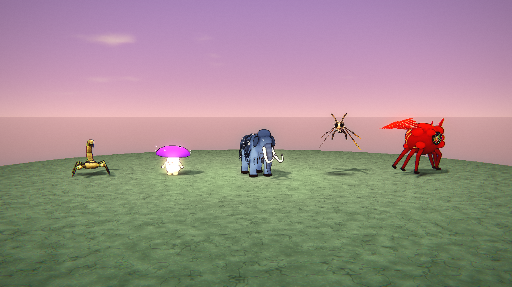 |
| 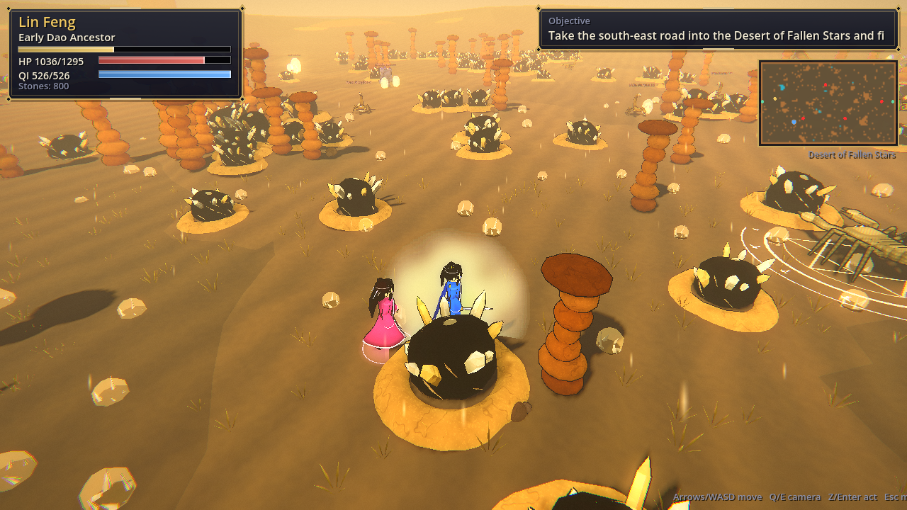 | 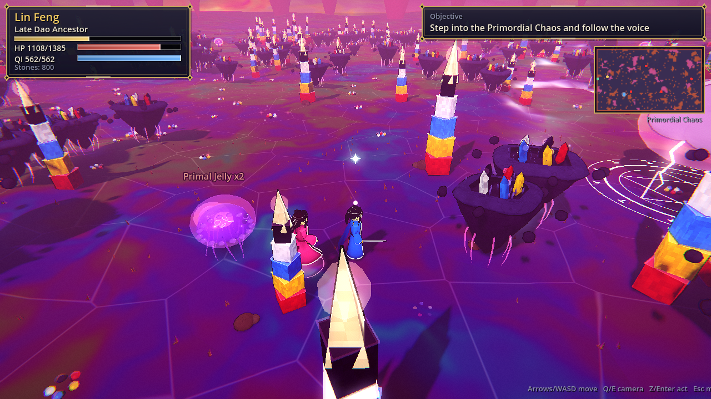 |
| 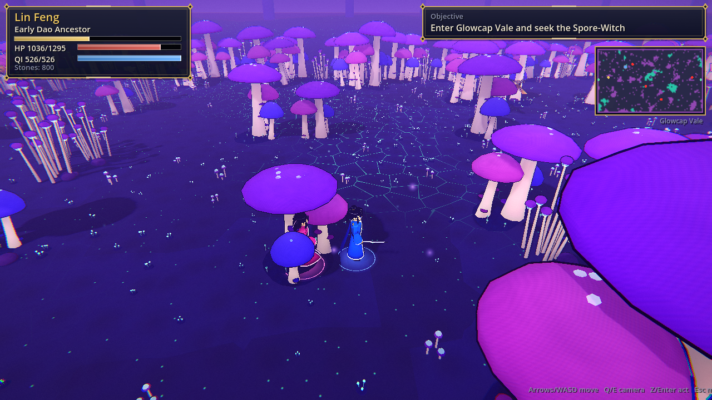 | 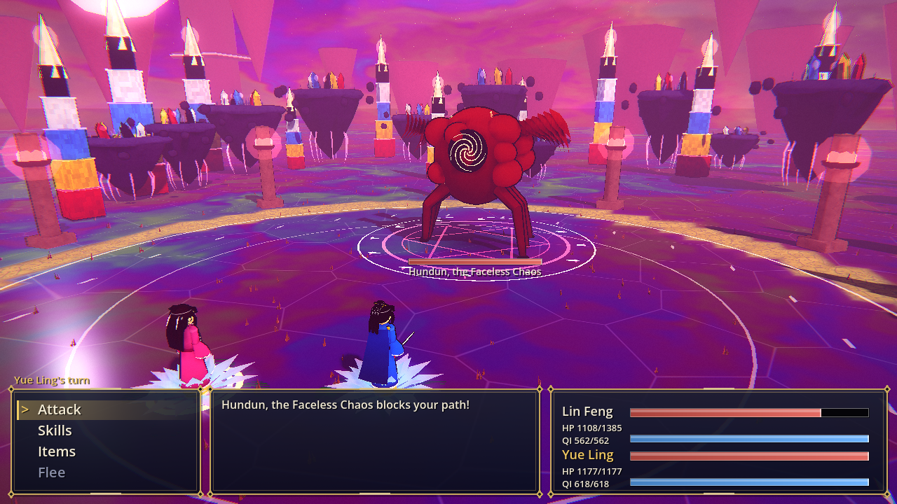 |

More captures (every region, every boss and model galleries) are in [`docs/screenshots`](docs/screenshots).

## What changed in this release

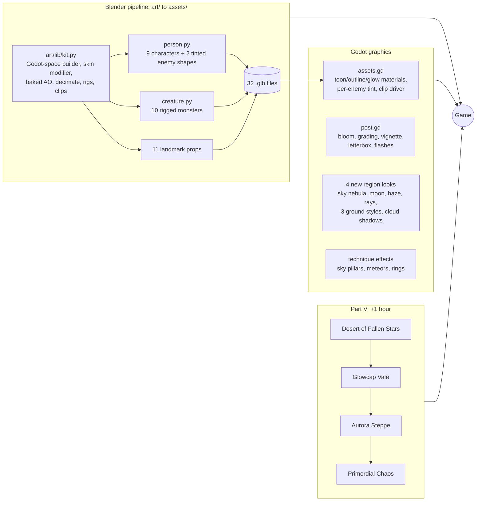

- **Blender Python art pipeline** (see [Art pipeline](#art-pipeline)): the hero, Yue Ling, the Elder, six NPCs, ten monster types, the humanoid and demon enemy shapes and eleven landmarks are now Blender models with skinned rigs, baked ambient occlusion and baked animation clips.
- **Graphics code doubled**: from 4,361 to about 8,800 lines (5,154 lines of GDScript graphics modules, 3,513 lines of Blender Python and new screen effects). See [3D graphics](#3d-graphics).
- **Part V** adds +1 hour (see below), verified by the playthrough bot; CI now requires **5 hours**.
- **Bugs found and fixed** (see below).

## 3D graphics

| Area | Before | Now |
|---|---|---|
| Characters | procedural people merged from primitives, rigid pivots | **Blender models**: swept-tube limbs that bend smoothly at the joints, a hanfu with crossed collar, slit skirt and bell sleeves, anime eyes on a blinking eyelid bone, five hair styles plus hats, capes, armour, weapons; 13-30k triangle budgets; baked AO |
| Animation | sine-driven pivots | 7 baked clips per character (idle, walk, sit, attack, cast, hurt, victory), 4 per monster, driven from the game clock with cross-fades |
| Monsters | 22 procedural shapes | beast, dragon, phoenix/bird, golem, tortoise, humanoid and demon converted to Blender; **5 new shapes** for Part V (scorpion, mushroom, mammoth, moth, Hundun); one mesh per shape recoloured per enemy through a tint channel |
| Landmarks | procedural | 11 Blender props (pine, bamboo, peach, mangrove, coral, tomb, crag, fallen star, glowcap, ice spire, chaos rock) instanced by MultiMesh, decimated to a triangle budget |
| Sky | gradient, sun, clouds, stars, aurora | plus nebula swirls, a moon with maria, horizon haze and god rays |
| Ground | 10 styles | plus glowing moss, permafrost with aurora sheen, nebula glass; drifting cloud shadows in every region |
| Horizon | silhouettes | plus the four pillars that hold up the sky and giant mushrooms |
| Weather | 12 kinds | plus sandstorm with dust banks, rising glow spores, aurora snow, rainbow chaos motes |
| Screen | glow + filmic grade | post-processing pass: unsharp mask, mip bloom, split toning per region, vignette, grain, edge aberration, hit flashes, breakthrough ripple, cinematic letterbox in dialogue |
| Combat | per-element hits | signature effects for the late techniques (falling sky pillars, five-colour meteor rain, cross slashes, rings of Nuwa's colours), boss intro camera sweep with a title card |
| Ending | golden sky | the four mended pillars, Hundun asleep below, five-colour rings overhead |

|  | 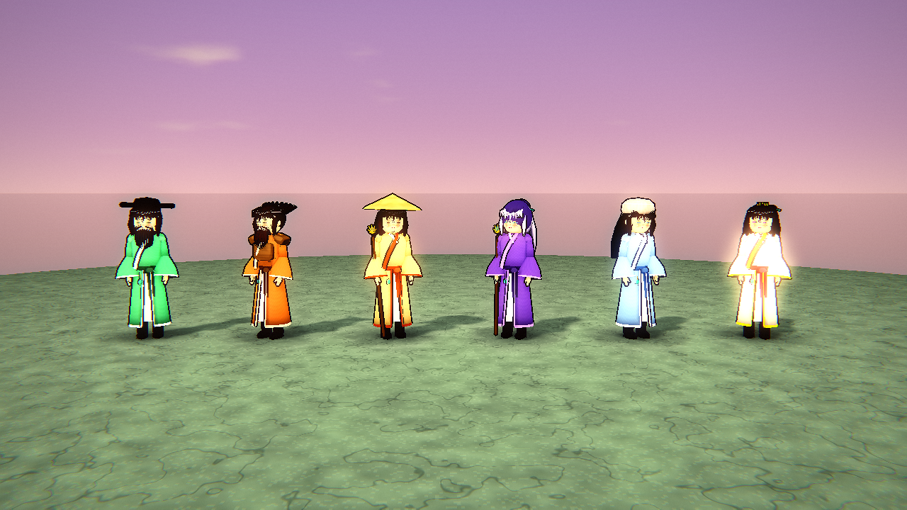 |
|---|---|
|  | 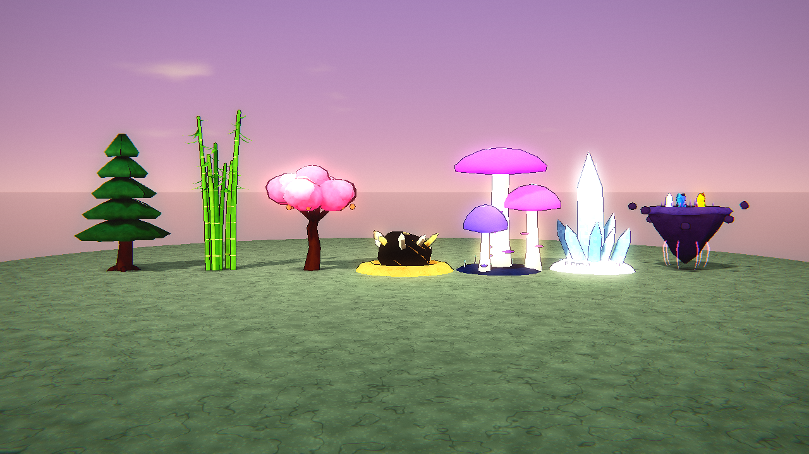 |
|  |  |

## Art pipeline

**Rule: all art is generated from scripts.** Every model, texture, animation and effect must be reproducible by running code that lives in this repository. Hand-made, downloaded or AI-image-generated asset files are not allowed. Rendered screenshots in `docs/screenshots` are outputs, not inputs.

| Source | Use it for | Where |
|---|---|---|
| **Godot code** (GDScript and shaders) | anything built from game data or changing at runtime: terrain, weather, spell effects, shaders, UI | `scripts/` |
| **Blender Python** (`bpy`, Blender 5.2) | hero assets: characters, monsters, rigs and animations, landmarks | `art/` |

- `art/lib/kit.py`: the toolkit. Coordinates are written in Godot space; primitives (ellipsoids, superquadrics, swept tubes with per-point bone weights, lathes, double-sided sheets, leaves, eyes), organic bodies from Blender's **Skin + Subdivision modifiers**, **ray-cast ambient occlusion** baked into vertex colours, the **Decimate** modifier for landmark triangle budgets, armatures, clips baked from Python functions and GLB export.
- `art/lib/person.py` builds every character from options (robe, hair style, hat, weapon, beard, horns, tinting); `art/lib/creature.py` holds the monster helpers.
- `art/characters/*.py`, `art/monsters/*.py`, `art/props/*.py`: one script per asset, each writing `assets/<group>/<name>.glb`.
- Vertex colour alpha carries the toon shader's surface class, UV.x a tint weight, and the material slot (`toon`, `plain`, `glow`) chooses the game shader; `scripts/assets.gd` swaps the materials in at load time, so Blender and procedural models share one look.
- Builds are deterministic: rebuilding produces byte-identical files on the same machine. CI rebuilds every asset from its script.
- Every art change is checked visually with the screenshot tour (`--tour`, `--gallery`).

```sh
pip install bpy==5.2.3                        # Blender as a Python module (or use a Blender install)
python art/build_all.py                       # rebuild all 32 assets (about 30 s)
blender --background --python art/monsters/hundun.py   # or one asset with Blender itself
godot --headless --path . --import            # re-import into Godot
```

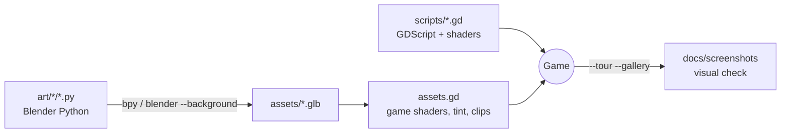

## Run it (terminal)

Requires [Godot 4.3+](https://godotengine.org/download) (developed on 4.7.2) available as `godot` on your PATH and a GPU/driver that supports OpenGL 3 (the project uses the Compatibility renderer).

```sh
git clone https://github.com/jgyy/timegox.git && cd timegox
godot --path . --import      # first time only: imports the project
godot --path .               # play it manually in a window
```

Other terminal commands:

```sh
godot --headless --path . --script tests/run_tests.gd           # data-integrity and 3D-asset tests
godot --headless --path . --script tests/manual_input_test.gd   # real keyboard-event smoke test
godot --headless --fixed-fps 30 --path . -- --bot --min-time=10800   # bot plays the whole game, prints play time
godot --fixed-fps 30 --path . -- --bot --timescale=1            # (drop --fixed-fps for real time) watch the bot
```

| Key | Action |
|---|---|
| Arrows / WASD | move (relative to the camera), navigate menus |
| Q / E | rotate the camera |
| Enter / Z / Space | confirm, interact, advance dialogue |
| Esc / X | menu (Meditate, Breakthrough, Items), cancel |

Walk into NPCs, enemies, pickups and bosses to interact with them. There is no save system yet: a full run takes about five and a half hours.

## Gameplay

- **Cultivation**: gain cultivation by meditating (Esc, Meditate) and winning battles. 31 stages across eleven realms (up to Primordial Sovereign); at the end of each realm you must pass a **Heavenly Tribulation** boss fight to break through.
- **Turn-based combat** with qi-costed techniques, elemental weaknesses (fire / water / wood / earth / thunder / dark), pills, a healer companion (Yue Ling) and boss heavy attacks.
- **Twenty-two regions**, each with a travel gate, elites, bosses and a hunt objective. **Part I**: the Sect, Whispering Bamboo Forest, Crimson Marsh, Frostpeak Caverns, Thunder Valley and the Blood Moon Palace. **Part II**: the Sunken Dragon Palace, Ashen Volcano, Void Rift Expanse and the Celestial Gate. **Part III**: the Mirror Lake of Echoes, the Graveyard of Sword Saints, the River of Ten Thousand Years and the Origin of the Dao. **Part IV (new)**: the Sea of Clouds Archipelago, the Ruins of the Jade Court, Heaven's Forge and the Garden of Immortal Peaches. **Part V (new)**: the Desert of Fallen Stars, Glowcap Vale, the Aurora Steppe and the Primordial Chaos.
- **Techniques** for the late game: Abyssal Tide, Meteor Rain, Void Rending Slash, Celestial Judgement, Chrono Severance, Genesis Sword, Ten Thousand Starfall, Ledger-Breaking Stroke, **Sky-Mending Sword**, **Five-Colour Stone Rain** and **Pillar of Heaven Strike**, plus Yue Ling's Starlight Rain, Dawn Lotus, Seal Bloom, **Five-Colour Thread** and **Nuwa's Mending**.
- **Economy**: spirit stones buy pills and tempering for your sword.


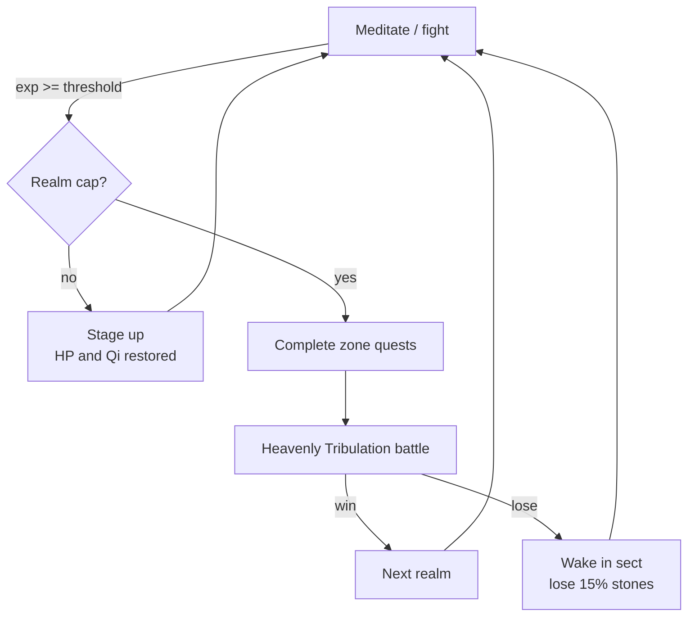

## Part III: The Hollow Heaven

After the Jade Emperor falls and Lin Feng merges with the Dao, the Heavenly Lotus Seal recalls him to the sect, where Elder Qing Xuan finally explains what the Seal is, who the Emperor was and why the sky is still cracking. Four new regions, 16 bosses, 12 monsters and five dialogue-heavy quest chains (about +1 hour) follow:

| Region | Levels | Story beat | Final boss |
|---|---|---|---|
| Mirror Lake of Echoes | 18-19 | The lake remembers the nineteen bearers before Lin Feng | Echo of Xu Mo |
| Graveyard of Sword Saints | 19-20 | The Seal's key and the founder of the sect | Founder Qing Lian |
| *Mahayana tribulation* | | | |
| River of Ten Thousand Years | 21-22 | The Emperor's origin as the first sweeper | Tian Xuan, the First Sweeper |
| Origin of the Dao | 22-23 | Yue Ling's secret and the Hollow Heaven | The Hollow Heaven |
| *True Immortal tribulation and ending* | | | |

## Part IV: The Unwritten Ledger

Lin Feng ascends as a True Immortal, but across the golden dawn someone is writing names in jade ink: the nineteen bearers, and his own. The Lotus Seal pulls him home, where everyone who ever survived a tribulation is ageing by the hour. The harvest had a bookkeeper: the Heavenly Court's **Jade Ledger**, still trying to balance its columns by collecting years from the living. Four new regions, 16 bosses, 12 monsters, five quest chains (each with a hunt, a collection and a delivery scene) and a new realm follow:

| Region | Levels | Story beat | Final boss |
|---|---|---|---|
| Sea of Clouds Archipelago | 24-25 | The Court's tollgate in the sky; a cloud-step woven from feathers | Herald of the Ledger, Qian Shu |
| Ruins of the Jade Court | 25 | A runaway scribe, four Jade Seals and the brush that wrote every name | Grand Registrar Si Ming |
| Heaven's Forge | 25-26 | Where every tribulation bolt was hammered; the brush is reforged to unwrite | Forge-Lord Tian Gong |
| Garden of Immortal Peaches | 26 | The nineteen bearers wake and remember their names | The Jade Ledger |
| *Dao Ancestor tribulation and new ending* | | | |

Part III's ending now flows into Part IV (the final ascension sets up the Ledger instead of closing the story), and the ending screen reflects the new finale.

## Part V: The Falling Sky

Lin Feng keeps his word and sweeps the steps, until stars start falling at noon. The Heavenly Court had propped up the sky with the years it harvested; with the Ledger closed, nothing holds it. Nuwa once mended the sky with stones of five colours and set four pillars beneath it. The eastern pillar still stands because the Azure Dragon King (freed in Part II) holds it up out of gratitude; the other three wardens have starved and gone wild, and at the centre Hundun, the faceless chaos from before the world, is waking. Four regions, 16 bosses, 12 monsters, five quest chains and a new realm:

| Region | Levels | Story beat | Final boss |
|---|---|---|---|
| Desert of Fallen Stars | 27 | Nomads who sing star fragments back into the sky | Bai Hu, White Tiger of the West |
| Glowcap Vale | 27-28 | A spore-witch's glowcaps rekindle a cold fire | Zhu Que, Vermilion Bird of the South |
| Aurora Steppe | 28-29 | The sky's breath, caught on the snow, wakes a frozen god | Xuan Wu, Black Tortoise of the North |
| Primordial Chaos | 29 | The First Lightning, Pangu's shadow and the Ancestor Lin Feng refused to become | Hundun, the Faceless Chaos |
| *Primordial Sovereign tribulation and new ending* | | | |

New creature types built in Blender for Part V: scorpion, mushroom folk, mammoth, lantern moth and Hundun (four wings, six legs, no face).

## Bugs found and fixed

| Bug | Fix |
|---|---|
| The bot's path-finding treated **portal tiles as walkable**, so a path that brushed past another gate teleported it (it bounced between the sect and the forest forever once a second road ran past the east gate) | Gates other than the goal block the path |
| The bot healed with Dawn Lotus at best and **never used Seal Bloom** | It picks the strongest heal Yue Ling knows |
| **Battle menus had no scrolling**: the late-game technique list (up to 17 entries) ran off the bottom of the screen and the cursor moved onto invisible entries | `UI.menu_list` scrolls with the cursor and shows scroll hints |
| The pause-menu **techniques list** overflowed its two columns of eight | Three columns of seven |
| The **HP and Qi bars** in the world HUD and on the meditation screen covered the numbers once they reached four digits | Bars moved clear of the text |
| **Long boss names** were clipped under their health bars, and party names were drawn underneath the translucent command panels | Wider labels for bosses; party labels removed (the status panel shows them) |
| **Long speaker names** ("Xuan Wu, Black Tortoise of the North") overflowed the dialogue name tag | The tag grows with the name |
| A conversation with **no lines** opened an empty dialogue box that Enter could never close | `say([])` runs its callback directly |
| Starting a **second game** from the title kept the previous run's toasts and NPC chat rotation | Reset in `new_game()` |
| A script error made `tests/run_tests.gd` **hang until CI's 40-minute timeout** instead of failing | A watchdog fails the run on the first frame; the smoke test has a frame limit |

### Bugs fixed in the previous release

| Bug | Fix |
|---|---|
| Two identical foes (same species, level and HP) were drawn **on top of each other** in battle: `Array.find()` compares dictionaries by value, so both resolved to the same stage slot | Each foe gets an explicit `slot` (`Data.make_foes`); regression test added |
| The sect's **east gate** faced the wrong way (rotation only applied to `x > 40`, but the sect is 40 tiles wide) | Orientation is computed from the map edges |
| Cancelling **Yue Ling's basic attack** target selection opened the Skills menu instead of the main menu | Both basic attacks (`strike`, `needle`) return to the main menu |
| Using a pill from the pause menu at **full HP or Qi** silently wasted it | The pill is kept and a message is shown |
| The **techniques list** in the pause menu overflowed the panel once more than 12 techniques were known | Two columns of eight |
| The **Jade Mantis Matriarch** was drawn as a wolf and the **Eon Tortoise** as a crab | New mantis and tortoise models |
| The bot's default `--max-time` (4 h) would have cut off a longer game | Raised to 6 h |

## Narrative plot holes found and fixed (previous release)

| Plot hole | Fix |
|---|---|
| The Elder asks for **three** Frost Jades but the quest needs four | Elder now says four |
| The **Heaven-Cleaving Sword** was usable from Early Nascent Soul, before Ancestor Jian Wuchen teaches it | Technique is gated on beating the Thunder Roc (`after` field) and covered by a test |
| The Elder demands the **Roc's feather** that the player is never given | The Roc now drops a feather item, mentioned in dialogue |
| The Dragon King gives a **pearl "as proof"** that never exists, and greets Lin Feng as if they had met ("how you have grown") | He gives a Dragon King's Scale which Sage Huo Rong recognises; the greeting no longer implies a past meeting |
| Sage **Chi Rong** and the villain **Chi Yan** shared a surname with no relation | Sage renamed Huo Rong |
| Xu Mo "hunted you for **three centuries**" although Lin Feng is a teenager | Reframed as hunting the *root's* bearers, and resolved by Part III (Lin Feng is the twentieth bearer) |
| Marsh Hag called Lin Feng the **seal's bearer**; everyone else says root bearer | Unified to "bearer of the Nine Heavens root" |
| Iron Fang jeers at a **"sweeper boy"** he could not know about | Now a "sect boy" |
| The **Jade Mantis** hunt had no in-story motivation | The Elder's briefing mentions the mantis claiming the herb groves |
| Alchemist says "take these pills" but gives none | Now "take this payment" |
| Yue Ling's origin (a random healer who happens to be bound nearby) had no foreshadowing | She wakes beside a lotus pond three winters ago; paid off in Part III |
| Sage Huo Rong lists three fire bosses but there are four; the hermit says "three who shepherd" the horrors but there are four; the Gatekeeper lists the wrong guardians | Counts and lists corrected |
| Quest items (pearls, embers, star fragments) were collected and never used | Each is now referenced in the following dialogue |
| The **sect storyline was abandoned**: the failing Seal, the Elder and Xu Mo's army were never resolved and the game ended in a distant gate | Part III returns Lin Feng to the sect and resolves the Seal, the Elder, Yue Ling and the Emperor |

## Architecture

Game logic (`game.gd`, `data.gd`, `mapgen.gd`, the battle rules and the bot) is unchanged by the 3D port; only the presentation layer is new. Screens derive from `ScreenBase` (`screen.gd`): each owns an optional `Node3D` scene plus a 2D overlay drawn with the UI helpers.

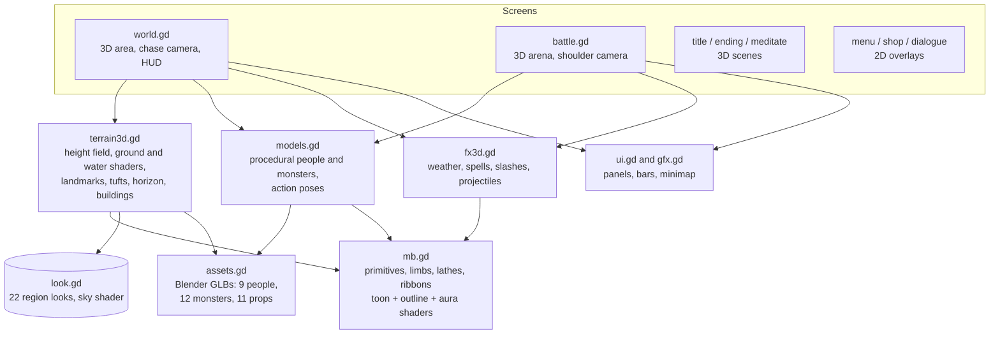

Highlights of the renderer: merged vertex-coloured meshes (a few draw calls per chunk) whose vertex alpha selects a procedural surface texture in the toon shader, an inverted-hull ink outline (skipped for thin double-sided geometry), MultiMesh instancing for landmarks, boulders, decorations and grass, a height-field terrain with a per-region ground shader, animated water/lava with foam, a sky shader per region, two-layer weather (snow, rain, petals, embers, bubbles, void stars, sand, clouds, lanterns, sparks, plus fireflies, pollen, ash or haze), rigged characters and monsters, and element-specific spell effects.

The screenshot tour also renders model galleries (`--gallery`).

Regenerate screenshots (needs a GL context; use `xvfb-run` on a server):

```sh
godot --path . --fixed-fps 30 -- --tour=docs/screenshots              # everything
godot --path . --fixed-fps 30 -- --tour=out --areas=mirror,grave --no-extras   # some regions
godot --path . --fixed-fps 30 -- --tour=out --areas=garden --no-extras --gallery  # one region + model galleries
```

## The playthrough bot

`scripts/bot.gd` plays the entire game end to end through the **same input surface a human uses** (`up/down/confirm/cancel` presses on the top screen and a held movement direction). It pathfinds with BFS, grinds and meditates when under-levelled, rests when hurt, shops, picks skills by elemental weakness, heals with pills or Spring Rain, and handles tribulations.

To make its clock a fair estimate of a person's playtime it uses human-scale pacing: 0.2 to 0.4 s per key press, and each dialogue line is "read" for about `length / 40` seconds after it finishes typing.

```sh
godot --headless --fixed-fps 30 --path . -- --bot --seed=1234 --report=build/bot_report.json
```

**Is the game sped up?** No. `--fixed-fps 30` makes each frame advance the game clock by exactly 1/30 s regardless of how fast the machine renders it. All movement, typing, battle animation and meditation run off that same frame time, so a full hour of *game time* is simulated in under a minute of *wall-clock* time. `Game.playtime` is the game clock, and it is the number reported. Drop `--fixed-fps` (and optionally pass `--timescale=N`) to watch the bot in real time.

Latest result (seed 1234, identical across runs; seeds 7 and 99 give 5:25:23 and 5:27:36). Parts I to IV take 4:18:35, so Part V adds about **1 hour 8 minutes**:

```
game play time  : 5:26:07 (19568 s)
wall clock      : ~6 min (headless)
final realm     : Early Primordial Sovereign
battles / kills : 601 / 1120   deaths: 0
time by screen  : battle 9023 s, world 3001 s, meditate 5128 s, dialogue 2314 s
time by area    : bamboo 870, marsh 656, frost 961, thunder 608, palace 565, sect 708,
                  dragon 624, volcano 1034, void 707, celestial 1447,
                  mirror 572, grave 1001, time 711, origin 1248,
                  cloudsea 799, court 839, forge 889, garden 1398,
                  dunes 840, fungal 776, aurora 857, chaos 1489
result          : PASS (needs >= 18000 s)
```

Bot flags: `--bot`, `--seed=N`, `--report=PATH`, `--min-time=SECONDS` (default 3600; CI uses 18000), `--max-time=SECONDS`, `--timescale=N`, `--shots=DIR` (needs a window, saves screenshots at key moments), and `--tour=DIR` (screenshot tour, see Architecture).

## CI

[`.github/workflows/ci.yml`](.github/workflows/ci.yml) downloads Godot, imports the project, runs the data-integrity tests (`tests/run_tests.gd`: quest/dialogue/NPC/boss references, portal symmetry, map reachability and determinism, every 3D model and terrain builds, story consistency), then runs the bot headless and **fails the build if the game is not completed or takes less than five hours of game time**. A second job installs Blender as a Python module and rebuilds every asset in `art/` from its script. The bot report is uploaded as an artifact and shown in the job summary.

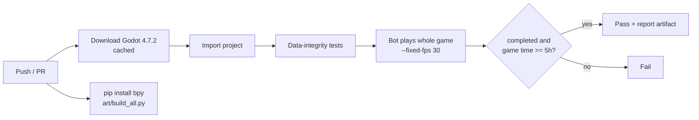

## Project layout

```
scripts/data.gd      content: skills, enemies, areas, quest chain, dialogue
scripts/mb.gd        mesh builder (primitives to merged ArrayMesh)
scripts/models.gd    3D people, monsters, props
scripts/terrain3d.gd 3D terrain, landmarks, buildings
scripts/look.gd      per-region look (sky, fog, light, weather)
scripts/fx3d.gd      weather, combat particles and technique effects
scripts/assets.gd    loader for the Blender assets (materials, tint, animation clips)
scripts/post.gd      screen-space post-processing pass
art/lib/kit.py       Blender (bpy) toolkit: geometry, skinning, AO, rigs, clips, export
art/lib/person.py    character builder shared by every person asset
art/characters, art/monsters, art/props   one Blender script per asset
art/build_all.py     rebuild every asset
assets/              generated .glb files (never edited by hand)
scripts/screen.gd    ScreenBase: 3D scene + 2D overlay
scripts/gfx.gd       2D UI ornaments, panels, minimap
scripts/tour.gd      screenshot tour (developer tool)
scripts/game.gd      autoload: state, progression, quest engine, play clock
scripts/main.gd      screen stack, input, story flow
scripts/world.gd     3D third-person world, movement, HUD
scripts/mapgen.gd    seeded map generator with reachability guarantee
scripts/battle.gd    turn-based combat on a 3D stage
scripts/bot.gd       end-to-end playthrough bot
tests/run_tests.gd   data-integrity tests
```
