# Ascension of the Azure Cloud

A xianxia cultivation RPG built in **Godot 4**, played in **full 3D from a third-person view**, and **all art is generated from scripts**: every tree, building, character, monster and spell effect comes from code in this repository, never from hand-made or downloaded files (see [Art pipeline](#art-pipeline)).
Play Lin Feng, an orphaned sect sweeper with a hidden "Nine Heavens root", from Qi Condensation to Dao Ancestor, through eighteen regions, 61 bosses and nine Heavenly Tribulations.

> **Total gameplay duration: about 4 hours 15 minutes** (4:17:46 of game time for the end-to-end bot run; seeds 7 and 99 give 4:16:09 and 4:17:15). Parts I to III take about 3 hours 11 minutes; **Part IV, "The Unwritten Ledger", adds another hour** (1 hour 6 minutes): four new regions, 16 new bosses, 12 new monsters, a new realm (Dao Ancestor), new techniques and a new ending.

| | |
|---|---|
| 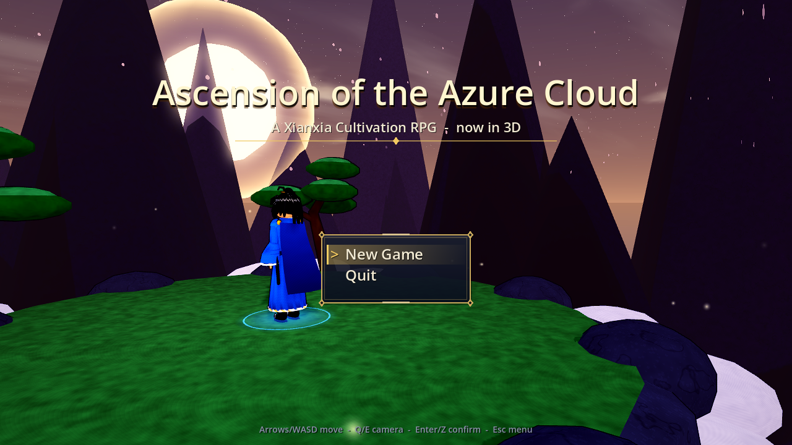 | 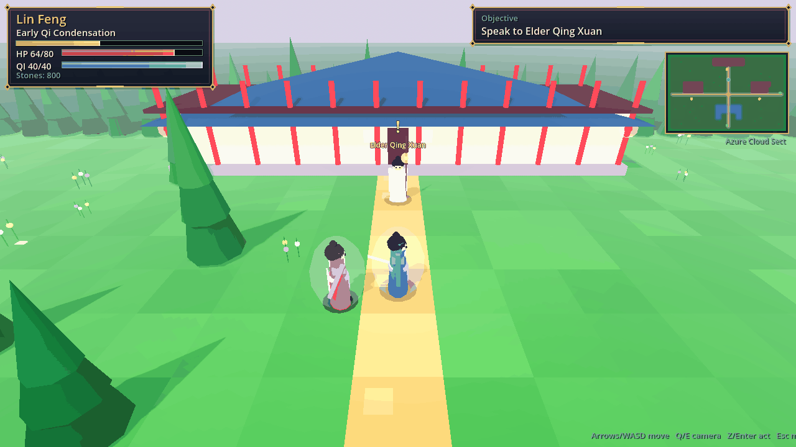 |
| 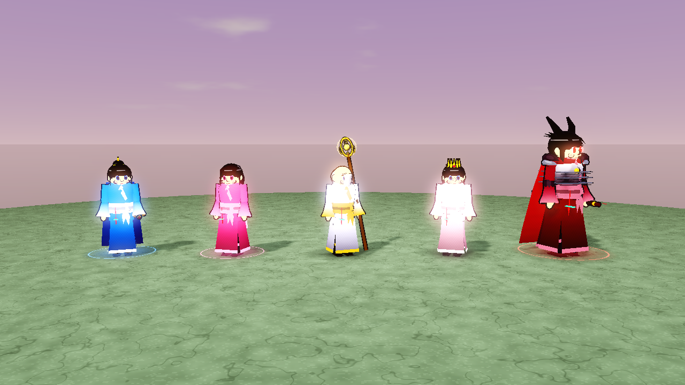 |  |
| 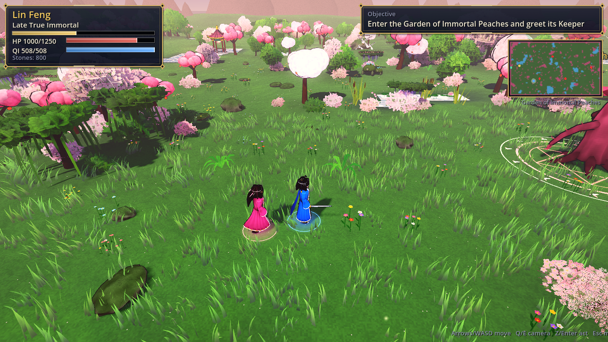 | 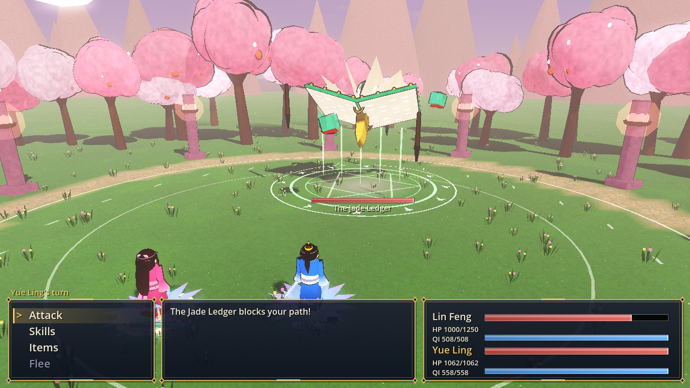 |
| 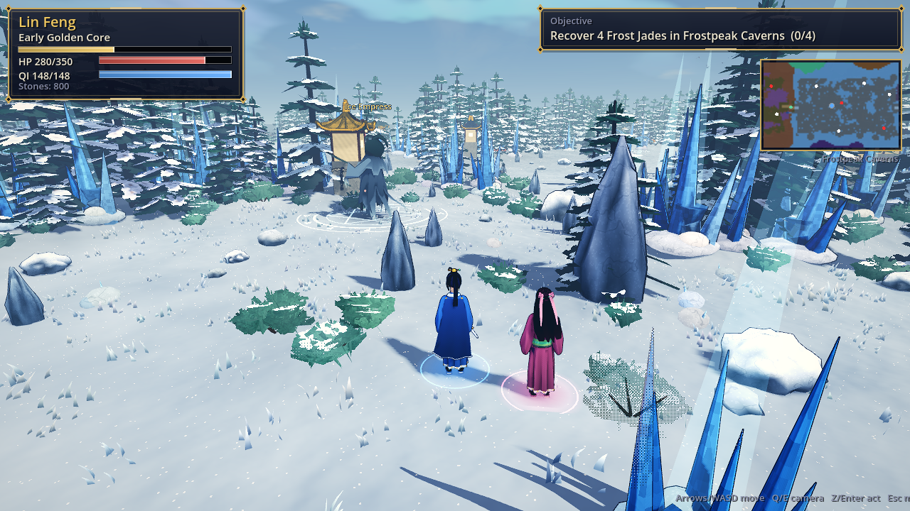 | 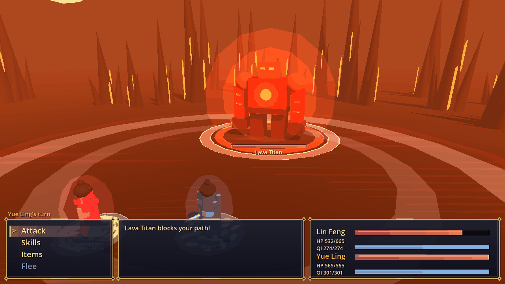 |

More captures (every region, every boss and model galleries) are in [`docs/screenshots`](docs/screenshots).

## What changed in this release

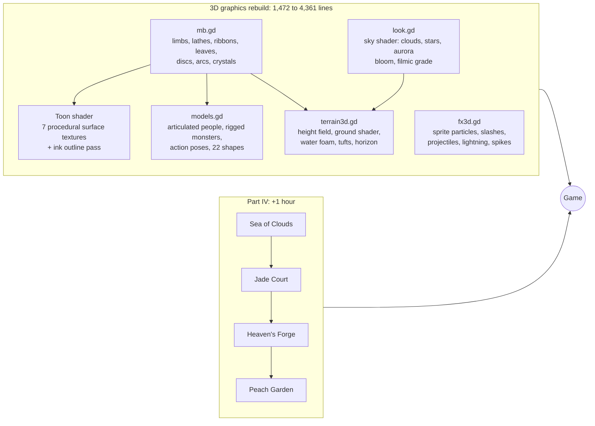

- **3D graphics rebuilt** (see [3D graphics](#3d-graphics)): the five 3D modules grew from 1,472 to 4,361 lines (about 3x), plus richer 3D scenes in the world, battle, title, meditation and ending screens.
- **Part IV** adds +1 hour (see below), verified by the playthrough bot.
- **Bugs found and fixed** (see below).
- Headless runs skip all rendering work, so CI simulates four hours of play in minutes.

## 3D graphics

Everything in this release is generated by Godot code (no meshes or textures from outside the repository). Future releases may also build art with Blender scripts; see [Art pipeline](#art-pipeline).

| Area | Before | Now |
|---|---|---|
| Surfaces | flat vertex colours | toon shader with procedural textures per surface class (cloth weave, stone grain and cracks, brushed metal, wood rings, skin subsurface, glinting crystal, wind-swayed foliage, scales, hair highlights) and an ink outline |
| Characters | capsule body, ball head, rigid limbs | tapered torso and robe, four swinging robe panels, two-segment arms and legs, wide sleeves, hands, faces with anime eyes that blink, five hair styles with a swinging ponytail, capes, armour, crowns, detailed swords and staffs |
| Animation | leg swing | walk cycle with knee bend, torso twist and head bob; idle breathing; secondary motion of hair, robe, sash and cape; attack, cast, hurt and victory poses in battle |
| Monsters | 18 static shapes | 22 rigged shapes (new: manta ray, mantis, tortoise, the Jade Ledger tome) with jaws, trotting legs, wagging tails, flapping two-part wings, undulating dragon bodies, scuttling crab and spider legs, pulsing jellyfish, swaying vines |
| Terrain | flat checkerboard quads | height field with hills, shores and causeways; blended ground colours; ground shader (grass, mud, snow, rock, tiles, sand, ash with glowing cracks, crystal, marble, glass) with cobbled paths; water with ripples, fresnel and shoreline foam; grass tufts; two variants of every landmark; boulders; horizon silhouettes |
| Sky and light | procedural sky preset | sky shader with sun disc and halo, drifting clouds, stars and aurora; bloom, filmic tonemapping, aerial fog; cool fill light |
| Effects | coloured balls | soft sprite particles; per-element spells (fire pillars, water rings, leaf spirals, rock spikes, sky lightning, dark vortices, shockwaves), sword-slash arcs, projectiles with trails, camera shake, ambient tribulation lightning, footstep dust, two-layer weather |

|  |  |
|---|---|
|  |  |

## Art pipeline

**Rule: all art is generated from scripts.** Every model, texture, animation and effect must be reproducible by running code that lives in this repository. Hand-made, downloaded or AI-image-generated asset files are not allowed. Rendered screenshots in `docs/screenshots` are outputs, not inputs.

Two kinds of script are allowed:

| Source | Use it for | Where |
|---|---|---|
| **Godot code** (GDScript and shaders) | anything built from game data or changing at runtime: terrain, weather, spell effects, shaders, UI | `scripts/` |
| **Blender Python** (`bpy`, latest Blender release) | hero assets that benefit from Blender's modelling tools: characters, monsters, rigs and animations, baked textures | `art/` (planned) |

Planned layout for the Blender part:

- one script per asset, e.g. `art/characters/lin_feng.py`, run with `blender --background --python <script>`
- each script exports a `.glb` (mesh, rig, animations, baked textures) into `assets/`, the only place generated asset files may live
- exported files are rebuilt from their scripts, never edited by hand; CI will rebuild them before the tests run
- every art change is checked visually with the screenshot tour (`--tour`, `--gallery`), because whoever writes the script cannot see the result otherwise

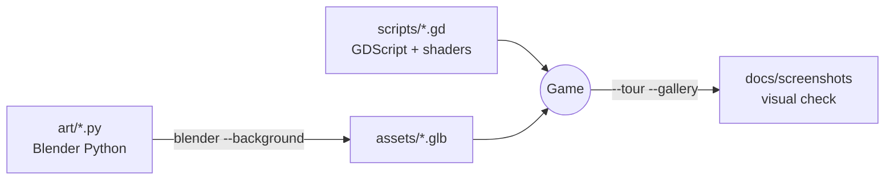

## Run it (terminal)

Requires [Godot 4.3+](https://godotengine.org/download) (developed on 4.7.2) available as `godot` on your PATH and a GPU/driver that supports OpenGL 3 (the project uses the Compatibility renderer).

```sh
git clone https://github.com/jgyy/timegox.git && cd timegox
godot --path . --import      # first time only: imports the project
godot --path .               # play it manually in a window
```

Other terminal commands:

```sh
godot --headless --path . --script tests/run_tests.gd           # data-integrity and 3D-asset tests
godot --headless --path . --script tests/manual_input_test.gd   # real keyboard-event smoke test
godot --headless --fixed-fps 30 --path . -- --bot --min-time=10800   # bot plays the whole game, prints play time
godot --fixed-fps 30 --path . -- --bot --timescale=1            # (drop --fixed-fps for real time) watch the bot
```

| Key | Action |
|---|---|
| Arrows / WASD | move (relative to the camera), navigate menus |
| Q / E | rotate the camera |
| Enter / Z / Space | confirm, interact, advance dialogue |
| Esc / X | menu (Meditate, Breakthrough, Items), cancel |

Walk into NPCs, enemies, pickups and bosses to interact with them. There is no save system yet: a full run takes about three hours.

## Gameplay

- **Cultivation**: gain cultivation by meditating (Esc, Meditate) and winning battles. 28 stages across ten realms (up to Dao Ancestor); at the end of each realm you must pass a **Heavenly Tribulation** boss fight to break through.
- **Turn-based combat** with qi-costed techniques, elemental weaknesses (fire / water / wood / earth / thunder / dark), pills, a healer companion (Yue Ling) and boss heavy attacks.
- **Eighteen regions**, each with a travel gate, elites, bosses and a hunt objective. **Part I**: the Sect, Whispering Bamboo Forest, Crimson Marsh, Frostpeak Caverns, Thunder Valley and the Blood Moon Palace. **Part II**: the Sunken Dragon Palace, Ashen Volcano, Void Rift Expanse and the Celestial Gate. **Part III**: the Mirror Lake of Echoes, the Graveyard of Sword Saints, the River of Ten Thousand Years and the Origin of the Dao. **Part IV (new)**: the Sea of Clouds Archipelago, the Ruins of the Jade Court, Heaven's Forge and the Garden of Immortal Peaches.
- **Techniques** for the late game: Abyssal Tide, Meteor Rain, Void Rending Slash, Celestial Judgement, Chrono Severance, Genesis Sword, **Ten Thousand Starfall** and **Ledger-Breaking Stroke**, plus Yue Ling's Starlight Rain, Dawn Lotus and **Seal Bloom**.
- **Economy**: spirit stones buy pills and tempering for your sword.

```mermaid
flowchart LR
    subgraph P1[Part I: about 1h06m]
    Sect[Azure Cloud Sect<br/>hub, shops, Elder] --> Bamboo[Bamboo Forest]
    Bamboo --> Marsh[Crimson Marsh]
    Marsh --> Frost[Frostpeak Caverns]
    Frost --> Thunder[Thunder Valley]
    Thunder --> Palace[Blood Moon Palace<br/>Demon Lord Xu Mo]
    end
    subgraph P2[Part II: about 1h04m]
    Palace ==>|Deity Tribulation| Dragon[Sunken Dragon Palace]
    Dragon --> Volcano[Ashen Volcano]
    Volcano -->|Void Tribulation| Void[Void Rift Expanse]
    Void --> Gate[Celestial Gate<br/>Jade Emperor of Ruin]
    end
    subgraph P3[Part III: about 1h01m]
    Gate ==>|Dao Merging, Lotus Seal recalls you| Sect2[Sect: the Elder's confession]
    Sect2 --> Mirror[Mirror Lake of Echoes<br/>Echo of Xu Mo]
    Mirror --> Grave[Graveyard of Sword Saints<br/>Founder Qing Lian]
    Grave -->|Mahayana Tribulation| Time[River of Ten Thousand Years<br/>Tian Xuan]
    Time --> Origin[Origin of the Dao<br/>The Hollow Heaven]
    end
    subgraph P4[Part IV: about 1h06m]
    Origin ==>|True Immortal, names written in the sky| Sect3[Sect: the Jade Ledger]
    Sect3 -->|west gate| Clouds[Sea of Clouds<br/>Herald Qian Shu]
    Clouds --> Court[Ruins of the Jade Court<br/>Registrar Si Ming]
    Court --> Forge[Heaven's Forge<br/>Forge-Lord Tian Gong]
    Forge --> Garden[Garden of Immortal Peaches<br/>The Jade Ledger]
    end
    Garden ==> End((Dao Ancestor))
```

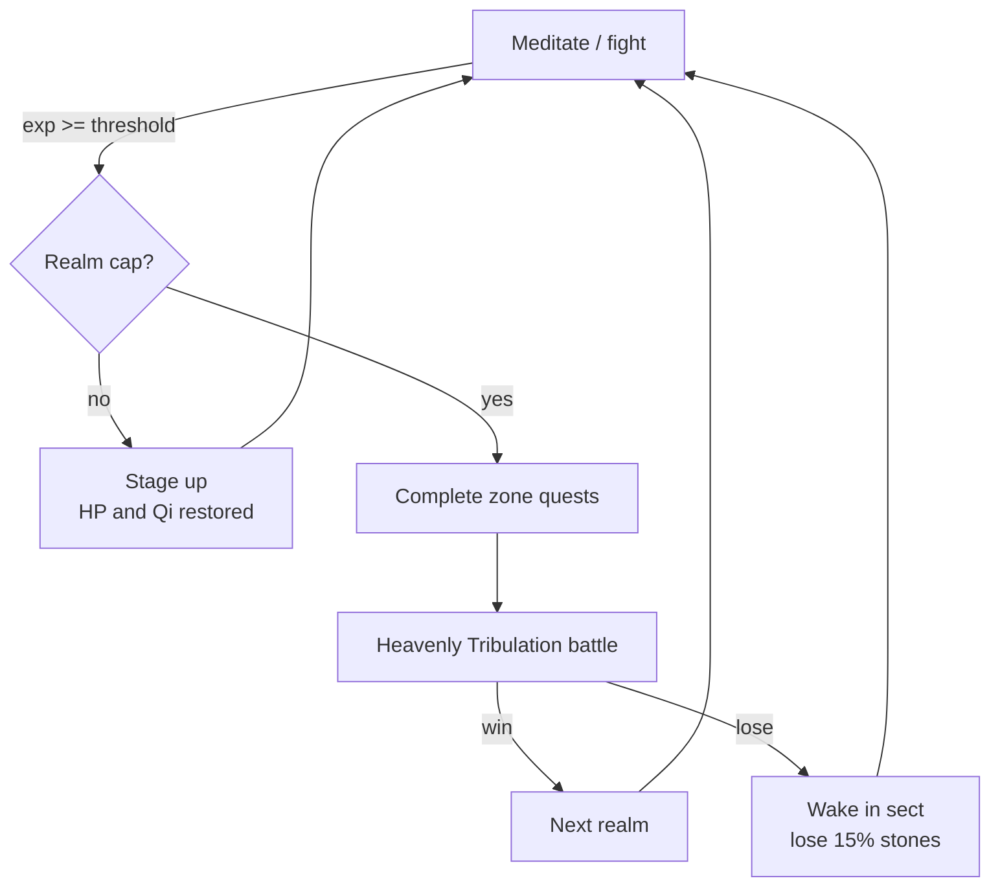

## Part III: The Hollow Heaven

After the Jade Emperor falls and Lin Feng merges with the Dao, the Heavenly Lotus Seal recalls him to the sect, where Elder Qing Xuan finally explains what the Seal is, who the Emperor was and why the sky is still cracking. Four new regions, 16 bosses, 12 monsters and five dialogue-heavy quest chains (about +1 hour) follow:

| Region | Levels | Story beat | Final boss |
|---|---|---|---|
| Mirror Lake of Echoes | 18-19 | The lake remembers the nineteen bearers before Lin Feng | Echo of Xu Mo |
| Graveyard of Sword Saints | 19-20 | The Seal's key and the founder of the sect | Founder Qing Lian |
| *Mahayana tribulation* | | | |
| River of Ten Thousand Years | 21-22 | The Emperor's origin as the first sweeper | Tian Xuan, the First Sweeper |
| Origin of the Dao | 22-23 | Yue Ling's secret and the Hollow Heaven | The Hollow Heaven |
| *True Immortal tribulation and ending* | | | |

## Part IV: The Unwritten Ledger

Lin Feng ascends as a True Immortal, but across the golden dawn someone is writing names in jade ink: the nineteen bearers, and his own. The Lotus Seal pulls him home, where everyone who ever survived a tribulation is ageing by the hour. The harvest had a bookkeeper: the Heavenly Court's **Jade Ledger**, still trying to balance its columns by collecting years from the living. Four new regions, 16 bosses, 12 monsters, five quest chains (each with a hunt, a collection and a delivery scene) and a new realm follow:

| Region | Levels | Story beat | Final boss |
|---|---|---|---|
| Sea of Clouds Archipelago | 24-25 | The Court's tollgate in the sky; a cloud-step woven from feathers | Herald of the Ledger, Qian Shu |
| Ruins of the Jade Court | 25 | A runaway scribe, four Jade Seals and the brush that wrote every name | Grand Registrar Si Ming |
| Heaven's Forge | 25-26 | Where every tribulation bolt was hammered; the brush is reforged to unwrite | Forge-Lord Tian Gong |
| Garden of Immortal Peaches | 26 | The nineteen bearers wake and remember their names | The Jade Ledger |
| *Dao Ancestor tribulation and new ending* | | | |

Part III's ending now flows into Part IV (the final ascension sets up the Ledger instead of closing the story), and the ending screen reflects the new finale.

## Bugs found and fixed

| Bug | Fix |
|---|---|
| Two identical foes (same species, level and HP) were drawn **on top of each other** in battle: `Array.find()` compares dictionaries by value, so both resolved to the same stage slot | Each foe gets an explicit `slot` (`Data.make_foes`); regression test added |
| The sect's **east gate** faced the wrong way (rotation only applied to `x > 40`, but the sect is 40 tiles wide) | Orientation is computed from the map edges |
| Cancelling **Yue Ling's basic attack** target selection opened the Skills menu instead of the main menu | Both basic attacks (`strike`, `needle`) return to the main menu |
| Using a pill from the pause menu at **full HP or Qi** silently wasted it | The pill is kept and a message is shown |
| The **techniques list** in the pause menu overflowed the panel once more than 12 techniques were known | Two columns of eight |
| The **Jade Mantis Matriarch** was drawn as a wolf and the **Eon Tortoise** as a crab | New mantis and tortoise models |
| The bot's default `--max-time` (4 h) would have cut off a longer game | Raised to 6 h |

## Narrative plot holes found and fixed (previous release)

| Plot hole | Fix |
|---|---|
| The Elder asks for **three** Frost Jades but the quest needs four | Elder now says four |
| The **Heaven-Cleaving Sword** was usable from Early Nascent Soul, before Ancestor Jian Wuchen teaches it | Technique is gated on beating the Thunder Roc (`after` field) and covered by a test |
| The Elder demands the **Roc's feather** that the player is never given | The Roc now drops a feather item, mentioned in dialogue |
| The Dragon King gives a **pearl "as proof"** that never exists, and greets Lin Feng as if they had met ("how you have grown") | He gives a Dragon King's Scale which Sage Huo Rong recognises; the greeting no longer implies a past meeting |
| Sage **Chi Rong** and the villain **Chi Yan** shared a surname with no relation | Sage renamed Huo Rong |
| Xu Mo "hunted you for **three centuries**" although Lin Feng is a teenager | Reframed as hunting the *root's* bearers, and resolved by Part III (Lin Feng is the twentieth bearer) |
| Marsh Hag called Lin Feng the **seal's bearer**; everyone else says root bearer | Unified to "bearer of the Nine Heavens root" |
| Iron Fang jeers at a **"sweeper boy"** he could not know about | Now a "sect boy" |
| The **Jade Mantis** hunt had no in-story motivation | The Elder's briefing mentions the mantis claiming the herb groves |
| Alchemist says "take these pills" but gives none | Now "take this payment" |
| Yue Ling's origin (a random healer who happens to be bound nearby) had no foreshadowing | She wakes beside a lotus pond three winters ago; paid off in Part III |
| Sage Huo Rong lists three fire bosses but there are four; the hermit says "three who shepherd" the horrors but there are four; the Gatekeeper lists the wrong guardians | Counts and lists corrected |
| Quest items (pearls, embers, star fragments) were collected and never used | Each is now referenced in the following dialogue |
| The **sect storyline was abandoned**: the failing Seal, the Elder and Xu Mo's army were never resolved and the game ended in a distant gate | Part III returns Lin Feng to the sect and resolves the Seal, the Elder, Yue Ling and the Emperor |

## Architecture

Game logic (`game.gd`, `data.gd`, `mapgen.gd`, the battle rules and the bot) is unchanged by the 3D port; only the presentation layer is new. Screens derive from `ScreenBase` (`screen.gd`): each owns an optional `Node3D` scene plus a 2D overlay drawn with the UI helpers.

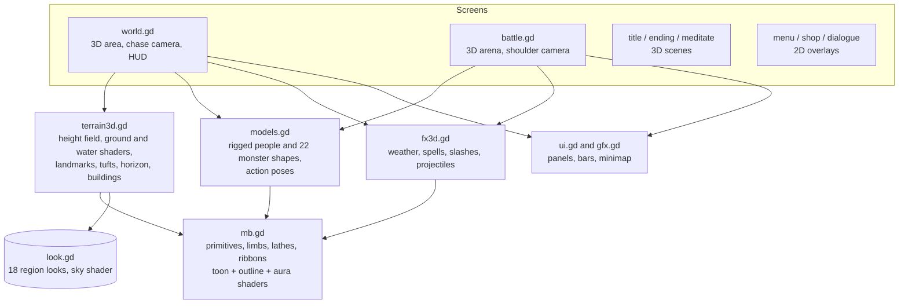

Highlights of the renderer: merged vertex-coloured meshes (a few draw calls per chunk) whose vertex alpha selects a procedural surface texture in the toon shader, an inverted-hull ink outline (skipped for thin double-sided geometry), MultiMesh instancing for landmarks, boulders, decorations and grass, a height-field terrain with a per-region ground shader, animated water/lava with foam, a sky shader per region, two-layer weather (snow, rain, petals, embers, bubbles, void stars, sand, clouds, lanterns, sparks, plus fireflies, pollen, ash or haze), rigged characters and monsters, and element-specific spell effects.

The screenshot tour also renders model galleries (`--gallery`).

Regenerate screenshots (needs a GL context; use `xvfb-run` on a server):

```sh
godot --path . --fixed-fps 30 -- --tour=docs/screenshots              # everything
godot --path . --fixed-fps 30 -- --tour=out --areas=mirror,grave --no-extras   # some regions
godot --path . --fixed-fps 30 -- --tour=out --areas=garden --no-extras --gallery  # one region + model galleries
```

## The playthrough bot

`scripts/bot.gd` plays the entire game end to end through the **same input surface a human uses** (`up/down/confirm/cancel` presses on the top screen and a held movement direction). It pathfinds with BFS, grinds and meditates when under-levelled, rests when hurt, shops, picks skills by elemental weakness, heals with pills or Spring Rain, and handles tribulations.

To make its clock a fair estimate of a person's playtime it uses human-scale pacing: 0.2 to 0.4 s per key press, and each dialogue line is "read" for about `length / 40` seconds after it finishes typing.

```sh
godot --headless --fixed-fps 30 --path . -- --bot --seed=1234 --report=build/bot_report.json
```

**Is the game sped up?** No. `--fixed-fps 30` makes each frame advance the game clock by exactly 1/30 s regardless of how fast the machine renders it. All movement, typing, battle animation and meditation run off that same frame time, so a full hour of *game time* is simulated in under a minute of *wall-clock* time. `Game.playtime` is the game clock, and it is the number reported. Drop `--fixed-fps` (and optionally pass `--timescale=N`) to watch the bot in real time.

Latest result (seed 1234, identical across runs; seeds 7 and 99 give 4:16:09 and 4:17:15). Parts I to III take 3:11:18, so Part IV adds about **1 hour 6 minutes**:

```
game play time  : 4:17:46 (15466 s)
wall clock      : ~6 min (headless)
final realm     : Early Dao Ancestor
battles / kills : 461 / 881   deaths: 0
time by screen  : battle 7394 s, world 2386 s, meditate 3923 s, dialogue 1685 s
time by area    : bamboo 867, marsh 655, frost 959, thunder 607, palace 561, sect 612,
                  dragon 621, volcano 1031, void 704, celestial 1444,
                  mirror 569, grave 998, time 708, origin 1245,
                  cloudsea 797, court 836, forge 886, garden 1395
result          : PASS (needs >= 14400 s)
```

Bot flags: `--bot`, `--seed=N`, `--report=PATH`, `--min-time=SECONDS` (default 3600; CI uses 14400), `--max-time=SECONDS`, `--timescale=N`, `--shots=DIR` (needs a window, saves screenshots at key moments), and `--tour=DIR` (screenshot tour, see Architecture).

## CI

[`.github/workflows/ci.yml`](.github/workflows/ci.yml) downloads Godot, imports the project, runs the data-integrity tests (`tests/run_tests.gd`: quest/dialogue/NPC/boss references, portal symmetry, map reachability and determinism, every 3D model and terrain builds, story consistency), then runs the bot headless and **fails the build if the game is not completed or takes less than four hours of game time**. The bot report is uploaded as an artifact and shown in the job summary.

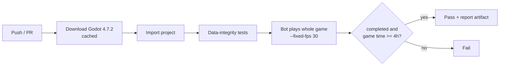

## Project layout

```
scripts/data.gd      content: skills, enemies, areas, quest chain, dialogue
scripts/mb.gd        mesh builder (primitives to merged ArrayMesh)
scripts/models.gd    3D people, monsters, props
scripts/terrain3d.gd 3D terrain, landmarks, buildings
scripts/look.gd      per-region look (sky, fog, light, weather)
scripts/fx3d.gd      weather and combat particle effects
scripts/screen.gd    ScreenBase: 3D scene + 2D overlay
scripts/gfx.gd       2D UI ornaments, panels, minimap
scripts/tour.gd      screenshot tour (developer tool)
scripts/game.gd      autoload: state, progression, quest engine, play clock
scripts/main.gd      screen stack, input, story flow
scripts/world.gd     3D third-person world, movement, HUD
scripts/mapgen.gd    seeded map generator with reachability guarantee
scripts/battle.gd    turn-based combat on a 3D stage
scripts/bot.gd       end-to-end playthrough bot
tests/run_tests.gd   data-integrity tests
```
