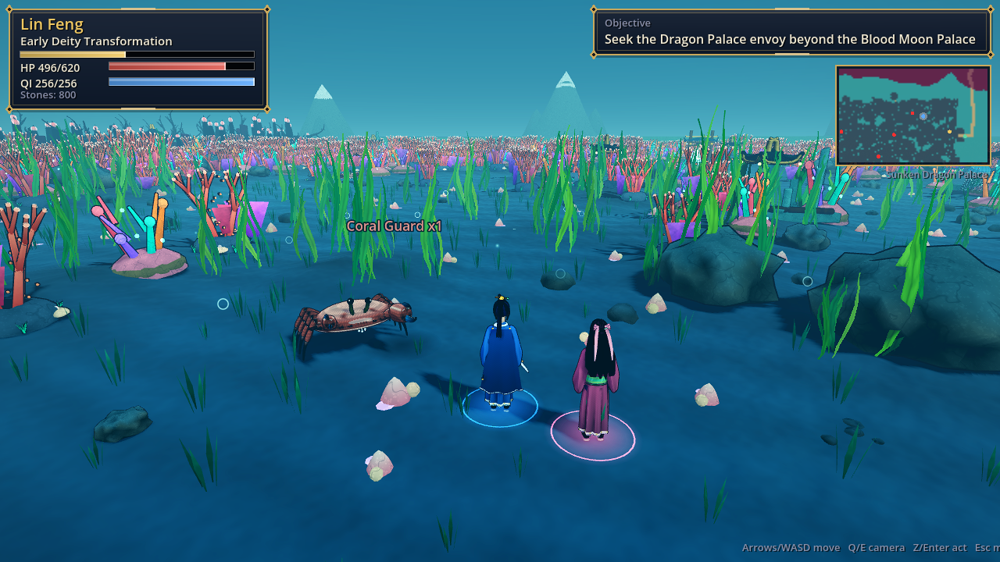
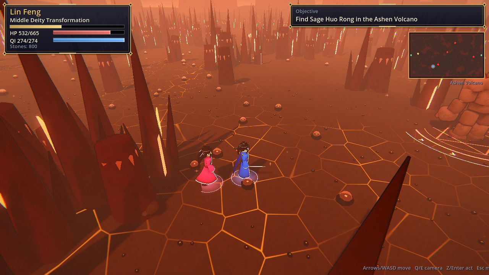
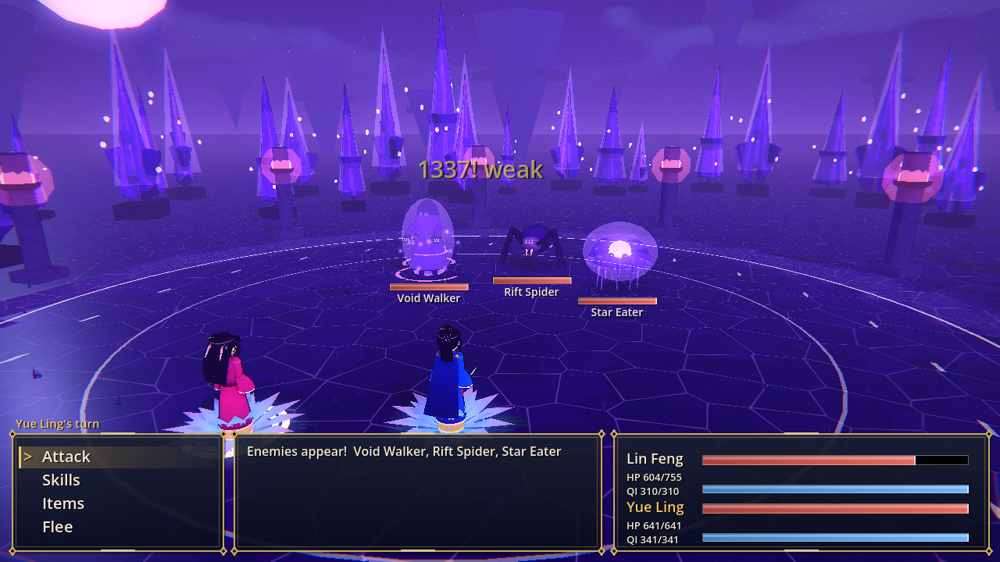
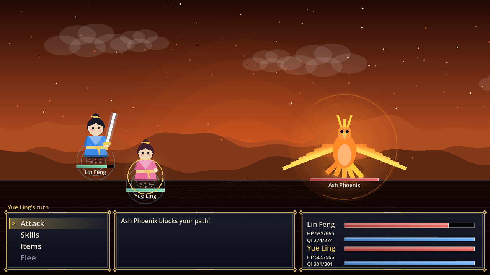
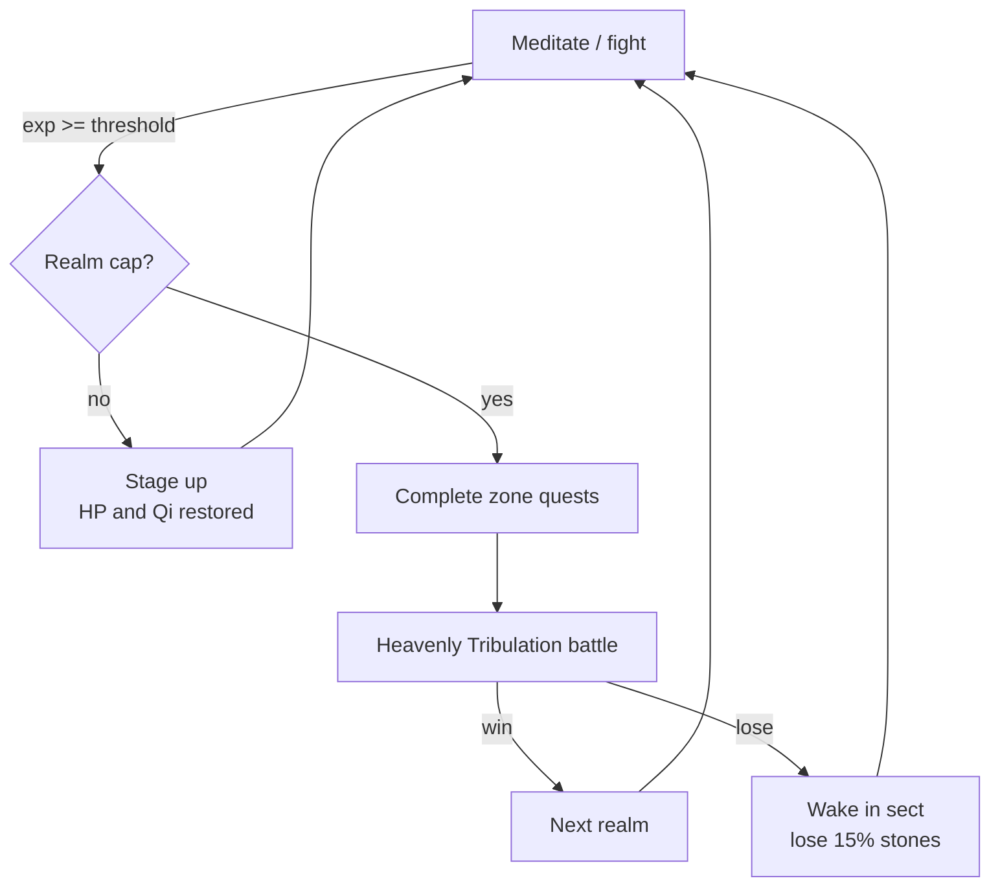
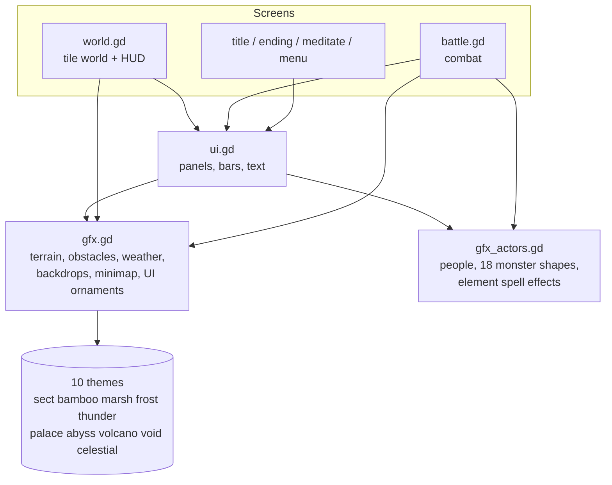

# Ascension of the Azure Cloud

A xianxia cultivation RPG built in **Godot 4** with no external art: every tile, character, monster and spell effect is drawn procedurally in code.
Play Lin Feng, an orphaned sect sweeper with a hidden "Nine Heavens root", from Qi Condensation all the way to Dao Merging, through ten regions, 29 bosses and six Heavenly Tribulations.

> **Total gameplay duration: about 2 hours 10 minutes** (2:10:20 of game time for the end-to-end bot run; a human should expect roughly 2 to 2.5 hours depending on reading and menu speed).
> Part I (the original six regions) takes about 1 hour 6 minutes. **Part II, "The Shattered Heavens", adds another hour**: four new regions, 15 new bosses, 12 new monsters, six new realms of power and a new ending.

| | |
|---|---|
|  |  |
|  |  |
|  |  |
|  |  |

More captures (every region, all 29 bosses, tribulation, meditation, ending) are in [`docs/screenshots`](docs/screenshots), including the full bestiary:


## Run it (terminal)

Requires [Godot 4.3+](https://godotengine.org/download) (developed on 4.7.2) available as `godot` on your PATH.

```sh
git clone https://github.com/jgyy/timegox.git && cd timegox
godot --path . --import      # first time only: imports the project
godot --path .               # play it manually in a window
```

Other terminal commands:

```sh
godot --headless --path . --script tests/run_tests.gd           # data-integrity tests
godot --headless --path . --script tests/manual_input_test.gd   # real keyboard-event smoke test
godot --headless --fixed-fps 30 --path . -- --bot               # bot plays the whole game, prints play time
godot --fixed-fps 30 --path . -- --bot --timescale=1            # (drop --fixed-fps for real time) watch the bot
```

The game is fully playable by hand with the keyboard:

| Key | Action |
|---|---|
| Arrows / WASD | move, navigate menus |
| Enter / Z / Space | confirm, interact, advance dialogue |
| Esc / X | menu (Meditate, Breakthrough, Items), cancel |

Walk into NPCs, enemies, pickups and bosses to interact with them. There is no save system yet: a full run takes about two hours.

## Gameplay

- **Cultivation**: gain cultivation by meditating (Esc → Meditate) and winning battles. 19 stages across seven realms (up to Dao Merging); at the end of each realm you must pass a **Heavenly Tribulation** boss fight to break through.
- **Turn-based combat** with qi-costed techniques, elemental weaknesses (fire / water / wood / earth / thunder), pills, a healer companion (Yue Ling) and boss heavy attacks.
- **Ten regions**, each with a travel gate, elites, bosses and a hunt objective. **Part I**: the Sect, Whispering Bamboo Forest, Crimson Marsh, Frostpeak Caverns, Thunder Valley and the Blood Moon Palace. **Part II (new)**: the Sunken Dragon Palace, Ashen Volcano, Void Rift Expanse and the Celestial Gate.
- **New techniques** for the late game: Abyssal Tide, Meteor Rain, Void Rending Slash, Celestial Judgement, plus Yue Ling's Starlight Rain.
- **Economy**: spirit stones buy pills and tempering for your sword.

```mermaid
flowchart LR
    subgraph P1[Part I: about 1h06m]
    Sect[Azure Cloud Sect<br/>hub, shops, Elder] --> Bamboo[Bamboo Forest<br/>Qi Condensation]
    Bamboo --> Marsh[Crimson Marsh<br/>Foundation]
    Marsh --> Frost[Frostpeak Caverns<br/>Golden Core]
    Frost --> Thunder[Thunder Valley<br/>Nascent Soul]
    Thunder --> Palace[Blood Moon Palace<br/>Demon Lord Xu Mo]
    end
    subgraph P2[Part II: The Shattered Heavens, about 1h04m]
    Palace ==>|Deity Tribulation| Dragon[Sunken Dragon Palace<br/>Dragon King]
    Dragon --> Volcano[Ashen Volcano<br/>Ash Phoenix]
    Volcano -->|Void Tribulation| Void[Void Rift Expanse<br/>Chaos Serpent]
    Void --> Gate[Celestial Gate<br/>Jade Emperor of Ruin]
    end
    Gate ==> End((Dao Merging))
```





## Architecture

All art is generated at runtime. `ui.gd` keeps the original drawing entry points (`UI.panel`, `UI.human`, `UI.monster`...) and delegates to two art libraries, so every screen picks up the new look.



Highlights of the renderer: per-theme ground, path and shoreline tiles, animated water and lava, theme-specific obstacles, weather (snow, rain and lightning, embers, bubbles, void stars, drifting light), a colour grade and vignette per region, a minimap, articulated characters with a walk cycle and per-NPC props, six new monster shapes (golem, serpent, crab, spider, jelly, phoenix), parallax battle backdrops and a distinct hit effect for each element.

Regenerate every screenshot (needs a window; use `xvfb-run` on a server):

```sh
godot --path . --fixed-fps 30 -- --tour=docs/screenshots
```

## The playthrough bot

`scripts/bot.gd` plays the entire game end to end through the **same input surface a human uses** (`up/down/confirm/cancel` presses on the top screen and a held movement direction). It pathfinds with BFS, grinds and meditates when under-levelled, rests when hurt, shops, picks skills by elemental weakness, heals with pills or Spring Rain, and handles tribulations.

To make its clock a fair estimate of a person's playtime it uses human-scale pacing: 0.2 to 0.4 s per key press, and each dialogue line is "read" for about `length / 40` seconds after it finishes typing.

```sh
godot --headless --fixed-fps 30 --path . -- --bot --seed=1234 --report=build/bot_report.json
```

**Is the game sped up?** No. `--fixed-fps 30` makes each frame advance the game clock by exactly 1/30 s regardless of how fast the machine renders it. All movement, typing, battle animation and meditation run off that same frame time, so a full hour of *game time* is simulated in under a minute of *wall-clock* time. `Game.playtime` is the game clock, and it is the number reported. Drop `--fixed-fps` (and optionally pass `--timescale=N`) to watch the bot in real time.

Latest result (seed 1234, identical across runs; seeds 7 and 99 give 2:09:53 and 2:09:52). Before Part II the same seeds gave 1:06:36, 1:06:45 and 1:06:34, so the expansion adds about **1 hour 3 minutes**:

```
game play time  : 2:10:20 (7820 s)
wall clock      : ~4 min
final realm     : Early Dao Merging
battles / kills : 227 / 431   deaths: 0
time by screen  : battle 4212 s, world 1287 s, meditate 1678 s, dialogue 598 s
time by area    : bamboo 844, marsh 666, frost 949, thunder 589, palace 552, sect 434,
                  dragon 615, volcano 1018, void 706, celestial 1456
result          : PASS (needs >= 7200 s)
```

Bot flags: `--bot`, `--seed=N`, `--report=PATH`, `--min-time=SECONDS` (default 3600; CI uses 7200), `--max-time=SECONDS`, `--timescale=N`, `--shots=DIR` (needs a window, saves screenshots at key moments), and `--tour=DIR` (screenshot tour, see Architecture).

## CI

[`.github/workflows/ci.yml`](.github/workflows/ci.yml) downloads Godot, imports the project, runs the data-integrity tests (`tests/run_tests.gd`: quest/dialogue/NPC/boss references, portal symmetry, map reachability and determinism), then runs the bot headless and **fails the build if the game is not completed or takes less than two hours of game time**. The bot report is uploaded as an artifact and shown in the job summary.


## Project layout

```
scripts/data.gd      content: skills, enemies, areas, quest chain, dialogue
scripts/gfx.gd       art library: terrain, weather, backdrops, minimap, UI ornaments
scripts/gfx_actors.gd art library: characters, monster shapes, spell effects
scripts/tour.gd      screenshot tour (developer tool)
scripts/game.gd      autoload: state, progression, quest engine, play clock
scripts/main.gd      screen stack, input, story flow
scripts/world.gd     tile world rendering and movement
scripts/mapgen.gd    seeded map generator with reachability guarantee
scripts/battle.gd    turn-based combat
scripts/bot.gd       end-to-end playthrough bot
tests/run_tests.gd   data-integrity tests
```
