# Ascension of the Azure Cloud

A xianxia cultivation RPG built in **Godot 4**, played in **full 3D from a third-person view**, and **all art is generated from scripts**: every tree, building, character, monster and spell effect comes from code in this repository (GDScript, shaders and **Blender Python**), never from hand-made or downloaded files (see [Art pipeline](#art-pipeline)).
Play Lin Feng, an orphaned sect sweeper with a hidden "Nine Heavens root", from Qi Condensation to Sun-Moon Harmony, across **one open world** of 38 regions around Azure Cloud Mountain, with 141 bosses, fourteen Heavenly Tribulations, three towns full of people and buildings you can walk into.

> **Total gameplay duration: about 10 hours 18 minutes** (10:17:41 of game time for the end-to-end bot run, seed 1234). Parts I to VIII take 8:58:59; **Part IX, "The Tenth Sun", adds another hour** (1 hour 19 minutes): four new regions in the scorched east and on the moon, 16 new bosses, 12 new monsters, a new realm (Sun-Moon Harmony), five new techniques, a market town with eight townsfolk and four new Blender-built leads. **Every character and monster was rebuilt again** (hanfu cut the way it is really cut, cel shading with tinted shadows, richer rigs, eleven character clips and five per monster, monsters sculpted from metaballs with painted coats), **the land lost its rectangles** (curved shorelines, meandering borders, irregular forest edges), and **the towns filled up** (nine new buildings in new styles and twenty new people).

| | |
|---|---|
| 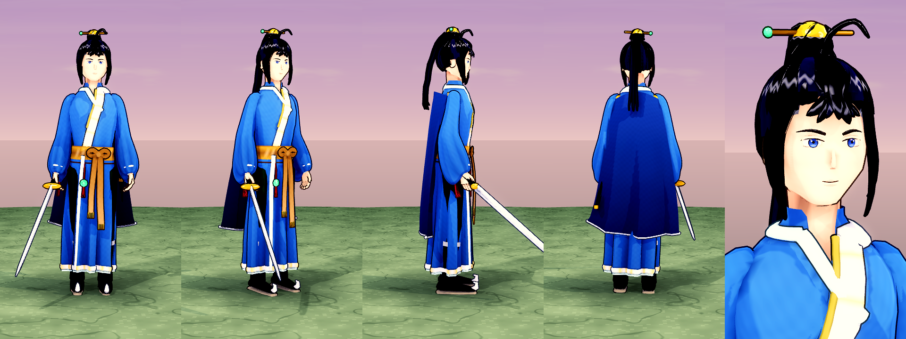 | 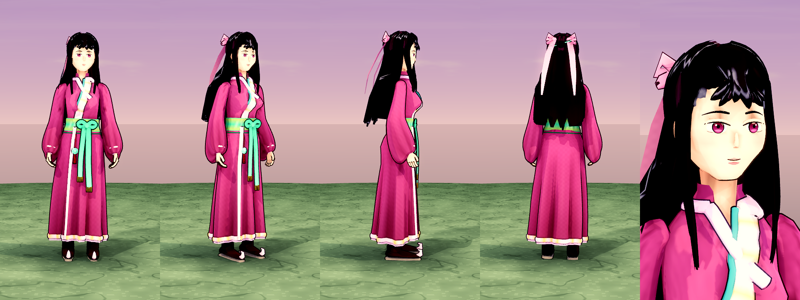 |
| 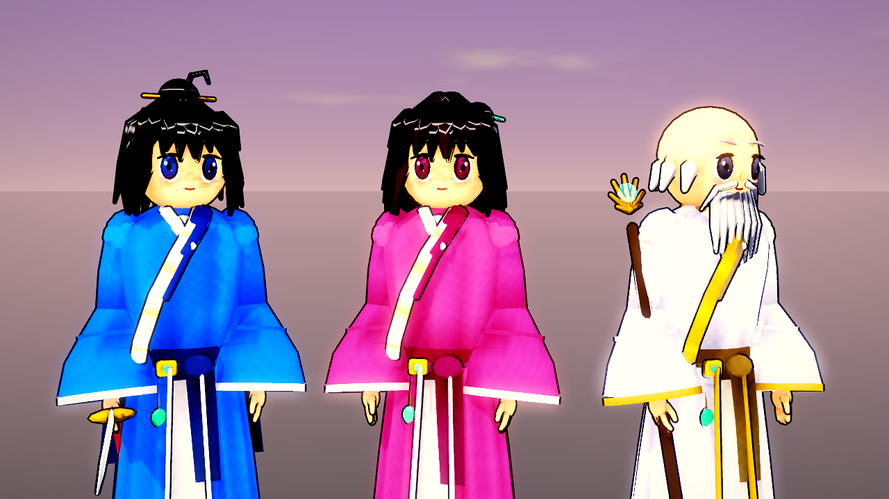 | 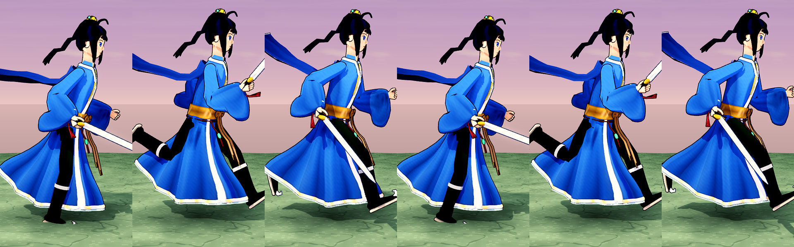 |
| 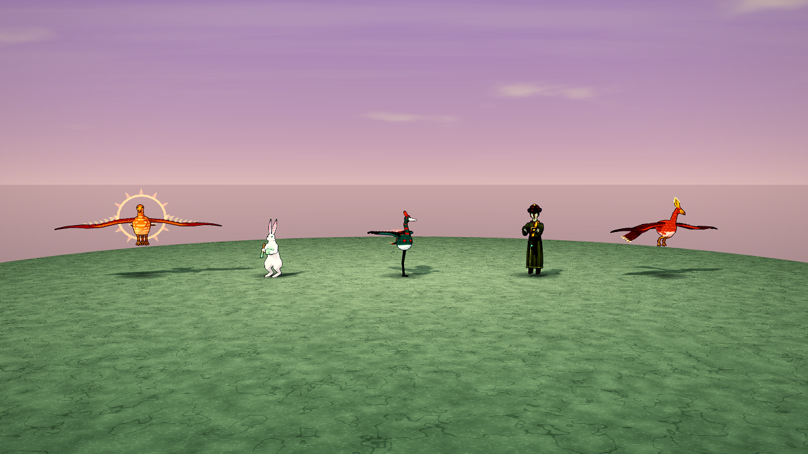 | 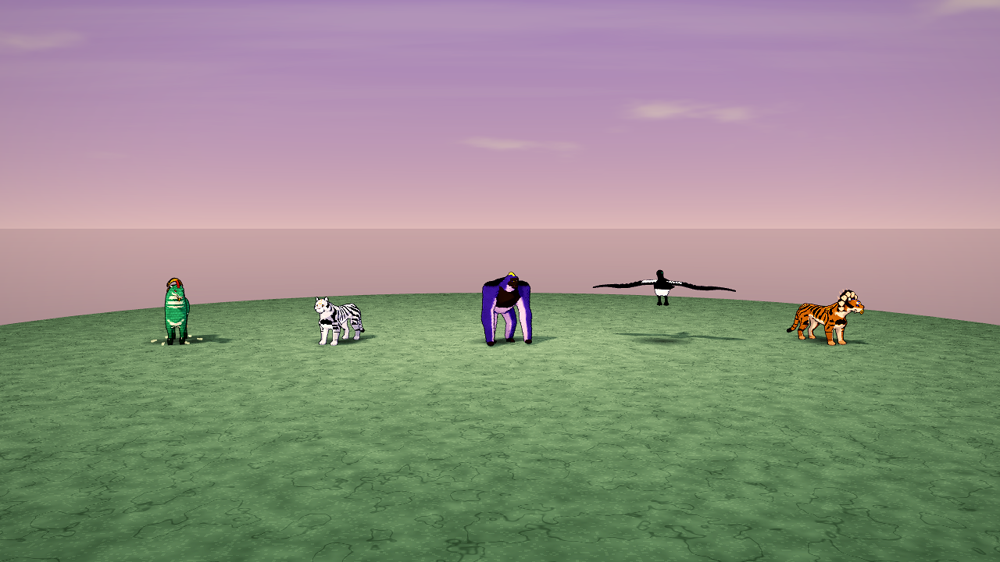 |
| 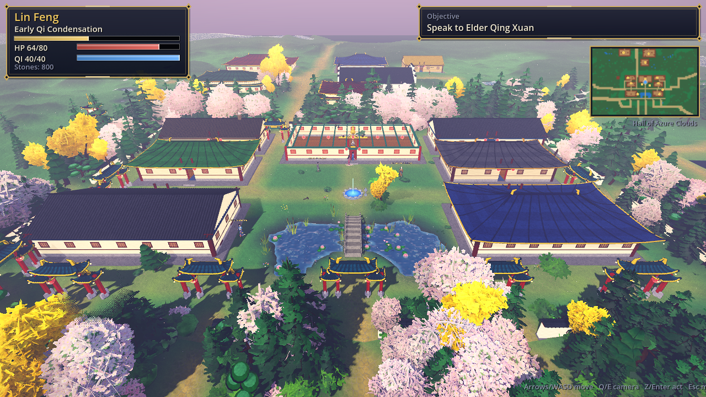 | 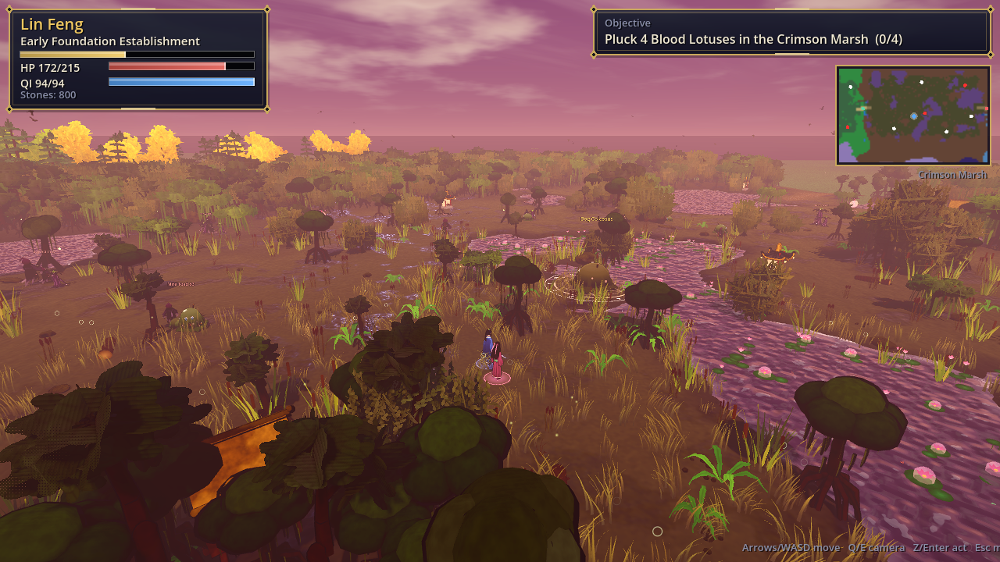 |
| 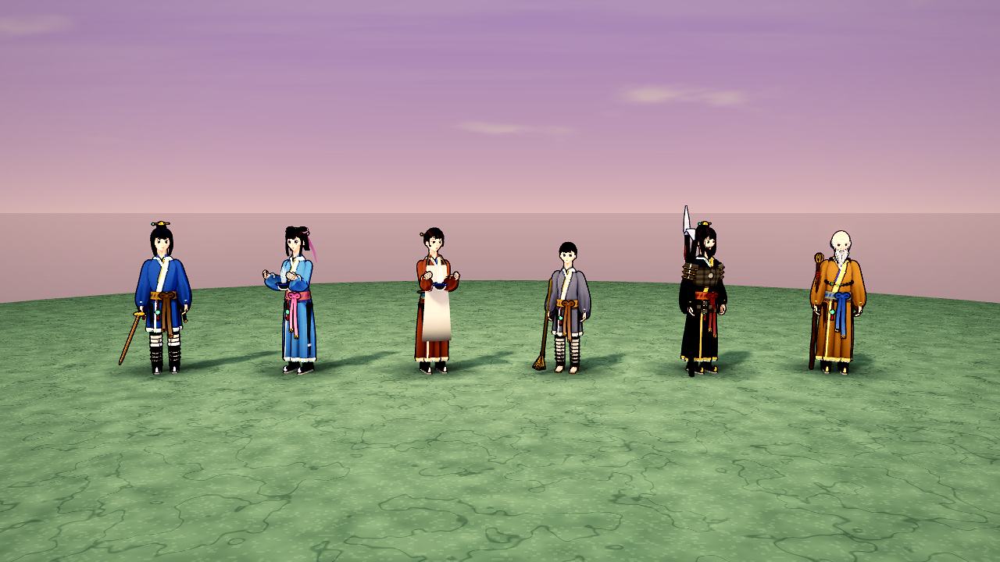 | 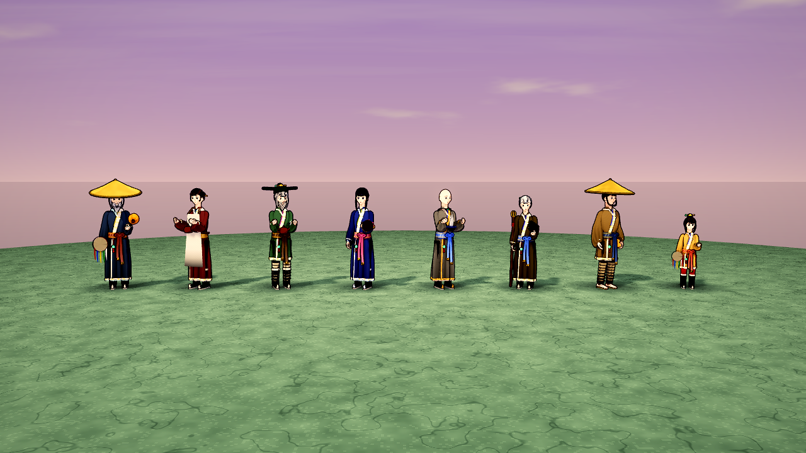 |
| 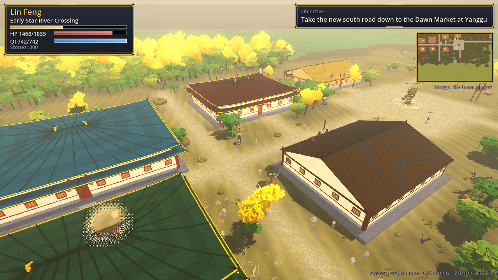 | 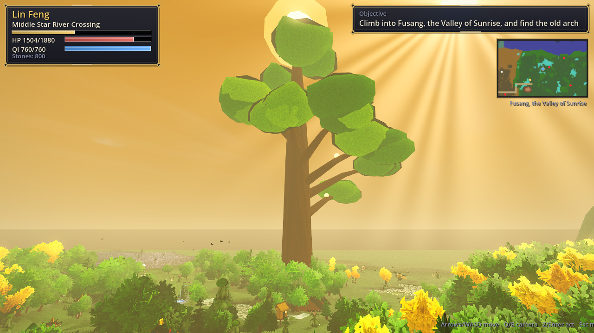 |
| 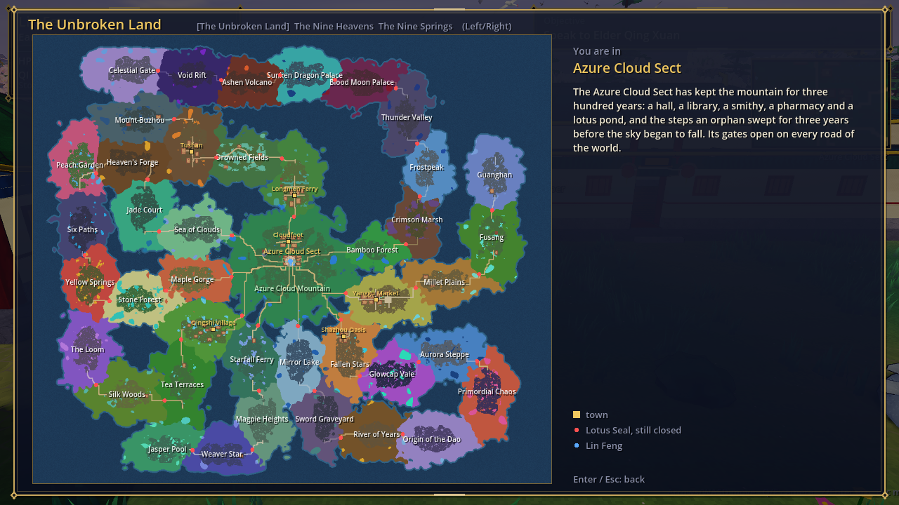 |  |

More captures (every region from the ground and from above, every boss, model galleries, turnarounds, animation strips and portraits) are in [`docs/screenshots`](docs/screenshots).

## What changed in this release

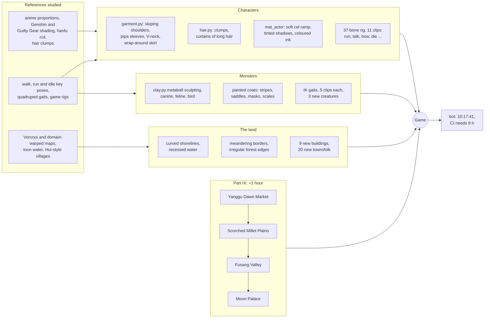

- **Characters, rebuilt again: they now look like people in hanfu.** The old figures had square, horizontal shoulders with the sleeves set on like shoulder pads, wide trapezoid "bell" sleeves with black insides, a white stripe of inner robe running from collar to hem like an apron, a turtleneck collar, thin strands of hair round a helmet and neon costumes. Now (`art/lib/garment.py`, `hair.py`, `person.py`):
  - **The cut of the robe**: narrower, sloping shoulders that run on into the sleeve with no seam (hanfu sleeves are cut in one with the bodice), arms that hang close to the body, a **V at the throat** where the crossed collars meet, and a **wrap-around skirt**, left over right, whose overlap edge carries the collar line down to the hem as one trimmed line.
  - **Sleeves** swept from the shoulder to the cuff as one surface: narrow seen from the front, deep seen from the side, the **pipa-shaped pocket** (mei) sagging behind the hand and gathered into a trimmed cuff (qu), on its own bone so it swings a beat behind the arm.
  - **Hair** in big clumps instead of thin strands: long hair falls as one continuous mass cut into pointed clumps at the ends, ponytails are full tails, side locks and fringes are wider; a highlight ring runs across dark hair.
  - **Proportions** of about 6.6 heads (a slightly larger head reads better at game distance), a thicker neck, softened plant-dye colours, a cape gathered over the shoulders on three bones.
- **Cel shading for characters and monsters** (`MB.mat_actor`): a soft two-tone ramp on the key light with **tinted shadows** (warm rose on skin, cool lavender on cloth and fur) instead of Godot's hard toon terminator, the ambient light that used to double every colour into neon cut back, a thin rim only on the lit side, toon highlights on metal, crystal and scales, and **coloured ink lines** (dark rose under skin, deep blue under a blue robe) drawn thinner than the scenery's.
- **Rigs**: every character gains a pocket bone per sleeve, finger and thumb bones, toe bones, a mouth bone for speech, a second hair bone and a third cape bone (26 to 37 bones).
- **Animation**: eleven clips instead of seven.  **Walk** rebuilt on contact, down, passing and up poses (the arms used to swing *with* the leg on the same side), a **qinggong run** with a flight phase and the cape, sleeves and hair streaming back (the hero crosses a 2 m tile every 0.16 s, so the old walk slid along the ground), **talk** (gestures, nods and a moving mouth), **bow** (the cupped-fist salute), **die** (a collapse that stays down), and idle, sit, attack, cast, hurt and victory redone with anticipation, follow-through and overlapping cloth.
- **Life in the world**: the hero and Yue Ling run on the road; whoever is speaking in a conversation gestures and moves their mouth; people bow as you walk up; **monster packs amble about their ground** with walk cycles and stop to face you when you come close; a fallen fighter collapses and stays down (party members until they are raised).
- **The world is no longer made of rectangles.**
  - **Shorelines** follow a smooth water field (the share of water round each corner, blurred and warped by noise, rounded towards the middle of every water tile) instead of tile corners; shore tiles are subdivided so the waterline curves, lone water tiles become round pools, banks slope down to a recessed waterline, and the foam follows the real depth instead of outlining every square tile in white. Water has teal shallows, deeper blue middles and a quieter sky reflection.
  - **Region borders meander**: ownership uses a two-scale domain warp, so borders wander like coasts and ridges on the world map and on the ground.
  - **No more rectangular clearings**: the forest reaches into every region from its edge by a depth that varies with noise, keeping clearings round every gate, arrival, person, boss, pickup, building and monster pack, and reconnecting anything it cuts off with trails that go round buildings.
  - Regions sit off the grid inside their bands.
- **More town buildings and people.** New building styles: **Huizhou houses** with white walls, black tiles and stepped horse-head fire walls, **thatched farmhouses**, a **two-storey teahouse** with a gallery, **shops** with awnings and signboards, **dormitories** and a **kitchen** with a smoking chimney. The sect gains a kitchen, a hall of martial practice and the disciples' dormitory; Qingshi Village a teahouse, a tofu shop, a carpentry, a farmhouse, a scholar's study and a granary. **Twelve new people** with their own Blender models and chat: Senior Brother Han, Junior Sister Mei, Auntie Zhou the cook, Little Bai (who sweeps the steps with Lin Feng's old broom), Gate Disciple Wu, Old Shen the bell-ringer, Farmer Lao, Little Hua, Tofu Seller Sun, Scholar Wang, Carpenter Gu and Xiao Lan the herb-picker.
- **Monsters sculpted, painted and animated** (`art/lib/clay.py`, `anatomy.py`, `canine.py`, `feline.py`, `bird.py`, `creature.py`): bodies are modelled from metaballs (balls, ellipsoids and capsule chains, each carrying smooth bone weights) instead of hundreds of outlined fur cards, with fur as shingled clumps that belong to the silhouette. Heads are built per species (the tiger's broad skull and cheek ruffs, the wolf's long muzzle and stop, the qilin's dragon head with one ridged horn and cloven hooves, the dragon's nine resemblances on an S-curved serpent body), and coats are painted in the grey values so a recolour still reads as an animal: tiger stripes and the king mark, the wolf's dark saddle and mask, the fox's white bib and black stockings, scales and belly plates. Horns, claws and fangs taper and shade from base to tip. Rigs gained spine, neck, jaw, ear, toe and long tail chains; every monster has **idle, walk, attack, hurt and die**, quadrupeds walk in the four-beat lateral sequence with the hips and chest bouncing out of step and the tail following through, insects and crabs walk on IK legs in an alternating tripod. Three new creatures: the **sun crow**, the **jade rabbit** and **Bifang**.
- **Part IX, "The Tenth Sun"** adds +1 hour (see [below](#part-ix-the-tenth-sun)), verified by the playthrough bot; CI now requires **9 hours**.
- **Art code** grew from 12,550 to about 17,000 lines of Blender Python, the game's GDScript from 17,359 to about 19,000 lines; 129 assets are rebuilt from their scripts in about seven minutes on four cores (the build now runs in parallel).
- **Bugs found and fixed** (see [below](#bugs-found-and-fixed)).

### References

Researched for this release (characters, creatures, rigs, animation, landscape and towns):

- **Stylised characters and faces**: [PoseMyArt anime head guide](https://posemy.art/blog/anime-head-drawing-guide/), [anime proportions step by step](https://www.alibaba.com/product-insights/how-to-draw-anime-characters-with-correct-proportions-step-by-step.html), [80.lv: capturing anime art style in 3D](https://80.lv/articles/cg-jolyne-cujoh-here-s-how-to-capture-anime-art-style-in-3d), [Blender Studio stylised character workflow](https://studio.blender.org/training/stylized-character-workflow/5e70a631db0e8bc0c8b226f2), [3D character body](https://tinakuang.myblog.arts.ac.uk/?p=656).
- **Toon shading**: [Adrian Mendez, Genshin shading breakdown](https://adrianmendez.artstation.com/projects/wJZ4Gg), [B. J. Ayers, recreating the Genshin shader](https://bjayers.artstation.com/blog/category/5), [URP Simple Genshin Shaders](https://github.com/NoiRC256/URPSimpleGenshinShaders), [80.lv Genshin shader for EEVEE](https://80.lv/articles/genshin-impact-character-shader-for-eevee), [GDC 2015: Guilty Gear Xrd's art style](https://gdcvault.com/play/1022031/GuiltyGearXrd-s-Art-Style-The) ([handout](https://www.ggxrd.com/Motomura_Junya_GuiltyGearXrd.pdf)).
- **Hanfu**: [Ru (upper garment)](https://en.wikipedia.org/wiki/Ru_(upper_garment)), [newhanfu: basic features and forms](https://www.newhanfu.com/73124.html), [hanfu garment types](https://culturechina.com/blog/what-is-zhiduo-and-other-hanfu-garment-types-explained.html).
- **Hair**: [BlenderNation: flat-modelling anime hair](https://www.blendernation.com/2020/02/01/flat-modeling-anime-hair/), [80.lv: hairstyle modelling for an anime-like character](https://80.lv/articles/a-closer-look-at-hairstyle-modeling-for-an-anime-like-3d-character), [CG Cookie: modelling hair](https://cgcookie.com/posts/how-to-model-hair-in-blender).
- **Walks, runs and idles**: [Walk cycle](https://en.wikipedia.org/wiki/Walk_cycle), [UW CSE 459 walk cycle notes](https://courses.cs.washington.edu/courses/cse459/19au/assignments/assignment_5/index.html), [SIGGRAPH walking exercise](https://education.siggraph.org/static/HyperGraph/animation/character_animation/walking/walking_excercise.htm), [AnimSchool: breathing life into idle animations](https://blog.animschool.edu/2024/06/14/breathing-life-into-idle-animations), [idle animation for games](https://mocaponline.com/blogs/mocap-news/idle-animation-design-guide).
- **Rigs**: [skeleton hierarchy guide](https://mocaponline.com/blogs/mocap-news/skeleton-hierarchy-animation-guide), [demystifying character rigging for games](https://gamedev.net/blogs/entry/2277565-demystifying-character-rigging-for-games/), [CRYENGINE jiggle bones](https://www.cryengine.com/docs/static/engines/cryengine-5/categories/23756816/pages/44959301).
- **Creatures**: [creating a furry 3D character](https://www.creativebloq.com/how-to/create-a-furry-3d-character-from-scratch), [80.lv: stylised characters for games](https://80.lv/articles/building-stylized-characters-for-games-tips-and-tricks), [digitigrade legs](https://www.line-of-action.com/zh-Hant/article/digitrade-animals-dont-have-backward-knees), [how to draw a tiger](https://chriswilsonstudio.com/how-to-draw-a-tiger/), [Chinese dragon (Loong)](https://www.wikiwand.com/en/articles/Loong), [A Chinese Bestiary (Strassberg)](https://abookofcreatures.com/category/china).
- **Quadruped gaits**: [Animation Mentor quadruped walk](https://www.animationmentor.com/?p=46186), [animating four-legged beasts](https://gamedeveloper.com/art/animating-four-legged-beasts), [animating dogs: gaits](https://animuppetry.blogspot.com/2013/01/animating-dogs-part-ii-more-gaits-and.html).
- **Landscape**: [Red Blob Games: polygon map generation](https://www.redblobgames.com/maps/polygon-map-generation/), [Frozen Fractal: continents and domain warping](https://frozenfractal.com/blog/2023/11/2/around-the-world-1-continents/), [stylised water with depth fade](https://godotshaders.com/shader/stylized-water-with-depthfade/), [toon water](https://godotshaders.com/shader/toon-water/).
- **Towns**: [Hui-style architecture](https://en.wikipedia.org/wiki/Hui_Style_architecture), [Xidi and Hongcun](https://worldheritagesite.org/list/Xidi+and+Hongcun), [Jiangnan architecture](https://news.cgtn.com/news/2024-05-01/VHJhbnNjcmlwdDc4NTI5/index.html).

### Previous release: rebuilt models and Part VIII


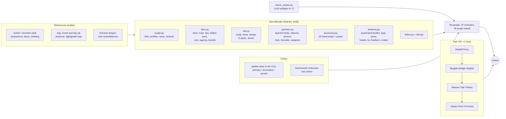

- **Characters look like people.** Every character is built by `art/lib/person.py` from new libraries. **Faces** (`face.py`) are sculpted on a skull: brow ridge, cheekbones, jaw and chin, a nose with alar wings, lips with a philtrum, eyes set into sockets under lids with a crease and lashes, ears with a helix, laugh lines and crow's feet for the old, and beards that grow from the face. **Hair** (`hair.py`) grows from a scalp with a real hairline as tapered locks, with fringes, side locks, a crown whorl and eight styles (topknot, long, bun, twin buns, braid, short, wild, bald), and dark hair gets a lighter sheen. **Clothes** (`garment.py`) are layered hanfu lofted around the body: inner robe, crossed collar, sash, hanging sleeves with a lining, a skirt that drapes, and armour of lamellar plates, pauldrons and tassets; hats, crowns, weapons, brocade motifs (cloud scrolls, waves, cranes, plum blossom), scars and freckles. Builds (slight to burly), age (the old stoop), femininity, and anime-leaning proportions (about 7 heads tall, larger eyes) follow the references. **Props and poses** (`accessory.py`): 29 hand-held items (gourds, fans, scrolls, lanterns, oars, fishing rods, abacus, flute, a cormorant...) with matching holding poses, so every NPC carries their trade.
- **Natural motion.** Idle with contrapposto and breathing, a walk with heel strike and counter-swinging arms, sitting, attacking, casting, hurt and victory clips; held props keep their pose while walking.
- **Monsters have anatomy.** `anatomy.py` builds quadrupeds the way the animals are built: a keel-shaped ribcage and tucked waist, withers and croup, muscled shoulders and haunches, **digitigrade legs** with the stifle forward and the hock back, paws with toe pads and claws, canine and feline skulls with a stop and a separate jaw, groomed fur clumps, feathers with a rachis, scale rows, plates, compound eyes, bristles, bark-covered limbs and veined leaves. The dragon follows the **nine resemblances** (camel head, deer antlers, rabbit eyes, cow ears, snake neck, clam belly, carp scales, eagle claws, tiger palms). All 29 old shapes were rebuilt and 8 new ones added: **qilin, ape, tiger, Queen Mother, River Warden, Crow Marshal, nine-faced Kaiming and magpie**, so lions, tigers, apes and qilin are no longer drawn as wolves.
- **Much richer colour palettes.** The art pipeline now stores a **palette slot** per vertex (primary, secondary, accent) next to the tint weight. In game, `Assets.palette()` turns one enemy colour into a scheme: a shade and a light of the primary blended by the surface's own value, an analogous secondary and a complementary accent (gold or blue for grey creatures). Quadrupeds get pale bellies and darker lower legs, manes, crests, fins and horns take the secondary, eyes, claws and glows the accent. Characters' costumes are **harmonised** from their robe colour: a pastel inner robe, deeper trousers, a contrasting sash and collar, light trim.
- **Landmarks** (all 26 props) gained sculpted detail within their triangle budgets, and four new ones mark Part VIII: the ferry post, the magpie pine, the star pillar and the jade peach tree.
- **Part VIII** adds +1 hour (see below), verified by the playthrough bot; CI now requires **8 hours**. The ending gains the **magpie bridge** (`art/props/magpiebridge.py`) with the Cowherd and the Weaver meeting on it.
- **Asset validation in CI.** `art/check_assets.py` reads every exported GLB without Blender and checks the script-to-file pairing, the three material slots, vertex colours and tint UVs, triangle budgets, the bones the game drives and the animation clips.
- **Blender Python art code doubled**: 6,272 to 12,549 lines (`art/lib` 5,389, characters 770, monsters 4,704, props 1,489, tools 198).
- **Bugs found and fixed** (see below).

#### References for that release

The models were rebuilt after studying how stylised and anatomical 3D characters are made:

- Anime proportions and faces: [how to draw anime characters with correct proportions](https://www.alibaba.com/product-insights/how-to-draw-anime-characters-with-correct-proportions-step-by-step.html), [3D character body](https://tinakuang.myblog.arts.ac.uk/2024/03/26/3d-character-body/), [making a stylised face](https://www.hitem3d.ai/de/ai-faq/how-to-make-a-face-3d-model-look-stylized).
- Toon shading and model evolution in Genshin Impact: [Adrian Mendez's shading breakdown](https://adrianmendez.artstation.com/projects/wJZ4Gg), [B. J. Ayers' blog](https://bjayers.artstation.com/blog/category/5), [character model evolution 1.0 to 7.0](https://topuplist.com/blogs/detail/genshin-impact-character-model-evolution-version-1-0-to-7-0), [Natlan model changes](https://thenerdstash.com/genshin-impact-fans-discover-a-small-yet-welcome-change-in-the-new-natlan-character-models).
- Quadruped anatomy: [digitigrade animals don't have backward knees](https://www.line-of-action.com/zh-Hant/article/digitrade-animals-dont-have-backward-knees), [canine hindlimb](https://en.wikivet.net/Canine_Hindlimb_-_Anatomy_&_Physiology), [canine phalanges](https://en.wikivet.net/Canine_Phalanges_-_Anatomy_%26_Physiology), [dog anatomy](https://www.wikiwand.com/en/articles/Dog_anatomy), [equine anatomy and biomechanics](https://mink-studios.blogspot.com/2016/11/equine-anatomy-and-biomechanics-primer.html), [eastern dragon anatomy](https://w.blackdrago.com/science/anatomy_east.htm).
- The Chinese dragon: [Loong](https://www.wikiwand.com/en/articles/Loong) (the nine resemblances), [how to draw a dragon](https://www.sixthtone.com/news/1014614/how-to-draw-a-dragon).

### Two releases ago: one open world and Part VII

```mermaid
flowchart LR
    subgraph O[One open world]
    AT[atlas.gd<br/>every region on one tile grid] --> RD[roads between gates,<br/>Lotus Seals instead of teleports]
    AT --> SM[noise-warped borders,<br/>forest belts between regions]
    AT --> ST[world.gd streams regions in<br/>and out around the player]
    AT --> MAP[world map in the pause menu,<br/>scrolling minimap]
    end
    subgraph S[Less squarish land]
    W1[wandering trails instead of<br/>L-shaped corridors] --> LAND((terrain))
    W2[shorelines follow the ground,<br/>oval sect pond] --> LAND
    W3[hilliness blends across<br/>region borders] --> LAND
    end
    subgraph B[Buildings you can enter]
    H[architecture.gd house():<br/>walls, door, plank floor,<br/>furniture, lanterns] --> RF[roof lifts away<br/>while you are inside]
    H --> NPC[Elder, Alchemist, Smith,<br/>Archivist and villagers indoors]
    end
    subgraph P[Part VII: +1 hour]
    V[Qingshi Village] --> TE[Cloud-Tea Terraces] --> SK[Mulberry Silk Woods] --> LM[Loom of Borders]
    end
    O --> G((Game))
    S --> G
    B --> G
    P --> G
```

- **One open world.** All 30 regions and the sect now lie on one continuous map (492 x 448 tiles, about 1 x 0.9 km). Azure Cloud Mountain with the sect on its slope runs down the west side; each chapter's chain of regions runs east from it as a band of land, and Part II's chain snakes back west beneath Part I's. You walk from region to region along roads: there are no loading gates or teleports any more. A region the story has not opened yet is closed by a **Lotus Seal** barrier across its road, which dissolves into an open archway when the Elder (or the boss before it) lets you through. The 3D view streams regions in as you approach them and drops the far ones; the minimap scrolls with you, and **Esc > World Map** shows the whole land.
- **Less squarish terrain.** Region borders are no longer straight walls: the land between two regions is a forest-and-rock belt whose edges wander with noise, and the change of ground, trees and sky follows the same wavy line. Connecting trails wander on the diagonal instead of running in L-shaped corridors, the mountain roads meander, the water plane runs on under the banks so shorelines follow the shape of the ground, the sect's lotus pond is an oval, and hilliness blends smoothly from one region to the next.
- **Buildings you can enter.** The sect's Hall of Azure Clouds, the Alchemist's Pharmacy, the Smithy and a new Scripture Library are hollow buildings with a door, plank floors, lattice windows, lanterns and furniture (altar and founder statue, cauldron and herb racks, hearth, anvil and weapon rack, bookshelves). Qingshi Village has five more (Granny Wen's house, an inn, a shrine, a weaver's workshop and an abandoned house) and the tea terraces and silk woods one each. Walk in through the door and the roof lifts away; the Elder, Alchemist Mo, Smith Tie and the villagers wait inside.
- **Part VII** adds +1 hour (see below), verified by the playthrough bot; CI now requires **7 hours**.
- **Bugs found and fixed** (see below).

### Three releases ago: natural landscapes and Part VI

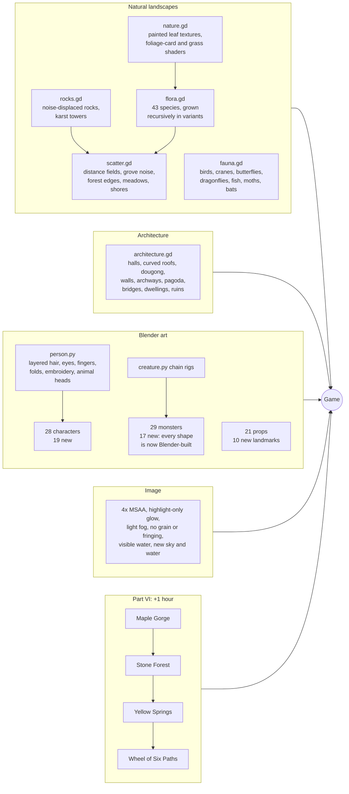

- **Natural landscapes instead of stamped copies.** Trees are grown by code from 43 species recipes, each in several seeded variants, with leaf-card canopies lit as one soft volume that glow when back-lit and move in rolling gusts. An ecology layer places them: dense tall forest inside blocked areas, young trees and shrubs at the edges, species gathering in natural stands, ferns, logs and stumps along forest borders, reeds and lotus at the water, flowers in meadows, rocks where the ground is rocky, and thick wind-blown grass. Wildlife moves through it.
- **Architecture.** The sect's halls are rebuilt the traditional way (platform, balustrade, lions, columns with bracket sets, lattice doors, painted beams, curved double-eaved roofs), with a courtyard wall, gate archways and a pagoda. Every road that crosses water gets a stone bridge; huts, shrines, watchtowers, tents, yurts, pavilions and ruins dot the wilds; the built regions get 10 new Blender landmarks.
- **Characters and monsters.** The character builder gained layered hair, richer eyes, fingers, cloth folds, embroidery and animal heads; 19 new characters (every NPC is now a Blender model) and 17 new monsters, so no enemy shape uses the old primitive models any more.
- **A clearer image.** The "slightly blurry lens" look is gone. The frame had no anti-aliasing and was softened by a low-threshold bloom over everything, a soft-light glow, heavy fog with aerial perspective, film grain and chromatic aberration. Now: 4x MSAA, glow only on genuinely bright highlights, light fog, and no grain or fringing.
- **Third-person follow camera.** The camera sits low behind Lin Feng and swings round behind him whenever he walks, so you see his back rather than his side; a held direction key keeps its heading while the camera turns. Trees, rocks, landmarks and buildings standing between the camera and the hero dissolve in an ordered dither, and Yue Ling walks at his shoulder instead of in the camera's way.
- **Part VI** adds +1 hour (see below), verified by the playthrough bot; CI now requires **6 hours**.
- **Graphics code grew from 8,667 to 15,036 lines** (+73%: 8,862 lines of GDScript graphics modules, 6,174 lines of Blender Python).
- **Bugs and plot holes found and fixed** (see below), including one that hid every pond, lake and river in the game.

## 3D graphics

| Area | Before | Now |
|---|---|---|
| Trees | 1-2 meshes per region, one per blocked tile | 43 procedurally grown species in 5 variants each, leaf-card canopies with spherized normals, translucency, gusting wind; per-instance hue, size, lean and yaw |
| Placement | a landmark on every blocked tile, a tuft on every open tile | ecology: distance fields to forest edge, water and road; grove noise; forest-edge undergrowth; meadows, shore plants, logs, rock outcrops; a dwelling per neighbourhood |
| Ground cover | one tuft mesh | curved grass blades with root-to-tip colour, dry and lush patches and gusts; ferns, flowers, lotus, spider lilies, glowshrooms, agave, kelp |
| Rocks | one sphere-like boulder | noise-displaced icospheres: boulders, slabs, spires, scree, pebbles, limestone towers; moss, snow or sand on top |
| Buildings | boxes with a pyramid roof | curved hip roofs with swept corners, tile ribs, ridge ornaments; bracket sets, lattice doors, platforms, lions; walls, archways, pagoda, bridges, 8 kinds of dwelling |
| Landmarks | primitive obelisks, columns, gears | 10 new Blender landmarks (obelisk, jade pillar, column, furnace, gear, monolith, floating island, shard, stone lantern, ghost pagoda) |
| Wildlife | none | flocks, crane formations, butterflies, dragonflies, fish that leap, moths, bats |
| Water | flat, hidden under the ground skirt | visible; sky reflection, sun glints, waves lapping at the shore |
| Mountains | grey six-sided cones | massifs with forested foothills, snow caps and shoulder peaks |
| Characters | 9 Blender people | 28: layered hair and fringes, iris gradients, fingers, folds, embroidered hems and lapels, animal heads |
| Monsters | 12 Blender shapes, 15 primitive | all 29 shapes Blender-built (serpent, crab, spider, mantis, jelly, manta, wisp, wraith, plant, slime, storm, tome, fox, koi, Ox-Head, Horse-Face, hopping corpse, ...) |
| Image | soft, misty | 4x MSAA, highlight-only bloom, light fog, distance-scaled ink outline |

|  |  |
|---|---|
|  |  |
|  |  |

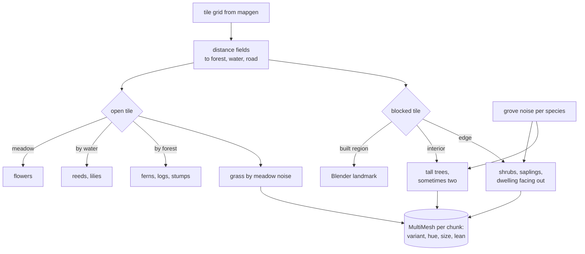

## Art pipeline

**Rule: all art is generated from scripts.** Every model, texture, animation and effect must be reproducible by running code that lives in this repository. Hand-made, downloaded or AI-image-generated asset files are not allowed. Rendered screenshots in `docs/screenshots` are outputs, not inputs.

| Source | Use it for | Where |
|---|---|---|
| **Godot code** (GDScript and shaders) | anything built from game data or changing at runtime: terrain, weather, spell effects, shaders, UI | `scripts/` |
| **Blender Python** (`bpy`, Blender 5.2) | hero assets: characters, monsters, rigs and animations, landmarks | `art/` |

- `art/lib/kit.py`: the toolkit. Coordinates are written in Godot space; primitives (ellipsoids, superquadrics, swept tubes with per-point bone weights, lathes, double-sided sheets, leaves, eyes), organic bodies from Blender's **Skin + Subdivision modifiers**, **ray-cast ambient occlusion** baked into vertex colours, the **Decimate** modifier for landmark triangle budgets, armatures, clips baked from Python functions and GLB export.
- `art/lib/person.py` builds every character from options (robe, hair style, hat, weapon, beard, horns, build, age, props, pose, brocade, tinting) with `face.py`, `hair.py`, `garment.py` and `accessory.py`; `sculpt.py` holds the shared modelling tools (lofts through cross-section profiles, noise, splines, strands).
- `art/lib/clay.py` sculpts creature bodies from metaballs (balls, ellipsoids, capsule chains) that carry smooth bone weights and paint tags; `anatomy.py` builds species heads, torsos, legs, paws, hooves, tails, fur clumps, eyes, ears, horns, claws and fangs; `canine.py`, `feline.py` and `bird.py` build the dog, cat and bird families; `art/lib/creature.py` holds the rigs, IK for legs, gait timing, the shared four-legged motion set and the clip helpers.
- `art/characters/*.py`, `art/monsters/*.py`, `art/props/*.py`: one script per asset, each writing `assets/<group>/<name>.glb`.
- Vertex colour alpha carries the toon shader's surface class, UV.x a tint weight, UV.y a **palette slot** (0 primary, 0.5 secondary, 1 accent), and the material slot (`toon`, `plain`, `glow`) chooses the game shader; `scripts/assets.gd` swaps the materials in at load time and turns the enemy's colour into a palette, so Blender and procedural models share one look.
- `python art/check_assets.py` validates every export (pairing with its script, materials, colours and UVs, triangle budgets, bones, clips); CI runs it after the rebuild.
- Builds are deterministic: rebuilding produces byte-identical files on the same machine. CI rebuilds every asset from its script.
- Every art change is checked visually with the screenshot tour (`--tour`, `--gallery`).

```sh
pip install bpy==5.2.3                        # Blender as a Python module (or use a Blender install)
python art/build_all.py                       # rebuild all 129 assets in parallel (about 7 min on 4 cores; ART_JOBS=N)
python art/check_assets.py                     # validate the exports
blender --background --python art/monsters/hundun.py   # or one asset with Blender itself
godot --headless --path . --import            # re-import into Godot
```

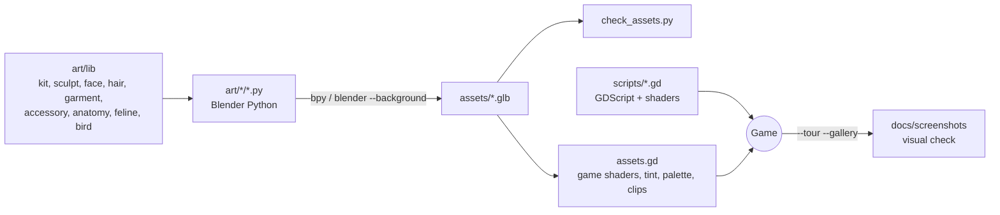

## Run it (terminal)

Requires [Godot 4.3+](https://godotengine.org/download) (developed on 4.7.2) available as `godot` on your PATH and a GPU/driver that supports OpenGL 3 (the project uses the Compatibility renderer).

```sh
git clone https://github.com/jgyy/timegox.git && cd timegox
godot --path . --import      # first time only: imports the project
godot --path .               # play it manually in a window
```

Other terminal commands:

```sh
godot --headless --path . --script tests/run_tests.gd           # data-integrity and 3D-asset tests
godot --headless --path . --script tests/manual_input_test.gd   # real keyboard-event smoke test
godot --headless --fixed-fps 30 --path . -- --bot --min-time=32400   # bot plays the whole game, prints play time
godot --fixed-fps 30 --path . -- --bot --timescale=1            # (drop --fixed-fps for real time) watch the bot
```

| Key | Action |
|---|---|
| Arrows / WASD | move (relative to the camera; a held key keeps its direction while the camera turns), navigate menus |
| Q / E | rotate the camera (it swings back behind Lin Feng as soon as he walks) |
| Enter / Z / Space | confirm, interact, advance dialogue |
| Esc / X | menu (Meditate, Breakthrough, Items), cancel |

Walk into NPCs, enemies, pickups and bosses to interact with them. There is no save system yet: a full run takes about nine hours. Esc > World Map shows the whole land.

## Gameplay

- **Cultivation**: gain cultivation by meditating (Esc, Meditate) and winning battles. 43 stages across fifteen realms (up to Sun-Moon Harmony); at the end of each realm you must pass a **Heavenly Tribulation** boss fight to break through.
- **Turn-based combat** with qi-costed techniques, elemental weaknesses (fire / water / wood / earth / thunder / dark), pills, a healer companion (Yue Ling) and boss heavy attacks.
- **Thirty-eight regions in one open world**, each with elites, bosses and a hunt objective, joined by roads. **Part I**: the Sect, Whispering Bamboo Forest, Crimson Marsh, Frostpeak Caverns, Thunder Valley and the Blood Moon Palace. **Part II**: the Sunken Dragon Palace, Ashen Volcano, Void Rift Expanse and the Celestial Gate. **Part III**: the Mirror Lake of Echoes, the Graveyard of Sword Saints, the River of Ten Thousand Years and the Origin of the Dao. **Part IV**: the Sea of Clouds Archipelago, the Ruins of the Jade Court, Heaven's Forge and the Garden of Immortal Peaches. **Part V**: the Desert of Fallen Stars, Glowcap Vale, the Aurora Steppe and the Primordial Chaos. **Part VI**: the Maple Gorge of Returning Souls, the Stone Forest of the Nine Bends, the Yellow Springs of Red Lilies and the Wheel of the Six Paths. **Part VII**: Qingshi Village Below the Mountain, the Cloud-Tea Terraces, the Mulberry Silk Woods and the Loom of Borders. **Part VIII**: the Starfall Ferry on the Silver River, the Heights of the Magpie Bridge, the Palace of the Weaver Star and the Jasper Pool of Kunlun. **Part IX (new)**: Yanggu, the Dawn Market; the Scorched Millet Plains; Fusang, the Valley of Sunrise; and Guanghan, the Palace of the Moon.
- **Techniques** for the late game: Abyssal Tide, Meteor Rain, Void Rending Slash, Celestial Judgement, Chrono Severance, Genesis Sword, Ten Thousand Starfall, Ledger-Breaking Stroke, Sky-Mending Sword, Five-Colour Stone Rain, Pillar of Heaven Strike, Six Paths Wheel Slash, Ten Thousand Lantern Rain, Samsara Sword, Seam-Cutting Sword, Thousand-Thread Rain, Boundless Heart Sword, Magpie Bridge Sword, Silver River Torrent, Seventh-Night Reunion Sword, **Noon-Splitting Sword**, **Fall of the Nine Suns** and **Tenth Arrow Sword**, plus Yue Ling's Starlight Rain, Dawn Lotus, Seal Bloom, Five-Colour Thread, Nuwa's Mending, Spirit Lantern Ward, Lotus of Rebirth, Silver Silk Snare, Homeward Lantern, Starweave Net, Magpie Wing Ward, **Osmanthus Moon Rain** and **Moon-Dew Ward** (the reviving heals also raise a fallen ally).
- **Economy**: spirit stones buy pills and tempering for your sword.

```mermaid
flowchart LR
    subgraph P1[Part I: about 1h06m]
    Sect[Azure Cloud Sect<br/>hub, shops, Elder] --> Bamboo[Bamboo Forest]
    Bamboo --> Marsh[Crimson Marsh]
    Marsh --> Frost[Frostpeak Caverns]
    Frost --> Thunder[Thunder Valley]
    Thunder --> Palace[Blood Moon Palace<br/>Demon Lord Xu Mo]
    end
    subgraph P2[Part II: about 1h04m]
    Palace ==>|Deity Tribulation| Dragon[Sunken Dragon Palace]
    Dragon --> Volcano[Ashen Volcano]
    Volcano -->|Void Tribulation| Void[Void Rift Expanse]
    Void --> Gate[Celestial Gate<br/>Jade Emperor of Ruin]
    end
    subgraph P3[Part III: about 1h01m]
    Gate ==>|Dao Merging, Lotus Seal recalls you| Sect2[Sect: the Elder's confession]
    Sect2 --> Mirror[Mirror Lake of Echoes<br/>Echo of Xu Mo]
    Mirror --> Grave[Graveyard of Sword Saints<br/>Founder Qing Lian]
    Grave -->|Mahayana Tribulation| Time[River of Ten Thousand Years<br/>Tian Xuan]
    Time --> Origin[Origin of the Dao<br/>The Hollow Heaven]
    end
    subgraph P4[Part IV: about 1h06m]
    Origin ==>|True Immortal, names written in the sky| Sect3[Sect: the Jade Ledger]
    Sect3 -->|west gate| Clouds[Sea of Clouds<br/>Herald Qian Shu]
    Clouds --> Court[Ruins of the Jade Court<br/>Registrar Si Ming]
    Court --> Forge[Heaven's Forge<br/>Forge-Lord Tian Gong]
    Forge --> Garden[Garden of Immortal Peaches<br/>The Jade Ledger]
    end
    subgraph P5[Part V: about 1h08m]
    Garden ==>|Dao Ancestor, stars fall at noon| Sect4[Sect: the falling sky]
    Sect4 -->|south-east road| Dunes[Desert of Fallen Stars<br/>Bai Hu, White Tiger]
    Dunes --> Fungal[Glowcap Vale<br/>Zhu Que, Vermilion Bird]
    Fungal --> Aurora[Aurora Steppe<br/>Xuan Wu, Black Tortoise]
    Aurora --> Chaos[Primordial Chaos<br/>Hundun, the Faceless]
    end
    subgraph P6[Part VI: about 1h07m]
    Chaos ==>|Primordial Sovereign, the dead stop moving on| Sect5[Sect: the queue at the gate]
    Sect5 -->|south-west funeral road| Maple[Maple Gorge<br/>Ox-Head]
    Maple --> Karst[Stone Forest<br/>Horse-Face]
    Karst --> Springs[Yellow Springs<br/>The Thousand Unforgotten]
    Springs --> Wheel[Wheel of the Six Paths<br/>King Yama]
    end
    subgraph P7[Part VII: about 1h07m]
    Wheel ==>|Samsara Transcendence, threads across the roads| Sect6[Sect: the Weaver's seams]
    Sect6 -->|south road| Village[Qingshi Village<br/>Needle General Zhen]
    Village --> Terraces[Cloud-Tea Terraces<br/>Thread Matron]
    Terraces --> Silk[Mulberry Silk Woods<br/>Thousand Hands]
    Silk --> Loom[Loom of Borders<br/>Madam Qianxian]
    end
    subgraph P8[Part VIII: about 1h11m]
    Loom ==>|Boundless Heart, the Silver River floods| Sect7[Sect: drowned stars in the pond]
    Sect7 -->|south road, the old Sky Road| Ferry[Starfall Ferry<br/>Qilin of the Rising Tide]
    Ferry --> Magpie[Magpie Bridge Heights<br/>Crow Marshal]
    Magpie --> Star[Weaver Star Palace<br/>Heavenly Warden of the River]
    Star --> Jasper[Jasper Pool of Kunlun<br/>Xiwangmu, Queen Mother of the West]
    end
    end
    subgraph P9[Part IX: about 1h19m]
    Jasper ==>|Star River Crossing, the sun will not set| Sect8[Sect: noon for nine days]
    Sect8 -->|the new south road| Yanggu[Yanggu Dawn Market<br/>Hanba, the Drought Fiend]
    Yanggu --> Millet[Scorched Millet Plains<br/>Bifang, the Fire Crane]
    Millet --> Fusang[Fusang Valley of Sunrise<br/>Jinwu, the Sun Crow]
    Fusang --> Guanghan[Guanghan, Palace of the Moon<br/>Xihe, Mother of Suns]
    end
    Guanghan ==> End((Sun-Moon Harmony))
```

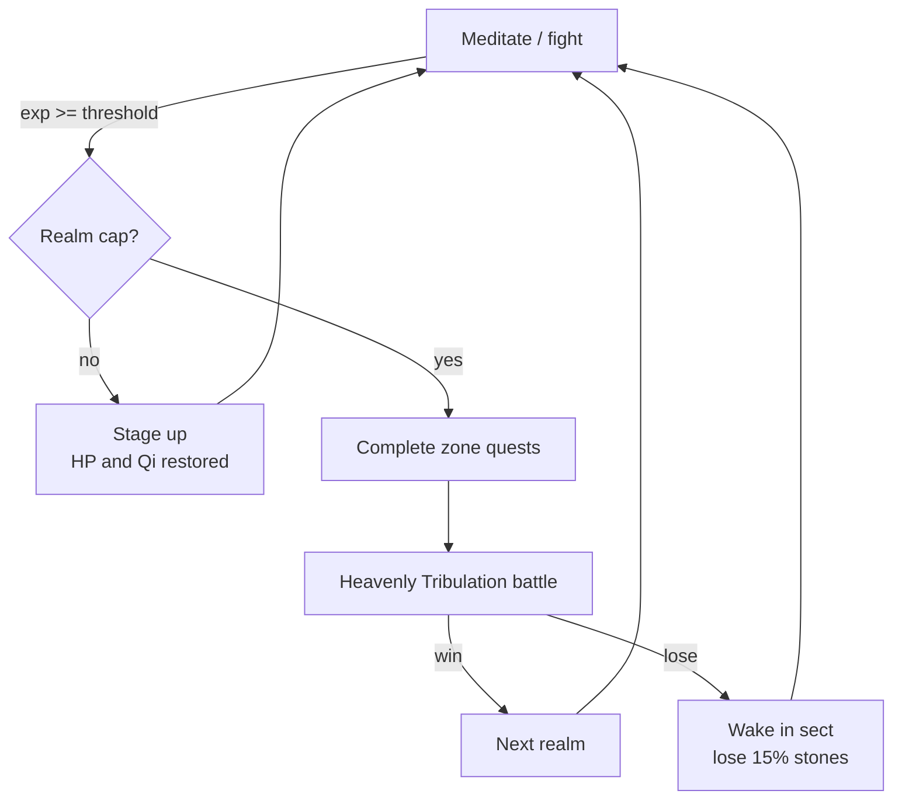

## Part III: The Hollow Heaven

After the Jade Emperor falls and Lin Feng merges with the Dao, the Heavenly Lotus Seal recalls him to the sect, where Elder Qing Xuan finally explains what the Seal is, who the Emperor was and why the sky is still cracking. Four new regions, 16 bosses, 12 monsters and five dialogue-heavy quest chains (about +1 hour) follow:

| Region | Levels | Story beat | Final boss |
|---|---|---|---|
| Mirror Lake of Echoes | 18-19 | The lake remembers the nineteen bearers before Lin Feng | Echo of Xu Mo |
| Graveyard of Sword Saints | 19-20 | The Seal's key and the founder of the sect | Founder Qing Lian |
| *Mahayana tribulation* | | | |
| River of Ten Thousand Years | 21-22 | The Emperor's origin as the first sweeper | Tian Xuan, the First Sweeper |
| Origin of the Dao | 22-23 | Yue Ling's secret and the Hollow Heaven | The Hollow Heaven |
| *True Immortal tribulation and ending* | | | |

## Part IV: The Unwritten Ledger

Lin Feng ascends as a True Immortal, but across the golden dawn someone is writing names in jade ink: the nineteen bearers, and his own. The Lotus Seal pulls him home, where everyone who ever survived a tribulation is ageing by the hour. The harvest had a bookkeeper: the Heavenly Court's **Jade Ledger**, still trying to balance its columns by collecting years from the living. Four new regions, 16 bosses, 12 monsters, five quest chains (each with a hunt, a collection and a delivery scene) and a new realm follow:

| Region | Levels | Story beat | Final boss |
|---|---|---|---|
| Sea of Clouds Archipelago | 24-25 | The Court's tollgate in the sky; a cloud-step woven from feathers | Herald of the Ledger, Qian Shu |
| Ruins of the Jade Court | 25 | A runaway scribe, four Jade Seals and the brush that wrote every name | Grand Registrar Si Ming |
| Heaven's Forge | 25-26 | Where every tribulation bolt was hammered; the brush is reforged to unwrite | Forge-Lord Tian Gong |
| Garden of Immortal Peaches | 26 | The nineteen bearers wake and remember their names | The Jade Ledger |
| *Dao Ancestor tribulation and new ending* | | | |

Part III's ending now flows into Part IV (the final ascension sets up the Ledger instead of closing the story), and the ending screen reflects the new finale.

## Part V: The Falling Sky

Lin Feng keeps his word and sweeps the steps, until stars start falling at noon. The Heavenly Court had propped up the sky with the years it harvested; with the Ledger closed, nothing holds it. Nuwa once mended the sky with stones of five colours and set four pillars beneath it. The eastern pillar still stands because the Azure Dragon King (freed in Part II) holds it up out of gratitude; the other three wardens have starved and gone wild, and at the centre Hundun, the faceless chaos from before the world, is waking. Four regions, 16 bosses, 12 monsters, five quest chains and a new realm:

| Region | Levels | Story beat | Final boss |
|---|---|---|---|
| Desert of Fallen Stars | 27 | Nomads who sing star fragments back into the sky | Bai Hu, White Tiger of the West |
| Glowcap Vale | 27-28 | A spore-witch's glowcaps rekindle a cold fire | Zhu Que, Vermilion Bird of the South |
| Aurora Steppe | 28-29 | The sky's breath, caught on the snow, wakes a frozen god | Xuan Wu, Black Tortoise of the North |
| Primordial Chaos | 29 | The First Lightning, Pangu's shadow and the Ancestor Lin Feng refused to become | Hundun, the Faceless Chaos |
| *Primordial Sovereign tribulation and new ending* | | | |

New creature types built in Blender for Part V: scorpion, mushroom folk, mammoth, lantern moth and Hundun (four wings, six legs, no face).

## The open world

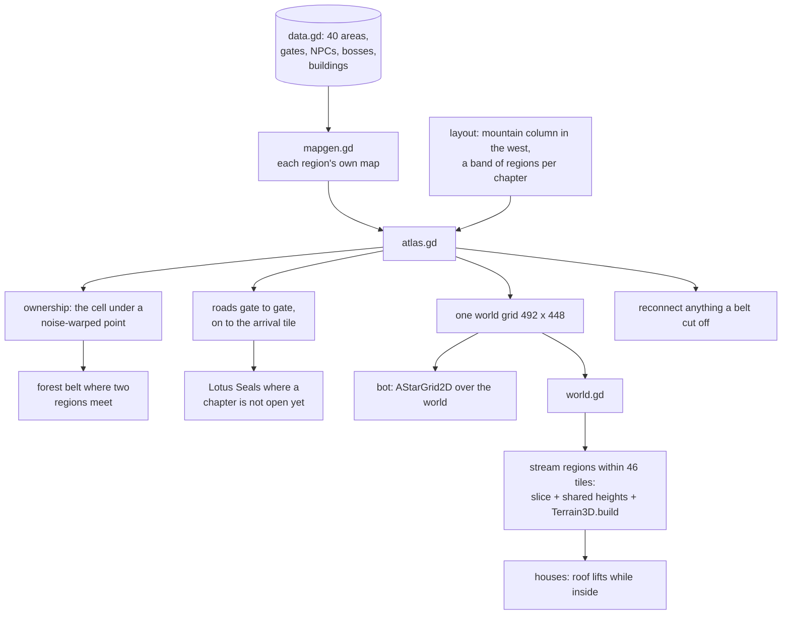

| Band (north to south) | Regions (west to east) | Entered from |
|---|---|---|
| Part IV | Sea of Clouds, Jade Court, Heaven's Forge, Peach Garden | the sect's west gate, up the mountain |
| Part I | Bamboo Forest, Crimson Marsh, Frostpeak, Thunder Valley, Blood Moon Palace | the sect's east gate |
| Part II (runs west) | Celestial Gate, Void Rift, Ashen Volcano, Sunken Dragon Palace | the road round the east edge from the Blood Moon Palace |
| Part III | Mirror Lake, Sword Graveyard, River of Ten Thousand Years, Origin of the Dao | the sect's south gate |
| Part V | Desert of Fallen Stars, Glowcap Vale, Aurora Steppe, Primordial Chaos | the south-east road |
| Part VI | Maple Gorge, Stone Forest, Yellow Springs, Wheel of the Six Paths | the south-west funeral road |
| Part VII | Qingshi Village, Cloud-Tea Terraces, Mulberry Silk Woods, Loom of Borders | the village road at the foot of the mountain |
| Part VIII | Starfall Ferry, Magpie Bridge Heights, Weaver Star Palace, Jasper Pool of Kunlun | the old Sky Road from the sect's south gate |
| Part IX | Yanggu Dawn Market, Scorched Millet Plains, Fusang Valley, Guanghan Moon Palace | the new south road |

Each region is still generated from its own seed by `mapgen.gd` (so every boss, NPC and herb keeps its place) and then stamped into the world grid by `atlas.gd`, a little higher or lower in its band so the regions do not sit on a grid. The forest then reaches in from each region's edge by a depth that varies with noise (1.5 to 8.5 tiles), keeping clearings round every gate, arrival, person, boss, pickup, building and monster pack, and anything it cuts off is reconnected by a trail that goes round buildings, so the land you can walk on is no longer a rectangle. Ownership of each tile is decided by looking up the region cell under a point warped at two scales (a few tiles of ripple on meanders of up to eight tiles, fading out at the mountain so its roads stay on it), so borders wander like coasts and ridges, and the land round what matters in a region always belongs to that region; where two regions meet the tiles become a forest-and-rock belt (it only ever adds trees, never opens a way through a region's own edge). Roads are carved from gate to gate and on through the belt to each region's arrival point; where a chapter is not open yet, a Lotus Seal entity covers the road where it crosses the region's edge. Finally anything a belt cut off is reconnected by a trail inside its own region. Tests check that every entity can be walked to, that with all seals shut only the sect, the mountain and the bamboo forest can be reached, and that the world is deterministic.

The 3D view builds a region when the player comes within 46 tiles of it: its tiles are cut out of the world grid (other regions' tiles blanked), corner heights come from one shared height field so neighbours meet without a crack, and the usual terrain, ecology, wildlife and buildings are built for it. Far regions are hidden and the furthest dropped. One skirt of hills and a ring of mountains surround the whole world.

## Part IX: The Tenth Sun

The magpie bridge holds, and the next morning the sun comes up and does not go down. The Elder tells the oldest story of all: Xihe, Mother of the Ten Suns, drove her children across the sky one a day from the Fusang tree in the Valley of Sunrise, until the morning all ten rose together and the archer Hou Yi shot nine of them down. After that the Heavenly Court drove the last sun and counted the days. With the Court gone the sun kept to its road out of habit, until something frightened it: now it hangs at noon over the scorching east, the west lies in endless night, and the embers of the nine fallen suns are waking in the ground. Only Chang'e, alone in the Moon Palace, still walks the moon round the sky, and she is tiring.

| Region | Size | Levels | Story beat | Final boss |
|---|---|---|---|---|
| Yanggu, the Dawn Market | 104 x 60 | 39 | A riverside market town where it has been noon for nine days: seven buildings you can enter, market lanes and eight townsfolk; Ah Mei the lantern-maker hangs the Noon Embers in her lanterns and sees them all lean east | Hanba, the Drought Fiend |
| The Scorched Millet Plains | 100 x 52 | 39-40 | Old Farmer Tian prays to Hou Ji for a little night; four Rain-Stones raise a cloud that cannot rain, because rain wants an evening | Bifang, the One-Legged Fire Crane |
| Fusang, the Valley of Sunrise | 88 x 64 | 40-41 | Feng Meng, Hou Yi's last apprentice, reads the fallen sun-feathers, confesses his master's murder and gives Lin Feng the tenth arrow that was never shot | Jinwu, the Three-Legged Sun Crow |
| Guanghan, the Palace of the Moon | 92 x 56 | 41 | Chang'e hears Feng Meng's apology after four thousand years; Wu Gang puts down his axe, Tiangou stops eating the moon, the Jade Rabbit finally sleeps | Xihe, Mother of the Ten Suns |
| *Sun-Moon Harmony tribulation: the sun and the moon walk the sky by agreement, not by decree* | | | | |

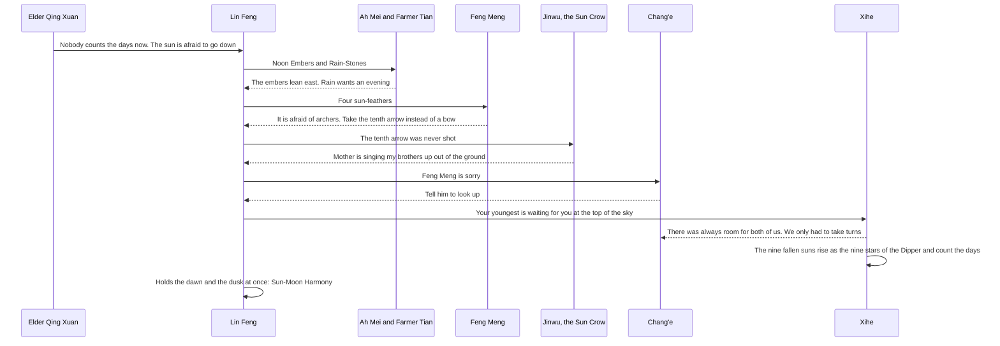

New Blender characters: Ah Mei the lantern-maker (a lit lantern and a carrying pole of unsold ones), Old Farmer Tian (straw hat, hoe, gourd and a sheaf of withered millet), Feng Meng (horn bow and quiver) and Chang'e (cloud brocade, osmanthus sprig, the Jade Rabbit in her arms). The Dawn Market's eight townsfolk have their own Blender models too (Watchman Zhou with his gong and unlit lantern, Innkeeper Bao, Tea Seller Pan, Dyer Su, Monk Huiming, Granny Gu of the granary, Porter Niu and Little Dou with his drum), and the market's buildings are shop fronts with awnings, a two-storey teahouse, a Huizhou inn and a thatched granary. New Blender creatures: `sun_crow` (Jinwu, three-legged, ringed with sun-fire), `jade_rabbit` (an upright hare with mortar and pestle) and `bifang` (the one-legged fire crane). New region looks: a market town under a white-hot noon with the sun high in the east, cracked yellow drought fields in heat haze (a new cracked-earth ground), a steaming green-gold valley under a blazing dawn round the colossal Fusang tree, and the silver-blue frost and osmanthus of the moon under a western moonlight. The ending adds the sun and the moon in the sky together, taking turns, with Xihe, Chang'e and the nine new stars of the Dipper.

## Part VIII: The River of Heaven

On the seventh night of the seventh month the whole sect climbs onto the hall roof to watch the magpies gather in the sky, as they have every year. No magpies come. Instead the Silver River across the sky spills over and stars rain into the lotus pond. The Elder tells the old story: the Weaver Star fell in love with a cowherd, and the Queen Mother of the West drew her golden hairpin across the sky to part them. That line became the River of Heaven, the oldest border there is. Qianxian bound its banks with her thread for ten thousand years, and now that she is unpicking her borders the river is pouring down the old Sky Road into the world.

| Region | Levels | Story beat | Final boss |
|---|---|---|---|
| Starfall Ferry on the Silver River | 36 | Niu Lang the Cowherd fishes drowned stars out of the flooded rice fields and reads where they fell | Qilin of the Rising Tide |
| Heights of the Magpie Bridge | 36-37 | Que Lao, the Old Magpie, calls the scattered flock home with the plumes the storm tore away | Crow Marshal of the Broken Bridge |
| Palace of the Weaver Star | 37-38 | Zhi Nu stopped weaving the river's banks to make it go away; it went down instead | Heavenly Warden of the River |
| Jasper Pool of Kunlun | 38 | Dong Shuang brings Lin Feng before the Queen Mother with four peaches of Kunlun | Xiwangmu, Queen Mother of the West |
| *Star River Crossing tribulation and the magpie bridge in the ending* | | | |

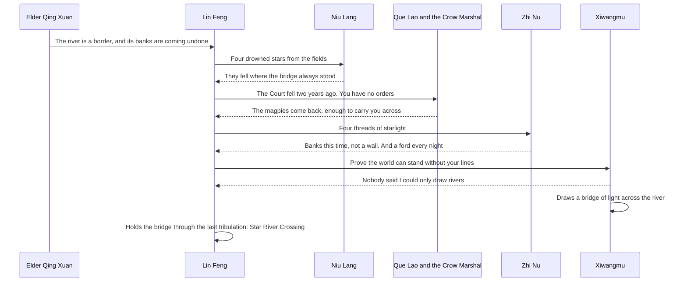

New Blender characters: Niu Lang the Cowherd (straw hat, flute, ox tether), Zhi Nu the Weaver Star (star crown, shuttle), Que Lao the Old Magpie (feather cloak) and Dong Shuang, maid of the Jasper Pool (peach branch). New creatures: the qilin, the ape, the great cat (tiger, lion, lynx), the magpie, and dedicated models for the Queen Mother, the River Warden, the Crow Marshal and nine-faced Kaiming. New region looks: flooded paddies under a sky of falling stars, wind-bent cliff pines full of magpie nests, the silver-and-lilac palace among star pillars, and the jade peach orchards around the green Jasper Pool.

## Part VII: The Unbroken Land

Spring comes, and silver threads appear across the mountain roads overnight. The Elder explains why the world was ever cut into separate realms joined by gates: the Heavenly Court's Weaver, **Madam Qianxian, Lady of a Thousand Threads**, sewed it into a quilt so that each realm could be harvested alone. When Lin Feng turned the Wheel her stitches came undone and the land grew back into one (the open world). Now she is sewing the mortal lands shut again, and spinning the newly reborn into thread, Little Wan among them.

| Region | Levels | Story beat | Final boss |
|---|---|---|---|
| Qingshi Village Below the Mountain | 33 | Granny Wen, the midwife who raised Lin Feng, reads the stolen threads in her own house | Needle General Zhen |
| Cloud-Tea Terraces | 33-34 | Tea Master Lu Yu brews tea that wakes thread-sleepers, and Yue Ling finds she was being sewn too | Thread Matron of the Hills |
| Mulberry Silk Woods | 34 | Can Niang unwinds soul-cocoons and frees four children's souls | Thousand Hands of the Spinning Hall |
| Loom of Borders | 35 | Zhi, the last weaver-girl, helps take the shuttles out of the Loom | Madam Qianxian, Lady of a Thousand Threads |
| *Boundless Heart tribulation and new ending* | | | |

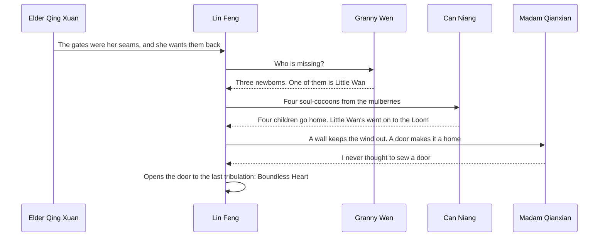

New characters (Blender scripts in `art/characters`): Granny Wen, Innkeeper Fu, Weaver Liu, Tea Master Lu Yu, Can Niang, Zhi and Archivist Lan of the sect's new library. New region looks: rice paddies and village lanes, steep green tea terraces in river mist, sunlit mulberry woods and the lilac marble floor of the Loom under a gold-and-violet sky.

## Part VI: The Turning Wheel

The sky holds, but on the night of the Ghost Festival the lanterns on the lotus pond gather at the sect's south-west gate, and the dead stand among them in a queue that no longer moves. The Heavenly Court did not only prop up the sky with stolen years; it also turned the Wheel of Rebirth, letting souls back up only when the Ledger allowed. With the Court gone the Wheel has stopped, and the overflow of the dead is walking back up the old funeral road. The Elder finally tells Lin Feng where he found him: under a maple in that gorge, beside two nameless graves.

| Region | Levels | Story beat | Final boss |
|---|---|---|---|
| Maple Gorge of Returning Souls | 30 | A lantern monk, lost soul lanterns, and the nameless graves | Ox-Head, Runner of the Ten Courts |
| Stone Forest of the Nine Bends | 30-31 | A cormorant fisher dives for dropped memories; one is a lullaby Lin Feng thought he invented | Horse-Face, Runner of the Ten Courts |
| Yellow Springs of Red Lilies | 31 | Meng Po brews a gentler soup that lets each soul keep one thing; Lin Feng meets his parents | The Thousand Unforgotten |
| Wheel of the Six Paths | 31-32 | Judge Cui mends the spokes; King Yama stopped the Wheel to spare souls a cruel world | King Yama, Lord of the Wheel |
| *Samsara Transcendence tribulation and new ending* | | | |

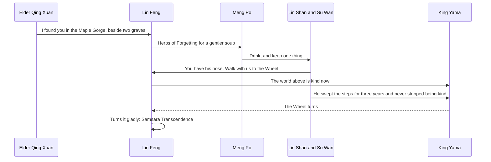

New Blender creatures for Part VI: the nine-tailed fox, the koi carp, Ox-Head, Horse-Face and the hopping corpse (jiangshi). New characters: Lantern Monk Jing Kong, Cormorant Fisher Old Yu, Meng Po, Judge Cui Jue, and Lin Feng's parents Lin Shan and Su Wan. New region looks: autumn leaf-litter ground and falling maple leaves, limestone towers above the river, fields of spider lilies under a golden spring, and the blue ghost-fire flagstones of the Ten Courts, with the Naihe Bridge and the great Wheel on the horizon.

## Bugs found and fixed

| Bug | Fix |
|---|---|
| **Every exported clip ran a quarter too slow.** `kit.bake_action` keys a pose every 1/30 s on consecutive frames, but Blender's factory scene runs at 24 frames per second, so a 0.55 s attack lasted 0.69 s and every walk dragged | The scene runs at 30 fps and clips start at 0 s (`kit.reset`, `kit.export`), so loops meet their first frame |
| **Characters walked like pacing camels**: in the walk clip `thigh.L` and `upper_arm.L` were driven by the same `sin(phase)` with the same sign, so each arm swung forward with the leg on its own side | Arms counter-swing, a few frames behind the legs |
| **The hero slid along the road**: he crosses a 2 m tile every 0.16 s (12.5 m/s) on a walk cycle of 0.7 s per stride | A run clip with a flight phase for the hero and Yue Ling |
| **Monsters never moved** in the world: only `idle` was ever played | Packs amble round their spot on walk cycles and turn to face the hero |
| **Fallen fighters shrank away in half a second** | A death clip that holds its last frame; fallen allies stay on the field until raised |
| **Every pond was a set of white-rimmed squares**: corners touching water were forced under the surface and the foam marked every corner that touched land, so shorelines were staircases outlined in white | A smooth water field for shore heights, subdivided shore tiles, foam by real depth |
| **Costumes glowed neon**: ambient light (0.85) plus the sun (1.1) plus a fill light lit every surface at about twice its colour | Actor shading with a reduced ambient term and a key light that keeps a lit surface near its painted colour |
| A white stripe of inner robe ran **from the collar to the hem like an apron**, and the collar stood up the neck like a turtleneck | A wrap-around skirt with a trimmed overlap edge; a V at the throat |
| **Part VIII's four guides were drawn as procedural stand-ins**: `_npc_opts` had no entry for them | Each uses its Blender model; any NPC with a Blender model uses it |
| The bot's ten-hour `max_time` would have stopped a ten-hour game before its end | Twelve hours |

### Bugs fixed in the Part VIII release

| Bug | Fix |
|---|---|
| **The ending screen was hidden behind a giant tree trunk.** The six floating islands were spread round a full circle (`i * 1.1 + 0.4`), which put one peach-tree island at z = 5, between the camera and the hero | The islands sit on the far half of the sky only |
| **Lotus of Rebirth and Homeward Lantern could not raise the fallen**: the heal only targeted living allies, so a knocked-out Lin Feng stayed down; the bot never tried | Reviving heals (`"revive": true`) reach the fallen and raise them; the bot uses them when an ally is down; regression test |
| Lions, tigers, lynxes, apes, macaques and qilin (**11 enemies**, including the White Tiger boss) were drawn with the **wolf** model | New tiger, ape and qilin models; enemies remapped |
| **Character heads were almost half a metre tall** (two stacked ellipsoids, under five heads to the body) with eyes stuck onto the surface | Sculpted heads at about seven heads to the body, eyes set into sockets |
| Hanging sleeves were **inside out** (black) when a loft's cross-sections ran clockwise | `loft()` detects the winding and flips faces so normals point out; linings are built inside on purpose |
| The post-processing rect set a `size` on top of full-rect anchors, printing a warning on every launch | The anchors size it |
| A defeat message was guarded by `if not quiet or true` (always true) | Removed the dead condition |
| `plate_segments` crashed on per-axis radii; `bake_ao` created an unused random generator | Componentwise radii; removed |
| Exported assets were only checked by playing the game | `art/check_assets.py` validates every GLB in CI |

### Bugs fixed in the open-world release

| Bug | Fix |
|---|---|
| The pause-menu **techniques list ran off the right of the panel** once Lin Feng knew more than 21 techniques (three columns of seven) | Four narrower columns of seven |
| The sect's **pagoda stood outside the map** past the east wall, on land the hero could walk across in an open world | It stands on its own blocked footprint on the mountain |
| Map **connection trails were straight L-shaped corridors** cut through forests, the most "squarish" thing in every region | Trails wander on the diagonal (`MapGen._carve`) |
| **Monster groups could spawn inside buildings**, and a trail carved to an indoor NPC could break through a wall | Spawns skip floors under a roof; trails to anything indoors go to the doorstep; clearing round NPCs never removes a wall |
| **Hunt kills were credited to the region the player stood in**, not the one the monsters came from, so a fight just across a border would not count | Kills are credited to the monsters' own region; enemy ids carry their region |
| The water surface stopped at the **square edge of each water tile** | The water plane runs on under the bank, so the shoreline follows the ground |
| The bot's **breadth-first search** would have been far too slow over a whole world | `AStarGrid2D` for routes, a capped search for nearby monsters |

### Bugs fixed in the landscapes release

| Bug | Fix |
|---|---|
| **Every pond, lake and river was invisible.** The far-ground "skirt" that extends the land to the horizon also lay flat across the whole map at y = -0.05, above the water surface (-0.12), covering it with a sheet of grass | Inside the map the skirt now drops below the deepest pond bed |
| **The image looked misty and slightly blurred**: no anti-aliasing; a bloom with a 0.62 threshold added a blurred copy of most of the frame; a soft-light glow; heavy fog with aerial perspective; film grain and chromatic aberration | 4x MSAA; bloom and glow only on bright highlights; fog at 30% density without aerial perspective; grain and fringing removed |
| The bot could **walk back and forth forever** between two tiles when two monster groups were about equally far away (the "nearest" target swapped with every step); the 45-minute stuck detector would have failed CI | The current target is kept unless another is clearly closer |
| Large trees beside the road could **hide the hero** from the chase camera | Foliage within a few metres of the camera dissolves in a dither pattern |
| Rotated boxes in the mesh builder are scaled along world axes, so rotated walls stretched off the map | Architecture uses axis-aligned extents (documented in `architecture.gd`) |
| The toon ink outline had a fixed model-space width: **thick in close-ups**, thin far away | Outline width scales with view depth |
| `ribbon`/`sheet` in the Blender kit returned nothing, and `recolor` erased the outline-skip flag of thin sheets | Both return their vertices; recolouring keeps the surface flag |

### Bugs fixed in the Part V release


| Bug | Fix |
|---|---|
| The bot's path-finding treated **portal tiles as walkable**, so a path that brushed past another gate teleported it (it bounced between the sect and the forest forever once a second road ran past the east gate) | Gates other than the goal block the path |
| The bot healed with Dawn Lotus at best and **never used Seal Bloom** | It picks the strongest heal Yue Ling knows |
| **Battle menus had no scrolling**: the late-game technique list (up to 17 entries) ran off the bottom of the screen and the cursor moved onto invisible entries | `UI.menu_list` scrolls with the cursor and shows scroll hints |
| The pause-menu **techniques list** overflowed its two columns of eight | Three columns of seven |
| The **HP and Qi bars** in the world HUD and on the meditation screen covered the numbers once they reached four digits | Bars moved clear of the text |
| **Long boss names** were clipped under their health bars, and party names were drawn underneath the translucent command panels | Wider labels for bosses; party labels removed (the status panel shows them) |
| **Long speaker names** ("Xuan Wu, Black Tortoise of the North") overflowed the dialogue name tag | The tag grows with the name |
| A conversation with **no lines** opened an empty dialogue box that Enter could never close | `say([])` runs its callback directly |
| Starting a **second game** from the title kept the previous run's toasts and NPC chat rotation | Reset in `new_game()` |
| A script error made `tests/run_tests.gd` **hang until CI's 40-minute timeout** instead of failing | A watchdog fails the run on the first frame; the smoke test has a frame limit |

### Bugs fixed in earlier releases

| Bug | Fix |
|---|---|
| Two identical foes (same species, level and HP) were drawn **on top of each other** in battle: `Array.find()` compares dictionaries by value, so both resolved to the same stage slot | Each foe gets an explicit `slot` (`Data.make_foes`); regression test added |
| The sect's **east gate** faced the wrong way (rotation only applied to `x > 40`, but the sect is 40 tiles wide) | Orientation is computed from the map edges |
| Cancelling **Yue Ling's basic attack** target selection opened the Skills menu instead of the main menu | Both basic attacks (`strike`, `needle`) return to the main menu |
| Using a pill from the pause menu at **full HP or Qi** silently wasted it | The pill is kept and a message is shown |
| The **techniques list** in the pause menu overflowed the panel once more than 12 techniques were known | Two columns of eight |
| The **Jade Mantis Matriarch** was drawn as a wolf and the **Eon Tortoise** as a crab | New mantis and tortoise models |
| The bot's default `--max-time` (4 h) would have cut off a longer game | Raised to 6 h |

## Narrative plot holes found and fixed

| Plot hole | Fix |
|---|---|
| Why did every forest, marsh and desert have **a gate in it**, and why does the world now run on without them? | Part VII: the gates were the Court Weaver's seams; when the Wheel turned they came undone and the land grew back into one |
| The **village midwife** who raised Lin Feng (Part VI) was never seen | Granny Wen is Part VII's first guide, in her own house |
| The finale's **baby girl who knows Lin Feng's face** was left unexplained | Part VII: she is Little Wan, Su Wan reborn; the story turns on bringing her home |

### Plot holes fixed in the previous release

| Plot hole | Fix |
|---|---|
| Lin Feng is "an orphaned sect sweeper", but **his parents were never mentioned again** in five parts | Part VI: the Elder found him as a baby beside two nameless graves; his parents, Lin Shan and Su Wan, hid him from Xu Mo's hunters, refused Meng Po's soup for sixteen years to wait for him, and walk on to rebirth in the finale |
| If the Elder found him as a baby, why has he only **swept the steps for three years**? | The Elder left him with the village midwife below the mountain, where no hunter would look for a bearer; he climbed the steps at thirteen |
| Yue Ling "woke beside a lotus pond **three winters ago**", the same winter Lin Feng arrived, with no reason given | The Seal woke her when the bearer came up the mountain |
| The Court's harvest held up the sky (Part V), but **death and rebirth**, which every soul passes through, were never addressed | Part VI: the Court also turned the Wheel of Rebirth; with the Ledger closed it stopped |

### Plot holes fixed in earlier releases


| Plot hole | Fix |
|---|---|
| The Elder asks for **three** Frost Jades but the quest needs four | Elder now says four |
| The **Heaven-Cleaving Sword** was usable from Early Nascent Soul, before Ancestor Jian Wuchen teaches it | Technique is gated on beating the Thunder Roc (`after` field) and covered by a test |
| The Elder demands the **Roc's feather** that the player is never given | The Roc now drops a feather item, mentioned in dialogue |
| The Dragon King gives a **pearl "as proof"** that never exists, and greets Lin Feng as if they had met ("how you have grown") | He gives a Dragon King's Scale which Sage Huo Rong recognises; the greeting no longer implies a past meeting |
| Sage **Chi Rong** and the villain **Chi Yan** shared a surname with no relation | Sage renamed Huo Rong |
| Xu Mo "hunted you for **three centuries**" although Lin Feng is a teenager | Reframed as hunting the *root's* bearers, and resolved by Part III (Lin Feng is the twentieth bearer) |
| Marsh Hag called Lin Feng the **seal's bearer**; everyone else says root bearer | Unified to "bearer of the Nine Heavens root" |
| Iron Fang jeers at a **"sweeper boy"** he could not know about | Now a "sect boy" |
| The **Jade Mantis** hunt had no in-story motivation | The Elder's briefing mentions the mantis claiming the herb groves |
| Alchemist says "take these pills" but gives none | Now "take this payment" |
| Yue Ling's origin (a random healer who happens to be bound nearby) had no foreshadowing | She wakes beside a lotus pond three winters ago; paid off in Part III |
| Sage Huo Rong lists three fire bosses but there are four; the hermit says "three who shepherd" the horrors but there are four; the Gatekeeper lists the wrong guardians | Counts and lists corrected |
| Quest items (pearls, embers, star fragments) were collected and never used | Each is now referenced in the following dialogue |
| The **sect storyline was abandoned**: the failing Seal, the Elder and Xu Mo's army were never resolved and the game ended in a distant gate | Part III returns Lin Feng to the sect and resolves the Seal, the Elder, Yue Ling and the Emperor |

## Architecture

Game logic (`game.gd`, `data.gd`, `mapgen.gd`, the battle rules and the bot) is unchanged by the 3D port; only the presentation layer is new. Screens derive from `ScreenBase` (`screen.gd`): each owns an optional `Node3D` scene plus a 2D overlay drawn with the UI helpers.


Highlights of the renderer: merged vertex-coloured meshes (a few draw calls per chunk) whose vertex alpha selects a procedural surface texture in the toon shader, an inverted-hull ink outline (skipped for thin double-sided geometry), MultiMesh instancing for landmarks, boulders, decorations and grass, a height-field terrain with a per-region ground shader, animated water/lava with foam, a sky shader per region, two-layer weather (snow, rain, petals, embers, bubbles, void stars, sand, clouds, lanterns, sparks, plus fireflies, pollen, ash or haze), rigged characters and monsters, and element-specific spell effects.

The screenshot tour also renders model galleries (`--gallery`).

Regenerate screenshots (needs a GL context; use `xvfb-run` on a server):

```sh
godot --path . --fixed-fps 30 -- --tour=docs/screenshots              # everything
godot --path . --fixed-fps 30 -- --tour=out --areas=mirror,grave --no-extras   # some regions
godot --path . --fixed-fps 30 -- --tour=out --areas=garden --no-extras --gallery  # one region + model galleries
godot --path . --fixed-fps 30 -- --tour=out --areas=maple --no-extras --world-only --vista  # ground and aerial views
godot --path . --fixed-fps 30 -- --tour=out --areas=none --no-extras --portraits  # character close-ups
```

## The playthrough bot

`scripts/bot.gd` plays the entire game end to end through the **same input surface a human uses** (`up/down/confirm/cancel` presses on the top screen and a held movement direction). It pathfinds across the open world with `AStarGrid2D` (seals still closed and other monsters count as blocked), grinds and meditates when under-levelled, rests when hurt, shops, picks skills by elemental weakness, heals with pills or Spring Rain, and handles tribulations.

To make its clock a fair estimate of a person's playtime it uses human-scale pacing: 0.2 to 0.4 s per key press, and each dialogue line is "read" for about `length / 40` seconds after it finishes typing.

```sh
godot --headless --fixed-fps 30 --path . -- --bot --seed=1234 --report=build/bot_report.json
```

**Is the game sped up?** No. `--fixed-fps 30` makes each frame advance the game clock by exactly 1/30 s regardless of how fast the machine renders it. All movement, typing, battle animation and meditation run off that same frame time, so a full hour of *game time* is simulated in under a minute of *wall-clock* time. `Game.playtime` is the game clock, and it is the number reported. Drop `--fixed-fps` (and optionally pass `--timescale=N`) to watch the bot in real time.

Latest result (seed 1234, identical across runs). Parts I to VII take 7:46:52, so Part VIII adds about **1 hour 11 minutes**:

```
game play time  : 8:57:35 (32255 s)
wall clock      : ~7 min (headless)
final realm     : Early Star River Crossing
battles / kills : 1019 / 1915   deaths: 0
time by screen  : battle 13596 s, meditate 8564 s, world 5327 s, dialogue 4591 s
time by area    : sect 1008, mountain 218,
                  bamboo 880, marsh 655, frost 1073, thunder 514, palace 556,
                  dragon 638, volcano 1039, void 719, celestial 1447,
                  mirror 568, grave 986, time 706, origin 1246,
                  cloudsea 815, court 808, forge 915, garden 1390,
                  dunes 853, fungal 795, aurora 879, chaos 1517,
                  maple 985, karst 967, springs 971, wheel 1133,
                  village 850, terraces 975, silk 937, loom 1159,
                  starferry 952, magpie 954, starpalace 945, jasper 1243
result          : PASS (needs >= 28800 s)
```

Bot flags: `--bot`, `--seed=N`, `--report=PATH`, `--min-time=SECONDS` (default 3600; CI uses 32400), `--max-time=SECONDS`, `--timescale=N`, `--shots=DIR` (needs a window, saves screenshots at key moments), and `--tour=DIR` (screenshot tour, see Architecture), and for development `--bot-start=STEP_ID` (start a fresh game at a quest step with the level and boss kills a player would have) and `--bot-trace=SECONDS` (print the bot state every frame after that game time).

## CI

[`.github/workflows/ci.yml`](.github/workflows/ci.yml) downloads Godot, imports the project, runs the data-integrity tests (`tests/run_tests.gd`: quest/dialogue/NPC/boss references, gate symmetry, map reachability and determinism, the open world (everything reachable, seals closing every unopened region, determinism), every building's walls and door, every 3D model and terrain builds, story consistency), then runs the bot headless and **fails the build if the game is not completed or takes less than nine hours of game time**. A second job installs Blender as a Python module, rebuilds every asset in `art/` from its script and validates the exports with `art/check_assets.py`. The bot report is uploaded as an artifact and shown in the job summary.

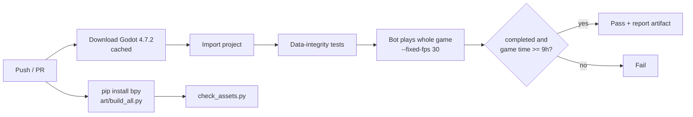

## Project layout

```
scripts/data.gd      content: skills, enemies, areas, quest chain, dialogue
scripts/mb.gd        mesh builder (primitives to merged ArrayMesh)
scripts/models.gd    3D people, monsters, props
scripts/terrain3d.gd 3D terrain, landmarks, buildings
scripts/look.gd      per-region look (sky, fog, light, weather)
scripts/fx3d.gd      weather, combat particles and technique effects
scripts/assets.gd    loader for the Blender assets (materials, tint, animation clips)
scripts/post.gd      screen-space post-processing pass
scripts/nature.gd    painted leaf textures, foliage-card and grass shaders
scripts/flora.gd     procedural plant species grown in variants
scripts/scatter.gd   ecology: where every plant, rock and dwelling goes
scripts/rocks.gd     procedural rocks and limestone towers
scripts/fauna.gd     ambient wildlife
scripts/architecture.gd  halls, roofs, walls, archways, bridges, dwellings
art/lib/kit.py       Blender (bpy) toolkit: geometry, skinning, AO, rigs, clips, export
art/lib/person.py    character builder shared by every person asset
art/lib/face.py, hair.py, garment.py, accessory.py   heads, hair, clothes, hand props
art/lib/sculpt.py    lofts, profiles, noise, splines, strands
art/lib/clay.py      metaball sculpting with bone weights (creature bodies)
art/lib/anatomy.py   animal heads, bodies, legs, fur, feathers, scales; canine.py, feline.py, bird.py
art/lib/creature.py  monster rigs, leg IK, gaits and the shared motion clips
art/check_assets.py  validator for the exported GLBs
art/characters, art/monsters, art/props   one Blender script per asset
art/build_all.py     rebuild every asset
assets/              generated .glb files (never edited by hand)
scripts/screen.gd    ScreenBase: 3D scene + 2D overlay
scripts/gfx.gd       2D UI ornaments, panels, minimap
scripts/tour.gd      screenshot tour (developer tool)
scripts/game.gd      autoload: state, progression, quest engine, play clock
scripts/main.gd      screen stack, input, story flow
scripts/world.gd     3D third-person open world: streaming, movement, interiors, HUD
scripts/atlas.gd     the open world: layout, ownership, borders, roads, seals
scripts/mapgen.gd    seeded map generator with reachability guarantee
scripts/battle.gd    turn-based combat on a 3D stage
scripts/bot.gd       end-to-end playthrough bot
tests/run_tests.gd   data-integrity tests
```
